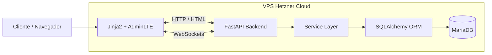
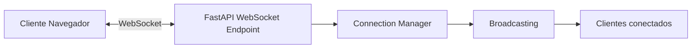
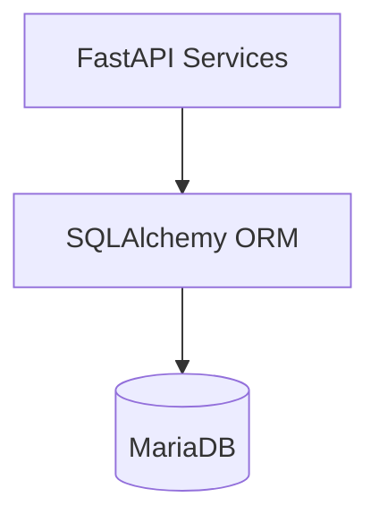
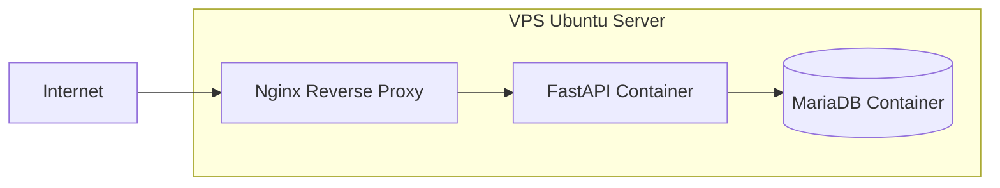

# 03_ARCHITECTURE.md

# 🏗️ Aula Robótica Platform — Arquitectura del Sistema

---

# 📌 Introducción

Aula Robótica Platform utiliza una arquitectura backend moderna orientada a:

* modularidad,
* mantenibilidad,
* seguridad,
* colaboración realtime,
* y despliegue cloud multicontenedor.

La arquitectura evolucionó progresivamente desde un sistema académico inicial hacia una plataforma backend preparada para escenarios colaborativos y despliegues productivos-like.

El diseño arquitectónico prioriza:

* separación de responsabilidades,
* backend-first architecture,
* renderizado SSR,
* sincronización realtime,
* y aproximación cloud-native.

---

# 🎯 Objetivos Arquitectónicos

La arquitectura fue diseñada para cumplir varios objetivos fundamentales.

---

# Objetivos funcionales

* colaboración multiusuario,
* sincronización realtime,
* trazabilidad,
* gestión IAM avanzada,
* dashboards administrativos,
* auditoría de acciones,
* coordinación de proyectos.

---

# Objetivos técnicos

* arquitectura modular,
* mantenibilidad,
* escalabilidad progresiva,
* seguridad backend-centralizada,
* despliegue reproducible,
* separación frontend/backend,
* integración DevOps,
* infraestructura cloud-ready.

---

# 🧠 Filosofía Arquitectónica

La plataforma sigue varios principios arquitectónicos fundamentales.

---

# 1. Backend-first Architecture

Toda la lógica crítica reside en backend:

* permisos,
* validaciones,
* autenticación,
* autorización,
* auditoría,
* realtime,
* ownership,
* sincronización.

El cliente actúa como capa ligera de interacción.

---

# 2. SSR-first Rendering

La plataforma utiliza renderizado server-side mediante:

* FastAPI,
* Jinja2,
* AdminLTE.

Este enfoque permite:

* simplicidad arquitectónica,
* menor complejidad frontend,
* renderizado contextual,
* integración backend más directa,
* mayor mantenibilidad.

La arquitectura queda preparada para futura evolución SPA desacoplada.

---

# 3. Arquitectura Modular

El backend se organiza mediante dominios funcionales independientes.

Cada módulo encapsula:

* routers,
* servicios,
* modelos,
* templates,
* validaciones,
* lógica JavaScript,
* permisos,
* realtime.

---

# 4. Realtime Collaboration

La sincronización multiusuario constituye una característica central del sistema.

La plataforma implementa:

* WebSockets persistentes,
* broadcasting,
* sincronización instantánea,
* actualización dinámica UI.

---

# 5. Cloud-ready Deployment

La arquitectura evolucionó hacia un despliegue real basado en:

* Docker,
* Docker Compose,
* Nginx,
* VPS Linux,
* MariaDB persistente,
* reverse proxy,
* infraestructura multicontenedor.

---

# 🏗️ Arquitectura General del Sistema

La plataforma se organiza en varias capas desacopladas.

---

# Capas principales

| Capa                 | Responsabilidad         |
| -------------------- | ----------------------- |
| Frontend SSR         | Interfaz usuario        |
| Backend FastAPI      | APIs y lógica negocio   |
| Service Layer        | Reglas negocio          |
| ORM Layer            | Persistencia SQLAlchemy |
| Database Layer       | MariaDB                 |
| Realtime Layer       | WebSockets              |
| Infrastructure Layer | Docker + Nginx + VPS    |

---

# Diagrama General Arquitectura

---

# 🖥️ Arquitectura Frontend SSR

La interfaz utiliza renderizado server-side.

---

# Tecnologías frontend

* Jinja2
* AdminLTE
* Bootstrap
* JavaScript modular
* Chart.js

---

# Responsabilidades frontend

* renderizado visual,
* formularios,
* tablas,
* dashboards,
* interacción usuario,
* eventos realtime,
* consumo WebSockets.

---

# Ventajas arquitectura SSR

* menor complejidad frontend,
* renderizado backend-centralizado,
* integración permisos,
* simplicidad mantenimiento,
* SEO y renderizado inmediato,
* menor sobrecarga cliente.

---

# 🐍 Arquitectura Backend

FastAPI constituye el núcleo principal del backend.

---

# Responsabilidades backend

* APIs REST,
* renderizado SSR,
* autenticación,
* autorización,
* validaciones,
* WebSockets,
* auditoría,
* lógica negocio.

---

# Arquitectura interna backend

El backend sigue separación por capas:

| Capa             | Responsabilidad  |
| ---------------- | ---------------- |
| Router Layer     | endpoints HTTP   |
| Service Layer    | lógica negocio   |
| ORM Layer        | persistencia     |
| Middleware Layer | auth y seguridad |
| Realtime Layer   | WebSockets       |

---

# Organización Modular

El sistema se organiza por dominios funcionales.

---

# Principales módulos

| Módulo        | Responsabilidad  |
| ------------- | ---------------- |
| auth          | autenticación    |
| users         | usuarios         |
| identities    | identidades      |
| roles         | roles y permisos |
| projects      | proyectos        |
| tasks         | tareas           |
| activities    | actividades      |
| notifications | notificaciones   |
| dashboard     | métricas         |
| audit         | auditoría        |
| websocket     | realtime         |

---

# Beneficios modularidad

* mantenibilidad,
* separación responsabilidades,
* reutilización,
* testing desacoplado,
* escalabilidad progresiva,
* menor acoplamiento.

---

# ⚡ Arquitectura Realtime

El sistema incorpora colaboración multiusuario realtime mediante WebSockets.

---

# Modelo realtime

La plataforma mantiene conexiones persistentes entre:

* navegador cliente,
* FastAPI,
* connection managers.

---

# Funcionalidades realtime implementadas

* Kanban colaborativo,
* actividad reciente,
* notificaciones,
* usuarios conectados,
* sincronización dashboard,
* actualización instantánea.

---

# Arquitectura WebSocket

---

# Connection Managers

Los connection managers gestionan:

* conexiones activas,
* rooms,
* broadcasting,
* sincronización proyectos,
* desconexiones,
* usuarios conectados.

---

# 🗄️ Arquitectura Persistencia

La persistencia se implementa mediante MariaDB y SQLAlchemy.

---

# MariaDB

## Responsabilidades

* almacenamiento relacional,
* integridad datos,
* persistencia proyectos,
* usuarios,
* auditoría,
* tareas,
* actividades.

---

# SQLAlchemy ORM

## Responsabilidades

* modelos ORM,
* relaciones,
* queries,
* persistencia desacoplada,
* abstracción SQL.

---

# Arquitectura Persistencia

---

# 🔐 Arquitectura Seguridad

La seguridad constituye una capa transversal del sistema.

---

# Autenticación

La plataforma utiliza:

* JWT,
* cookies HTTPOnly,
* middleware validación,
* sesiones stateless.

---

# Autorización

El sistema combina:

* RBAC,
* permisos contextuales,
* ownership,
* validaciones backend.

---

# Arquitectura IAM

La arquitectura IAM desacopla:

* usuarios,
* identidades,
* roles,
* permisos,
* proveedores autenticación.

Esto prepara la plataforma para:

* OAuth2,
* SAML,
* SSO institucional.

---

# Middleware Seguridad

Los middlewares gestionan:

* validación sesión,
* autenticación,
* autorización,
* permisos,
* protección rutas.

---

# ☁️ Arquitectura Cloud y DevOps

La plataforma evolucionó hacia una infraestructura desplegada sobre Linux real.

---

# Infraestructura actual

| Elemento          | Tecnología          |
| ----------------- | ------------------- |
| Cloud Provider    | Hetzner Cloud       |
| Sistema operativo | Ubuntu Server 24.04 |
| Reverse Proxy     | Nginx               |
| Backend           | FastAPI             |
| Persistencia      | MariaDB             |
| Orquestación      | Docker Compose      |

---

# Arquitectura Multicontenedor

La infraestructura separa:

* API backend,
* base de datos,
* reverse proxy.

---

# Diagrama infraestructura desplegada

---

# Reverse Proxy

Nginx gestiona:

* entrada HTTP,
* forwarding backend,
* proxy WebSocket,
* headers,
* aislamiento infraestructura,
* futura integración HTTPS.

---

# Persistencia Docker

Docker volumes permiten persistencia de:

* MariaDB,
* uploads,
* logs,
* backups.

---

# Seguridad Infraestructura

Actualmente se implementan:

* acceso SSH mediante claves,
* root deshabilitado,
* firewall,
* aislamiento Docker,
* backend oculto tras reverse proxy.

---

# 🧪 Arquitectura Testing y Calidad

La calidad software forma parte de la arquitectura global.

---

# Testing

La plataforma utiliza:

* pytest,
* tests servicios,
* tests repositorios,
* tests API,
* validación despliegue,
* validación WebSockets.

---

# Calidad código

Se utilizan:

* Ruff,
* SonarCloud,
* coverage,
* linting,
* quality gates.

---

# CI/CD

GitHub Actions automatiza:

* testing,
* coverage,
* análisis calidad,
* validación pipeline.

---

# 📈 Estado Arquitectónico Actual

Actualmente el sistema dispone de:

✅ Arquitectura modular funcional
✅ Realtime multiusuario operativo
✅ IAM avanzado operativo
✅ Docker deployment operativo
✅ Reverse proxy funcional
✅ Persistencia validada
✅ VPS Linux operativo
✅ WebSockets operativos
✅ Arquitectura multicontenedor funcional

---

# 🔮 Evolución Arquitectónica Futura

La arquitectura actual deja preparada la plataforma para:

* HTTPS completo,
* SAML institucional,
* frontend SPA desacoplado,
* observabilidad avanzada,
* monitorización,
* Kubernetes,
* escalabilidad horizontal,
* evolución cloud-native.

---

# 📌 Conclusión

La arquitectura de Aula Robótica Platform evolucionó desde una aplicación académica tradicional hacia una plataforma backend colaborativa moderna capaz de integrar:

* modularidad,
* realtime,
* IAM avanzado,
* WebSockets,
* Docker,
* despliegue cloud,
* DevOps,
* reverse proxy,
* auditoría,
* colaboración multiusuario.

La combinación de arquitectura modular, SSR, infraestructura Docker y sincronización realtime aproxima el sistema a arquitecturas utilizadas en entornos profesionales reales.
