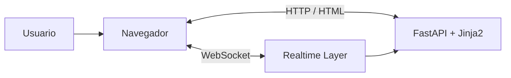
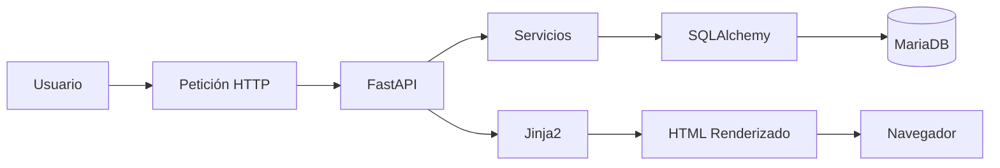
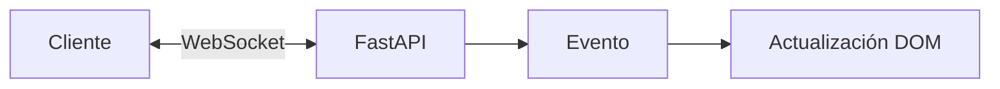

## 04_FRONTEND_ARCHITECTURE.md

# 🖥️ Aula Robótica Platform — Arquitectura Frontend

---

# 📌 Introducción

La interfaz de usuario de Aula Robótica Platform se diseñó siguiendo una estrategia **SSR-first (Server Side Rendering)** basada en FastAPI, Jinja2 y AdminLTE.

A diferencia de las arquitecturas SPA tradicionales, donde gran parte de la lógica se ejecuta en cliente, el proyecto adopta una aproximación centrada en el backend, permitiendo:

* mayor simplicidad arquitectónica,
* integración natural con permisos y autenticación,
* menor complejidad frontend,
* renderizado contextual,
* mejor mantenibilidad,
* y rápida evolución funcional.

La arquitectura frontend se complementa además con capacidades realtime mediante WebSockets, proporcionando una experiencia dinámica sin renunciar a las ventajas del renderizado server-side.

---

# 🎯 Objetivos del Frontend

La arquitectura frontend fue diseñada para cumplir varios objetivos.

---

## Objetivos funcionales

* interfaz intuitiva,
* navegación sencilla,
* visualización eficiente de información,
* soporte multiusuario,
* dashboards operativos,
* experiencia colaborativa.

---

## Objetivos técnicos

* integración backend-first,
* reutilización componentes,
* renderizado contextual,
* soporte realtime,
* mantenibilidad,
* responsive design,
* escalabilidad progresiva.

---

# 👥 Principios de Experiencia de Usuario (UX)

El diseño de la interfaz se ha desarrollado siguiendo criterios de simplicidad, coherencia y eficiencia operativa.

Las decisiones de diseño persiguen minimizar la carga cognitiva del usuario mediante:

- navegación consistente,
- reducción del número de clics,
- organización lógica de la información,
- feedback inmediato ante acciones,
- reutilización de componentes visuales,
- consistencia entre módulos.

La interfaz prioriza la productividad frente a elementos puramente decorativos, siguiendo una estética propia de aplicaciones empresariales y paneles de administración modernos.

---

# 🧠 Filosofía Arquitectónica

La interfaz sigue varios principios fundamentales.

---

## 1. SSR-first

La generación principal de contenido se realiza en servidor mediante Jinja2.

El servidor entrega al navegador:

* HTML renderizado,
* menús dinámicos,
* permisos contextualizados,
* datos iniciales.

Esto reduce significativamente la complejidad cliente.

---

## 2. Frontend ligero

La lógica de negocio permanece en backend.

El frontend se centra en:

* interacción usuario,
* renderizado visual,
* consumo eventos realtime,
* validaciones básicas.

---

## 3. Integración con IAM

Los elementos visuales se adaptan dinámicamente según:

* rol usuario,
* permisos disponibles,
* contexto operativo,
* ownership.

Esto permite ocultar acciones no autorizadas antes incluso de que el usuario intente ejecutarlas.

---

## 4. Mejora progresiva

La plataforma combina:

* renderizado SSR,
* JavaScript modular,
* WebSockets,
* actualización dinámica DOM.

Obteniendo una experiencia moderna sin necesidad de SPA completa.

---

# 🏗️ Arquitectura General Frontend

La arquitectura visual se integra dentro de la arquitectura global del sistema.



---

# 🔄 Flujo de Renderizado SSR

El proceso de generación de páginas sigue un flujo completamente controlado por el backend.



Este flujo permite que toda la información llegue ya renderizada al cliente, reduciendo el trabajo del navegador y facilitando la integración de permisos, autenticación y renderizado contextual.

---

# Componentes principales

| Componente | Responsabilidad     |
| ---------- | ------------------- |
| Jinja2     | Renderizado SSR     |
| AdminLTE   | Framework visual    |
| Bootstrap  | Responsive Layout   |
| JavaScript | Interactividad      |
| Chart.js   | Visualización datos |
| WebSockets | Realtime            |

---

# 🎨 Sistema de Interfaz

---

# AdminLTE

AdminLTE constituye la base visual principal de la aplicación.

---

## Funciones principales

* navegación lateral,
* dashboard administrativo,
* tablas,
* formularios,
* cards,
* widgets,
* estructura responsive.

---

## Ventajas

* apariencia profesional,
* diseño enterprise,
* integración Bootstrap,
* rapidez desarrollo.

---

# Bootstrap

Bootstrap proporciona:

* sistema grid,
* diseño responsive,
* componentes reutilizables,
* adaptación móvil.

---

# Diseño Responsive

La plataforma se adapta automáticamente a:

* escritorio,
* portátiles,
* tablets,
* dispositivos móviles.

---

# 📄 Sistema de Templates

La interfaz utiliza Jinja2 como motor de renderizado.

---

# Estructura general

```text
templates/
│
├── layouts/
├── partials/
├── dashboard/
├── projects/
├── tasks/
├── activities/
├── notifications/
└── auth/
```

---

# Layout Base

El layout principal centraliza:

* navegación lateral,
* cabecera,
* pie página,
* carga scripts,
* estilos globales.

---

# Beneficios

* reutilización,
* consistencia visual,
* mantenimiento simplificado.

---

# Componentes Reutilizables

La plataforma utiliza fragmentos compartidos para:

* tablas,
* formularios,
* badges,
* alertas,
* modales,
* navegación.

---

# 📊 Dashboard

Uno de los componentes más relevantes de la interfaz es el Dashboard principal.

---

# Información mostrada

Actualmente incluye:

* horas registradas,
* estado tareas,
* productividad,
* usuarios activos,
* auditoría,
* actividad reciente,
* notificaciones.

---

# Tecnologías utilizadas

* Jinja2
* Chart.js
* JavaScript
* WebSockets

---

# Beneficios

* visión global sistema,
* seguimiento actividad,
* monitorización operativa.

---

# 📋 Kanban Colaborativo

El sistema Kanban constituye una de las funcionalidades visuales más importantes.

---

# Características

* columnas dinámicas,
* tareas arrastrables,
* actualización instantánea,
* sincronización multiusuario.

---

# Estados soportados

* Por hacer
* En progreso
* Completada

---

# Integración Realtime

Los cambios se sincronizan mediante WebSockets permitiendo colaboración simultánea.

---

# ⚡ Integración Realtime

La interfaz incorpora soporte realtime sin abandonar SSR.

---

# Funcionalidades realtime

* actividad reciente,
* notificaciones,
* usuarios conectados,
* sincronización Kanban,
* actualización dashboard.

---

# Flujo realtime



---

# Beneficios

* menor necesidad recarga,
* experiencia más fluida,
* colaboración instantánea.

---

# 🔗 Integración SSR + WebSockets

Aunque la plataforma utiliza renderizado server-side para generar las páginas, determinadas zonas de la interfaz permanecen sincronizadas mediante WebSockets.

Esta combinación permite aprovechar las ventajas de ambos enfoques:

- renderizado inicial rápido,
- menor complejidad frontend,
- actualización dinámica de información,
- sincronización multiusuario.

Los WebSockets se utilizan principalmente para actualizar elementos dinámicos sin necesidad de recargar completamente la página.

---

# 🔐 Integración Seguridad

La interfaz está estrechamente integrada con el sistema IAM.

---

# Adaptación por permisos

Los componentes visuales se muestran u ocultan según:

* rol,
* permisos,
* ownership,
* contexto operación.

---

# Ejemplos

* botones edición,
* acciones administrativas,
* accesos módulos,
* opciones navegación.

---

# Beneficios

* mejor experiencia usuario,
* menor confusión,
* reducción errores.

---

# 🧩 Organización JavaScript

La lógica cliente se organiza de forma modular.

---

# Responsabilidades JavaScript

* eventos interfaz,
* formularios,
* modales,
* gráficos,
* WebSockets,
* actualizaciones dinámicas.

---

# Beneficios

* mantenibilidad,
* reutilización,
* desacoplamiento.

---

# ☁️ Frontend e Infraestructura Cloud

La arquitectura frontend fue adaptada para funcionar correctamente en el entorno desplegado.

---

# Compatibilidad Docker

La interfaz funciona dentro del contenedor FastAPI sin requerir servicios frontend adicionales.

---

# Compatibilidad Nginx

Nginx gestiona:

* peticiones HTTP,
* recursos estáticos,
* conexiones WebSocket,
* proxy backend.

---

# Beneficios

* simplicidad despliegue,
* menor complejidad infraestructura,
* mantenimiento sencillo.

---

# 🧪 Validación Frontend

La interfaz fue validada mediante:

* pruebas funcionales,
* validación responsive,
* pruebas permisos,
* validación realtime,
* despliegue cloud.

---

# Validaciones realizadas

✅ Renderizado SSR correcto
✅ Navegación funcional
✅ Dashboard operativo
✅ Kanban operativo
✅ WebSockets operativos
✅ Responsive validado
✅ Integración IAM funcional

---

# 📁 Recursos Estáticos

La aplicación organiza los recursos del frontend mediante una estructura desacoplada.

```text
static/
├── css/
├── js/
├── images/
├── icons/
└── vendor/
```

La separación de recursos facilita:

- reutilización,
- mantenimiento,
- organización,
- carga optimizada de componentes.

---

# 🚀 Optimización del Rendimiento

La arquitectura frontend incorpora diversas medidas para mejorar el rendimiento percibido por el usuario:

- renderizado SSR,
- reutilización de layouts,
- componentes compartidos,
- carga modular de JavaScript,
- actualización parcial mediante WebSockets,
- reducción de peticiones innecesarias.

Esta estrategia minimiza el tiempo de carga inicial y evita recargas completas cuando únicamente cambia una parte de la información mostrada.

---

# 🚀 Optimización del Rendimiento

La arquitectura frontend incorpora diversas medidas para mejorar el rendimiento percibido por el usuario:

- renderizado SSR,
- reutilización de layouts,
- componentes compartidos,
- carga modular de JavaScript,
- actualización parcial mediante WebSockets,
- reducción de peticiones innecesarias.

Esta estrategia minimiza el tiempo de carga inicial y evita recargas completas cuando únicamente cambia una parte de la información mostrada.

---

# 📈 Estado Actual

Actualmente el frontend dispone de:

✅ SSR completo operativo
✅ AdminLTE integrado
✅ Dashboard funcional
✅ Kanban colaborativo
✅ WebSockets integrados
✅ Responsive design
✅ Integración IAM completa

---

# 🔮 Evolución Futura

La arquitectura actual deja preparada la evolución hacia:

* SPA desacoplada,
* Vue.js o React,
* componentes dinámicos avanzados,
* offline support,
* PWA,
* dashboards avanzados,
* colaboración enriquecida.

---

# 📌 Conclusión

La arquitectura frontend de Aula Robótica Platform combina la simplicidad del renderizado server-side con capacidades modernas de interacción y colaboración en tiempo real.

La integración de FastAPI, Jinja2, AdminLTE, Bootstrap, JavaScript modular y WebSockets permite construir una interfaz coherente, mantenible y altamente integrada con la lógica de negocio del backend.

Esta aproximación proporciona un equilibrio entre productividad de desarrollo, mantenibilidad y experiencia de usuario, manteniendo además una arquitectura preparada para futuras evoluciones hacia modelos SPA y aplicaciones cloud de mayor complejidad.
