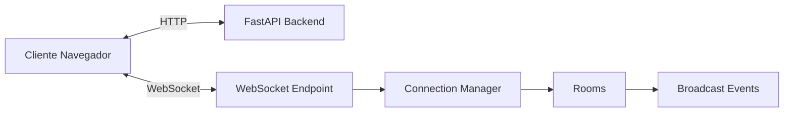

# 05_REALTIME_ARCHITECTURE.md

# ⚡ Aula Robótica Platform — Arquitectura Realtime

---

# 📌 Introducción

Uno de los elementos diferenciales de Aula Robótica Platform es la incorporación de capacidades de colaboración en tiempo real mediante WebSockets.

La arquitectura realtime permite que múltiples usuarios interactúen simultáneamente con la plataforma y reciban actualizaciones instantáneas sin necesidad de recargar páginas ni realizar consultas periódicas al servidor.

Esta funcionalidad resulta especialmente relevante para escenarios colaborativos donde varios usuarios trabajan sobre los mismos proyectos, tareas o espacios compartidos.

La solución implementada se basa en FastAPI WebSockets, gestión de conexiones persistentes, broadcasting de eventos y sincronización multiusuario.

---

# 🎯 Objetivos del Sistema Realtime

La arquitectura realtime fue diseñada para resolver varios problemas funcionales.

## Objetivos funcionales

* sincronización instantánea
* colaboración multiusuario
* actualización dinámica de interfaz
* reducción de recargas completas
* mejora experiencia usuario
* visualización de actividad en vivo

---

## Objetivos técnicos

* conexiones persistentes
* baja latencia
* broadcasting eficiente
* desacoplamiento HTTP/WebSocket
* integración con FastAPI
* soporte Docker y Nginx
* despliegue cloud compatible

---

# 🧠 Filosofía Arquitectónica

La arquitectura realtime sigue varios principios fundamentales.

---

## 1. Comunicación orientada a eventos

La comunicación no se basa en polling continuo.

En lugar de ello, el servidor emite eventos únicamente cuando se producen cambios relevantes.

Esto reduce:

* tráfico innecesario
* carga servidor
* consultas repetitivas

y mejora significativamente la experiencia de usuario.

---

## 2. Persistencia de conexión

Las conexiones WebSocket permanecen abiertas mientras el usuario mantiene activa la sesión.

Esto permite:

* recepción instantánea eventos
* broadcasting
* presencia usuarios
* sincronización permanente

---

## 3. Desacoplamiento HTTP / Realtime

Las operaciones de negocio continúan realizándose mediante HTTP tradicional.

Los WebSockets se utilizan exclusivamente para:

* notificaciones
* sincronización
* actualización visual
* presencia usuarios

---

# 🏗️ Arquitectura General

La arquitectura realtime se integra dentro de la arquitectura global del sistema.



---

# Componentes principales

## Cliente Web

Responsable de:

* abrir conexión WebSocket
* escuchar eventos
* actualizar interfaz
* mantener sincronización

---

## WebSocket Endpoint

Gestiona:

* apertura conexión
* autenticación
* recepción eventos
* cierre conexión

---

## Connection Manager

Responsable de:

* conexiones activas
* rooms
* broadcasting
* desconexiones
* presencia usuarios

---

## Event Broadcasting

Encargado de:

* distribuir eventos
* sincronizar clientes
* propagar cambios
* mantener consistencia visual

---

# 🔌 Flujo de Conexión

Cuando un usuario accede a la plataforma:

1. Se autentica mediante JWT.
2. Se renderiza la interfaz SSR.
3. El cliente abre una conexión WebSocket.
4. FastAPI valida el usuario.
5. El Connection Manager registra la conexión.
6. El usuario pasa a formar parte de una o varias rooms.
7. Comienza la recepción de eventos realtime.

---

# 🏠 Arquitectura de Rooms

Para evitar enviar eventos innecesarios a todos los usuarios, las conexiones se agrupan mediante rooms lógicas.

---

## Dashboard Room

Utilizada para:

* actividad reciente
* métricas
* estadísticas
* presencia usuarios

---

## Project Rooms

Cada proyecto puede disponer de una room específica.

Permite:

* sincronización Kanban
* actividad proyecto
* eventos colaboración

---

## User Rooms

Orientadas a:

* notificaciones privadas
* mensajes personales
* eventos específicos usuario

---

# 📡 Eventos Implementados

Actualmente la plataforma utiliza WebSockets para varios tipos de eventos.

---

## Dashboard Updates

Actualización dinámica de:

* métricas
* productividad
* actividad reciente

---

## Notifications

Notificaciones en tiempo real dirigidas a usuarios concretos.

Ejemplos:

* cambios proyecto
* tareas asignadas
* eventos relevantes

---

## Activity Feed Updates

Inserción dinámica de nuevas actividades sin recargar la página.

---

## Kanban Events

Sincronización colaborativa de:

* cambios estado
* movimiento tareas
* actualización columnas

---

## Users Online

Control de presencia de usuarios conectados.

---

# 🔄 Broadcasting de Eventos

La arquitectura utiliza broadcasting para distribuir eventos entre clientes conectados.

---

## Ejemplo conceptual

```python
await manager.broadcast(event)
```

---

# Ventajas

* sincronización inmediata
* consistencia visual
* bajo acoplamiento
* escalabilidad progresiva

---

# ⚙️ Procesamiento Asíncrono

La arquitectura aprovecha el modelo async de FastAPI.

---

## Tecnologías utilizadas

* asyncio
* async/await
* Uvicorn ASGI
* FastAPI WebSockets

---

## Beneficios

* alta concurrencia
* menor bloqueo
* mejor rendimiento
* múltiples conexiones simultáneas

---

# 🔐 Seguridad Realtime

La capa realtime incorpora validaciones específicas.

---

## Autenticación

Las conexiones se asocian a usuarios autenticados.

Se valida:

* JWT
* sesión activa
* identidad usuario

---

## Autorización

El sistema controla:

* acceso a rooms
* permisos proyecto
* ownership
* contexto usuario

---

## Aislamiento

Los usuarios únicamente reciben eventos autorizados para su contexto.

---

# ☁️ Integración con Infraestructura Cloud

La arquitectura realtime fue adaptada para funcionar correctamente en el entorno desplegado.

---

## VPS Linux

Infraestructura:

* Hetzner Cloud
* Ubuntu Server 24.04

---

## Docker

Los servicios realtime funcionan dentro del contenedor FastAPI.

---

## Nginx Reverse Proxy

Nginx fue configurado para soportar:

* Upgrade HTTP 101
* conexiones persistentes
* proxy WebSocket
* forwarding bidireccional

---

# Validación Infraestructura Realtime

La arquitectura fue validada mediante:

* múltiples navegadores
* múltiples sesiones simultáneas
* VPS desplegado
* Docker Compose
* Nginx Reverse Proxy

---

# 🧪 Verificación WebSocket

La validación realtime incluyó:

---

## DevTools

Verificación de:

* handshake
* conexión persistente
* mensajes recibidos

---

## HTTP 101 Upgrade

Confirmación correcta de:

```text
101 Switching Protocols
```

---

## Docker Logs

Monitorización de:

* conexiones
* desconexiones
* broadcasting
* actividad runtime

---

## Sincronización Multiusuario

Pruebas realizadas:

* varios usuarios simultáneos
* eventos concurrentes
* actualización instantánea

---

# 📈 Beneficios Obtenidos

La incorporación de WebSockets permitió:

* colaboración más fluida
* mejor experiencia usuario
* sincronización instantánea
* dashboards vivos
* actividad dinámica
* arquitectura moderna

---

# 🚀 Evolución Futura

La arquitectura actual deja preparada la evolución hacia:

* edición colaborativa
* live dashboards avanzados
* activity streaming
* shared cursors
* realtime analytics
* presencia avanzada usuarios
* canales distribuidos

---

# 📌 Conclusión

La arquitectura realtime de Aula Robótica Platform constituye uno de los componentes más avanzados del proyecto.

La combinación de:

* FastAPI WebSockets,
* asyncio,
* broadcasting,
* rooms,
* Docker,
* Nginx,
* VPS Linux,

permite ofrecer colaboración multiusuario en tiempo real sobre una infraestructura cloud real.

Esta arquitectura aproxima la plataforma a patrones utilizados habitualmente en aplicaciones colaborativas modernas y constituye uno de los principales elementos diferenciales del proyecto.
