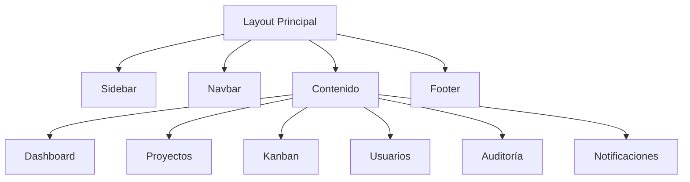

# 06_UI_ARCHITECTURE.md

# 🎨 Aula Robótica Platform — Arquitectura de Interfaz de Usuario

---

# 📌 Introducción

La interfaz de usuario de Aula Robótica Platform fue diseñada para ofrecer una experiencia moderna, intuitiva y orientada a productividad dentro de un entorno colaborativo educativo.

El objetivo principal fue construir una interfaz que permitiera gestionar usuarios, proyectos, tareas y actividades de forma sencilla, manteniendo simultáneamente una apariencia profesional y una navegación coherente.

La arquitectura UI se apoya en:

* AdminLTE
* Bootstrap
* Jinja2 SSR
* JavaScript modular
* WebSockets

para proporcionar una experiencia visual consistente e integrada con el backend.

---

# 🎯 Objetivos de Diseño

La arquitectura visual persigue varios objetivos fundamentales.

---

## Objetivos funcionales

* navegación intuitiva
* acceso rápido a información
* productividad
* colaboración multiusuario
* visualización clara de estados
* reducción de clics innecesarios

---

## Objetivos técnicos

* reutilización componentes
* diseño responsive
* mantenibilidad
* consistencia visual
* integración permisos
* soporte realtime

---

# 🧠 Principios de Diseño

La interfaz sigue varios principios fundamentales.

---

## Simplicidad

Se priorizó una interfaz clara y fácilmente comprensible.

Los elementos visuales se reducen a aquellos realmente necesarios para cada contexto.

---

## Consistencia

Todos los módulos utilizan:

* estilos comunes
* iconografía homogénea
* navegación consistente
* componentes reutilizables

---

## Contextualización

La interfaz adapta dinámicamente:

* menús
* acciones
* botones
* accesos

según el rol y permisos del usuario.

---

## Feedback inmediato

Las acciones importantes generan retroalimentación visual mediante:

* notificaciones
* mensajes
* actividad reciente
* actualización realtime

---

# 🏗️ Arquitectura General UI

La interfaz se organiza en varios componentes principales.

---

# Layout Principal

El layout principal constituye la estructura común de toda la aplicación.

---

## Componentes globales

* barra lateral
* cabecera superior
* contenido principal
* pie de página
* scripts globales

---

## Beneficios

* coherencia visual
* reutilización
* mantenimiento simplificado

---

# 🧭 Sistema de Navegación

La navegación se diseñó para minimizar la complejidad operativa.

---

# Sidebar

La barra lateral proporciona acceso a los módulos principales.

---

## Módulos disponibles

* Dashboard
* Proyectos
* Tareas
* Actividades
* Usuarios
* Roles
* Auditoría
* Notificaciones

---

## Características

* navegación persistente
* iconografía consistente
* acceso contextual
* responsive

---

# Navbar Superior

La cabecera proporciona acceso rápido a:

* perfil usuario
* estado sesión
* notificaciones
* acciones globales

---

# 📊 Dashboard

El Dashboard constituye el punto central de acceso a información operativa.

---

# Información mostrada

Actualmente incluye:

* horas registradas
* estado tareas
* productividad
* usuarios activos
* usuarios inactivos
* auditoría reciente
* actividad reciente
* notificaciones

---

# Objetivos Dashboard

* visión global sistema
* monitorización actividad
* acceso rápido información
* soporte toma decisiones

---

# 📋 Interfaz Kanban

El Kanban representa una de las funcionalidades visuales más importantes de la plataforma.

---

# Características

* organización visual tareas
* flujo de trabajo
* actualización realtime
* colaboración simultánea

---

# Estados soportados

* Por hacer
* En progreso
* Completada

---

# Beneficios

* seguimiento visual
* gestión estado
* colaboración eficiente

---

# 📂 Vista de Proyecto

La vista de detalle de proyecto centraliza la información relevante de cada proyecto.

---

# Información mostrada

* descripción
* horas registradas
* miembros
* tareas
* usuarios conectados
* actividad reciente

---

# Objetivos

* visión consolidada
* coordinación equipo
* trazabilidad

---

# 🔔 Sistema de Notificaciones

La plataforma incorpora notificaciones integradas en la interfaz.

---

# Tipos de notificaciones

* eventos proyecto
* cambios tareas
* actividad relevante
* mensajes sistema

---

# Beneficios

* comunicación rápida
* reducción recargas
* mejor experiencia usuario

---

# 📝 Actividad Reciente

La actividad reciente permite visualizar cambios producidos en el sistema.

---

# Información mostrada

* usuario
* acción
* entidad afectada
* fecha
* hora

---

# Beneficios

* trazabilidad
* transparencia
* colaboración

---

# 🔍 Auditoría

La interfaz incorpora herramientas de auditoría para seguimiento de actividad.

---

# Funcionalidades

* consulta eventos
* filtrado actividad
* análisis histórico

---

# Beneficios

* control operativo
* seguimiento usuarios
* trazabilidad acciones

---

# ⚡ Experiencia Realtime

La interfaz incorpora capacidades realtime mediante WebSockets.

---

# Funcionalidades realtime

* actualización actividad
* sincronización Kanban
* usuarios conectados
* notificaciones instantáneas

---

# Beneficios

* colaboración fluida
* actualización inmediata
* menor necesidad recarga

---

# 📱 Diseño Responsive

La plataforma se adapta automáticamente a distintos dispositivos.

---

# Compatibilidad

* escritorio
* portátil
* tablet
* móvil

---

# Objetivos

* accesibilidad
* flexibilidad
* experiencia consistente

---

# ♿ Accesibilidad

La interfaz incorpora medidas básicas de accesibilidad.

---

# Consideraciones

* contraste visual adecuado
* navegación clara
* iconografía consistente
* estructura semántica

---

# Beneficios

* mejor experiencia usuario
* facilidad aprendizaje
* mayor usabilidad

---

# 🎨 Consistencia Visual

La identidad visual se basa en:

* AdminLTE
* Bootstrap
* iconografía homogénea
* tarjetas informativas
* dashboards administrativos

---

# Objetivos

* apariencia profesional
* coherencia visual
* facilidad mantenimiento

---

# 🧪 Validación UX

La interfaz fue validada mediante:

* pruebas funcionales
* validación responsive
* pruebas navegación
* validación realtime
* pruebas despliegue cloud

---

# Validaciones realizadas

✅ Dashboard operativo
✅ Sidebar funcional
✅ Kanban operativo
✅ Notificaciones funcionales
✅ Responsive validado
✅ Actividad reciente operativa
✅ Auditoría funcional

---

# 📈 Estado Actual

Actualmente la interfaz dispone de:

✅ Arquitectura visual consistente
✅ Dashboard operativo
✅ Kanban colaborativo
✅ Notificaciones realtime
✅ Actividad reciente
✅ Auditoría integrada
✅ Responsive design
✅ Integración IAM

---

# 🔮 Evolución Futura

La arquitectura UI deja preparada la evolución hacia:

* SPA desacoplada
* dashboards avanzados
* personalización usuario
* temas visuales
* accesibilidad avanzada
* visualización analítica enriquecida

---

# 📌 Conclusión

La arquitectura de interfaz de Aula Robótica Platform combina simplicidad, productividad y colaboración en tiempo real.

La integración de:

* AdminLTE,
* Bootstrap,
* Jinja2,
* WebSockets,
* Dashboard,
* Kanban,
* Notificaciones,
* Auditoría,

permite ofrecer una experiencia de usuario moderna y coherente, alineada con la arquitectura backend y preparada para futuras evoluciones funcionales.
