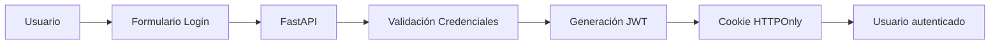
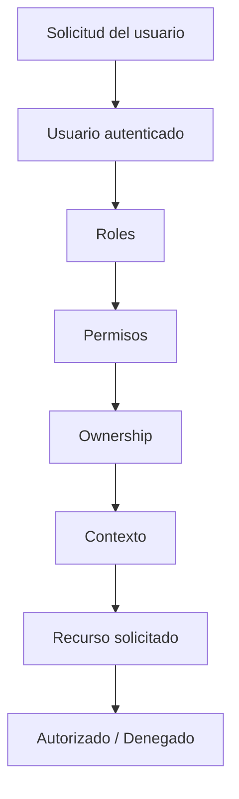

# 07_SECURITY_ARCHITECTURE.md

# 🔐 Aula Robótica Platform — Arquitectura de Seguridad

---

# 📌 Introducción

La seguridad constituye uno de los pilares fundamentales sobre los que se ha diseñado Aula Robótica Platform. Desde las primeras fases del proyecto se adoptó un enfoque **Backend-First Security**, donde todas las decisiones críticas relacionadas con la autenticación, autorización y acceso a los recursos son gestionadas desde el servidor.

La plataforma no se limita únicamente a proteger el acceso de los usuarios, sino que incorpora una arquitectura de seguridad distribuida en múltiples capas que abarca:

- autenticación mediante JWT;
- autorización basada en roles y permisos (RBAC);
- validaciones contextuales sobre recursos;
- protección de sesiones mediante cookies HTTPOnly;
- auditoría de acciones;
- comunicaciones WebSocket protegidas;
- aislamiento de servicios mediante Docker;
- protección de infraestructura mediante Nginx, firewall y hardening SSH.

Este enfoque permite aproximar el proyecto a arquitecturas de seguridad utilizadas habitualmente en aplicaciones empresariales modernas, manteniendo al mismo tiempo una elevada mantenibilidad y facilidad de evolución.

---

# 🎯 Objetivos de la Arquitectura de Seguridad

La arquitectura de seguridad fue diseñada para satisfacer simultáneamente requisitos funcionales, técnicos y operativos.

## Objetivos funcionales

- Garantizar que únicamente los usuarios autenticados puedan acceder a la plataforma.
- Controlar el acceso a recursos según el perfil del usuario.
- Proteger la información almacenada.
- Mantener la trazabilidad de las operaciones realizadas.
- Permitir colaboración multiusuario de forma segura.
- Proteger las comunicaciones realtime.

---

## Objetivos técnicos

- Centralizar todas las validaciones críticas en backend.
- Evitar dependencia de controles implementados únicamente en cliente.
- Desacoplar autenticación y autorización.
- Facilitar futuras integraciones SSO.
- Permitir despliegues cloud seguros.
- Favorecer la escalabilidad del sistema.

---

# 🧠 Principios de Diseño

La arquitectura de seguridad sigue una serie de principios ampliamente utilizados en el desarrollo backend moderno.

---

## Backend First Security

Toda operación sensible debe ser validada desde el servidor.

Aunque la interfaz de usuario adapte dinámicamente los elementos mostrados según el perfil del usuario, el backend vuelve a comprobar siempre los permisos antes de ejecutar cualquier acción.

Esto evita que un usuario pueda realizar operaciones manipulando manualmente las peticiones HTTP o el código JavaScript del navegador.

---

## Defense in Depth

La seguridad se implementa mediante múltiples capas independientes.

| Capa | Función principal |
|------|-------------------|
| Interfaz | Adaptación visual según permisos |
| Middleware | Validación de autenticación |
| Routers | Protección de endpoints |
| Servicios | Reglas de negocio |
| ORM | Acceso seguro a datos |
| Base de datos | Persistencia |
| Infraestructura | Firewall, Docker y Nginx |

Cada capa añade un nivel adicional de protección.

---

## Principio de Mínimo Privilegio

Los usuarios únicamente disponen de los permisos estrictamente necesarios para realizar sus funciones.

Este principio reduce significativamente el impacto potencial de errores de configuración o accesos indebidos.

---

## Autorización Contextual

La autorización no depende únicamente del rol asignado al usuario.

También se consideran factores como:

- propiedad del recurso;
- pertenencia a un proyecto;
- relación con la entidad solicitada;
- contexto de la operación;
- permisos efectivos.

---

# 🔑 Arquitectura de Autenticación

La autenticación constituye el primer mecanismo de protección del sistema.

La plataforma utiliza un modelo basado en **JSON Web Tokens (JWT)** combinado con **cookies HTTPOnly**, permitiendo mantener sesiones seguras sin depender de sesiones tradicionales almacenadas en servidor.

---

## Flujo general de autenticación



---

## Proceso de autenticación

El proceso completo sigue las siguientes fases:

1. El usuario introduce sus credenciales.
2. FastAPI valida la identidad consultando la base de datos.
3. Si las credenciales son correctas se genera un JWT.
4. El token se almacena mediante una cookie HTTPOnly.
5. Las peticiones posteriores reutilizan automáticamente dicha cookie.

Este mecanismo evita exponer el token directamente al código JavaScript del navegador.

---

# JSON Web Token (JWT)

Los JWT permiten identificar de forma segura a un usuario autenticado sin mantener información de sesión persistente en memoria.

Entre sus principales ventajas destacan:

- arquitectura stateless;
- escalabilidad;
- integración sencilla con APIs REST;
- compatibilidad con WebSockets;
- facilidad de despliegue en entornos distribuidos.

---

## Información contenida en el token

El JWT almacena únicamente la información necesaria para identificar al usuario y validar su sesión.

De forma simplificada incluye:

- identificador del usuario;
- fecha de emisión;
- fecha de expiración;
- información de control.

La lógica de autorización continúa realizándose posteriormente mediante consultas al sistema de permisos.

---

# 🍪 Gestión de Sesiones

La plataforma utiliza cookies HTTPOnly para almacenar el token de autenticación.

Este mecanismo aporta varias ventajas respecto al almacenamiento del token en LocalStorage o SessionStorage.

---

## Cookies HTTPOnly

Las cookies HTTPOnly presentan las siguientes características:

| Característica | Beneficio |
|---------------|-----------|
| HTTPOnly | JavaScript no puede acceder al token |
| Envío automático | El navegador adjunta la cookie en cada petición |
| Integración SSR | Compatible con renderizado en servidor |
| Transparencia | No requiere gestión manual desde el cliente |

---

## Secure Cookies

La arquitectura ha sido preparada para utilizar cookies seguras cuando el sistema opere mediante HTTPS.

En dicho escenario podrán utilizarse atributos como:

- Secure
- HttpOnly
- SameSite=Lax
- SameSite=Strict

mejorando todavía más la protección frente a determinados ataques.

---

# Session Middleware

Además del sistema JWT, la aplicación utiliza un middleware de sesión para almacenar información temporal relacionada con la experiencia de usuario.

Entre otros elementos:

- mensajes flash;
- confirmaciones;
- estado temporal de navegación;
- notificaciones visuales.

Es importante destacar que este mecanismo **no sustituye** al sistema de autenticación basado en JWT, sino que ambos cumplen funciones claramente diferenciadas.

---

# Beneficios de la Arquitectura de Autenticación

La solución adoptada aporta múltiples ventajas:

- separación entre autenticación y autorización;
- sesiones ligeras;
- integración natural con FastAPI;
- compatibilidad con WebSockets;
- facilidad de despliegue mediante Docker;
- adaptación a arquitecturas cloud;
- preparación para futuras integraciones SSO.

---

# 🛡️ Arquitectura de Autorización

Una vez autenticado el usuario, todas las operaciones realizadas sobre la plataforma deben pasar por un proceso de autorización.

Mientras que la autenticación responde a la pregunta:

> **¿Quién eres?**

la autorización responde a:

> **¿Qué puedes hacer?**

La arquitectura implementada combina varios mecanismos complementarios que permiten aplicar controles de acceso granulares y contextuales.

---

# Modelo General de Autorización



---

## Roles (RBAC)

La plataforma utiliza un modelo **Role Based Access Control (RBAC)** para simplificar la administración de permisos.

Cada usuario puede pertenecer a uno o varios roles que determinan las capacidades generales disponibles dentro del sistema.

Ejemplos de roles implementados:

| Rol | Responsabilidad |
|------|-----------------|
| Administrador | Gestión global de la plataforma |
| Profesor | Gestión de proyectos y usuarios académicos |
| Estudiante | Participación en proyectos y tareas |

Los roles agrupan permisos, facilitando tanto la administración como el mantenimiento del sistema.

---

## Permisos Granulares

Cada rol dispone de un conjunto de permisos específicos asociados a recursos concretos.

Ejemplos:

```text
projects:create
projects:update
projects:delete

tasks:create
tasks:update
tasks:delete

users:create
users:update
dashboard:read
audit:read
```

Esta granularidad permite controlar cada operación de forma independiente.

---

## Autorización Contextual

En Aula Robótica Platform la autorización no depende únicamente del rol asignado al usuario.

También se evalúa el contexto específico de la operación.

Entre otros factores:

- propietario del recurso;
- pertenencia al proyecto;
- responsable de la tarea;
- estado del proyecto;
- relación entre entidades.

Este enfoque permite construir reglas mucho más flexibles que un RBAC tradicional.

---

## Ownership

El sistema implementa validaciones de propiedad (ownership).

Por ejemplo:

- un usuario puede visualizar un proyecto;
- pero únicamente modificar aquellos de los que sea responsable;
- o para los que disponga de permisos administrativos.

Este mecanismo evita accesos indebidos incluso cuando dos usuarios comparten un mismo rol.

---

# Middleware de Seguridad

La mayor parte de las validaciones de seguridad se centralizan mediante middleware reutilizable.

El middleware evita duplicar comprobaciones en cada endpoint de la aplicación.

---

## Responsabilidades principales

- Validación de autenticación.
- Resolución del usuario actual.
- Comprobación de sesión.
- Validación de permisos.
- Protección de rutas.
- Gestión de errores de autorización.

---

## Beneficios

- menor duplicación;
- mantenimiento simplificado;
- comportamiento homogéneo;
- mayor testabilidad;
- separación de responsabilidades.

---

# Seguridad en Arquitectura SSR

La aplicación utiliza renderizado **Server Side Rendering (SSR)** mediante FastAPI y Jinja2.

Esta arquitectura aporta ventajas importantes desde el punto de vista de la seguridad.

---

## Renderizado contextual

Antes de enviar una página al navegador, el backend calcula:

- permisos disponibles;
- acciones permitidas;
- elementos visibles;
- navegación autorizada.

De esta forma la interfaz se adapta dinámicamente al usuario autenticado.

---

## Ocultación de funcionalidades

Los elementos visuales se muestran únicamente cuando el usuario dispone de autorización suficiente.

Ejemplos:

- botones de edición;
- acciones administrativas;
- enlaces de navegación;
- operaciones de eliminación;
- opciones avanzadas.

Es importante destacar que esta ocultación **mejora la experiencia de usuario**, pero **no constituye un mecanismo de seguridad por sí misma**, ya que todas las operaciones vuelven a validarse posteriormente en el backend.

---

# Seguridad de APIs

Todos los endpoints expuestos por FastAPI están protegidos mediante validaciones de autenticación y autorización.

Cada petición sigue un flujo similar al siguiente:

```mermaid
flowchart LR

Cliente

--> Middleware

--> Autenticación

--> Autorización

--> Servicio

--> Base de Datos
```

Únicamente si todas las validaciones resultan satisfactorias se ejecuta la operación solicitada.

---

# ⚡ Seguridad WebSocket

La incorporación de comunicación en tiempo real introduce nuevos requisitos de seguridad.

Cada conexión WebSocket debe ser autenticada y autorizada antes de incorporarse al sistema realtime.

---

## Flujo de conexión

```mermaid
flowchart LR

Cliente

--> Handshake

Handshake

--> Validación JWT

Validación JWT

--> FastAPI

FastAPI

--> Connection Manager

Connection Manager

--> Room autorizada
```

---

## Validaciones realizadas

Antes de aceptar una conexión se verifica:

- identidad del usuario;
- validez del token;
- estado de la sesión;
- permisos sobre el recurso;
- pertenencia al proyecto;
- acceso a la room correspondiente.

---

## Rooms

Las conexiones WebSocket se organizan mediante **rooms** lógicas.

Esto evita enviar información innecesaria a todos los usuarios conectados.

Ejemplos:

| Room | Contenido |
|------|-----------|
| dashboard | actividad general |
| project:{id} | eventos del proyecto |
| user:{id} | notificaciones privadas |
| notifications | avisos del sistema |

---

## Broadcasting Seguro

Los eventos únicamente se distribuyen entre los usuarios autorizados.

Este mecanismo evita:

- fugas de información;
- recepción de eventos ajenos;
- sincronizaciones no autorizadas.

---

# Auditoría y Trazabilidad

Toda arquitectura de seguridad moderna debe proporcionar mecanismos de auditoría.

La plataforma registra información relevante sobre las operaciones realizadas por los usuarios.

---

## Información registrada

Entre otros datos:

- usuario;
- acción realizada;
- recurso afectado;
- fecha y hora;
- dirección IP;
- navegador;
- información contextual.

---

## Objetivos

La auditoría permite:

- reconstruir acciones realizadas;
- facilitar tareas de depuración;
- detectar incidencias;
- mejorar la seguridad operacional;
- aumentar la trazabilidad del sistema.

---

## Eventos Auditados

Actualmente pueden registrarse acciones como:

- inicio de sesión;
- modificaciones de proyectos;
- cambios de tareas;
- operaciones administrativas;
- creación y edición de usuarios;
- eventos relevantes del sistema.

---

# Beneficios de la Arquitectura de Autorización

La combinación de RBAC, autorización contextual, middleware centralizado y protección WebSocket proporciona una arquitectura de seguridad flexible y fácilmente extensible.

Este enfoque permite mantener una elevada coherencia en todas las capas del sistema y facilita la incorporación futura de nuevos módulos sin necesidad de rediseñar completamente el modelo de autorización.

---

# 🛡️ Arquitectura de Autorización

Una vez autenticado el usuario, todas las operaciones realizadas sobre la plataforma deben pasar por un proceso de autorización.

Mientras que la autenticación responde a la pregunta:

> **¿Quién eres?**

la autorización responde a:

> **¿Qué puedes hacer?**

La arquitectura implementada combina varios mecanismos complementarios que permiten aplicar controles de acceso granulares y contextuales.

---

# Modelo General de Autorización


---

## Roles (RBAC)

La plataforma utiliza un modelo **Role Based Access Control (RBAC)** para simplificar la administración de permisos.

Cada usuario puede pertenecer a uno o varios roles que determinan las capacidades generales disponibles dentro del sistema.

Ejemplos de roles implementados:

| Rol | Responsabilidad |
|------|-----------------|
| Administrador | Gestión global de la plataforma |
| Profesor | Gestión de proyectos y usuarios académicos |
| Estudiante | Participación en proyectos y tareas |

Los roles agrupan permisos, facilitando tanto la administración como el mantenimiento del sistema.

---

## Permisos Granulares

Cada rol dispone de un conjunto de permisos específicos asociados a recursos concretos.

Ejemplos:

```text
projects:create
projects:update
projects:delete

tasks:create
tasks:update
tasks:delete

users:create
users:update
dashboard:read
audit:read
```

Esta granularidad permite controlar cada operación de forma independiente.

---

## Autorización Contextual

En Aula Robótica Platform la autorización no depende únicamente del rol asignado al usuario.

También se evalúa el contexto específico de la operación.

Entre otros factores:

- propietario del recurso;
- pertenencia al proyecto;
- responsable de la tarea;
- estado del proyecto;
- relación entre entidades.

Este enfoque permite construir reglas mucho más flexibles que un RBAC tradicional.

---

## Ownership

El sistema implementa validaciones de propiedad (ownership).

Por ejemplo:

- un usuario puede visualizar un proyecto;
- pero únicamente modificar aquellos de los que sea responsable;
- o para los que disponga de permisos administrativos.

Este mecanismo evita accesos indebidos incluso cuando dos usuarios comparten un mismo rol.

---

# Middleware de Seguridad

La mayor parte de las validaciones de seguridad se centralizan mediante middleware reutilizable.

El middleware evita duplicar comprobaciones en cada endpoint de la aplicación.

---

## Responsabilidades principales

- Validación de autenticación.
- Resolución del usuario actual.
- Comprobación de sesión.
- Validación de permisos.
- Protección de rutas.
- Gestión de errores de autorización.

---

## Beneficios

- menor duplicación;
- mantenimiento simplificado;
- comportamiento homogéneo;
- mayor testabilidad;
- separación de responsabilidades.

---

# Seguridad en Arquitectura SSR

La aplicación utiliza renderizado **Server Side Rendering (SSR)** mediante FastAPI y Jinja2.

Esta arquitectura aporta ventajas importantes desde el punto de vista de la seguridad.

---

## Renderizado contextual

Antes de enviar una página al navegador, el backend calcula:

- permisos disponibles;
- acciones permitidas;
- elementos visibles;
- navegación autorizada.

De esta forma la interfaz se adapta dinámicamente al usuario autenticado.

---

## Ocultación de funcionalidades

Los elementos visuales se muestran únicamente cuando el usuario dispone de autorización suficiente.

Ejemplos:

- botones de edición;
- acciones administrativas;
- enlaces de navegación;
- operaciones de eliminación;
- opciones avanzadas.

Es importante destacar que esta ocultación **mejora la experiencia de usuario**, pero **no constituye un mecanismo de seguridad por sí misma**, ya que todas las operaciones vuelven a validarse posteriormente en el backend.

---

# Seguridad de APIs

Todos los endpoints expuestos por FastAPI están protegidos mediante validaciones de autenticación y autorización.

Cada petición sigue un flujo similar al siguiente:

```mermaid
flowchart LR

Cliente

--> Middleware

--> Autenticación

--> Autorización

--> Servicio

--> Base de Datos
```

Únicamente si todas las validaciones resultan satisfactorias se ejecuta la operación solicitada.

---

# ⚡ Seguridad WebSocket

La incorporación de comunicación en tiempo real introduce nuevos requisitos de seguridad.

Cada conexión WebSocket debe ser autenticada y autorizada antes de incorporarse al sistema realtime.

---

## Flujo de conexión

```mermaid
flowchart LR

Cliente

--> Handshake

Handshake

--> Validación JWT

Validación JWT

--> FastAPI

FastAPI

--> Connection Manager

Connection Manager

--> Room autorizada
```

---

## Validaciones realizadas

Antes de aceptar una conexión se verifica:

- identidad del usuario;
- validez del token;
- estado de la sesión;
- permisos sobre el recurso;
- pertenencia al proyecto;
- acceso a la room correspondiente.

---

## Rooms

Las conexiones WebSocket se organizan mediante **rooms** lógicas.

Esto evita enviar información innecesaria a todos los usuarios conectados.

Ejemplos:

| Room | Contenido |
|------|-----------|
| dashboard | actividad general |
| project:{id} | eventos del proyecto |
| user:{id} | notificaciones privadas |
| notifications | avisos del sistema |

---

## Broadcasting Seguro

Los eventos únicamente se distribuyen entre los usuarios autorizados.

Este mecanismo evita:

- fugas de información;
- recepción de eventos ajenos;
- sincronizaciones no autorizadas.

---

# Auditoría y Trazabilidad

Toda arquitectura de seguridad moderna debe proporcionar mecanismos de auditoría.

La plataforma registra información relevante sobre las operaciones realizadas por los usuarios.

---

## Información registrada

Entre otros datos:

- usuario;
- acción realizada;
- recurso afectado;
- fecha y hora;
- dirección IP;
- navegador;
- información contextual.

---

## Objetivos

La auditoría permite:

- reconstruir acciones realizadas;
- facilitar tareas de depuración;
- detectar incidencias;
- mejorar la seguridad operacional;
- aumentar la trazabilidad del sistema.

---

## Eventos Auditados

Actualmente pueden registrarse acciones como:

- inicio de sesión;
- modificaciones de proyectos;
- cambios de tareas;
- operaciones administrativas;
- creación y edición de usuarios;
- eventos relevantes del sistema.

---

# Beneficios de la Arquitectura de Autorización

La combinación de RBAC, autorización contextual, middleware centralizado y protección WebSocket proporciona una arquitectura de seguridad flexible y fácilmente extensible.

Este enfoque permite mantener una elevada coherencia en todas las capas del sistema y facilita la incorporación futura de nuevos módulos sin necesidad de rediseñar completamente el modelo de autorización.