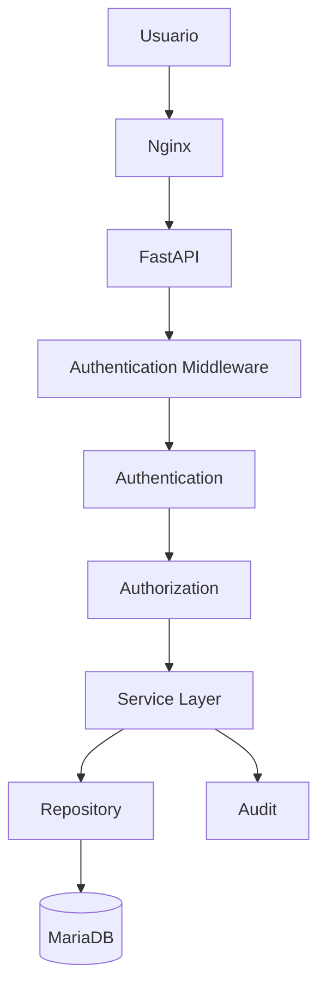
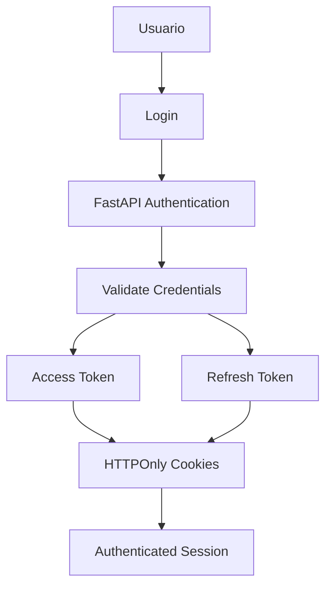
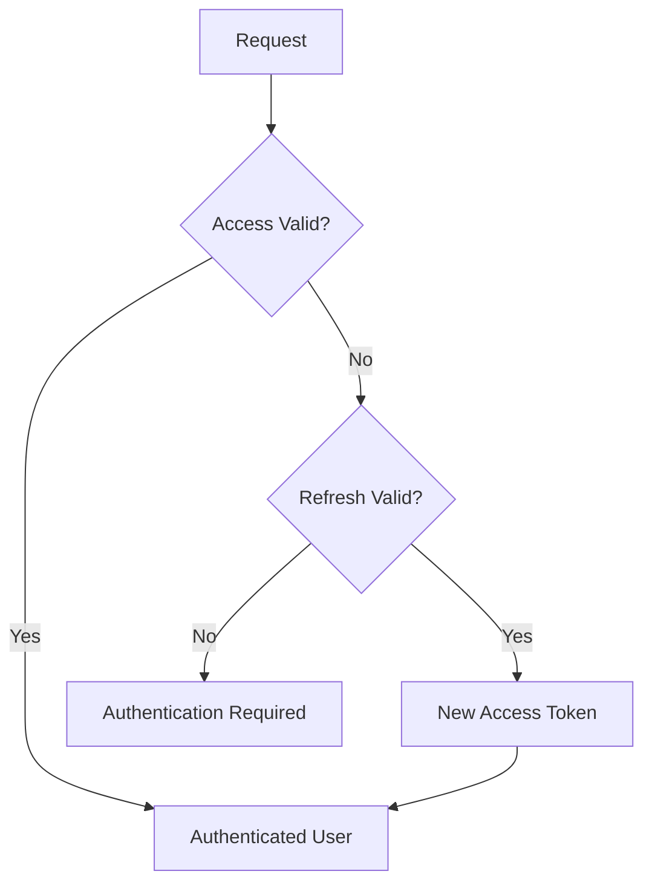
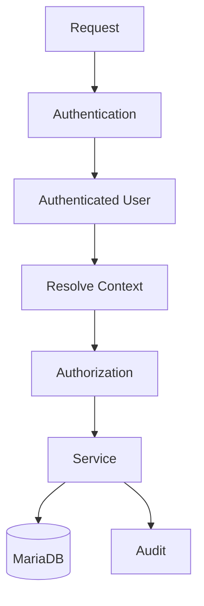
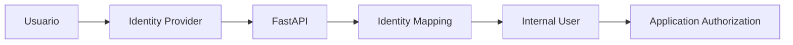
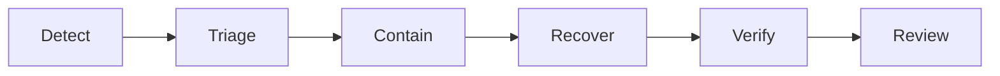
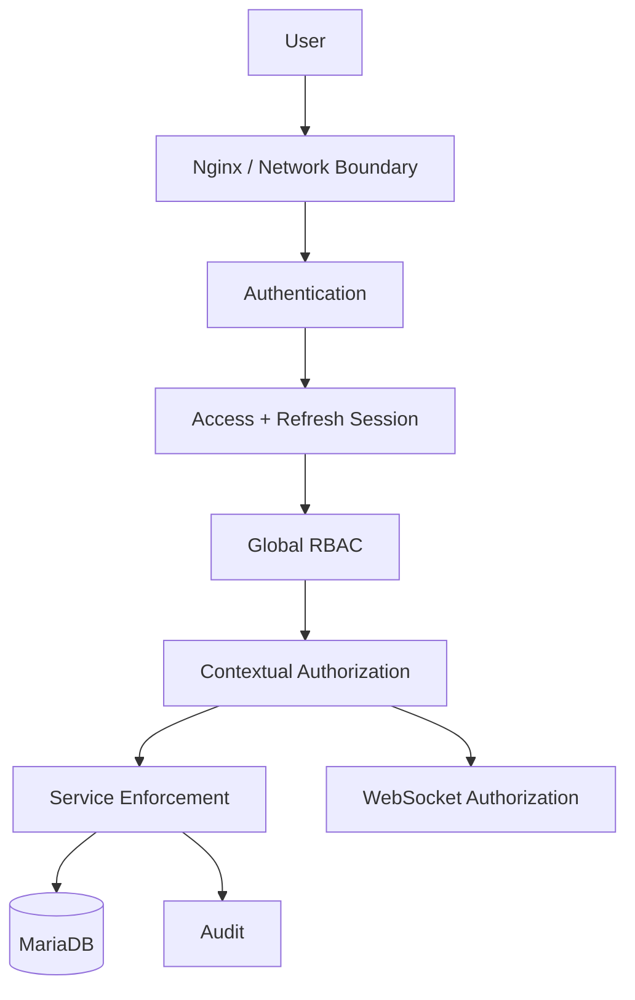
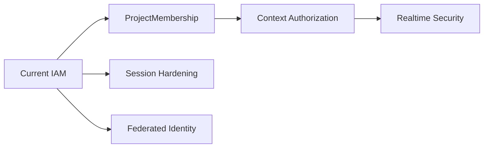

# 08_SECURITY_IAM.md

# 🔐 Aula Robótica Platform — Seguridad e IAM

---

# 📌 Introducción

La seguridad constituye uno de los pilares arquitectónicos fundamentales de Aula Robótica Platform.

Desde las primeras fases del proyecto, el diseño se orientó hacia una aproximación **backend-first**, donde:

* la autenticación;
* la autorización;
* los permisos;
* la auditoría;
* la trazabilidad;
* la validación de acceso;
* y la protección de recursos

son gestionados principalmente desde servidor.

La plataforma dispone actualmente de una base IAM construida alrededor de:

```text
JWT Access Token

+

JWT Refresh Token

+

HTTPOnly Cookies

+

Authentication Middleware

+

Global RBAC

+

Partial Contextual Authorization.
```

La arquitectura mantiene separadas las responsabilidades de:

```text
Identity

Authentication

Authorization

Audit

Application Security

Infrastructure Security.
```

Esta separación permite evolucionar progresivamente hacia escenarios institucionales más complejos sin acoplar la identidad externa con la lógica de autorización interna.

Entre las posibles evoluciones futuras se encuentran:

```text
SAML 2.0

OAuth2

OpenID Connect

institutional SSO

external identity providers.
```

Estas capacidades son:

```text
FUTURE / CONDITIONAL
```

y no forman parte de la arquitectura de autenticación actualmente implementada.

Además de la seguridad a nivel aplicación, Aula Robótica Platform dispone de una infraestructura real basada en:

```text
Linux

Docker

Docker Compose

Nginx

Hetzner VPS.
```

La seguridad debe entenderse como una capacidad transversal y en evolución continua.

Por tanto:

```text
Security Foundation
    CURRENT

Security Hardening
    CONTINUOUS.
```

---

# 🎯 Objetivos del Sistema de Seguridad

La arquitectura de seguridad persigue objetivos:

```text
funcionales

técnicos

operacionales

arquitectónicos.
```

---

## Objetivos funcionales

```text
autenticación segura

gestión de sesiones

renovación transparente de acceso

control de permisos

protección de recursos

aislamiento entre usuarios

aislamiento contextual

trazabilidad de acciones

colaboración multiusuario segura.
```

---

## Objetivos técnicos

```text
seguridad backend-centralizada

autenticación desacoplada

autorización explícita

protección de endpoints

context-aware authorization

integración SSR

integración REST

integración WebSocket

gestión segura de cookies

infraestructura reproducible

evolución progresiva de IAM.
```

---

## Objetivos operacionales

```text
reducir superficie de ataque

proteger servicios internos

mantener trazabilidad

facilitar diagnóstico

permitir recuperación

gestionar secretos correctamente

endurecer progresivamente producción.
```

---

# 🧠 Filosofía de Seguridad

La plataforma sigue varios principios fundamentales.

---

# 1. Backend-First Security

Toda validación crítica debe realizarse en backend.

El frontend puede:

```text
ocultar controles

deshabilitar acciones

adaptar navegación

mejorar UX.
```

Pero nunca constituye la autoridad de seguridad.

---

# Regla fundamental

```text
Frontend Visibility

≠

Authorization.
```

---

# 2. Defense in Depth

La seguridad se implementa mediante capas complementarias.

| Nivel | Responsabilidad |
|---|---|
| Frontend | UX y validaciones no autoritativas |
| Nginx | Reverse proxy y frontera HTTP |
| Middleware | Identificación y contexto |
| Authentication | Validación de identidad |
| Authorization | Decisión de acceso |
| Service Layer | Enforcement de reglas sensibles |
| Repository / DB | Integridad persistente |
| Audit | Trazabilidad |
| Docker | Aislamiento de servicios |
| Infraestructura | Red, host y acceso administrativo |

---

# Modelo

```text
Client

↓

Network Boundary

↓

Authentication

↓

Authorization

↓

Application Rules

↓

Persistence Integrity

↓

Audit.
```

---

# 3. Authentication ≠ Authorization

La autenticación responde:

```text
Who is this user?
```

La autorización responde:

```text
Can this user
perform this action
on this resource
in this context?
```

Por tanto:

```text
Authentication

≠

Authorization.
```

---

# 4. Global Role ≠ Context Permission

Un rol global no determina necesariamente todos los permisos dentro de:

```text
projects

tasks

activities

attachments

realtime channels.
```

---

# 5. Resource Identifier ≠ Resource Access

Conocer:

```text
resource_id
```

no implica:

```text
authorization.
```

---

# 6. Persistent State Is Authoritative

Las decisiones relevantes deben apoyarse en:

```text
validated server-side state.
```

No en:

```text
client assumptions.
```

---

# 7. Deny by Default

Cuando no pueda demostrarse autorización:

```text
DENY.
```

---

# 8. Security Is Continuous

No debe considerarse:

```text
security complete.
```

La clasificación correcta es:

```text
Security Foundation:
    CURRENT

Security Hardening:
    CONTINUOUS.
```

---

# 🏗️ Arquitectura General de Seguridad

La seguridad atraviesa toda la infraestructura.



---

# Arquitectura de Seguridad Actual

```text
Browser

↓

Nginx

↓

FastAPI

↓

Authentication Middleware

↓

JWT Access / Refresh Validation

↓

Authenticated User Context

↓

Global RBAC

↓

Partial Contextual Authorization

↓

Service-layer Rules

↓

MariaDB

↓

Audit.
```

---

# 👤 Arquitectura IAM

La plataforma implementa una arquitectura IAM desacoplada.

IAM debe entenderse como la combinación de:

```text
Identity

Authentication

Authorization

Access Context

Auditability.
```

---

# Objetivos IAM

```text
separación de identidad y credenciales

autenticación segura

roles globales

autorización contextual

evolución de membership

preparación para identidad federada

extensibilidad.
```

---

# Componentes principales

| Componente | Función | Estado |
|---|---|---|
| Users | Identidad interna | CURRENT |
| Identities | Credenciales / identidad autenticable | CURRENT |
| Roles | Roles globales | CURRENT |
| Permissions | Permisos | CURRENT / EVOLVING |
| Authentication Middleware | Identificación del usuario | CURRENT |
| Global RBAC | Autorización global | CURRENT |
| Contextual Authorization | Autorización según contexto | PARTIAL |
| ProjectMembership | Modelo contextual explícito | TARGET / IN CONSOLIDATION |
| Audit | Trazabilidad | CURRENT |
| Federated Identity | Identidad institucional externa | FUTURE |

---

# Separación User / Identity

La arquitectura desacopla conceptualmente:

```text
User

from

Authentication Identity.
```

Esto evita convertir:

```text
credentials
```

en:

```text
business identity.
```

---

# Identity Principle

```text
External Identity

≠

Application User

≠

Application Authorization.
```

---

# Beneficio

Esta separación facilita una futura integración con:

```text
SAML

OAuth2

OpenID Connect

LDAP

Active Directory

institutional SSO.
```

---

# Estado de Identidad Federada

```text
SAML
    FUTURE / CONDITIONAL
    NOT IMPLEMENTED

OAuth2 / OIDC
    FUTURE / CONDITIONAL

LDAP / Active Directory
    FUTURE / CONDITIONAL.
```

---

# 🔑 Autenticación

La autenticación actual utiliza:

```text
JWT Access Token

+

JWT Refresh Token

+

HTTPOnly Cookies.
```

---

# Estado

```text
JWT Access Token
    CURRENT

JWT Refresh Token
    CURRENT

Access Cookie
    CURRENT

Refresh Cookie
    CURRENT

Explicit /refresh
    CURRENT

Automatic Access Refresh
    CURRENT

Refresh-token Validation
    CURRENT

Logout Token Cleanup
    CURRENT.
```

---

# JWT Authentication

Los JWT se utilizan para representar la identidad autenticada.

---

## Uso principal

```text
autenticación de usuarios

validación de sesiones

protección de recursos

integración SSR

integración REST

contexto para WebSockets.
```

---

# Access Token

El access token se utiliza para autenticar las peticiones ordinarias.

Su vida útil debe permanecer:

```text
limited.
```

---

# Refresh Token

El refresh token permite renovar:

```text
Access Token
```

sin solicitar nuevamente:

```text
username + password.
```

---

# Critical Status

Los refresh tokens no son una preparación futura.

Son:

```text
CURRENT.
```

---

# Flujo de Autenticación



---

# Flujo Conceptual

```text
Credentials

↓

Authentication Service

↓

Credential Validation

↓

Access Token

+

Refresh Token

↓

HTTPOnly Cookies

↓

Authenticated Requests.
```

---

# Renovación de Access Token

La plataforma dispone de:

```text
Explicit Refresh

+

Automatic Refresh.
```

---

# Explicit Refresh

Existe un endpoint explícito:

```text
/refresh
```

que:

```text
reads refresh token

↓

validates refresh token

↓

creates new access token

↓

updates access cookie.
```

Estado:

```text
CURRENT.
```

---

# Automatic Access Refresh

El middleware puede detectar que el access token ya no permite autenticar correctamente la petición.

Entonces puede:

```text
read refresh token

↓

validate refresh token

↓

generate new access token

↓

reconstruct authenticated user

↓

continue request.
```

Estado:

```text
CURRENT.
```

---

# Refresh Workflow



---

# Refresh Token Security

Debe distinguirse claramente entre:

```text
Refresh-token Implementation

and

Refresh-token Security Hardening.
```

---

# Refresh-token Implementation

```text
JWT Refresh Token
    CURRENT

Refresh Cookie
    CURRENT

Refresh-token Validation
    CURRENT

Explicit Refresh
    CURRENT

Automatic Access Refresh
    CURRENT.
```

---

# Refresh-token Hardening

```text
Refresh-token Rotation
    VERIFY / HARDENING

Server-side Revocation
    VERIFY / HARDENING

Reuse Detection
    FUTURE HARDENING

Session / Device Management
    FUTURE.
```

---

# Important Distinction

```text
Refresh Token Exists

≠

Complete Refresh-token Lifecycle Hardening.
```

---

# Logout

El logout elimina:

```text
Access Cookie

+

Refresh Cookie.
```

Estado:

```text
CURRENT.
```

---

# Logout Cleanup ≠ Server-side Revocation

Eliminar las cookies del navegador no demuestra necesariamente:

```text
server-side token revocation.
```

Por tanto:

```text
Logout Cookie Cleanup
    CURRENT

Server-side Revocation
    VERIFY / HARDENING.
```

---

# 🍪 Gestión de Cookies JWT

Los tokens utilizados por el flujo web se transportan mediante:

```text
HTTPOnly cookies.
```

---

# Beneficios

| Beneficio | Descripción |
|---|---|
| HTTPOnly | JavaScript no puede leer directamente la cookie |
| SSR Friendly | Integración natural con backend |
| Browser Managed | Envío automático |
| Reduced Token Exposure | Menor exposición directa a JS |
| Shared Auth Context | Compatible con middleware y SSR |

---

# HTTPOnly

```text
HttpOnly = True
```

reduce la exposición directa de tokens frente a JavaScript.

---

# Important Limitation

```text
HTTPOnly

≠

Complete XSS Protection.
```

Un XSS todavía puede ejecutar acciones autenticadas desde el navegador.

---

# Cookie Security Attributes

La política debe considerar:

```text
HttpOnly

Secure

SameSite

Path

Max-Age / Expires.
```

---

# Entorno de Desarrollo

Durante desarrollo HTTP puede utilizarse:

```text
HTTPOnly = True

SameSite = Lax

Secure = False.
```

---

# Política de Login por Entorno

La implementación actual del flujo de login contempla conceptualmente:

```text
DEBUG

    SameSite = lax
    Secure = false

PRODUCTION

    SameSite = strict
    Secure = true.
```

---

# ⚠️ Cookie Policy Consistency

Existe actualmente una inconsistencia de hardening conocida.

La renovación automática del access token desde middleware no aplica exactamente la misma política que el login.

Actualmente debe considerarse:

```text
HTTPOnly Cookies
    CURRENT

Environment-aware Login Cookie Policy
    CURRENT

Uniform Cookie Policy Across Authentication Paths
    TARGET / HARDENING.
```

---

# Riesgo

Una renovación automática no debe degradar:

```text
Secure

SameSite
```

respecto a la política requerida por producción.

---

# Dirección Arquitectónica

La política debe centralizarse.

```text
Central Cookie Policy

├── Login
├── Explicit Refresh
├── Automatic Refresh
└── Logout.
```

---

# Cookie Security Invariant

```text
Every authentication path
that creates or renews a cookie

must apply

the same environment-aware
security policy.
```

---

# Secure Cookies

En producción:

```text
Secure = True
```

debe formar parte de la política efectiva cuando el servicio opera sobre HTTPS.

---

# HTTPS

HTTPS protege:

```text
credentials

access cookies

refresh cookies

application traffic.
```

---

# CSRF

La autenticación mediante cookies introduce la necesidad de considerar:

```text
Cross-Site Request Forgery.
```

---

# SameSite

`SameSite` constituye una defensa útil.

Pero:

```text
SameSite

≠

Formal CSRF Protection.
```

---

# Estado CSRF

```text
Formal CSRF Protection
    TARGET / PLANNED.
```

---

# CSRF Hardening

Debe diseñarse específicamente para:

```text
cookie-authenticated browser mutations.
```

---

# JWT Production Concerns

La arquitectura considera varias preocupaciones de seguridad.

---

# CURRENT

```text
JWT Access Tokens

JWT Refresh Tokens

HTTPOnly Cookies

Explicit Refresh

Automatic Access Refresh

Token Expiration

Backend Validation

Logout Cookie Cleanup.
```

---

# ACTIVE HARDENING

```text
Cookie Policy Consistency

Formal CSRF Protection

Refresh-token Lifecycle Security

Contextual Authorization

WebSocket Security

Subscription Authorization

Security Regression Testing.
```

---

# FUTURE / CONDITIONAL

```text
Session / Device Management

MFA

SAML

OAuth2 / OIDC

Federated Identity.
```

---

# 🛡️ Autorización y RBAC

La autorización constituye una capa independiente de la autenticación.

---

# Global RBAC

La plataforma utiliza:

```text
Role Based Access Control
```

para gestionar permisos globales.

Estado:

```text
CURRENT.
```

---

# Roles

Los roles existentes deben entenderse de acuerdo con el modelo real de la aplicación.

Ejemplos conceptuales pueden incluir:

```text
admin

profesor

estudiante.
```

La documentación de roles no debe sustituir al modelo implementado como fuente de verdad.

---

# Global RBAC Responsibilities

Puede controlar:

```text
administración global

acceso general a módulos

operaciones reservadas

capacidades globales.
```

---

# Permisos Granulares

Los permisos pueden controlar:

```text
lectura

creación

edición

eliminación

administración

operaciones específicas.
```

---

# Global RBAC ≠ Contextual Authorization

Un usuario puede tener un rol global válido y aun así no estar autorizado para actuar sobre:

```text
a specific project

a specific task

a specific attachment

a specific realtime scope.
```

---

# Autorización Contextual

La plataforma incorpora mecanismos de autorización contextual.

Su estado es:

```text
PARTIAL / IN PROGRESS.
```

---

# Contextual Inputs

Las decisiones pueden depender de:

```text
user

action

resource

project

ownership

membership

resource relationship

context role.
```

---

# Modelo Conceptual

```text
can(
    user,
    action,
    resource,
    context
)
```

---

# Ejemplo

Un usuario puede:

```text
view a project
```

pero no necesariamente:

```text
modify that project.
```

La decisión puede depender de:

```text
membership

ownership

contextual role

specific permission.
```

---

# ProjectMembership

La evolución de autorización contextual se apoya en la consolidación de:

```text
ProjectMembership.
```

Estado:

```text
TARGET / IN CONSOLIDATION.
```

---

# ProjectMembership Purpose

Debe permitir representar explícitamente:

```text
User

↓

Membership

↓

Project

↓

Contextual Role / Permissions.
```

---

# Dependency

```text
ProjectMembership

↓

Contextual Authorization

↓

Cross-project Isolation

↓

WebSocket Subscription Authorization.
```

---

# Cross-project Isolation

Una de las garantías críticas es impedir:

```text
User authorized in Project A

↓

accessing protected resources
from Project B

without authorization.
```

---

# Cross-project Tests

Estado:

```text
TARGET / HIGH PRIORITY.
```

---

# Nested Resource Authorization

Los recursos hijos deben validar:

```text
their own resource

+

their parent context.
```

---

# Example

```text
/task/{task_id}
```

no debe autorizarse únicamente porque:

```text
task_id exists.
```

Debe verificarse su relación con:

```text
project

membership

requested operation.
```

---

# 🧩 Middleware de Seguridad

El middleware centraliza parte importante de la identificación.

---

# Authentication Middleware Responsibilities

```text
leer cookies

validar access token

validar refresh token cuando corresponda

renovar access token

reconstruir usuario

inyectar contexto autenticado.
```

---

# Context Injection

La identidad autenticada puede quedar disponible mediante:

```python
request.state.user
```

para capas posteriores.

---

# Middleware Boundary

El middleware puede establecer:

```text
who the user is.
```

Pero no debe convertirse necesariamente en:

```text
the only authorization layer.
```

---

# Authorization Enforcement

Las operaciones sensibles deberían protegerse mediante:

```text
route-level/context resolution

+

authorization policy

+

service-layer enforcement

+

database integrity.
```

---

# Security Flow



---

# Authorization Principle

```text
One security layer
must not be the only barrier
protecting critical state.
```

---

# ⚡ Seguridad Realtime

La plataforma dispone actualmente de:

```text
FastAPI WebSockets

+

In-memory Connection Manager.
```

---

# Realtime Foundation

Estado:

```text
CURRENT.
```

---

# Current Realtime Capabilities

Incluyen:

```text
WebSocket connections

connection management

realtime notifications

realtime project/application events

multiple connected clients.
```

---

# WebSocket Authentication

Existe una base de autenticación WebSocket.

Estado:

```text
CURRENT FOUNDATION

+

ACTIVE HARDENING.
```

---

# WebSocket Authentication ≠ Subscription Authorization

```text
Authenticated Connection

≠

Authorized Subscription.
```

---

# Subscription Authorization

Un usuario autenticado no debe poder suscribirse automáticamente a:

```text
any project

any resource

any room

any channel.
```

---

# Estado

```text
WebSocket Subscription Authorization
    TARGET / HIGH PRIORITY.
```

---

# Dependency

La autorización de subscriptions depende de una base contextual fiable:

```text
ProjectMembership

↓

Contextual Authorization

↓

Subscription Authorization.
```

---

# Rooms

Las rooms deben considerarse:

```text
delivery scopes.
```

No:

```text
authorization mechanisms.
```

---

# Critical Rule

```text
Knowing a room identifier

≠

permission to subscribe.
```

---

# Realtime Event Security

Los eventos deberían contener:

```text
minimum required data.
```

---

# Avoid

No emitir innecesariamente:

```text
sensitive user information

authentication tokens

private resource data

unscoped payloads.
```

---

# Event Contract

La plataforma está evolucionando hacia un contrato de eventos más explícito.

Estado:

```text
TARGET / IN PROGRESS.
```

---

# Reconnect and Reconciliation

La seguridad y fiabilidad realtime también requieren gestionar:

```text
disconnect

reconnect

missed events

state reconciliation.
```

Estado:

```text
TARGET / IN PROGRESS.
```

---

# Realtime Authority

```text
WebSocket Event

≠

Authoritative State.
```

La autoridad permanece en:

```text
persistent application state.
```

---

# Realtime Mutation Rule

```text
Authorize

↓

Persist

↓

Commit

↓

Broadcast.
```

---

# 🗄️ Auditoría y Trazabilidad

La auditoría constituye una capability transversal.

Estado:

```text
CURRENT.
```

---

# Audit Purpose

La auditoría permite registrar:

```text
who

did what

to which resource

when

and, when appropriate,
from which operational context.
```

---

# Eventos Auditables

Pueden incluir:

```text
authentication events

authorization-sensitive operations

task changes

project changes

membership changes

resource modifications

administrative operations.
```

---

# Audit Information

Dependiendo del evento:

| Elemento | Descripción |
|---|---|
| user_id | Usuario |
| action | Acción |
| resource | Recurso |
| resource_id | Identificador |
| context | Contexto |
| ip | IP cuando sea apropiado |
| user_agent | Cliente cuando sea apropiado |
| created_at | Timestamp |

---

# Audit ≠ Logging

```text
Audit

≠

Application Logging.
```

---

# Audit ≠ Activity Feed

```text
Audit

≠

Activity Feed.
```

---

# Audit Purpose Difference

```text
Audit:
    accountability
    security
    traceability

Activity Feed:
    collaboration
    product visibility.
```

---

# Sensitive Data

Audit y logging no deben almacenar:

```text
raw passwords

raw access tokens

raw refresh tokens

authentication cookie values

unnecessary secrets.
```

---

# ☁️ Seguridad de Infraestructura

La plataforma se despliega actualmente sobre:

```text
Ubuntu

Hetzner VPS

Docker

Docker Compose

Nginx.
```

---

# Infrastructure Status

```text
Ubuntu
    CURRENT

Hetzner VPS
    CURRENT

Docker
    CURRENT

Docker Compose
    CURRENT

Nginx
    CURRENT.
```

---

# SSH Hardening

La infraestructura ha utilizado medidas como:

```text
ED25519 key authentication

root-access restriction

dedicated administrative user

controlled SSH access.
```

---

# Security Principle

La administración remota debe minimizar:

```text
password-based exposure

unnecessary privileged access

unrestricted network access.
```

---

# Firewall Cloud

La infraestructura dispone de controles de firewall.

---

# Exposed Services

La arquitectura debe limitar la exposición pública a los servicios realmente necesarios.

Conceptualmente:

| Servicio | Exposición |
|---|---|
| Nginx | Pública |
| FastAPI | Interna detrás de proxy |
| MariaDB | Interna |
| Other internal services | Interna salvo requisito explícito |

---

# Network Principle

```text
Internal Service

should not become

Public Service

without explicit need.
```

---

# 🌐 Reverse Proxy Security

Nginx constituye la frontera HTTP principal.

---

# Responsibilities

```text
reverse proxy

HTTP forwarding

WebSocket forwarding

header handling

TLS termination when configured

backend isolation.
```

---

# Reverse Proxy Boundary

Nginx aporta una capa de infraestructura.

Pero:

```text
Reverse Proxy

≠

Application Authorization.
```

---

# 🔒 Seguridad Docker

Docker proporciona aislamiento de procesos y servicios.

---

# Benefits

```text
service separation

private networks

controlled exposure

reproducible deployment.
```

---

# Docker Security Boundary

Docker no debe considerarse:

```text
complete security isolation.
```

---

# Container Hardening

La evolución puede revisar:

```text
minimal images

non-root execution where practical

filesystem permissions

secret exposure

image updates

dependency vulnerabilities

container capabilities.
```

---

# Current Protected Topology

```text
Internet

↓

Nginx

↓

FastAPI

↓

MariaDB.
```

---

# 🧪 Validación de Seguridad

La seguridad debe validarse mediante:

```text
functional tests

negative tests

authorization tests

infrastructure verification

operational observation.
```

---

# Confirmed Foundations

```text
JWT Access Token
    CURRENT

JWT Refresh Token
    CURRENT

HTTPOnly Cookies
    CURRENT

Explicit Refresh
    CURRENT

Automatic Access Refresh
    CURRENT

Authentication Middleware
    CURRENT

Global RBAC
    CURRENT

Audit
    CURRENT

WebSocket Foundation
    CURRENT

Nginx
    CURRENT

Docker
    CURRENT

Infrastructure Firewall
    CURRENT

SSH Hardening
    CURRENT.
```

---

# Partial / Evolving Security

```text
Contextual Authorization

ProjectMembership maturity

Cross-project isolation coverage

Cookie Policy Consistency

WebSocket Security

Subscription Authorization

Security Test Coverage

Observability.
```

---

# Planned Hardening

```text
Formal CSRF Protection

Refresh-token Lifecycle Hardening

Cookie Policy Centralization

Cross-project Authorization Tests

WebSocket Authentication Hardening

Subscription Authorization

Security Regression Expansion.
```

---

# Security Regression Testing

La plataforma debe reforzar especialmente pruebas sobre:

```text
authentication

refresh

logout

global roles

context membership

cross-project access

nested resources

attachments

WebSocket subscriptions.
```

---

# Negative Security Testing

Las pruebas deben comprobar no solo:

```text
what authorized users can do.
```

También:

```text
what unauthorized users
must never be able to do.
```

---

# Example Matrix

```text
Authenticated User:
    yes

Member of Project A:
    yes

Member of Project B:
    no

Requested Resource:
    Project B Task

Expected:
    DENY.
```

---

# 🔍 Security Observability

La seguridad debe producir señales útiles para diagnóstico.

---

# Candidate Signals

```text
login failures

refresh failures

authentication failures

authorization denials

WebSocket authentication failures

subscription denials

unexpected administrative operations.
```

---

# Security Logging Principle

Registrar:

```text
useful security context.
```

No registrar:

```text
credentials

tokens

cookie values

unnecessary personal data.
```

---

# Correlation

La evolución de observabilidad puede incorporar:

```text
request_id

correlation_id
```

para relacionar:

```text
request

authentication

authorization

service operation

audit

error.
```

---

# 🔐 Secrets Management

Los secretos no deben almacenarse directamente en:

```text
source code.
```

---

# Candidate Secrets

```text
JWT signing secrets

database credentials

external provider secrets

future SAML/OIDC secrets

API credentials.
```

---

# Configuration Principle

```text
Configuration

≠

Source Code.
```

---

# Secret Logging Rule

```text
Never log secrets.
```

---

# Password Security

Las contraseñas deben almacenarse mediante:

```text
secure password hashing.
```

---

# Password Rule

Nunca almacenar:

```text
plaintext password.
```

---

# Authentication Failure Responses

Los errores no deben revelar innecesariamente:

```text
whether a username exists

password details

token internals

cryptographic configuration

stack traces.
```

---

# Generic Failure Principle

Cuando corresponda:

```text
safe external response

+

detailed internal diagnostic.
```

---

# Session Security

La sesión actual se basa en:

```text
Access Token

+

Refresh Token

+

HTTPOnly Cookies.
```

---

# Session Hardening Evolution

Puede evolucionar hacia:

```text
refresh rotation

server-side revocation

reuse detection

session/device inventory

selective session termination.
```

---

# Session Management Status

```text
Basic Access + Refresh Session
    CURRENT

Advanced Session Management
    FUTURE.
```

---

# Refresh Rotation

```text
VERIFY / HARDENING.
```

---

# Server-side Revocation

```text
VERIFY / HARDENING.
```

---

# Reuse Detection

```text
FUTURE HARDENING.
```

---

# Session / Device Management

```text
FUTURE.
```

---

# 🔐 Federated Identity

La arquitectura puede evolucionar hacia identidad federada.

---

# SAML

Estado:

```text
FUTURE / CONDITIONAL

NOT IMPLEMENTED.
```

---

# SAML Trigger

Debe existir un requisito como:

```text
institutional federation

enterprise identity provider

organizational SSO.
```

---

# OAuth2 / OIDC

Estado:

```text
FUTURE / CONDITIONAL.
```

---

# Identity Provider Examples

Podrían evaluarse:

```text
Microsoft Entra ID

Keycloak

Google

GitHub

GitLab

other compatible providers.
```

---

# External Authentication Boundary

Un proveedor externo puede demostrar:

```text
identity.
```

No debería decidir automáticamente:

```text
application authorization.
```

---

# Federated Identity Flow



---

# MFA

Estado:

```text
FUTURE.
```

Puede evaluarse cuando exista:

```text
security requirement

institutional requirement

risk justification.
```

---

# Security Headers

La evolución de hardening puede revisar:

```text
Content-Security-Policy

X-Content-Type-Options

Referrer-Policy

frame protection

HSTS.
```

---

# Important Principle

No aplicar cabeceras mediante:

```text
copy-paste checklist.
```

Deben validarse contra:

```text
actual application behavior.
```

---

# Content Security Policy

Una futura CSP debe ser compatible con:

```text
Jinja2

Bootstrap

AdminLTE

modular JavaScript

required assets.
```

---

# Attachment Security

El sistema de attachments constituye otra frontera de seguridad.

---

# Required Controls

```text
authentication

authorization

context validation

safe filename handling

safe storage paths

download protection.
```

---

# Upload Principle

```text
Client Filename

≠

Trusted Storage Path.
```

---

# Future Upload Hardening

Si el perfil de riesgo lo exige:

```text
content-type validation

size limits

malware scanning

quarantine

advanced content inspection.
```

---

# Malware Scanning

Estado:

```text
CONDITIONAL.
```

---

# 🧯 Incident Response

La madurez de seguridad debe incluir progresivamente:

```text
detection

triage

containment

recovery

verification

post-incident learning.
```

---

# Incident Flow



---

# Security Incident Principle

```text
Restore safe service

while preserving
enough evidence
for investigation.
```

---

# Backup and Recovery

La seguridad también incluye:

```text
availability

integrity

recoverability.
```

---

# Protected Data

Las estrategias de backup deben considerar:

```text
MariaDB

persistent attachment storage

critical configuration.
```

---

# Backup ≠ Recovery

```text
Backup Exists

≠

Recovery Works.
```

---

# Restore Validation

Debe evolucionar hacia:

```text
tested restore procedures.
```

---

# Security and Availability

Un sistema puede ser:

```text
confidential
```

pero no estar suficientemente protegido si:

```text
it cannot recover
from destructive failure.
```

---

# Dependency Security

La plataforma depende de:

```text
Python packages

JavaScript dependencies

container images

operating-system packages.
```

---

# Dependency Hardening

Debe considerar:

```text
security updates

compatibility

release notes

automated tests

controlled upgrades.
```

---

# Supply-chain Security

Puede evolucionar hacia:

```text
dependency pinning

trusted registries

CI permission hardening

artifact integrity

image provenance.
```

Estado:

```text
EVOLVING / FUTURE HARDENING.
```

---

# Security in CI

El pipeline forma parte de:

```text
the security boundary.
```

---

# CI Security Concerns

```text
secret exposure

workflow permissions

dependency integrity

artifact integrity

unsafe scripts.
```

---

# Security Documentation

La documentación debe distinguir siempre:

```text
CURRENT

PARTIAL

TARGET

PLANNED

FUTURE

CONDITIONAL.
```

---

# Documentation Rule

```text
Documented Security Design

≠

Implemented Security Control.
```

---

# Production-ready Language

Debe evitarse describir globalmente la plataforma como:

```text
fully production-ready
```

si existen áreas activas de hardening.

---

# Preferred Language

```text
Production-oriented foundation

with active security hardening.
```

---

# ⚠️ Incidencias y Aprendizajes

## SSH

Problema:

```text
Fingerprint conflict
during initial connection.
```

Resolución:

```text
controlled known_hosts update.
```

---

# JWT Cookies

Problema histórico:

```text
Secure cookies
blocked HTTP development access.
```

Resolución:

```text
environment-aware cookie configuration.
```

---

# Current Cookie Hardening Issue

Existe además una cuestión distinta:

```text
automatic access refresh
does not yet share
a fully centralized cookie policy.
```

Esto debe permanecer registrado como:

```text
HARDENING.
```

---

# WebSockets

Se resolvieron problemas funcionales de autenticación WebSocket durante el desarrollo.

Sin embargo:

```text
functional connection

≠

complete realtime security maturity.
```

---

# Remaining Realtime Hardening

```text
authentication hardening

subscription authorization

event contract

reconnect

reconciliation

security regression tests.
```

---

# 📈 Estado Actual de Seguridad

La situación actual puede resumirse mediante la siguiente matriz.

| Capability | Estado |
|---|---|
| IAM Foundation | CURRENT |
| User / Identity Separation | CURRENT |
| JWT Access Token | CURRENT |
| JWT Refresh Token | CURRENT |
| HTTPOnly Access Cookie | CURRENT |
| HTTPOnly Refresh Cookie | CURRENT |
| Explicit `/refresh` | CURRENT |
| Automatic Access Refresh | CURRENT |
| Refresh-token Validation | CURRENT |
| Logout Cookie Cleanup | CURRENT |
| Password Hashing | CURRENT |
| Global RBAC | CURRENT |
| Contextual Authorization | PARTIAL / IN PROGRESS |
| ProjectMembership | TARGET / IN CONSOLIDATION |
| Audit | CURRENT |
| FastAPI WebSockets | CURRENT |
| In-memory Connection Manager | CURRENT |
| WebSocket Auth Foundation | CURRENT |
| WebSocket Auth Hardening | TARGET |
| Subscription Authorization | TARGET |
| Docker | CURRENT |
| Docker Compose | CURRENT |
| Nginx | CURRENT |
| Ubuntu | CURRENT |
| Hetzner VPS | CURRENT |
| Firewall | CURRENT |
| SSH Hardening | CURRENT |
| Formal CSRF Protection | TARGET / PLANNED |
| Cookie Policy Centralization | TARGET |
| Refresh Rotation | VERIFY / HARDENING |
| Server-side Revocation | VERIFY / HARDENING |
| Reuse Detection | FUTURE HARDENING |
| Session / Device Management | FUTURE |
| SAML | FUTURE / CONDITIONAL |
| OAuth2 / OIDC | FUTURE / CONDITIONAL |
| MFA | FUTURE |

---

# Security Maturity Model

```text
CURRENT FOUNDATION

    JWT Access + Refresh
    HTTPOnly Cookies
    Authentication Middleware
    Global RBAC
    Audit
    WebSocket Foundation
    Docker / Nginx / VPS Security

↓

ACTIVE CONSOLIDATION

    ProjectMembership
    Contextual Authorization
    Cross-project Isolation
    CSRF
    Cookie Policy
    Refresh-token Hardening
    WebSocket Security
    Subscription Authorization
    Security Tests

↓

FUTURE / CONDITIONAL

    Session Management
    MFA
    SAML
    OAuth2 / OIDC
    Federated Identity
    Advanced Infrastructure Security.
```

---

# 🔮 Evolución Futura

La evolución debe introducirse únicamente a partir de:

```text
validated requirements

measured risk

operational evidence.
```

---

# Near-term Hardening

```text
ProjectMembership consolidation

Contextual Authorization

Cross-project Authorization Tests

Formal CSRF Protection

Cookie Policy Centralization

Refresh-token Security Hardening

WebSocket Authentication Hardening

Subscription Authorization

Security Regression Testing

Backup / Restore Validation.
```

---

# Future Identity

```text
SAML

OAuth2 / OIDC

MFA

institutional SSO

session/device management

passwordless authentication.
```

---

# Conditional Security Infrastructure

Solo si existe necesidad demostrada podrían evaluarse:

```text
distributed session infrastructure

external policy engine

advanced secrets platform

centralized security analytics

specialized identity infrastructure.
```

---

# Security Evolution Rule

```text
Do not introduce
security infrastructure

because it looks enterprise.

Introduce it
when it protects
a validated risk
or requirement.
```

---

# 🔍 Security Verification Checklist

```text
[ ] Is the user authenticated?

[ ] Is the token type correct?

[ ] Is the token valid?

[ ] Is the session context valid?

[ ] Is the user globally authorized?

[ ] Is the user authorized in this context?

[ ] Does the resource belong to the expected parent?

[ ] Is the requested action allowed?

[ ] Is the operation enforced server-side?

[ ] Is the event auditable when required?

[ ] Does realtime preserve the same authorization boundary?

[ ] Are sensitive values excluded from logs?
```

---

# Authentication Checklist

```text
[ ] Access token validated

[ ] Refresh token validated when required

[ ] Access and refresh token types separated

[ ] HTTPOnly applied

[ ] Secure applied according to environment

[ ] SameSite applied according to policy

[ ] Cookie policy consistent across refresh paths

[ ] Logout removes access cookie

[ ] Logout removes refresh cookie

[ ] No token logged.
```

---

# Authorization Checklist

```text
[ ] Global role checked when required

[ ] Context resolved

[ ] Membership checked when required

[ ] Parent resource relationship checked

[ ] Ownership checked when applicable

[ ] Service layer enforces sensitive rules

[ ] Cross-project access denied

[ ] Negative tests exist.
```

---

# Realtime Security Checklist

```text
[ ] Connection authenticated

[ ] Subscription authorized

[ ] Scope validated

[ ] Event payload minimized

[ ] Sensitive information excluded

[ ] Persist before broadcast

[ ] Reconnect behavior safe

[ ] Reconciliation restores authoritative state.
```

---

# Security Invariants

```text
Authentication
    ≠ Authorization

Global Role
    ≠ Context Permission

Resource ID
    ≠ Resource Access

Frontend Visibility
    ≠ Security Enforcement

HTTPOnly
    ≠ Complete XSS Protection

SameSite
    ≠ Formal CSRF Protection

Logout Cookie Cleanup
    ≠ Server-side Revocation

Authenticated WebSocket
    ≠ Authorized Subscription

Audit
    ≠ Logging

Audit
    ≠ Activity Feed

Refresh-token Workflow
    ≠ Refresh-token Hardening

Federated Identity
    ≠ Business Authorization

Documented Security
    ≠ Implemented Security.
```

---

# 📊 Security Architecture



---

# 📊 IAM Evolution



---

# 📊 Security Hardening Roadmap

```text
Authentication Foundation
    CURRENT

↓

Global RBAC
    CURRENT

↓

ProjectMembership
    TARGET / IN CONSOLIDATION

↓

Contextual Authorization
    PARTIAL → TARGET

↓

Cross-project Isolation
    TARGET

↓

CSRF + Cookie Hardening
    TARGET

↓

Refresh-token Lifecycle Hardening
    VERIFY / TARGET

↓

WebSocket Security
    TARGET

↓

Security Regression Testing
    EXPANDING

↓

Federated Identity
    FUTURE / CONDITIONAL.
```

---

# 📌 Conclusión

La arquitectura de seguridad de Aula Robótica Platform dispone actualmente de una base sólida y funcional formada por:

```text
IAM desacoplado

JWT Access + Refresh

HTTPOnly Cookies

Explicit Refresh

Automatic Access Refresh

Authentication Middleware

Global RBAC

Audit

FastAPI WebSockets

Docker

Docker Compose

Nginx

Ubuntu

Hetzner VPS.
```

La autenticación mediante refresh token forma parte de la implementación actual.

Por tanto, no debe describirse como:

```text
future refresh-token support.
```

La clasificación correcta es:

```text
Refresh-token Workflow
    CURRENT

Refresh-token Security Hardening
    EVOLVING / VERIFY.
```

La autorización presenta distintos niveles de madurez:

```text
Global RBAC
    CURRENT / MATURE

Contextual Authorization
    PARTIAL / IN PROGRESS

ProjectMembership
    TARGET / IN CONSOLIDATION.
```

La seguridad realtime también debe distinguir entre:

```text
WebSocket Foundation
    CURRENT

WebSocket Security Hardening
    TARGET

Subscription Authorization
    TARGET.
```

Las principales áreas de consolidación son:

```text
ProjectMembership

Contextual Authorization

Cross-project Isolation

Formal CSRF Protection

Cookie Policy Consistency

Refresh-token Security Hardening

WebSocket Security

Subscription Authorization

Security Regression Testing

Backup / Restore Validation.
```

Las capacidades de identidad federada permanecen como evolución futura:

```text
SAML
    FUTURE / CONDITIONAL
    NOT IMPLEMENTED

OAuth2 / OIDC
    FUTURE / CONDITIONAL

MFA
    FUTURE.
```

La plataforma no debe describirse mediante una afirmación absoluta como:

```text
security complete.
```

La descripción adecuada es:

```text
Security Foundation:
    CURRENT

Security Hardening:
    CONTINUOUS.
```

El principio rector de seguridad permanece:

```text
Authenticate explicitly.

Authorize contextually.

Deny by default.

Enforce on the server.

Protect persistent state.

Audit sensitive actions.

Harden continuously.

Never document
a future security capability
as already implemented.
```
