# 09_AUTH_FLOW.md

# 🔐 Flujo de Autenticación

---

# 📌 Introducción

La autenticación constituye uno de los pilares fundamentales de la arquitectura de Aula Robótica Platform.

Su objetivo es garantizar que únicamente los usuarios correctamente identificados puedan acceder a los recursos protegidos de la plataforma, manteniendo un equilibrio entre:

```text
seguridad

usabilidad

mantenibilidad

rendimiento

capacidad de evolución.
```

La aplicación implementa actualmente un modelo de autenticación basado en:

```text
JWT Access Token

+

JWT Refresh Token

+

Cookies HTTPOnly

+

Middleware de autenticación.
```

Esta arquitectura está integrada con:

```text
FastAPI

Jinja2 SSR

REST APIs

WebSockets.
```

El navegador no necesita gestionar manualmente los tokens mediante JavaScript.

Los tokens utilizados por la navegación web se transportan mediante cookies HTTPOnly, reduciendo la exposición directa frente a código JavaScript ejecutado en el navegador.

La plataforma dispone además de un flujo completo de renovación basado en refresh tokens:

```text
Login

↓

Access Token + Refresh Token

↓

Cookies HTTPOnly

↓

Validación Access Token

↓

Access Token expirado / inválido

↓

Validación Refresh Token

↓

Nuevo Access Token

↓

Continuación de la sesión.
```

Existen actualmente dos mecanismos de renovación:

```text
Explicit /refresh
    CURRENT

Automatic Access Refresh
    CURRENT.
```

La arquitectura también permite una evolución futura hacia mecanismos de identidad federada como:

```text
SAML 2.0

OAuth2

OpenID Connect.
```

Estas capacidades son futuras y no deben confundirse con el mecanismo de autenticación actualmente implementado.

---

# 🎯 Objetivos

La arquitectura de autenticación persigue objetivos funcionales, técnicos y de seguridad.

---

# Objetivos funcionales

```text
identificar de forma fiable a los usuarios

proteger los recursos privados

mantener sesiones autenticadas

renovar sesiones sin exigir login continuo

simplificar la experiencia de acceso

soportar distintos tipos de usuarios

permitir futuras integraciones corporativas.
```

---

# Objetivos técnicos

```text
desacoplar autenticación y autorización

utilizar estándares ampliamente aceptados

minimizar la exposición de credenciales y tokens

mantener compatibilidad con SSR

centralizar la identificación del usuario

soportar APIs y WebSockets

permitir evolución futura de identidad

mantener una política coherente de cookies.
```

---

# Objetivos de seguridad

```text
no almacenar contraseñas en texto plano

limitar la vida útil de los access tokens

utilizar refresh tokens para renovación

transportar tokens web mediante HTTPOnly cookies

validar los tokens antes de confiar en sus claims

eliminar tokens de autenticación durante logout

mantener separadas autenticación y autorización

endurecer progresivamente el lifecycle de sesión.
```

---

# 🏗️ Arquitectura General

La autenticación se encuentra situada entre:

```text
cliente

↓

infraestructura HTTP

↓

aplicación

↓

lógica de negocio.
```

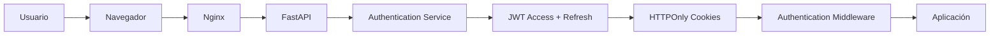

---

# Principios de Diseño

La implementación sigue varios principios fundamentales.

---

# Separación de Responsabilidades

La autenticación responde principalmente a:

> ¿Quién es el usuario?

La autorización responde posteriormente a:

> ¿Qué puede hacer este usuario sobre este recurso y en este contexto?

Por tanto:

```text
Authentication

≠

Authorization.
```

Esta separación permite evolucionar ambos mecanismos independientemente.

---

# Autenticación Basada en Tokens

La plataforma utiliza JWT para representar la identidad autenticada.

El mecanismo actual incluye:

```text
Access Token

+

Refresh Token.
```

El access token permite autenticar las peticiones ordinarias.

El refresh token permite obtener un nuevo access token cuando sea necesario sin solicitar nuevamente las credenciales del usuario.

---

# Estado de Sesión

Aunque JWT evita una sesión HTTP tradicional almacenada íntegramente en memoria del servidor, la arquitectura no debe simplificarse como completamente:

```text
stateless.
```

La autenticación utiliza:

```text
signed tokens

+

browser cookies

+

refresh-token lifecycle.
```

Además, futuras capacidades como:

```text
server-side revocation

reuse detection

session/device management
```

podrían introducir estado adicional deliberadamente.

---

# Cookies HTTPOnly

Aula Robótica Platform utiliza cookies HTTPOnly para transportar los tokens en el flujo web.

Esto permite que:

```text
el navegador envíe automáticamente las cookies

JavaScript no pueda leer directamente su contenido

SSR funcione sin gestión manual de tokens

middleware y rutas compartan el mismo contexto autenticado.
```

---

# HTTPOnly

El atributo:

```text
HttpOnly
```

impide el acceso directo a la cookie mediante APIs JavaScript normales del navegador.

Esto reduce la exposición directa del token frente a determinados escenarios XSS.

---

# HTTPOnly No Elimina XSS

HTTPOnly no significa:

```text
XSS solved.
```

Un ataque XSS puede seguir:

```text
ejecutando acciones en nombre del usuario

manipulando la interfaz

enviando peticiones autenticadas.
```

Por tanto, deben mantenerse otras defensas como:

```text
escaping

template safety

Content Security Policy cuando corresponda

validación de entradas

dependencias seguras.
```

---

# Compatibilidad con SSR

La arquitectura está diseñada específicamente para aplicaciones renderizadas en servidor.

Durante una petición autenticada:

```text
Navegador

↓

Cookie Access Token

↓

FastAPI

↓

Authentication Middleware

↓

JWT Validation

↓

request.state.user

↓

Route / Service

↓

Jinja2 Template.
```

El navegador no necesita leer manualmente el JWT.

---

# Renovación Transparente

Cuando el access token deja de ser válido y existe un refresh token válido, el middleware puede:

```text
validar el refresh token

generar un nuevo access token

reconstruir el contexto del usuario

continuar la petición.
```

Esta capacidad es:

```text
CURRENT.
```

---

# Preparación para SSO

La autenticación federada no forma parte actualmente del flujo implementado.

Su estado es:

```text
SAML
    FUTURE / CONDITIONAL

OAuth2 / OpenID Connect
    FUTURE / CONDITIONAL.
```

Una futura integración podría sustituir o complementar el mecanismo utilizado para demostrar inicialmente la identidad.

La aplicación podría seguir utilizando internamente:

```text
Internal User

+

application authentication context.
```

---

# Componentes del Sistema

| Componente | Responsabilidad |
|---|---|
| Navegador | Envío de credenciales y cookies |
| Nginx | Reverse proxy y transporte HTTP/HTTPS |
| FastAPI | Recepción y procesamiento de peticiones |
| Authentication Service | Validación de credenciales |
| Password Hasher | Verificación segura de contraseña |
| JWT Service | Creación y validación de tokens |
| Access Token | Autenticación ordinaria |
| Refresh Token | Renovación del access token |
| Cookies HTTPOnly | Transporte web de tokens |
| Authentication Middleware | Identificación y renovación automática |
| User Repository | Recuperación de identidad persistida |
| MariaDB | Persistencia relacional actual |
| Templates SSR | Presentación contextual |

---

# Arquitectura por Capas

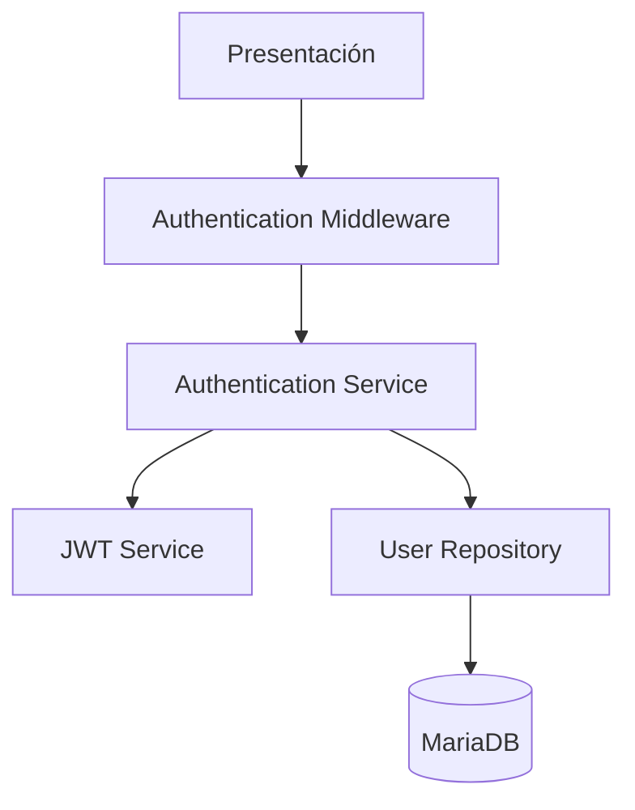

Cada componente mantiene una responsabilidad claramente definida.

---

# Flujo General de Login

El proceso de login genera actualmente:

```text
Access Token

+

Refresh Token.
```

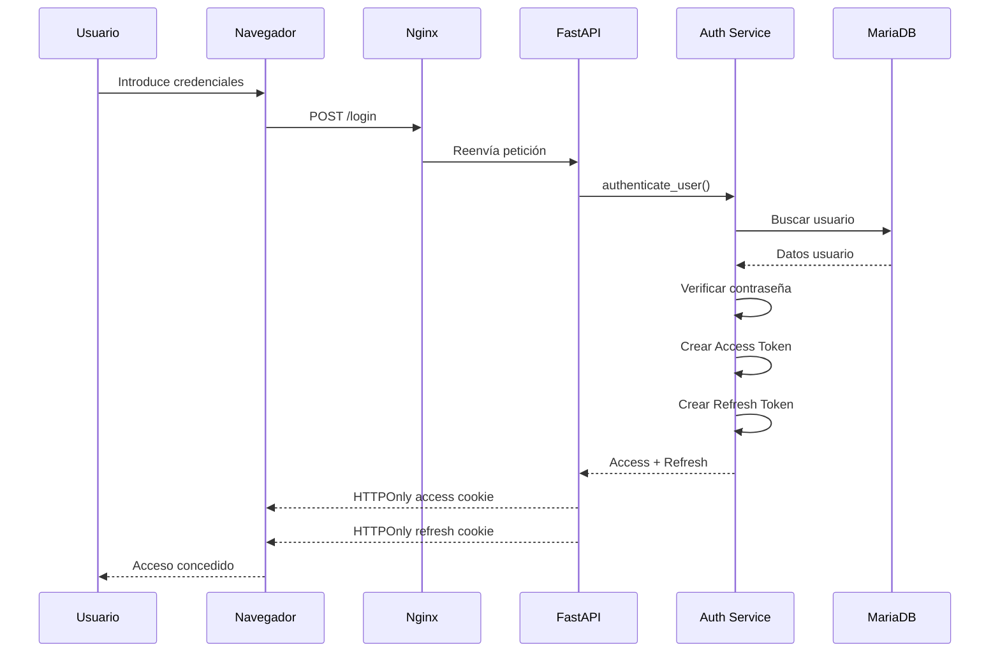

---

# Ciclo de Vida Actual

```text
No autenticado

↓

Formulario Login

↓

Validación de credenciales

↓

Access Token + Refresh Token

↓

HTTPOnly Cookies

↓

Usuario autenticado

↓

Peticiones normales

↓

Access Token válido?
```

Si:

```text
YES
    continuar petición.
```

Si no:

```text
Refresh Token válido?

    YES
        generar nuevo Access Token
        reconstruir contexto
        continuar

    NO
        autenticación requerida.
```

Finalmente:

```text
Logout

↓

Eliminar Access Cookie

+

Eliminar Refresh Cookie

↓

No autenticado.
```

---

# Inicio del Proceso

La autenticación comienza cuando el usuario accede al formulario de login.

La interfaz solicita las credenciales definidas por la implementación.

Habitualmente pueden incluir:

```text
username / email

password.
```

Las credenciales deben enviarse mediante:

```text
HTTPS
```

en producción.

---

# Recepción de Credenciales

FastAPI recibe la petición correspondiente al login.

Durante esta fase puede:

```text
validar campos obligatorios

validar formato

rechazar entradas inconsistentes

delegar autenticación al servicio correspondiente.
```

---

# Búsqueda del Usuario

El servicio de autenticación consulta la persistencia para localizar la identidad correspondiente.

La base de datos relacional actual es:

```text
MariaDB.
```

El resultado puede representar:

```text
usuario existente

usuario inexistente

usuario deshabilitado

otro estado definido por el dominio.
```

---

# Verificación de Contraseña

Las contraseñas no deben almacenarse en texto plano.

El flujo conceptual es:

```text
Contraseña introducida

↓

Password Verification

↓

Hash almacenado

↓

Comparación segura

↓

Credenciales válidas / inválidas.
```

El hash almacenado no debe permitir recuperar directamente la contraseña original.

---

# Creación de Tokens

Tras autenticar correctamente las credenciales, el sistema genera:

```text
Access Token

+

Refresh Token.
```

Ambos tienen responsabilidades distintas.

---

# Access Token

El access token representa una identidad autenticada durante un periodo limitado.

Se utiliza para:

```text
peticiones SSR

peticiones HTTP

APIs

establecimiento del contexto autenticado.
```

---

# Refresh Token

El refresh token permite:

```text
obtener un nuevo access token
```

sin exigir:

```text
username + password
```

en cada expiración del access token.

Su implementación es:

```text
CURRENT.
```

---

# Access Token vs Refresh Token

| Token | Responsabilidad |
|---|---|
| Access Token | Autenticar peticiones ordinarias |
| Refresh Token | Renovar el Access Token |
| Access Token | Vida normalmente más corta |
| Refresh Token | Vida normalmente superior |
| Access Token | Utilizado frecuentemente |
| Refresh Token | Utilizado para renovación |

---

# Estructura Conceptual del JWT

Un JWT está compuesto conceptualmente por:

```text
HEADER

.

PAYLOAD

.

SIGNATURE.
```

---

# Header

Ejemplo conceptual:

```json
{
  "alg": "HS256",
  "typ": "JWT"
}
```

El valor exacto depende de la configuración real.

---

# Payload

El payload contiene claims.

Ejemplo conceptual:

```json
{
  "sub": "125",
  "username": "admin",
  "role": "ADMIN",
  "exp": 1735689600
}
```

Este ejemplo es ilustrativo.

Las claims reales deben corresponder a la implementación.

---

# Claims

Claims habituales pueden incluir:

| Claim | Descripción |
|---|---|
| `sub` | Identidad principal |
| `username` | Nombre de usuario cuando corresponda |
| `role` | Información de rol cuando corresponda |
| `iat` | Instante de emisión |
| `exp` | Expiración |
| `iss` | Emisor cuando se utilice |
| `aud` | Audiencia cuando se utilice |

---

# Minimal Claims Principle

La información incluida en los tokens debe limitarse a:

```text
what authentication actually requires.
```

Evitar incorporar:

```text
large user profiles

sensitive domain data

volatile authorization state
```

sin necesidad.

---

# Firma

La firma permite detectar modificaciones no autorizadas del contenido.

Conceptualmente:

```text
Header

+

Payload

+

Signing Key

↓

Cryptographic Signature

↓

Signed JWT.
```

---

# Token Validation

Antes de confiar en un token deben validarse las condiciones requeridas por la implementación.

Pueden incluir:

```text
signature

expiration

token type

required claims

issuer / audience when configured.
```

---

# Expiración

Los tokens deben tener una vida limitada.

La configuración contempla conceptos como:

```text
ACCESS_TOKEN_EXPIRE_MINUTES

REFRESH_TOKEN_EXPIRE_DAYS.
```

Los valores concretos deben mantenerse en:

```text
configuration
```

y no depender de documentación estática como única fuente de verdad.

---

# Token Type Separation

Access y refresh token no son intercambiables.

Debe evitarse:

```text
using a refresh token
as an ordinary access token.
```

La validación debe reconocer el tipo de token cuando la implementación lo requiera.

---

# Cookies de Autenticación

Después del login se establecen:

```text
Access Cookie

+

Refresh Cookie.
```

Ambas se utilizan dentro del lifecycle de autenticación.

---

# Política de Cookies

Una política segura debe controlar:

```text
HttpOnly

Secure

SameSite

Path

Max-Age / Expires

environment-specific behavior.
```

---

# Estado Actual de la Política de Cookies

La implementación actual contiene política de cookies en más de un punto del flujo.

El login configura los atributos en función del entorno.

Conceptualmente:

```text
DEBUG

    SameSite = lax
    Secure = false

PRODUCTION

    SameSite = strict
    Secure = true.
```

---

# Renovación Automática y Consistencia de Cookies

Existe actualmente un punto de hardening identificado.

La renovación automática realizada desde middleware establece el nuevo access token con una configuración que no está completamente centralizada con la política utilizada durante el login.

Por tanto:

```text
HTTPOnly Cookies
    CURRENT

Environment-aware Cookie Policy
    CURRENT in login flow

Uniform Cookie Policy Across All Refresh Paths
    HARDENING / TARGET.
```

---

# Riesgo de Inconsistencia

Una renovación automática no debería poder degradar atributos como:

```text
Secure

SameSite.
```

especialmente en:

```text
production.
```

---

# Dirección de Hardening

La política debe evolucionar hacia:

```text
One Central Cookie Policy

↓

Login

Explicit Refresh

Automatic Refresh

Logout.
```

---

# Cookie Policy Invariant

```text
Every code path
that creates or renews
an authentication cookie

must apply
the same environment-aware
security policy.
```

---

# Ventajas del Modelo Adoptado

La combinación:

```text
Access JWT

+

Refresh JWT

+

HTTPOnly Cookies
```

proporciona:

```text
renovación de sesión

integración natural con SSR

menor exposición directa a JavaScript

separación entre autenticación y presentación

compatibilidad con middleware centralizado.
```

---

# Flujo de Petición Autenticada

Una vez autenticado el usuario:

```text
Browser

↓

Request + Access Cookie

↓

Nginx

↓

FastAPI

↓

Authentication Middleware

↓

Access Token Validation

↓

User Context

↓

Route

↓

Service

↓

Response.
```

---

# Diagrama

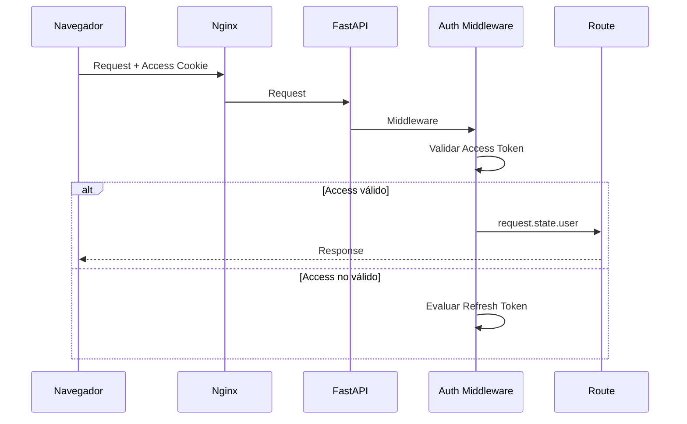

---

# Authentication Middleware

El middleware constituye un componente central del flujo.

Sus responsabilidades incluyen:

```text
leer cookies de autenticación

validar el access token

intentar renovación cuando corresponde

reconstruir el usuario autenticado

inyectar el contexto en request.state

permitir continuar la petición.
```

---

# Context Injection

Tras autenticar correctamente al usuario, el middleware puede establecer:

```python
request.state.user
```

Esto permite que otras capas accedan a:

```text
authenticated identity
```

sin repetir el proceso completo de autenticación.

---

# Authentication Context

El contexto puede reutilizarse por:

```text
SSR

REST APIs

authorization

audit

application services.
```

---

# Access Token Expirado o Inválido

Cuando la validación ordinaria del access token no permite reconstruir la identidad, el middleware puede utilizar:

```text
Refresh Token.
```

---

# Flujo de Renovación Automática

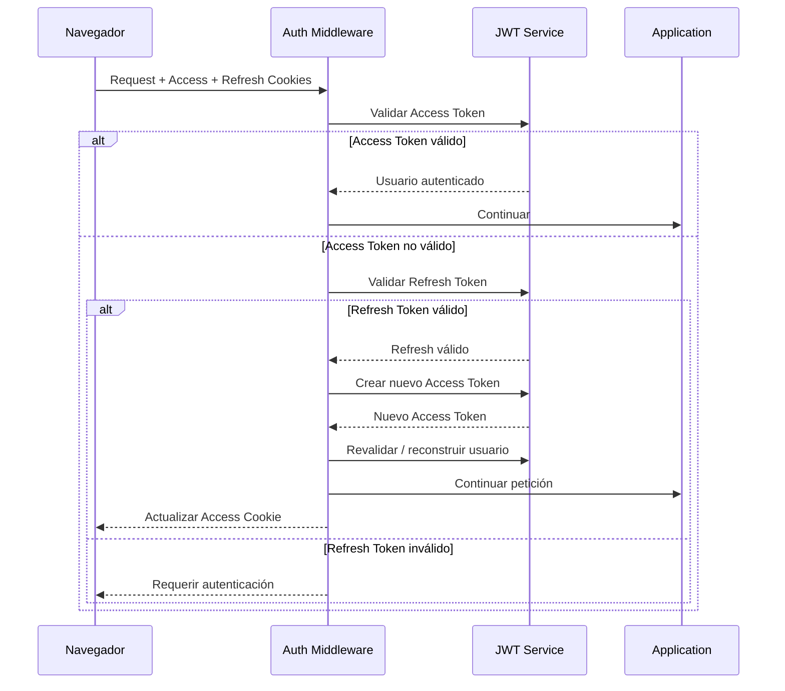

---

# Estado de Renovación Automática

```text
Automatic Access Refresh
    CURRENT.
```

---

# Explicit Refresh Endpoint

Además de la renovación automática, existe un endpoint explícito:

```text
/refresh.
```

Su estado es:

```text
CURRENT.
```

---

# Flujo de `/refresh`

Conceptualmente:

```text
Browser

↓

Refresh Cookie

↓

POST /refresh

↓

validate_refresh_token()

↓

refresh_access_token()

↓

New Access Token

↓

New Access Cookie.
```

---

# Diagrama de Refresh Explícito

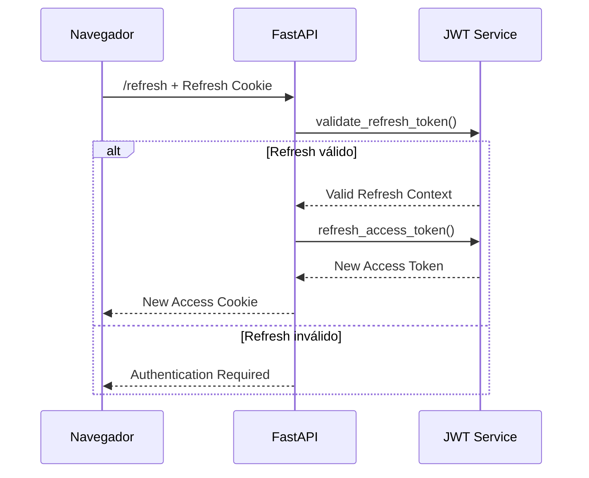

---

# Refresh Token Validation

La validación del refresh token es:

```text
CURRENT.
```

La implementación dispone de una operación equivalente a:

```python
validate_refresh_token(...)
```

para comprobar el token antes de utilizarlo para renovar el access token.

---

# Access Token Refresh

La generación de un nuevo access token a partir de un refresh token válido es:

```text
CURRENT.
```

La implementación dispone de una operación equivalente a:

```python
refresh_access_token(...)
```

---

# Refresh Token Security Hardening

La existencia de refresh tokens no significa que todo el lifecycle avanzado esté completado.

Debe distinguirse:

```text
Refresh-token Workflow
    CURRENT

Refresh-token Security Hardening
    EVOLVING / VERIFY.
```

---

# Rotation

```text
Refresh-token Rotation
    VERIFY / HARDENING.
```

No debe afirmarse como garantía completa sin verificar el comportamiento correspondiente.

---

# Server-side Revocation

```text
Server-side Revocation
    VERIFY / HARDENING.
```

La eliminación de la cookie durante logout no equivale necesariamente a:

```text
server-side cryptographic revocation.
```

---

# Reuse Detection

```text
Refresh-token Reuse Detection
    FUTURE HARDENING.
```

---

# Session / Device Management

```text
Session / Device Management
    FUTURE.
```

Podría permitir en el futuro:

```text
listar sesiones

revocar una sesión concreta

revocar otros dispositivos

mostrar último uso

gestionar dispositivos reconocidos.
```

---

# Logout

El logout actual elimina:

```text
Access Cookie

+

Refresh Cookie.
```

---

# Flujo de Logout

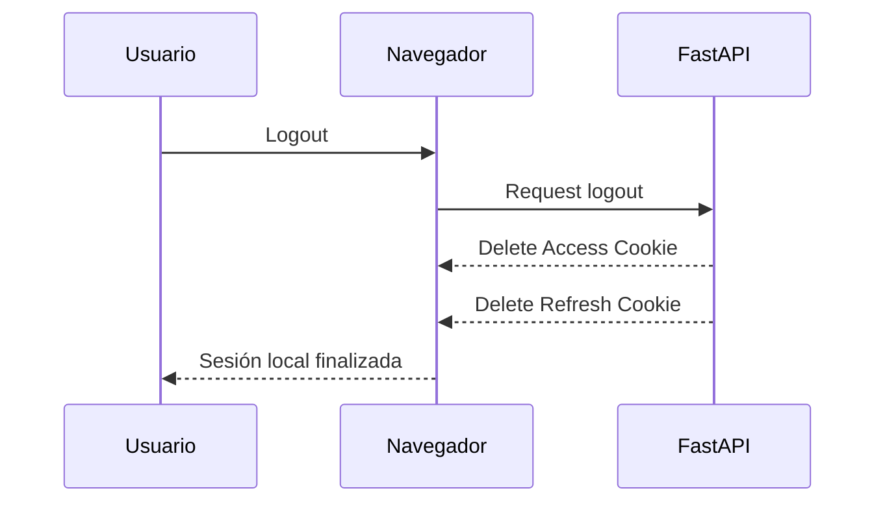

---

# Logout Token Cleanup

```text
Logout Token Cleanup
    CURRENT.
```

---

# Important Distinction

```text
Delete Browser Cookie

≠

Server-side Token Revocation.
```

La primera capacidad está implementada.

La segunda pertenece a:

```text
VERIFY / HARDENING
```

según el mecanismo concreto de revocación disponible.

---

# Authentication Failure

La autenticación puede fallar por:

```text
credenciales inválidas

usuario no válido

access token inválido

refresh token inválido

token expirado

token mal formado

firma inválida.
```

---

# Failure Principle

Ante fallo de autenticación:

```text
do not construct
an authenticated user context.
```

---

# Error Information

Las respuestas no deberían revelar innecesariamente:

```text
existencia de usuarios

detalles criptográficos

contenido de tokens

stack traces

información interna sensible.
```

---

# Integración con Autorización

Una vez identificada la identidad, comienza la autorización.

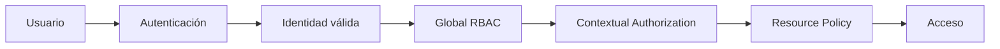

---

# Estado Actual de Autorización

La autenticación no debe implicar que toda la autorización contextual esté completamente madura.

Estado general:

```text
Global RBAC
    CURRENT

Contextual Authorization
    PARTIAL / IN PROGRESS

ProjectMembership
    TARGET / IN CONSOLIDATION.
```

---

# Relación entre JWT y RBAC

El JWT proporciona información inicial sobre la identidad.

Sin embargo:

```text
authorization
must not rely exclusively
on stale token claims
when current resource context matters.
```

El sistema puede necesitar consultar:

```text
global roles

project membership

context role

resource ownership

resource relationships.
```

---

# Autorización Contextual

Los permisos pueden depender de:

```text
user

action

resource

context.
```

Ejemplos:

```text
propietario del recurso

miembro del proyecto

rol contextual

administrador global.
```

---

# UI Authorization

SSR puede adaptar la interfaz según el contexto.

Por ejemplo:

```text
mostrar u ocultar acciones

habilitar controles

personalizar navegación.
```

---

# Critical Security Rule

```text
Hidden UI

≠

Authorization.
```

La autorización real debe aplicarse:

```text
server-side.
```

---

# Integración con SSR

El usuario autenticado puede formar parte del contexto utilizado durante el renderizado.

```text
Authenticated User

↓

Authorization Context

↓

Jinja2

↓

Rendered UI.
```

---

# Integración con APIs

Las APIs protegidas reutilizan la identidad autenticada.

Conceptualmente:

```text
Request

↓

Authentication

↓

User Context

↓

Authorization

↓

Application Operation

↓

Response.
```

---

# Integración con WebSockets

La plataforma dispone actualmente de:

```text
FastAPI WebSockets.
```

La autenticación puede reutilizar información procedente del contexto HTTP/cookies durante el establecimiento de la conexión.

---

# WebSocket Security Status

Debe distinguirse:

```text
WebSocket Foundation
    CURRENT

WebSocket Authentication Hardening
    TARGET / ACTIVE CONSOLIDATION

Subscription Authorization
    TARGET.
```

---

# Important Realtime Rule

```text
Authenticated WebSocket

≠

Authorized Subscription.
```

Un usuario autenticado no debería poder suscribirse automáticamente a:

```text
any project

any resource

any channel.
```

---

# Arquitectura Compartida

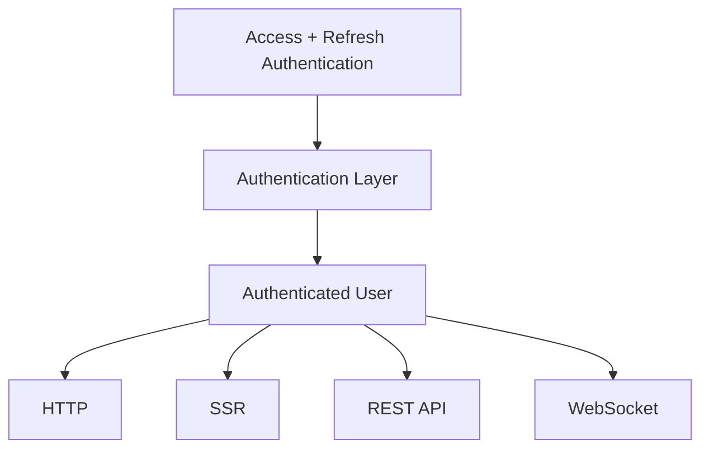

---

# Integración con Docker

La configuración de autenticación se proporciona mediante:

```text
environment configuration.
```

Conceptos relevantes incluyen:

```text
SECRET_KEY

JWT algorithm

Access Token lifetime

Refresh Token lifetime

Cookie security policy.
```

Los nombres concretos deben verificarse contra:

```text
current application settings
```

antes de considerarlos contrato estable.

---

# Integración con Nginx

Nginx actúa como reverse proxy.

Debe preservar correctamente:

```text
cookies

headers

HTTPS forwarding information

WebSocket upgrades

client/proxy context required by the application.
```

---

# Integración con HTTPS

HTTPS es fundamental para proteger:

```text
credentials

authentication cookies

application traffic.
```

En producción:

```text
Secure cookies
```

deben formar parte de la política efectiva.

---

# Current Cookie Hardening Issue

La configuración de login contempla:

```text
Secure = true
```

fuera de DEBUG.

Sin embargo, la renovación automática debe centralizarse para garantizar que:

```text
the renewed cookie
preserves the production security policy.
```

---

# Integración Futura con SAML

**Estado:**

```text
FUTURE / CONDITIONAL

NOT IMPLEMENTED.
```

Una futura integración podría seguir:

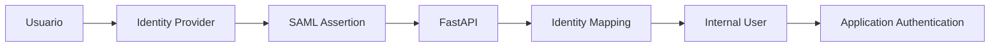

---

# SAML Boundary

SAML respondería a:

```text
external identity authentication.
```

No sustituiría:

```text
Global RBAC

ProjectMembership

Contextual Authorization

Resource Authorization.
```

---

# Integración Futura con OAuth2 / OIDC

**Estado:**

```text
FUTURE / CONDITIONAL.
```

Podrían evaluarse proveedores como:

```text
Microsoft Entra ID

Google

GitHub

GitLab

Keycloak

other compatible identity providers.
```

---

# Identity Principle

Una futura identidad externa debería mapearse hacia:

```text
Internal User.
```

---

# Not

```text
External Provider Identity

=

Business Authorization.
```

---

# Seguridad del Flujo Actual

Las capacidades actuales incluyen:

```text
password hashing

signed JWTs

access-token expiration

refresh-token workflow

HTTPOnly cookies

explicit refresh

automatic access refresh

logout cookie cleanup

central authentication middleware.
```

---

# Hardening Pendiente o en Evolución

```text
formal CSRF protection

cookie policy consistency

refresh-token rotation verification

server-side revocation verification

reuse detection

session/device management

WebSocket authentication hardening

subscription authorization.
```

---

# CSRF

El uso de:

```text
SameSite
```

contribuye a reducir determinados escenarios CSRF.

Pero:

```text
SameSite

≠

formal CSRF protection.
```

---

# CSRF Status

```text
Formal CSRF Protection
    TARGET / PLANNED.
```

---

# Security Matrix

| Área | Estado |
|---|---|
| Password hashing | CURRENT |
| JWT Access Token | CURRENT |
| JWT Refresh Token | CURRENT |
| Access Cookie | CURRENT |
| Refresh Cookie | CURRENT |
| HTTPOnly | CURRENT |
| Explicit `/refresh` | CURRENT |
| Automatic Access Refresh | CURRENT |
| Refresh-token Validation | CURRENT |
| Logout Cookie Cleanup | CURRENT |
| Global RBAC | CURRENT |
| Contextual Authorization | PARTIAL |
| Formal CSRF Protection | TARGET / PLANNED |
| Cookie Policy Centralization | TARGET |
| Refresh Rotation | VERIFY / HARDENING |
| Server-side Revocation | VERIFY / HARDENING |
| Reuse Detection | FUTURE HARDENING |
| Session/Device Management | FUTURE |
| SAML | FUTURE / CONDITIONAL |
| OAuth2 / OIDC | FUTURE / CONDITIONAL |

---

# Threat Matrix

| Amenaza | Mitigación / Estado |
|---|---|
| Contraseña almacenada inseguramente | Password hashing |
| Manipulación de JWT | Firma y validación |
| Exposición directa del token a JS | HTTPOnly cookies |
| Access token comprometido | Expiración limitada |
| Access token expirado | Refresh workflow |
| CSRF | SameSite + formal protection pendiente |
| Acceso anónimo | Authentication middleware |
| Escalada global de privilegios | Global RBAC |
| Acceso cross-project | Contextual authorization en consolidación |
| Subscription abuse | WebSocket subscription authorization target |
| Refresh token comprometido | Hardening adicional requerido |

---

# Auditoría

La autenticación constituye una fuente importante de eventos de seguridad.

Pueden resultar relevantes:

```text
login

logout

authentication failure

refresh failure

access denial

password change

account status change.
```

---

# Audit Security

No deben registrarse:

```text
raw passwords

raw access tokens

raw refresh tokens

authentication cookie values.
```

---

# Observabilidad

La observabilidad puede incluir:

```text
login success/failure

refresh success/failure

authentication failures

authorization denials

token-validation failures

WebSocket authentication failures.
```

---

# Privacy Principle

Las métricas y logs deben proporcionar:

```text
operational value
```

sin introducir:

```text
unnecessary sensitive information.
```

---

# Troubleshooting

| Problema | Posible causa |
|---|---|
| Login incorrecto | Credenciales inválidas |
| Access cookie ausente | Configuración de cookie o respuesta |
| Refresh cookie ausente | Login/cookie lifecycle |
| JWT inválido | Firma, formato o configuración |
| Access token expirado | Expiración normal |
| Refresh fallido | Refresh token inválido/expirado |
| Renovación insegura | Política de cookies no centralizada |
| Error WebSocket | Autenticación/conexión/cookie |
| Acceso denegado | Autorización |
| Acceso cross-project | Contextual authorization defect |

---

# Buenas Prácticas

```text
usar HTTPS en producción

mantener access tokens de vida limitada

utilizar refresh tokens para renovación

mantener claims mínimas

almacenar secretos fuera del código

utilizar HTTPOnly cookies

aplicar Secure en producción

centralizar SameSite / Secure / HttpOnly

validar todos los tokens

distinguir access y refresh token

desacoplar autenticación y autorización

reutilizar el contexto autenticado

proteger operaciones mediante autorización server-side

no registrar tokens

probar escenarios negativos.
```

---

# Estado Actual

Actualmente Aula Robótica Platform dispone de:

```text
JWT Access Token
    CURRENT

JWT Refresh Token
    CURRENT

Access + Refresh Cookies
    CURRENT

HTTPOnly Cookies
    CURRENT

Explicit /refresh
    CURRENT

Automatic Access Refresh
    CURRENT

Refresh-token Validation
    CURRENT

Logout Access + Refresh Cookie Cleanup
    CURRENT

Authentication Middleware
    CURRENT

FastAPI Integration
    CURRENT

Jinja2 SSR Integration
    CURRENT

REST API Authentication
    CURRENT

WebSocket Authentication Foundation
    CURRENT

Global RBAC
    CURRENT

Contextual Authorization
    PARTIAL / IN PROGRESS.
```

---

# Consolidación Actual

Las áreas principales de hardening son:

```text
Formal CSRF Protection

Cookie Policy Consistency

Refresh-token Rotation Verification

Server-side Revocation Verification

Cross-project Authorization

WebSocket Authentication Hardening

WebSocket Subscription Authorization

Security Regression Tests.
```

---

# Evolución Futura

Capacidades futuras o condicionales incluyen:

```text
refresh-token reuse detection

session/device management

MFA

SAML 2.0

OAuth2

OpenID Connect

Microsoft Entra ID federation

Active Directory integration

passwordless authentication.
```

---

# Future Identity Rule

Estas capacidades deben introducirse únicamente cuando exista:

```text
validated identity requirement.
```

---

# SAML Status

```text
SAML
    FUTURE / CONDITIONAL
    NOT IMPLEMENTED.
```

---

# OAuth2 / OIDC Status

```text
OAuth2 / OpenID Connect
    FUTURE / CONDITIONAL.
```

---

# Refresh Status

No debe volver a documentarse:

```text
Refresh Token
    FUTURE.
```

La clasificación correcta es:

```text
Refresh-token Workflow
    CURRENT

Refresh-token Security Hardening
    EVOLVING / VERIFY.
```

---

# Beneficios Obtenidos

La arquitectura actual proporciona:

```text
autenticación desacoplada

renovación de access token

integración transparente con SSR

integración con FastAPI

compatibilidad con APIs

base común para WebSockets

menor exposición directa de tokens a JavaScript

separación de autenticación y autorización

capacidad de evolución hacia identidad federada.
```

---

# 📊 Resumen Global del Flujo

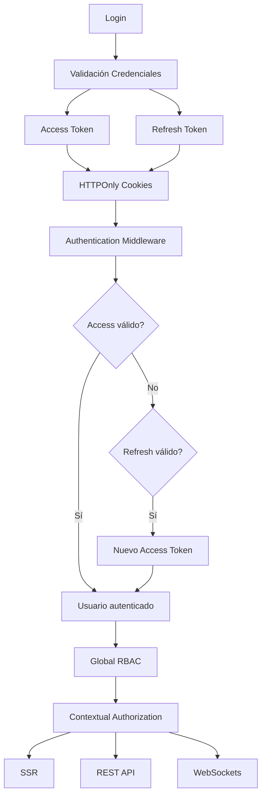

---

# 📊 Flujo de Logout

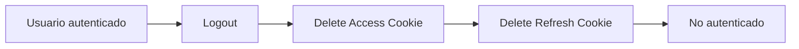

---

# 📊 Evolución de Seguridad

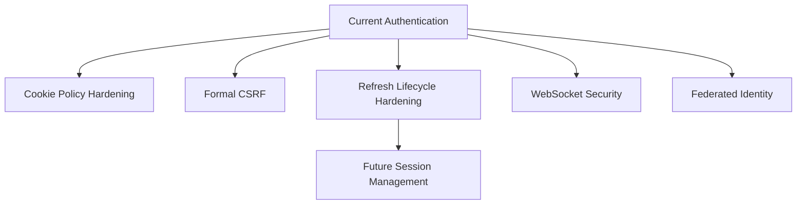

---

# Matriz Temporal

| Capacidad | Estado |
|---|---|
| Local Login | CURRENT |
| JWT Access Token | CURRENT |
| JWT Refresh Token | CURRENT |
| HTTPOnly Access Cookie | CURRENT |
| HTTPOnly Refresh Cookie | CURRENT |
| Explicit Refresh | CURRENT |
| Automatic Access Refresh | CURRENT |
| Logout Cookie Cleanup | CURRENT |
| Global RBAC | CURRENT |
| Contextual Authorization | PARTIAL |
| ProjectMembership | TARGET / IN CONSOLIDATION |
| CSRF Hardening | TARGET / PLANNED |
| Cookie Policy Centralization | TARGET |
| Refresh Rotation | VERIFY / HARDENING |
| Server-side Revocation | VERIFY / HARDENING |
| Reuse Detection | FUTURE HARDENING |
| Session/Device Management | FUTURE |
| SAML | FUTURE / CONDITIONAL |
| OAuth2 / OIDC | FUTURE / CONDITIONAL |
| MFA | FUTURE |
| Passwordless | FUTURE |

---

# Arquitectura Actual

```text
Browser

↓

Access + Refresh HTTPOnly Cookies

↓

Nginx

↓

FastAPI

↓

Authentication Middleware

├── Access Token Validation
│
└── Refresh Token Validation
        ↓
    Automatic Access Refresh

↓

Authenticated User Context

↓

Global RBAC

↓

Partial Contextual Authorization

↓

Application.
```

---

# Arquitectura Futura Condicional

```text
External Identity Provider

↓

SAML / OIDC

↓

Identity Mapping

↓

Internal User

↓

Existing Application Authorization.
```

---

# Invariantes

```text
Authentication
    ≠ Authorization

Access Token
    ≠ Refresh Token

Cookie Deletion
    ≠ Server-side Revocation

HTTPOnly
    ≠ Complete XSS Protection

SameSite
    ≠ Formal CSRF Protection

Authenticated
    ≠ Authorized

Authenticated WebSocket
    ≠ Authorized Subscription

Federated Identity
    ≠ Contextual Authorization

Refresh-token Workflow
    ≠ Refresh-token Hardening.
```

---

# 📌 Conclusiones

La arquitectura de autenticación de Aula Robótica Platform dispone actualmente de un flujo completo basado en:

```text
JWT Access Token

+

JWT Refresh Token

+

HTTPOnly Cookies.
```

El login genera los tokens necesarios para establecer la sesión web.

El access token se utiliza para autenticar las peticiones ordinarias.

El refresh token permite renovar el access token mediante:

```text
explicit /refresh

and

automatic middleware refresh.
```

El logout elimina actualmente:

```text
Access Cookie

+

Refresh Cookie.
```

Por tanto, los refresh tokens no constituyen una capacidad futura ni una simple preparación arquitectónica:

```text
Refresh-token Workflow
    CURRENT.
```

La evolución pendiente se concentra en:

```text
refresh-token security hardening

cookie policy centralization

formal CSRF protection

contextual authorization maturity

WebSocket security

subscription authorization.
```

La autenticación y la autorización permanecen claramente separadas.

El estado actual puede resumirse como:

```text
Authentication:
    JWT Access + Refresh
    CURRENT

Session Transport:
    HTTPOnly Cookies
    CURRENT

Refresh:
    Explicit + Automatic
    CURRENT

Authorization:
    Global RBAC
    CURRENT

Contextual Authorization:
    PARTIAL / IN PROGRESS

Federated Identity:
    FUTURE / CONDITIONAL.
```

Esta base permite evolucionar hacia mecanismos como:

```text
SAML

OAuth2

OpenID Connect

MFA

session/device management
```

sin presentar ninguna de estas capacidades como implementada antes de disponer de evidencia real.

El principio rector permanece:

```text
Document what exists.

Harden what is incomplete.

Keep authentication
and authorization separate.

Never promote future identity capabilities
to current architecture
without implementation evidence.
```
