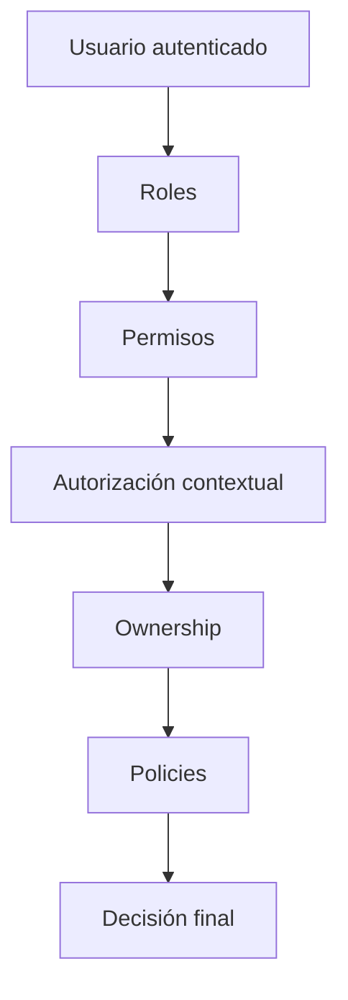
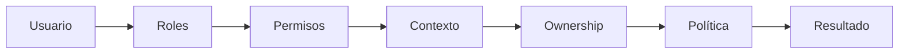
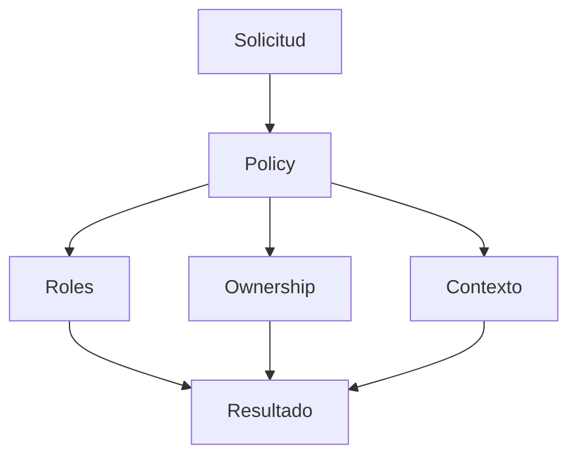

# 10_RBAC_CONTEXTUAL.md

# 🛡️ RBAC y Autorización Contextual

---

# 📌 Introducción

La autorización constituye uno de los componentes fundamentales de la arquitectura de Aula Robótica Platform.

Mientras que la autenticación permite verificar la identidad del usuario, la autorización determina qué operaciones puede realizar sobre los distintos recursos del sistema.

La plataforma implementa un modelo híbrido que combina:

- RBAC (Role-Based Access Control)
- permisos granulares
- autorización contextual
- ownership
- políticas reutilizables
- renderizado contextual SSR
- validaciones backend

Este enfoque permite construir una arquitectura flexible, mantenible y preparada para futuras ampliaciones sin necesidad de rediseñar el sistema de permisos.

---

# 🎯 Objetivos

La arquitectura RBAC fue diseñada para satisfacer simultáneamente requisitos funcionales y arquitectónicos.

## Objetivos funcionales

- controlar el acceso a los recursos;
- limitar operaciones según el perfil del usuario;
- facilitar la administración de permisos;
- soportar colaboración multiusuario;
- proteger recursos compartidos;
- permitir crecimiento futuro.

---

## Objetivos técnicos

- desacoplar autenticación y autorización;
- minimizar duplicación de lógica;
- reutilizar políticas de autorización;
- soportar autorización contextual;
- favorecer mantenibilidad;
- aproximar la arquitectura a modelos enterprise.

---

# 🧠 Principios de Diseño

---

# Separación de responsabilidades

La autenticación y la autorización son procesos completamente independientes.

```text
Autenticación
↓

¿Quién eres?

Autorización

↓

¿Qué puedes hacer?
```

Esta separación simplifica la evolución futura del sistema y facilita la incorporación de nuevos mecanismos de autenticación.

---

# Permisos atómicos

La unidad mínima del sistema de autorización es el permiso.

Cada permiso representa una acción concreta sobre un recurso.

Ejemplos:

```text
users:create
users:update
projects:delete
tasks:update
activities:read
dashboard:view
```

Los permisos no dependen directamente de los usuarios, sino que posteriormente se agrupan mediante roles.

---

# Roles como agregadores

Los roles actúan como agrupaciones lógicas de permisos.

En lugar de asignar permisos individualmente a cada usuario, éstos se conceden a través de uno o varios roles.

Este enfoque simplifica enormemente la administración del sistema.

---

# Autorización contextual

El acceso no depende únicamente del rol asignado al usuario.

También se consideran otros elementos:

- proyecto actual;
- pertenencia al proyecto;
- ownership;
- relación con la entidad;
- estado del recurso;
- contexto funcional.

Este modelo proporciona mucha mayor flexibilidad que un RBAC tradicional.

---

# Backend First Authorization

Toda autorización efectiva se realiza siempre desde el backend.

La interfaz únicamente adapta la experiencia de usuario ocultando acciones no disponibles.

No obstante, cualquier operación vuelve a validarse desde servidor antes de ejecutarse.

---

# Arquitectura General

La autorización del sistema combina diferentes mecanismos.



Cada uno de estos niveles aporta información adicional para determinar si una operación debe permitirse o rechazarse.

---

# Componentes del Sistema

La arquitectura RBAC se encuentra formada por varios elementos independientes.

| Componente | Responsabilidad |
|------------|-----------------|
| User | Usuario de la plataforma |
| Identity | Identidad de autenticación |
| Role | Perfil funcional |
| Permission | Acción autorizada |
| UserRole | Asociación usuario-rol |
| RolePermission | Asociación rol-permiso |
| Policies | Reglas reutilizables |
| Context Resolver | Resolución del contexto |

---

# Modelo RBAC Global

El sistema implementa un modelo RBAC clásico desacoplado de la autenticación.

---

# Usuarios

Los usuarios representan personas registradas en la plataforma.

Contienen únicamente información funcional:

- nombre;
- correo;
- estado;
- información académica.

Las credenciales de autenticación permanecen desacopladas.

---

# Identidades

La autenticación se gestiona mediante entidades independientes.

Esta separación permite incorporar en el futuro diferentes proveedores de autenticación como:

- login local;
- OAuth2;
- SAML;
- LDAP;
- Single Sign-On.

---

# Roles

Los roles representan perfiles funcionales globales.

Actualmente la plataforma incorpora:

| Rol | Descripción |
|------|-------------|
| Administrador | Gestión completa de la plataforma |
| Profesor | Gestión académica |
| Estudiante | Participación en proyectos |

La arquitectura permite incorporar nuevos roles sin modificar el resto del sistema.

---

# Permisos

Los permisos representan acciones concretas sobre recursos específicos.

Formato utilizado:

```text
resource:action
```

Ejemplos:

```text
projects:create
projects:update
projects:delete

tasks:create
tasks:update

activities:create

users:update
```

Este formato resulta fácilmente extensible y facilita futuras automatizaciones.

---

# Relaciones del Modelo

La arquitectura utiliza relaciones many-to-many.

## Usuario ↔ Rol

Un usuario puede disponer de varios roles.

Un mismo rol puede asignarse a múltiples usuarios.

```text
User

↓

UserRole

↓

Role
```

---

## Rol ↔ Permiso

Cada rol agrupa varios permisos.

Un permiso puede reutilizarse por distintos roles.

```text
Role

↓

RolePermission

↓

Permission
```

Esta separación evita duplicidades y mejora considerablemente la mantenibilidad del sistema.

---

# Jerarquía de Roles

Aunque el sistema implementa un modelo RBAC clásico, los roles presentan distintos niveles de responsabilidad dentro de la plataforma.

La jerarquía no implica herencia automática de permisos, sino una clasificación funcional que facilita la administración y comprensión del sistema.

```text
Administrador

│

├── Profesor

│

└── Estudiante
```

Cada rol dispone de un conjunto de permisos adaptado a sus responsabilidades.

---

# Permisos Efectivos

Los permisos efectivos de un usuario son el resultado de combinar toda la información disponible en el momento de la operación.

No dependen exclusivamente del rol asignado.

Para determinar si una acción está permitida se consideran:

- roles asignados;
- permisos asociados;
- ownership;
- pertenencia al proyecto;
- contexto funcional;
- estado del recurso.

---

## Resolución de Permisos



Este proceso permite mantener un modelo de autorización flexible sin incrementar la complejidad del código.

---

# Ownership

Uno de los mecanismos más importantes implementados es la validación de ownership.

Ownership determina si un recurso pertenece funcionalmente al usuario que intenta modificarlo.

Ejemplos habituales:

- propietario de un proyecto;
- responsable de una tarea;
- autor de una actividad;
- creador de un recurso.

---

## Ventajas

La incorporación de ownership permite:

- reducir permisos excesivos;
- proteger recursos compartidos;
- facilitar colaboración;
- mejorar la trazabilidad.

---

# Membresía de Proyecto

Muchas operaciones dependen de la pertenencia del usuario a un proyecto concreto.

Antes de ejecutar determinadas acciones el sistema verifica:

- si el usuario pertenece al proyecto;
- si dispone del rol adecuado dentro del mismo;
- si mantiene permisos suficientes.

Este mecanismo evita accesos cruzados entre proyectos independientes.

---

# Roles Contextuales

Además del rol global, determinadas funcionalidades pueden depender de un rol específico dentro de un proyecto.

Ejemplos:

| Rol contextual | Capacidades |
|---------------|-------------|
| Coordinador | Gestión completa del proyecto |
| Colaborador | Trabajo sobre tareas asignadas |
| Observador | Consulta sin modificación |

Este enfoque permite reutilizar los mismos usuarios en distintos proyectos con responsabilidades diferentes.

---

# Políticas de Autorización

La lógica de autorización se organiza mediante políticas reutilizables.

Una política representa una regla de negocio encargada de determinar si una operación concreta está permitida.

Ejemplos:

- puede editar un proyecto;
- puede eliminar una tarea;
- puede administrar usuarios;
- puede visualizar auditoría.

Las políticas encapsulan la lógica de autorización evitando duplicaciones en los controladores.

---

# Arquitectura de Policies



---

# Helpers de Autorización

Para simplificar el desarrollo, las comprobaciones más frecuentes se encapsulan en funciones reutilizables.

Estas funciones reciben:

- usuario;
- recurso;
- acción;
- contexto.

Y devuelven una decisión binaria.

```text
True

↓

Operación permitida

False

↓

Operación denegada
```

Esta aproximación mejora la mantenibilidad y facilita el testing de la lógica de autorización.

---

# Integración con la Interfaz

La arquitectura RBAC también participa en el renderizado de la interfaz.

Antes de generar cada vista, el backend calcula los permisos efectivos del usuario.

Con esta información la interfaz puede:

- ocultar botones;
- deshabilitar acciones;
- mostrar módulos disponibles;
- adaptar la navegación.

Es importante destacar que estas restricciones son únicamente visuales.

Todas las operaciones vuelven a validarse posteriormente en backend.

---

# Ejemplo de Flujo de Autorización

Supongamos que un usuario intenta modificar una tarea.

El sistema sigue una secuencia similar a la siguiente:

1. Validar autenticación.
2. Obtener roles asignados.
3. Resolver permisos efectivos.
4. Comprobar pertenencia al proyecto.
5. Verificar ownership de la tarea.
6. Aplicar la política correspondiente.
7. Autorizar o rechazar la operación.

Este flujo permite incorporar nuevas reglas sin modificar la estructura general del sistema.

---

# Beneficios del Modelo

La combinación de RBAC, permisos granulares y autorización contextual aporta numerosas ventajas.

## Flexibilidad

Permite representar escenarios complejos sin proliferación de roles.

---

## Escalabilidad

La incorporación de nuevos módulos únicamente requiere añadir nuevos permisos y políticas.

---

## Mantenibilidad

Las reglas de autorización permanecen centralizadas y desacopladas del resto del código.

---

## Reutilización

Las mismas políticas pueden utilizarse desde:

- vistas SSR;
- endpoints REST;
- WebSockets;
- servicios internos.

---

## Seguridad

La autorización contextual reduce considerablemente el riesgo de accesos indebidos, incluso cuando distintos usuarios comparten el mismo rol global.

---

# Integración con la Arquitectura SSR

La arquitectura de autorización se integra de forma transparente con el modelo **Server-Side Rendering (SSR)** utilizado por Aula Robótica Platform.

Antes de renderizar cualquier página, el backend calcula los permisos efectivos del usuario autenticado y los incorpora al contexto de la plantilla Jinja2.

Esto permite adaptar dinámicamente la interfaz sin trasladar la lógica de autorización al navegador.

---

## Renderizado Contextual

Cada vista puede modificar automáticamente:

- menús disponibles;
- botones de acción;
- formularios;
- opciones administrativas;
- enlaces de navegación;
- paneles de administración.

Como consecuencia, cada usuario visualiza únicamente aquellas funcionalidades para las que dispone de autorización.

---

## Importante

La ocultación de elementos visuales mejora la experiencia de usuario, pero **no constituye un mecanismo de seguridad**.

Todas las operaciones vuelven a validarse posteriormente en backend antes de ejecutarse.

---

# Integración con WebSockets

La plataforma incorpora funcionalidades colaborativas mediante WebSockets.

Estas comunicaciones también utilizan el sistema RBAC.

Antes de aceptar una conexión WebSocket se realizan varias comprobaciones.

---

## Flujo de Validación

```mermaid
flowchart LR

Cliente

--> Handshake

Handshake

--> Usuario

Usuario

--> Roles

Roles

--> Permisos

Permisos

--> Contexto

Contexto

--> Room

Room

--> Conexión aceptada
```

---

## Operaciones Protegidas

La autorización controla el acceso a:

- dashboard realtime;
- actividad reciente;
- notificaciones;
- Kanban colaborativo;
- rooms de proyecto.

De este modo únicamente reciben información los usuarios autorizados.

---

# Relación con la Arquitectura IAM

RBAC constituye únicamente una parte del modelo IAM implementado por la plataforma.

Mientras que IAM gestiona:

- identidades;
- autenticación;
- proveedores;
- usuarios;

RBAC determina qué operaciones puede ejecutar posteriormente cada usuario autenticado.

```text
Identity

↓

Authentication

↓

User

↓

Roles

↓

Permissions

↓

Policies

↓

Authorization
```

Esta separación facilita futuras integraciones con:

- OAuth2;
- LDAP;
- Active Directory;
- SAML;
- Single Sign-On.

---

# Auditoría de Autorizaciones

El sistema puede registrar información relacionada con operaciones relevantes de autorización.

Entre otros eventos:

- accesos denegados;
- modificaciones administrativas;
- cambios de permisos;
- asignación de roles;
- operaciones críticas.

Esta información resulta especialmente útil para:

- depuración;
- análisis de incidencias;
- trazabilidad;
- auditorías de seguridad.

---

# Casos de Uso

## Caso 1

Un estudiante intenta eliminar un proyecto.

Proceso:

1. Usuario autenticado.
2. Resolución de roles.
3. Obtención de permisos.
4. Evaluación del contexto.
5. Aplicación de la política.
6. Operación denegada.

---

## Caso 2

Un profesor modifica una tarea perteneciente a un proyecto del que forma parte.

Proceso:

1. Usuario autenticado.
2. Permiso de edición.
3. Verificación de pertenencia.
4. Validación de ownership.
5. Operación autorizada.

---

## Caso 3

Un administrador accede al módulo de auditoría.

Proceso:

1. Usuario autenticado.
2. Rol administrador.
3. Permiso audit:read.
4. Acceso concedido.

---

# Buenas Prácticas Aplicadas

Durante el desarrollo se siguieron diversas recomendaciones ampliamente utilizadas en arquitecturas backend modernas.

Entre ellas:

- separación entre autenticación y autorización;
- centralización de políticas;
- permisos reutilizables;
- validaciones backend;
- principio de mínimo privilegio;
- desacoplamiento entre UI y autorización;
- reutilización de helpers;
- integración con middleware;
- arquitectura preparada para crecimiento.

---

# Ventajas de la Arquitectura

La solución implementada proporciona numerosos beneficios.

## Seguridad

Las operaciones siempre se validan desde servidor.

---

## Flexibilidad

Es posible añadir nuevos recursos y permisos sin modificar el diseño general.

---

## Escalabilidad

El crecimiento funcional únicamente requiere incorporar nuevas políticas y permisos.

---

## Mantenibilidad

Toda la lógica de autorización permanece centralizada.

---

## Reutilización

Las mismas reglas pueden utilizarse desde:

- vistas SSR;
- APIs REST;
- WebSockets;
- servicios internos.

---

## Extensibilidad

La arquitectura queda preparada para incorporar nuevos mecanismos de autenticación y autorización sin afectar al resto del sistema.

---

# Estado Actual

Actualmente el sistema dispone de:

✅ Modelo RBAC completamente funcional.

✅ Permisos granulares.

✅ Roles desacoplados.

✅ Validaciones contextuales.

✅ Ownership.

✅ Políticas reutilizables.

✅ Middleware de autorización.

✅ Integración SSR.

✅ Protección WebSocket.

✅ Integración con IAM.

---

# Evolución Futura

La arquitectura actual permite evolucionar hacia escenarios más avanzados sin necesidad de rediseñar el modelo de autorización.

Entre las mejoras previstas destacan:

- políticas declarativas;
- ABAC (Attribute Based Access Control);
- autorización basada en organizaciones;
- delegación de permisos;
- permisos temporales;
- jerarquías dinámicas de roles;
- integración con proveedores SSO;
- autorización distribuida.

---

# 📌 Conclusiones

El modelo RBAC implementado en Aula Robótica Platform constituye una solución flexible y mantenible para la gestión de autorizaciones dentro de una plataforma colaborativa.

La combinación de roles, permisos granulares, autorización contextual, ownership y políticas reutilizables permite controlar el acceso a los recursos de forma precisa sin incrementar innecesariamente la complejidad del sistema.

La estrecha integración con la arquitectura SSR, los WebSockets, el middleware de seguridad y el modelo IAM proporciona una solución coherente que mantiene separadas las responsabilidades de autenticación y autorización, facilitando tanto el mantenimiento como la futura evolución hacia arquitecturas empresariales de mayor complejidad.

Gracias a esta aproximación, la plataforma dispone de una base sólida sobre la que incorporar nuevas funcionalidades, nuevos perfiles de usuario y futuros mecanismos de identidad federada sin comprometer la seguridad ni la mantenibilidad del sistema.

