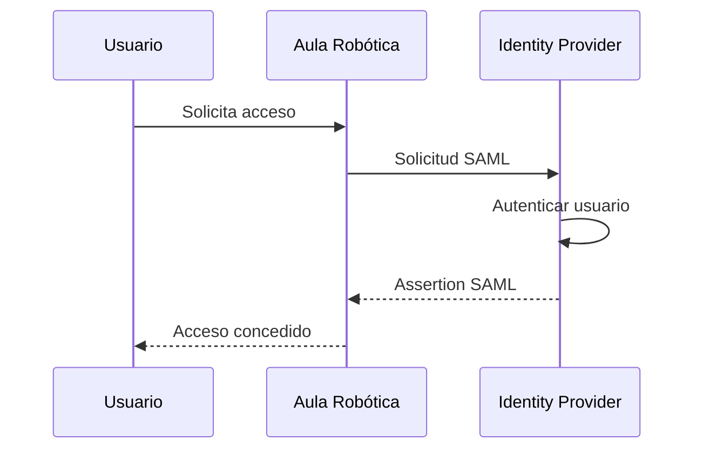
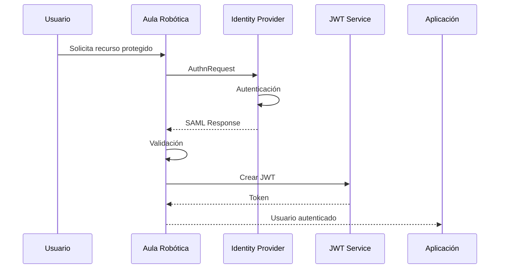

# 11_SAML_INTEGRATION.md

# 🏢 Integración con SAML 2.0

---

# 📌 Introducción

Aula Robótica Platform ha sido diseñada siguiendo una arquitectura modular que facilita la incorporación de mecanismos avanzados de autenticación empresarial.

Aunque la versión actual utiliza autenticación basada en **JWT** y **cookies HTTPOnly**, toda la arquitectura ha sido preparada para integrar en el futuro un sistema de **Single Sign-On (SSO)** mediante **SAML 2.0**, uno de los estándares más extendidos en organizaciones, administraciones públicas, universidades y grandes empresas.

La adopción de SAML permitirá delegar completamente la autenticación en un proveedor externo de identidad, manteniendo la aplicación centrada únicamente en la autorización, la lógica de negocio y la gestión de usuarios internos.

De esta forma se evita almacenar contraseñas corporativas dentro de la plataforma y se facilita la integración con infraestructuras de identidad ya existentes.

---

# 🎯 Objetivos

La futura integración con SAML persigue diversos objetivos.

## Objetivos funcionales

- permitir inicio de sesión único (Single Sign-On);
- eliminar la necesidad de credenciales locales;
- facilitar el acceso mediante identidad corporativa;
- mejorar la experiencia del usuario;
- reducir la administración de contraseñas;
- integrarse con directorios empresariales.

---

## Objetivos técnicos

- desacoplar autenticación y autorización;
- utilizar estándares abiertos;
- mantener compatibilidad con JWT interno;
- facilitar despliegues empresariales;
- soportar múltiples proveedores de identidad;
- mantener la arquitectura SSR existente;
- preparar la plataforma para futuros mecanismos SSO.

---

# 🌐 ¿Qué es SAML?

**Security Assertion Markup Language (SAML)** es un estándar abierto basado en XML que permite intercambiar información de autenticación y autorización entre dos sistemas independientes.

Su finalidad consiste en que una aplicación no tenga que validar directamente las credenciales del usuario.

En su lugar, dicha responsabilidad se delega en un proveedor especializado de identidad.

---

# Principio Fundamental

La autenticación deja de realizarse dentro de la aplicación.

En su lugar:

```text
Usuario

↓

Proveedor de identidad

↓

Aplicación
```

La plataforma únicamente recibe la confirmación de que el usuario ha sido autenticado correctamente.

---

# Beneficios del Modelo

La utilización de SAML aporta numerosas ventajas.

Entre ellas:

- inicio de sesión único;
- centralización de identidades;
- menor exposición de credenciales;
- integración con Active Directory;
- soporte para múltiples aplicaciones;
- autenticación uniforme.

---

# Escenarios de Uso

SAML resulta especialmente habitual en organizaciones como:

- universidades;
- administraciones públicas;
- bancos;
- hospitales;
- grandes empresas;
- plataformas educativas.

En estos entornos el usuario ya dispone de una identidad corporativa administrada por la organización.

---

# Arquitectura General

La autenticación deja de realizarse directamente contra Aula Robótica Platform.

```mermaid
flowchart LR

Usuario

--> Navegador

Navegador

--> Identity Provider

Identity Provider

--> Aula Robótica Platform

Aula Robótica Platform

--> JWT

JWT

--> Cookies HTTPOnly

Cookies HTTPOnly

--> Aplicación
```

SAML se utiliza únicamente durante el proceso inicial de autenticación.

Posteriormente la aplicación continúa utilizando JWT.

---

# Principios de Diseño

La integración futura con SAML sigue diversos principios arquitectónicos.

---

# Desacoplamiento

La aplicación no depende de un proveedor concreto.

Puede integrarse con distintos sistemas manteniendo la misma lógica interna.

---

# Compatibilidad

La autenticación SAML debe convivir con otros mecanismos.

Por ejemplo:

- login local;
- OAuth2;
- OpenID Connect;
- Azure Entra ID;
- autenticación institucional.

---

# Reutilización

Tras recibir la respuesta SAML, la plataforma genera el mismo JWT utilizado actualmente.

Esto permite reutilizar:

- middleware;
- autorización;
- RBAC;
- WebSockets;
- SSR;
- APIs.

La integración afecta únicamente al proceso inicial de autenticación.

---

# Escalabilidad

La arquitectura permite incorporar nuevos proveedores de identidad sin modificar la lógica funcional de la plataforma.

---

# Componentes Principales

La integración con SAML incorpora varios actores especializados.

| Componente | Responsabilidad |
|------------|-----------------|
| Usuario | Solicita autenticación |
| Navegador | Intercambio de mensajes |
| Identity Provider (IdP) | Autentica al usuario |
| Service Provider (SP) | Aula Robótica Platform |
| Assertion | Información de identidad |
| JWT Service | Generación del token interno |
| Middleware | Gestión posterior de autenticación |

---

# Identity Provider

El **Identity Provider (IdP)** constituye la autoridad responsable de autenticar usuarios.

Entre los proveedores más habituales se encuentran:

- Microsoft Entra ID;
- Active Directory Federation Services (ADFS);
- Keycloak;
- Shibboleth;
- Okta;
- Google Workspace;
- Auth0.

La aplicación nunca conoce la contraseña del usuario.

---

# Service Provider

Aula Robótica Platform actúa como **Service Provider (SP)**.

Sus responsabilidades incluyen:

- iniciar autenticaciones;
- recibir respuestas SAML;
- validar firmas;
- crear usuarios internos;
- generar JWT;
- iniciar sesión.

---

# Relación entre IdP y SP

```mermaid
flowchart LR

Usuario

--> Service Provider

Service Provider

--> Identity Provider

Identity Provider

--> Service Provider

Service Provider

--> Aplicación
```

Cada componente mantiene responsabilidades claramente diferenciadas.

---

# Metadata

Antes de establecer confianza entre ambos sistemas se intercambian documentos de metadatos.

Estos documentos describen información como:

- identificador;
- endpoints;
- certificados;
- algoritmos soportados;
- URL ACS;
- entidad emisora.

Los metadatos permiten automatizar gran parte de la configuración.

---

# Elementos Habituales de Metadata

| Elemento | Descripción |
|-----------|-------------|
| Entity ID | Identificador único |
| ACS URL | Endpoint de respuesta |
| SSO URL | Inicio de autenticación |
| Certificados | Firma y validación |
| Protocolos | Versiones soportadas |

---

# Relación de Confianza

SAML se basa completamente en una relación de confianza mutua.

```text
Service Provider

⇅

Certificados

⇅

Identity Provider
```

Ambos sistemas intercambian previamente sus certificados públicos.

---

# Certificados Digitales

Los certificados permiten:

- firmar mensajes;
- validar identidad;
- evitar modificaciones;
- garantizar autenticidad.

La plataforma nunca debe confiar en respuestas sin verificar previamente la firma.

---

# Flujo Conceptual



---

# XML como Formato

SAML utiliza documentos XML para intercambiar información.

Estos documentos contienen:

- identidad;
- atributos;
- organización;
- roles;
- grupos;
- tiempos de validez;
- firma digital.

La aplicación interpreta posteriormente esta información.

---

# Assertions

La **Assertion** representa el elemento central de SAML.

Incluye información como:

- identidad;
- autenticación;
- atributos;
- autorización inicial.

Posteriormente la aplicación transforma esta información en su modelo interno.

---

# Atributos Habituales

Entre los atributos más comunes destacan:

| Atributo | Uso |
|-----------|-----|
| NameID | Identificador |
| email | Correo |
| givenName | Nombre |
| surname | Apellidos |
| department | Departamento |
| organization | Organización |
| groups | Grupos corporativos |

La plataforma puede utilizar estos datos para crear o actualizar automáticamente el usuario interno.

---

# NameID

El atributo más importante suele ser **NameID**.

Generalmente identifica de forma única al usuario dentro del proveedor de identidad.

Puede representar:

- correo electrónico;
- identificador interno;
- UUID;
- DNI institucional;
- identificador universitario.

Este valor se utiliza habitualmente como clave principal de autenticación.

---

# Arquitectura Interna

Tras la autenticación SAML, Aula Robótica Platform continúa utilizando exactamente la misma arquitectura que en el modelo JWT tradicional.

```mermaid
flowchart TD

Assertion SAML

↓

Validación

↓

Usuario

↓

JWT

↓

Cookie HTTPOnly

↓

Middleware

↓

SSR

REST

WebSockets
```

La integración resulta completamente transparente para el resto del sistema.

---

# Integración con FastAPI

FastAPI recibe la respuesta SAML mediante un endpoint específico.

Posteriormente:

1. valida la respuesta;
2. verifica la firma;
3. obtiene atributos;
4. identifica el usuario;
5. genera el JWT;
6. establece la cookie.

Desde ese momento la plataforma continúa funcionando exactamente igual que con el sistema de autenticación local.

---

# Compatibilidad con la Arquitectura Actual

Uno de los principales objetivos del diseño consiste en reutilizar toda la infraestructura existente.

No resulta necesario modificar:

- middleware;
- RBAC;
- autorización contextual;
- templates SSR;
- APIs;
- WebSockets;
- Docker;
- despliegue.

La autenticación SAML se limita únicamente al proceso inicial de identificación.

---

# Resumen Arquitectónico

```mermaid
flowchart TD

Identity Provider

↓

Assertion SAML

↓

FastAPI

↓

JWT

↓

Cookie HTTPOnly

↓

Authentication Middleware

↓

Usuario autenticado
```

Esta arquitectura permite incorporar autenticación empresarial sin alterar el resto de componentes de Aula Robótica Platform y constituye la base sobre la que se desarrollará el flujo completo de autenticación SAML, la gestión de usuarios y la integración con el sistema interno de autorización en las siguientes secciones.

---

# 🔄 Flujo Completo de Autenticación SAML

La autenticación basada en SAML sigue un proceso diferente al modelo tradicional de usuario y contraseña.

En lugar de validar directamente las credenciales, Aula Robótica Platform delega completamente dicha responsabilidad en el proveedor de identidad corporativo.

Una vez finalizada la autenticación, la plataforma continúa utilizando su arquitectura interna basada en JWT y cookies HTTPOnly.

---

# Flujo General



Este proceso mantiene completamente desacoplados los mecanismos de autenticación y autorización.

---

# Inicio del Proceso

Cuando un usuario intenta acceder a un recurso protegido sin encontrarse autenticado, el Service Provider detecta la ausencia de una sesión válida.

En lugar de presentar un formulario de login local, la aplicación genera automáticamente una petición SAML.

---

# AuthnRequest

La solicitud enviada al Identity Provider recibe el nombre de **Authentication Request (AuthnRequest)**.

Su finalidad consiste en solicitar la autenticación del usuario.

Habitualmente incluye información como:

- identificador del Service Provider;
- URL de retorno;
- identificador único de la petición;
- instante de emisión;
- protocolo utilizado.

---

# Redirección al Identity Provider

Tras construir la solicitud, el navegador es redirigido automáticamente al proveedor de identidad.

```text
Usuario

↓

Aula Robótica

↓

Identity Provider
```

Desde ese momento la autenticación deja de depender de la plataforma.

---

# Autenticación Corporativa

El Identity Provider autentica al usuario utilizando sus propios mecanismos.

Dependiendo de la organización pueden emplearse:

- usuario y contraseña;
- Active Directory;
- tarjeta inteligente;
- certificado digital;
- autenticación multifactor;
- biometría.

La plataforma nunca participa en este proceso.

---

# MFA

Muchos proveedores incorporan autenticación multifactor.

Por ejemplo:

```text
Usuario

↓

Contraseña

↓

Código OTP

↓

Confirmación móvil

↓

Acceso concedido
```

La incorporación de MFA no requiere modificaciones en Aula Robótica Platform.

---

# Creación de la Assertion

Tras autenticar correctamente al usuario, el Identity Provider construye una **SAML Assertion**.

Este documento XML contiene la información necesaria para identificar al usuario.

---

# Información Habitual

Una Assertion suele contener:

- identidad;
- atributos;
- grupos;
- organización;
- tiempos de validez;
- firma digital.

Toda esta información se encuentra protegida criptográficamente.

---

# Respuesta SAML

El navegador recibe posteriormente una **SAML Response**.

```text
Identity Provider

↓

SAML Response

↓

Browser

↓

Service Provider
```

La respuesta se envía normalmente mediante HTTP POST.

---

# Assertion Consumer Service

El endpoint encargado de recibir la respuesta se denomina **Assertion Consumer Service (ACS)**.

Sus responsabilidades incluyen:

- recibir la respuesta;
- validar XML;
- verificar certificados;
- comprobar firmas;
- extraer atributos;
- iniciar la sesión.

Este endpoint constituye el punto de entrada principal del protocolo SAML.

---

# Arquitectura ACS

```mermaid
flowchart TD

Identity Provider

↓

SAML Response

↓

ACS Endpoint

↓

Validación

↓

Usuario

↓

JWT
```

---

# Validación Inicial

Antes de aceptar la autenticación deben realizarse diversas comprobaciones.

Entre ellas:

- formato XML;
- estructura válida;
- certificado conocido;
- firma correcta;
- tiempo de validez;
- destinatario esperado.

Si cualquiera de estas comprobaciones falla, la autenticación se rechaza.

---

# Validación de la Firma

La firma constituye uno de los elementos más importantes del protocolo.

```text
Assertion

↓

Certificado público

↓

Firma válida

↓

Respuesta aceptada
```

Sin esta validación un atacante podría fabricar respuestas falsas.

---

# Validación Temporal

Toda Assertion posee un intervalo de validez.

```text
NotBefore

↓

Hora actual

↓

NotOnOrAfter
```

Fuera de dicho intervalo la autenticación debe rechazarse.

---

# Validación del Destinatario

También debe verificarse que la respuesta se dirige realmente a la plataforma.

Se comprueba:

- Entity ID;
- ACS URL;
- Audience;
- Destination.

Esto evita reutilizar respuestas emitidas para otros servicios.

---

# Extracción de Atributos

Una vez validada la Assertion se extraen los atributos del usuario.

Ejemplos:

| Atributo | Uso |
|-----------|-----|
| NameID | Identificador principal |
| email | Correo |
| givenName | Nombre |
| surname | Apellidos |
| organization | Organización |
| department | Departamento |
| groups | Grupos corporativos |

Estos datos alimentan el modelo interno de usuarios.

---

# Identificación del Usuario

La plataforma debe determinar si el usuario ya existe.

Las posibilidades habituales son:

- usuario existente;
- usuario inexistente;
- usuario deshabilitado;
- usuario bloqueado.

Cada caso requiere un tratamiento específico.

---

# Provisionamiento Automático

Una característica habitual consiste en crear automáticamente usuarios que acceden por primera vez.

```text
Usuario nuevo

↓

Assertion válida

↓

Crear usuario

↓

Asignar rol

↓

Generar JWT
```

Este mecanismo reduce enormemente el trabajo administrativo.

---

# Actualización Automática

Si el usuario ya existe, determinados atributos pueden actualizarse automáticamente.

Por ejemplo:

- nombre;
- apellidos;
- departamento;
- organización;
- correo.

La política concreta depende de la organización.

---

# Asignación Inicial de Roles

Tras identificar al usuario resulta necesario asignar permisos.

Las estrategias más habituales son:

- rol por defecto;
- rol según grupos SAML;
- sincronización con directorio;
- asignación manual.

La plataforma puede combinar varios mecanismos simultáneamente.

---

# Relación con RBAC

```mermaid
flowchart LR

Assertion

↓

Usuario

↓

RBAC

↓

Permisos

↓

Aplicación
```

La autenticación SAML proporciona únicamente la identidad.

El sistema RBAC determina posteriormente las capacidades del usuario.

---

# Creación del JWT

Una vez identificado correctamente el usuario, Aula Robótica Platform genera el mismo JWT utilizado por el sistema de autenticación local.

Esto garantiza la compatibilidad completa con el resto de la arquitectura.

---

# Arquitectura Interna

```mermaid
flowchart TD

Assertion

↓

Usuario

↓

JWT

↓

Cookie HTTPOnly

↓

Authentication Middleware

↓

Aplicación
```

A partir de este momento desaparecen las diferencias entre login local y autenticación SAML.

---

# Cookies HTTPOnly

El JWT generado se almacena posteriormente en una cookie HTTPOnly.

Esta decisión permite:

- mantener SSR;
- reutilizar middleware;
- proteger frente a XSS;
- simplificar el cliente.

---

# Inicio de Sesión

Desde la perspectiva del usuario el proceso finaliza exactamente igual que en la autenticación tradicional.

```text
Usuario autenticado

↓

Cookie

↓

Dashboard

↓

Uso normal
```

La autenticación corporativa queda completamente transparente.

---

# Integración con SSR

Las plantillas renderizadas en servidor utilizan exactamente el mismo contexto de autenticación.

Por tanto pueden acceder a:

- usuario;
- roles;
- organización;
- avatar;
- permisos.

Sin distinguir si el origen de autenticación fue SAML o JWT local.

---

# Integración con REST

Las APIs REST reciben automáticamente el JWT generado tras la autenticación SAML.

No requieren ningún tratamiento adicional.

---

# Integración con WebSockets

Los WebSockets reutilizan igualmente la cookie HTTPOnly.

Durante el handshake:

1. se recibe la cookie;
2. se valida el JWT;
3. se identifica al usuario;
4. se registra la conexión.

Todo el sistema realtime permanece inalterado.

---

# Sincronización de Identidad

La identidad corporativa puede mantenerse sincronizada con el directorio institucional.

Cambios como:

- cambio de nombre;
- cambio de departamento;
- nuevas organizaciones;
- modificaciones de grupos;

pueden reflejarse automáticamente durante cada autenticación.

---

# Compatibilidad con Múltiples IdP

La arquitectura también permite configurar varios proveedores simultáneamente.

Por ejemplo:

```text
Universidad

↓

Azure Entra ID

↓

Keycloak

↓

Active Directory

↓

Aula Robótica
```

El mecanismo interno permanece exactamente igual.

---

# Resumen del Flujo

```mermaid
flowchart TD

Usuario

↓

Identity Provider

↓

Assertion

↓

ACS

↓

Validación

↓

Usuario

↓

JWT

↓

Cookie HTTPOnly

↓

Middleware

↓

Aplicación
```

Este flujo permite incorporar autenticación corporativa basada en SAML manteniendo intacta la arquitectura interna de Aula Robótica Platform y servirá como base para abordar en la siguiente sección los aspectos relacionados con la seguridad, el despliegue, la integración con Docker y la evolución futura del sistema de identidad.

---

# 🔄 Flujo Completo de Autenticación SAML

La autenticación basada en SAML sigue un proceso diferente al modelo tradicional de usuario y contraseña.

En lugar de validar directamente las credenciales, Aula Robótica Platform delega completamente dicha responsabilidad en el proveedor de identidad corporativo.

Una vez finalizada la autenticación, la plataforma continúa utilizando su arquitectura interna basada en JWT y cookies HTTPOnly.

---

# Flujo General


Este proceso mantiene completamente desacoplados los mecanismos de autenticación y autorización.

---

# Inicio del Proceso

Cuando un usuario intenta acceder a un recurso protegido sin encontrarse autenticado, el Service Provider detecta la ausencia de una sesión válida.

En lugar de presentar un formulario de login local, la aplicación genera automáticamente una petición SAML.

---

# AuthnRequest

La solicitud enviada al Identity Provider recibe el nombre de **Authentication Request (AuthnRequest)**.

Su finalidad consiste en solicitar la autenticación del usuario.

Habitualmente incluye información como:

- identificador del Service Provider;
- URL de retorno;
- identificador único de la petición;
- instante de emisión;
- protocolo utilizado.

---

# Redirección al Identity Provider

Tras construir la solicitud, el navegador es redirigido automáticamente al proveedor de identidad.

```text
Usuario

↓

Aula Robótica

↓

Identity Provider
```

Desde ese momento la autenticación deja de depender de la plataforma.

---

# Autenticación Corporativa

El Identity Provider autentica al usuario utilizando sus propios mecanismos.

Dependiendo de la organización pueden emplearse:

- usuario y contraseña;
- Active Directory;
- tarjeta inteligente;
- certificado digital;
- autenticación multifactor;
- biometría.

La plataforma nunca participa en este proceso.

---

# MFA

Muchos proveedores incorporan autenticación multifactor.

Por ejemplo:

```text
Usuario

↓

Contraseña

↓

Código OTP

↓

Confirmación móvil

↓

Acceso concedido
```

La incorporación de MFA no requiere modificaciones en Aula Robótica Platform.

---

# Creación de la Assertion

Tras autenticar correctamente al usuario, el Identity Provider construye una **SAML Assertion**.

Este documento XML contiene la información necesaria para identificar al usuario.

---

# Información Habitual

Una Assertion suele contener:

- identidad;
- atributos;
- grupos;
- organización;
- tiempos de validez;
- firma digital.

Toda esta información se encuentra protegida criptográficamente.

---

# Respuesta SAML

El navegador recibe posteriormente una **SAML Response**.

```text
Identity Provider

↓

SAML Response

↓

Browser

↓

Service Provider
```

La respuesta se envía normalmente mediante HTTP POST.

---

# Assertion Consumer Service

El endpoint encargado de recibir la respuesta se denomina **Assertion Consumer Service (ACS)**.

Sus responsabilidades incluyen:

- recibir la respuesta;
- validar XML;
- verificar certificados;
- comprobar firmas;
- extraer atributos;
- iniciar la sesión.

Este endpoint constituye el punto de entrada principal del protocolo SAML.

---

# Arquitectura ACS

```mermaid
flowchart TD

Identity Provider

↓

SAML Response

↓

ACS Endpoint

↓

Validación

↓

Usuario

↓

JWT
```

---

# Validación Inicial

Antes de aceptar la autenticación deben realizarse diversas comprobaciones.

Entre ellas:

- formato XML;
- estructura válida;
- certificado conocido;
- firma correcta;
- tiempo de validez;
- destinatario esperado.

Si cualquiera de estas comprobaciones falla, la autenticación se rechaza.

---

# Validación de la Firma

La firma constituye uno de los elementos más importantes del protocolo.

```text
Assertion

↓

Certificado público

↓

Firma válida

↓

Respuesta aceptada
```

Sin esta validación un atacante podría fabricar respuestas falsas.

---

# Validación Temporal

Toda Assertion posee un intervalo de validez.

```text
NotBefore

↓

Hora actual

↓

NotOnOrAfter
```

Fuera de dicho intervalo la autenticación debe rechazarse.

---

# Validación del Destinatario

También debe verificarse que la respuesta se dirige realmente a la plataforma.

Se comprueba:

- Entity ID;
- ACS URL;
- Audience;
- Destination.

Esto evita reutilizar respuestas emitidas para otros servicios.

---

# Extracción de Atributos

Una vez validada la Assertion se extraen los atributos del usuario.

Ejemplos:

| Atributo | Uso |
|-----------|-----|
| NameID | Identificador principal |
| email | Correo |
| givenName | Nombre |
| surname | Apellidos |
| organization | Organización |
| department | Departamento |
| groups | Grupos corporativos |

Estos datos alimentan el modelo interno de usuarios.

---

# Identificación del Usuario

La plataforma debe determinar si el usuario ya existe.

Las posibilidades habituales son:

- usuario existente;
- usuario inexistente;
- usuario deshabilitado;
- usuario bloqueado.

Cada caso requiere un tratamiento específico.

---

# Provisionamiento Automático

Una característica habitual consiste en crear automáticamente usuarios que acceden por primera vez.

```text
Usuario nuevo

↓

Assertion válida

↓

Crear usuario

↓

Asignar rol

↓

Generar JWT
```

Este mecanismo reduce enormemente el trabajo administrativo.

---

# Actualización Automática

Si el usuario ya existe, determinados atributos pueden actualizarse automáticamente.

Por ejemplo:

- nombre;
- apellidos;
- departamento;
- organización;
- correo.

La política concreta depende de la organización.

---

# Asignación Inicial de Roles

Tras identificar al usuario resulta necesario asignar permisos.

Las estrategias más habituales son:

- rol por defecto;
- rol según grupos SAML;
- sincronización con directorio;
- asignación manual.

La plataforma puede combinar varios mecanismos simultáneamente.

---

# Relación con RBAC

```mermaid
flowchart LR

Assertion

↓

Usuario

↓

RBAC

↓

Permisos

↓

Aplicación
```

La autenticación SAML proporciona únicamente la identidad.

El sistema RBAC determina posteriormente las capacidades del usuario.

---

# Creación del JWT

Una vez identificado correctamente el usuario, Aula Robótica Platform genera el mismo JWT utilizado por el sistema de autenticación local.

Esto garantiza la compatibilidad completa con el resto de la arquitectura.

---

# Arquitectura Interna

```mermaid
flowchart TD

Assertion

↓

Usuario

↓

JWT

↓

Cookie HTTPOnly

↓

Authentication Middleware

↓

Aplicación
```

A partir de este momento desaparecen las diferencias entre login local y autenticación SAML.

---

# Cookies HTTPOnly

El JWT generado se almacena posteriormente en una cookie HTTPOnly.

Esta decisión permite:

- mantener SSR;
- reutilizar middleware;
- proteger frente a XSS;
- simplificar el cliente.

---

# Inicio de Sesión

Desde la perspectiva del usuario el proceso finaliza exactamente igual que en la autenticación tradicional.

```text
Usuario autenticado

↓

Cookie

↓

Dashboard

↓

Uso normal
```

La autenticación corporativa queda completamente transparente.

---

# Integración con SSR

Las plantillas renderizadas en servidor utilizan exactamente el mismo contexto de autenticación.

Por tanto pueden acceder a:

- usuario;
- roles;
- organización;
- avatar;
- permisos.

Sin distinguir si el origen de autenticación fue SAML o JWT local.

---

# Integración con REST

Las APIs REST reciben automáticamente el JWT generado tras la autenticación SAML.

No requieren ningún tratamiento adicional.

---

# Integración con WebSockets

Los WebSockets reutilizan igualmente la cookie HTTPOnly.

Durante el handshake:

1. se recibe la cookie;
2. se valida el JWT;
3. se identifica al usuario;
4. se registra la conexión.

Todo el sistema realtime permanece inalterado.

---

# Sincronización de Identidad

La identidad corporativa puede mantenerse sincronizada con el directorio institucional.

Cambios como:

- cambio de nombre;
- cambio de departamento;
- nuevas organizaciones;
- modificaciones de grupos;

pueden reflejarse automáticamente durante cada autenticación.

---

# Compatibilidad con Múltiples IdP

La arquitectura también permite configurar varios proveedores simultáneamente.

Por ejemplo:

```text
Universidad

↓

Azure Entra ID

↓

Keycloak

↓

Active Directory

↓

Aula Robótica
```

El mecanismo interno permanece exactamente igual.

---

# Resumen del Flujo

```mermaid
flowchart TD

Usuario

↓

Identity Provider

↓

Assertion

↓

ACS

↓

Validación

↓

Usuario

↓

JWT

↓

Cookie HTTPOnly

↓

Middleware

↓

Aplicación
```

Este flujo permite incorporar autenticación corporativa basada en SAML manteniendo intacta la arquitectura interna de Aula Robótica Platform y servirá como base para abordar en la siguiente sección los aspectos relacionados con la seguridad, el despliegue, la integración con Docker y la evolución futura del sistema de identidad.

