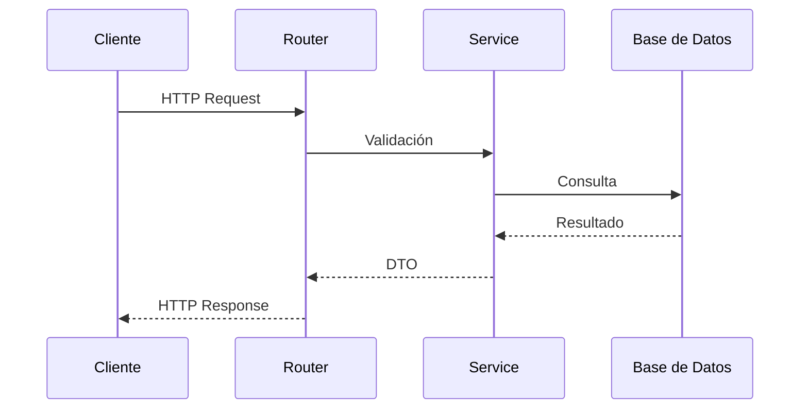

# 12_API_ROUTES.md

# 🌐 Arquitectura de las API Routes

---

# 📌 Introducción

Las API Routes constituyen el punto de entrada principal para todas las operaciones realizadas sobre Aula Robótica Platform.

Aunque la plataforma utiliza **Server-Side Rendering (SSR)** para la generación dinámica de la interfaz mediante Jinja2, gran parte de la lógica de negocio se expone también mediante una API REST diseñada siguiendo principios modernos de modularidad, mantenibilidad y escalabilidad.

Esta arquitectura permite desacoplar completamente la presentación de la lógica de negocio, facilitando la reutilización de los servicios por distintos clientes, como aplicaciones web, aplicaciones móviles o integraciones con sistemas externos.

---

# 🎯 Objetivos

La arquitectura de rutas persigue diversos objetivos.

## Objetivos funcionales

- exponer funcionalidades mediante interfaces REST;
- mantener una estructura uniforme;
- facilitar la evolución del sistema;
- permitir integración con clientes externos;
- reutilizar la lógica de negocio existente.

---

## Objetivos técnicos

- desacoplar presentación y servicios;
- facilitar el mantenimiento;
- soportar autenticación centralizada;
- integrarse con OpenAPI;
- favorecer el testing automatizado;
- simplificar futuras versiones de la API.

---

# Principios de Diseño

Las rutas REST han sido diseñadas siguiendo una serie de principios arquitectónicos.

Entre ellos destacan:

- responsabilidad única;
- baja dependencia;
- alta cohesión;
- modularidad;
- reutilización;
- consistencia;
- extensibilidad.

Cada router representa un dominio funcional claramente delimitado.

---

# Arquitectura General

```mermaid
flowchart TD

Cliente

↓

FastAPI Router

↓

Authentication Middleware

↓

Controller

↓

Service Layer

↓

Repository

↓

MariaDB
```

Cada componente mantiene responsabilidades claramente diferenciadas.

---

# Arquitectura por Capas

Las API Routes únicamente coordinan el flujo de las peticiones.

No contienen lógica de negocio compleja.

Su función consiste en:

- recibir solicitudes;
- validar datos;
- invocar servicios;
- construir respuestas;
- gestionar códigos HTTP.

Toda la lógica funcional reside en la capa de servicios.

---

# Flujo General



---

# Organización Modular

Cada dominio funcional dispone de su propio router independiente.

Esta organización facilita:

- localización del código;
- mantenimiento;
- reutilización;
- escalabilidad;
- incorporación de nuevas funcionalidades.

---

# Organización Habitual

Una estructura representativa puede organizarse de la siguiente forma:

```text
routers/

├── auth.py
├── users.py
├── roles.py
├── projects.py
├── robots.py
├── activities.py
├── websocket.py
└── admin.py
```

Cada archivo concentra exclusivamente las rutas pertenecientes a un único dominio funcional.

---

# Registro Centralizado

Todos los routers son registrados desde el punto central de la aplicación.

```mermaid
flowchart TD

main.py

↓

include_router()

↓

Router Auth

Router Users

Router Projects

Router Activities

Router Admin
```

Este mecanismo mantiene completamente desacoplados los distintos módulos.

---

# Agrupación por Dominios

La organización por dominios evita estructuras excesivamente grandes.

Cada router representa una responsabilidad concreta.

Por ejemplo:

| Router | Responsabilidad |
|---------|-----------------|
| Auth | Autenticación |
| Users | Usuarios |
| Roles | Gestión de permisos |
| Projects | Proyectos |
| Activities | Actividades |
| Robots | Robots |
| Admin | Administración |

---

# Uso de APIRouter

FastAPI proporciona el componente **APIRouter** para encapsular conjuntos de rutas relacionadas.

Cada router puede definir:

- prefijos;
- etiquetas;
- dependencias;
- respuestas comunes;
- autenticación.

Esto reduce la duplicación de código y mejora la organización.

---

# Prefijos de Ruta

Cada módulo dispone normalmente de un prefijo identificativo.

Ejemplos:

```text
/auth

/users

/projects

/activities

/admin
```

Esta estructura facilita la navegación y comprensión de la API.

---

# Versionado

La arquitectura se encuentra preparada para incorporar versionado de la API.

Ejemplo:

```text
/api/v1/users

/api/v1/projects

/api/v2/projects
```

El versionado permite evolucionar la API sin romper la compatibilidad con clientes existentes.

---

# Convenciones REST

Las rutas siguen las recomendaciones habituales del estilo REST.

Se utilizan recursos claramente identificables mediante sustantivos.

Ejemplos:

```text
/users

/projects

/robots

/activities
```

Se evita utilizar verbos dentro de la URL siempre que resulta posible.

---

# Uso Correcto de Métodos HTTP

Cada operación utiliza el verbo HTTP más adecuado.

| Método | Operación |
|----------|-----------|
| GET | Consulta |
| POST | Creación |
| PUT | Sustitución completa |
| PATCH | Actualización parcial |
| DELETE | Eliminación |

Esta correspondencia mejora la interoperabilidad con clientes REST.

---

# Identificación de Recursos

Los recursos individuales se identifican mediante parámetros de ruta.

Ejemplo conceptual:

```text
/users/{user_id}

/projects/{project_id}
```

Este enfoque facilita el acceso directo a cualquier entidad del sistema.

---

# Jerarquía de Recursos

Cuando existe una relación entre entidades, las rutas reflejan dicha jerarquía.

Ejemplo:

```text
/projects/{id}/members

/projects/{id}/activities

/users/{id}/projects
```

La URL representa de forma natural la relación entre recursos.

---

# Separación entre API y SSR

Aunque la plataforma utiliza renderizado SSR, la arquitectura diferencia claramente ambos tipos de acceso.

```mermaid
flowchart LR

Navegador

--> SSR

Cliente API

--> REST

SSR

REST

↓

Service Layer
```

Ambos mecanismos reutilizan exactamente la misma lógica de negocio.

---

# Integración con Templates

Las rutas SSR renderizan directamente plantillas Jinja2.

Mientras tanto, las rutas REST devuelven:

- JSON;
- códigos HTTP;
- cabeceras;
- metadatos.

La separación entre ambos modelos simplifica la evolución del sistema.

---

# Respuestas Consistentes

Todas las respuestas REST siguen una estructura homogénea.

Generalmente incluyen:

- datos;
- estado;
- mensajes;
- códigos HTTP.

La consistencia facilita el desarrollo de clientes externos.

---

# Códigos de Estado

La API utiliza los códigos HTTP estándar.

| Código | Significado |
|----------|-------------|
| 200 | Operación correcta |
| 201 | Recurso creado |
| 204 | Sin contenido |
| 400 | Solicitud incorrecta |
| 401 | No autenticado |
| 403 | Acceso denegado |
| 404 | Recurso inexistente |
| 409 | Conflicto |
| 422 | Error de validación |
| 500 | Error interno |

El uso adecuado de estos códigos mejora la interoperabilidad.

---

# Gestión Centralizada

Las rutas delegan toda la lógica compleja en la capa de servicios.

Esto permite que los routers permanezcan:

- ligeros;
- fáciles de mantener;
- altamente reutilizables.

El controlador actúa únicamente como coordinador de la petición.

---

# Flujo Arquitectónico

```mermaid
flowchart TD

HTTP Request

↓

Router

↓

Validación inicial

↓

Service Layer

↓

Repository

↓

DTO

↓

HTTP Response
```

La simplicidad del router constituye uno de los principios fundamentales de la arquitectura.

---

# Beneficios del Diseño

La organización propuesta aporta múltiples ventajas.

Entre ellas:

- modularidad;
- separación de responsabilidades;
- reutilización de servicios;
- escalabilidad;
- facilidad de testing;
- documentación automática;
- mantenimiento simplificado;
- preparación para futuras versiones de la API.

---

# Resumen Arquitectónico

```mermaid
flowchart LR

Cliente

↓

Router

↓

Controller

↓

Service

↓

Repository

↓

MariaDB
```

Esta arquitectura proporciona una base sólida para el desarrollo de APIs REST modernas y constituye el punto de partida para abordar, en las siguientes secciones, aspectos como las operaciones CRUD, la validación mediante DTOs, la autenticación, la autorización, la paginación y la integración con el resto de componentes de Aula Robótica Platform.

---

# ⚙️ Operaciones CRUD

Las API Routes implementan las operaciones fundamentales de persistencia mediante el modelo CRUD (Create, Read, Update y Delete).

Cada operación utiliza el método HTTP más adecuado y delega completamente la lógica de negocio en la capa de servicios.

---

# Arquitectura CRUD

```mermaid
flowchart TD

Cliente

↓

Router

↓

Validación

↓

Service Layer

↓

Repository

↓

MariaDB
```

Cada operación sigue exactamente el mismo flujo arquitectónico.

---

# Operaciones de Consulta

Las operaciones de lectura utilizan habitualmente el método **GET**.

Ejemplos habituales:

```text
GET /users

GET /users/{id}

GET /projects

GET /projects/{id}
```

Estas operaciones no modifican el estado del sistema.

---

# Operaciones de Creación

Las nuevas entidades se crean mediante **POST**.

Ejemplo conceptual:

```text
POST /projects
```

El cuerpo de la petición contiene toda la información necesaria para construir el nuevo recurso.

---

# Operaciones de Actualización

Dependiendo del escenario pueden utilizarse dos métodos.

| Método | Uso |
|----------|-----|
| PUT | Sustitución completa |
| PATCH | Actualización parcial |

Esta diferenciación mejora la claridad semántica de la API.

---

# Eliminación de Recursos

Las eliminaciones utilizan el método **DELETE**.

Ejemplo:

```text
DELETE /projects/{id}
```

Dependiendo de la política de negocio podrán implementarse:

- eliminación física;
- eliminación lógica;
- archivado;
- desactivación.

---

# Soft Delete

En numerosos dominios resulta recomendable evitar el borrado permanente.

```text
Activo

↓

Archivado

↓

Oculto

↓

Recuperable
```

Este enfoque facilita la auditoría y recuperación de información.

---

# Validación de Entrada

Antes de acceder a la capa de servicios todas las peticiones son validadas.

La validación incluye aspectos como:

- tipos;
- longitud;
- formato;
- obligatoriedad;
- restricciones.

Esto evita que datos inválidos alcancen la lógica de negocio.

---

# Uso de DTOs

Las API Routes trabajan exclusivamente con objetos de transferencia de datos (DTO).

Se distinguen normalmente varios modelos.

| DTO | Finalidad |
|------|-----------|
| CreateDTO | Alta |
| UpdateDTO | Modificación |
| ResponseDTO | Respuesta |
| FilterDTO | Consultas |

Esta separación desacopla la API del modelo de persistencia.

---

# Validación con Pydantic

FastAPI utiliza modelos Pydantic para validar automáticamente:

- tipos;
- formatos;
- valores;
- enumeraciones;
- restricciones.

La validación se realiza antes de ejecutar cualquier lógica funcional.

---

# Errores de Validación

Las peticiones inválidas generan automáticamente respuestas HTTP apropiadas.

Ejemplos:

- parámetros ausentes;
- tipos incorrectos;
- formatos inválidos;
- restricciones incumplidas.

El cliente recibe información estructurada sobre el error detectado.

---

# Parámetros de Ruta

Las rutas utilizan parámetros para identificar recursos concretos.

Ejemplo:

```text
/users/{user_id}

/projects/{project_id}
```

Estos parámetros son validados automáticamente por FastAPI.

---

# Parámetros de Consulta

Las operaciones de búsqueda suelen incorporar parámetros opcionales.

Ejemplos:

```text
?page=1

?size=20

?search=robot

?active=true
```

Este mecanismo facilita consultas flexibles sin multiplicar el número de endpoints.

---

# Paginación

La paginación constituye un elemento esencial para mantener un buen rendimiento.

```mermaid
flowchart LR

Base de Datos

↓

Consulta limitada

↓

Página

↓

Cliente
```

La API evita devolver colecciones excesivamente grandes.

---

# Parámetros Habituales

Una implementación típica utiliza parámetros como:

| Parámetro | Función |
|------------|----------|
| page | Página solicitada |
| size | Número de registros |
| sort | Ordenación |
| direction | ASC/DESC |

La estructura permanece uniforme en toda la plataforma.

---

# Filtrado

Las consultas complejas pueden incorporar filtros adicionales.

Ejemplos:

- estado;
- propietario;
- fecha;
- categoría;
- organización.

Los filtros reducen la cantidad de información transferida.

---

# Ordenación

La API permite ordenar resultados según distintos criterios.

Ejemplos:

```text
sort=name

sort=created_at

sort=updated_at
```

La ordenación se delega normalmente al repositorio.

---

# Búsqueda

Las operaciones de búsqueda se implementan mediante parámetros específicos.

Ejemplo:

```text
GET /projects?search=robotica
```

Este diseño mantiene una API sencilla y coherente.

---

# Respuestas Parciales

En determinados escenarios resulta conveniente devolver únicamente parte de la información.

Ejemplos:

- listados resumidos;
- vistas previas;
- catálogos;
- selectores.

Esto reduce el tamaño de las respuestas y mejora el rendimiento.

---

# Integración con la Capa de Servicios

Las API Routes nunca implementan reglas de negocio complejas.

Su responsabilidad consiste únicamente en:

- recibir datos;
- validarlos;
- invocar servicios;
- devolver respuestas.

Toda decisión funcional reside en la Service Layer.

---

# Integración con la Autenticación

Las rutas protegidas utilizan el middleware de autenticación documentado anteriormente.

```mermaid
flowchart TD

Request

↓

Authentication Middleware

↓

JWT

↓

Usuario autenticado

↓

Router
```

El router únicamente recibe usuarios previamente autenticados.

---

# Integración con RBAC

Tras autenticar al usuario se aplican las reglas de autorización.

```mermaid
flowchart TD

Usuario

↓

RBAC

↓

Permisos

↓

Router

↓

Service
```

Cada operación verifica previamente que el usuario dispone de los permisos necesarios.

---

# Acceso Contextual

En determinadas operaciones también resulta necesario comprobar el contexto.

Ejemplos:

- propietario;
- miembro del proyecto;
- docente asignado;
- administrador.

La autorización contextual complementa el modelo RBAC.

---

# Integración con SSR

Las rutas SSR reutilizan exactamente los mismos servicios que las APIs REST.

```mermaid
flowchart LR

SSR

REST API

↓

Service Layer
```

Esto evita duplicar lógica funcional.

---

# Integración con WebSockets

Las modificaciones realizadas mediante REST pueden generar eventos en tiempo real.

Ejemplo:

```text
POST

↓

Actualizar entidad

↓

Evento WebSocket

↓

Clientes conectados
```

La API y el sistema realtime permanecen completamente sincronizados.

---

# Idempotencia

Las operaciones deben respetar el comportamiento esperado por HTTP.

| Método | Idempotente |
|----------|-------------|
| GET | Sí |
| PUT | Sí |
| DELETE | Sí |
| PATCH | Depende |
| POST | No |

Mantener estas propiedades mejora la interoperabilidad con clientes externos.

---

# Gestión de Excepciones

Las excepciones producidas por la Service Layer se transforman en respuestas HTTP adecuadas.

Esto evita exponer detalles internos del sistema y proporciona mensajes homogéneos a todos los clientes.

---

# Consistencia de la API

Todos los endpoints siguen las mismas convenciones.

Entre ellas:

- nombres homogéneos;
- respuestas consistentes;
- validación uniforme;
- códigos HTTP adecuados;
- separación por dominios.

La uniformidad facilita el aprendizaje y mantenimiento de la API.

---

# Flujo Completo

```mermaid
flowchart TD

HTTP Request

↓

Validación Pydantic

↓

Authentication

↓

RBAC

↓

Router

↓

Service Layer

↓

Repository

↓

Base de Datos

↓

DTO

↓

HTTP Response
```

Este flujo representa el funcionamiento habitual de cualquier operación REST dentro de Aula Robótica Platform y constituye la base para la integración con la documentación automática, la observabilidad, el despliegue y las buenas prácticas que se abordarán en la siguiente sección.

---

# 📚 Documentación Automática

Uno de los principales beneficios de FastAPI es la generación automática de documentación interactiva a partir de las propias definiciones de la API.

La documentación se mantiene sincronizada con el código fuente, reduciendo el riesgo de inconsistencias y facilitando el mantenimiento.

---

# OpenAPI

FastAPI implementa de forma nativa la especificación **OpenAPI**, ampliamente utilizada para describir servicios REST.

Esta especificación define de forma estructurada:

- endpoints;
- parámetros;
- modelos;
- respuestas;
- autenticación;
- códigos HTTP.

Gracias a ello, herramientas externas pueden interpretar automáticamente la API.

---

# Swagger UI

La especificación OpenAPI permite generar una interfaz interactiva para explorar y probar los distintos endpoints.

Entre sus principales ventajas destacan:

- navegación por recursos;
- visualización de modelos;
- pruebas desde el navegador;
- documentación siempre actualizada.

Esta funcionalidad resulta especialmente útil durante el desarrollo y las tareas de integración.

---

# ReDoc

Además de Swagger UI, FastAPI ofrece compatibilidad con ReDoc, proporcionando una documentación más orientada a la consulta técnica.

Su estructura facilita la exploración de APIs extensas y mejora la legibilidad en proyectos de mayor tamaño.

---

# Arquitectura de Documentación

```mermaid
flowchart TD

Código FastAPI

↓

Modelos Pydantic

↓

OpenAPI

↓

Swagger UI

ReDoc
```

Toda la documentación se genera automáticamente a partir del propio código de la aplicación.

---

# Modelado de Respuestas

Las respuestas REST se describen mediante modelos específicos.

Este enfoque aporta diversas ventajas:

- tipado fuerte;
- validación automática;
- documentación consistente;
- reducción de errores.

Los clientes pueden conocer con precisión la estructura esperada de cada respuesta.

---

# Modelado de Errores

Las respuestas de error mantienen igualmente una estructura uniforme.

Entre los elementos habituales se incluyen:

- código HTTP;
- descripción;
- detalle del error;
- información de validación cuando procede.

La homogeneidad simplifica la integración con clientes externos.

---

# Integración con Docker

La arquitectura REST funciona de forma completamente transparente dentro del entorno Docker.

```mermaid
flowchart LR

Cliente

↓

Nginx

↓

FastAPI

↓

Service Layer

↓

MariaDB
```

Los contenedores no requieren modificaciones específicas para soportar las API Routes.

---

# Integración con Docker Compose

Docker Compose coordina los distintos servicios implicados en el procesamiento de peticiones REST.

Entre ellos:

- FastAPI;
- MariaDB;
- Nginx;
- futuros servicios auxiliares.

La configuración permanece centralizada mediante variables de entorno.

---

# Integración con Nginx

Nginx actúa como punto de entrada único para todas las solicitudes HTTP.

Sus responsabilidades incluyen:

- terminación TLS;
- balanceo futuro;
- reverse proxy;
- compresión;
- gestión de cabeceras;
- soporte para WebSockets.

Las API Routes permanecen completamente independientes de la infraestructura.

---

# Arquitectura del Despliegue

```mermaid
flowchart TD

Internet

↓

Nginx

↓

FastAPI

↓

Routers

↓

Service Layer

↓

MariaDB
```

Esta arquitectura facilita la escalabilidad y el mantenimiento del sistema.

---

# Integración con Pydantic Settings

La configuración de la API se centraliza mediante Pydantic Settings.

Entre los parámetros configurables pueden encontrarse:

- prefijos;
- CORS;
- URLs públicas;
- modo de depuración;
- claves criptográficas;
- configuración OpenAPI.

Este enfoque evita valores codificados directamente en la aplicación.

---

# Integración con Middleware

Todas las peticiones REST atraviesan el conjunto de middlewares definidos por la aplicación.

Entre sus responsabilidades destacan:

- autenticación;
- inyección de contexto;
- auditoría;
- logging;
- tratamiento uniforme de excepciones.

Los routers permanecen completamente desacoplados de estas tareas transversales.

---

# Observabilidad

Las API Routes constituyen una importante fuente de información operativa.

Entre las métricas más relevantes destacan:

- número de peticiones;
- tiempo medio de respuesta;
- errores por endpoint;
- recursos más utilizados;
- usuarios activos;
- carga por servicio.

Esta información facilita el análisis del comportamiento del sistema.

---

# Logging

Las peticiones REST pueden generar registros relacionados con:

- endpoint invocado;
- usuario autenticado;
- método HTTP;
- código de respuesta;
- duración;
- excepciones producidas.

Estos registros resultan fundamentales para el diagnóstico de incidencias.

---

# Integración con Auditoría

Las operaciones que modifican información sensible pueden registrarse adicionalmente dentro del sistema de auditoría.

Ejemplos:

- creación de usuarios;
- modificación de permisos;
- eliminación de recursos;
- cambios administrativos.

La auditoría complementa el sistema de logging sin sustituirlo.

---

# Testing

La arquitectura modular facilita el desarrollo de pruebas automatizadas.

Las API Routes pueden verificarse mediante:

- pruebas unitarias;
- pruebas de integración;
- pruebas funcionales;
- validación de contratos REST.

Cada capa puede probarse de forma independiente.

---

# Escalabilidad

La organización por routers independientes permite incorporar nuevas funcionalidades sin afectar a los módulos existentes.

Por ejemplo:

- nuevos dominios;
- nuevas versiones;
- nuevas APIs públicas;
- integraciones externas.

La arquitectura mantiene un elevado nivel de cohesión y un bajo acoplamiento.

---

# Buenas Prácticas

Durante el desarrollo de las API Routes se siguen diversas recomendaciones.

Entre ellas:

- mantener routers ligeros;
- evitar lógica de negocio en los endpoints;
- utilizar DTOs específicos;
- validar todas las entradas;
- documentar automáticamente la API;
- aplicar autenticación centralizada;
- reutilizar la Service Layer;
- utilizar códigos HTTP apropiados.

Estas prácticas favorecen un código más mantenible y robusto.

---

# Estado Actual

Actualmente Aula Robótica Platform dispone de:

✅ Arquitectura REST modular.

✅ Organización por dominios funcionales.

✅ Separación entre routers y servicios.

✅ Validación mediante Pydantic.

✅ Integración con SSR.

✅ Middleware centralizado.

✅ Compatibilidad con autenticación JWT.

✅ Integración con RBAC contextual.

✅ Preparación para documentación OpenAPI.

✅ Compatibilidad con Docker y Nginx.

La arquitectura permite continuar ampliando la plataforma sin introducir dependencias innecesarias entre módulos.

---

# Evolución Futura

La evolución prevista contempla diversas mejoras.

Entre ellas:

- versionado completo de la API;
- limitación de velocidad (*Rate Limiting*);
- cacheo de respuestas;
- compresión automática;
- soporte para ETag;
- API pública para terceros;
- documentación enriquecida;
- monitorización mediante métricas;
- generación de SDKs cliente;
- integración con GraphQL en escenarios específicos.

Estas funcionalidades podrán incorporarse manteniendo la estructura actual.

---

# Beneficios Obtenidos

La arquitectura propuesta aporta numerosas ventajas.

Entre ellas:

- alta modularidad;
- reutilización de la lógica de negocio;
- documentación automática;
- facilidad de mantenimiento;
- integración con clientes externos;
- compatibilidad con SSR;
- elevada escalabilidad;
- preparación para despliegues cloud.

---

# 📊 Arquitectura Global

```mermaid
flowchart TD

Cliente

↓

Nginx

↓

FastAPI

↓

Authentication Middleware

↓

Router

↓

Service Layer

↓

Repository

↓

MariaDB

↓

DTO

↓

HTTP Response
```

Este diagrama resume el recorrido habitual de cualquier solicitud REST dentro de Aula Robótica Platform y muestra la separación de responsabilidades entre los distintos componentes de la arquitectura.

---

# 📌 Conclusiones

La arquitectura de las API Routes de Aula Robótica Platform ha sido diseñada siguiendo principios de modularidad, cohesión y separación de responsabilidades, permitiendo desacoplar completamente la capa de presentación de la lógica de negocio.

La utilización de routers independientes, validación mediante Pydantic, integración con la Service Layer, autenticación centralizada, autorización basada en RBAC contextual y documentación automática mediante OpenAPI proporciona una base sólida para el desarrollo de servicios REST modernos, mantenibles y escalables.

Gracias a esta organización, la plataforma se encuentra preparada para evolucionar hacia nuevas versiones de la API, integraciones con clientes externos y despliegues en entornos cloud, manteniendo una arquitectura consistente y alineada con las mejores prácticas del ecosistema FastAPI.

