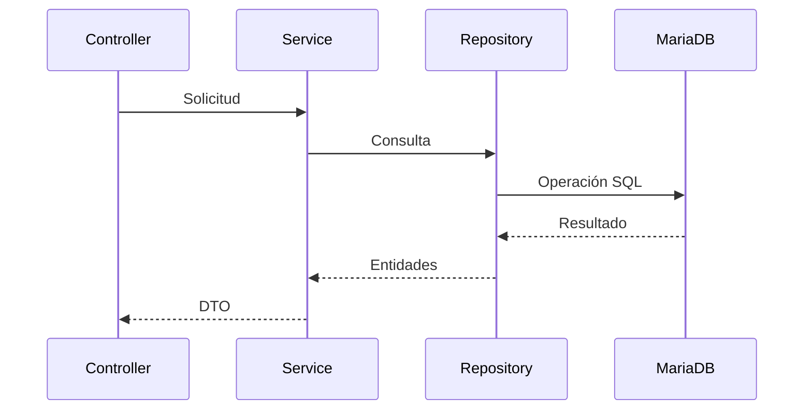

# 13_SERVICE_LAYER.md

# 🏗️ Arquitectura de la Service Layer

---

# 📌 Introducción

La **Service Layer** constituye el núcleo funcional de Aula Robótica Platform y representa la capa responsable de implementar toda la lógica de negocio de la aplicación.

Su principal objetivo consiste en desacoplar completamente la lógica funcional de los mecanismos de acceso HTTP y de persistencia, permitiendo que las reglas del dominio permanezcan independientes de los detalles tecnológicos.

Gracias a esta arquitectura, la plataforma mantiene una clara separación entre la presentación, la lógica de negocio y el acceso a datos, facilitando el mantenimiento, la reutilización y la evolución del sistema.

---

# 🎯 Objetivos

La Service Layer persigue una serie de objetivos tanto funcionales como arquitectónicos.

## Objetivos funcionales

- centralizar las reglas de negocio;
- coordinar operaciones complejas;
- garantizar la consistencia funcional;
- reutilizar procesos comunes;
- controlar el flujo de ejecución.

---

## Objetivos técnicos

- separar responsabilidades;
- reducir el acoplamiento;
- favorecer el testing;
- facilitar la escalabilidad;
- mejorar la mantenibilidad;
- preparar la aplicación para futuras evoluciones.

---

# Papel dentro de la Arquitectura

La Service Layer actúa como intermediaria entre los controladores y la capa de persistencia.

```mermaid
flowchart TD

Cliente

↓

Router

↓

Controller

↓

Service Layer

↓

Repository

↓

MariaDB
```

Toda la lógica funcional se concentra en esta capa.

---

# Filosofía de Diseño

Las clases de servicio no conocen detalles relacionados con:

- HTTP;
- HTML;
- Jinja2;
- FastAPI;
- WebSockets;
- MariaDB.

Únicamente trabajan con objetos del dominio y reglas de negocio.

Este desacoplamiento constituye uno de los pilares de la arquitectura.

---

# Responsabilidad Única

Cada servicio implementa un único dominio funcional.

Ejemplos:

| Servicio | Responsabilidad |
|-----------|-----------------|
| UserService | Gestión de usuarios |
| AuthService | Autenticación |
| ProjectService | Gestión de proyectos |
| ActivityService | Actividades |
| RobotService | Robots |

Cada componente mantiene un alcance claramente definido.

---

# Arquitectura por Capas

```mermaid
flowchart TD

Presentation Layer

↓

Service Layer

↓

Repository Layer

↓

Persistence
```

Cada capa únicamente conoce la inmediatamente inferior.

Esta organización reduce significativamente las dependencias entre componentes.

---

# Flujo General



El controlador nunca accede directamente al repositorio.

---

# Separación de Responsabilidades

La arquitectura distribuye claramente las funciones.

| Capa | Responsabilidad |
|-------|-----------------|
| Router | Recepción HTTP |
| Controller | Coordinación |
| Service | Lógica de negocio |
| Repository | Persistencia |
| Database | Almacenamiento |

Esta distribución favorece un código limpio y mantenible.

---

# Desacoplamiento

Las reglas de negocio permanecen completamente independientes de:

- FastAPI;
- Jinja2;
- SQLAlchemy;
- MariaDB;
- Docker.

Esto permite sustituir tecnologías sin modificar la lógica funcional.

---

# Cohesión

Cada servicio agrupa únicamente funcionalidades relacionadas entre sí.

Por ejemplo, UserService no implementa operaciones correspondientes a proyectos o actividades.

Este principio mejora la legibilidad del código y facilita su mantenimiento.

---

# Reutilización

Las operaciones implementadas dentro de la Service Layer pueden reutilizarse desde múltiples componentes.

Por ejemplo:

- APIs REST;
- páginas SSR;
- tareas programadas;
- procesos internos;
- futuros servicios externos.

Toda la aplicación comparte la misma lógica funcional.

---

# Organización Habitual

Una organización representativa puede seguir una estructura similar a la siguiente.

```text
services/

├── auth_service.py
├── user_service.py
├── role_service.py
├── project_service.py
├── activity_service.py
├── robot_service.py
└── notification_service.py
```

Cada servicio representa un dominio independiente.

---

# Servicios Especializados

No todos los servicios gestionan entidades persistentes.

Algunos implementan funcionalidades transversales como:

- autenticación;
- autorización;
- notificaciones;
- auditoría;
- correo electrónico;
- almacenamiento.

Estos componentes siguen exactamente los mismos principios arquitectónicos.

---

# Coordinación entre Servicios

En determinadas operaciones resulta necesario combinar varios servicios.

```mermaid
flowchart LR

UserService

↓

ProjectService

↓

NotificationService

↓

AuditService
```

La Service Layer coordina estas interacciones manteniendo cada responsabilidad separada.

---

# Independencia del Transporte

Los servicios desconocen completamente cómo fueron invocados.

Pueden ejecutarse desde:

- HTTP;
- WebSocket;
- tareas internas;
- scripts administrativos;
- procesos automáticos.

Esto incrementa notablemente la reutilización del código.

---

# Independencia del Cliente

La lógica funcional permanece idéntica independientemente del consumidor.

Ejemplos:

- navegador;
- aplicación móvil;
- cliente REST;
- consola administrativa;
- futuras APIs públicas.

Todos utilizan exactamente la misma Service Layer.

---

# Flujo Funcional

```mermaid
flowchart TD

Solicitud

↓

Controller

↓

Service

↓

Reglas de negocio

↓

Repository

↓

Resultado
```

Toda decisión funcional se toma exclusivamente dentro del servicio correspondiente.

---

# Principios SOLID

La Service Layer ha sido diseñada siguiendo los principios SOLID.

Entre ellos:

- responsabilidad única;
- abierto para extensión;
- cerrado para modificación;
- inversión de dependencias;
- segregación de interfaces.

Estos principios favorecen un diseño robusto y fácilmente mantenible.

---

# Inversión de Dependencias

Los servicios dependen de abstracciones y no de implementaciones concretas.

Este enfoque facilita:

- testing;
- sustitución de repositorios;
- incorporación de mocks;
- evolución tecnológica.

---

# Bajo Acoplamiento

Cada servicio conoce únicamente los componentes estrictamente necesarios para realizar su trabajo.

La reducción de dependencias facilita:

- refactorizaciones;
- reutilización;
- pruebas automatizadas;
- mantenimiento.

---

# Alta Cohesión

Las responsabilidades relacionadas permanecen agrupadas dentro del mismo servicio.

Esto permite comprender rápidamente cada módulo y reduce la complejidad del sistema.

---

# Escalabilidad

La arquitectura permite incorporar nuevos dominios funcionales simplemente añadiendo nuevos servicios especializados.

No resulta necesario modificar los componentes ya existentes.

---

# Beneficios Arquitectónicos

La Service Layer aporta múltiples ventajas.

Entre ellas:

- separación de responsabilidades;
- reutilización;
- independencia tecnológica;
- facilidad de testing;
- mantenibilidad;
- escalabilidad;
- claridad estructural.

---

# Arquitectura General

```mermaid
flowchart TD

Router

↓

Controller

↓

Service Layer

↓

Repository

↓

Database
```

Esta organización constituye el núcleo de la arquitectura backend de Aula Robótica Platform y servirá como base para abordar, en las siguientes secciones, aspectos como la gestión de transacciones, las validaciones de negocio, el tratamiento de excepciones, la integración con la autenticación, la autorización y el resto de componentes de la plataforma.

---

# ⚙️ Gestión de las Reglas de Negocio

La principal responsabilidad de la Service Layer consiste en implementar todas las reglas funcionales de Aula Robótica Platform.

Estas reglas determinan cómo debe comportarse la aplicación independientemente del cliente que la utilice.

Entre ellas pueden encontrarse:

- validaciones funcionales;
- restricciones de negocio;
- coordinación entre entidades;
- ejecución de procesos complejos;
- aplicación de políticas internas.

---

# Flujo de Ejecución

```mermaid
flowchart TD

Solicitud

↓

Controller

↓

Service Layer

↓

Validaciones

↓

Reglas de negocio

↓

Repository

↓

Persistencia
```

Toda decisión funcional se concentra en esta capa.

---

# Validaciones Técnicas y Funcionales

La arquitectura diferencia claramente ambos tipos de validación.

| Tipo | Responsable |
|--------|-------------|
| Sintaxis | FastAPI / Pydantic |
| Tipos | Pydantic |
| Reglas de negocio | Service Layer |

Esta separación evita duplicar responsabilidades.

---

# Validaciones de Negocio

Algunos ejemplos habituales incluyen:

- usuarios duplicados;
- recursos inexistentes;
- estados incompatibles;
- operaciones no permitidas;
- restricciones temporales;
- dependencias entre entidades.

Estas comprobaciones no pueden resolverse únicamente mediante validaciones sintácticas.

---

# Coordinación de Operaciones

Muchas operaciones requieren actuar sobre múltiples componentes.

Ejemplo conceptual:

```mermaid
flowchart LR

Validación

↓

Actualizar Proyecto

↓

Registrar Auditoría

↓

Enviar Notificación
```

La Service Layer coordina todo el proceso manteniendo la consistencia funcional.

---

# Gestión de Transacciones

Cuando una operación implica múltiples modificaciones sobre la base de datos, todas ellas deben ejecutarse como una única unidad lógica.

```text
Inicio

↓

Operación 1

↓

Operación 2

↓

Operación 3

↓

Commit
```

Si alguna operación falla, todas las modificaciones deben revertirse.

---

# Atomicidad

La atomicidad garantiza que una operación compleja se ejecute completamente o no produzca ningún efecto.

```text
Todo correcto

↓

Commit

────────────

Error

↓

Rollback
```

Este comportamiento evita estados inconsistentes.

---

# Integridad del Dominio

La Service Layer protege permanentemente la coherencia del modelo de negocio.

Por ejemplo:

- impedir referencias inválidas;
- mantener relaciones consistentes;
- evitar duplicidades;
- preservar restricciones funcionales.

---

# Orquestación de Servicios

Un servicio puede coordinar otros servicios especializados cuando resulta necesario.

```mermaid
flowchart TD

ProjectService

↓

UserService

↓

NotificationService

↓

AuditService
```

Cada servicio continúa siendo responsable únicamente de su propio dominio.

---

# Gestión de DTOs

La Service Layer recibe y devuelve objetos de transferencia de datos.

Estos modelos desacoplan la lógica funcional de las entidades persistentes.

Habitualmente existen distintos DTO para:

- creación;
- actualización;
- consulta;
- respuestas resumidas;
- respuestas detalladas.

---

# Conversión de Modelos

Durante el flujo de ejecución se producen distintas transformaciones.

```mermaid
flowchart LR

Request DTO

↓

Entidad

↓

Repository

↓

Entidad

↓

Response DTO
```

Estas conversiones permanecen encapsuladas dentro de la arquitectura.

---

# Tratamiento de Excepciones

Las excepciones funcionales se generan dentro de la Service Layer.

Ejemplos:

- usuario inexistente;
- proyecto cerrado;
- permisos insuficientes;
- operación duplicada.

El controlador transforma posteriormente estas excepciones en respuestas HTTP apropiadas.

---

# Excepciones Técnicas

También pueden producirse errores relacionados con la infraestructura.

Por ejemplo:

- errores de base de datos;
- pérdida de conexión;
- servicios externos;
- almacenamiento.

La lógica de negocio permanece separada de estos aspectos.

---

# Integración con Repository Layer

La Service Layer nunca interactúa directamente con la base de datos.

Todas las operaciones de persistencia se delegan al repositorio correspondiente.

```mermaid
flowchart TD

Service

↓

Repository

↓

SQLAlchemy

↓

MariaDB
```

Esta separación facilita enormemente el mantenimiento.

---

# Independencia de SQL

Los servicios desconocen completamente:

- consultas SQL;
- índices;
- tablas;
- conexiones.

Únicamente trabajan con objetos del dominio.

---

# Integración con la Autenticación

La autenticación ya ha sido validada antes de acceder a la Service Layer.

```mermaid
flowchart TD

JWT

↓

Authentication Middleware

↓

Usuario autenticado

↓

Service Layer
```

Los servicios reciben directamente la identidad del usuario.

---

# Integración con RBAC

Las operaciones sensibles verifican igualmente los permisos disponibles.

```mermaid
flowchart TD

Usuario

↓

Roles

↓

Permisos

↓

Service
```

La autorización puede realizarse mediante dependencias o validaciones específicas del dominio.

---

# Autorización Contextual

En numerosos escenarios resulta necesario verificar también el contexto.

Ejemplos:

- propietario del recurso;
- responsable del proyecto;
- docente asignado;
- administrador.

Estas comprobaciones complementan el modelo RBAC.

---

# Integración con SSR

Las páginas renderizadas mediante Jinja2 reutilizan exactamente la misma Service Layer.

```mermaid
flowchart LR

SSR

↓

Service Layer

↓

Repository
```

No existe duplicación de lógica funcional.

---

# Integración con APIs REST

Las API Routes también utilizan los mismos servicios.

```mermaid
flowchart LR

REST

↓

Service Layer

↓

Repository
```

Esto garantiza un comportamiento uniforme independientemente del cliente.

---

# Integración con WebSockets

Las operaciones realizadas desde WebSockets pueden invocar igualmente la Service Layer.

```mermaid
flowchart LR

WebSocket

↓

Service

↓

Repository
```

Toda la lógica permanece centralizada.

---

# Integración con Auditoría

Las operaciones relevantes pueden registrar automáticamente eventos de auditoría.

Ejemplos:

- creación;
- modificación;
- eliminación;
- cambios administrativos;
- accesos privilegiados.

La auditoría permanece desacoplada de la lógica principal.

---

# Integración con Notificaciones

Algunas operaciones desencadenan eventos adicionales.

Por ejemplo:

- envío de correo;
- notificaciones internas;
- actualización de dashboards;
- eventos WebSocket.

La Service Layer coordina estas acciones sin mezclar responsabilidades.

---

# Idempotencia

Las operaciones deben respetar el comportamiento esperado por la lógica de negocio.

Siempre que resulte posible:

- evitar duplicados;
- detectar repeticiones;
- garantizar consistencia.

Esto facilita la integración con clientes distribuidos.

---

# Gestión de Dependencias

Cada servicio depende únicamente de los componentes imprescindibles.

Ejemplos:

- repositorios;
- servicios auxiliares;
- proveedores externos.

La reducción de dependencias simplifica el testing y el mantenimiento.

---

# Flujo Completo

```mermaid
flowchart TD

Request

↓

Controller

↓

Service

↓

Validaciones

↓

Reglas de negocio

↓

Repository

↓

Persistencia

↓

DTO

↓

Controller

↓

HTTP Response
```

Este flujo resume el funcionamiento habitual de la Service Layer y constituye la base para abordar, en la siguiente sección, aspectos relacionados con el testing, la observabilidad, el despliegue, la escalabilidad y la evolución futura de esta capa arquitectónica.

---

# 🧪 Testing de la Service Layer

La separación entre la lógica de negocio y el resto de componentes de la aplicación facilita enormemente el desarrollo de pruebas automatizadas.

La Service Layer puede verificarse de forma aislada sin necesidad de iniciar el servidor web ni interactuar directamente con la interfaz de usuario.

Este enfoque mejora la calidad del software y permite detectar regresiones de manera temprana.

---

# Objetivos del Testing

Las pruebas sobre la Service Layer persiguen diversos objetivos.

Entre ellos:

- validar reglas de negocio;
- verificar flujos funcionales;
- detectar regresiones;
- garantizar la consistencia del dominio;
- comprobar el tratamiento de excepciones.

---

# Tipos de Pruebas

La arquitectura permite aplicar distintos niveles de testing.

| Tipo | Finalidad |
|--------|-----------|
| Unitarias | Verificar lógica individual |
| Integración | Comprobar interacción entre capas |
| Funcionales | Validar casos de uso |
| End-to-End | Verificar el flujo completo |

Cada nivel aporta un grado diferente de confianza sobre el comportamiento del sistema.

---

# Arquitectura de Testing

```mermaid
flowchart TD

Test

↓

Mock Repository

↓

Service Layer

↓

Resultado
```

El aislamiento de dependencias simplifica la construcción de pruebas unitarias.

---

# Uso de Mocks

Durante las pruebas unitarias los repositorios pueden sustituirse por implementaciones simuladas.

Esto permite:

- controlar los datos de entrada;
- reproducir escenarios específicos;
- evitar dependencias externas;
- reducir tiempos de ejecución.

La lógica de negocio permanece completamente aislada.

---

# Cobertura Funcional

Las pruebas deben contemplar tanto escenarios correctos como situaciones excepcionales.

Ejemplos:

- creación satisfactoria;
- validaciones fallidas;
- recursos inexistentes;
- conflictos de negocio;
- permisos insuficientes;
- operaciones duplicadas.

Una cobertura amplia incrementa la fiabilidad de la aplicación.

---

# Observabilidad

La Service Layer constituye uno de los principales puntos de generación de métricas funcionales.

Entre los indicadores más relevantes destacan:

- operaciones ejecutadas;
- tiempo medio de procesamiento;
- errores funcionales;
- transacciones completadas;
- operaciones canceladas.

Estos datos permiten evaluar el comportamiento del sistema.

---

# Logging

La lógica de negocio puede registrar eventos relevantes para facilitar el diagnóstico de incidencias.

Ejemplos:

- inicio de procesos;
- finalización correcta;
- excepciones controladas;
- errores inesperados;
- operaciones críticas.

El nivel de detalle debe equilibrar utilidad y rendimiento.

---

# Integración con Auditoría

La Service Layer constituye el lugar idóneo para iniciar el registro de eventos auditables.

```mermaid
flowchart LR

Service

↓

Audit Service

↓

Registro
```

Entre los eventos susceptibles de auditoría se encuentran:

- creación de entidades;
- modificaciones;
- eliminaciones;
- cambios de permisos;
- acciones administrativas.

---

# Integración con Docker

La Service Layer permanece completamente independiente del entorno de ejecución.

Puede ejecutarse de igual forma:

- en desarrollo;
- dentro de Docker;
- en un VPS;
- en entornos cloud.

El código funcional no requiere modificaciones al cambiar de infraestructura.

---

# Integración con Docker Compose

Docker Compose únicamente coordina los servicios implicados en el despliegue.

La lógica implementada dentro de la Service Layer permanece totalmente ajena a:

- contenedores;
- redes;
- volúmenes;
- variables de entorno.

Este desacoplamiento facilita la portabilidad del sistema.

---

# Integración con Nginx

Nginx actúa exclusivamente como punto de entrada HTTP.

La Service Layer desconoce completamente:

- cabeceras;
- proxies;
- certificados TLS;
- balanceadores.

Toda la infraestructura queda abstraída por las capas superiores.

---

# Integración con Pydantic Settings

Los servicios pueden acceder a parámetros de configuración centralizados cuando resulta necesario.

Ejemplos:

- límites funcionales;
- tiempos de expiración;
- opciones de integración;
- características habilitadas.

La configuración permanece separada de la lógica de negocio.

---

# Escalabilidad

La arquitectura permite incorporar nuevos servicios especializados sin afectar al resto de componentes.

```mermaid
flowchart TD

Service Layer

↓

UserService

ProjectService

RobotService

NotificationService

AuditService

Future Services
```

Cada nuevo dominio puede desarrollarse de forma independiente.

---

# Extensibilidad

La incorporación de nuevas funcionalidades suele limitarse a:

- crear un nuevo servicio;
- implementar las reglas de negocio;
- reutilizar repositorios existentes;
- registrar el componente.

La arquitectura minimiza el impacto sobre el código ya desarrollado.

---

# Rendimiento

La separación de responsabilidades favorece un procesamiento eficiente.

Los servicios:

- ejecutan únicamente la lógica necesaria;
- reutilizan componentes;
- evitan duplicidades;
- delegan la persistencia en los repositorios.

Este diseño mejora la capacidad de evolución del sistema.

---

# Buenas Prácticas

Durante el desarrollo de la Service Layer se siguen diversas recomendaciones.

Entre ellas:

- mantener métodos pequeños;
- una única responsabilidad por servicio;
- evitar dependencias innecesarias;
- centralizar las reglas de negocio;
- reutilizar operaciones comunes;
- lanzar excepciones específicas;
- minimizar efectos secundarios;
- documentar procesos complejos.

Estas prácticas favorecen un código más claro y mantenible.

---

# Estado Actual

Actualmente Aula Robótica Platform dispone de:

✅ Arquitectura por capas claramente definida.

✅ Separación entre Router, Service y Repository.

✅ Lógica de negocio centralizada.

✅ Integración con autenticación JWT.

✅ Compatibilidad con RBAC contextual.

✅ Reutilización desde SSR y APIs REST.

✅ Integración con WebSockets.

✅ Preparación para auditoría y notificaciones.

La organización actual permite continuar ampliando la plataforma manteniendo un bajo nivel de acoplamiento.

---

# Evolución Futura

La Service Layer podrá evolucionar incorporando nuevas capacidades.

Entre ellas:

- arquitectura basada en casos de uso (*Use Cases*);
- patrón Command;
- patrón CQRS;
- Event Bus interno;
- procesamiento asíncrono;
- colas de mensajes;
- integración con Kafka;
- tareas distribuidas;
- microservicios especializados.

La estructura actual facilita una evolución progresiva sin necesidad de reescribir la lógica existente.

---

# Beneficios Obtenidos

La Service Layer proporciona numerosas ventajas arquitectónicas.

Entre ellas:

- separación de responsabilidades;
- reutilización de reglas de negocio;
- independencia tecnológica;
- facilidad de testing;
- alta cohesión;
- bajo acoplamiento;
- escalabilidad;
- mantenibilidad.

Estos principios permiten construir una plataforma robusta y preparada para futuras ampliaciones.

---

# 📊 Arquitectura Global

```mermaid
flowchart TD

Router

↓

Controller

↓

Service Layer

↓

Repository

↓

MariaDB

↓

Respuesta
```

Este diagrama resume la posición central de la Service Layer dentro de la arquitectura backend de Aula Robótica Platform y muestra cómo actúa como núcleo funcional encargado de coordinar la lógica de negocio entre la presentación y la persistencia.

---

# 📌 Conclusiones

La Service Layer constituye el componente central de la arquitectura backend de Aula Robótica Platform al concentrar toda la lógica de negocio y mantenerla completamente desacoplada de los mecanismos de presentación y persistencia.

La separación entre controladores, servicios y repositorios favorece un diseño basado en principios SOLID, facilita el desarrollo de pruebas automatizadas y permite reutilizar la misma lógica desde APIs REST, páginas SSR, WebSockets y futuros procesos internos.

Gracias a esta organización, la plataforma dispone de una base sólida para evolucionar hacia arquitecturas más avanzadas, incorporar nuevos dominios funcionales o integrar tecnologías como mensajería asíncrona, CQRS o microservicios, manteniendo siempre la coherencia, la mantenibilidad y la escalabilidad del sistema.

