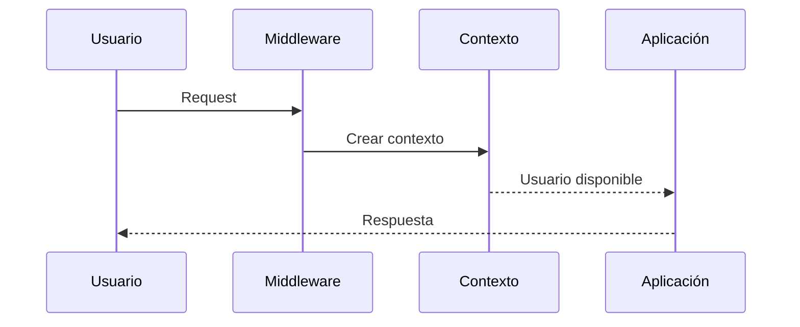

# 14_CONTEXT_INJECTION.md

# 🧩 Context Injection

---

# 📌 Introducción

La **inyección de contexto** constituye uno de los mecanismos fundamentales de Aula Robótica Platform para compartir información relevante durante el ciclo de vida de cada petición.

Este mecanismo permite que los distintos componentes de la aplicación accedan de forma segura y consistente a datos comunes, como el usuario autenticado, sus permisos, la configuración activa o el estado de la solicitud, sin necesidad de transmitir explícitamente dicha información entre todas las capas.

Gracias a esta arquitectura, la plataforma reduce el acoplamiento entre componentes y favorece un modelo de desarrollo más limpio, mantenible y escalable.

---

# 🎯 Objetivos

La inyección de contexto persigue diversos objetivos.

## Objetivos funcionales

- compartir información durante la petición;
- evitar duplicación de datos;
- facilitar el acceso al usuario autenticado;
- personalizar la experiencia del usuario;
- simplificar el desarrollo de nuevas funcionalidades.

---

## Objetivos técnicos

- desacoplar componentes;
- centralizar información compartida;
- reducir dependencias;
- facilitar el testing;
- mejorar la mantenibilidad;
- favorecer la reutilización.

---

# ¿Qué es el Contexto?

El contexto representa el conjunto de información compartida durante el procesamiento de una petición.

Puede incluir elementos como:

- usuario autenticado;
- roles;
- permisos;
- configuración;
- preferencias;
- idioma;
- organización;
- datos de sesión.

Esta información permanece disponible durante todo el ciclo de vida de la solicitud.

---

# Arquitectura General

```mermaid
flowchart TD

HTTP Request

↓

Authentication Middleware

↓

Context Injection

↓

Request Context

↓

Controllers

Service Layer

Templates SSR
```

Todos los componentes acceden al mismo contexto compartido.

---

# Ciclo de Vida

Cada petición dispone de su propio contexto independiente.

```text
Nueva petición

↓

Crear contexto

↓

Procesar solicitud

↓

Enviar respuesta

↓

Liberar contexto
```

El contexto nunca se comparte entre peticiones distintas.

---

# Principios de Diseño

La arquitectura sigue varios principios fundamentales.

Entre ellos:

- aislamiento por petición;
- inmutabilidad cuando resulta posible;
- reutilización;
- desacoplamiento;
- seguridad;
- simplicidad.

Estos principios reducen significativamente la complejidad del sistema.

---

# Contexto por Petición

Cada solicitud HTTP genera un contexto completamente nuevo.

```mermaid
flowchart LR

Request A

↓

Context A

────────────

Request B

↓

Context B
```

No existe intercambio de información entre usuarios distintos.

---

# Middleware como Punto de Entrada

La construcción del contexto comienza en el middleware de autenticación.

Este componente se encarga de:

- validar el JWT;
- identificar al usuario;
- recuperar información básica;
- inicializar el contexto.

A partir de ese momento el resto de la aplicación reutiliza dicha información.

---

# Flujo General



Todo el flujo comparte el mismo objeto de contexto.

---

# Información Compartida

El contexto puede almacenar distintos tipos de información.

| Información | Finalidad |
|--------------|-----------|
| Usuario | Identidad autenticada |
| Roles | Autorización |
| Organización | Contexto corporativo |
| Idioma | Internacionalización |
| Configuración | Personalización |
| Preferencias | Experiencia de usuario |

La composición concreta dependerá de las necesidades de la aplicación.

---

# Usuario Autenticado

Uno de los elementos más importantes del contexto es el usuario autenticado.

Este objeto puede contener información como:

- identificador;
- nombre;
- correo;
- roles;
- organización;
- estado.

Su disponibilidad simplifica considerablemente el desarrollo de la aplicación.

---

# Integración con JWT

El usuario se obtiene a partir del JWT validado por el middleware.

```mermaid
flowchart TD

JWT

↓

Validación

↓

Usuario

↓

Contexto

↓

Aplicación
```

La autenticación únicamente se realiza una vez por petición.

---

# Request State

FastAPI proporciona un mecanismo específico para almacenar información asociada a la petición.

El contexto puede mantenerse dentro del objeto **Request**, permaneciendo disponible durante todo el procesamiento.

Este enfoque evita el uso de variables globales y garantiza el aislamiento entre solicitudes.

---

# Dependencias de FastAPI

Además del objeto Request, FastAPI permite acceder al contexto mediante dependencias.

Este mecanismo facilita:

- reutilización;
- desacoplamiento;
- tipado;
- inyección automática.

Las dependencias simplifican el acceso a la información compartida.

---

# Arquitectura de Dependencias

```mermaid
flowchart TD

Request

↓

Context

↓

Dependency Injection

↓

Controller

↓

Service
```

Los componentes reciben únicamente la información que realmente necesitan.

---

# Evitando Parámetros Repetitivos

Sin un mecanismo de contexto sería necesario transmitir continuamente información entre capas.

Ejemplo conceptual:

```text
Controller

↓

Service

↓

Repository

↓

Usuario

↓

Roles

↓

Configuración
```

La inyección de contexto elimina esta repetición innecesaria.

---

# Contexto Tipado

El contexto puede representarse mediante modelos específicos.

Entre sus ventajas destacan:

- autocompletado;
- validación;
- claridad;
- mantenibilidad.

El tipado reduce significativamente los errores durante el desarrollo.

---

# Integración con SSR

Las páginas renderizadas mediante Jinja2 utilizan directamente el contexto compartido.

Esto permite acceder fácilmente a información como:

- usuario;
- nombre;
- avatar;
- organización;
- permisos.

Las plantillas permanecen desacopladas del proceso de autenticación.

---

# Personalización Dinámica

```mermaid
flowchart TD

Usuario

↓

Contexto

↓

Jinja2

↓

Interfaz personalizada
```

Cada usuario recibe una interfaz adaptada a su contexto.

---

# Integración con la Service Layer

Los servicios también pueden acceder al contexto cuando resulta necesario.

Esto permite:

- identificar al usuario actual;
- registrar auditoría;
- aplicar restricciones;
- personalizar operaciones.

Toda la información permanece centralizada.

---

# Independencia de la Persistencia

El contexto no almacena información relacionada con la base de datos.

Su finalidad consiste exclusivamente en compartir datos durante el procesamiento de la petición.

La persistencia continúa siendo responsabilidad de los repositorios.

---

# Beneficios

La inyección de contexto aporta numerosas ventajas.

Entre ellas:

- menor acoplamiento;
- reutilización;
- claridad;
- seguridad;
- simplicidad;
- escalabilidad;
- facilidad de testing.

---

# Arquitectura Resumida

```mermaid
flowchart TD

HTTP Request

↓

Middleware

↓

Context Injection

↓

Request Context

↓

Controllers

↓

Services

↓

Templates
```

Esta arquitectura establece una base uniforme para compartir información durante todo el ciclo de vida de cada solicitud y servirá como punto de partida para abordar, en la siguiente sección, la integración del contexto con RBAC, WebSockets, Docker, la observabilidad y el resto de componentes de Aula Robótica Platform.

---

# 🔐 Integración con RBAC

La inyección de contexto constituye uno de los pilares sobre los que se apoya el sistema de autorización contextual de Aula Robótica Platform.

Una vez autenticado el usuario, el contexto permite que las distintas capas de la aplicación conozcan su identidad sin necesidad de volver a consultar el sistema de autenticación.

Sobre esta información se aplican posteriormente las reglas de autorización definidas por el modelo RBAC.

---

# Flujo de Autorización

```mermaid
flowchart TD

JWT

↓

Authentication Middleware

↓

Context Injection

↓

Usuario

↓

RBAC

↓

Permisos

↓

Aplicación
```

La autenticación y la autorización permanecen claramente separadas.

---

# Autorización Contextual

En muchos escenarios no basta con conocer el rol global del usuario.

También resulta necesario evaluar el contexto específico de la operación.

Por ejemplo:

- propietario del recurso;
- miembro del proyecto;
- docente responsable;
- alumno matriculado;
- administrador institucional.

La información necesaria ya se encuentra disponible dentro del contexto de la petición.

---

# Acceso desde la Service Layer

Los servicios pueden acceder al contexto para adaptar su comportamiento.

Ejemplos:

- registrar el usuario creador;
- limitar consultas;
- aplicar filtros automáticos;
- verificar permisos;
- registrar auditoría.

Todo ello sin necesidad de propagar manualmente la identidad del usuario.

---

# Integración con APIs REST

Las API Routes reutilizan directamente el contexto generado por el middleware.

```mermaid
flowchart TD

HTTP Request

↓

Authentication

↓

Context Injection

↓

Router

↓

Service

↓

Repository
```

Todos los endpoints comparten un comportamiento homogéneo.

---

# Integración con SSR

Las páginas renderizadas mediante Jinja2 utilizan exactamente el mismo contexto.

Gracias a ello es posible:

- mostrar el nombre del usuario;
- personalizar menús;
- ocultar opciones restringidas;
- adaptar la navegación;
- mostrar información contextual.

La lógica de presentación permanece completamente desacoplada de la autenticación.

---

# Contexto Compartido

```mermaid
flowchart TD

Contexto

↓

SSR

REST

Service Layer

Templates

Dependencias
```

Toda la aplicación reutiliza una única fuente de información.

---

# Integración con WebSockets

El contexto también puede utilizarse durante el establecimiento de conexiones WebSocket.

Durante el *handshake*:

1. se recibe la cookie HTTPOnly;
2. se valida el JWT;
3. se identifica al usuario;
4. se crea el contexto de conexión.

A partir de ese momento todas las comunicaciones pueden asociarse al usuario autenticado.

---

# Arquitectura Realtime

```mermaid
flowchart LR

Cookie

↓

JWT

↓

Contexto

↓

WebSocket

↓

Eventos
```

El sistema en tiempo real reutiliza la misma arquitectura de autenticación.

---

# Integración con Auditoría

El contexto simplifica enormemente el registro de auditoría.

Cada operación puede registrar automáticamente información como:

- usuario;
- fecha;
- recurso;
- acción;
- resultado.

No es necesario transmitir manualmente estos datos entre capas.

---

# Integración con Logging

El sistema de logging también puede enriquecer automáticamente los registros utilizando el contexto.

Ejemplos:

- identificador del usuario;
- endpoint ejecutado;
- organización;
- dirección IP;
- duración de la petición.

Esta información facilita el análisis posterior de incidencias.

---

# Integración con Docker

El mecanismo de Context Injection resulta completamente independiente del entorno de ejecución.

Puede utilizarse sin modificaciones:

- en desarrollo;
- mediante Docker Compose;
- sobre un VPS;
- en futuros entornos cloud.

La infraestructura no afecta a su funcionamiento.

---

# Integración con Nginx

Nginx actúa únicamente como punto de entrada HTTP.

El contexto comienza a construirse una vez que la petición alcanza FastAPI.

Por ello:

- no depende del proxy;
- no depende del servidor web;
- no depende de la infraestructura física.

Toda la lógica permanece encapsulada dentro de la aplicación.

---

# Integración con Pydantic Settings

El contexto también puede incorporar información procedente de la configuración centralizada.

Ejemplos:

- idioma por defecto;
- organización activa;
- configuración regional;
- funcionalidades habilitadas.

Esto facilita la adaptación dinámica del comportamiento de la plataforma.

---

# Seguridad

La información almacenada en el contexto debe seguir diversas recomendaciones.

Entre ellas:

- almacenar únicamente información necesaria;
- evitar datos sensibles innecesarios;
- impedir modificaciones accidentales;
- destruir el contexto al finalizar la petición;
- mantener aislamiento entre usuarios.

Estas medidas reducen la superficie de ataque del sistema.

---

# Aislamiento

Cada petición mantiene un contexto completamente independiente.

```text
Request A

↓

Context A

────────────

Request B

↓

Context B
```

Nunca existe intercambio de información entre usuarios distintos.

---

# Observabilidad

La existencia de un contexto compartido facilita la obtención de métricas de alto nivel.

Entre ellas:

- usuarios activos;
- peticiones autenticadas;
- duración de solicitudes;
- recursos más utilizados;
- errores por usuario.

Esta información mejora significativamente la capacidad de monitorización.

---

# Troubleshooting

Los problemas relacionados con el contexto suelen estar asociados a:

| Problema | Posible causa |
|----------|---------------|
| Usuario ausente | JWT inválido |
| Contexto vacío | Middleware no ejecutado |
| Permisos incorrectos | RBAC mal configurado |
| Información desactualizada | Contexto no regenerado |
| Error SSR | Usuario no inyectado |

La separación entre autenticación, contexto y autorización facilita la localización del origen del problema.

---

# Buenas Prácticas

Durante el desarrollo se siguen diversas recomendaciones.

Entre ellas:

- crear el contexto una única vez;
- mantenerlo ligero;
- evitar lógica de negocio en el contexto;
- reutilizar dependencias;
- no utilizar variables globales;
- destruir el contexto al finalizar la petición;
- mantener tipado fuerte;
- documentar su estructura.

Estas prácticas favorecen un diseño robusto y fácilmente mantenible.

---

# Estado Actual

Actualmente Aula Robótica Platform dispone de:

✅ Middleware centralizado.

✅ Contexto por petición.

✅ Integración con JWT.

✅ Compatibilidad con SSR.

✅ Acceso mediante dependencias de FastAPI.

✅ Integración con la Service Layer.

✅ Compatibilidad con APIs REST.

✅ Preparación para WebSockets.

✅ Integración con RBAC contextual.

La arquitectura actual proporciona un mecanismo uniforme para compartir información durante todo el ciclo de vida de una solicitud.

---

# Evolución Futura

La arquitectura permitirá incorporar nuevas capacidades.

Entre ellas:

- contexto multiorganización;
- internacionalización avanzada;
- propagación distribuida de contexto;
- trazabilidad completa (*Distributed Tracing*);
- integración con OpenTelemetry;
- correlación automática de peticiones;
- contexto para tareas asíncronas;
- propagación hacia colas de mensajes.

Estas mejoras podrán añadirse sin modificar el funcionamiento básico de la plataforma.

---

# Beneficios Obtenidos

La inyección de contexto aporta numerosas ventajas.

Entre ellas:

- desacoplamiento entre componentes;
- eliminación de parámetros repetitivos;
- reutilización de información;
- integración uniforme con SSR y REST;
- simplificación del desarrollo;
- mayor seguridad;
- facilidad de mantenimiento;
- elevada escalabilidad.

---

# 📊 Arquitectura Completa

```mermaid
flowchart TD

HTTP Request

↓

Authentication Middleware

↓

Context Injection

↓

Request Context

↓

RBAC

↓

Controller

↓

Service Layer

↓

Repository

↓

HTTP Response
```

Este flujo resume el funcionamiento completo del sistema de inyección de contexto dentro de Aula Robótica Platform y muestra cómo la información compartida acompaña a la petición desde su recepción hasta la generación de la respuesta.

---

# 📌 Conclusiones

La inyección de contexto constituye un componente esencial de la arquitectura de Aula Robótica Platform al proporcionar un mecanismo uniforme para compartir información relevante durante el procesamiento de cada solicitud.

La integración con el middleware de autenticación, el sistema RBAC contextual, las páginas SSR, las API REST y la Service Layer permite mantener un elevado nivel de cohesión, reducir el acoplamiento entre componentes y simplificar el desarrollo de nuevas funcionalidades.

Gracias a esta arquitectura, la plataforma dispone de una base sólida para evolucionar hacia escenarios más avanzados, incorporando trazabilidad distribuida, observabilidad avanzada e integración con nuevos servicios sin comprometer la claridad ni la mantenibilidad del sistema.

