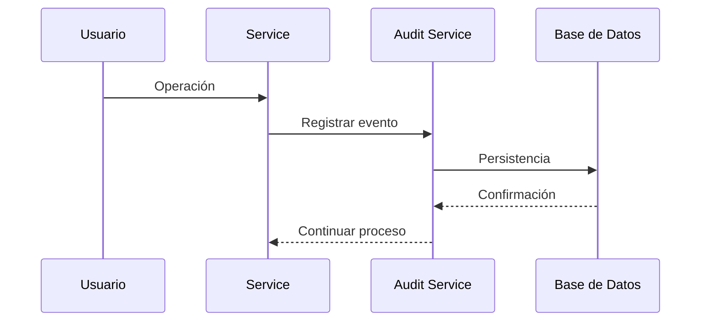

# 15_AUDIT_SYSTEM.md

# 📋 Sistema de Auditoría

---

# 📌 Introducción

El sistema de auditoría constituye uno de los componentes transversales más importantes de Aula Robótica Platform, proporcionando mecanismos para registrar de forma estructurada las acciones relevantes realizadas dentro de la aplicación.

Su finalidad principal no consiste únicamente en almacenar información histórica, sino en garantizar la trazabilidad de las operaciones, facilitar el diagnóstico de incidencias, reforzar la seguridad y proporcionar evidencias sobre el uso del sistema.

La auditoría complementa otros mecanismos como el logging, la autenticación y la autorización, permitiendo reconstruir con precisión la secuencia de eventos ocurridos durante el funcionamiento de la plataforma.

---

# 🎯 Objetivos

La arquitectura de auditoría persigue varios objetivos fundamentales.

## Objetivos funcionales

- registrar operaciones relevantes;
- identificar al usuario responsable;
- mantener un historial de cambios;
- facilitar el seguimiento de incidencias;
- apoyar tareas administrativas.

---

## Objetivos técnicos

- desacoplar la auditoría de la lógica de negocio;
- minimizar el impacto sobre el rendimiento;
- facilitar la consulta de eventos;
- garantizar la integridad de la información;
- preparar la plataforma para requisitos normativos.

---

# ¿Qué es una Auditoría?

Una auditoría consiste en registrar de forma permanente determinadas acciones realizadas dentro del sistema.

No todas las operaciones requieren auditoría.

Únicamente se almacenan aquellos eventos que aportan valor desde el punto de vista funcional, administrativo o de seguridad.

---

# Diferencia entre Auditoría y Logging

Aunque ambos mecanismos registran información, sus objetivos son diferentes.

| Logging | Auditoría |
|----------|-----------|
| Diagnóstico técnico | Trazabilidad funcional |
| Información temporal | Evidencia permanente |
| Orientado a desarrolladores | Orientado a administradores |
| Puede eliminarse | Debe conservarse |
| Errores y depuración | Acciones relevantes |

Ambos sistemas son complementarios.

---

# Principios de Diseño

El sistema de auditoría sigue varios principios arquitectónicos.

Entre ellos:

- independencia;
- inmutabilidad;
- trazabilidad;
- bajo acoplamiento;
- reutilización;
- escalabilidad.

Estos principios permiten mantener una arquitectura limpia y fácilmente extensible.

---

# Arquitectura General

```mermaid
flowchart TD

Usuario

↓

Router

↓

Service Layer

↓

Audit Service

↓

Audit Repository

↓

MariaDB
```

La auditoría constituye una capa transversal reutilizable por toda la aplicación.

---

# Flujo General



La operación funcional permanece desacoplada del almacenamiento de auditoría.

---

# Eventos Auditables

No todas las acciones generan registros de auditoría.

Entre las operaciones habitualmente auditadas destacan:

- autenticaciones;
- cierres de sesión;
- creación de usuarios;
- modificaciones;
- eliminaciones;
- cambios administrativos;
- asignación de permisos;
- operaciones críticas.

---

# Clasificación de Eventos

Los eventos pueden agruparse según su naturaleza.

| Categoría | Ejemplos |
|------------|----------|
| Seguridad | Login, Logout |
| Administración | Gestión de usuarios |
| Datos | Altas, modificaciones |
| Configuración | Cambios del sistema |
| Permisos | Roles y privilegios |

Esta clasificación facilita posteriores consultas y análisis.

---

# Componentes del Sistema

La arquitectura incorpora varios componentes especializados.

| Componente | Responsabilidad |
|------------|-----------------|
| Audit Service | Coordinación |
| Audit Repository | Persistencia |
| Base de datos | Almacenamiento |
| Context Injection | Usuario actual |
| Middleware | Información de petición |

Cada componente mantiene una responsabilidad claramente definida.

---

# Audit Service

El servicio de auditoría constituye el punto central del sistema.

Sus responsabilidades incluyen:

- construir registros;
- normalizar eventos;
- almacenar información;
- desacoplar la lógica funcional;
- facilitar futuras ampliaciones.

Ningún otro componente necesita conocer los detalles de persistencia.

---

# Audit Repository

La persistencia de auditoría se delega completamente al repositorio correspondiente.

```mermaid
flowchart TD

Audit Service

↓

Audit Repository

↓

MariaDB
```

Este diseño mantiene la separación entre lógica funcional y almacenamiento.

---

# Información Registrada

Cada registro puede contener información como:

- usuario;
- acción;
- fecha;
- recurso;
- resultado;
- dirección IP;
- identificador de sesión.

La estructura concreta dependerá de las necesidades de la plataforma.

---

# Modelo Conceptual

```mermaid
flowchart LR

Usuario

↓

Acción

↓

Recurso

↓

Resultado

↓

Registro Auditoría
```

Cada evento representa una evidencia del comportamiento del sistema.

---

# Usuario Responsable

Siempre que resulte posible el sistema identifica al usuario responsable de la operación.

Esta información procede normalmente del contexto de autenticación generado por el middleware.

De esta forma cada acción puede asociarse inequívocamente a un usuario.

---

# Recursos Auditados

Los registros pueden hacer referencia a diferentes tipos de recursos.

Ejemplos:

- usuarios;
- proyectos;
- robots;
- actividades;
- configuraciones;
- permisos.

Esta información facilita la reconstrucción posterior de los acontecimientos.

---

# Tipos de Acciones

Las acciones registradas pueden clasificarse mediante verbos normalizados.

Ejemplos habituales:

- CREATE;
- UPDATE;
- DELETE;
- LOGIN;
- LOGOUT;
- ASSIGN;
- REVOKE;
- EXPORT.

La normalización simplifica las consultas posteriores.

---

# Resultados

Cada operación puede registrar igualmente su resultado.

Por ejemplo:

- éxito;
- error;
- acceso denegado;
- validación fallida;
- excepción.

Esto proporciona una visión completa del comportamiento del sistema.

---

# Trazabilidad

```mermaid
flowchart TD

Usuario

↓

Operación

↓

Servicio

↓

Auditoría

↓

Historial
```

La trazabilidad permite reconstruir con precisión la secuencia de acciones realizadas dentro de la plataforma.

---

# Independencia Funcional

La auditoría no implementa lógica de negocio.

Su única responsabilidad consiste en registrar información relevante.

Esto permite reutilizar el mismo mecanismo desde cualquier componente de la aplicación.

---

# Integración con la Arquitectura

El sistema puede ser utilizado por:

- APIs REST;
- páginas SSR;
- Service Layer;
- tareas automáticas;
- procesos administrativos;
- WebSockets.

Toda la plataforma comparte un único mecanismo de auditoría.

---

# Beneficios

La incorporación de un sistema de auditoría proporciona numerosas ventajas.

Entre ellas:

- trazabilidad;
- seguridad;
- transparencia;
- diagnóstico de incidencias;
- control administrativo;
- historial de cambios;
- preparación para cumplimiento normativo.

---

# Arquitectura Resumida

```mermaid
flowchart TD

Aplicación

↓

Audit Service

↓

Audit Repository

↓

MariaDB
```

Esta arquitectura establece una base sólida para registrar de forma uniforme las operaciones relevantes realizadas dentro de Aula Robótica Platform y servirá como punto de partida para abordar, en las siguientes secciones, la integración con autenticación, RBAC, WebSockets, observabilidad y los mecanismos de seguridad asociados al sistema de auditoría.

---

# 🔐 Integración con la Autenticación

El sistema de auditoría trabaja de forma coordinada con el mecanismo de autenticación basado en JWT.

Una vez validada la identidad del usuario, el contexto generado por el middleware proporciona toda la información necesaria para identificar al responsable de cada operación.

De esta forma, cada registro de auditoría puede asociarse de manera inequívoca a un usuario autenticado.

---

# Flujo de Identificación

```mermaid
flowchart TD

JWT

↓

Authentication Middleware

↓

Context Injection

↓

Usuario

↓

Audit Service

↓

Registro
```

La autenticación únicamente se realiza una vez por petición.

---

# Integración con Context Injection

El sistema de auditoría reutiliza el contexto compartido generado durante la solicitud.

Gracias a ello puede acceder automáticamente a información como:

- usuario;
- organización;
- roles;
- identificador de sesión;
- dirección IP.

No resulta necesario transmitir manualmente estos datos entre capas.

---

# Integración con RBAC

La auditoría registra también las operaciones relacionadas con el sistema de autorización.

Entre ellas:

- asignación de roles;
- modificación de permisos;
- creación de perfiles;
- revocación de privilegios;
- cambios administrativos.

Esto permite reconstruir posteriormente la evolución de los permisos dentro de la plataforma.

---

# Flujo de Autorización

```mermaid
flowchart TD

Usuario

↓

RBAC

↓

Permisos

↓

Operación

↓

Audit Service
```

La autorización continúa siendo independiente de la auditoría, aunque ambas colaboran durante el procesamiento de la petición.

---

# Integración con la Service Layer

La Service Layer constituye el principal punto desde el que se generan eventos auditables.

```mermaid
flowchart TD

Controller

↓

Service Layer

↓

Audit Service

↓

Repository
```

La lógica de negocio permanece desacoplada del mecanismo de almacenamiento.

---

# Auditoría Automática

Muchas operaciones pueden registrar automáticamente eventos sin que cada servicio implemente manualmente el proceso.

Este enfoque:

- reduce código repetido;
- mejora la consistencia;
- disminuye errores;
- simplifica el mantenimiento.

---

# Integración con APIs REST

Todas las operaciones realizadas mediante la API REST pueden generar registros de auditoría.

Entre ellas:

- creación de recursos;
- modificaciones;
- eliminaciones;
- operaciones administrativas;
- consultas críticas.

La auditoría permanece completamente transparente para el cliente.

---

# Integración con SSR

Las acciones iniciadas desde las páginas renderizadas mediante Jinja2 utilizan exactamente el mismo sistema de auditoría.

```mermaid
flowchart LR

SSR

↓

Service Layer

↓

Audit Service
```

No existe diferencia entre clientes web y consumidores de la API.

---

# Integración con WebSockets

Las conexiones WebSocket también pueden generar registros de auditoría.

Ejemplos:

- apertura de conexión;
- cierre;
- operaciones críticas;
- mensajes administrativos;
- acciones colaborativas.

La reutilización del contexto autenticado simplifica la identificación del usuario.

---

# Eventos Realtime

```mermaid
flowchart TD

WebSocket

↓

Usuario

↓

Evento

↓

Audit Service
```

La arquitectura mantiene la coherencia entre comunicaciones HTTP y tiempo real.

---

# Auditoría de Errores

Además de las operaciones correctas, pueden registrarse determinados errores funcionales.

Ejemplos:

- acceso denegado;
- autenticación fallida;
- permisos insuficientes;
- validaciones críticas;
- excepciones relevantes.

Esto facilita posteriores investigaciones.

---

# Integración con Logging

Logging y auditoría comparten información, aunque persiguen objetivos diferentes.

```mermaid
flowchart TD

Aplicación

↓

Logging

Audit Service
```

El logging ayuda al diagnóstico técnico mientras que la auditoría mantiene evidencias funcionales permanentes.

---

# Integración con Observabilidad

Los registros de auditoría pueden convertirse en una importante fuente de métricas.

Entre ellas:

- operaciones por usuario;
- recursos más utilizados;
- frecuencia de acciones;
- actividad administrativa;
- accesos privilegiados.

Estas métricas permiten comprender mejor el comportamiento de la plataforma.

---

# Consultas Históricas

La persistencia estructurada facilita la recuperación posterior de información.

Ejemplos:

- historial de un usuario;
- cambios sobre un recurso;
- acciones administrativas;
- operaciones realizadas durante un intervalo temporal.

Estas consultas apoyan tanto tareas técnicas como administrativas.

---

# Seguridad

La auditoría debe respetar varias recomendaciones.

Entre ellas:

- registrar únicamente información necesaria;
- proteger datos sensibles;
- impedir modificaciones posteriores;
- controlar el acceso a los registros;
- mantener políticas de conservación.

La auditoría no debe convertirse en una fuente de exposición de información confidencial.

---

# Integridad de los Registros

Los registros deben mantenerse inalterables una vez almacenados.

Esto garantiza:

- autenticidad;
- trazabilidad;
- fiabilidad;
- valor probatorio.

La modificación posterior de un evento comprometería la utilidad del sistema.

---

# Retención

La política de conservación dependerá de las necesidades de la organización.

Pueden definirse criterios como:

- antigüedad;
- volumen;
- requisitos legales;
- auditorías internas;
- políticas corporativas.

Una gestión adecuada evita un crecimiento innecesario del almacenamiento.

---

# Rendimiento

El registro de auditoría debe minimizar el impacto sobre el funcionamiento general de la aplicación.

Para ello se recomienda:

- registrar únicamente eventos relevantes;
- evitar operaciones redundantes;
- optimizar consultas;
- reutilizar componentes.

En futuras versiones podrán incorporarse mecanismos de procesamiento asíncrono.

---

# Buenas Prácticas

Durante el desarrollo del sistema de auditoría se siguen diversas recomendaciones.

Entre ellas:

- mantener eventos normalizados;
- utilizar nombres consistentes;
- registrar únicamente información útil;
- desacoplar la auditoría de la lógica de negocio;
- reutilizar el Audit Service;
- evitar duplicidades;
- documentar los tipos de eventos.

Estas prácticas favorecen un sistema uniforme y fácilmente mantenible.

---

# Arquitectura Completa

```mermaid
flowchart TD

Usuario

↓

JWT

↓

Authentication

↓

Context Injection

↓

Service Layer

↓

Audit Service

↓

Audit Repository

↓

MariaDB
```

Este flujo muestra cómo la auditoría se integra de forma transversal con el resto de componentes de Aula Robótica Platform y acompaña a cada operación desde la autenticación inicial hasta el almacenamiento permanente del evento, preparando la base para abordar, en la última sección, aspectos relacionados con el despliegue, la observabilidad avanzada, la evolución futura y las conclusiones del sistema de auditoría.

---

# 📈 Integración con la Observabilidad

Aunque la auditoría y la observabilidad persiguen objetivos diferentes, ambos mecanismos resultan complementarios dentro de la arquitectura de Aula Robótica Platform.

Mientras que la observabilidad permite comprender el estado técnico de la aplicación, la auditoría proporciona evidencias funcionales sobre las acciones realizadas por los usuarios.

La combinación de ambos sistemas facilita el diagnóstico de incidencias y el análisis del comportamiento general de la plataforma.

---

# Relación entre Componentes

```mermaid
flowchart TD

Aplicación

↓

Logging

Observabilidad

Audit Service

↓

Administradores
```

Cada componente aporta una visión distinta del funcionamiento del sistema.

---

# Integración con Docker

El sistema de auditoría permanece completamente desacoplado de la infraestructura de despliegue.

Puede ejecutarse sin modificaciones:

- en entornos locales;
- mediante Docker;
- utilizando Docker Compose;
- sobre servidores VPS;
- en futuros entornos cloud.

La lógica de auditoría permanece inalterada independientemente del entorno.

---

# Integración con Docker Compose

Docker Compose coordina exclusivamente los distintos servicios que forman la plataforma.

El sistema de auditoría no depende de:

- redes Docker;
- contenedores;
- volúmenes;
- configuración del orquestador.

Esta independencia favorece la portabilidad del backend.

---

# Integración con Nginx

Nginx actúa únicamente como proxy inverso para las peticiones HTTP y HTTPS.

El sistema de auditoría comienza a operar una vez que la solicitud alcanza la aplicación FastAPI.

Por ello, la generación de registros permanece completamente aislada de:

- certificados TLS;
- balanceadores;
- proxies;
- configuración del servidor web.

---

# Integración con Pydantic Settings

La configuración centralizada puede utilizarse para controlar distintos aspectos relacionados con la auditoría.

Por ejemplo:

- activación del sistema;
- niveles de registro;
- políticas de conservación;
- configuración de proveedores externos;
- límites de almacenamiento.

Esta aproximación evita la aparición de valores codificados dentro del código fuente.

---

# Integración con MariaDB

Los registros de auditoría se almacenan de forma persistente utilizando la misma infraestructura de base de datos empleada por el resto de la plataforma.

```mermaid
flowchart TD

Audit Service

↓

Audit Repository

↓

SQLAlchemy

↓

MariaDB
```

La separación mediante el repositorio mantiene desacopladas la lógica funcional y la persistencia.

---

# Consultas Administrativas

El almacenamiento estructurado facilita la elaboración de consultas para tareas de administración.

Entre ellas:

- actividad de un usuario;
- historial de un recurso;
- operaciones críticas;
- acciones realizadas durante un periodo determinado;
- actividad administrativa.

Estas consultas constituyen una herramienta de gran utilidad para la gestión de la plataforma.

---

# Escalabilidad

La arquitectura del sistema de auditoría ha sido diseñada para crecer junto con el resto de Aula Robótica Platform.

Es posible incorporar nuevos tipos de eventos sin modificar los componentes existentes.

```mermaid
flowchart TD

Audit Service

↓

Usuarios

Proyectos

Robots

Cursos

Inventario

Nuevos módulos
```

Cada nuevo dominio puede reutilizar el mismo mecanismo de auditoría.

---

# Extensibilidad

La incorporación de nuevos eventos suele limitarse a:

- definir la acción auditada;
- construir el registro correspondiente;
- utilizar el Audit Service.

No resulta necesario modificar el funcionamiento interno del sistema.

---

# Rendimiento

El diseño del sistema busca minimizar el impacto sobre el rendimiento general de la aplicación.

Para ello se aplican principios como:

- registrar únicamente información relevante;
- reutilizar componentes;
- evitar duplicidades;
- mantener estructuras de datos simples.

En escenarios de mayor carga podrá evolucionarse hacia mecanismos de persistencia asíncrona.

---

# Compatibilidad con Procesamiento Asíncrono

En futuras versiones, determinadas operaciones de auditoría podrán ejecutarse de forma desacoplada del flujo principal.

Algunas posibilidades incluyen:

- colas de mensajes;
- procesamiento en segundo plano;
- eventos de dominio;
- arquitecturas orientadas a eventos.

Esta evolución permitirá incrementar el rendimiento sin alterar la arquitectura existente.

---

# Integración con Kafka y Event Bus

La estructura actual facilita una futura integración con plataformas de mensajería.

Entre las tecnologías consideradas destacan:

- Apache Kafka;
- RabbitMQ;
- Event Bus interno;
- arquitecturas *publish/subscribe*.

Estas soluciones permitirían distribuir eventos de auditoría entre distintos servicios sin modificar la lógica funcional.

---

# Seguridad

Los registros de auditoría constituyen información sensible y deben protegerse adecuadamente.

Entre las medidas recomendadas se encuentran:

- acceso restringido;
- cifrado cuando sea necesario;
- políticas de retención;
- copias de seguridad;
- control de integridad.

Estas medidas garantizan la fiabilidad del historial almacenado.

---

# Buenas Prácticas

Durante el desarrollo del sistema de auditoría se siguen diversas recomendaciones.

Entre ellas:

- registrar únicamente eventos relevantes;
- mantener nomenclaturas homogéneas;
- evitar duplicidades;
- desacoplar completamente la lógica funcional;
- reutilizar el Audit Service;
- conservar estructuras simples;
- facilitar futuras ampliaciones.

Estas prácticas contribuyen a un sistema robusto y fácilmente mantenible.

---

# Estado Actual

Actualmente Aula Robótica Platform dispone de una arquitectura preparada para incorporar un sistema de auditoría transversal.

La plataforma cuenta con:

✅ Service Layer centralizada.

✅ Context Injection para identificar al usuario.

✅ Integración con autenticación JWT.

✅ Compatibilidad con RBAC contextual.

✅ Arquitectura Repository.

✅ Persistencia mediante MariaDB.

✅ Compatibilidad con SSR.

✅ Compatibilidad con APIs REST.

✅ Preparación para WebSockets.

Esta base arquitectónica permite integrar la auditoría de forma homogénea en todos los módulos de la aplicación.

---

# Evolución Futura

La arquitectura permitirá incorporar nuevas capacidades sin modificar el diseño general.

Entre las posibles evoluciones destacan:

- procesamiento asíncrono de eventos;
- integración con OpenTelemetry;
- correlación distribuida de peticiones;
- exportación de eventos;
- dashboards administrativos;
- generación automática de informes;
- integración con SIEM corporativos;
- detección de anomalías mediante inteligencia artificial.

Estas mejoras reforzarán tanto la seguridad como la capacidad de análisis operativo de la plataforma.

---

# Beneficios Obtenidos

La incorporación de un sistema de auditoría aporta numerosas ventajas.

Entre ellas:

- trazabilidad completa;
- identificación del usuario responsable;
- reconstrucción de operaciones;
- apoyo a la administración;
- mejora de la seguridad;
- preparación para requisitos normativos;
- integración con el resto de la arquitectura;
- elevada escalabilidad.

Todo ello contribuye a construir una plataforma más robusta, transparente y preparada para crecer.

---

# 📊 Arquitectura Global del Sistema de Auditoría

```mermaid
flowchart TD

Usuario

↓

JWT

↓

Authentication Middleware

↓

Context Injection

↓

Controller

↓

Service Layer

↓

Audit Service

↓

Audit Repository

↓

MariaDB

↓

Consultas Administrativas
```

Este diagrama resume la posición transversal del sistema de auditoría dentro de Aula Robótica Platform y muestra cómo acompaña a cada operación desde la autenticación inicial hasta el almacenamiento permanente de los eventos registrados.

---

# 📌 Conclusiones

El sistema de auditoría constituye un componente transversal esencial dentro de la arquitectura de Aula Robótica Platform al proporcionar un mecanismo uniforme para registrar, almacenar y consultar las operaciones relevantes realizadas en la plataforma.

Su integración con el sistema de autenticación basado en JWT, el mecanismo de Context Injection, el modelo de autorización RBAC, la Service Layer y la arquitectura Repository garantiza una trazabilidad completa sin introducir acoplamientos innecesarios entre componentes.

El diseño propuesto favorece la reutilización, la mantenibilidad y la escalabilidad del sistema, permitiendo incorporar nuevas funcionalidades, dominios o mecanismos de procesamiento distribuido sin alterar la estructura existente. De este modo, la plataforma queda preparada para evolucionar hacia escenarios más avanzados de observabilidad, cumplimiento normativo, análisis de eventos e integración con tecnologías de mensajería y monitorización empresarial.

