# 16_UI_TEMPLATES.md

# 16. Arquitectura de Plantillas e Interfaz de Usuario

---

# 1. Introducción

La capa de presentación de **Aula Robótica Platform** está construida sobre una arquitectura de renderizado en servidor basada en **FastAPI**, **Jinja2**, **AdminLTE**, **Bootstrap** y JavaScript modular.

La plataforma no utiliza las plantillas como simples documentos HTML aislados. El frontend se organiza como un sistema de interfaz modular compuesto por layouts, componentes reutilizables, macros, fragmentos parciales, patrones de página y servicios JavaScript especializados.

Este diseño permite mantener una experiencia visual coherente en todos los módulos funcionales y evita que cada página implemente de forma independiente estructuras, botones, formularios, tablas, estados, mensajes o controles de autorización.

La arquitectura actual puede entenderse como un pequeño sistema de diseño orientado a aplicaciones administrativas SSR, adaptado a las necesidades específicas de Aula Robótica Platform.

---

# 2. Propósito del documento

Este documento define los principios, componentes y reglas que gobiernan la capa de plantillas y la construcción de interfaces de usuario de la plataforma.

Sus objetivos principales son:

- documentar la arquitectura frontend SSR;
- establecer una estructura uniforme para las plantillas;
- describir la jerarquía de layouts y componentes;
- normalizar los patrones de interfaz;
- facilitar la reutilización visual;
- reducir duplicaciones;
- integrar la autorización contextual;
- preparar la interfaz para actualizaciones en tiempo real;
- mantener separadas la presentación, la lógica de negocio y la persistencia.

---

# 3. Objetivos de la arquitectura UI

La arquitectura de interfaz se ha diseñado para alcanzar los siguientes objetivos.

## 3.1. Coherencia visual

Todas las páginas deben compartir:

- estructura general;
- navegación;
- espaciados;
- tipografía;
- iconografía;
- colores;
- estilos de botones;
- representación de estados;
- tratamiento de errores;
- comportamiento de formularios.

La coherencia visual reduce la curva de aprendizaje y mejora la experiencia de uso.

---

## 3.2. Reutilización

Los elementos repetidos se encapsulan como:

- layouts;
- macros Jinja2;
- componentes;
- partials;
- funciones auxiliares;
- módulos JavaScript.

La regla principal es:

> Todo patrón visual que aparezca de forma repetida debe convertirse en un componente reutilizable.

---

## 3.3. Separación de responsabilidades

La arquitectura diferencia claramente entre:

| Responsabilidad | Componente |
|---|---|
| Lógica de negocio | Service Layer |
| Persistencia | Repository Layer |
| Preparación de datos | Router o controlador |
| Estructura visual | Plantillas Jinja2 |
| Interacción en navegador | JavaScript |
| Estilo base | AdminLTE y Bootstrap |
| Autorización efectiva | Backend |
| Visibilidad contextual | Plantillas |

Las plantillas no deben implementar reglas de negocio ni acceder directamente a la base de datos.

---

## 3.4. Escalabilidad

La incorporación de nuevos módulos debe poder realizarse sin reconstruir la interfaz desde cero.

Cada nuevo dominio funcional puede reutilizar:

- el layout principal;
- el sistema de formularios;
- las tablas;
- los botones;
- las acciones CRUD;
- los estados vacíos;
- los diálogos;
- los mensajes toast;
- la paginación;
- la navegación contextual.

---

## 3.5. Accesibilidad y usabilidad

Los componentes deben favorecer:

- navegación comprensible;
- contraste adecuado;
- etiquetas descriptivas;
- iconos acompañados de texto cuando sea necesario;
- foco visible;
- mensajes de error claros;
- confirmación de operaciones críticas;
- comportamiento consistente en dispositivos de distintos tamaños.

---

## 3.6. Integración con seguridad

La interfaz se adapta a la identidad, roles, permisos y contexto del usuario.

La UI puede ocultar:

- botones;
- enlaces;
- menús;
- secciones;
- acciones administrativas;
- controles de edición.

Sin embargo, esta ocultación no sustituye nunca la validación del backend.

> La interfaz mejora la experiencia ocultando acciones no disponibles, mientras que el backend garantiza la seguridad real.

---

# 4. Stack tecnológico de presentación

La capa visual de Aula Robótica Platform se apoya en el siguiente conjunto tecnológico:

```text
FastAPI
+
Jinja2
+
AdminLTE
+
Bootstrap
+
Font Awesome
+
JavaScript modular
+
WebSockets
```

Cada elemento cumple una función específica.

| Tecnología | Responsabilidad |
|---|---|
| FastAPI | Gestión de rutas y preparación del contexto |
| Jinja2 | Renderizado SSR y composición de plantillas |
| AdminLTE | Estructura visual administrativa |
| Bootstrap | Sistema de estilos y componentes responsivos |
| Font Awesome | Iconografía |
| JavaScript | Interactividad y comportamiento dinámico |
| WebSockets | Actualizaciones en tiempo real |

---

# 5. Modelo de renderizado SSR

La plataforma utiliza principalmente **Server-Side Rendering**.

En este modelo, FastAPI procesa la petición, recupera la información necesaria, aplica las reglas de acceso y entrega una plantilla Jinja2 ya renderizada.

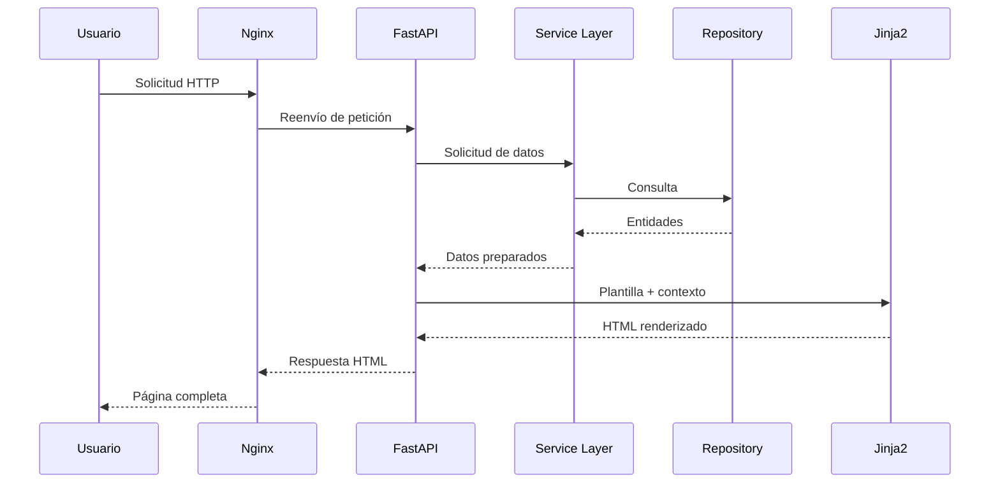

---

# 6. Ventajas del enfoque SSR

El uso de SSR aporta distintas ventajas al proyecto.

## 6.1. Simplicidad arquitectónica

No es necesario mantener dos aplicaciones completamente independientes para backend y frontend.

La lógica de navegación y renderizado permanece integrada dentro de la aplicación FastAPI.

---

## 6.2. Menor complejidad de estado

La mayor parte del estado se resuelve en el servidor.

Esto reduce la necesidad de:

- stores globales;
- sincronización compleja;
- duplicación de modelos;
- manejo manual de caché en el navegador.

---

## 6.3. Integración directa con autenticación

Las cookies HTTPOnly se utilizan de forma natural en las peticiones SSR.

El backend puede validar la sesión antes de renderizar cada página y construir una interfaz adaptada al usuario autenticado.

---

## 6.4. Reutilización del backend

Las mismas capas de servicio son utilizadas por:

- páginas SSR;
- endpoints REST;
- WebSockets;
- tareas internas;
- procesos administrativos.

---

## 6.5. Rendimiento inicial

La respuesta llega al navegador como HTML preparado para mostrarse.

No resulta necesario descargar una gran aplicación JavaScript antes de presentar el contenido principal.

---

# 7. Arquitectura general de plantillas

La organización de plantillas se estructura por responsabilidad y por dominio funcional.

```text
templates/
│
├── layouts/
├── components/
├── partials/
├── auth/
├── dashboard/
├── users/
├── roles/
├── identities/
├── projects/
├── tasks/
├── activities/
├── audit/
├── errors/
└── shared/
```

La estructura puede evolucionar con nuevos dominios, pero debe conservar la separación entre elementos globales, componentes reutilizables y páginas específicas.

---

# 8. Clasificación de plantillas

Las plantillas se agrupan en varias categorías.

| Categoría | Finalidad |
|---|---|
| Layouts | Definir la estructura global |
| Components | Implementar elementos reutilizables |
| Partials | Representar fragmentos insertables |
| Pages | Construir pantallas completas |
| Rows | Renderizar elementos de listas o tablas |
| Forms | Crear formularios normalizados |
| Errors | Mostrar errores HTTP |
| Shared | Reunir piezas comunes entre dominios |

---

# 9. Layout System

El sistema de layouts constituye la base estructural de toda la aplicación.

Un layout define el armazón común sobre el que se construyen las páginas.

Entre sus responsabilidades se encuentran:

- declaración del documento HTML;
- carga de estilos;
- navbar;
- sidebar;
- área principal;
- breadcrumbs;
- footer;
- mensajes globales;
- scripts;
- puntos de extensión;
- inicialización de componentes JavaScript.

---

# 10. Layout principal

El archivo principal suele corresponder a:

```text
templates/layouts/base.html
```

Este layout actúa como contenedor de todas las páginas autenticadas.

Su estructura conceptual es:

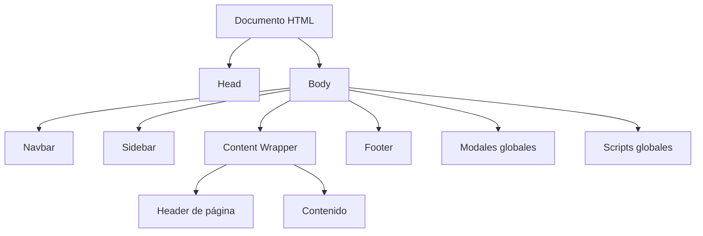

---

# 11. Responsabilidades del layout base

El layout principal debe encargarse exclusivamente de elementos globales.

## 11.1. Estructura del documento

Incluye:

- declaración `DOCTYPE`;
- idioma;
- metadatos;
- viewport;
- título;
- estilos globales;
- favicon.

---

## 11.2. Navegación superior

La barra superior puede contener:

- acceso al perfil;
- notificaciones;
- control del menú lateral;
- identidad del usuario;
- cierre de sesión;
- accesos rápidos.

---

## 11.3. Navegación lateral

La barra lateral representa la navegación principal por módulos.

Su contenido puede variar según:

- rol;
- permisos;
- contexto organizativo;
- estado del usuario;
- funcionalidades habilitadas.

---

## 11.4. Área de contenido

El layout proporciona un bloque extensible donde cada página inserta su contenido.

```jinja2


```

---

## 11.5. Recursos JavaScript

Los scripts globales deben cargarse en el layout.

Las páginas pueden ampliar la carga mediante bloques específicos.

```jinja2


```

---

## 11.6. Elementos globales de interacción

El layout puede incorporar:

- contenedor de toast;
- modal de confirmación;
- indicador de carga;
- overlay;
- manejadores WebSocket;
- bootstrap de notificaciones.

---

# 12. Herencia de plantillas

Jinja2 permite que las páginas extiendan el layout principal.

```jinja2



Proyectos



    <!-- Contenido de la página -->

```

La herencia evita repetir la estructura general en cada archivo.

---

# 13. Bloques de extensión

El layout puede definir distintos bloques para permitir personalización.

| Bloque | Finalidad |
|---|---|
| `title` | Título del documento |
| `page_title` | Encabezado visible |
| `breadcrumbs` | Ruta de navegación |
| `content` | Contenido principal |
| `styles` | CSS específico |
| `scripts` | JavaScript específico |
| `modals` | Diálogos exclusivos |
| `actions` | Acciones de cabecera |

La definición de bloques debe mantenerse controlada para evitar layouts excesivamente complejos.

---

# 14. Jerarquía visual

La arquitectura sigue una composición descendente.

```text
Layout global
    ↓
Layout de página
    ↓
Componentes estructurales
    ↓
Componentes de dominio
    ↓
Microcomponentes
```

Representación:

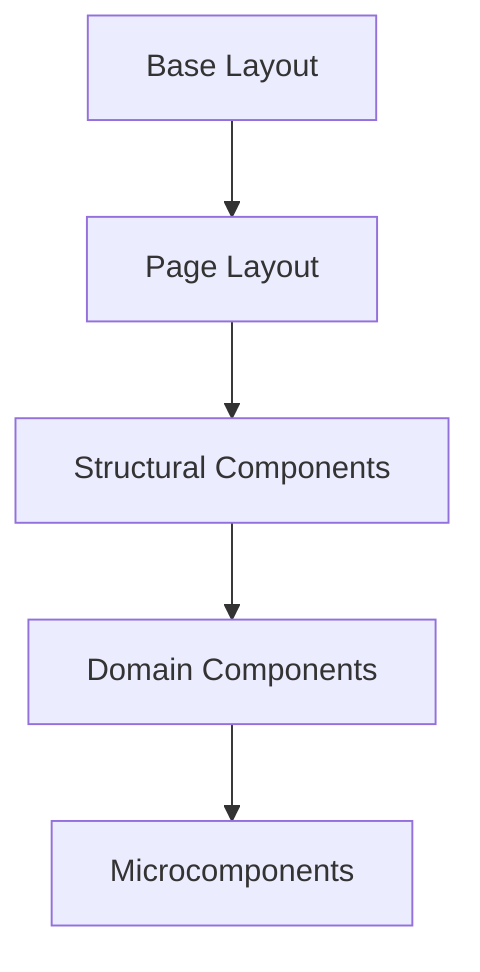

---

# 15. Page Layouts

Los layouts de página proporcionan estructuras reutilizables para determinados tipos de pantalla.

Los principales patrones son:

- páginas de listado;
- páginas de detalle;
- páginas de formulario;
- dashboards;
- páginas de autenticación;
- páginas de error.

Cada patrón dispone de una estructura visual homogénea.

---

# 16. Páginas de listado

Las páginas de listado muestran colecciones de recursos.

Normalmente incluyen:

- encabezado;
- acciones principales;
- filtros;
- buscador;
- tabla o rejilla;
- paginación;
- estado vacío.

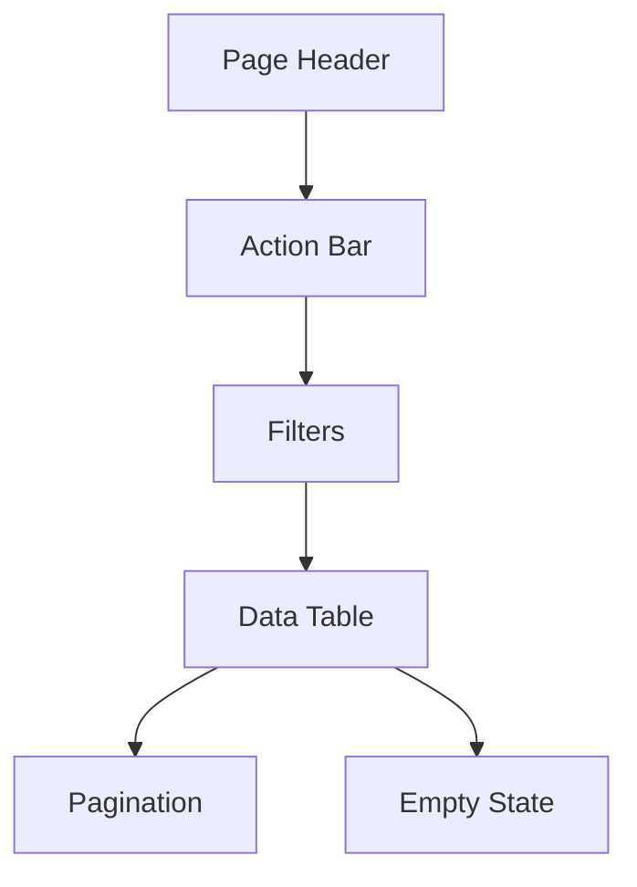

---

# 17. Páginas de detalle

Las páginas de detalle presentan información completa de una entidad.

Pueden incluir:

- cabecera contextual;
- estado;
- acciones;
- información principal;
- panel lateral;
- relaciones;
- adjuntos;
- historial;
- actividad.

```text
Header
+
Action Bar
+
Information Grid
+
Main Panel
+
Context Panel
+
Timeline
+
Attachments
```

---

# 18. Páginas de formulario

Las páginas de formulario deben utilizar componentes normalizados.

Su estructura general incluye:

- título;
- descripción;
- resumen de errores;
- campos agrupados;
- acciones de envío;
- cancelación;
- ayuda contextual.

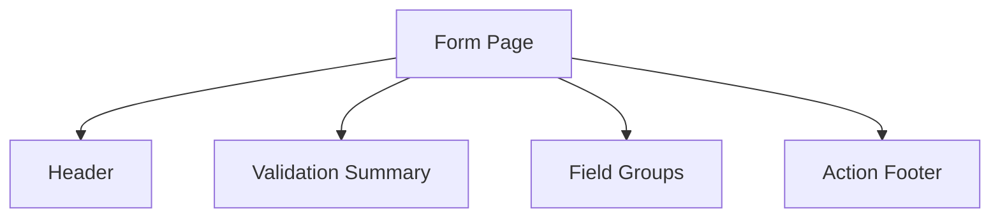

---

# 19. Dashboards

Los dashboards combinan varios tipos de componentes.

Entre ellos:

- tarjetas de métricas;
- gráficos;
- actividad reciente;
- estados;
- accesos rápidos;
- alertas;
- paneles en tiempo real.

El dashboard debe componerse a partir de componentes reutilizables y no mediante HTML específico difícil de mantener.

---

# 20. Páginas de autenticación

Las vistas de autenticación pueden utilizar un layout independiente.

Ejemplos:

- inicio de sesión;
- recuperación de contraseña;
- cambio de contraseña;
- error de autenticación.

Estas páginas no necesitan la navegación administrativa completa.

```text
Auth Layout
├── Logo
├── Formulario
├── Mensajes
└── Enlaces auxiliares
```

---

# 21. Páginas de error

Los errores HTTP deben utilizar plantillas homogéneas.

Entre los casos habituales:

- 400 — solicitud inválida;
- 401 — autenticación requerida;
- 403 — acceso prohibido;
- 404 — recurso inexistente;
- 409 — conflicto;
- 422 — validación fallida;
- 500 — error interno.

Estas páginas deben proporcionar información comprensible sin revelar detalles sensibles.

---

# 22. Component Architecture

Los componentes encapsulan fragmentos visuales reutilizables.

Un componente puede representar:

- un botón;
- una insignia;
- una tabla;
- una tarjeta;
- una fila;
- un campo;
- una alerta;
- un estado vacío;
- un panel;
- una acción.

La componentización reduce la duplicación y facilita la evolución global del diseño.

---

# 23. Macros Jinja2

Las macros permiten definir componentes parametrizables.

Ejemplo conceptual:

```jinja2

    <a
        href="{{ href }}"
        class="btn btn-{{ variant }}"
    >
        
            <i class="{{ icon }}"></i>
        
        {{ label }}
    </a>

```

Uso:

```jinja2
{{ button(
    label="Crear proyecto",
    href=url_for("projects:create"),
    icon="fas fa-plus",
    variant="primary"
) }}
```

---

# 24. Ventajas de las macros

Las macros aportan:

- uniformidad;
- reutilización;
- parametrización;
- reducción de errores;
- facilidad de mantenimiento;
- menor volumen de HTML repetido.

Una modificación sobre una macro puede propagarse automáticamente a todas las páginas que la utilizan.

---

# 25. Organización de componentes

Una posible estructura es:

```text
templates/components/
│
├── actions/
├── badges/
├── buttons/
├── cards/
├── dialogs/
├── empty_states/
├── forms/
├── navigation/
├── pagination/
├── tables/
├── timelines/
└── toasts/
```

La agrupación por tipo facilita la localización y reutilización.

---

# 26. Componentes estructurales

Los componentes estructurales definen zonas completas de una página.

Ejemplos:

- page header;
- content card;
- detail panel;
- sidebar block;
- action bar;
- info grid;
- timeline container.

Estos componentes pueden contener otros componentes más pequeños.

---

# 27. Microcomponentes

Los microcomponentes representan elementos simples y altamente reutilizables.

Ejemplos:

- botón;
- icono;
- badge;
- avatar;
- etiqueta;
- contador;
- tooltip;
- enlace de acción.

Su diseño debe mantenerse sencillo y predecible.

---

# 28. Principios de los componentes

Todo componente debe cumplir, cuando resulte aplicable, los siguientes principios:

- responsabilidad única;
- interfaz de parámetros clara;
- valores por defecto razonables;
- estilos consistentes;
- independencia del dominio;
- accesibilidad;
- adaptación responsive;
- ausencia de lógica de negocio.

---

# 29. Componentes de dominio

Algunos elementos están vinculados a entidades concretas.

Ejemplos:

```text
user_row.html
project_row.html
task_row.html
activity_row.html
role_card.html
audit_event.html
```

Estos componentes pueden utilizar macros genéricas, pero encapsulan la representación concreta de un recurso.

---

# 30. Patrón Row Component

Las filas de tablas complejas se extraen a componentes independientes.

```jinja2

    

```

Este patrón evita que las páginas de listado acumulen grandes cantidades de lógica visual.

---

# 31. Responsabilidades de un Row Component

Una fila de entidad puede encargarse de:

- mostrar los datos principales;
- representar el estado;
- mostrar relaciones;
- calcular clases visuales simples;
- incluir acciones permitidas;
- adaptar el contenido al contexto.

No debe:

- consultar datos;
- modificar entidades;
- ejecutar reglas de negocio;
- decidir permisos no proporcionados por el backend.

---

# 32. Flujo de composición

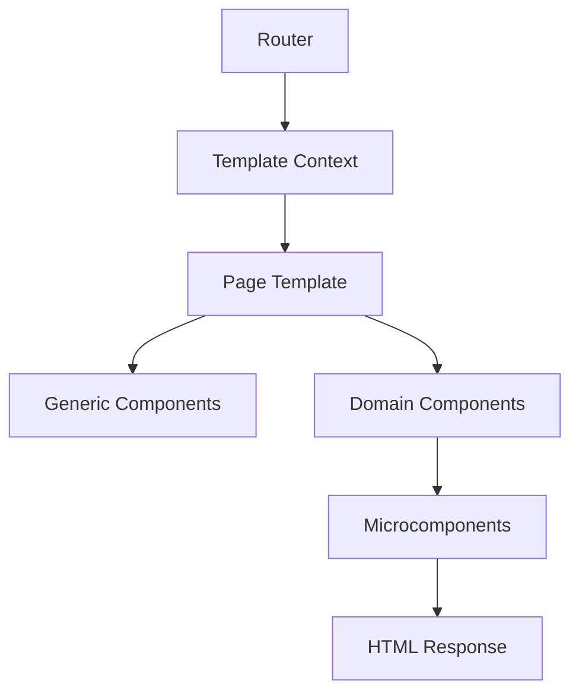

La composición permite construir páginas complejas mediante piezas pequeñas y controladas.

---

# 33. Convenciones de nomenclatura

Las plantillas deben utilizar nombres descriptivos y homogéneos.

Ejemplos recomendados:

```text
project_list.html
project_detail.html
project_form.html
project_row.html
project_card.html
project_filters.html
```

Deben evitarse nombres genéricos como:

```text
page.html
component.html
template2.html
new.html
```

---

# 34. Separación por dominio

Cada módulo funcional mantiene sus propias vistas.

```text
templates/projects/
│
├── list.html
├── detail.html
├── form.html
├── components/
│   ├── project_row.html
│   ├── project_card.html
│   └── project_summary.html
└── partials/
    ├── filters.html
    └── activity.html
```

Esta estructura favorece el crecimiento ordenado de la aplicación.

---

# 35. Componentes globales y locales

No todos los componentes deben promoverse al nivel global.

| Tipo | Ubicación |
|---|---|
| Reutilizado por varios dominios | `templates/components/` |
| Exclusivo de un dominio | Carpeta del dominio |
| Fragmento de página | `partials/` |
| Estructura global | `layouts/` |

La promoción prematura de componentes puede generar abstracciones innecesarias.

---

# 36. Contexto de renderizado

FastAPI entrega a la plantilla un diccionario de contexto.

Este contexto puede incluir:

- `request`;
- usuario autenticado;
- permisos;
- información de navegación;
- datos del recurso;
- mensajes flash;
- configuración visual;
- filtros;
- paginación.

Ejemplo conceptual:

```python
context = {
    "request": request,
    "current_user": current_user,
    "projects": projects,
    "permissions": permissions,
    "pagination": pagination,
}
```

---

# 37. Preparación del contexto

La preparación del contexto debe realizarse antes del renderizado.

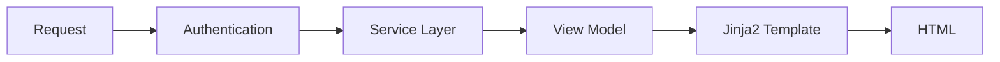

La plantilla debe recibir datos suficientemente preparados para limitar la lógica dentro del HTML.

---

# 38. View Models

Cuando una pantalla necesita combinar información de varias fuentes, puede utilizarse un modelo específico de presentación.

Un View Model puede contener:

- entidad principal;
- datos relacionados;
- permisos;
- acciones disponibles;
- métricas;
- propiedades calculadas;
- configuración visual.

Este patrón evita trasladar cálculos complejos a Jinja2.

---

# 39. Lógica permitida en plantillas

Las plantillas pueden realizar operaciones simples de presentación.

Ejemplos:

- condicionales;
- iteraciones;
- selección de clases;
- formato visual;
- inclusión de componentes;
- comprobación de valores.

---

# 40. Lógica no permitida

Las plantillas no deben:

- acceder a repositorios;
- ejecutar consultas;
- modificar entidades;
- implementar reglas de negocio;
- realizar operaciones persistentes;
- contener cálculos complejos;
- resolver autorización crítica.

La lógica compleja debe permanecer en Python.

---

# 41. Arquitectura resumida de la capa UI

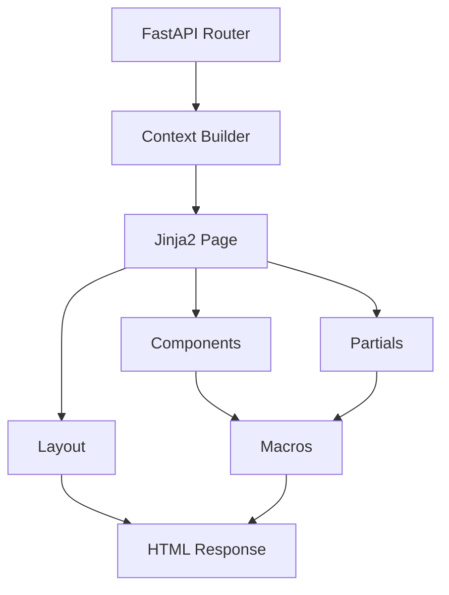

Esta arquitectura proporciona la base para abordar en las siguientes partes los sistemas de acciones, botones, badges, tablas, formularios, estados vacíos, detalle de entidades, autorización contextual, integración JavaScript y comportamiento en tiempo real.

---

# 42. Sistema de acciones

El sistema de acciones normaliza la representación y el comportamiento de las operaciones disponibles sobre los recursos de la plataforma.

Las acciones pueden corresponder a:

- consulta;
- creación;
- edición;
- eliminación;
- archivado;
- restauración;
- asignación;
- descarga;
- exportación;
- operaciones específicas de dominio.

Cada acción debe mantener una apariencia, semántica y ubicación coherentes en todas las pantallas.

---

# 43. Objetivos del sistema de acciones

El sistema persigue los siguientes objetivos:

- evitar botones implementados de forma independiente;
- mantener una iconografía homogénea;
- integrar permisos y contexto;
- distinguir operaciones seguras y destructivas;
- simplificar la creación de pantallas CRUD;
- mejorar la accesibilidad;
- centralizar los atributos utilizados por JavaScript.

---

# 44. Clasificación de acciones

Las acciones pueden clasificarse según su finalidad.

| Tipo | Ejemplos | Representación habitual |
|---|---|---|
| Navegación | Ver, volver, abrir | Enlace o botón secundario |
| Creación | Nuevo usuario, nuevo proyecto | Botón primario |
| Modificación | Editar, cambiar estado | Botón primario o warning |
| Eliminación | Eliminar, revocar | Botón danger |
| Recuperación | Restaurar, reactivar | Botón success |
| Descarga | Descargar, exportar | Botón outline |
| Contextual | Asignar, publicar, cerrar | Según semántica |
| Masiva | Eliminar seleccionados | Barra de acciones |

---

# 45. Jerarquía visual de acciones

Las acciones deben reflejar visualmente su importancia.

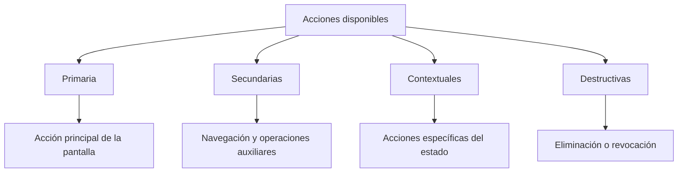

Una pantalla no debería presentar varias acciones primarias con la misma jerarquía salvo que el flujo funcional lo justifique claramente.

---

# 46. Macro de acciones

El sistema puede centralizarse en una macro como:

```text
templates/components/actions/actions.html
```

Ejemplo conceptual:

```jinja2

    
        <a
            href="{{ url or '#' }}"
            class="btn btn-{{ variant }} btn-{{ size }} disabled"
            
                data-dialog-confirm="{{ confirm }}"
            
            
                data-http-method="{{ method }}"
            
            
                aria-disabled="true"
                tabindex="-1"
            
        >
            
                <i class="{{ icon }}" aria-hidden="true"></i>
            
            <span>{{ label }}</span>
        </a>
    

```

---

# 47. Acciones CRUD normalizadas

Las acciones CRUD deben reutilizar una interfaz homogénea.

```jinja2
{{ actions.view(
    url=url_for("projects:detail", project_id=project.id),
    permission=permissions.can_view
) }}

{{ actions.edit(
    url=url_for("projects:edit", project_id=project.id),
    permission=permissions.can_edit
) }}

{{ actions.delete(
    url=url_for("projects:delete", project_id=project.id),
    permission=permissions.can_delete,
    resource_name=project.name
) }}
```

Las macros específicas pueden envolver una macro base y definir:

- icono;
- variante;
- texto;
- confirmación;
- atributos de seguridad;
- comportamiento JavaScript.

---

# 48. Ubicación de las acciones

Las acciones deben aparecer en ubicaciones predecibles.

| Contexto | Ubicación recomendada |
|---|---|
| Página de listado | Cabecera y columna final |
| Página de detalle | Barra de acciones superior |
| Formulario | Pie del formulario |
| Tarjeta | Cabecera o pie |
| Tabla | Última columna |
| Acción masiva | Barra sobre la tabla |
| Acción contextual | Junto al bloque afectado |

La consistencia espacial mejora la velocidad de uso de la interfaz.

---

# 49. Menús de acciones

Cuando una entidad dispone de numerosas operaciones, se recomienda utilizar un menú contextual.

```jinja2
<div class="dropdown">
    <button
        class="btn btn-sm btn-outline-secondary dropdown-toggle"
        type="button"
        data-bs-toggle="dropdown"
        aria-expanded="false"
    >
        <i class="fas fa-ellipsis-v" aria-hidden="true"></i>
        <span class="visually-hidden">Acciones</span>
    </button>

    <ul class="dropdown-menu dropdown-menu-end">
        <!-- Acciones disponibles -->
    </ul>
</div>
```

Las acciones principales no deben ocultarse dentro del menú cuando constituyen el objetivo habitual de la pantalla.

---

# 50. Acciones destructivas

Las operaciones destructivas requieren un tratamiento especial.

Deben incluir:

- variante visual `danger`;
- confirmación explícita;
- descripción del recurso afectado;
- explicación de consecuencias;
- autorización backend;
- registro de auditoría cuando corresponda.

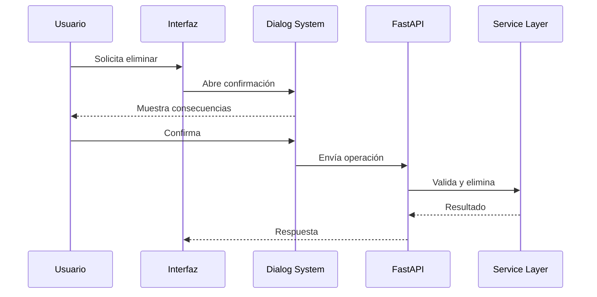

---

# 51. Integración de permisos en acciones

La visibilidad de una acción puede depender de:

- rol global;
- permiso funcional;
- pertenencia al recurso;
- estado de la entidad;
- organización activa;
- propiedad del recurso;
- configuración habilitada.

Ejemplo:

```jinja2

    {{ actions.edit(...) }}

```

El backend debe proporcionar permisos ya resueltos o un View Model de acciones disponibles.

---

# 52. Seguridad de la visibilidad

Ocultar un botón no constituye una medida de seguridad suficiente.

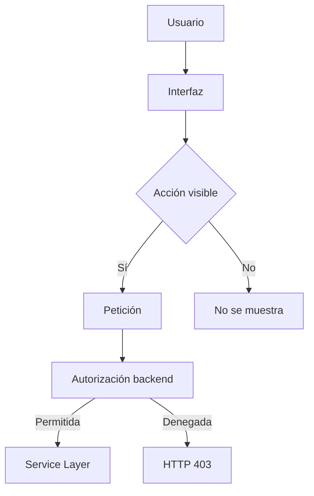

La validación definitiva debe ejecutarse siempre en el servidor.

---

# 53. Sistema de botones

El sistema de botones define una biblioteca visual común para toda la plataforma.

Debe evitarse la creación manual de clases diferentes en cada pantalla.

Las variantes principales son:

- `primary`;
- `secondary`;
- `success`;
- `warning`;
- `danger`;
- `info`;
- `light`;
- `dark`;
- `outline-*`;
- `link`.

---

# 54. Semántica de colores

Los colores deben utilizarse de forma coherente.

| Variante | Uso recomendado |
|---|---|
| Primary | Acción principal |
| Secondary | Acción auxiliar |
| Success | Confirmación, activación o recuperación |
| Warning | Precaución o edición sensible |
| Danger | Eliminación o revocación |
| Info | Información o ayuda |
| Light | Acción de bajo énfasis |
| Outline | Acción secundaria compacta |

Los colores no deben emplearse únicamente por preferencia estética, sino por significado funcional.

---

# 55. Tamaños de botones

Los tamaños deben adaptarse al contexto.

| Tamaño | Uso |
|---|---|
| Grande | Call to action excepcional |
| Normal | Formularios y cabeceras |
| Pequeño | Tablas y tarjetas |
| Icon-only | Acciones compactas con tooltip |

Los botones exclusivamente iconográficos deben incorporar:

- `aria-label`;
- tooltip;
- título accesible;
- foco visible.

---

# 56. Estados de botones

Un botón puede presentar diferentes estados:

- normal;
- hover;
- focus;
- disabled;
- loading;
- success;
- error.

El estado de carga evita envíos duplicados.

```html
<button
    type="submit"
    class="btn btn-primary"
    data-loading-text="Guardando..."
>
    <i class="fas fa-save" aria-hidden="true"></i>
    Guardar
</button>
```

---

# 57. Prevención de doble envío

Las acciones que modifican información deben protegerse frente a activaciones repetidas.

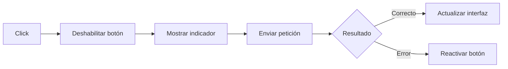

El sistema JavaScript puede aplicar este comportamiento de forma global mediante atributos `data-*`.

---

# 58. Sistema de insignias

Las insignias permiten representar estados, roles, prioridades, categorías y contadores de manera compacta.

Ejemplos:

- estado del proyecto;
- prioridad de una tarea;
- rol del usuario;
- actividad pendiente;
- visibilidad;
- número de elementos;
- estado de conexión.

---

# 59. Tipos de badges

| Tipo de información | Ejemplo |
|---|---|
| Estado | Activo, archivado, finalizado |
| Prioridad | Alta, media, baja |
| Rol | Administrador, docente, alumno |
| Resultado | Correcto, fallido |
| Contador | 4 tareas pendientes |
| Conectividad | En línea, desconectado |

---

# 60. Macro de badges

```jinja2

    <span
        class="badge bg-{{ variant }} rounded-pill"
        title="{{ title }}"
    >
        
            <i class="{{ icon }}" aria-hidden="true"></i>
        
        {{ label }}
    </span>

```

---

# 61. Resolución visual de estados

La traducción entre un estado de dominio y su representación visual debe centralizarse.

Ejemplo conceptual:

```python
PROJECT_STATUS_UI = {
    "draft": {
        "label": "Borrador",
        "variant": "secondary",
        "icon": "fas fa-pencil-alt",
    },
    "active": {
        "label": "Activo",
        "variant": "success",
        "icon": "fas fa-play",
    },
    "closed": {
        "label": "Finalizado",
        "variant": "primary",
        "icon": "fas fa-check",
    },
    "archived": {
        "label": "Archivado",
        "variant": "dark",
        "icon": "fas fa-archive",
    },
}
```

La plantilla recibe la información visual ya preparada o utiliza un filtro controlado.

---

# 62. Colores y accesibilidad

El color nunca debe ser el único mecanismo para comunicar un estado.

Un badge debe combinar:

- texto;
- color;
- icono cuando aporte valor;
- descripción accesible.

Ejemplo correcto:

```text
[✓ Activo]
```

Ejemplo insuficiente:

```text
[●]
```

---

# 63. Sistema de tablas administrativas

Las tablas constituyen uno de los componentes más utilizados en una plataforma administrativa.

Deben resolver de forma uniforme:

- cabeceras;
- filas;
- ordenación;
- paginación;
- filtros;
- acciones;
- selección;
- estados vacíos;
- comportamiento responsive.

---

# 64. Arquitectura de una tabla

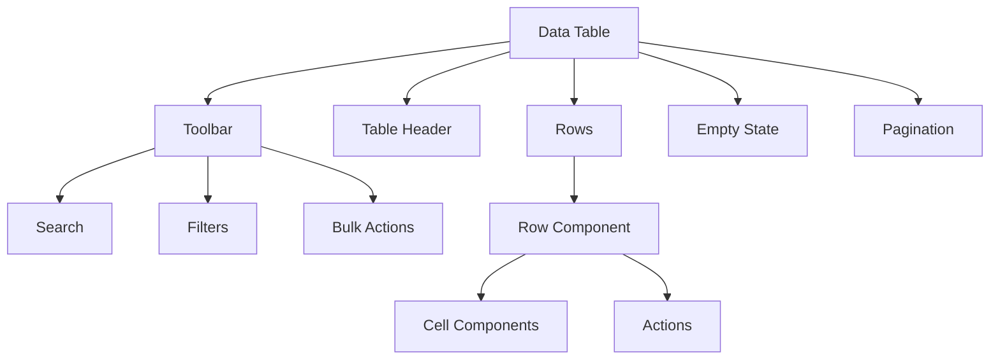

---

# 65. Macro de tabla

La macro principal puede aceptar:

- identificador;
- columnas;
- clase responsive;
- estado vacío;
- modo seleccionable;
- texto accesible;
- configuración de acciones.

Ejemplo conceptual:

```jinja2

    
        
    

```

---

# 66. Cabeceras de tabla

Las cabeceras deben:

- utilizar texto conciso;
- indicar ordenación cuando exista;
- mantener alineación con el contenido;
- evitar ambigüedades;
- incluir información accesible.

Las columnas numéricas suelen alinearse a la derecha, mientras que las columnas de texto se alinean a la izquierda.

---

# 67. Row Components

Cada fila compleja debe encapsularse en un componente de dominio.

Ejemplo:

```jinja2
<tr data-entity-id="{{ project.id }}">
    <td>
        
    </td>

    <td>
        {{ badges.status(project.status_ui) }}
    </td>

    <td>
        {{ project.owner_name }}
    </td>

    <td>
        {{ project.updated_at|datetime_format }}
    </td>

    <td class="text-end">
        
    </td>
</tr>
```

---

# 68. Tablas responsive

Las tablas deben permanecer utilizables en pantallas pequeñas.

Las estrategias posibles incluyen:

- contenedor con desplazamiento horizontal;
- ocultación controlada de columnas secundarias;
- conversión a tarjetas;
- filas expandibles;
- priorización de información.

```html
<div class="table-responsive">
    <table class="table table-hover align-middle">
        <!-- Contenido -->
    </table>
</div>
```

---

# 69. Estados vacíos

Cuando no existen datos, la tabla no debe mostrar únicamente una estructura vacía.

Debe presentar un componente de estado vacío con:

- icono;
- mensaje;
- explicación;
- acción principal opcional;
- filtros aplicados cuando corresponda.

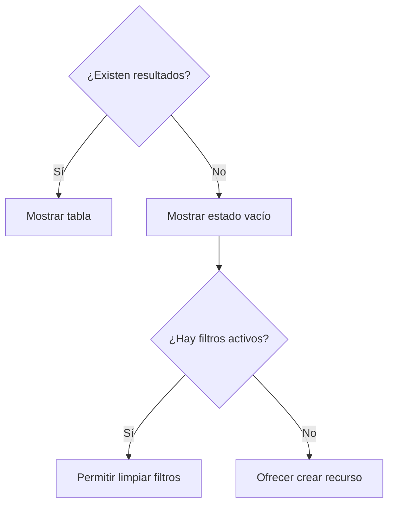

---

# 70. Tipos de estados vacíos

| Situación | Mensaje recomendado |
|---|---|
| Colección nueva | Aún no existen elementos |
| Filtros sin coincidencias | No hay resultados para estos filtros |
| Búsqueda sin coincidencias | No se encontraron coincidencias |
| Falta de permisos | No hay elementos visibles |
| Error de carga | No fue posible recuperar los datos |

Cada situación requiere una respuesta visual diferente.

---

# 71. Selección múltiple

Las tablas que admitan operaciones masivas deben incluir:

- checkbox en cabecera;
- checkbox por fila;
- contador de seleccionados;
- barra de acciones;
- confirmación para operaciones destructivas.

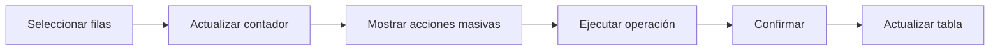

---

# 72. Ordenación

La ordenación debe conservar:

- filtros;
- página actual cuando sea razonable;
- término de búsqueda;
- dirección ascendente o descendente.

El estado de ordenación debe reflejarse visualmente en la cabecera.

---

# 73. Búsqueda y filtros

Las páginas de listado pueden incluir:

- búsqueda libre;
- filtros por estado;
- filtros por usuario;
- filtros por fecha;
- filtros por categoría;
- filtros por organización.

El backend debe validar y aplicar los parámetros recibidos.

---

# 74. Arquitectura del filtro

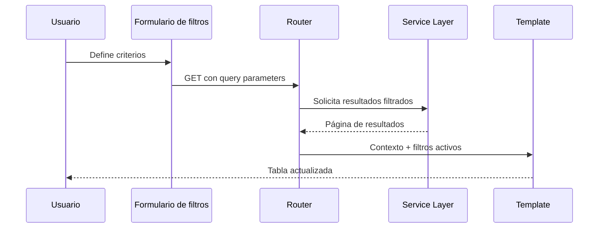

El uso de `GET` permite mantener URLs compartibles y navegables.

---

# 75. Representación de filtros activos

Los filtros aplicados deben mostrarse de forma visible.

Ejemplo:

```text
Estado: Activo ×
Responsable: Docente ×
Fecha: Últimos 30 días ×
```

El usuario debe poder:

- eliminar un filtro;
- limpiar todos;
- modificar criterios;
- conservar el resto de parámetros.

---

# 76. Paginación

La paginación debe integrarse como componente global.

Debe mostrar, cuando resulte útil:

- página actual;
- total de páginas;
- anterior;
- siguiente;
- número de resultados;
- rango visible.

Ejemplo:

```text
Mostrando 21–40 de 128 resultados
```

---

# 77. Conservación de parámetros

La paginación debe conservar:

- búsqueda;
- filtros;
- orden;
- tamaño de página.

Una macro puede construir los enlaces actualizando únicamente el parámetro `page`.

---

# 78. Sistema de formularios

Los formularios constituyen el principal mecanismo de entrada de datos de la plataforma.

Deben ofrecer una experiencia consistente en:

- estructura;
- etiquetas;
- validación;
- mensajes;
- ayuda;
- acciones;
- estados de carga;
- accesibilidad.

---

# 79. Arquitectura de formulario

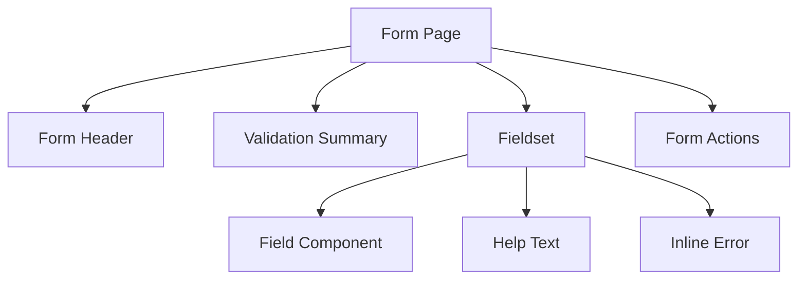

---

# 80. Componentes de campo

El sistema puede incluir macros para:

- input de texto;
- email;
- contraseña;
- número;
- fecha;
- hora;
- textarea;
- select;
- checkbox;
- radio;
- switch;
- archivo;
- campo oculto.

Todos deben compartir una interfaz de parámetros predecible.

---

# 81. Macro de input

Ejemplo conceptual:

```jinja2

    <div class="mb-3">
        <label for="{{ name }}" class="form-label">
            {{ label }}
            
                <span aria-hidden="true">*</span>
                <span class="visually-hidden">Obligatorio</span>
            
        </label>

        <input
            id="{{ name }}"
            name="{{ name }}"
            type="{{ type }}"
            value="{{ value }}"
            class="form-control is-invalid"
            placeholder="{{ placeholder }}"
            required
            disabled
            aria-describedby="{{ name }}-help"
        >

        
            <div id="{{ name }}-help" class="form-text">
                {{ help }}
            </div>
        

        
            <div class="invalid-feedback">
                {{ error }}
            </div>
        
    </div>

```

---

# 82. Agrupación de campos

Los formularios extensos deben organizarse por bloques semánticos.

Ejemplos:

- información básica;
- datos de contacto;
- configuración;
- permisos;
- relaciones;
- información adicional.

Puede utilizarse:

- `fieldset`;
- tarjetas;
- pestañas;
- acordeones;
- pasos.

La estructura elegida debe reducir la carga cognitiva.

---

# 83. Validación de formularios

La validación puede producirse en varias capas.

| Capa | Responsabilidad |
|---|---|
| Navegador | Reglas HTML básicas |
| JavaScript | Feedback inmediato opcional |
| Pydantic | Tipos y estructura |
| Service Layer | Reglas de negocio |
| Base de datos | Restricciones de integridad |

La validación del navegador mejora la experiencia, pero nunca sustituye la validación del servidor.

---

# 84. Errores de campo

Los errores deben mostrarse junto al campo afectado.

Ejemplo:

```text
Correo electrónico
[fran@]
Introduce una dirección de correo válida.
```

El mensaje debe explicar:

- qué dato es incorrecto;
- por qué;
- cómo corregirlo.

---

# 85. Resumen de errores

Los formularios con múltiples errores deben incluir un resumen superior.

```html
<div class="alert alert-danger" role="alert">
    <h2 class="h6">Revisa los siguientes campos:</h2>
    <ul>
        <li><a href="#email">El correo no es válido.</a></li>
        <li><a href="#role">Debes seleccionar un rol.</a></li>
    </ul>
</div>
```

Los enlaces permiten desplazar el foco al campo correspondiente.

---

# 86. Conservación de valores

Cuando la validación falla, el formulario debe conservar los valores introducidos, salvo información sensible como contraseñas.

El contexto puede incluir:

```python
{
    "form_data": submitted_data,
    "form_errors": validation_errors,
}
```

La plantilla utiliza estos valores para reconstruir el formulario.

---

# 87. Formularios de creación y edición

Cuando ambos flujos comparten la mayoría de campos, pueden reutilizar una plantilla o partial común.

```text
form.html
├── modo: create
├── modo: edit
├── valores iniciales
├── errores
└── acciones
```

La lógica de negocio sigue separada aunque la interfaz sea reutilizada.

---

# 88. Acciones de formulario

El pie del formulario debe incluir:

- acción principal;
- cancelar;
- acción secundaria opcional;
- indicador de carga.

Ejemplo:

```text
[Guardar cambios] [Cancelar]
```

Las acciones destructivas no deben mezclarse visualmente con la acción principal de guardado.

---

# 89. Formularios multipart

Los formularios con archivos deben utilizar:

```html
enctype="multipart/form-data"
```

La interfaz debe informar sobre:

- tipos admitidos;
- tamaño máximo;
- número máximo de archivos;
- estado de carga;
- errores de validación.

---

# 90. Sistema de adjuntos

La interfaz de adjuntos puede incluir:

- selector de archivos;
- carga mediante arrastre;
- progreso;
- listado existente;
- metadata;
- descarga;
- eliminación;
- previsualización.

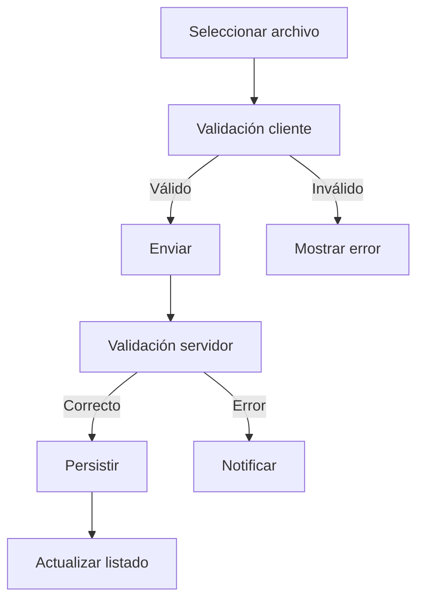

---

# 91. Detail Layout System

Las páginas de detalle utilizan una estructura visual orientada a mostrar información compleja de forma jerarquizada.

La composición habitual es:

```text
Page Header
+
Status and Actions
+
Summary Grid
+
Main Content
+
Context Sidebar
+
Related Resources
+
Timeline
+
Attachments
```

---

# 92. Cabecera de detalle

La cabecera puede contener:

- nombre del recurso;
- identificador;
- badge de estado;
- propietario;
- fecha de actualización;
- acciones principales;
- botón de regreso.

Debe permitir comprender inmediatamente qué recurso se está consultando.

---

# 93. Information Grid

La cuadrícula de información resume los atributos principales.

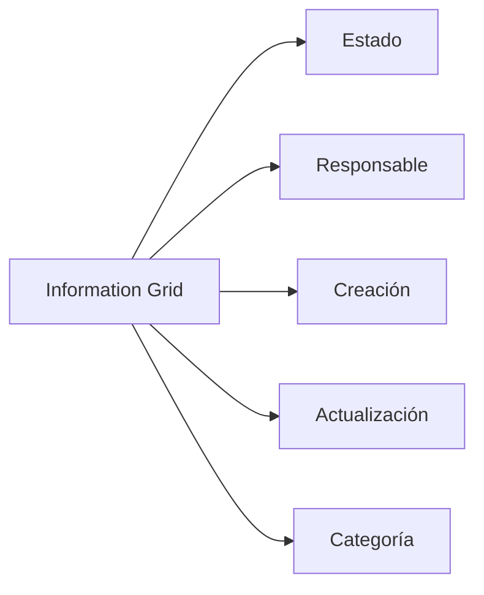

Cada valor debe acompañarse de una etiqueta clara.

---

# 94. Panel principal

El panel principal concentra la información de mayor importancia.

Puede incluir:

- descripción;
- contenido;
- instrucciones;
- progreso;
- datos funcionales;
- relaciones principales.

Su anchura debe priorizar la lectura.

---

# 95. Panel contextual

El panel lateral muestra información secundaria o contextual.

Ejemplos:

- metadata;
- permisos;
- responsables;
- etiquetas;
- estado;
- enlaces relacionados;
- acciones rápidas.

En pantallas pequeñas debe reordenarse bajo el contenido principal.

---

# 96. Timelines

Las líneas temporales representan acontecimientos ordenados cronológicamente.

Pueden utilizarse para:

- historial de actividad;
- cambios de estado;
- comentarios;
- auditoría;
- eventos del proyecto.

Cada entrada puede contener:

- fecha;
- usuario;
- icono;
- tipo de evento;
- descripción;
- recurso relacionado.

---

# 97. Componentes de actividad

Ejemplo conceptual:

```jinja2
<article class="timeline-item">
    <div class="timeline-icon">
        <i class="{{ event.icon }}" aria-hidden="true"></i>
    </div>

    <div class="timeline-content">
        <header>
            <strong>{{ event.actor_name }}</strong>
            {{ event.action_label }}
        </header>

        <p>{{ event.description }}</p>

        <time datetime="{{ event.created_at.isoformat() }}">
            {{ event.created_at|datetime_format }}
        </time>
    </div>
</article>
```

---

# 98. Navegación por pestañas

Las páginas de detalle extensas pueden organizarse mediante pestañas.

Ejemplos:

- resumen;
- actividad;
- miembros;
- tareas;
- archivos;
- configuración;
- auditoría.

Las pestañas deben:

- conservar una URL identificable cuando resulte necesario;
- indicar la selección activa;
- permitir navegación por teclado;
- evitar ocultar información esencial.

---

# 99. Componentes de tarjetas

Las tarjetas se utilizan para agrupar información relacionada.

Una tarjeta puede incluir:

- cabecera;
- título;
- herramientas;
- cuerpo;
- pie;
- estado de carga;
- contenido vacío.

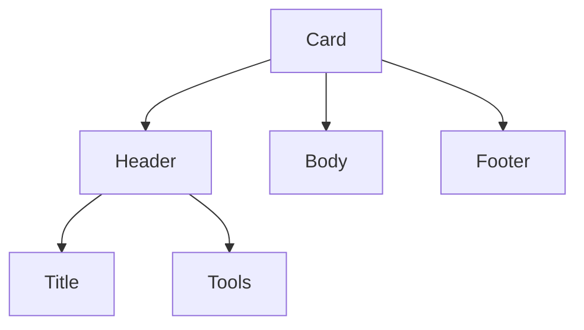

---

# 100. Tarjetas de métricas

Las tarjetas de métricas deben mostrar:

- valor principal;
- etiqueta;
- tendencia opcional;
- icono;
- periodo;
- enlace a detalle cuando proceda.

No deben depender únicamente del color para representar tendencias positivas o negativas.

---

# 101. Dashboard Components

El dashboard se compone mediante bloques independientes.

```mermaid
flowchart TD
    A[Dashboard] --> B[Metric Cards]
    A --> C[Recent Activity]
    A --> D[Pending Tasks]
    A --> E[Project Status]
    A --> F[Realtime Indicators]
    A --> G[Quick Actions]
```

Cada bloque debe poder evolucionar de forma independiente.

---

# 102. Estados de carga

Aunque el renderizado principal sea SSR, determinadas operaciones dinámicas requieren estados de carga.

Los componentes pueden mostrar:

- spinner;
- skeleton;
- overlay;
- texto de progreso;
- botón deshabilitado.

El indicador debe aparecer únicamente cuando la espera sea perceptible.

---

# 103. Estados de error en componentes

Los componentes dinámicos deben gestionar errores locales sin inutilizar toda la página.

Ejemplo:

```text
No fue posible cargar la actividad reciente.
[Reintentar]
```

Esto resulta especialmente importante en:

- WebSockets;
- peticiones AJAX;
- carga de adjuntos;
- dashboards;
- componentes parcialmente actualizados.

---

# 104. Autorización contextual en plantillas

La interfaz puede adaptarse mediante un objeto de permisos.

Ejemplo:

```python
permissions = {
    "can_view": True,
    "can_create": False,
    "can_edit": True,
    "can_delete": False,
    "can_manage_members": True,
}
```

La plantilla utiliza estos valores exclusivamente para decidir la visibilidad.

---

# 105. Modelo de acciones disponibles

Para pantallas complejas puede utilizarse un View Model específico.

```python
actions = {
    "edit": {
        "visible": True,
        "enabled": True,
        "url": "...",
    },
    "delete": {
        "visible": True,
        "enabled": False,
        "reason": "El proyecto contiene actividades activas.",
    },
}
```

Este modelo permite representar acciones deshabilitadas y explicar el motivo.

---

# 106. Acciones deshabilitadas

Cuando una acción es visible pero no está disponible, la interfaz puede mostrarla deshabilitada con una explicación.

Ejemplo:

```text
[Eliminar proyecto — deshabilitado]

Motivo: existen tareas activas asociadas.
```

Esto puede ser más informativo que ocultar completamente la acción.

---

# 107. Navegación contextual

La sidebar y los menús también deben respetar el contexto del usuario.

```mermaid
flowchart TD
    A[Usuario autenticado] --> B[Roles]
    B --> C[Permisos]
    C --> D[Context Builder]
    D --> E[Sidebar]
    D --> F[Page Actions]
    D --> G[Component Visibility]
```

La construcción del menú puede centralizarse para evitar condicionales repetidos.

---

# 108. Breadcrumbs

Los breadcrumbs ayudan a situar al usuario dentro de la jerarquía funcional.

Ejemplo:

```text
Inicio / Proyectos / Aula STEM / Actividades
```

Deben:

- representar la jerarquía real;
- incluir enlaces salvo el elemento actual;
- usar nombres comprensibles;
- evitar rutas excesivamente largas.

---

# 109. Page Header Component

El encabezado de página puede encapsularse como componente.

Parámetros habituales:

- título;
- subtítulo;
- icono;
- breadcrumbs;
- badge;
- acciones;
- botón de retorno.

```jinja2

    {{ actions.edit(...) }}

```

---

# 110. Menús laterales

La sidebar debe organizar la navegación por módulos funcionales.

Puede contener:

- sección principal;
- gestión de usuarios;
- proyectos;
- actividades;
- administración;
- auditoría;
- configuración.

Las secciones deben agruparse por afinidad y no por estructura interna del código.

---

# 111. Estado activo de navegación

El elemento activo debe resolverse según la ruta actual.

```jinja2
<a
    href="{{ url_for('projects:list') }}"
    class="nav-link active"
>
    <i class="nav-icon fas fa-diagram-project"></i>
    <p>Proyectos</p>
</a>
```

El router o el Context Builder puede proporcionar la sección activa.

---

# 112. Integración con el Dialog System

Las acciones que requieren confirmación deben declarar su intención mediante atributos de datos.

```html
<button
    type="button"
    class="btn btn-danger"
    data-dialog="confirm-delete"
    data-resource-name="Proyecto Aula STEM"
    data-action-url="/projects/42/delete"
>
    Eliminar
</button>
```

El sistema JavaScript interpreta estos atributos y abre el diálogo correspondiente.

---

# 113. Integración con el Toast System

Las respuestas exitosas o fallidas pueden transformarse en notificaciones toast.

El backend puede utilizar:

- mensajes flash;
- redirecciones con estado;
- respuesta JSON;
- eventos WebSocket.

```mermaid
flowchart TD
    A[Operación] --> B{Tipo de respuesta}
    B -->|SSR| C[Flash Message]
    B -->|AJAX| D[JSON]
    B -->|Realtime| E[WebSocket Event]

    C --> F[Toast System]
    D --> F
    E --> F
```

---

# 114. Mensajes flash

Los mensajes flash se utilizan para comunicar el resultado de una operación tras una redirección.

Ejemplos:

- proyecto creado;
- usuario actualizado;
- archivo eliminado;
- permiso revocado;
- error inesperado.

La plantilla base transforma los mensajes en toasts homogéneos.

---

# 115. Estructura conceptual de flash

```python
flash_message = {
    "type": "success",
    "title": "Proyecto creado",
    "message": "El proyecto se ha creado correctamente.",
}
```

La interfaz no debe depender de textos incrustados en múltiples plantillas.

---

# 116. Integración con WebSockets

La interfaz está preparada para recibir actualizaciones en tiempo real.

Ejemplos:

- cambios de estado;
- nuevas actividades;
- usuarios conectados;
- notificaciones;
- progreso de procesos;
- modificaciones colaborativas.

---

# 117. Actualización de componentes en tiempo real

```mermaid
sequenceDiagram
    participant S as Servidor
    participant W as WebSocket
    participant J as JavaScript
    participant C as Componente UI

    S->>W: Evento
    W->>J: Mensaje estructurado
    J->>J: Valida tipo y payload
    J->>C: Actualiza componente
    C-->>J: Estado visual actualizado
```

La actualización debe limitarse al componente afectado.

---

# 118. Atributos de datos como contrato

Los atributos `data-*` conectan el HTML renderizado con los módulos JavaScript.

Ejemplos:

```html
data-dialog-confirm
data-toast
data-entity-id
data-action-url
data-http-method
data-websocket-topic
data-loading-text
data-auto-submit
```

Estos atributos actúan como contrato entre plantillas y JavaScript.

---

# 119. Progressive Enhancement

La interfaz debe conservar, siempre que sea viable, una funcionalidad básica sin JavaScript.

JavaScript se utiliza para mejorar:

- confirmaciones;
- validación inmediata;
- actualización parcial;
- carga asíncrona;
- toasts;
- WebSockets;
- interacciones avanzadas.

Las operaciones críticas deben continuar protegidas por el backend.

---

# 120. Integración SSR y JavaScript

```mermaid
flowchart TD
    A[FastAPI] --> B[HTML SSR]
    B --> C[Navegador]
    C --> D[JavaScript Bootstrap]
    D --> E[Detectar data attributes]
    E --> F[Inicializar componentes]
    F --> G[Interfaz interactiva]
```

El JavaScript no reconstruye toda la aplicación, sino que mejora componentes concretos.

---

# 121. Renderizado seguro

Jinja2 escapa por defecto el contenido dinámico.

Debe evitarse el uso indiscriminado de:

```jinja2
{{ value|safe }}
```

Solo debe aplicarse cuando el contenido:

- ha sido generado internamente;
- ha sido sanitizado;
- pertenece a una fuente confiable;
- necesita contener HTML controlado.

---

# 122. Protección frente a XSS

Las medidas principales incluyen:

- autoescape de Jinja2;
- validación de entrada;
- sanitización de contenido enriquecido;
- ausencia de HTML construido desde cadenas no confiables;
- Content Security Policy cuando se implemente;
- uso limitado de scripts inline.

---

# 123. Protección CSRF

Las operaciones que modifican el estado deben incorporar protección CSRF cuando utilicen autenticación basada en cookies.

El formulario puede incluir:

```html
<input
    type="hidden"
    name="csrf_token"
    value="{{ csrf_token }}"
>
```

El backend debe validar el token antes de procesar la operación.

---

# 124. Relaciones entre componentes

```mermaid
flowchart TD
    A[Layout Base] --> B[Page Header]
    A --> C[Sidebar]
    A --> D[Toast Container]
    A --> E[Global Dialog]

    F[Page Template] --> B
    F --> G[Action Bar]
    F --> H[Data Table]
    F --> I[Form]
    F --> J[Detail Layout]

    H --> K[Row Components]
    K --> L[Badges]
    K --> M[Actions]

    I --> N[Field Components]
    M --> E
    G --> E
```

La arquitectura permite combinar componentes sin duplicar comportamiento ni estilos.

---

# 125. Convenciones de implementación

Las páginas deben cumplir las siguientes reglas:

- extender un layout definido;
- utilizar componentes globales cuando existan;
- mantener la lógica de negocio fuera de Jinja2;
- recibir permisos ya preparados;
- utilizar nombres descriptivos;
- declarar interactividad mediante atributos `data-*`;
- evitar scripts inline;
- reutilizar los sistemas de diálogo y toast;
- mantener HTML semántico;
- incluir estados vacíos y de error.

---

# 126. Flujo completo de una página administrativa

```mermaid
sequenceDiagram
    participant U as Usuario
    participant R as Router
    participant S as Service Layer
    participant C as Context Builder
    participant T as Jinja2
    participant JS as JavaScript

    U->>R: GET /projects
    R->>S: Recuperar proyectos
    S-->>R: Datos paginados
    R->>C: Construir contexto
    C-->>R: Datos + permisos + navegación
    R->>T: Renderizar plantilla
    T-->>U: HTML SSR
    U->>JS: Carga de documento
    JS->>JS: Inicializar componentes
    JS-->>U: Interfaz interactiva
```

Esta segunda parte define los sistemas de acciones, botones, badges, tablas, formularios, páginas de detalle, autorización contextual e integración entre SSR y JavaScript. La tercera y última parte completa el documento con accesibilidad, responsive design, rendimiento, testing, observabilidad, despliegue, estado actual, evolución futura y conclusiones.

---

# 127. Accesibilidad

La accesibilidad constituye un requisito transversal de la arquitectura de interfaz de Aula Robótica Platform.

La plataforma debe permitir que sus funcionalidades puedan utilizarse mediante diferentes formas de interacción y con distintos niveles de capacidad visual, motora o cognitiva.

La accesibilidad no debe tratarse como una mejora posterior, sino como una característica integrada desde el diseño de los componentes.

---

# 128. Objetivos de accesibilidad

Los principales objetivos son:

- permitir navegación mediante teclado;
- mantener una estructura semántica clara;
- facilitar el uso con lectores de pantalla;
- proporcionar mensajes comprensibles;
- conservar un contraste adecuado;
- evitar que el color sea el único transmisor de información;
- garantizar un foco visible;
- asociar correctamente etiquetas y controles;
- ofrecer alternativas textuales para los iconos.

---

# 129. HTML semántico

Las plantillas deben utilizar elementos HTML según su significado.

Ejemplos recomendados:

```html
<header></header>
<nav></nav>
<main></main>
<section></section>
<article></article>
<aside></aside>
<footer></footer>
```

Debe evitarse construir toda la interfaz exclusivamente mediante elementos `div` sin significado estructural.

La semántica mejora:

- la navegación asistida;
- la comprensión del documento;
- el mantenimiento;
- la indexación;
- la consistencia del código.

---

# 130. Jerarquía de encabezados

Cada página debe disponer de una jerarquía de títulos coherente.

```text
h1 — título principal de la página
h2 — secciones principales
h3 — subsecciones
h4 — bloques internos
```

No deben utilizarse encabezados únicamente para cambiar el tamaño visual del texto.

La jerarquía debe representar la estructura real del contenido.

---

# 131. Navegación por teclado

Todos los elementos interactivos deben poder utilizarse mediante teclado.

Esto incluye:

- enlaces;
- botones;
- menús;
- formularios;
- pestañas;
- diálogos;
- dropdowns;
- tablas interactivas;
- componentes dinámicos.

El orden de tabulación debe coincidir con la estructura visual y lógica de la página.

---

# 132. Gestión del foco

Los componentes dinámicos deben controlar correctamente el foco.

Ejemplos:

- al abrir un diálogo, el foco se traslada al interior;
- al cerrar un diálogo, vuelve al elemento que lo abrió;
- al producirse un error, puede dirigirse al resumen de validación;
- tras una actualización parcial, el foco no debe perderse;
- los mensajes críticos deben poder anunciarse.

```mermaid
flowchart TD
    A[Usuario activa componente] --> B[Guardar elemento origen]
    B --> C[Mover foco]
    C --> D[Interacción]
    D --> E[Cerrar componente]
    E --> F[Restaurar foco]
```

---

# 133. Estados de foco visibles

Los controles no deben eliminar los estilos de foco sin proporcionar una alternativa.

Debe evitarse:

```css
outline: none;
```

salvo que exista un indicador de foco equivalente y claramente visible.

---

# 134. Etiquetas de formularios

Todos los controles deben disponer de una etiqueta asociada.

Ejemplo:

```html
<label for="project-name">Nombre del proyecto</label>
<input
    id="project-name"
    name="name"
    type="text"
>
```

Los placeholders no sustituyen a las etiquetas porque desaparecen durante la escritura y pueden presentar menor contraste.

---

# 135. Campos obligatorios

Los campos obligatorios deben indicarse mediante:

- texto;
- símbolo visual;
- atributo `required`;
- información accesible.

Ejemplo:

```html
<label for="email">
    Correo electrónico
    <span aria-hidden="true">*</span>
    <span class="visually-hidden">Campo obligatorio</span>
</label>
```

---

# 136. Mensajes de validación accesibles

Los errores deben asociarse al campo mediante atributos como:

```html
aria-invalid="true"
aria-describedby="email-error"
```

Ejemplo:

```html
<input
    id="email"
    name="email"
    type="email"
    class="form-control is-invalid"
    aria-invalid="true"
    aria-describedby="email-error"
>

<div id="email-error" class="invalid-feedback">
    Introduce una dirección de correo válida.
</div>
```

---

# 137. Iconos accesibles

Los iconos decorativos deben ocultarse a los lectores de pantalla.

```html
<i class="fas fa-plus" aria-hidden="true"></i>
```

Cuando un botón solo contiene un icono, debe incorporar una etiqueta accesible.

```html
<button
    type="button"
    class="btn btn-sm btn-outline-primary"
    aria-label="Editar proyecto"
>
    <i class="fas fa-edit" aria-hidden="true"></i>
</button>
```

---

# 138. Contraste y color

La interfaz debe garantizar contraste suficiente entre:

- texto y fondo;
- enlaces y contenido;
- botones y superficie;
- mensajes y contexto;
- estados activos y desactivados.

El color debe complementarse mediante texto, iconos o patrones.

Ejemplo:

```text
✓ Activo
⚠ Pendiente
✕ Error
```

---

# 139. Regiones dinámicas

Los mensajes toast, alertas y resultados asíncronos pueden utilizar regiones vivas.

```html
<div
    id="toast-container"
    aria-live="polite"
    aria-atomic="true"
></div>
```

Los errores críticos pueden utilizar:

```html
role="alert"
```

Debe evitarse anunciar información irrelevante o excesivamente frecuente.

---

# 140. Accesibilidad en tablas

Las tablas deben incorporar:

- encabezados mediante `th`;
- atributos `scope`;
- caption cuando aporte contexto;
- orden de lectura comprensible;
- acciones accesibles;
- identificación clara de filas.

Ejemplo:

```html
<table class="table">
    <caption class="visually-hidden">
        Listado de proyectos disponibles
    </caption>

    <thead>
        <tr>
            <th scope="col">Proyecto</th>
            <th scope="col">Estado</th>
            <th scope="col">Responsable</th>
            <th scope="col">Acciones</th>
        </tr>
    </thead>
</table>
```

---

# 141. Accesibilidad en diálogos

Los diálogos deben:

- declarar `role="dialog"`;
- utilizar `aria-modal="true"`;
- disponer de título;
- describir su finalidad;
- mantener el foco dentro;
- cerrarse mediante teclado cuando proceda;
- restaurar el foco al elemento de origen.

Estos aspectos se detallan en `17_DIALOG_SYSTEM.md`.

---

# 142. Diseño responsive

La interfaz debe adaptarse a distintos tamaños de pantalla sin perder funcionalidad.

Los principales escenarios son:

- escritorio;
- portátil;
- tablet;
- dispositivo móvil.

La plataforma mantiene una orientación administrativa, pero debe seguir siendo utilizable en pantallas reducidas.

---

# 143. Principios responsive

El diseño debe seguir los siguientes principios:

- priorizar el contenido esencial;
- evitar anchuras rígidas;
- utilizar grids flexibles;
- permitir reorganización vertical;
- adaptar tablas y formularios;
- mantener controles táctiles utilizables;
- evitar desplazamiento horizontal global;
- conservar la navegación accesible.

---

# 144. Estrategia Mobile First

Cuando resulte viable, los componentes deben construirse desde la presentación más reducida hacia tamaños superiores.

```mermaid
flowchart LR
    A[Móvil] --> B[Tablet]
    B --> C[Escritorio]
    C --> D[Pantalla amplia]
```

Esta aproximación obliga a priorizar información y reduce estilos correctivos posteriores.

---

# 145. Sistema de grid

Bootstrap proporciona una cuadrícula de doce columnas.

Ejemplo:

```html
<div class="row">
    <div class="col-12 col-lg-8">
        <!-- Contenido principal -->
    </div>

    <div class="col-12 col-lg-4">
        <!-- Panel lateral -->
    </div>
</div>
```

En pantallas pequeñas, ambos bloques se muestran verticalmente.

---

# 146. Contenedores

Las páginas pueden utilizar:

- `container`;
- `container-fluid`;
- combinaciones controladas.

Los dashboards y tablas extensas suelen beneficiarse de una anchura fluida, mientras que formularios y contenido textual pueden requerir una anchura máxima para mejorar la legibilidad.

---

# 147. Navegación responsive

La barra lateral debe poder:

- contraerse;
- ocultarse;
- abrirse mediante botón;
- conservar la sección activa;
- mantener acceso mediante teclado.

En dispositivos móviles no debe bloquear permanentemente el contenido principal.

---

# 148. Formularios responsive

Los formularios deben adaptarse mediante:

- campos a una columna en móvil;
- agrupaciones en varias columnas en escritorio;
- botones de ancho completo cuando resulte útil;
- textos de ayuda legibles;
- controles táctiles adecuados.

```html
<div class="row">
    <div class="col-12 col-md-6">
        <!-- Campo -->
    </div>

    <div class="col-12 col-md-6">
        <!-- Campo -->
    </div>
</div>
```

---

# 149. Tablas en dispositivos pequeños

Las estrategias admitidas incluyen:

1. desplazamiento horizontal;
2. ocultación de columnas secundarias;
3. vista en tarjetas;
4. filas expandibles;
5. resumen móvil específico.

La decisión depende de la importancia y complejidad de los datos.

---

# 150. Tarjetas responsive

Las tarjetas deben:

- adaptar su anchura;
- evitar alturas rígidas;
- reorganizar acciones;
- permitir que títulos largos ocupen varias líneas;
- mantener controles accesibles;
- evitar desbordamientos.

---

# 151. Acciones responsive

En pantallas pequeñas, una barra de acciones puede:

- apilar botones;
- mostrar la acción principal;
- agrupar acciones secundarias en un menú;
- utilizar botones de ancho completo;
- conservar el texto cuando sea necesario.

La compactación no debe ocultar operaciones importantes sin una alternativa clara.

---

# 152. Contenido táctil

Los objetivos interactivos deben tener un tamaño suficiente para evitar pulsaciones accidentales.

Esto afecta especialmente a:

- botones iconográficos;
- checkboxes;
- menús;
- pestañas;
- enlaces de tabla;
- controles de cierre.

---

# 153. Rendimiento de plantillas

El rendimiento de la capa UI depende tanto del servidor como del navegador.

Los principales objetivos son:

- reducir el tiempo de renderizado;
- limitar el volumen de HTML;
- minimizar recursos innecesarios;
- evitar consultas desde plantillas;
- controlar la complejidad de macros;
- cargar scripts únicamente cuando sean necesarios;
- optimizar imágenes y archivos estáticos.

---

# 154. Renderizado eficiente

Las plantillas deben recibir los datos preparados.

Debe evitarse:

- acceder repetidamente a relaciones perezosas;
- ejecutar consultas indirectas durante el renderizado;
- construir estructuras complejas dentro de Jinja2;
- recorrer colecciones innecesariamente grandes;
- duplicar componentes ocultos.

```mermaid
flowchart TD
    A[Repository] --> B[Service Layer]
    B --> C[View Model]
    C --> D[Template Context]
    D --> E[Renderizado Jinja2]
```

---

# 155. Prevención del problema N+1

Las páginas que muestran relaciones deben recuperar los datos mediante consultas optimizadas.

Ejemplo de riesgo:

```text
1 consulta para proyectos
+
1 consulta por responsable
+
1 consulta por estado relacionado
```

La Service Layer y Repository Layer deben preparar la información necesaria antes de renderizar.

---

# 156. Paginación obligatoria

Los listados potencialmente grandes deben paginarse.

No debe entregarse a la plantilla una colección completa cuando el volumen pueda crecer de forma significativa.

La paginación reduce:

- tiempo de consulta;
- consumo de memoria;
- tamaño de respuesta;
- tiempo de renderizado;
- complejidad del DOM.

---

# 157. Complejidad del DOM

Las páginas deben evitar estructuras HTML innecesariamente profundas.

Un DOM excesivo puede afectar:

- rendimiento de estilos;
- JavaScript;
- accesibilidad;
- mantenimiento;
- tiempo de interacción.

Los componentes deben ser semánticos y suficientemente simples.

---

# 158. Carga de recursos

Los recursos globales se cargan desde el layout principal.

Los recursos específicos deben añadirse solo en las páginas que los utilizan.

Ejemplo:

```jinja2

    <script
        type="module"
        src="{{ url_for('static', path='js/pages/project-detail.js') }}"
    ></script>

```

---

# 159. JavaScript diferido

Los scripts pueden cargarse mediante:

```html
defer
```

o mediante módulos:

```html
type="module"
```

Esto evita bloquear el análisis inicial del documento.

---

# 160. Optimización de CSS

Las hojas de estilo deben organizarse por responsabilidad.

```text
static/css/
├── app.css
├── layout.css
├── components.css
├── utilities.css
└── pages/
```

Debe evitarse:

- duplicar reglas;
- utilizar selectores excesivamente específicos;
- añadir estilos inline;
- sobrescribir AdminLTE sin una estrategia clara;
- acumular código obsoleto.

---

# 161. Recursos estáticos

Nginx puede servir directamente:

- CSS;
- JavaScript;
- imágenes;
- iconos;
- fuentes;
- archivos públicos.

```mermaid
flowchart LR
    A[Navegador] --> B[Nginx]
    B -->|Estáticos| C[Static Files]
    B -->|Dinámicos| D[FastAPI]
```

Este enfoque reduce carga sobre la aplicación.

---

# 162. Versionado de recursos

Los recursos deben versionarse para evitar problemas de caché.

Ejemplos:

```text
app.css?v=2026.07
app.js?v=4
```

o mediante nombres generados:

```text
app.8f3a21.css
```

Esto permite aplicar políticas de caché más agresivas.

---

# 163. Optimización de imágenes

Las imágenes deben:

- utilizar dimensiones adecuadas;
- evitar resoluciones innecesarias;
- emplear formatos eficientes;
- declarar anchura y altura;
- utilizar carga diferida cuando corresponda;
- proporcionar texto alternativo.

Ejemplo:

```html

```

---

# 164. Testing de plantillas

La capa UI debe verificarse mediante distintos niveles de pruebas.

| Nivel | Objetivo |
|---|---|
| Unitario | Validar helpers y View Models |
| Integración | Comprobar renderizado de rutas |
| Estructural | Verificar componentes y HTML |
| Funcional | Validar flujos de usuario |
| End-to-End | Probar comportamiento completo |
| Accesibilidad | Detectar problemas de interacción |

---

# 165. Pruebas de renderizado

Las rutas SSR deben verificar:

- código de estado;
- plantilla utilizada;
- contexto;
- contenido esperado;
- permisos;
- mensajes;
- ausencia de datos sensibles.

Ejemplo conceptual:

```python
def test_project_list_renders_for_authorized_user(client):
    response = client.get("/projects")

    assert response.status_code == 200
    assert "Proyectos" in response.text
```

---

# 166. Pruebas de visibilidad

Las pruebas deben comprobar que las acciones se representan según el contexto.

Ejemplos:

- administrador ve acciones de gestión;
- docente ve edición de sus recursos;
- alumno no ve eliminación;
- usuario anónimo es redirigido;
- una acción bloqueada muestra la razón.

Estas pruebas mejoran la coherencia entre permisos backend e interfaz.

---

# 167. Pruebas de formularios

Los formularios deben probar:

- renderizado inicial;
- campos obligatorios;
- valores existentes;
- errores;
- conservación de datos;
- envío correcto;
- protección CSRF;
- redirección;
- mensajes de resultado.

---

# 168. Pruebas de componentes

Las macros y componentes críticos pueden comprobarse mediante plantillas de prueba o snapshots controlados.

Los elementos prioritarios son:

- botones;
- badges;
- formularios;
- paginación;
- estados vacíos;
- tablas;
- diálogos;
- toasts.

Los snapshots deben utilizarse con prudencia para no generar pruebas frágiles ante cambios puramente estéticos.

---

# 169. Pruebas End-to-End

Las pruebas E2E pueden validar flujos como:

```mermaid
flowchart TD
    A[Login] --> B[Abrir listado]
    B --> C[Crear recurso]
    C --> D[Validar toast]
    D --> E[Abrir detalle]
    E --> F[Editar]
    F --> G[Eliminar con diálogo]
```

Estas pruebas comprueban la integración entre:

- FastAPI;
- Jinja2;
- autenticación;
- JavaScript;
- base de datos;
- navegador.

---

# 170. Pruebas de accesibilidad

Las comprobaciones pueden incluir:

- navegación por teclado;
- foco;
- contraste;
- etiquetas;
- roles ARIA;
- nombres accesibles;
- estructura de encabezados;
- validación de formularios;
- diálogos;
- contenido dinámico.

Las herramientas automáticas resultan útiles, pero no sustituyen la revisión manual.

---

# 171. Testing responsive

Las pantallas principales deben probarse en varios tamaños.

Ejemplos:

- 360 px;
- 768 px;
- 1024 px;
- 1440 px.

Deben revisarse especialmente:

- sidebar;
- tablas;
- formularios;
- diálogos;
- barras de acciones;
- dashboards;
- contenido largo.

---

# 172. Observabilidad de la capa UI

Aunque gran parte del renderizado se realiza en el servidor, la capa UI también debe aportar información operativa.

Entre los indicadores relevantes se encuentran:

- tiempo de renderizado de plantillas;
- rutas SSR más utilizadas;
- errores de renderizado;
- respuestas 4xx y 5xx;
- recursos estáticos no encontrados;
- fallos JavaScript;
- desconexiones WebSocket.

---

# 173. Logging de renderizado

El backend puede registrar:

- plantilla utilizada;
- duración de renderizado;
- identificador de petición;
- usuario;
- ruta;
- resultado;
- excepción.

No deben registrarse datos sensibles ni contenido completo de formularios.

---

# 174. Correlación de peticiones

Cada petición puede incluir un identificador de correlación.

```mermaid
flowchart LR
    A[Nginx] --> B[Request ID]
    B --> C[FastAPI]
    C --> D[Service Layer]
    D --> E[Template Render]
    E --> F[Logs]
```

Esto permite relacionar:

- acceso HTTP;
- lógica backend;
- renderizado;
- auditoría;
- errores JavaScript comunicados al servidor.

---

# 175. Gestión de errores de plantilla

Los errores de renderizado deben:

- quedar registrados;
- evitar exposición de detalles internos;
- mostrar una página segura;
- conservar el identificador de incidencia;
- permitir diagnóstico posterior.

En producción no deben mostrarse:

- trazas;
- variables;
- rutas internas;
- secretos;
- consultas.

---

# 176. Integración con Docker

Las plantillas y recursos estáticos forman parte de la imagen del backend o de un volumen gestionado según la estrategia de despliegue.

Estructura conceptual:

```text
/app
├── app/
├── templates/
├── static/
└── main.py
```

El contenedor debe disponer de todos los recursos necesarios para renderizar la interfaz.

---

# 177. Integración con Docker Compose

Docker Compose coordina:

- backend FastAPI;
- MariaDB;
- Nginx;
- volúmenes;
- redes;
- configuración.

```mermaid
flowchart TD
    A[Usuario] --> B[Nginx Container]
    B --> C[FastAPI Container]
    C --> D[Jinja2 Templates]
    C --> E[MariaDB Container]
    B --> F[Static Files]
```

---

# 178. Integración con Nginx

Nginx actúa como punto de entrada y puede encargarse de:

- HTTPS;
- redirección HTTP a HTTPS;
- proxy hacia FastAPI;
- entrega de recursos estáticos;
- compresión;
- caché;
- límites de tamaño;
- cabeceras de seguridad.

La arquitectura de plantillas permanece independiente de la configuración concreta del proxy.

---

# 179. Configuración de archivos estáticos

Una configuración conceptual puede separar:

```text
/static/
```

del tráfico dinámico.

```mermaid
flowchart LR
    A[GET /static/app.css] --> B[Nginx]
    B --> C[Archivo CSS]

    D[GET /projects] --> E[Nginx]
    E --> F[FastAPI]
    F --> G[Jinja2]
```

---

# 180. Cabeceras de seguridad

Nginx y FastAPI pueden colaborar para aplicar cabeceras como:

- `Content-Security-Policy`;
- `X-Content-Type-Options`;
- `Referrer-Policy`;
- `Permissions-Policy`;
- `Strict-Transport-Security`;
- protección de framing.

La política CSP debe diseñarse teniendo en cuenta:

- AdminLTE;
- Bootstrap;
- scripts propios;
- fuentes;
- iconos;
- WebSockets;
- estilos inline existentes.

---

# 181. Content Security Policy

La evolución del frontend debe reducir progresivamente:

- scripts inline;
- estilos inline;
- ejecución dinámica;
- dependencias externas no controladas.

Esto facilita una CSP más restrictiva y segura.

---

# 182. Configuración mediante Pydantic Settings

La capa UI puede depender de parámetros centralizados.

Ejemplos:

- nombre de la aplicación;
- entorno;
- URL pública;
- versión;
- funcionalidades habilitadas;
- configuración WebSocket;
- límites de archivos;
- idioma por defecto;
- modo de depuración.

Las plantillas reciben únicamente la configuración necesaria para presentación.

---

# 183. Feature Flags

Las funcionalidades en desarrollo pueden controlarse mediante flags.

Ejemplo:

```python
features = {
    "realtime_notifications": True,
    "advanced_audit": False,
    "robot_simulator": False,
}
```

La interfaz puede ocultar secciones no habilitadas, mientras que el backend también debe bloquear su uso.

---

# 184. Internacionalización

La arquitectura debe permitir una evolución futura hacia múltiples idiomas.

Los textos deberían:

- evitar duplicación;
- estar centralizados;
- utilizar claves;
- admitir parámetros;
- diferenciar plural y singular;
- respetar formatos locales.

---

# 185. Formatos regionales

Los filtros Jinja2 pueden centralizar:

- fechas;
- horas;
- números;
- porcentajes;
- tamaños;
- duraciones.

Ejemplo:

```jinja2
{{ project.created_at|datetime_format }}
{{ attachment.size|filesize_format }}
```

Esto evita formatos inconsistentes entre páginas.

---

# 186. Tema visual

La plataforma utiliza AdminLTE y Bootstrap como base visual.

Las personalizaciones deben concentrarse en una capa propia y no modificando directamente los archivos de terceros.

```text
AdminLTE
+
Bootstrap
+
Aula Robótica Theme
```

---

# 187. Variables de diseño

La evolución del sistema puede centralizar valores como:

- colores;
- espaciados;
- radios;
- sombras;
- tipografía;
- transiciones;
- z-index.

Ejemplo conceptual:

```css
:root {
    --app-spacing-xs: 0.25rem;
    --app-spacing-sm: 0.5rem;
    --app-spacing-md: 1rem;
    --app-spacing-lg: 1.5rem;
    --app-border-radius: 0.375rem;
}
```

Estas variables reducen inconsistencias y facilitan cambios globales.

---

# 188. Modo claro y oscuro

La arquitectura puede evolucionar para admitir:

- tema claro;
- tema oscuro;
- preferencia del sistema;
- selección manual;
- persistencia de preferencia.

La implementación debe garantizar contraste y compatibilidad en todos los componentes.

---

# 189. Compatibilidad entre navegadores

La plataforma debe priorizar navegadores modernos.

Las funcionalidades críticas deben validarse en:

- Chrome;
- Edge;
- Firefox;
- Safari cuando resulte necesario.

Debe evitarse depender de APIs experimentales sin alternativa.

---

# 190. Mantenibilidad

La mantenibilidad de la capa UI depende de:

- estructura de carpetas consistente;
- componentes reutilizables;
- convenciones;
- documentación;
- eliminación de código muerto;
- pruebas;
- revisión de accesibilidad;
- separación entre HTML, CSS y JavaScript.

---

# 191. Reglas de revisión de plantillas

Durante una revisión deben verificarse, al menos, los siguientes puntos:

- extensión correcta del layout;
- ausencia de lógica de negocio;
- componentes reutilizados;
- permisos proporcionados por backend;
- etiquetas accesibles;
- estados vacíos;
- tratamiento de errores;
- responsive design;
- scripts externos a la plantilla;
- protección CSRF;
- escape de contenido;
- nomenclatura consistente.

---

# 192. Antipatrones

Deben evitarse los siguientes patrones:

- copiar páginas completas;
- duplicar formularios;
- crear botones manualmente en cada vista;
- incrustar JavaScript extenso;
- utilizar estilos inline;
- consultar datos desde Jinja2;
- resolver permisos mediante condiciones complejas;
- utilizar `safe` sin sanitización;
- ocultar errores;
- renderizar colecciones sin paginación;
- depender solo del color;
- omitir estados vacíos.

---

# 193. Ejemplo de antipatrón

```jinja2

    <!-- Acción -->

```

Esta lógica debe resolverse previamente.

Ejemplo recomendado:

```jinja2

    {{ actions.edit(...) }}

```

---

# 194. Evolución hacia un Design System

La arquitectura actual puede evolucionar hacia un sistema de diseño formal.

Este sistema incluiría:

- catálogo de componentes;
- tokens de diseño;
- documentación visual;
- ejemplos de uso;
- estados;
- variantes;
- accesibilidad;
- reglas de composición.

---

# 195. Catálogo de componentes

El catálogo podría documentar:

| Componente | Variantes |
|---|---|
| Button | Primary, secondary, danger, icon |
| Badge | Status, role, priority |
| Card | Standard, metric, compact |
| Table | Basic, selectable, responsive |
| Form Field | Input, select, textarea, switch |
| Empty State | Collection, search, error |
| Dialog | Confirm, form, information |
| Toast | Success, warning, error, info |

---

# 196. Evolución hacia HTMX

La arquitectura SSR puede incorporar progresivamente tecnologías como HTMX para realizar actualizaciones parciales sin construir una SPA completa.

Casos de uso:

- filtros;
- paginación;
- formularios inline;
- actualización de tablas;
- carga de paneles;
- acciones rápidas.

```mermaid
flowchart LR
    A[Usuario] --> B[HTMX Request]
    B --> C[FastAPI]
    C --> D[Jinja2 Partial]
    D --> E[Actualizar Fragmento]
```

Esta evolución resulta compatible con la arquitectura actual de partials y componentes.

---

# 197. Evolución hacia componentes enriquecidos

Algunos componentes pueden evolucionar con JavaScript específico.

Ejemplos:

- selectores avanzados;
- subida de archivos;
- editores;
- calendarios;
- gráficos;
- tableros;
- simuladores.

Estos componentes deben integrarse de forma aislada y conservar una interfaz clara con el backend.

---

# 198. Evolución hacia procesamiento en tiempo real

La integración WebSocket permitirá actualizar:

- notificaciones;
- actividad;
- estados;
- presencia;
- progreso;
- paneles;
- colaboraciones.

La interfaz debe manejar:

- conexión;
- reconexión;
- eventos duplicados;
- estado offline;
- errores;
- actualización selectiva.

---

# 199. Evolución de accesibilidad

Las mejoras futuras pueden incluir:

- auditorías WCAG periódicas;
- pruebas automatizadas en CI;
- navegación completa por teclado;
- validación con lectores de pantalla;
- documentación accesible de componentes;
- métricas de calidad UI.

---

# 200. Estado actual

Actualmente Aula Robótica Platform dispone de una arquitectura de interfaz basada en:

✅ FastAPI como backend y servidor de vistas.

✅ Renderizado SSR con Jinja2.

✅ Layout principal reutilizable.

✅ Integración visual con AdminLTE.

✅ Componentes Bootstrap.

✅ Separación entre páginas, componentes y partials.

✅ Contexto de usuario inyectado en plantillas.

✅ Compatibilidad con autenticación JWT mediante cookies HTTPOnly.

✅ Integración con autorización RBAC contextual.

✅ Arquitectura preparada para diálogos globales.

✅ Arquitectura preparada para notificaciones toast.

✅ JavaScript orientado a mejora progresiva.

✅ Preparación para WebSockets.

✅ Despliegue mediante Docker, Docker Compose y Nginx.

---

# 201. Aspectos pendientes de consolidación

La evolución de la capa UI debe continuar con:

- formalización completa de macros;
- unificación de componentes repetidos;
- normalización de formularios;
- eliminación de estilos inline;
- eliminación de scripts inline;
- catálogo de componentes;
- cobertura de pruebas UI;
- revisión de accesibilidad;
- estrategia CSP;
- gestión centralizada de mensajes;
- consolidación del responsive design.

---

# 202. Evolución futura

La arquitectura permitirá incorporar progresivamente:

- Design System propio;
- HTMX;
- componentes enriquecidos;
- modo oscuro;
- internacionalización;
- pruebas visuales;
- accesibilidad automatizada;
- integración completa con WebSockets;
- paneles en tiempo real;
- carga parcial de contenido;
- temas personalizables;
- catálogo documental de componentes.

---

# 203. Beneficios arquitectónicos

La arquitectura de plantillas proporciona:

- coherencia visual;
- reutilización;
- bajo acoplamiento;
- facilidad de mantenimiento;
- integración directa con el backend;
- menor complejidad que una SPA independiente;
- seguridad centralizada;
- evolución incremental;
- compatibilidad con tiempo real;
- reducción de duplicidades.

---

# 204. Arquitectura global de la interfaz

```mermaid
flowchart TD
    A[Usuario] --> B[Nginx]
    B --> C[FastAPI Router]
    C --> D[Authentication]
    D --> E[Context Injection]
    E --> F[Service Layer]
    F --> G[View Model]
    G --> H[Jinja2]

    H --> I[Base Layout]
    H --> J[Page Template]
    J --> K[Components]
    J --> L[Partials]
    K --> M[Macros]

    I --> N[HTML Response]
    L --> N
    M --> N

    N --> O[Navegador]
    O --> P[JavaScript Modules]
    P --> Q[Dialog System]
    P --> R[Toast System]
    P --> S[WebSockets]
```

---

# 205. Flujo completo de renderizado e interacción

```mermaid
sequenceDiagram
    participant U as Usuario
    participant N as Nginx
    participant F as FastAPI
    participant A as Autenticación
    participant S as Service Layer
    participant J as Jinja2
    participant JS as JavaScript
    participant WS as WebSocket

    U->>N: Solicitud
    N->>F: Proxy HTTP
    F->>A: Validar sesión
    A-->>F: Usuario y contexto
    F->>S: Solicitar datos
    S-->>F: View Model
    F->>J: Plantilla + contexto
    J-->>F: HTML renderizado
    F-->>N: Respuesta
    N-->>U: Documento HTML
    U->>JS: Inicialización
    JS->>JS: Registrar componentes
    JS->>WS: Conectar cuando proceda
    WS-->>JS: Eventos
    JS-->>U: Actualización parcial
```

---

# 206. Matriz de responsabilidades

| Componente | Responsabilidad principal |
|---|---|
| FastAPI Router | Recibir la petición y seleccionar la vista |
| Authentication Middleware | Validar la identidad |
| Context Injection | Proporcionar usuario, permisos y navegación |
| Service Layer | Ejecutar lógica de negocio |
| View Model | Preparar datos de presentación |
| Jinja2 | Componer el HTML |
| Layouts | Definir la estructura global |
| Components | Reutilizar patrones visuales |
| Partials | Encapsular fragmentos |
| JavaScript | Añadir interacción |
| Dialog System | Gestionar confirmaciones |
| Toast System | Mostrar notificaciones |
| WebSockets | Actualizar información en tiempo real |
| Nginx | Proxy, HTTPS y recursos estáticos |

---

# 207. Criterios de calidad

Una nueva pantalla puede considerarse integrada correctamente cuando:

- utiliza el layout oficial;
- mantiene una jerarquía de encabezados válida;
- recibe los datos desde el backend;
- no implementa lógica de negocio;
- utiliza componentes existentes;
- adapta acciones a permisos;
- incluye estados vacío, carga y error cuando proceda;
- es responsive;
- admite navegación por teclado;
- mantiene protección CSRF;
- escapa contenido no confiable;
- se integra con diálogos y toasts;
- dispone de pruebas proporcionales a su criticidad.

---

# 208. Conclusiones

La arquitectura de plantillas de Aula Robótica Platform constituye una capa de presentación SSR modular, reutilizable y estrechamente integrada con el backend FastAPI.

El uso conjunto de Jinja2, AdminLTE, Bootstrap, macros, componentes y partials permite construir interfaces administrativas coherentes sin introducir la complejidad operativa de una aplicación frontend completamente independiente.

La separación entre Router, Service Layer, View Models y plantillas garantiza que la lógica funcional permanezca fuera de la interfaz, mientras que el sistema de Context Injection proporciona la identidad, los permisos y la navegación necesarios para adaptar cada pantalla al usuario autenticado.

La componentización de botones, acciones, badges, tablas, formularios, estados vacíos, páginas de detalle y elementos dinámicos reduce la duplicación y facilita que los cambios visuales se propaguen de forma uniforme por toda la plataforma.

La integración con JavaScript modular, el sistema de diálogos, las notificaciones toast y WebSockets proporciona una evolución progresiva hacia interfaces más interactivas, manteniendo SSR como base estable y predecible.

Finalmente, la arquitectura queda preparada para avanzar hacia un Design System propio, incorporar HTMX, mejorar la accesibilidad, fortalecer la política de seguridad del navegador y ampliar las capacidades en tiempo real sin necesidad de reemplazar el modelo de presentación existente.

