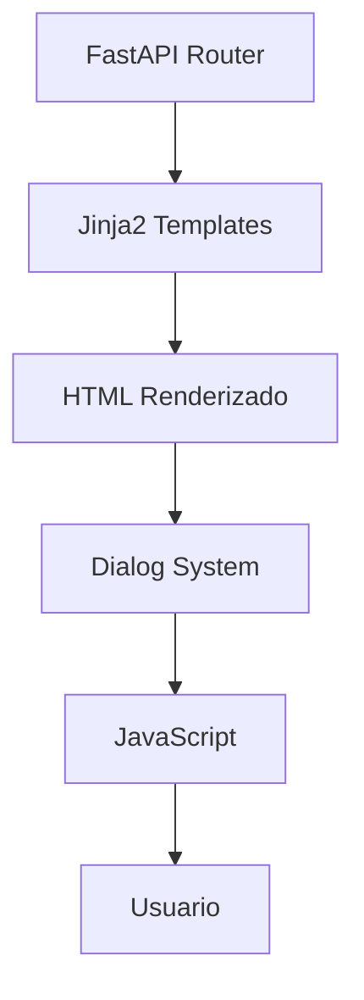
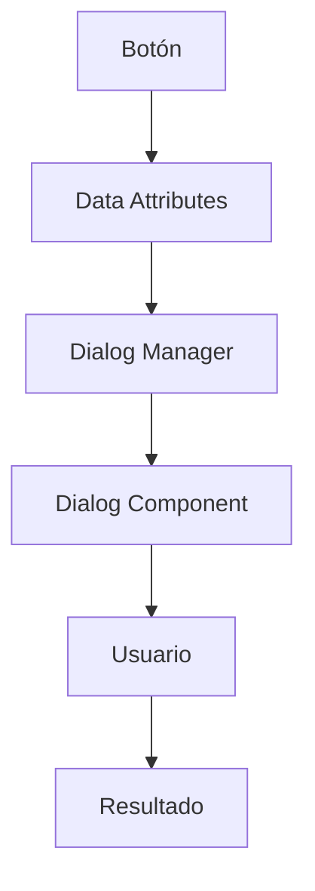
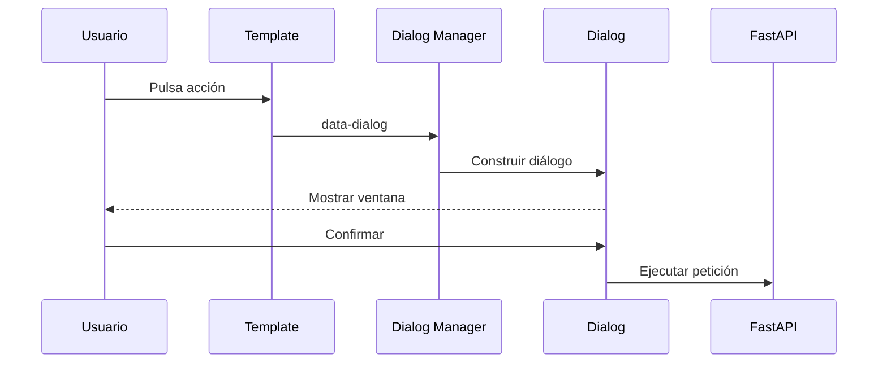
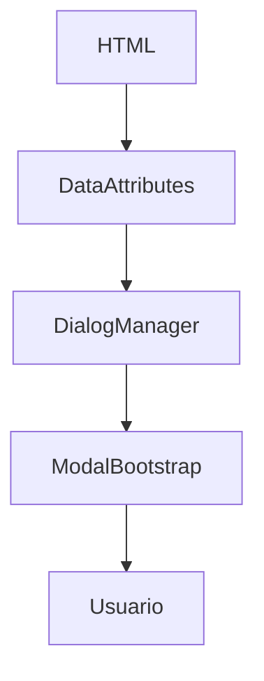
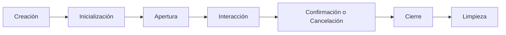
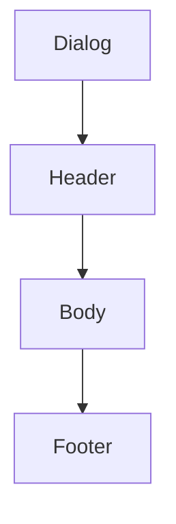
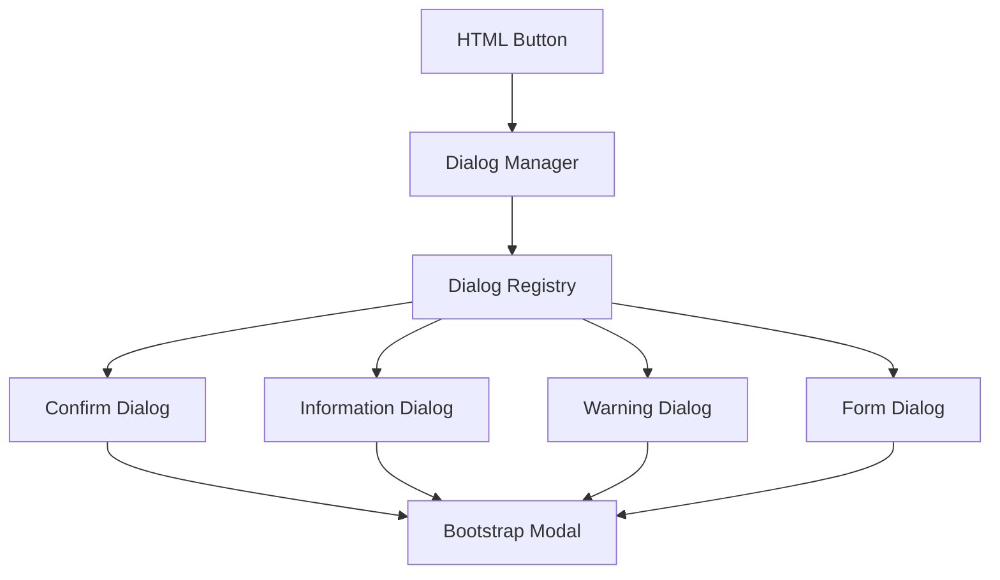
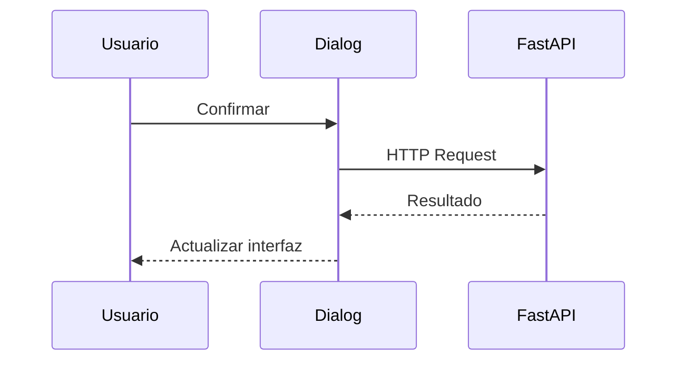

# 17. Sistema de Diálogos

---

# 1. Introducción

La interacción con el usuario en Aula Robótica Platform requiere numerosos puntos de confirmación, introducción de información, visualización de detalles y comunicación de estados intermedios. Para evitar implementaciones aisladas en cada módulo funcional, la plataforma adopta un **Sistema de Diálogos** centralizado, reutilizable y desacoplado del dominio de negocio.

Este sistema constituye una capa transversal de la arquitectura de presentación y proporciona una forma homogénea de mostrar ventanas modales en toda la aplicación, manteniendo una experiencia de usuario coherente y facilitando el mantenimiento del código.

Los diálogos no implementan lógica de negocio. Su responsabilidad consiste exclusivamente en presentar información, solicitar confirmaciones o recopilar datos antes de que el backend procese la operación correspondiente.

---

# 2. Objetivos del documento

Este documento describe la arquitectura del Sistema de Diálogos utilizado por Aula Robótica Platform.

Sus objetivos principales son:

- definir una arquitectura uniforme para todos los diálogos;
- evitar duplicación de código HTML y JavaScript;
- normalizar el comportamiento de las ventanas modales;
- integrar el sistema con Jinja2 y FastAPI;
- facilitar la reutilización mediante componentes;
- mejorar la accesibilidad;
- permitir futuras ampliaciones;
- documentar las buenas prácticas de utilización.

---

# 3. Papel dentro de la arquitectura

El Sistema de Diálogos pertenece a la capa de presentación y se sitúa entre las plantillas Jinja2 y los módulos JavaScript de interacción.



Los diálogos constituyen componentes reutilizables que pueden ser invocados desde cualquier pantalla de la aplicación.

---

# 4. Principios de diseño

El sistema se basa en varios principios arquitectónicos.

## 4.1. Responsabilidad única

Cada diálogo debe cumplir un único propósito.

Ejemplos:

- confirmar una eliminación;
- mostrar información;
- editar un recurso;
- solicitar una decisión;
- presentar un error.

No debe combinar múltiples flujos independientes dentro de la misma ventana.

---

## 4.2. Reutilización

Un mismo diálogo debe poder utilizarse desde distintas páginas.

Por ejemplo, el diálogo de confirmación de eliminación puede emplearse para:

- usuarios;
- proyectos;
- actividades;
- robots;
- documentos;
- recursos futuros.

La reutilización evita duplicaciones y mantiene una experiencia uniforme.

---

## 4.3. Configuración mediante datos

Los diálogos reciben la información necesaria mediante parámetros o atributos `data-*`.

Ejemplo:

```html
<button
    class="btn btn-danger"
    data-dialog="confirm-delete"
    data-resource-name="Proyecto Aula STEM"
    data-action-url="/projects/42/delete"
>
    Eliminar
</button>
```

El HTML permanece declarativo y el comportamiento se centraliza en JavaScript.

---

## 4.4. Independencia del dominio

El sistema no debe conocer entidades concretas como:

- Proyecto;
- Usuario;
- Actividad;
- Robot;
- Organización.

Debe trabajar con conceptos genéricos:

- título;
- mensaje;
- acción;
- recurso;
- icono;
- botones.

Esto permite reutilizar la infraestructura sin modificarla al incorporar nuevos módulos.

---

## 4.5. Integración progresiva

Los diálogos enriquecen la experiencia del usuario, pero la aplicación debe seguir siendo funcional incluso cuando determinadas mejoras JavaScript no estén disponibles.

Las operaciones críticas continúan siendo validadas por el backend.

---

# 5. Casos de uso

El Sistema de Diálogos cubre numerosos escenarios funcionales.

Entre ellos:

- confirmación de eliminación;
- cierre de sesión;
- restauración de recursos;
- archivado;
- publicación;
- operaciones masivas;
- introducción de comentarios;
- selección de opciones;
- visualización de información;
- ayuda contextual;
- resolución de conflictos;
- mensajes de advertencia.

---

# 6. Beneficios arquitectónicos

La centralización del sistema proporciona diversas ventajas.

- Uniformidad visual.
- Reducción de código duplicado.
- Mayor mantenibilidad.
- Integración sencilla con JavaScript.
- Accesibilidad consistente.
- Facilidad para evolucionar el diseño.
- Compatibilidad con SSR.
- Preparación para WebSockets.
- Menor complejidad en las plantillas.

---

# 7. Clasificación de diálogos

Los diálogos pueden clasificarse según su finalidad.

| Tipo | Finalidad |
|------|-----------|
| Confirmación | Solicitar aceptación antes de ejecutar una acción |
| Información | Mostrar contenido informativo |
| Advertencia | Alertar sobre consecuencias |
| Error | Comunicar un problema |
| Formulario | Solicitar información |
| Selección | Elegir entre varias opciones |
| Progreso | Mostrar operaciones largas |
| Resultado | Comunicar éxito o fracaso |

Cada categoría presenta requisitos de interacción diferentes.

---

# 8. Arquitectura general

El sistema sigue una arquitectura desacoplada.



La lógica de negocio permanece completamente fuera del componente visual.

---

# 9. Flujo de funcionamiento



El diálogo únicamente media entre la interfaz y la operación posterior.

---

# 10. Organización del sistema

Una posible estructura es:

```text
templates/
└── components/
    └── dialogs/

static/
└── js/
    └── dialogs/
```

La separación entre HTML y JavaScript facilita el mantenimiento.

---

# 11. Relación con Jinja2

Las plantillas generan el marcado necesario para invocar un diálogo.

Ejemplo:

```jinja2
<button
    class="btn btn-danger"
    data-dialog="confirm-delete"
    data-resource-name="{{ project.name }}"
    data-action-url="{{ url_for('projects:delete', id=project.id) }}"
>
    Eliminar
</button>
```

La plantilla no contiene la lógica que abre la ventana.

---

# 12. Relación con JavaScript

JavaScript interpreta los atributos declarativos.



Esta separación permite modificar el comportamiento sin alterar las plantillas.

---

# 13. Dialog Manager

El núcleo del sistema puede centralizarse mediante un componente denominado **Dialog Manager**.

Sus responsabilidades incluyen:

- registrar tipos de diálogo;
- interpretar atributos `data-*`;
- construir el contenido;
- abrir y cerrar ventanas;
- gestionar callbacks;
- restaurar el foco;
- coordinar la accesibilidad.

Los módulos funcionales nunca deberían manipular directamente los modales.

---

# 14. Ciclo de vida

Todo diálogo atraviesa varias fases.



Cada fase debe ejecutarse de forma consistente independientemente del tipo de diálogo.

---

# 15. Estados internos

Durante su ciclo de vida un diálogo puede encontrarse en distintos estados.

| Estado | Descripción |
|---------|-------------|
| Created | Instanciado |
| Initialized | Configurado |
| Visible | Mostrado |
| Waiting | Esperando interacción |
| Processing | Ejecutando acción |
| Success | Operación correcta |
| Error | Error producido |
| Closed | Finalizado |

Estos estados permiten gestionar correctamente animaciones, botones y eventos.

---

# 16. Integración con Bootstrap

La plataforma utiliza Bootstrap como base para la implementación visual de los diálogos.

Bootstrap proporciona:

- overlay;
- animaciones;
- gestión básica del foco;
- estructura HTML;
- compatibilidad responsive.

El Dialog Manager encapsula esta dependencia para evitar acoplar la aplicación al framework visual.

---

# 17. Componentes de un diálogo

Todo diálogo comparte una estructura similar.



Cada parte cumple una responsabilidad concreta.

---

# 18. Cabecera

La cabecera suele incluir:

- título;
- icono;
- botón de cierre.

Debe describir claramente el propósito de la ventana.

Ejemplos:

- Confirmar eliminación
- Editar usuario
- Información
- Advertencia

---

# 19. Cuerpo

El cuerpo contiene el contenido principal.

Puede mostrar:

- texto;
- listas;
- formularios;
- imágenes;
- tablas;
- advertencias;
- información contextual.

Debe evitarse introducir lógica de negocio.

---

# 20. Pie

El pie reúne las acciones disponibles.

Habitualmente contiene:

- aceptar;
- cancelar;
- cerrar;
- acción secundaria.

Los botones deben mantener una jerarquía visual consistente con el resto de la plataforma.

---

# 21. Jerarquía de botones

Los diálogos deben respetar una jerarquía clara.

| Acción | Variante |
|---------|----------|
| Principal | Primary |
| Secundaria | Secondary |
| Destructiva | Danger |
| Cancelar | Outline / Secondary |

El usuario debe identificar rápidamente cuál es la acción recomendada.

---

# 22. Confirmaciones

Las confirmaciones constituyen el tipo de diálogo más habitual.

Se utilizan antes de ejecutar operaciones como:

- eliminar;
- restaurar;
- publicar;
- archivar;
- cerrar sesión;
- finalizar procesos.

---

# 23. Confirmaciones destructivas

Las acciones irreversibles requieren información adicional.

Ejemplo:

```text
Eliminar proyecto

¿Desea eliminar el proyecto
"Aula STEM"?

Esta acción no podrá deshacerse.

[Cancelar]
[Eliminar]
```

El diálogo debe explicar claramente las consecuencias.

---

# 24. Confirmaciones contextuales

El contenido del diálogo puede adaptarse al recurso afectado.

```jinja2
data-resource-name="{{ project.name }}"
```

Posteriormente el Dialog Manager incorpora ese valor al mensaje mostrado.

---

# 25. Advertencias

Los diálogos de advertencia informan sobre situaciones potencialmente problemáticas.

Ejemplos:

- cambios sin guardar;
- pérdida de información;
- conflicto de edición;
- recursos relacionados;
- acciones costosas.

No todas las advertencias requieren confirmación.

---

# 26. Diálogos informativos

Estos diálogos muestran información sin solicitar decisiones.

Ejemplos:

- ayuda;
- instrucciones;
- detalles;
- información legal;
- resumen de operación.

Normalmente presentan un único botón de cierre.

---

# 27. Diálogos de error

Cuando un problema requiere atención inmediata puede mostrarse un diálogo específico.

Debe incluir:

- descripción comprensible;
- posibles causas;
- acciones recomendadas.

Nunca debe revelar información interna del servidor.

---

# 28. Integración con formularios

Algunos diálogos pueden contener formularios ligeros.

Ejemplos:

- cambiar nombre;
- introducir comentario;
- asignar responsable;
- seleccionar categoría.

Los formularios complejos deben mantenerse en páginas dedicadas.

---

# 29. Diálogos de selección

Permiten elegir entre varias opciones.

Ejemplos:

- organización activa;
- proyecto;
- robot;
- aula;
- prioridad.

Su estructura debe minimizar el número de pasos necesarios.

---

# 30. Responsabilidades del sistema

El Sistema de Diálogos debe responsabilizarse exclusivamente de:

- mostrar información;
- solicitar confirmación;
- recoger datos simples;
- coordinar la interacción;
- devolver un resultado.

No debe:

- consultar la base de datos;
- aplicar reglas de negocio;
- validar permisos;
- modificar entidades directamente.

Estas responsabilidades corresponden siempre al backend y a la Service Layer.

---

# 31. Implementación del Dialog Manager

El **Dialog Manager** constituye el núcleo del sistema de diálogos y centraliza toda la lógica relacionada con la creación, apertura, actualización y cierre de ventanas modales.

Su objetivo es evitar que cada módulo implemente su propio comportamiento, proporcionando una única API para toda la aplicación.

Sus responsabilidades principales incluyen:

- localizar el diálogo solicitado;
- interpretar atributos `data-*`;
- construir el contenido dinámico;
- inicializar el modal Bootstrap;
- gestionar eventos del usuario;
- coordinar la accesibilidad;
- devolver el resultado al componente solicitante.

---

# 32. Arquitectura interna



Cada tipo de diálogo implementa únicamente su comportamiento específico.

---

# 33. Registro de diálogos

El Dialog Manager mantiene un registro de los tipos de diálogo disponibles.

Ejemplo conceptual:

```javascript
dialogRegistry = {
    "confirm-delete": ConfirmDeleteDialog,
    "confirm-logout": LogoutDialog,
    "info": InformationDialog,
    "warning": WarningDialog,
    "form": FormDialog
}
```

Esto facilita incorporar nuevos diálogos sin modificar el núcleo del sistema.

---

# 34. Inicialización automática

Durante la carga de la página, el sistema identifica los elementos que utilizan diálogos.

```mermaid
flowchart TD
    Documento HTML
    ↓
Buscar data-dialog
    ↓
Registrar eventos
    ↓
Esperar interacción
```

No es necesario registrar manualmente cada botón.

---

# 35. Atributos de configuración

Los atributos `data-*` constituyen el contrato entre las plantillas y el Dialog Manager.

Ejemplos habituales:

```html
data-dialog
data-title
data-message
data-action-url
data-resource-id
data-resource-name
data-http-method
data-confirm-text
data-cancel-text
data-icon
```

Esta aproximación mantiene las plantillas declarativas.

---

# 36. Construcción dinámica

El contenido puede generarse a partir de la información proporcionada por el botón.

Ejemplo conceptual:

```text
Título:
Eliminar proyecto

Mensaje:
¿Desea eliminar
"Aula STEM"?

Botón:
Eliminar
```

El mismo componente sirve para cualquier recurso.

---

# 37. Callbacks

Tras la interacción del usuario el sistema ejecuta un callback.

Existen normalmente dos posibilidades.

- Confirmación.
- Cancelación.

```mermaid
flowchart TD
    Usuario

↓

Dialog

↓

¿Confirmar?

↙           ↘

Sí           No

↓             ↓

Callback     Callback
Confirm      Cancel
```

---

# 38. Ejecución de acciones

Una vez confirmado el diálogo pueden realizarse distintas acciones.

Por ejemplo:

- enviar formulario;
- realizar petición Fetch;
- redirigir;
- ejecutar callback;
- cerrar sesión;
- iniciar descarga.

El diálogo no implementa la lógica funcional.

---

# 39. Integración con FastAPI

Cuando la operación requiere comunicación con el servidor, el diálogo actúa como intermediario.



Toda validación continúa realizándose en el backend.

---

# 40. Diálogos SSR

En operaciones clásicas SSR el diálogo suele enviar un formulario.

```text
Usuario

↓

Confirmación

↓

POST

↓

FastAPI

↓

Redirect

↓

Nueva página
```

El flujo continúa siendo completamente compatible con Server Side Rendering.

---

# 41. Diálogos AJAX

Cuando se utiliza Fetch API el flujo cambia ligeramente.

```mermaid
flowchart TD
    Confirmación

↓

Fetch

↓

FastAPI

↓

JSON

↓

Actualizar interfaz

↓

Toast
```

El usuario permanece en la misma página.

---

# 42. Integración con CSRF

Las operaciones POST deben incorporar protección CSRF.

El token puede recuperarse desde:

- cookie;
- campo oculto;
- meta tag.

El Dialog Manager añade automáticamente el token cuando genera la petición.

---

# 43. Estados durante el procesamiento

Mientras se ejecuta una operación el diálogo puede cambiar de estado.

```text
Normal

↓

Procesando...

↓

Resultado
```

Esto evita múltiples confirmaciones consecutivas.

---

# 44. Indicadores de carga

Durante operaciones largas pueden mostrarse:

- spinner;
- barra de progreso;
- texto de espera;
- desactivación de botones.

Ejemplo:

```text
Eliminando proyecto...

⟳
```

---

# 45. Prevención de doble envío

Los botones de confirmación deben deshabilitarse inmediatamente.

```mermaid
flowchart TD
Click

↓

Deshabilitar botón

↓

Enviar petición

↓

Esperar respuesta

↓

Cerrar diálogo
```

Esto evita operaciones duplicadas.

---

# 46. Gestión de errores

Cuando la operación falla el diálogo debe informar adecuadamente.

Ejemplos:

- error de validación;
- error de red;
- acceso denegado;
- conflicto;
- error interno.

Nunca deben mostrarse trazas del servidor.

---

# 47. Integración con Toast System

Tras finalizar correctamente una operación el sistema puede generar automáticamente un Toast.

```mermaid
flowchart TD

Dialog

↓

Operación correcta

↓

Toast Manager

↓

Notificación
```

Esto evita incorporar mensajes dentro del propio diálogo.

---

# 48. Integración con WebSockets

Un diálogo puede iniciar operaciones cuyo resultado llegue posteriormente mediante WebSocket.

Ejemplo:

```text
Importación

↓

Proceso servidor

↓

Evento WebSocket

↓

Cerrar diálogo

↓

Toast
```

El diálogo permanece desacoplado del mecanismo de actualización.

---

# 49. Accesibilidad

Los diálogos deben cumplir diversas recomendaciones WCAG.

Entre ellas:

- role="dialog";
- aria-modal="true";
- título identificado;
- foco inicial;
- navegación por teclado;
- restauración del foco;
- cierre mediante Escape cuando proceda.

---

# 50. Gestión del foco

```mermaid
flowchart TD

Elemento origen

↓

Abrir diálogo

↓

Mover foco

↓

Interacción

↓

Cerrar

↓

Restaurar foco
```

Este comportamiento mejora significativamente la accesibilidad.

---

# 51. Navegación mediante teclado

Todo diálogo debe permitir:

- TAB;
- Shift+TAB;
- ENTER;
- ESC;
- flechas cuando existan listas.

No debe ser posible desplazar el foco fuera del diálogo mientras permanezca abierto.

---

# 52. Responsive Design

Los diálogos deben adaptarse automáticamente.

En escritorio:

- anchura media;
- botones alineados.

En móvil:

- anchura completa;
- botones apilados;
- contenido desplazable.

---

# 53. Diálogos grandes

Algunas operaciones requieren más espacio.

Ejemplos:

- formularios;
- tablas;
- información extensa.

Bootstrap permite diferentes tamaños sin modificar la arquitectura.

---

# 54. Diálogos pequeños

Otros casos requieren únicamente una confirmación sencilla.

Ejemplo:

```text
Cerrar sesión

Cancelar

Salir
```

No resulta necesario ocupar gran parte de la pantalla.

---

# 55. Animaciones

Las animaciones deben ser discretas.

Objetivos:

- mejorar percepción;
- indicar transición;
- no ralentizar interacción;
- respetar preferencias de accesibilidad.

---

# 56. Rendimiento

El sistema debe evitar:

- crear múltiples instancias;
- cargar HTML duplicado;
- registrar eventos repetidos.

Siempre que resulte posible se reutilizará una única instancia del modal.

---

# 57. Logging

Pueden registrarse eventos como:

- apertura;
- confirmación;
- cancelación;
- errores;
- tiempo de interacción.

Esta información resulta útil durante tareas de diagnóstico.

---

# 58. Testing

El sistema puede verificarse mediante:

- pruebas unitarias JavaScript;
- pruebas funcionales;
- Selenium;
- Playwright;
- pruebas manuales.

Los escenarios prioritarios incluyen:

- apertura;
- cierre;
- foco;
- confirmación;
- cancelación;
- errores.

---

# 59. Buenas prácticas

Durante el desarrollo deben seguirse varias recomendaciones.

- Un único propósito por diálogo.
- HTML declarativo.
- JavaScript modular.
- Reutilización máxima.
- Sin lógica de negocio.
- Integración con Toast System.
- Compatibilidad con SSR.
- Accesibilidad completa.
- Responsive Design.
- Seguridad delegada al backend.

---

# 60. Estado actual

Actualmente la arquitectura contempla:

✅ Dialog Manager centralizado.

✅ Componentes reutilizables.

✅ Integración con Jinja2.

✅ Compatibilidad con FastAPI.

✅ Integración con Bootstrap.

✅ Compatibilidad con SSR.

✅ Preparación para Fetch API.

✅ Preparación para WebSockets.

✅ Integración con Toast System.

✅ Accesibilidad preparada.

---

# 61. Evolución futura

Las siguientes mejoras podrán incorporarse sin modificar la arquitectura existente.

Entre ellas:

- diálogos apilados;
- asistentes multipaso;
- carga dinámica de contenido;
- componentes HTMX;
- integración con IA;
- historial de acciones;
- diálogos colaborativos;
- validación en tiempo real;
- soporte offline.

---

# 62. Arquitectura completa

```mermaid
flowchart TD

Usuario

↓

Botón HTML

↓

Dialog Manager

↓

Bootstrap Modal

↓

Confirmación

↓

FastAPI

↓

Service Layer

↓

Resultado

↓

Toast

↓

Actualizar interfaz
```

---

# 63. Conclusiones

El Sistema de Diálogos constituye un componente transversal fundamental dentro de la arquitectura de Aula Robótica Platform, proporcionando un mecanismo uniforme para gestionar confirmaciones, advertencias, formularios ligeros y mensajes informativos.

La separación entre plantillas Jinja2, Dialog Manager, JavaScript modular y lógica de negocio mantiene un bajo acoplamiento entre componentes y facilita la reutilización de la interfaz en todos los módulos de la aplicación.

La integración con FastAPI, SSR, Bootstrap, el sistema de Toasts y la futura comunicación mediante WebSockets permite construir una experiencia de usuario consistente, accesible y preparada para evolucionar hacia funcionalidades más avanzadas sin alterar la arquitectura base.

