# 18. Sistema de Notificaciones Toast

---

# 1. Introducción

La interacción con una aplicación web moderna requiere proporcionar información inmediata al usuario tras la ejecución de determinadas operaciones. Acciones como crear un proyecto, guardar cambios, eliminar un recurso o recibir una actualización en tiempo real deben comunicarse de forma clara sin interrumpir el flujo de trabajo.

Para resolver esta necesidad, Aula Robótica Platform incorpora un **Sistema de Notificaciones Toast** centralizado, reutilizable y desacoplado de la lógica de negocio.

Las notificaciones Toast permiten mostrar mensajes temporales y no intrusivos que informan sobre el resultado de una operación sin bloquear la interfaz, evitando el uso excesivo de alertas modales o redirecciones innecesarias.

---

# 2. Objetivos del documento

Este documento describe la arquitectura del Sistema de Toasts utilizado por Aula Robótica Platform.

Sus objetivos principales son:

- establecer un mecanismo uniforme de notificación;
- evitar implementaciones aisladas en cada módulo;
- desacoplar la interfaz de la lógica de negocio;
- integrar SSR y JavaScript;
- reutilizar componentes;
- facilitar futuras ampliaciones;
- mejorar la experiencia de usuario;
- preparar la arquitectura para eventos en tiempo real.

---

# 3. Papel dentro de la arquitectura

El sistema de Toasts forma parte de la capa de presentación y se sitúa entre las respuestas del backend y la interacción del usuario.

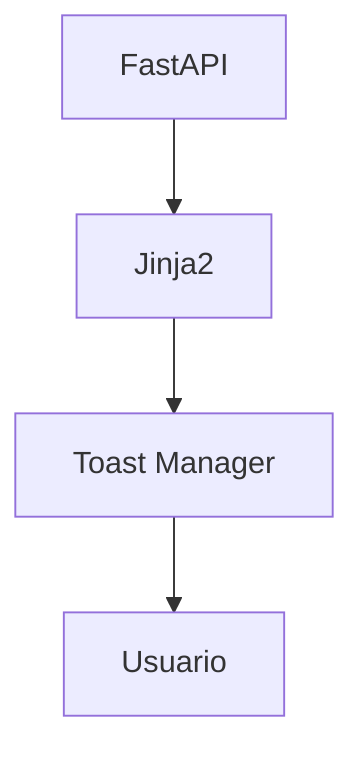

Las notificaciones representan la última etapa del ciclo de interacción.

---

# 4. Principios de diseño

El sistema sigue diversos principios arquitectónicos.

## 4.1. No intrusivo

Las notificaciones no deben interrumpir el trabajo del usuario.

Su aparición debe permitir continuar utilizando la aplicación.

---

## 4.2. Temporal

Un Toast representa un mensaje breve.

Debe desaparecer automáticamente cuando ya no resulte relevante.

---

## 4.3. Reutilizable

Todos los módulos deben utilizar el mismo sistema.

No deben existir implementaciones particulares para:

- usuarios;
- proyectos;
- actividades;
- robots;
- autenticación.

---

## 4.4. Declarativo

Las plantillas únicamente describen qué mensaje mostrar.

El comportamiento pertenece exclusivamente al Toast Manager.

---

## 4.5. Desacoplado

El sistema no conoce entidades concretas.

Trabaja únicamente con:

- tipo;
- título;
- mensaje;
- duración;
- prioridad.

---

# 5. Casos de uso

Los Toasts pueden utilizarse para comunicar:

- operación completada;
- validación correcta;
- eliminación realizada;
- restauración;
- importación finalizada;
- cambios guardados;
- error recuperable;
- advertencia;
- información.

---

# 6. Beneficios

La utilización de un sistema unificado proporciona:

- coherencia visual;
- menor duplicación;
- integración sencilla;
- mantenimiento reducido;
- mejor experiencia de usuario;
- reutilización;
- compatibilidad con SSR;
- preparación para tiempo real.

---

# 7. Arquitectura general

```mermaid
flowchart TD

FastAPI

↓

Flash Message

↓

Toast Manager

↓

Toast Component

↓

Usuario
```

El backend únicamente comunica el evento.

La representación visual corresponde al frontend.

---

# 8. Flujo de funcionamiento

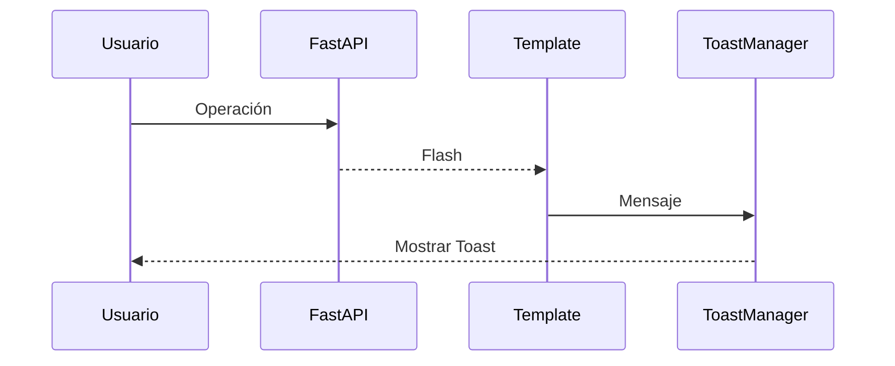

La operación funcional permanece completamente separada de la representación.

---

# 9. Tipos de Toast

El sistema distingue distintos niveles de notificación.

| Tipo | Uso |
|-------|-----|
| Success | Operación correcta |
| Error | Operación fallida |
| Warning | Advertencia |
| Info | Información |
| Loading | Proceso en curso |

Cada categoría mantiene una identidad visual propia.

---

# 10. Toast Success

Representa operaciones finalizadas correctamente.

Ejemplos:

- Proyecto creado.
- Usuario actualizado.
- Archivo cargado.
- Contraseña modificada.
- Robot asignado.

Normalmente desaparecen automáticamente.

---

# 11. Toast Error

Comunican problemas durante la operación.

Ejemplos:

- Error inesperado.
- No se pudo guardar.
- Permisos insuficientes.
- Recurso inexistente.

No deben mostrar información interna del servidor.

---

# 12. Toast Warning

Alertan sobre situaciones que requieren atención.

Ejemplos:

- Cambios sin guardar.
- Próxima expiración.
- Configuración incompleta.
- Operación parcialmente realizada.

No implican necesariamente un error.

---

# 13. Toast Info

Transmiten información general.

Ejemplos:

- Nueva versión disponible.
- Conexión restablecida.
- Sincronización iniciada.
- Cambio de organización.

---

# 14. Toast Loading

Algunas operaciones largas requieren una notificación temporal.

Ejemplo:

```text
Importando datos...

⟳
```

Posteriormente será reemplazada por un Success o Error.

---

# 15. Arquitectura interna

```mermaid
flowchart TD

ToastManager

↓

ToastRegistry

↓

ToastComponent

↓

Container

↓

Usuario
```

El Toast Manager controla toda la vida del mensaje.

---

# 16. Toast Manager

Este componente centraliza:

- creación;
- visualización;
- temporización;
- eliminación;
- cola;
- animaciones;
- callbacks.

Las páginas nunca manipulan directamente el DOM del Toast.

---

# 17. Toast Container

Todas las notificaciones comparten un único contenedor.

```html
<div id="toast-container"></div>
```

Su ubicación suele encontrarse en el layout principal.

---

# 18. Ciclo de vida

Todo Toast atraviesa varias fases.

```mermaid
flowchart LR

Crear

↓

Mostrar

↓

Esperar

↓

Ocultar

↓

Eliminar
```

La duración depende del tipo de mensaje.

---

# 19. Estados

| Estado | Descripción |
|---------|-------------|
| Created | Generado |
| Visible | Mostrado |
| Waiting | Temporizador activo |
| Closing | Cerrándose |
| Removed | Eliminado |

---

# 20. Duración

La duración debe depender del tipo.

Ejemplo:

| Tipo | Tiempo |
|------|---------|
| Success | 3 s |
| Info | 4 s |
| Warning | 5 s |
| Error | Manual o 6 s |

La configuración debe ser centralizada.

---

# 21. Cola de mensajes

Cuando varios Toasts aparecen simultáneamente deben organizarse.

```mermaid
flowchart TD

Toast1

↓

Toast2

↓

Toast3
```

La cola evita superposiciones desordenadas.

---

# 22. Límite máximo

El sistema debe limitar el número de Toasts visibles.

Por ejemplo:

```text
Máximo visibles:
3
```

Los mensajes restantes permanecen en espera.

---

# 23. Priorización

No todos los mensajes tienen la misma importancia.

```text
Error

↓

Warning

↓

Success

↓

Info
```

Los mensajes críticos pueden desplazar otros menos importantes.

---

# 24. Posicionamiento

Las ubicaciones habituales son:

- esquina superior derecha;
- esquina inferior derecha;
- superior central.

Toda la aplicación debe utilizar la misma posición.

---

# 25. Animaciones

Las animaciones deben resultar discretas.

Ejemplos:

- fade;
- slide;
- opacity;
- translate.

Nunca deben ralentizar el trabajo del usuario.

---

# 26. Integración con Jinja2

Las plantillas reciben mensajes Flash.

Ejemplo conceptual:

```jinja2

```

Posteriormente JavaScript crea los Toasts correspondientes.

---

# 27. Flash Messages

SSR utiliza normalmente mensajes Flash.

```text
POST

↓

Redirect

↓

Flash

↓

Toast
```

Esto permite informar tras una redirección.

---

# 28. Integración con FastAPI

FastAPI únicamente comunica el resultado.

Ejemplo conceptual:

```python
flash(
    "Proyecto creado correctamente",
    "success"
)
```

La representación permanece completamente desacoplada.

---

# 29. Integración con JavaScript

```mermaid
flowchart TD

Flash

↓

ToastManager

↓

DOM

↓

Animación

↓

Usuario
```

JavaScript interpreta la información recibida.

---

# 30. Responsabilidades

El sistema de Toasts debe encargarse exclusivamente de:

- mostrar mensajes;
- temporizar;
- eliminar;
- animar;
- organizar.

No debe:

- consultar datos;
- ejecutar operaciones;
- validar permisos;
- modificar entidades.

La segunda parte desarrollará la integración con AJAX, Fetch API, WebSockets, Dialog System, accesibilidad, pruebas, despliegue, observabilidad, evolución futura y conclusiones del Sistema de Toasts.

---

# 31. Integración con Fetch API

El Sistema de Toasts puede recibir mensajes procedentes de operaciones asíncronas ejecutadas mediante `Fetch API`.

Este flujo resulta útil cuando una acción debe actualizar parte de la interfaz sin recargar completamente la página.

Ejemplos:

- eliminar una fila;
- cambiar el estado de un recurso;
- asignar un usuario;
- guardar una configuración rápida;
- cargar un archivo;
- actualizar un contador.

---

# 32. Flujo asíncrono

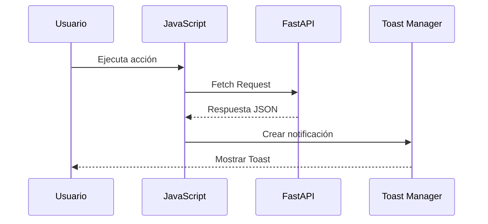

El Toast Manager no realiza la petición ni interpreta la lógica de negocio. Únicamente recibe un mensaje ya preparado por el módulo responsable.

---

# 33. Contrato de respuesta

Las respuestas JSON pueden utilizar una estructura común.

```json
{
  "success": true,
  "message": {
    "type": "success",
    "title": "Proyecto actualizado",
    "text": "Los cambios se han guardado correctamente."
  },
  "data": {}
}
```

En caso de error:

```json
{
  "success": false,
  "message": {
    "type": "error",
    "title": "No se pudo actualizar",
    "text": "Revisa los datos e inténtalo de nuevo."
  },
  "errors": {}
}
```

La estructura homogénea simplifica la integración entre módulos.

---

# 34. Normalización de respuestas

La capa JavaScript puede transformar distintas respuestas HTTP en un formato estándar.

| Código HTTP | Toast recomendado |
|---|---|
| 200 | Success o Info |
| 201 | Success |
| 204 | Success opcional |
| 400 | Warning o Error |
| 401 | Error y redirección |
| 403 | Error |
| 404 | Warning |
| 409 | Warning o Error |
| 422 | Error de validación |
| 500 | Error genérico |

La elección final depende del contexto funcional.

---

# 35. Gestión centralizada de Fetch

El sistema puede integrarse con un cliente HTTP común.

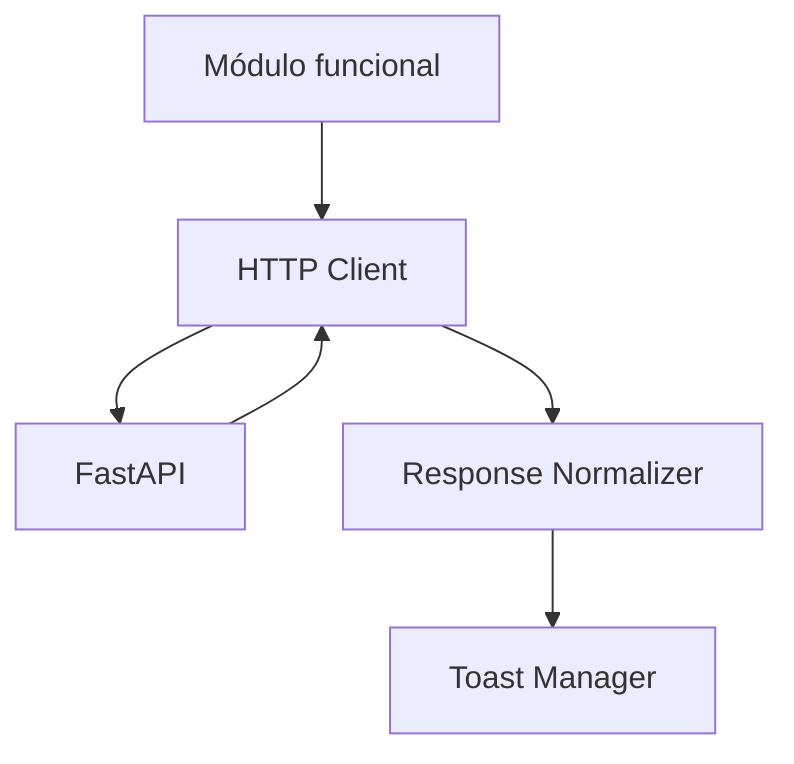

Esta arquitectura evita que cada módulo implemente de forma diferente:

- validación de estado;
- lectura de JSON;
- gestión de errores;
- presentación de mensajes.

---

# 36. Ejemplo conceptual de uso

```javascript
try {
    const response = await httpClient.post(actionUrl, payload);

    toastManager.show({
        type: "success",
        title: "Cambios guardados",
        message: response.message
    });
} catch (error) {
    toastManager.show({
        type: "error",
        title: "Error",
        message: error.userMessage
    });
}
```

Los detalles técnicos del cliente HTTP pertenecen a la arquitectura JavaScript, no al Toast Manager.

---

# 37. Errores de red

Los fallos de conectividad deben diferenciarse de los errores funcionales.

Ejemplos:

- conexión interrumpida;
- timeout;
- servidor no disponible;
- respuesta inválida;
- petición cancelada.

Mensaje recomendado:

```text
No se pudo conectar con el servidor.
Comprueba tu conexión e inténtalo de nuevo.
```

No deben mostrarse excepciones técnicas como `TypeError: Failed to fetch`.

---

# 38. Reintentos

Determinadas notificaciones pueden incorporar una acción de reintento.

Ejemplo:

```text
No se pudo cargar la actividad.

[Reintentar]
```

La acción debe pertenecer al módulo que originó el error, mientras que el Toast únicamente presenta el control.

---

# 39. Integración con el Dialog System

El Dialog System y el Toast System cumplen responsabilidades complementarias.

| Sistema | Uso |
|---|---|
| Dialog | Solicitar decisión o introducir datos |
| Toast | Comunicar un resultado breve |
| Alert inline | Mostrar información persistente en contexto |
| Página de error | Informar de un fallo que impide continuar |

Un diálogo no debe utilizarse cuando basta con una notificación temporal.

---

# 40. Flujo diálogo y Toast

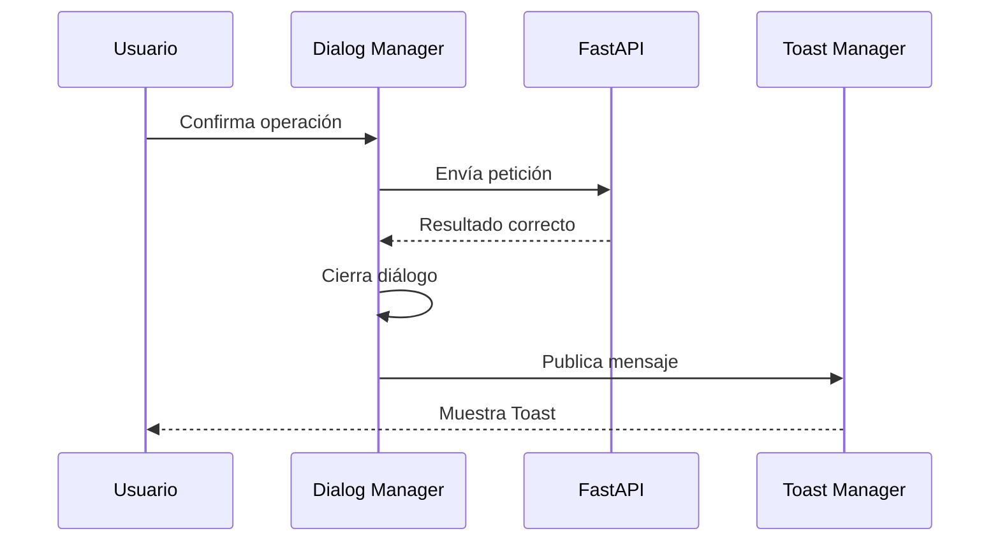

Este patrón resulta habitual en operaciones destructivas o sensibles.

---

# 41. Errores dentro de diálogos

No todos los errores deben convertirse inmediatamente en un Toast.

Cuando un formulario modal contiene errores de validación, estos deben mostrarse junto a los campos.

El Toast puede utilizarse para:

- error general;
- fallo de red;
- error inesperado;
- confirmación posterior.

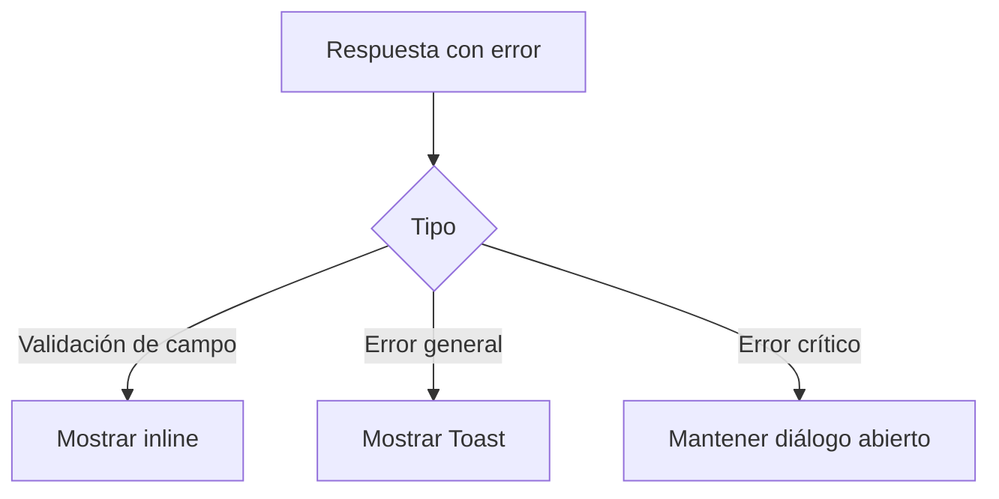

---

# 42. Integración con WebSockets

Los eventos recibidos mediante WebSockets pueden generar notificaciones en tiempo real.

Ejemplos:

- una actividad ha sido asignada;
- un proyecto ha cambiado de estado;
- una importación ha finalizado;
- un usuario ha enviado un comentario;
- una conexión se ha restablecido;
- un proceso ha fallado.

---

# 43. Flujo en tiempo real

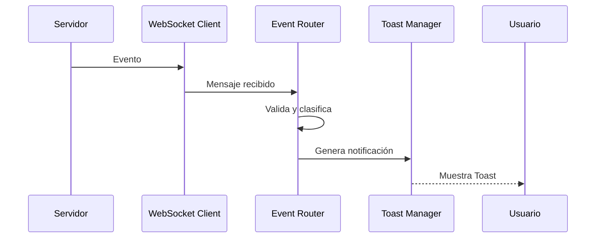

El Toast Manager no debe procesar directamente mensajes WebSocket sin normalización previa.

---

# 44. Contrato de evento

Un evento puede incluir:

```json
{
  "event": "project.updated",
  "severity": "info",
  "title": "Proyecto actualizado",
  "message": "Se ha modificado el proyecto Aula STEM.",
  "resource": {
    "type": "project",
    "id": 42
  }
}
```

El Event Router decide si el mensaje debe:

- mostrar un Toast;
- actualizar un componente;
- ignorarse;
- agruparse;
- persistirse.

---

# 45. Evitar duplicados

Los sistemas en tiempo real pueden recibir eventos repetidos.

Para evitar notificaciones duplicadas, cada evento puede incluir:

- identificador único;
- marca temporal;
- clave de deduplicación;
- versión del recurso.

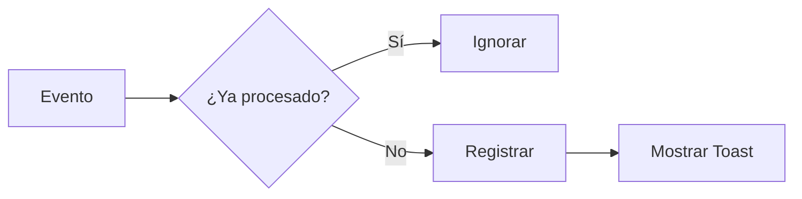

---

# 46. Agrupación de eventos

Cuando se producen múltiples eventos similares en poco tiempo, el sistema puede agruparlos.

Ejemplo inicial:

```text
Nueva actividad asignada.
Nueva actividad asignada.
Nueva actividad asignada.
```

Ejemplo agrupado:

```text
Tienes 3 nuevas actividades asignadas.
```

La agrupación reduce ruido y fatiga de notificaciones.

---

# 47. Eventos silenciosos

No todos los eventos deben producir un Toast.

Pueden actualizarse silenciosamente:

- contadores;
- indicadores;
- presencia;
- timestamps;
- pequeños cambios visuales.

El Toast se reserva para información relevante para el usuario.

---

# 48. Eventos según el contexto

La misma actualización puede requerir distinto comportamiento según la pantalla activa.

Ejemplo:

- si el usuario está viendo el recurso, se actualiza el componente;
- si está en otra pantalla, se muestra un Toast;
- si el evento fue provocado por el propio usuario, puede omitirse.

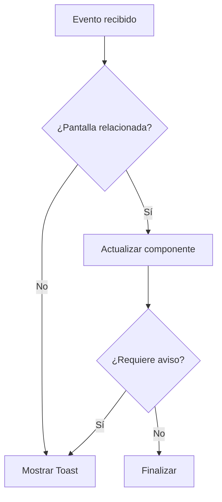

---

# 49. Integración con mensajes Flash

Los mensajes Flash representan la principal vía de comunicación después de una redirección SSR.

El flujo habitual es:

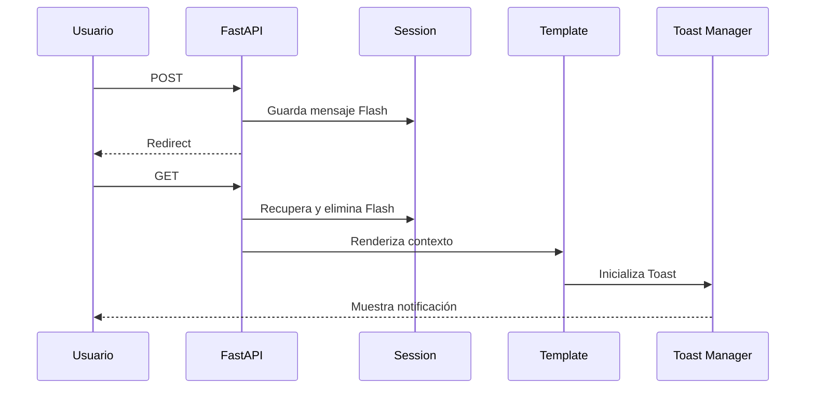

El mensaje se consume una única vez.

---

# 50. Estructura de mensajes Flash

Un mensaje Flash puede contener:

```python
{
    "type": "success",
    "title": "Proyecto creado",
    "message": "El proyecto se ha creado correctamente.",
    "duration": 4000
}
```

Los campos opcionales deben disponer de valores por defecto centralizados.

---

# 51. Renderizado seguro de Flash

Los mensajes procedentes del servidor deben serializarse de forma segura.

Debe evitarse insertar directamente cadenas dentro de scripts inline.

Una opción es renderizar los mensajes como JSON:

```html
<script
    id="flash-messages"
    type="application/json"
>
    {{ flashes | tojson }}
</script>
```

JavaScript puede recuperar y procesar el contenido al cargar la página.

---

# 52. Seguridad del contenido

Los Toasts deben tratar todo contenido dinámico como texto.

Debe evitarse utilizar:

```javascript
element.innerHTML = message;
```

cuando el valor procede de una fuente no confiable.

La alternativa recomendada es:

```javascript
element.textContent = message;
```

Esto reduce el riesgo de ataques XSS.

---

# 53. Contenido enriquecido

Cuando una notificación necesite enlaces o botones, estos deben construirse mediante componentes controlados.

No debe aceptarse HTML arbitrario enviado por el backend.

Ejemplo de acción permitida:

```json
{
  "action": {
    "label": "Abrir proyecto",
    "url": "/projects/42"
  }
}
```

El frontend genera el enlace aplicando validaciones.

---

# 54. Validación de URLs

Las URLs incluidas en acciones deben:

- pertenecer a rutas permitidas;
- utilizar protocolos seguros;
- evitar esquemas como `javascript:`;
- escapar parámetros;
- respetar la política de navegación.

Las rutas internas son preferibles a URLs externas.

---

# 55. Accesibilidad

Las notificaciones Toast deben ser perceptibles para usuarios de tecnologías de asistencia sin interrumpir innecesariamente la navegación.

El contenedor puede utilizar:

```html
<div
    id="toast-container"
    aria-live="polite"
    aria-relevant="additions"
    aria-atomic="false"
></div>
```

Los mensajes críticos pueden usar una región con prioridad mayor.

---

# 56. Niveles de anuncio

| Tipo | Configuración recomendada |
|---|---|
| Success | `aria-live="polite"` |
| Info | `aria-live="polite"` |
| Warning | `aria-live="polite"` o `assertive` según gravedad |
| Error | `role="alert"` o `aria-live="assertive"` |
| Loading | Evitar anuncios repetitivos |

El uso de regiones `assertive` debe limitarse para no interrumpir al usuario constantemente.

---

# 57. Foco

Los Toasts no deben capturar automáticamente el foco al aparecer.

El usuario debe poder continuar en el elemento activo.

El foco solo puede trasladarse cuando:

- existe una acción crítica que requiere intervención;
- la notificación sustituye un flujo bloqueado;
- el usuario la abre explícitamente.

---

# 58. Botón de cierre

Cuando una notificación puede cerrarse manualmente, el botón debe incluir una etiqueta accesible.

```html
<button
    type="button"
    class="btn-close"
    aria-label="Cerrar notificación"
></button>
```

El botón debe ser accesible mediante teclado.

---

# 59. Duración accesible

Los mensajes que contienen información importante deben permanecer visibles el tiempo suficiente.

Deben evitarse duraciones excesivamente cortas.

Recomendaciones:

- aumentar duración para mensajes largos;
- mantener errores hasta cierre manual;
- pausar el temporizador con hover o foco;
- permitir revisar notificaciones relevantes.

---

# 60. Pausa del temporizador

Cuando el usuario interactúa con un Toast, el temporizador debe pausarse.

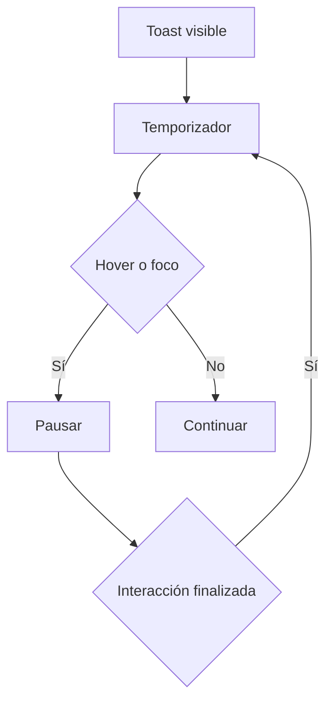

Este comportamiento mejora la usabilidad y la accesibilidad.

---

# 61. Preferencia de movimiento reducido

Las animaciones deben respetar:

```css
@media (prefers-reduced-motion: reduce) {
    .toast {
        transition: none;
    }
}
```

La funcionalidad debe mantenerse aunque las animaciones estén desactivadas.

---

# 62. Diseño responsive

El sistema debe adaptarse a distintos tamaños de pantalla.

En escritorio puede utilizar una columna lateral.

En móvil puede:

- ocupar casi todo el ancho;
- utilizar márgenes reducidos;
- apilar acciones;
- limitar la altura;
- permitir cierre sencillo.

---

# 63. Posicionamiento responsive

Ejemplo conceptual:

```text
Escritorio:
Esquina superior derecha

Móvil:
Parte superior central
```

El contenedor no debe cubrir permanentemente:

- navegación;
- botones principales;
- campos activos;
- mensajes críticos.

---

# 64. Tamaño del contenido

Las notificaciones deben ser breves.

Un Toast no es adecuado para:

- instrucciones extensas;
- errores con muchos campos;
- documentos;
- explicaciones legales;
- decisiones complejas;
- contenido tabular.

En estos casos deben utilizarse diálogos, alertas persistentes o páginas específicas.

---

# 65. Acciones dentro de Toasts

Un Toast puede incorporar una acción breve.

Ejemplos:

- Deshacer.
- Reintentar.
- Abrir.
- Ver detalles.

No debería contener múltiples acciones competitivas.

---

# 66. Acción Deshacer

Las operaciones reversibles pueden ofrecer una ventana temporal para deshacer.

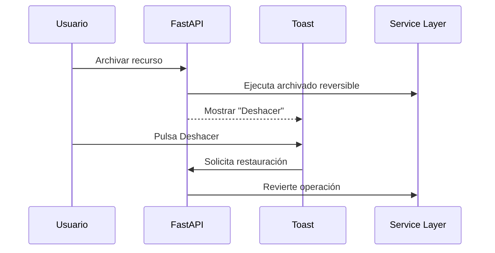

La reversibilidad debe estar implementada de forma segura en el backend.

---

# 67. Persistencia de notificaciones

Los Toasts son temporales y no constituyen un historial.

Las notificaciones importantes pueden almacenarse adicionalmente en:

- centro de notificaciones;
- auditoría;
- base de datos;
- actividad del usuario.

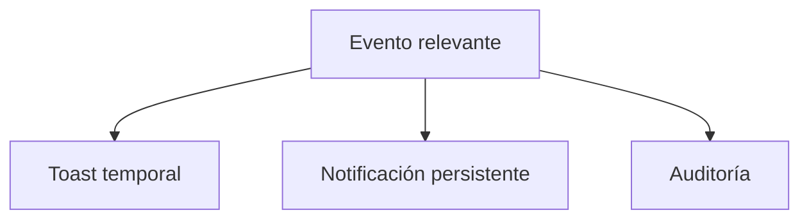

Cada mecanismo cumple una función diferente.

---

# 68. Centro de notificaciones

Una futura evolución puede incorporar un centro persistente con:

- mensajes leídos y no leídos;
- fecha;
- categoría;
- recurso relacionado;
- acciones;
- filtros;
- paginación.

El Toast actuaría como aviso inmediato, mientras que el centro conservaría el historial.

---

# 69. Notificaciones por usuario

Los eventos en tiempo real deben respetar:

- identidad;
- permisos;
- contexto;
- organización;
- preferencias;
- suscripciones.

El backend no debe enviar eventos sensibles a usuarios no autorizados.

---

# 70. Preferencias de notificación

La arquitectura puede evolucionar para permitir configurar:

- tipos habilitados;
- duración;
- sonidos;
- eventos en tiempo real;
- agrupación;
- horario;
- canales externos.

Las preferencias visuales no deben afectar a mensajes de seguridad imprescindibles.

---

# 71. Sonidos

Los Toasts no deben reproducir sonido por defecto.

Cuando se incorpore audio:

- debe ser opcional;
- respetar preferencias;
- utilizarse solo en eventos relevantes;
- evitar repetición;
- disponer de alternativa visual.

---

# 72. Rendimiento

El sistema debe evitar:

- crear demasiados nodos;
- mantener temporizadores innecesarios;
- registrar listeners duplicados;
- procesar eventos irrelevantes;
- conservar mensajes eliminados.

La limpieza del ciclo de vida debe ser completa.

---

# 73. Reutilización del DOM

El sistema puede crear y destruir cada Toast o reutilizar estructuras, según la complejidad.

En ambos casos debe garantizar:

- ausencia de contenido residual;
- eliminación de listeners;
- cancelación de temporizadores;
- liberación de referencias.

---

# 74. Gestión de temporizadores

Cada Toast debe mantener control sobre su temporizador.

Estados posibles:

```text
Activo
Pausado
Reanudado
Cancelado
Finalizado
```

Al cerrar una notificación manualmente, el temporizador debe cancelarse.

---

# 75. Gestión de cola

El Toast Manager puede utilizar una estructura FIFO con prioridades.

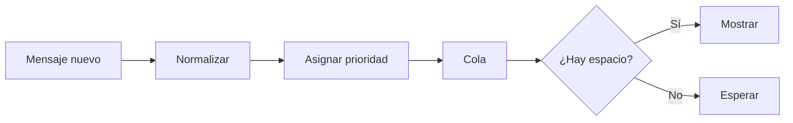

Los errores críticos pueden adelantarse según las reglas configuradas.

---

# 76. Colapso de mensajes repetidos

Mensajes iguales pueden combinarse.

Ejemplo:

```text
3 archivos se han cargado correctamente.
```

En lugar de:

```text
Archivo cargado.
Archivo cargado.
Archivo cargado.
```

La clave de agrupación puede basarse en:

- tipo;
- código;
- recurso;
- ventana temporal.

---

# 77. Observabilidad

El sistema puede generar métricas y logs sobre:

- número de Toasts;
- tipo;
- origen;
- descartes;
- agrupaciones;
- errores de renderizado;
- acciones pulsadas;
- tiempo visible.

La telemetría no debe almacenar mensajes sensibles completos.

---

# 78. Logging

Ejemplo conceptual:

```text
event=toast_displayed
type=error
source=project_update
request_id=...
```

No deben registrarse:

- contraseñas;
- tokens;
- datos personales innecesarios;
- contenido completo de formularios.

---

# 79. Correlación

Los Toasts originados por una petición pueden asociarse a un identificador de correlación.

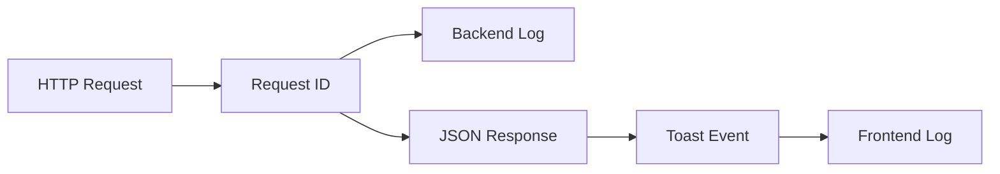

Esto facilita investigar errores reportados por usuarios.

---

# 80. Gestión de errores internos

Si el Toast Manager falla, no debe bloquear la funcionalidad principal.

El sistema puede:

- registrar el error;
- utilizar una alerta inline de respaldo;
- escribir un mensaje en consola durante desarrollo;
- mantener la operación completada.

La presentación de una notificación nunca debe ser requisito para confirmar la persistencia de una operación.

---

# 81. Testing unitario

Las pruebas JavaScript deben verificar:

- creación;
- normalización;
- duración;
- prioridad;
- cola;
- cierre;
- pausa;
- reanudación;
- agrupación;
- eliminación.

---

# 82. Testing de integración

Las pruebas de integración deben comprobar:

- mensajes Flash convertidos en Toasts;
- respuestas Fetch;
- eventos WebSocket;
- interacción con Dialog System;
- acciones como Reintentar o Deshacer.

---

# 83. Testing funcional

Escenarios recomendados:

```mermaid
flowchart TD
    A[Crear proyecto] --> B[Redirect]
    B --> C[Toast success]
    C --> D[Desaparece]

    E[Eliminar proyecto] --> F[Dialog]
    F --> G[Confirmar]
    G --> H[Toast success]

    I[Error de red] --> J[Toast error]
    J --> K[Reintentar]
```

---

# 84. Testing de accesibilidad

Debe comprobarse:

- anuncio mediante lector de pantalla;
- ausencia de robo de foco;
- botón de cierre;
- pausa con foco;
- duración suficiente;
- contraste;
- uso de movimiento reducido;
- navegación mediante teclado.

---

# 85. Testing responsive

Las notificaciones deben probarse en:

- pantallas móviles;
- tablets;
- escritorio;
- zoom elevado;
- textos largos;
- varios Toasts simultáneos.

Debe verificarse que no bloquean acciones importantes.

---

# 86. Testing End-to-End

Las pruebas E2E pueden utilizar Playwright o Selenium para validar:

- visibilidad;
- contenido;
- clase visual;
- cierre automático;
- cierre manual;
- acción;
- cola;
- integración con servidor.

---

# 87. Integración con Docker

El JavaScript y los estilos del sistema forman parte de los recursos estáticos de la aplicación.

Estructura conceptual:

```text
static/
├── js/
│   └── toasts/
│       ├── toast-manager.js
│       ├── toast-component.js
│       └── toast-config.js
└── css/
    └── components/
        └── toast.css
```

Estos recursos se incluyen en la imagen de despliegue.

---

# 88. Integración con Nginx

Nginx puede servir directamente:

- módulos JavaScript;
- estilos;
- iconos;
- recursos asociados.

```mermaid
flowchart LR
    A[Navegador] --> B[Nginx]
    B -->|/static| C[Toast Assets]
    B -->|/api| D[FastAPI]
```

La configuración de caché debe coordinarse con el versionado de archivos.

---

# 89. Versionado de recursos

Los cambios en el sistema deben invalidar la caché.

Opciones:

```text
toast-manager.js?v=3
```

o:

```text
toast-manager.a8c712.js
```

Los nombres con hash son preferibles en procesos de construcción automatizados.

---

# 90. Content Security Policy

El sistema debe evitar depender de scripts inline.

Los mensajes Flash pueden almacenarse en:

- JSON embebido;
- atributos seguros;
- endpoint inicial;
- contexto global controlado.

Esto permite aplicar una política CSP más restrictiva.

---

# 91. Configuración centralizada

La configuración puede incluir:

```javascript
{
    maxVisible: 3,
    defaultPosition: "top-right",
    durations: {
        success: 3000,
        info: 4000,
        warning: 6000,
        error: 0
    }
}
```

El valor `0` puede representar cierre manual.

---

# 92. Variables de entorno

Algunas opciones pueden depender del entorno:

- modo debug;
- logging frontend;
- WebSockets habilitados;
- duración de mensajes;
- agrupación;
- telemetría.

La configuración debe exponerse al navegador de forma controlada y sin secretos.

---

# 93. Buenas prácticas

El Sistema de Toasts debe respetar las siguientes reglas:

- utilizar mensajes breves;
- indicar claramente el resultado;
- evitar contenido técnico;
- no mostrar datos sensibles;
- no sustituir errores de campo;
- no utilizar Toasts para decisiones;
- evitar exceso de mensajes;
- centralizar estilos;
- conservar accesibilidad;
- respetar preferencias del usuario;
- limitar acciones;
- deduplicar eventos.

---

# 94. Redacción de mensajes

Los mensajes deben ser:

- directos;
- comprensibles;
- orientados a la acción;
- consistentes;
- específicos.

Ejemplo recomendado:

```text
No se pudo guardar el proyecto.
Revisa los datos e inténtalo de nuevo.
```

Ejemplo no recomendado:

```text
Error 422 en endpoint /api/v1/projects.
```

---

# 95. Títulos de Toast

Los títulos deben ser breves.

Ejemplos:

- Proyecto creado.
- Cambios guardados.
- Acceso denegado.
- Conexión perdida.
- Importación finalizada.

El mensaje inferior aporta el contexto adicional.

---

# 96. Antipatrones

Deben evitarse:

- mostrar un Toast por cada pequeña interacción;
- utilizar colores sin texto;
- duración demasiado corta;
- errores técnicos;
- múltiples notificaciones duplicadas;
- capturar el foco;
- incluir formularios;
- insertar HTML no confiable;
- mantener errores críticos solo unos segundos;
- superponer Toasts sobre controles esenciales.

---

# 97. Estado actual

Actualmente la arquitectura contempla:

✅ Toast Manager centralizado.

✅ Contenedor global en el layout.

✅ Mensajes Success, Error, Warning e Info.

✅ Integración con mensajes Flash SSR.

✅ Compatibilidad con Fetch API.

✅ Integración con Dialog System.

✅ Preparación para eventos WebSocket.

✅ Cola y límite de mensajes.

✅ Gestión de duración.

✅ Accesibilidad mediante regiones vivas.

✅ Diseño responsive.

✅ Separación de la lógica de negocio.

---

# 98. Aspectos pendientes de consolidación

La evolución del sistema debe continuar con:

- implementación formal del registro de Toasts;
- deduplicación de eventos;
- agrupación;
- acciones controladas;
- pruebas automatizadas;
- persistencia de notificaciones importantes;
- telemetría;
- preferencias de usuario;
- revisión completa de accesibilidad;
- integración con CSP.

---

# 99. Evolución futura

Las mejoras previstas pueden incluir:

- centro de notificaciones;
- sincronización entre pestañas;
- soporte offline;
- acciones Deshacer;
- notificaciones persistentes;
- agrupación inteligente;
- preferencias por usuario;
- canales externos;
- integración con dispositivos;
- notificaciones relacionadas con IA;
- avisos de colaboración en tiempo real.

---

# 100. Sincronización entre pestañas

La arquitectura puede utilizar `BroadcastChannel` para compartir eventos entre pestañas.

```mermaid
flowchart LR
    A[Pestaña A] --> B[BroadcastChannel]
    B --> C[Pestaña B]
    B --> D[Pestaña C]
```

Esto evita mostrar varias veces la misma notificación en sesiones paralelas.

---

# 101. Soporte offline

En una futura estrategia offline, el sistema puede comunicar:

- pérdida de conexión;
- trabajo pendiente de sincronización;
- recuperación de conexión;
- sincronización completada;
- conflicto.

Los mensajes deben reflejar el estado real y evitar generar una falsa sensación de persistencia.

---

# 102. Integración con Service Workers

Un Service Worker podría originar eventos relacionados con:

- caché;
- actualizaciones;
- sincronización en segundo plano;
- conectividad;
- notificaciones push.

El Toast Manager seguiría actuando como componente de presentación.

---

# 103. Integración con IA

Las funcionalidades futuras basadas en IA pueden utilizar Toasts para informar sobre:

- generación iniciada;
- análisis completado;
- sugerencia disponible;
- fallo de procesamiento;
- resultado preparado.

Los procesos largos deben complementarse con indicadores de progreso persistentes.

---

# 104. Arquitectura completa

```mermaid
flowchart TD
    A[SSR Flash] --> G[Message Normalizer]
    B[Fetch Response] --> G
    C[WebSocket Event] --> G
    D[Dialog Result] --> G
    E[Service Worker] --> G
    F[Frontend Module] --> G

    G --> H[Toast Manager]
    H --> I[Deduplication]
    I --> J[Priority Queue]
    J --> K[Toast Component]
    K --> L[Accessible Container]
    L --> M[Usuario]

    H --> N[Logging]
    H --> O[Persistent Notification Center]
```

---

# 105. Flujo completo de notificación

```mermaid
sequenceDiagram
    participant O as Origen
    participant N as Normalizador
    participant M as Toast Manager
    participant Q as Cola
    participant C as Componente
    participant U as Usuario

    O->>N: Mensaje
    N->>N: Validar y normalizar
    N->>M: Notificación estándar
    M->>M: Deduplicar
    M->>Q: Encolar
    Q->>C: Mostrar cuando exista espacio
    C-->>U: Notificación accesible
    U->>C: Cerrar o ejecutar acción
    C->>M: Finalizar
    M->>Q: Mostrar siguiente
```

---

# 106. Matriz de responsabilidades

| Componente | Responsabilidad |
|---|---|
| FastAPI | Generar resultados y mensajes Flash |
| Session/Flash | Conservar mensaje durante la redirección |
| HTTP Client | Gestionar peticiones Fetch |
| WebSocket Client | Recibir eventos |
| Event Router | Clasificar eventos |
| Message Normalizer | Unificar formatos |
| Toast Manager | Gestionar ciclo de vida |
| Priority Queue | Ordenar mensajes |
| Toast Component | Renderizar cada notificación |
| Accessible Container | Anunciar los mensajes |
| Notification Center | Mantener historial futuro |
| Audit System | Registrar eventos relevantes |

---

# 107. Criterios de calidad

Una notificación se considera correctamente implementada cuando:

- utiliza el Toast Manager;
- presenta un tipo válido;
- contiene un mensaje claro;
- no incluye información sensible;
- dispone de duración adecuada;
- respeta la accesibilidad;
- no captura el foco;
- se adapta a dispositivos móviles;
- se deduplica cuando procede;
- se integra con el origen sin acoplamiento;
- no sustituye validaciones inline;
- dispone de pruebas proporcionales a su criticidad.

---

# 108. Conclusiones

El Sistema de Notificaciones Toast de Aula Robótica Platform proporciona una infraestructura centralizada para comunicar de forma inmediata, coherente y no intrusiva los resultados de las operaciones realizadas en la plataforma.

Su integración con FastAPI, mensajes Flash, Jinja2, Fetch API, Dialog System y WebSockets permite utilizar un único modelo de notificación tanto en flujos SSR como en interacciones asíncronas y eventos en tiempo real.

La separación entre el origen del mensaje, su normalización y su representación visual evita que los módulos funcionales manipulen directamente el DOM o implementen comportamientos diferentes para situaciones equivalentes.

La incorporación de cola, prioridades, límites, deduplicación, duración configurable y acciones controladas permite mantener una experiencia de usuario ordenada incluso cuando se producen múltiples eventos simultáneos.

La accesibilidad forma parte integral de la arquitectura mediante regiones vivas, gestión no intrusiva del foco, tiempos suficientes, cierre por teclado y respeto por las preferencias de movimiento reducido.

Finalmente, el sistema queda preparado para evolucionar hacia un centro de notificaciones persistente, sincronización entre pestañas, soporte offline, preferencias por usuario y comunicación en tiempo real más avanzada, sin modificar los principios arquitectónicos establecidos.
