# 19. Patrones de Componentes

---

# 1. Introducción

La interfaz de Aula Robótica Platform se construye mediante una arquitectura basada en componentes reutilizables. En lugar de crear páginas completamente independientes, cada vista se compone mediante la combinación de bloques funcionales con responsabilidades claramente definidas.

Este enfoque reduce la duplicación de código, mejora la mantenibilidad y permite que los cambios visuales o funcionales se propaguen de forma uniforme por toda la plataforma.

Los componentes representan la unidad básica de construcción de la interfaz de usuario y constituyen uno de los pilares fundamentales de la arquitectura frontend SSR basada en FastAPI y Jinja2.

---

# 2. Objetivos del documento

Este documento define la arquitectura y los patrones utilizados para el diseño de componentes en Aula Robótica Platform.

Sus objetivos son:

- establecer un modelo uniforme de componentes;
- definir responsabilidades claras;
- reducir duplicación;
- favorecer la reutilización;
- mejorar la mantenibilidad;
- facilitar el testing;
- separar presentación y lógica de negocio;
- preparar la evolución hacia un Design System.

---

# 3. Papel dentro de la arquitectura

Los componentes pertenecen exclusivamente a la capa de presentación.

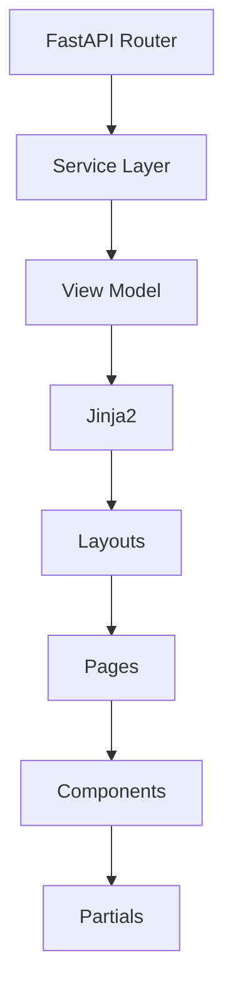

Los componentes nunca contienen reglas de negocio.

---

# 4. Definición de componente

Un componente es una unidad reutilizable de interfaz con una responsabilidad concreta.

Puede representar:

- un botón;
- una tarjeta;
- una tabla;
- un formulario;
- un badge;
- un diálogo;
- un selector;
- un panel;
- una barra de acciones.

Su comportamiento debe ser predecible y consistente.

---

# 5. Principios de diseño

Todo componente debe cumplir una serie de principios.

- Responsabilidad única.
- Alta cohesión.
- Bajo acoplamiento.
- Reutilización.
- Independencia del dominio.
- Accesibilidad.
- Configuración mediante parámetros.
- Facilidad de prueba.
- Compatibilidad con SSR.

---

# 6. Responsabilidad única

Cada componente debe resolver únicamente un problema.

Ejemplos correctos:

- botón de acción;
- tarjeta de proyecto;
- badge de estado;
- selector de organización.

Ejemplo incorrecto:

Un componente que:

- renderiza un formulario;
- realiza llamadas AJAX;
- valida permisos;
- consulta datos;
- modifica el DOM.

---

# 7. Reutilización

Un componente debe poder utilizarse desde distintas páginas.

Ejemplo:

```text
Project Card
```

Puede aparecer en:

- listado;
- dashboard;
- resultados de búsqueda;
- favoritos;
- página principal.

No debe depender de una única vista.

---

# 8. Configuración mediante parámetros

Los componentes reciben datos mediante parámetros.

Ejemplo conceptual:

```jinja2
{{ project_card.render(
    project=project,
    permissions=permissions
) }}
```

Nunca deben consultar directamente la base de datos.

---

# 9. Independencia del dominio

Siempre que sea posible, los componentes deben abstraerse del modelo de negocio.

En lugar de conocer:

```text
Proyecto
```

pueden trabajar con:

```text
Título

Descripción

Estado

Acciones
```

Esto incrementa su reutilización.

---

# 10. Arquitectura general

```mermaid
flowchart TD

Layout

↓

Page

↓

Component

↓

Subcomponent

↓

HTML
```

La interfaz se construye de forma jerárquica.

---

# 11. Organización recomendada

Una posible estructura es:

```text
templates/

components/

buttons/

cards/

dialogs/

forms/

tables/

badges/

navigation/

layout/

partials/
```

Cada directorio agrupa componentes relacionados.

---

# 12. Tipos de componentes

La plataforma distingue varias categorías.

| Categoría | Ejemplos |
|-----------|----------|
| Layout | Sidebar, Header |
| Navegación | Breadcrumbs |
| Acción | Botones |
| Información | Cards |
| Estado | Badges |
| Entrada | Formularios |
| Datos | Tablas |
| Feedback | Toasts |
| Interacción | Dialogs |

---

# 13. Componentes estructurales

Definen la organización de la página.

Ejemplos:

- Header;
- Sidebar;
- Footer;
- Main Layout;
- Toolbar;
- Container.

Su responsabilidad consiste en organizar el contenido.

---

# 14. Componentes funcionales

Representan funcionalidades reutilizables.

Ejemplos:

- formulario;
- tabla;
- diálogo;
- selector;
- búsqueda;
- paginación.

Normalmente reciben datos preparados por el backend.

---

# 15. Componentes visuales

Representan pequeños elementos gráficos.

Ejemplos:

- badge;
- icono;
- avatar;
- spinner;
- separador;
- etiqueta;
- contador.

Suelen reutilizarse cientos de veces.

---

# 16. Componentes compuestos

Un componente complejo puede construirse mediante otros componentes.

Ejemplo:

```mermaid
flowchart TD

Project Card

↓

Header

↓

Status Badge

↓

Owner

↓

Actions
```

Esto favorece la reutilización interna.

---

# 17. Jerarquía

La arquitectura sigue una composición progresiva.

```text
Layout

↓

Página

↓

Panel

↓

Card

↓

Botón
```

Cada nivel conoce únicamente a sus componentes hijos.

---

# 18. Tamaño recomendado

Los componentes deben mantener un tamaño razonable.

Como orientación:

- pequeños;
- fáciles de comprender;
- fácilmente reutilizables.

Cuando un componente supera claramente su responsabilidad, conviene dividirlo.

---

# 19. Nomenclatura

Los nombres deben describir claramente su finalidad.

Ejemplos:

```text
project-card.html

status-badge.html

confirm-dialog.html

user-avatar.html
```

Debe evitarse:

```text
component1.html

utils.html

misc.html
```

---

# 20. Ubicación

Los componentes reutilizables deben almacenarse en una ubicación común.

No deben permanecer ocultos dentro de una página concreta cuando pueden ser utilizados por otros módulos.

---

# 21. Componentes y macros

No todos los elementos requieren un componente completo.

Los elementos muy pequeños pueden implementarse como macros.

Ejemplos:

- botón;
- badge;
- icono;
- etiqueta;
- input.

Los componentes mayores suelen utilizar partials.

---

# 22. Macros

Las macros representan componentes ligeros.

Ejemplo:

```jinja2
{{ badge(
    label="Activo",
    variant="success"
) }}
```

Permiten reutilizar HTML repetitivo.

---

# 23. Partials

Los partials representan fragmentos HTML reutilizables.

Ejemplo:

```text
project-card.html
```

Puede contener:

- cabecera;
- descripción;
- acciones;
- badges;
- propietario.

---

# 24. Diferencias

| Macro | Partial |
|---------|----------|
| Muy pequeña | Más compleja |
| Similar a función | Similar a componente |
| Devuelve HTML | Renderiza fragmento |
| Poco estado | Más estructura |

Ambos mecanismos son complementarios.

---

# 25. Componentes de dominio

Algunos componentes representan entidades concretas.

Ejemplos:

- Project Card;
- Robot Card;
- Activity Row;
- User Summary.

Estos componentes sí conocen el dominio.

---

# 26. Componentes genéricos

Otros componentes son completamente reutilizables.

Ejemplos:

- botón;
- badge;
- modal;
- spinner;
- alerta;
- paginación.

Pueden emplearse en cualquier módulo.

---

# 27. View Models

Los componentes deben recibir información preparada.

```mermaid
flowchart TD

Repository

↓

Service

↓

View Model

↓

Component
```

El componente no transforma reglas de negocio.

---

# 28. Datos mínimos

Un componente debe recibir únicamente la información necesaria.

Incorrecto:

```text
Objeto enorme
```

Correcto:

```text
Título

Estado

Permisos

URL
```

Esto reduce acoplamiento.

---

# 29. Responsabilidades prohibidas

Un componente nunca debe:

- consultar la base de datos;
- validar autenticación;
- decidir permisos;
- realizar consultas HTTP;
- ejecutar SQL;
- aplicar lógica de negocio.

Todo ello pertenece a capas superiores.

---

# 30. Beneficios

El uso sistemático de patrones de componentes proporciona:

- reutilización;
- consistencia visual;
- menor mantenimiento;
- menor duplicación;
- mayor escalabilidad;
- pruebas más sencillas;
- evolución controlada;
- integración natural con Jinja2 y FastAPI.

---

# 31. Composición avanzada de componentes

La composición avanzada permite construir interfaces complejas mediante la combinación de componentes pequeños, especializados y reutilizables.

En lugar de diseñar grandes bloques monolíticos, cada pantalla se divide en capas de responsabilidad:

```text
Página

↓

Componente estructural

↓

Componente de dominio

↓

Componente visual

↓

Microcomponente
```

Este modelo favorece una evolución controlada de la interfaz.

---

# 32. Principio de composición

La composición debe preferirse frente a la duplicación y frente a la creación de componentes excesivamente configurables.

Ejemplo:

```text
Project Detail

├── Page Header
├── Status Badge
├── Action Bar
├── Information Grid
├── Activity Timeline
└── Attachment List
```

Cada bloque puede evolucionar de forma independiente.

---

# 33. Composición frente a herencia

En la capa de presentación se recomienda priorizar la composición.

La herencia de plantillas resulta adecuada para:

- layouts;
- estructuras globales;
- bloques de página;
- páginas de autenticación;
- variantes generales.

La composición resulta más apropiada para:

- tarjetas;
- tablas;
- filas;
- formularios;
- paneles;
- acciones;
- estados.

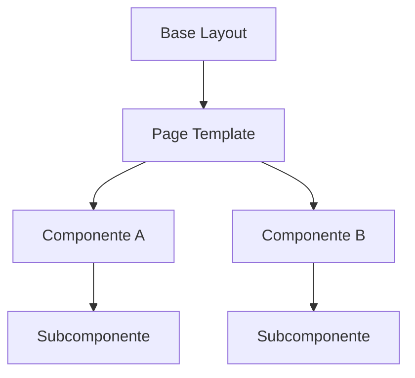

---

# 34. Ventajas de la composición

La composición aporta:

- mayor reutilización;
- menor acoplamiento;
- mejor legibilidad;
- pruebas más focalizadas;
- cambios locales;
- menor riesgo de efectos secundarios;
- facilidad para sustituir componentes.

---

# 35. Patrón Container / Presentational

La arquitectura puede diferenciar entre componentes contenedores y componentes de presentación.

| Tipo | Responsabilidad |
|---|---|
| Container | Recibir contexto y coordinar componentes |
| Presentational | Renderizar datos sin lógica funcional |

Este patrón ayuda a mantener la capa visual limpia.

---

# 36. Componentes contenedores

Un componente contenedor puede:

- recibir un View Model;
- seleccionar subcomponentes;
- determinar variantes visuales;
- organizar el layout;
- transmitir permisos;
- preparar propiedades simples.

No debe consultar directamente repositorios ni ejecutar reglas de negocio.

---

# 37. Componentes de presentación

Un componente de presentación:

- recibe datos simples;
- genera HTML;
- aplica estilos;
- muestra estados;
- emite acciones declarativas;
- no conoce la procedencia de los datos.

Ejemplo:

```jinja2
{{ status_badge(
    label=status.label,
    variant=status.variant,
    icon=status.icon
) }}
```

---

# 38. Flujo Container / Presentational

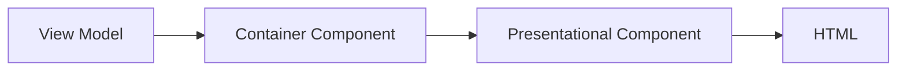

El componente de presentación puede reutilizarse desde varios contenedores.

---

# 39. Componentes inteligentes y componentes puros

En una arquitectura SSR, el equivalente a un componente inteligente es el componente que recibe un contexto más amplio y coordina otros elementos.

El componente puro recibe únicamente parámetros concretos y no depende de variables globales.

Ejemplo de componente puro:

```jinja2
{{ avatar(
    name=user.display_name,
    image_url=user.avatar_url,
    size="sm"
) }}
```

Ejemplo de componente acoplado:

```jinja2
{{ avatar(current_user) }}
```

La segunda opción puede ser válida en componentes exclusivamente globales, pero reduce la reutilización.

---

# 40. Preferencia por componentes puros

Siempre que resulte práctico, los componentes deben ser puros.

Esto significa que:

- la misma entrada genera la misma salida;
- no dependen de estado oculto;
- no modifican datos;
- no realizan efectos secundarios;
- no consultan servicios externos.

Este enfoque facilita las pruebas y la depuración.

---

# 41. Pattern Page Shell

El patrón **Page Shell** define la envoltura común de las páginas funcionales.

Puede incluir:

- título;
- breadcrumbs;
- acciones;
- descripción;
- contenido;
- panel auxiliar.

Ejemplo conceptual:

```jinja2

    
        {{ actions.create(...) }}
    

    
        <!-- Contenido -->
    

```

---

# 42. Pattern Section

Las páginas extensas deben dividirse en secciones reutilizables.

Una sección puede contener:

- título;
- descripción;
- acciones;
- cuerpo;
- estado vacío;
- contenido colapsable.

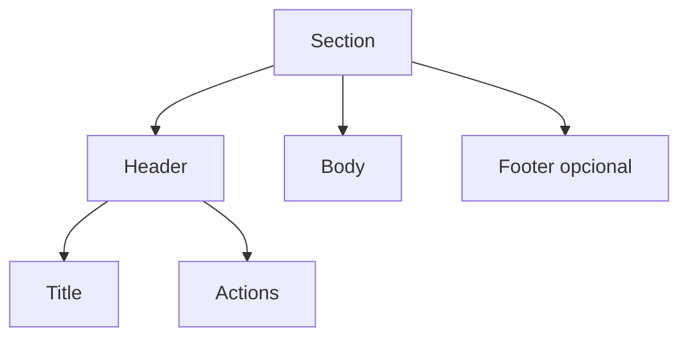

---

# 43. Pattern Card

Las tarjetas agrupan información relacionada dentro de un contenedor visual.

Variantes habituales:

- estándar;
- compacta;
- métrica;
- interactiva;
- seleccionable;
- informativa;
- de estado.

---

# 44. Anatomía de una tarjeta

```text
Card

├── Header
│   ├── Título
│   ├── Badge
│   └── Herramientas
├── Body
│   ├── Contenido
│   └── Datos
└── Footer
    └── Acciones
```

La tarjeta no debe contener información no relacionada con su propósito.

---

# 45. Card Component

Ejemplo conceptual:

```jinja2

    <p>{{ project.summary }}</p>

    
        {{ actions.view(...) }}
    

```

---

# 46. Tarjetas interactivas

Cuando toda la tarjeta es clicable, deben respetarse varias reglas:

- mantener un enlace semántico;
- no interferir con botones internos;
- conservar foco visible;
- proporcionar nombre accesible;
- evitar eventos globales innecesarios.

No debe utilizarse un `div` con `onclick` como sustituto de un enlace.

---

# 47. Pattern List Item

Los elementos de lista reutilizables pueden representar:

- usuarios;
- actividades;
- archivos;
- comentarios;
- eventos;
- notificaciones.

Su estructura habitual es:

```text
Icono o avatar

+

Contenido principal

+

Metadata

+

Acciones
```

---

# 48. Pattern Media Object

El patrón Media Object resulta útil para combinar una representación visual y contenido textual.

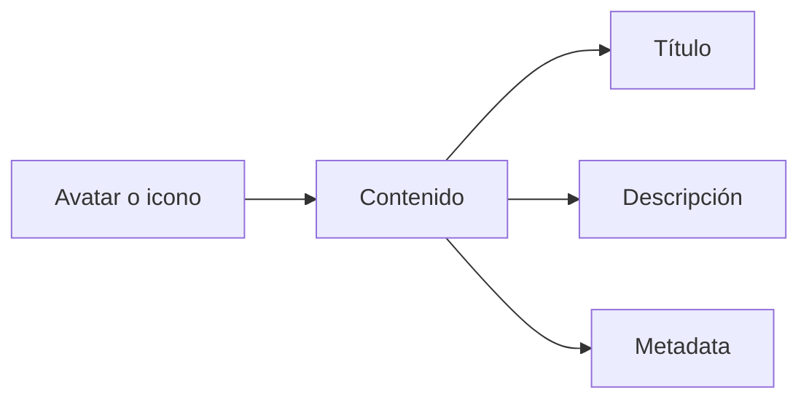

Casos habituales:

- usuario;
- comentario;
- actividad;
- archivo;
- robot;
- notificación.

---

# 49. Pattern Data Row

Las filas de datos deben estar normalizadas cuando se repiten en diferentes tablas.

Una fila puede recibir:

- identificador;
- datos visibles;
- estado;
- acciones;
- atributos de actualización;
- selección.

El componente debe evitar conocer la consulta que originó los datos.

---

# 50. Pattern Key-Value

La visualización de atributos puede reutilizar un patrón clave-valor.

Ejemplo:

```text
Responsable
María López

Fecha de creación
12/07/2026

Estado
Activo
```

Este patrón puede renderizarse como:

- lista;
- grid;
- definition list;
- tabla compacta.

---

# 51. Definition List Component

El elemento `dl` resulta apropiado para pares etiqueta-valor.

```html
<dl class="row">
    <dt class="col-sm-4">Responsable</dt>
    <dd class="col-sm-8">María López</dd>

    <dt class="col-sm-4">Estado</dt>
    <dd class="col-sm-8">Activo</dd>
</dl>
```

Su uso mejora la semántica frente a estructuras basadas únicamente en `div`.

---

# 52. Pattern Status

Los estados de dominio deben representarse mediante un componente común.

Puede incluir:

- label;
- variante;
- icono;
- descripción;
- fecha;
- motivo.

```jinja2
{{ status_component.render(
    status=project.status_ui
) }}
```

La traducción desde estado de negocio a estado visual debe prepararse previamente.

---

# 53. Pattern Empty State

Los estados vacíos deben tratarse como componentes de primer nivel.

Un estado vacío puede incluir:

- icono;
- título;
- descripción;
- acción;
- ayuda;
- filtros activos.

Ejemplo:

```text
No hay proyectos

Crea el primer proyecto para comenzar.

[Crear proyecto]
```

---

# 54. Variantes de Empty State

| Variante | Uso |
|---|---|
| Initial | Colección aún vacía |
| Filtered | No hay coincidencias |
| Search | Búsqueda sin resultados |
| Permission | No existen recursos visibles |
| Error | No se pudo cargar |
| Offline | Contenido no disponible sin conexión |

---

# 55. Pattern Loading State

Los componentes dinámicos deben compartir patrones de carga.

Opciones:

- spinner;
- skeleton;
- texto;
- overlay;
- progreso;
- placeholder.

La elección depende del tiempo previsto y del tipo de contenido.

---

# 56. Spinner

Adecuado para operaciones breves e indeterminadas.

```html
<div class="spinner-border" role="status">
    <span class="visually-hidden">Cargando...</span>
</div>
```

Debe incluir un texto accesible.

---

# 57. Skeleton

Los skeletons resultan útiles cuando se conoce la estructura aproximada del contenido.

Ventajas:

- reducen percepción de espera;
- conservan la geometría;
- evitan saltos visuales.

No deben simular datos falsos ni permanecer indefinidamente.

---

# 58. Pattern Error State

Los componentes deben disponer de un estado de error local.

Puede incluir:

- título;
- descripción;
- acción de reintento;
- identificador de incidencia;
- enlace de ayuda.

Ejemplo:

```text
No se pudo cargar la actividad.

[Reintentar]
```

---

# 59. Pattern Inline Alert

Las alertas persistentes se utilizan cuando el mensaje pertenece al contexto de la página.

Ejemplos:

- configuración incompleta;
- recurso bloqueado;
- conflicto;
- permisos limitados;
- información importante.

No deben sustituirse por Toasts si deben permanecer visibles.

---

# 60. Pattern Toolbar

Una toolbar agrupa controles relacionados.

Puede contener:

- búsqueda;
- filtros;
- cambio de vista;
- acciones masivas;
- ordenación;
- exportación.

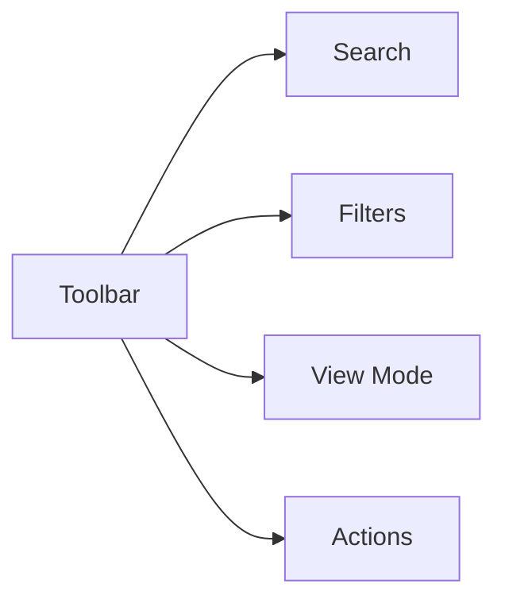

Debe adaptarse a pantallas pequeñas.

---

# 61. Pattern Action Group

Las acciones relacionadas pueden agruparse mediante:

- botones contiguos;
- dropdown;
- split button;
- menú contextual;
- barra inferior.

La agrupación debe reflejar afinidad funcional.

---

# 62. Pattern Primary Action

Cada pantalla debe identificar una acción principal.

Ejemplos:

- crear proyecto;
- guardar cambios;
- iniciar actividad;
- publicar;
- confirmar.

La acción principal debe destacar sin competir con acciones secundarias.

---

# 63. Pattern Destructive Action

Las acciones destructivas deben utilizar:

- estilo danger;
- texto claro;
- confirmación;
- consecuencias;
- registro de auditoría;
- autorización backend.

Ejemplos:

- eliminar;
- revocar;
- desactivar;
- purgar;
- cerrar definitivamente.

---

# 64. Pattern Progressive Disclosure

La información secundaria puede ocultarse hasta que resulte necesaria.

Herramientas:

- acordeones;
- pestañas;
- paneles colapsables;
- menús;
- enlaces “Ver más”.

Este patrón reduce sobrecarga visual, pero no debe ocultar información esencial.

---

# 65. Pattern Tabs

Las pestañas organizan contenido paralelo dentro de un mismo recurso.

Ejemplos:

- resumen;
- miembros;
- actividad;
- archivos;
- auditoría;
- configuración.

Deben:

- indicar estado activo;
- admitir teclado;
- mantener URL cuando proceda;
- evitar un número excesivo de opciones.

---

# 66. Pattern Accordion

Los acordeones resultan adecuados para:

- ayuda;
- configuraciones avanzadas;
- grupos de campos;
- preguntas frecuentes;
- información secundaria.

No deben utilizarse cuando el usuario necesita comparar varias secciones simultáneamente.

---

# 67. Pattern Stepper

Los procesos largos pueden dividirse en pasos.

Ejemplos:

- creación de actividad;
- configuración de robot;
- importación;
- alta de organización.

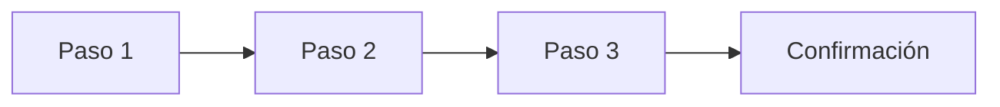

Debe quedar claro:

- paso actual;
- pasos completados;
- errores;
- posibilidad de volver;
- progreso.

---

# 68. Pattern Wizard

Un Wizard amplía el Stepper con estado y validación entre etapas.

Debe utilizarse únicamente cuando el proceso no pueda resolverse razonablemente en un único formulario.

La lógica de negocio continúa en el backend.

---

# 69. Pattern Form Field

Todos los campos deben compartir una estructura consistente.

```text
Label

Control

Help text

Error
```

Cada campo debe resolver:

- identificación;
- valor;
- obligatoriedad;
- descripción;
- error;
- estado disabled;
- accesibilidad.

---

# 70. Pattern Form Group

Los campos relacionados se agrupan semánticamente.

Ejemplo:

```text
Información personal

├── Nombre
├── Apellidos
├── Correo
└── Teléfono
```

Puede utilizarse `fieldset` con `legend`.

---

# 71. Pattern Form Actions

El pie de formulario debe mantener una estructura homogénea.

```text
[Guardar] [Cancelar]
```

Las acciones deben adaptarse al contexto:

- creación;
- edición;
- configuración;
- wizard;
- modal.

---

# 72. Pattern Search

El componente de búsqueda puede incluir:

- input;
- botón;
- icono;
- limpieza;
- texto de resultados;
- submit automático opcional.

En SSR debe utilizar normalmente parámetros GET.

---

# 73. Pattern Filter Panel

Los filtros pueden mostrarse:

- inline;
- en sidebar;
- en dropdown;
- en offcanvas;
- en panel colapsable.

La elección depende del número de filtros y del tamaño de pantalla.

---

# 74. Pattern Active Filters

Los filtros activos deben representarse como chips o etiquetas eliminables.

Ejemplo:

```text
Estado: Activo ×
Tipo: Taller ×
Responsable: María ×
```

Debe existir una acción para limpiar todos los filtros.

---

# 75. Pattern Pagination

La paginación debe centralizar:

- anterior;
- siguiente;
- páginas;
- total;
- rango;
- tamaño de página;
- conservación de filtros.

La variante compacta puede utilizarse en componentes pequeños.

---

# 76. Pattern Avatar

El componente avatar puede mostrar:

- imagen;
- iniciales;
- icono;
- estado de conexión;
- tamaño;
- tooltip.

Debe incluir un texto alternativo cuando la imagen aporte información.

---

# 77. Avatar Fallback

Cuando no existe imagen:

```text
Francisco Ramírez

↓

FR
```

Las iniciales deben calcularse en el backend o en un helper controlado.

---

# 78. Pattern Icon

Los iconos deben centralizarse para evitar inconsistencias.

Un helper puede recibir:

- nombre semántico;
- tamaño;
- variante;
- texto accesible;
- estado decorativo.

Ejemplo:

```jinja2
{{ icon("edit", decorative=True) }}
```

El componente resuelve la clase real de Font Awesome.

---

# 79. Iconografía semántica

La aplicación debe mantener una correspondencia uniforme.

| Acción | Icono conceptual |
|---|---|
| Crear | Plus |
| Editar | Pencil |
| Eliminar | Trash |
| Guardar | Save |
| Volver | Arrow left |
| Descargar | Download |
| Ver | Eye |
| Configurar | Gear |

No deben emplearse iconos distintos para una misma acción sin motivo.

---

# 80. Pattern Metadata

La metadata secundaria puede incluir:

- fecha;
- autor;
- categoría;
- identificador;
- versión;
- tamaño.

Debe presentarse con menor jerarquía visual, pero conservar contraste suficiente.

---

# 81. Pattern Timeline

Las líneas temporales agrupan eventos cronológicos.

Cada elemento debe incluir:

- icono;
- actor;
- acción;
- recurso;
- fecha;
- detalle;
- enlace opcional.

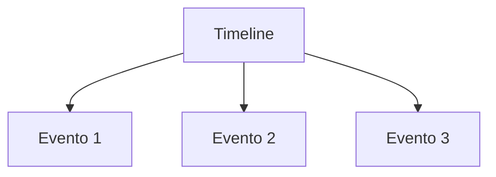

---

# 82. Pattern Activity Feed

El feed de actividad puede ser:

- paginado;
- incremental;
- actualizado por WebSocket;
- filtrable;
- agrupado por fecha.

Debe diferenciar eventos relevantes de cambios técnicos internos.

---

# 83. Pattern File Item

Los archivos adjuntos pueden representarse mediante un componente común.

Información habitual:

- icono de tipo;
- nombre;
- tamaño;
- fecha;
- autor;
- acciones;
- estado de subida.

---

# 84. Pattern Progress

Los procesos con avance conocido deben utilizar una barra de progreso.

Ejemplos:

- carga;
- importación;
- generación;
- sincronización;
- procesamiento.

Debe incluir:

- porcentaje;
- estado textual;
- resultado;
- error.

---

# 85. Pattern Metric Card

Las métricas deben mostrar:

- valor;
- etiqueta;
- periodo;
- tendencia;
- contexto;
- enlace.

Ejemplo:

```text
24

Actividades activas

+12 % este mes
```

La tendencia no debe depender únicamente del color.

---

# 86. Pattern Stat Group

Varias métricas relacionadas pueden agruparse.

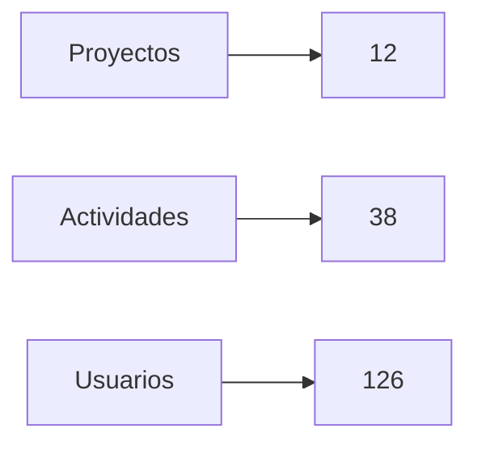

El grupo debe mantener alineación y jerarquía uniforme.

---

# 87. Pattern Feature Flag

Los componentes experimentales pueden depender de flags.

```jinja2

    

```

El backend debe impedir también el acceso cuando la funcionalidad no esté habilitada.

---

# 88. Pattern Permission Gate

La visibilidad de componentes puede depender de permisos preparados previamente.

```jinja2

    

```

El componente no debe calcular el permiso.

---

# 89. Pattern Disabled with Reason

En ocasiones conviene mostrar una acción deshabilitada con explicación.

```text
[Publicar — deshabilitado]

Faltan datos obligatorios.
```

Este patrón mejora la comprensión frente a ocultar siempre la acción.

---

# 90. Pattern Responsive Variant

Un mismo componente puede ofrecer variantes para diferentes tamaños.

Ejemplo:

```text
Desktop:
Tabla

Mobile:
Card list
```

Ambas variantes deben representar la misma información esencial.

---

# 91. Integración con JavaScript

Los componentes interactivos deben declarar su comportamiento mediante atributos `data-*`.

Ejemplo:

```html
<button
    data-dialog="confirm-delete"
    data-resource-id="42"
    data-action-url="/projects/42/delete"
>
    Eliminar
</button>
```

JavaScript debe inicializar el comportamiento sin acoplarse a la estructura interna innecesariamente.

---

# 92. Component Bootstrapping

La inicialización puede realizarse mediante un registro.

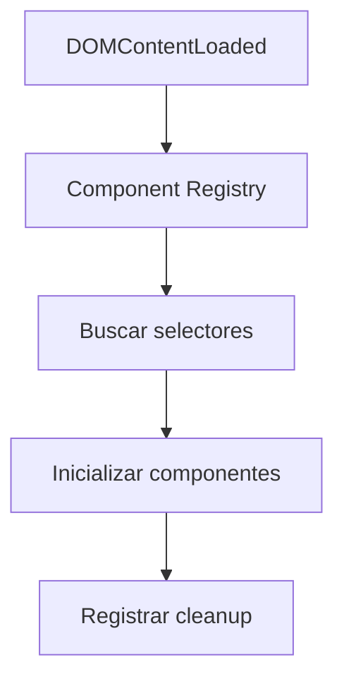

Cada módulo debe ser responsable de su propio ciclo de vida.

---

# 93. Contrato HTML–JavaScript

El contrato debe documentar:

- selector;
- atributos;
- eventos;
- estados;
- clases;
- respuestas esperadas.

Ejemplo:

```text
Component:
Confirm Action

Selector:
[data-dialog="confirm-delete"]

Required data:
action-url
resource-name

Optional data:
confirm-text
```

---

# 94. Custom Events

Los componentes pueden comunicarse mediante eventos personalizados.

Ejemplo:

```javascript
document.dispatchEvent(
    new CustomEvent("project:updated", {
        detail: {
            projectId: 42
        }
    })
);
```

Esto reduce el acoplamiento directo entre módulos.

---

# 95. Event Naming

Los eventos deben seguir una convención.

```text
domain:action

project:updated
activity:created
dialog:confirmed
toast:shown
websocket:connected
```

Los nombres deben ser estables y descriptivos.

---

# 96. Component State

Los componentes dinámicos pueden manejar estados como:

- idle;
- loading;
- success;
- error;
- disabled;
- empty;
- offline.

El estado debe reflejarse en:

- clases;
- atributos ARIA;
- contenido;
- controles disponibles.

---

# 97. State Machine

Los componentes complejos pueden modelarse como máquinas de estado.

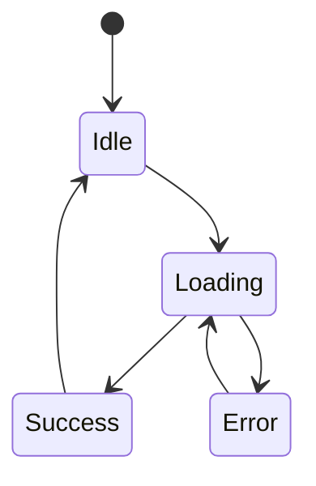

Este enfoque evita transiciones incoherentes.

---

# 98. Integración con SSR

Los componentes reciben un estado inicial renderizado por el servidor.

JavaScript puede enriquecerlo posteriormente.

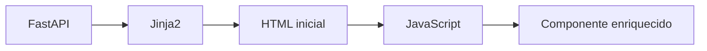

La interfaz no depende de JavaScript para mostrar su contenido principal.

---

# 99. Hydration ligera

La plataforma no necesita una hidratación completa como una SPA.

Solo se inicializan los componentes interactivos.

Ejemplos:

- diálogos;
- toasts;
- filtros automáticos;
- WebSockets;
- selectores;
- cargas de archivos.

Este enfoque reduce complejidad y peso.

---

# 100. Integración con WebSockets

Los componentes pueden suscribirse a eventos en tiempo real.

Ejemplos:

- contador;
- actividad;
- estado;
- progreso;
- presencia;
- notificación.

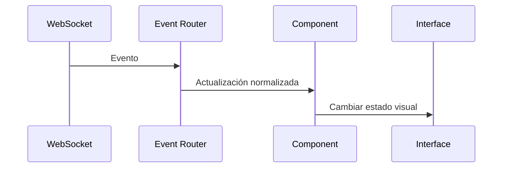

---

# 101. Suscripciones por componente

Cada componente debe escuchar únicamente eventos relevantes.

Debe evitarse:

- reenviar todos los eventos a todos los componentes;
- actualizar toda la página;
- duplicar suscripciones;
- mantener listeners de componentes eliminados.

---

# 102. Actualización selectiva

Una actualización en tiempo real debe localizar el componente mediante:

- tipo de recurso;
- identificador;
- clave de componente;
- topic.

Ejemplo:

```html
<article
    data-component="project-card"
    data-project-id="42"
>
</article>
```

El Event Router puede actualizar únicamente esa tarjeta.

---

# 103. Reconciliación de estado

Cuando llega un evento, el componente debe verificar:

- versión;
- timestamp;
- procedencia;
- estado actual;
- duplicidad.

Esto evita aplicar eventos antiguos sobre información más reciente.

---

# 104. Componentes desconectados

Cuando la conexión WebSocket se pierde, los componentes pueden:

- mostrar estado offline;
- conservar datos existentes;
- desactivar acciones dependientes;
- solicitar sincronización al reconectar.

No deben eliminar contenido válido por una desconexión temporal.

---

# 105. Accesibilidad de componentes

Todos los patrones deben incorporar accesibilidad desde su definición.

Esto incluye:

- semántica HTML;
- teclado;
- foco;
- nombres accesibles;
- contraste;
- estados ARIA;
- texto alternativo;
- mensajes comprensibles.

La accesibilidad no debe añadirse individualmente en cada uso.

---

# 106. Accesibilidad por defecto

Las macros deben generar atributos correctos por defecto.

Ejemplo:

```jinja2
{{ icon_button(
    icon="edit",
    label="Editar proyecto",
    url=edit_url
) }}
```

El componente añade automáticamente:

- `aria-label`;
- foco visible;
- título cuando proceda;
- icono decorativo.

---

# 107. Componentes y teclado

Los componentes interactivos deben utilizar elementos nativos siempre que sea posible.

Preferencias:

```text
button
a
input
select
details
summary
```

frente a:

```text
div con click
span con eventos
```

Los elementos nativos ofrecen comportamiento accesible de forma predeterminada.

---

# 108. Componentes dinámicos y ARIA

Los estados dinámicos pueden requerir:

```html
aria-expanded
aria-selected
aria-disabled
aria-busy
aria-live
aria-current
```

Estos atributos deben reflejar el estado real.

---

# 109. Rendimiento de componentes

La componentización no debe generar una estructura innecesariamente pesada.

Debe controlarse:

- profundidad del DOM;
- número de macros;
- repeticiones;
- listeners;
- estilos;
- renderizado de colecciones;
- inicialización JavaScript.

---

# 110. Lazy Initialization

Los componentes costosos pueden inicializarse cuando:

- entran en viewport;
- se abre una pestaña;
- se activa un acordeón;
- el usuario interactúa;
- se necesita el recurso.

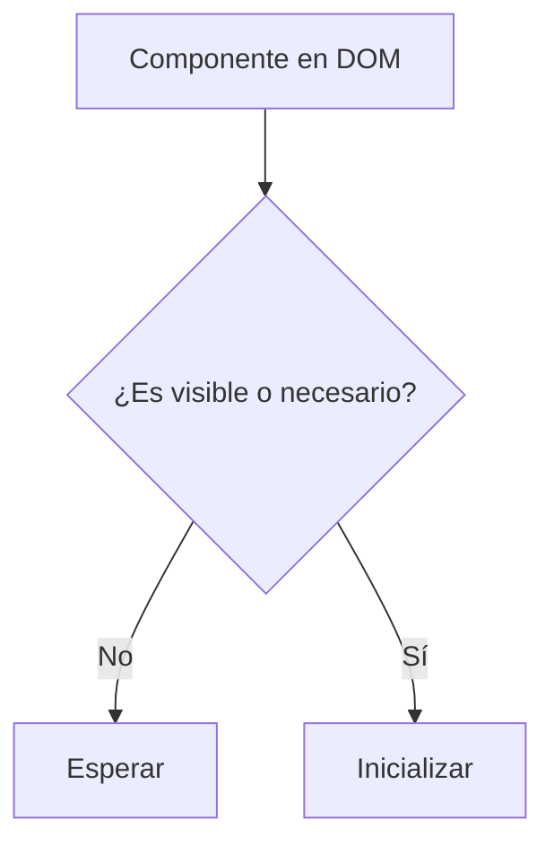

---

# 111. Degradación controlada

Cuando un módulo JavaScript falla, el componente debe conservar una versión básica utilizable cuando sea posible.

Ejemplos:

- formulario convencional;
- enlace normal;
- tabla SSR;
- descarga directa;
- submit estándar.

---

# 112. Component Registry

La arquitectura puede centralizar componentes interactivos mediante un registro.

Ejemplo conceptual:

```javascript
componentRegistry.register(
    "confirm-action",
    "[data-component='confirm-action']",
    ConfirmAction
);
```

El registro se encarga de localizar e inicializar instancias.

---

# 113. Lifecycle Hooks

Los componentes JavaScript pueden implementar:

```text
mount
update
destroy
```

Responsabilidades:

| Hook | Uso |
|---|---|
| mount | Registrar eventos e inicializar |
| update | Aplicar cambios |
| destroy | Eliminar listeners y recursos |

---

# 114. Cleanup

La limpieza resulta obligatoria cuando un componente se reemplaza dinámicamente.

Debe cancelar:

- event listeners;
- timers;
- observers;
- peticiones;
- suscripciones;
- referencias DOM.

Esto evita fugas de memoria y comportamientos duplicados.

---

# 115. Testing de componentes

Los componentes deben probarse según su complejidad.

Niveles:

- macros;
- renderizado;
- comportamiento JavaScript;
- integración;
- accesibilidad;
- responsive;
- End-to-End.

---

# 116. Pruebas de macros

Deben comprobar:

- parámetros;
- valores por defecto;
- variantes;
- atributos;
- escape;
- accesibilidad;
- resultado HTML.

Ejemplos prioritarios:

- button;
- badge;
- icon;
- field;
- pagination.

---

# 117. Pruebas de renderizado

Los componentes de dominio deben verificar:

- datos visibles;
- ausencia de datos sensibles;
- acciones;
- estados;
- permisos;
- fallback;
- contenido vacío.

---

# 118. Pruebas de interacción

Los componentes JavaScript deben probar:

- inicialización;
- eventos;
- estados;
- errores;
- cleanup;
- llamadas;
- actualización.

---

# 119. Pruebas de contrato

Debe comprobarse que el HTML genera los atributos esperados por JavaScript.

Ejemplo:

```text
data-component
data-resource-id
data-action-url
```

Un cambio no coordinado puede romper silenciosamente la interacción.

---

# 120. Pruebas visuales

Los componentes críticos pueden utilizar pruebas de regresión visual.

Casos adecuados:

- botones;
- formularios;
- tarjetas;
- modales;
- toasts;
- navegación;
- tablas.

Las diferencias deben revisarse antes de aceptar cambios.

---

# 121. Pruebas de accesibilidad

Cada componente debe validar:

- nombre accesible;
- orden de foco;
- roles;
- estados;
- contraste;
- teclado;
- lectura comprensible.

Los componentes globales requieren mayor cobertura.

---

# 122. Documentación de componentes

Cada componente debe documentar:

- objetivo;
- parámetros;
- variantes;
- estados;
- ejemplo;
- accesibilidad;
- eventos;
- restricciones;
- dependencias.

---

# 123. Ficha de componente

Ejemplo:

```text
Nombre:
Status Badge

Propósito:
Representar un estado de dominio.

Parámetros:
label
variant
icon
description

Variantes:
success
warning
danger
secondary

Accesibilidad:
Texto siempre visible.
Color no exclusivo.
```

---

# 124. Catálogo visual

La arquitectura puede incorporar una página interna que muestre:

- componentes;
- variantes;
- estados;
- ejemplos;
- código;
- accesibilidad.

Este catálogo facilita desarrollo, QA y diseño.

---

# 125. Design Tokens

Los componentes deben apoyarse progresivamente en tokens de diseño.

Categorías:

- color;
- spacing;
- typography;
- radius;
- shadow;
- motion;
- breakpoint;
- z-index.

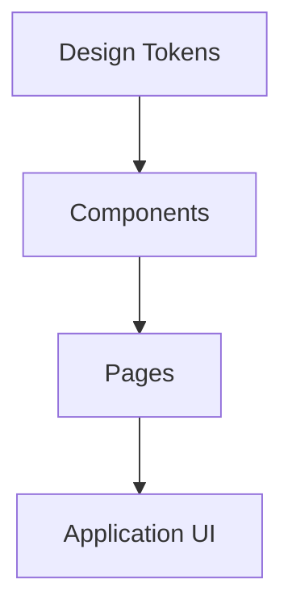

---

# 126. Tokens de color

Los colores deben definirse semánticamente.

Ejemplos:

```text
color-primary
color-success
color-warning
color-danger
color-surface
color-border
color-text-muted
```

Debe evitarse que cada componente utilice valores arbitrarios.

---

# 127. Tokens de espaciado

El sistema puede utilizar una escala consistente.

```text
xs
sm
md
lg
xl
```

Esto mejora la armonía visual y reduce CSS específico.

---

# 128. Tokens de tipografía

Los componentes deben compartir:

- familias;
- tamaños;
- pesos;
- altura de línea;
- jerarquías.

No deben introducirse tamaños nuevos sin una necesidad justificada.

---

# 129. Variantes de componentes

Las variantes deben responder a necesidades reales.

Ejemplo:

```text
Button

├── primary
├── secondary
├── danger
├── outline
└── icon
```

Debe evitarse crear demasiadas variantes combinatorias.

---

# 130. API de componentes

La API de una macro o componente debe ser:

- pequeña;
- estable;
- legible;
- coherente;
- con valores por defecto.

Una macro con decenas de parámetros puede indicar una abstracción incorrecta.

---

# 131. Slots y bloques

Los componentes complejos pueden admitir contenido variable mediante `call`.

Ejemplo:

```jinja2

    <p>Contenido variable</p>

```

Esto proporciona flexibilidad sin duplicar la estructura.

---

# 132. Parámetros frente a slots

Se recomienda utilizar:

- parámetros para datos simples;
- slots para contenido estructurado.

Ejemplo:

```text
Parámetro:
title

Slot:
card body
```

---

# 133. Componentes demasiado genéricos

Un componente excesivamente genérico puede resultar difícil de comprender.

Ejemplo problemático:

```text
UniversalBox
```

con múltiples flags:

```text
showHeader
showFooter
isTable
isForm
isModal
isCompact
```

Es preferible crear componentes con semántica clara.

---

# 134. Abstracción prematura

No todo fragmento repetido una vez debe convertirse inmediatamente en componente.

Se recomienda abstraer cuando:

- aparece varias veces;
- existe una semántica clara;
- el cambio debe propagarse;
- la duplicación empieza a divergir.

---

# 135. Regla de promoción

Un componente local puede promoverse a global cuando:

- se usa en más de un dominio;
- su API es estable;
- no depende de reglas específicas;
- tiene valor transversal;
- dispone de documentación.

---

# 136. Deprecación de componentes

Los componentes obsoletos deben marcarse y retirarse de forma controlada.

Proceso:


Debe evitarse mantener indefinidamente variantes antiguas.

---

# 137. Versionado interno

Los cambios incompatibles pueden requerir:

- nueva macro;
- variante temporal;
- migración;
- changelog;
- actualización de documentación.

La capa UI debe evolucionar sin romper módulos inesperadamente.

---

# 138. Revisión de componentes

Toda revisión debe comprobar:

- responsabilidad;
- reutilización;
- API;
- accesibilidad;
- responsive;
- seguridad;
- rendimiento;
- testing;
- documentación.

---

# 139. Seguridad

Los componentes deben escapar contenido dinámico.

Debe limitarse:

```jinja2
|safe
```

También debe evitarse:

- construir HTML desde texto no confiable;
- aceptar URLs arbitrarias;
- incluir eventos inline;
- exponer secretos;
- serializar datos sensibles en atributos.

---

# 140. Sanitización

Los componentes que muestren contenido enriquecido deben recibir información sanitizada.

Ejemplos:

- descripciones HTML;
- comentarios enriquecidos;
- documentación;
- contenido generado.

La sanitización debe realizarse antes del renderizado.

---

# 141. Datos en atributos

Los atributos `data-*` no deben utilizarse para almacenar objetos sensibles o grandes volúmenes.

Son adecuados para:

- identificadores;
- URLs;
- flags;
- nombres breves;
- configuración simple.

---

# 142. Integración con permisos

Los componentes reciben permisos resueltos.

Ejemplo:

```jinja2
{{ project_actions(
    project=project,
    can_view=permissions.can_view,
    can_edit=permissions.can_edit,
    can_delete=permissions.can_delete
) }}
```

El backend sigue siendo responsable de autorizar la petición.

---

# 143. Observabilidad

Los componentes interactivos pueden emitir eventos de diagnóstico.

Ejemplos:

```text
component:mounted
component:error
dialog:opened
toast:shown
upload:failed
```

La instrumentación debe limitarse a componentes relevantes.

---

# 144. Métricas de calidad

Pueden medirse:

- reutilización;
- duplicación;
- número de variantes;
- cobertura;
- accesibilidad;
- errores;
- peso JavaScript;
- complejidad del DOM.

Estas métricas ayudan a detectar degradación arquitectónica.

---

# 145. Flujo completo de componente interactivo

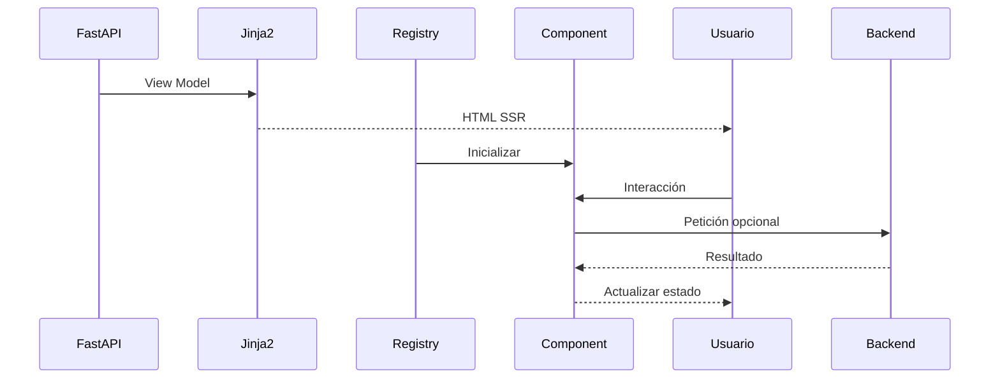

---

# 146. Gobierno de componentes

A medida que la plataforma crece, el número de componentes también aumenta. Para evitar inconsistencias y duplicidades es necesario establecer un modelo de gobierno que regule su creación, evolución y retirada.

Los objetivos principales son:

- evitar componentes redundantes;
- mantener una API coherente;
- controlar la evolución del catálogo;
- facilitar la reutilización;
- preservar la compatibilidad.

---

# 147. Ciclo de vida de un componente

Todo componente atraviesa un ciclo de vida definido.

```mermaid
flowchart LR
    A[Diseño] --> B[Implementación]
    B --> C[Documentación]
    C --> D[Reutilización]
    D --> E[Mantenimiento]
    E --> F[Deprecación]
    F --> G[Eliminación]
```

Cada fase debe quedar documentada para facilitar la evolución del sistema.

---

# 148. Criterios para crear un nuevo componente

Antes de crear un componente nuevo debe comprobarse:

- si ya existe uno equivalente;
- si puede extenderse uno existente;
- si el nuevo componente aporta una responsabilidad claramente diferenciada;
- si tendrá reutilización futura;
- si su API puede mantenerse estable.

No toda repetición puntual justifica la creación de un componente nuevo.

---

# 149. Criterios de reutilización

Un componente debe promoverse al catálogo común cuando:

- aparece en varios módulos;
- mantiene una semántica estable;
- tiene suficiente cohesión;
- resulta independiente del dominio específico;
- mejora la consistencia visual.

---

# 150. Versionado de componentes

Los cambios incompatibles deben gestionarse cuidadosamente.

Opciones habituales:

- mantener compatibilidad;
- crear una nueva variante;
- introducir una nueva versión;
- planificar la migración;
- eliminar la versión antigua tras un periodo de convivencia.

El cambio debe minimizar el impacto sobre las páginas existentes.

---

# 151. Catálogo de componentes

El proyecto puede mantener un catálogo interno con todos los componentes disponibles.

Ejemplo conceptual:

```text
Components/

Buttons
Cards
Forms
Tables
Dialogs
Toasts
Badges
Navigation
Layout
Timeline
Progress
Files
Charts
```

Este catálogo facilita la localización y reutilización.

---

# 152. Arquitectura del catálogo

```mermaid
flowchart TD
    A[Component Library]
    --> B[Layout]
    --> C[Navigation]
    --> D[Forms]
    --> E[Tables]
    --> F[Cards]
    --> G[Dialogs]
    --> H[Feedback]
```

Cada categoría mantiene una responsabilidad claramente diferenciada.

---

# 153. Documentación de componentes

Todo componente debería disponer de una ficha técnica con:

- propósito;
- parámetros;
- variantes;
- ejemplos;
- dependencias;
- eventos;
- requisitos de accesibilidad;
- capturas o diagramas cuando aporten valor.

La documentación debe evolucionar junto al código.

---

# 154. Convenciones de nombres

Los nombres deben seguir una nomenclatura uniforme.

Ejemplos recomendados:

```text
project-card.html
status-badge.html
user-avatar.html
confirm-dialog.html
progress-bar.html
```

Evitar nombres ambiguos:

```text
widget.html
common.html
misc.html
box.html
```

---

# 155. Organización de carpetas

Una estructura recomendada puede ser:

```text
templates/
└── components/
    ├── actions/
    ├── badges/
    ├── buttons/
    ├── cards/
    ├── dialogs/
    ├── forms/
    ├── layout/
    ├── navigation/
    ├── tables/
    ├── timeline/
    ├── upload/
    └── feedback/
```

La organización debe responder a responsabilidades funcionales y no únicamente al orden alfabético.

---

# 156. Separación de responsabilidades

Cada componente debe separar claramente:

- estructura HTML;
- estilos CSS;
- comportamiento JavaScript;
- configuración;
- documentación.

```mermaid
flowchart TD
    A[Component]
    --> B[HTML]
    --> C[CSS]
    --> D[JavaScript]
    --> E[Documentation]
```

---

# 157. Estilos asociados

Los estilos específicos deben mantenerse próximos conceptualmente al componente, aunque formen parte del sistema global de hojas de estilo.

Ejemplo:

```text
static/
└── css/
    └── components/
        ├── buttons.css
        ├── cards.css
        ├── dialogs.css
        ├── timeline.css
        └── upload.css
```

Debe evitarse una única hoja de miles de líneas.

---

# 158. JavaScript asociado

El comportamiento interactivo también puede organizarse por componente.

```text
static/
└── js/
    └── components/
        ├── dialog-manager.js
        ├── toast-manager.js
        ├── upload.js
        ├── filters.js
        └── pagination.js
```

Cada módulo debe encargarse únicamente de su propia funcionalidad.

---

# 159. Component Registry

Todos los componentes JavaScript pueden registrarse mediante un mecanismo común.

```mermaid
flowchart TD
    A[DOMContentLoaded]
    --> B[Component Registry]
    --> C[Buttons]
    --> D[Dialogs]
    --> E[Toasts]
    --> F[Upload]
    --> G[Timeline]
```

Este enfoque simplifica la inicialización de nuevos módulos.

---

# 160. Inicialización progresiva

No todos los componentes requieren inicialización inmediata.

La arquitectura puede utilizar:

- lazy loading;
- Intersection Observer;
- eventos de usuario;
- carga diferida;
- inicialización bajo demanda.

Esto mejora el rendimiento inicial de la aplicación.

---

# 161. Integración con el Design System

Los componentes representan la implementación práctica del Design System.

```mermaid
flowchart TD
    A[Design Tokens]
    --> B[Component Library]
    --> C[Pages]
    --> D[Application]
```

El Design System define las reglas; los componentes las materializan.

---

# 162. Consistencia visual

Todos los componentes deben compartir:

- tipografía;
- colores;
- espaciado;
- radios;
- sombras;
- iconografía;
- animaciones;
- jerarquía visual.

La consistencia reduce la carga cognitiva del usuario.

---

# 163. Consistencia funcional

Las mismas acciones deben comportarse de forma equivalente en toda la aplicación.

Ejemplos:

- un botón "Guardar" siempre confirma cambios;
- un botón "Eliminar" siempre solicita confirmación;
- un Toast de éxito siempre utiliza el mismo estilo;
- los errores mantienen una presentación uniforme.

---

# 164. Integración con autenticación

Los componentes relacionados con la sesión pueden reutilizar:

- avatar;
- menú de usuario;
- selector de organización;
- cambio de idioma;
- cierre de sesión.

Todos deben depender únicamente del contexto preparado por el backend.

---

# 165. Integración con RBAC

La visibilidad de los componentes debe resolverse mediante permisos ya calculados.

```jinja2

    

```

El componente no debe contener lógica compleja de autorización.

---

# 166. Integración con Context Injection

Los componentes globales pueden utilizar datos inyectados en el contexto, como:

- usuario autenticado;
- organización activa;
- permisos;
- configuración;
- navegación.

La dependencia debe mantenerse limitada a componentes verdaderamente globales.

---

# 167. Integración con WebSockets

Los componentes preparados para tiempo real deben exponer puntos claros de actualización.

Ejemplo:

```html
<div
    data-component="project-status"
    data-project-id="42"
></div>
```

El Event Router puede localizar y actualizar únicamente el componente afectado.

---

# 168. Integración con HTMX (futura)

La arquitectura permite incorporar HTMX para sustituir parcialmente contenido SSR.

Ejemplo:

```mermaid
flowchart LR
    A[Usuario] --> B[HTMX Request]
    B --> C[FastAPI]
    C --> D[Partial Jinja2]
    D --> E[Actualizar componente]
```

Los componentes existentes pueden reutilizarse sin modificaciones profundas.

---

# 169. Internacionalización

Los componentes no deberían contener textos incrustados.

En su lugar, deberían utilizar:

- claves de traducción;
- helpers;
- filtros;
- recursos localizados.

Esto facilita la futura incorporación de múltiples idiomas.

---

# 170. Temas visuales

Los componentes deben adaptarse a distintos temas sin modificar su estructura.

Ejemplos:

- claro;
- oscuro;
- alto contraste.

La personalización debe apoyarse en variables de diseño y no en duplicar componentes.

---

# 171. Observabilidad

Los componentes interactivos pueden emitir eventos para análisis y depuración.

Ejemplos:

- componente inicializado;
- error de renderizado;
- acción ejecutada;
- tiempo de respuesta;
- fallo de actualización.

La observabilidad debe ser configurable y no afectar al comportamiento funcional.

---

# 172. Integración con Auditoría

Determinadas acciones iniciadas desde componentes pueden generar eventos auditables.

Ejemplos:

- eliminación;
- publicación;
- cambio de permisos;
- exportación.

La auditoría corresponde al backend, pero el componente puede proporcionar el contexto necesario.

---

# 173. Seguridad

Los componentes deben aplicar por defecto:

- escape de contenido;
- URLs seguras;
- atributos `rel` adecuados;
- validación de parámetros;
- ausencia de HTML arbitrario;
- integración con CSP.

El componente nunca debe asumir que los datos recibidos son seguros.

---

# 174. Rendimiento

Los componentes deben minimizar:

- profundidad del DOM;
- renderizados innecesarios;
- duplicación de listeners;
- cálculos repetitivos;
- carga de recursos no utilizados.

Las optimizaciones deben realizarse sin comprometer la claridad del código.

---

# 175. Compatibilidad con Docker y despliegue

Los componentes forman parte del código fuente de la aplicación y se despliegan junto con:

- plantillas;
- recursos estáticos;
- módulos JavaScript;
- hojas de estilo.

No requieren infraestructura específica adicional.

---

# 176. Integración con CI/CD

Los cambios en componentes deben validarse mediante la canalización de integración continua.

Las comprobaciones pueden incluir:

- linting;
- pruebas unitarias;
- pruebas de integración;
- accesibilidad;
- cobertura;
- análisis estático.

El objetivo es detectar regresiones antes del despliegue.

---

# 177. Métricas de calidad

Algunos indicadores útiles son:

| Métrica | Objetivo |
|---|---|
| Componentes reutilizados | Incrementar reutilización |
| Componentes duplicados | Reducir duplicación |
| Cobertura de pruebas | Aumentar confianza |
| Complejidad media | Mantener simplicidad |
| Errores de accesibilidad | Reducir incidencias |

Estas métricas ayudan a controlar la evolución del catálogo.

---

# 178. Revisión de código

Toda incorporación de un nuevo componente debería revisar:

- responsabilidad;
- API;
- documentación;
- accesibilidad;
- responsive;
- pruebas;
- reutilización;
- consistencia con el Design System.

La revisión debe centrarse en la arquitectura además de la funcionalidad.

---

# 179. Antipatrones

Deben evitarse situaciones como:

- componentes excesivamente grandes;
- lógica de negocio en plantillas;
- macros con decenas de parámetros;
- HTML duplicado;
- estilos inline;
- JavaScript inline;
- dependencias ocultas;
- nombres ambiguos;
- reutilización forzada.

Estos patrones incrementan la deuda técnica.

---

# 180. Estado actual

Actualmente la arquitectura contempla:

✅ Componentes reutilizables con Jinja2.

✅ Separación entre layouts, páginas y componentes.

✅ Uso de macros y partials.

✅ Integración con Bootstrap y AdminLTE.

✅ Preparación para JavaScript modular.

✅ Integración con Dialog System.

✅ Integración con Toast System.

✅ Compatibilidad con SSR.

✅ Preparación para WebSockets.

---

# 181. Aspectos pendientes

Las siguientes líneas de trabajo completarán el sistema:

- catálogo visual de componentes;
- documentación técnica unificada;
- Design Tokens completos;
- pruebas visuales automatizadas;
- HTMX para actualizaciones parciales;
- mayor cobertura de accesibilidad;
- Storybook o herramienta equivalente si se considera necesaria.

---

# 182. Evolución futura

La arquitectura permitirá incorporar progresivamente:

- Design System formal;
- temas configurables;
- internacionalización;
- componentes enriquecidos;
- sincronización en tiempo real;
- componentes colaborativos;
- nuevos patrones de interacción;
- herramientas de documentación automática.

Todo ello sin alterar la estructura básica establecida.

---

# 183. Arquitectura global de componentes

```mermaid
flowchart TD
    A[FastAPI]
    --> B[Service Layer]
    --> C[View Models]
    --> D[Jinja2]

    D --> E[Layouts]
    E --> F[Pages]
    F --> G[Components]
    G --> H[Macros]
    G --> I[Partials]

    I --> J[HTML SSR]

    J --> K[JavaScript Modules]
    K --> L[Dialog System]
    K --> M[Toast System]
    K --> N[WebSocket Components]

    J --> O[Usuario]
```

---

# 184. Flujo completo de un componente

```mermaid
sequenceDiagram
    participant R as Router
    participant S as Service Layer
    participant V as View Model
    participant J as Jinja2
    participant C as Component
    participant U as Usuario
    participant JS as JavaScript

    R->>S: Solicitud
    S->>V: Preparar datos
    V-->>J: Contexto
    J->>C: Renderizar componente
    C-->>U: HTML SSR
    JS->>C: Inicialización opcional
    U->>C: Interacción
    C->>JS: Evento
```

---

# 185. Matriz de responsabilidades

| Elemento | Responsabilidad |
|---|---|
| Router | Seleccionar la vista |
| Service Layer | Ejecutar lógica de negocio |
| View Model | Adaptar datos para la presentación |
| Layout | Estructura global |
| Página | Organizar componentes |
| Componente | Representar una responsabilidad concreta |
| Macro | Generar fragmentos pequeños reutilizables |
| Partial | Renderizar bloques reutilizables |
| JavaScript | Añadir comportamiento interactivo |
| Dialog System | Gestionar confirmaciones |
| Toast System | Comunicar resultados |
| WebSocket Client | Actualizar componentes en tiempo real |

---

# 186. Criterios de calidad

Un componente puede considerarse correctamente diseñado cuando:

- tiene una única responsabilidad;
- es reutilizable;
- recibe únicamente los datos necesarios;
- no contiene lógica de negocio;
- mantiene una API clara y estable;
- es accesible;
- funciona correctamente en distintos tamaños de pantalla;
- dispone de pruebas proporcionadas a su complejidad;
- está documentado;
- sigue las convenciones del Design System.

---

# 187. Conclusiones

La arquitectura basada en componentes de Aula Robótica Platform constituye la base sobre la que se construye toda la interfaz de usuario.

La combinación de **layouts**, **páginas**, **macros**, **partials** y **componentes reutilizables** permite desarrollar interfaces coherentes, mantenibles y escalables, reduciendo la duplicación y facilitando la evolución funcional de la plataforma.

La separación entre lógica de negocio, View Models y componentes de presentación garantiza un bajo acoplamiento entre el backend FastAPI y la capa visual, mientras que la integración con JavaScript modular, Dialog System, Toast System y WebSockets permite incorporar funcionalidades dinámicas sin abandonar el modelo SSR.

La adopción progresiva de un Design System, junto con un catálogo formal de componentes, reglas de gobierno y una estrategia de documentación y pruebas, permitirá que la plataforma continúe creciendo de forma ordenada, manteniendo una experiencia de usuario consistente y una arquitectura sostenible a largo plazo.

