# 20. Arquitectura JavaScript

---

# 1. Introducción

La capa JavaScript de Aula Robótica Platform proporciona la interactividad necesaria sobre una arquitectura de presentación basada principalmente en renderizado en servidor con FastAPI y Jinja2.

JavaScript no actúa como una aplicación independiente ni sustituye al backend. Su función consiste en enriquecer progresivamente el HTML generado por el servidor mediante comportamientos dinámicos, validaciones de experiencia de usuario, peticiones asíncronas, diálogos, notificaciones, actualización parcial de componentes y comunicación en tiempo real.

La arquitectura se diseña siguiendo un enfoque modular, desacoplado y orientado a componentes. Cada módulo debe resolver una responsabilidad concreta, exponer una interfaz clara y evitar dependencias innecesarias con otros elementos de la aplicación.

---

# 2. Objetivos del documento

Este documento define los principios, componentes y convenciones que gobiernan la arquitectura JavaScript de Aula Robótica Platform.

Sus objetivos principales son:

- documentar la organización del código JavaScript;
- separar comportamiento, presentación y lógica de negocio;
- evitar scripts globales monolíticos;
- definir módulos reutilizables;
- normalizar la inicialización de componentes;
- establecer contratos entre HTML y JavaScript;
- integrar Fetch API y WebSockets;
- garantizar compatibilidad con SSR;
- mejorar la mantenibilidad y el testing;
- preparar la evolución futura de la interfaz.

---

# 3. Papel dentro de la arquitectura

JavaScript pertenece exclusivamente a la capa de presentación.

Su función consiste en añadir comportamiento sobre el HTML renderizado por Jinja2.

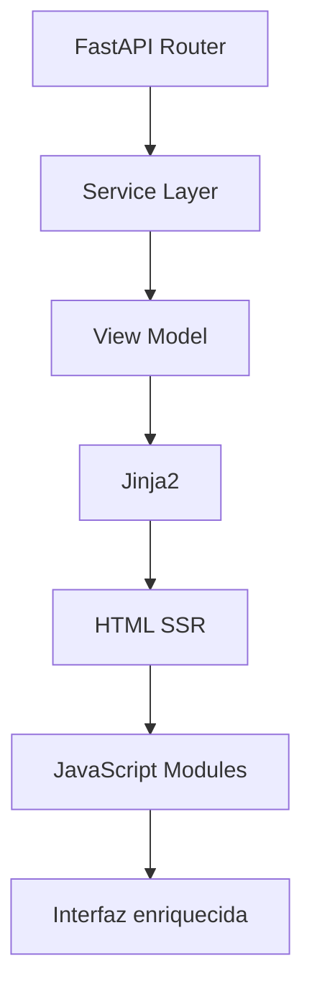

La lógica funcional y las reglas de negocio permanecen en el backend.

---

# 4. Principios arquitectónicos

La arquitectura JavaScript se apoya en los siguientes principios:

- mejora progresiva;
- modularidad;
- responsabilidad única;
- bajo acoplamiento;
- contratos declarativos;
- inicialización explícita;
- degradación controlada;
- accesibilidad;
- seguridad;
- facilidad de prueba.

---

# 5. Mejora progresiva

La plataforma utiliza JavaScript para mejorar una interfaz funcional ya renderizada por el servidor.

Esto significa que:

- el contenido principal llega mediante HTML;
- los formularios pueden enviarse de forma tradicional;
- los enlaces conservan navegación válida;
- las acciones críticas siguen funcionando mediante SSR;
- JavaScript añade comodidad y dinamismo.

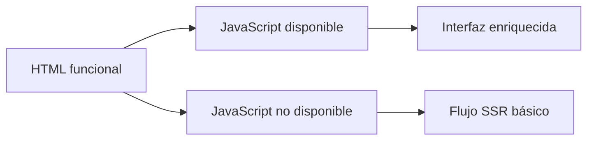

---

# 6. Responsabilidades de JavaScript

La capa JavaScript puede encargarse de:

- inicializar componentes interactivos;
- abrir y cerrar diálogos;
- mostrar Toasts;
- realizar peticiones Fetch;
- actualizar fragmentos del DOM;
- gestionar estados de carga;
- validar datos de forma inmediata;
- escuchar eventos WebSocket;
- coordinar componentes;
- mejorar formularios;
- gestionar interacciones responsive.

---

# 7. Responsabilidades excluidas

JavaScript no debe:

- aplicar reglas de negocio definitivas;
- autorizar operaciones;
- decidir permisos reales;
- acceder directamente a la base de datos;
- sustituir la validación del backend;
- almacenar secretos;
- asumir que el cliente es confiable;
- garantizar por sí solo la consistencia de los datos.

Toda operación sensible debe validarse nuevamente en FastAPI.

---

# 8. Arquitectura general

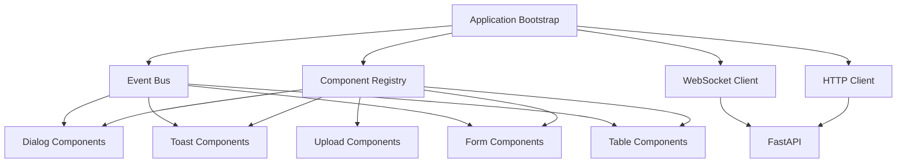

Cada bloque mantiene una responsabilidad claramente diferenciada.

---

# 9. Organización de carpetas

Una estructura recomendada es:

```text
static/
└── js/
    ├── app.js
    ├── core/
    │   ├── bootstrap.js
    │   ├── config.js
    │   ├── event-bus.js
    │   ├── component-registry.js
    │   └── logger.js
    ├── http/
    │   ├── http-client.js
    │   ├── csrf.js
    │   ├── response-normalizer.js
    │   └── errors.js
    ├── components/
    │   ├── dialogs/
    │   ├── toasts/
    │   ├── forms/
    │   ├── tables/
    │   ├── filters/
    │   └── uploads/
    ├── realtime/
    │   ├── websocket-client.js
    │   ├── event-router.js
    │   └── subscriptions.js
    ├── pages/
    │   ├── project-list.js
    │   ├── project-detail.js
    │   └── dashboard.js
    └── utils/
        ├── dom.js
        ├── dates.js
        ├── strings.js
        └── urls.js
```

---

# 10. Capas de la arquitectura JavaScript

La arquitectura puede dividirse en varias capas.

| Capa | Responsabilidad |
|---|---|
| Bootstrap | Inicializar la aplicación |
| Core | Proporcionar servicios transversales |
| Components | Gestionar elementos reutilizables |
| HTTP | Comunicar con FastAPI |
| Realtime | Gestionar WebSockets |
| Pages | Coordinar comportamientos específicos |
| Utils | Proporcionar helpers sin estado |

---

# 11. Application Bootstrap

El módulo de arranque inicializa la capa JavaScript después de cargar el documento.

Sus responsabilidades incluyen:

- cargar configuración;
- inicializar servicios;
- registrar componentes;
- procesar mensajes Flash;
- conectar WebSockets cuando proceda;
- inicializar módulos de página;
- registrar gestión global de errores.

---

# 12. Flujo de arranque

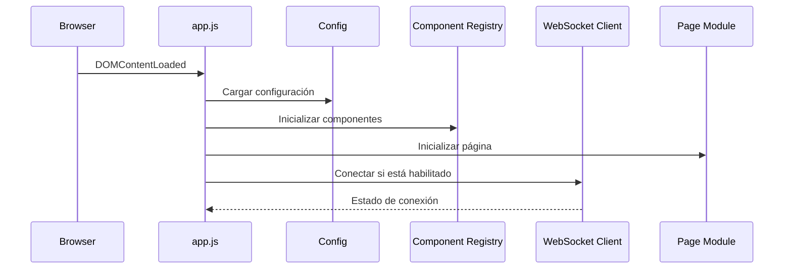

---

# 13. Punto de entrada

El archivo principal puede ser:

```text
static/js/app.js
```

Ejemplo conceptual:

```javascript
import { bootstrapApplication } from "./core/bootstrap.js";

document.addEventListener("DOMContentLoaded", () => {
    bootstrapApplication();
});
```

El punto de entrada debe permanecer pequeño.

---

# 14. Módulo Bootstrap

El módulo `bootstrap.js` coordina los servicios principales.

```javascript
export function bootstrapApplication() {
    loadConfiguration();
    initializeComponents();
    initializePageModule();
    initializeFlashMessages();
    initializeRealtime();
}
```

Cada responsabilidad debe delegarse en un módulo especializado.

---

# 15. Configuración del frontend

La configuración puede incluir:

- entorno;
- versión;
- base URL;
- WebSockets habilitados;
- modo debug;
- límites de archivos;
- idioma;
- características activas.

El backend puede exponerla de forma controlada.

---

# 16. Configuración embebida

Una opción segura consiste en utilizar un bloque JSON.

```html
<script
    id="app-config"
    type="application/json"
>
    {{ frontend_config | tojson }}
</script>
```

JavaScript recupera y valida el contenido.

---

# 17. Config Manager

El Config Manager centraliza el acceso a configuración.

Ejemplo conceptual:

```javascript
export function getConfig() {
    const element = document.getElementById("app-config");

    if (!element) {
        return {};
    }

    return JSON.parse(element.textContent);
}
```

La configuración no debe contener secretos.

---

# 18. Feature Flags

Los módulos pueden comprobar funcionalidades habilitadas.

```javascript
if (config.features.realtimeNotifications) {
    initializeRealtime();
}
```

El backend debe aplicar también las restricciones correspondientes.

---

# 19. ES Modules

La arquitectura utiliza módulos ES nativos.

Ejemplo:

```javascript
import { toastManager } from "./components/toasts/toast-manager.js";
```

Ventajas:

- dependencias explícitas;
- ámbito aislado;
- reutilización;
- carga diferida;
- mejor testing;
- menor contaminación global.

---

# 20. Ausencia de variables globales

Debe evitarse almacenar servicios en `window`.

No recomendado:

```javascript
window.toastManager = new ToastManager();
```

Recomendado:

```javascript
export const toastManager = new ToastManager();
```

Solo deben exponerse globalmente elementos imprescindibles por compatibilidad.

---

# 21. Responsabilidad única por módulo

Cada archivo debe resolver una responsabilidad clara.

Ejemplos:

```text
toast-manager.js
dialog-manager.js
http-client.js
event-bus.js
websocket-client.js
```

Debe evitarse un archivo `app.js` con miles de líneas.

---

# 22. Dependencias explícitas

Los módulos deben importar sus dependencias.

```javascript
import { httpClient } from "../../http/http-client.js";
import { toastManager } from "../toasts/toast-manager.js";
```

Las dependencias ocultas dificultan el testing y el mantenimiento.

---

# 23. Inyección de dependencias ligera

Los componentes complejos pueden recibir servicios mediante el constructor.

```javascript
export class ProjectActions {
    constructor({ httpClient, toastManager, dialogManager }) {
        this.httpClient = httpClient;
        this.toastManager = toastManager;
        this.dialogManager = dialogManager;
    }
}
```

Esto facilita sustituir dependencias durante pruebas.

---

# 24. Core Services

Los servicios transversales pueden incluir:

- Event Bus;
- HTTP Client;
- Logger;
- Config Manager;
- Component Registry;
- WebSocket Client;
- Error Handler.

Estos servicios no deben depender de páginas concretas.

---

# 25. Component Registry

El Component Registry centraliza la inicialización de componentes declarados en el HTML.

Ejemplo:

```javascript
componentRegistry.register(
    "confirm-action",
    "[data-component='confirm-action']",
    ConfirmAction
);
```

Durante el arranque, el registro localiza las instancias y las inicializa.

---

# 26. Flujo del Component Registry

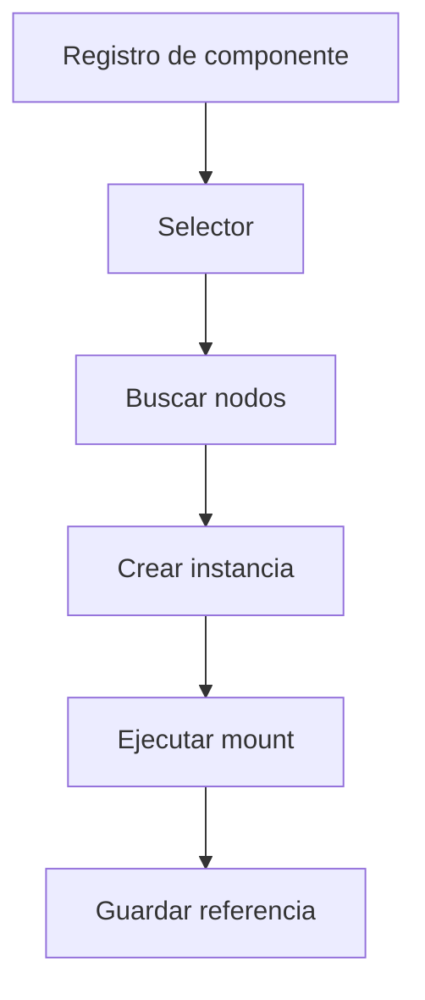

---

# 27. Contrato de componente

Cada componente JavaScript debería implementar una interfaz conceptual.

```text
constructor
mount
update
destroy
```

No todos los componentes necesitan todos los métodos, pero la convención facilita su gestión.

---

# 28. Método mount

`mount()` inicializa el componente.

Puede encargarse de:

- leer configuración;
- registrar eventos;
- crear observers;
- aplicar estado inicial;
- preparar accesibilidad.

Ejemplo:

```javascript
mount() {
    this.element.addEventListener("click", this.handleClick);
}
```

---

# 29. Método update

`update()` aplica cambios sin crear una nueva instancia.

Puede utilizarse para:

- actualizar estado;
- reemplazar datos;
- responder a WebSockets;
- cambiar configuración;
- reflejar errores.

---

# 30. Método destroy

`destroy()` elimina todos los recursos asociados.

```javascript
destroy() {
    this.element.removeEventListener("click", this.handleClick);
}
```

También debe cancelar:

- timers;
- observers;
- peticiones;
- suscripciones;
- callbacks.

---

# 31. Prevención de inicialización duplicada

Los componentes no deben montarse varias veces sobre el mismo nodo.

Puede utilizarse:

```html
data-component-mounted="true"
```

o un `WeakMap` de instancias.

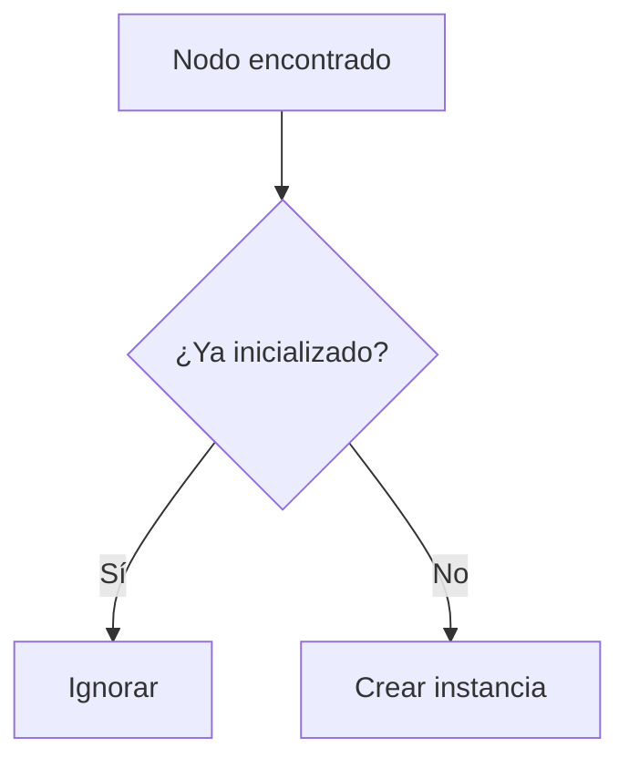

---

# 32. Inicialización por atributos

Los atributos `data-*` permiten definir comportamiento desde Jinja2.

Ejemplo:

```html
<button
    data-component="confirm-action"
    data-action-url="/projects/42/delete"
    data-http-method="DELETE"
    data-resource-name="Aula STEM"
>
    Eliminar
</button>
```

JavaScript interpreta estos valores sin depender del dominio.

---

# 33. Contrato HTML–JavaScript

Todo componente debe documentar:

- selector;
- atributos obligatorios;
- atributos opcionales;
- eventos emitidos;
- estados CSS;
- respuesta esperada;
- estrategia de error.

Ejemplo:

```text
Componente:
confirm-action

Selector:
[data-component="confirm-action"]

Requeridos:
data-action-url

Opcionales:
data-resource-name
data-http-method
data-confirm-text
```

---

# 34. Dataset

Los valores pueden recuperarse mediante:

```javascript
const {
    actionUrl,
    httpMethod,
    resourceName
} = element.dataset;
```

Los valores deben validarse antes de utilizarlos.

---

# 35. Validación de configuración

Cada componente debe detectar configuración inválida.

Ejemplo:

```javascript
if (!this.actionUrl) {
    throw new ComponentConfigurationError(
        "confirm-action requires data-action-url"
    );
}
```

En producción, el error debe registrarse sin bloquear toda la página.

---

# 36. Componentes de página

Los módulos de página coordinan comportamientos exclusivos de una vista.

Ejemplos:

```text
project-list.js
project-detail.js
dashboard.js
```

No deben duplicar servicios globales.

---

# 37. Identificación de página

El layout puede exponer:

```html
<body data-page="project-list">
```

El bootstrap selecciona el módulo correspondiente.

```javascript
const pageName = document.body.dataset.page;
```

---

# 38. Page Registry

Un registro de páginas puede asociar nombres y módulos.

```javascript
const pageRegistry = {
    "project-list": initializeProjectList,
    "project-detail": initializeProjectDetail,
    "dashboard": initializeDashboard
};
```

Solo se inicializa el módulo necesario.

---

# 39. Carga dinámica

Los módulos de página pueden cargarse mediante `import()`.

```javascript
const module = await import(
    `../pages/${pageName}.js`
);

module.initialize();
```

La ruta debe resolverse mediante un registro controlado y no mediante datos arbitrarios.

---

# 40. Lazy Loading

La carga diferida reduce el JavaScript inicial.

Casos adecuados:

- gráficos;
- editores;
- calendarios;
- simuladores;
- subida avanzada;
- módulos administrativos poco usados.

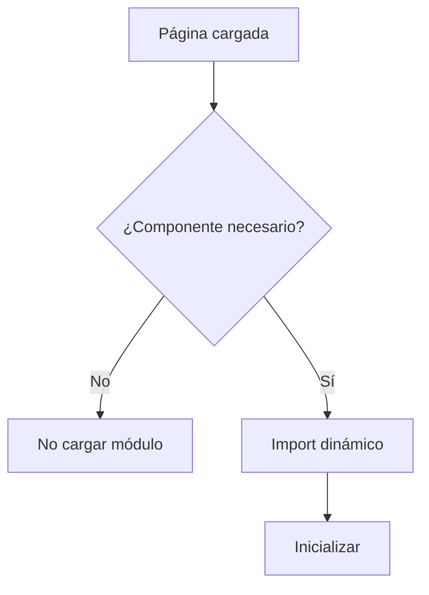

---

# 41. Utilidades

Las funciones auxiliares deben ser pequeñas, puras y sin estado cuando sea posible.

Ejemplos:

- formatear fecha;
- construir URL;
- escapar selector;
- transformar texto;
- realizar debounce.

No deben convertirse en un repositorio desordenado de funciones sin relación.

---

# 42. Organización de utilidades

Puede utilizarse:

```text
utils/
├── dom.js
├── forms.js
├── dates.js
├── strings.js
├── urls.js
└── timers.js
```

Cada archivo agrupa utilidades de una misma responsabilidad.

---

# 43. Funciones puras

Las funciones puras:

- no modifican estado externo;
- no dependen del DOM;
- no producen efectos secundarios;
- devuelven siempre el mismo resultado para la misma entrada.

Ejemplo:

```javascript
export function normalizeWhitespace(value) {
    return value.trim().replace(/\s+/g, " ");
}
```

Estas funciones resultan fáciles de probar.

---

# 44. DOM Helpers

Las operaciones repetidas sobre el DOM pueden centralizarse.

Ejemplo:

```javascript
export function queryRequired(selector, root = document) {
    const element = root.querySelector(selector);

    if (!element) {
        throw new Error(`Element not found: ${selector}`);
    }

    return element;
}
```

Debe evitarse crear una abstracción completa que oculte el DOM innecesariamente.

---

# 45. Event Bus

El Event Bus permite comunicar módulos sin referencias directas.

Ejemplos:

```text
dialog:confirmed
toast:shown
project:updated
websocket:connected
session:expired
```

---

# 46. Arquitectura del Event Bus

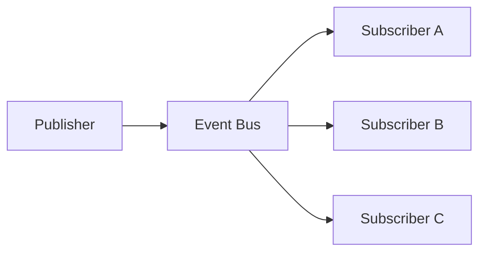

El emisor no necesita conocer a los receptores.

---

# 47. Implementación conceptual

```javascript
export class EventBus {
    constructor() {
        this.listeners = new Map();
    }

    on(eventName, handler) {
        // Registro
    }

    off(eventName, handler) {
        // Eliminación
    }

    emit(eventName, payload) {
        // Publicación
    }
}
```

La implementación debe gestionar errores aislando los listeners.

---

# 48. Convención de eventos

Los nombres deben seguir una estructura estable.

```text
scope:action
```

Ejemplos:

```text
project:created
project:updated
dialog:opened
dialog:confirmed
toast:closed
http:error
websocket:disconnected
```

---

# 49. Payload de eventos

El payload debe ser pequeño y explícito.

Ejemplo:

```javascript
eventBus.emit("project:updated", {
    projectId: 42,
    source: "project-form"
});
```

No deben enviarse objetos completos innecesarios ni datos sensibles.

---

# 50. CustomEvent nativo

Cuando la comunicación está vinculada al DOM puede utilizarse `CustomEvent`.

```javascript
document.dispatchEvent(
    new CustomEvent("project:updated", {
        detail: {
            projectId: 42
        }
    })
);
```

El Event Bus propio resulta más adecuado para servicios desacoplados.

---

# 51. Cuándo no utilizar eventos

No debe utilizarse el Event Bus cuando una llamada directa es más clara.

Ejemplo:

```javascript
toastManager.show(message);
```

es preferible a emitir siempre:

```text
toast:requested
```

Los eventos resultan útiles cuando existen varios receptores o se desea desacoplamiento real.

---

# 52. HTTP Client

El HTTP Client centraliza la comunicación asíncrona con FastAPI.

Sus responsabilidades incluyen:

- construir peticiones;
- añadir cabeceras;
- incorporar CSRF;
- procesar respuestas;
- normalizar errores;
- gestionar timeout;
- detectar expiración de sesión.

---

# 53. Flujo HTTP

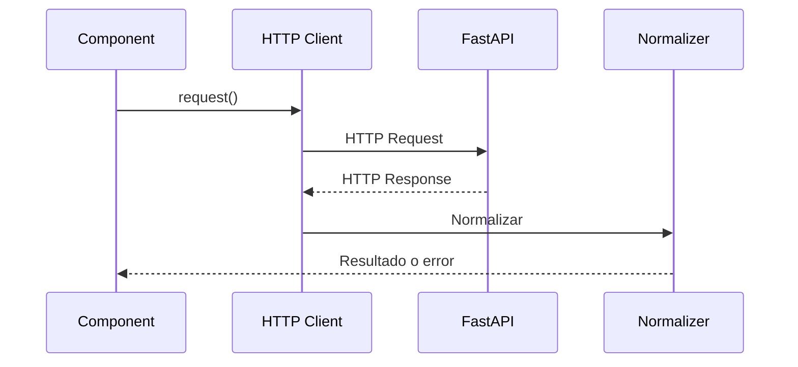

El componente no necesita conocer todos los detalles del protocolo.

---

# 54. API conceptual

```javascript
httpClient.get(url, options);
httpClient.post(url, data, options);
httpClient.put(url, data, options);
httpClient.patch(url, data, options);
httpClient.delete(url, options);
```

Internamente todas las operaciones pueden utilizar un método `request()` común.

---

# 55. Request común

Ejemplo conceptual:

```javascript
async function request(url, options = {}) {
    const response = await fetch(url, {
        credentials: "same-origin",
        ...options
    });

    return normalizeResponse(response);
}
```

La implementación real debe incluir gestión de errores y seguridad.

---

# 56. Cabeceras

Las peticiones pueden incluir:

- `Accept`;
- `Content-Type`;
- `X-CSRF-Token`;
- `X-Requested-With`;
- identificador de correlación;
- versión cliente.

No deben enviarse cabeceras innecesarias.

---

# 57. Credentials

Cuando la autenticación se basa en cookies HTTPOnly debe configurarse correctamente:

```javascript
credentials: "same-origin"
```

o la política definida para el despliegue.

JavaScript no necesita acceder al JWT.

---

# 58. CSRF

El token CSRF puede recuperarse desde:

- meta tag;
- campo oculto;
- cookie no HTTPOnly específica;
- configuración inicial.

Ejemplo:

```html
<meta
    name="csrf-token"
    content="{{ csrf_token }}"
>
```

El HTTP Client lo incorpora automáticamente en operaciones mutables.

---

# 59. Métodos seguros y mutables

| Tipo | Métodos |
|---|---|
| Lectura | GET, HEAD, OPTIONS |
| Modificación | POST, PUT, PATCH, DELETE |

La protección CSRF debe aplicarse a los métodos que modifican estado.

---

# 60. Serialización JSON

Cuando se envía JSON:

```javascript
headers: {
    "Content-Type": "application/json"
},
body: JSON.stringify(payload)
```

El backend debe validar el contenido mediante Pydantic.

---

# 61. FormData

Para archivos o formularios multipart se utiliza:

```javascript
const formData = new FormData(form);
```

No debe definirse manualmente `Content-Type`, ya que el navegador añade el boundary correcto.

---

# 62. Normalización de respuestas

El Response Normalizer transforma las respuestas en una estructura común.

Ejemplo:

```javascript
{
    ok: true,
    status: 200,
    data: {},
    message: null
}
```

En error:

```javascript
{
    ok: false,
    status: 422,
    code: "validation_error",
    message: "Revisa los datos.",
    errors: {}
}
```

---

# 63. Errores tipados

La arquitectura puede definir:

- `HttpError`;
- `ValidationError`;
- `AuthorizationError`;
- `ConflictError`;
- `NetworkError`;
- `TimeoutError`.

Esto permite respuestas específicas sin analizar cadenas de texto.

---

# 64. Gestión por código HTTP

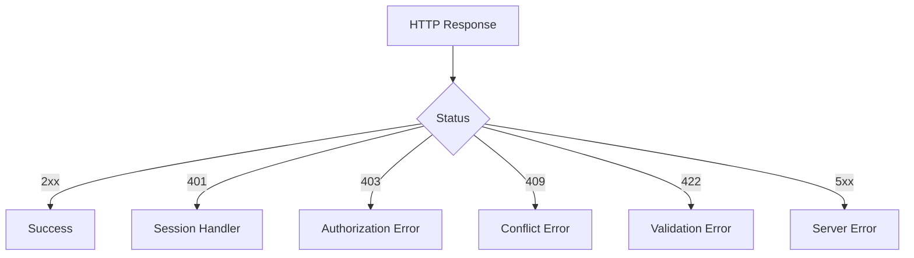

---

# 65. Error 401

Una respuesta `401` puede indicar expiración de sesión.

El manejador global puede:

- mostrar aviso;
- conservar la URL actual;
- redirigir al login;
- evitar bucles de redirección.

No debe intentar refrescar tokens si la arquitectura no contempla ese flujo.

---

# 66. Error 403

El error `403` indica que la identidad es válida, pero no tiene permisos.

La interfaz puede mostrar:

```text
No tienes permisos para realizar esta acción.
```

La operación no debe reintentarse automáticamente.

---

# 67. Error 409

Los conflictos pueden aparecer cuando:

- el recurso cambió;
- existe una relación activa;
- se incumple una condición;
- hay una edición concurrente.

La interfaz debe mostrar información útil y ofrecer recarga o resolución cuando proceda.

---

# 68. Error 422

Los errores de validación deben asignarse a campos cuando exista un formulario.

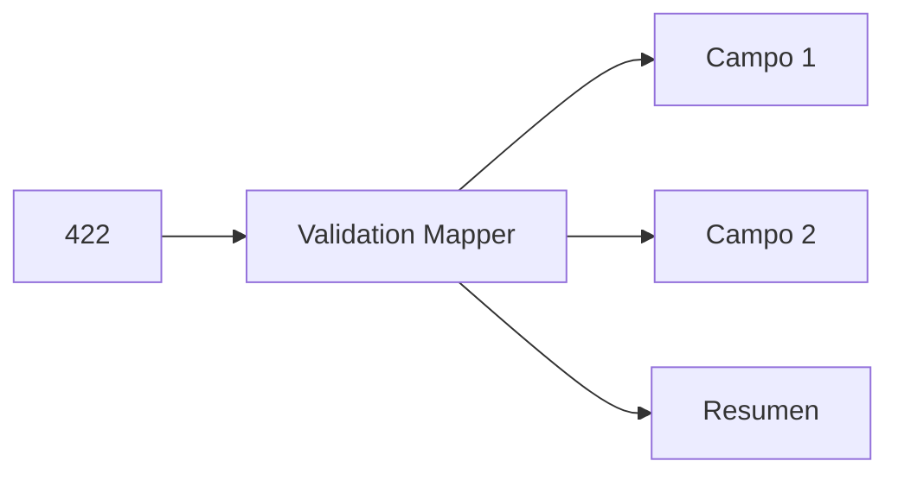

El Toast debe reservarse para el error general.

---

# 69. Error 500

Los errores internos deben presentarse con un mensaje genérico.

Ejemplo:

```text
No se pudo completar la operación.
Inténtalo de nuevo más tarde.
```

Puede incluirse un identificador de incidencia, pero nunca la traza.

---

# 70. Errores de red

Los errores de red deben diferenciarse de respuestas HTTP.

Casos:

- servidor inaccesible;
- DNS;
- conexión interrumpida;
- navegador offline;
- petición cancelada.

---

# 71. Timeout

Fetch no incluye timeout directo, pero puede utilizarse `AbortController`.

```javascript
const controller = new AbortController();

const timeoutId = setTimeout(
    () => controller.abort(),
    timeout
);
```

La limpieza del temporizador resulta obligatoria.

---

# 72. Cancelación

Los componentes deben cancelar peticiones cuando:

- se destruyen;
- el usuario inicia una nueva búsqueda;
- cambia la página;
- la respuesta ya no resulta relevante.

Esto evita actualizar componentes obsoletos.

---

# 73. Race Conditions

Las peticiones simultáneas pueden devolver resultados fuera de orden.

Ejemplo:

```text
Búsqueda A

Búsqueda B

Respuesta B

Respuesta A
```

La respuesta A no debe sobrescribir el resultado más reciente.

---

# 74. Control de versión de petición

Puede utilizarse:

- AbortController;
- contador;
- identificador;
- timestamp;
- última promesa activa.

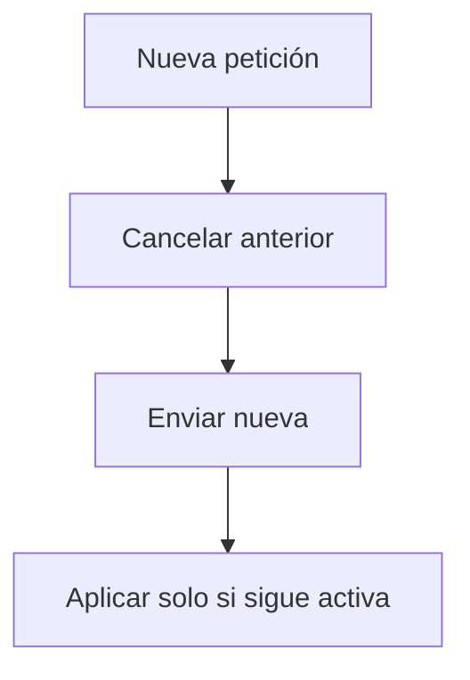

---

# 75. Retry Policy

Los reintentos automáticos deben utilizarse con prudencia.

Adecuados para:

- GET idempotentes;
- errores temporales;
- desconexiones breves.

No recomendados automáticamente para:

- creación;
- pagos;
- eliminación;
- acciones no idempotentes.

---

# 76. Backoff

Los reintentos pueden utilizar espera incremental.

```text
1 segundo

2 segundos

4 segundos

8 segundos
```

Debe existir un límite máximo.

---

# 77. Estados de carga

Los componentes deben representar el estado de una petición.

```text
Idle

↓

Loading

↓

Success o Error
```

Durante `Loading` puede:

- deshabilitarse la acción;
- mostrarse spinner;
- establecerse `aria-busy`;
- evitarse doble envío.

---

# 78. Máquina de estados HTTP

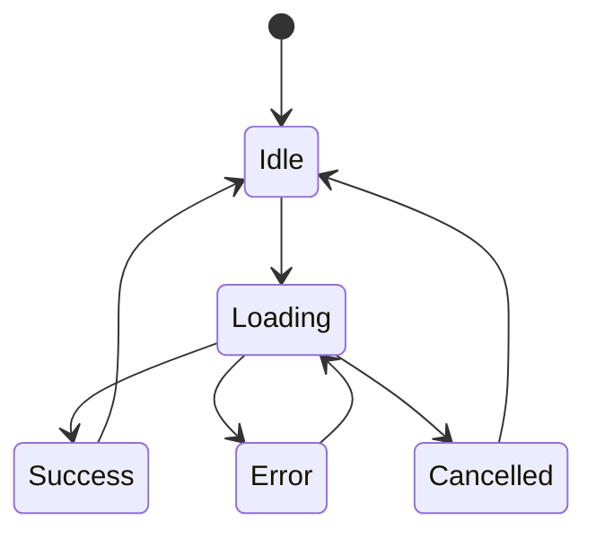

---

# 79. Gestión de formularios

Los módulos de formulario pueden encargarse de:

- prevenir doble envío;
- mostrar estado de carga;
- mapear errores;
- limpiar errores previos;
- enviar mediante Fetch opcional;
- conservar fallback SSR.

---

# 80. Form Controller

Un Form Controller genérico puede recibir:

- elemento `form`;
- HTTP Client;
- Toast Manager;
- callback de éxito;
- estrategia de errores;
- indicador de carga.

No debe conocer entidades concretas.

---

# 81. Validación del navegador

Los atributos HTML pueden proporcionar validación básica:

```html
required
minlength
maxlength
pattern
min
max
```

JavaScript puede mejorar el feedback, pero el backend debe repetir la validación.

---

# 82. Validación asíncrona

Algunos campos pueden requerir comprobación remota.

Ejemplos:

- correo ya utilizado;
- nombre duplicado;
- código disponible;
- identificador válido.

Debe utilizarse:

- debounce;
- cancelación;
- indicador de carga;
- mensaje accesible.

---

# 83. Debounce

El debounce evita ejecutar una acción en cada pulsación.

Casos habituales:

- búsqueda;
- autocompletado;
- validación remota;
- filtros.

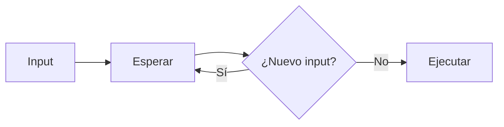

---

# 84. Throttle

El throttle limita la frecuencia máxima de ejecución.

Casos:

- scroll;
- resize;
- movimiento;
- progreso;
- eventos frecuentes.

Debe elegirse debounce o throttle según el comportamiento esperado.

---

# 85. Accesibilidad en formularios dinámicos

JavaScript debe mantener:

- `aria-invalid`;
- `aria-describedby`;
- foco en errores;
- resumen accesible;
- mensajes persistentes;
- asociación entre campo y error.

No debe limitarse a cambiar el color del borde.

---

# 86. Integración con Dialog System

El Dialog Manager se implementa como un servicio o conjunto de componentes especializados.

Puede recibir:

- configuración;
- callbacks;
- HTTP Client;
- Event Bus;
- Toast Manager.

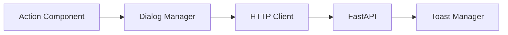

---

# 87. Integración con Toast System

El Toast Manager debe exponer una API pequeña.

```javascript
toastManager.success(message);
toastManager.error(message);
toastManager.warning(message);
toastManager.info(message);
```

También puede aceptar un objeto de configuración.

---

# 88. Ausencia de manipulación directa

Los módulos funcionales no deben construir manualmente Toasts o diálogos.

No recomendado:

```javascript
document.body.insertAdjacentHTML(
    "beforeend",
    "<div class='toast'>...</div>"
);
```

Recomendado:

```javascript
toastManager.success("Proyecto creado.");
```

---

# 89. Eventos globales del navegador

La aplicación puede escuchar:

- `online`;
- `offline`;
- `visibilitychange`;
- `beforeunload`;
- `popstate`;
- `resize`.

Cada evento debe utilizarse únicamente cuando exista una necesidad real.

---

# 90. Estado online y offline

```javascript
window.addEventListener("offline", () => {
    eventBus.emit("network:offline");
});

window.addEventListener("online", () => {
    eventBus.emit("network:online");
});
```

La interfaz puede mostrar un aviso y reintentar sincronizaciones seguras.

---

# 91. Visibility API

La aplicación puede reducir trabajo cuando la pestaña no está visible.

Casos:

- pausar polling;
- reducir actualizaciones;
- posponer animaciones;
- solicitar sincronización al regresar.

---

# 92. beforeunload

Puede utilizarse para advertir sobre cambios sin guardar.

Debe evitarse activarlo globalmente porque degrada la navegación.

Solo debe registrarse cuando exista realmente un formulario modificado.

---

# 93. Dirty State

Un Form Controller puede mantener:

```text
pristine
dirty
submitting
saved
```

La advertencia se elimina después de guardar correctamente.

---

# 94. Seguridad

La seguridad JavaScript debe basarse en que el cliente no es confiable.

Principios:

- no almacenar secretos;
- no confiar en datos del DOM;
- validar URLs;
- utilizar `textContent`;
- evitar `eval`;
- evitar HTML arbitrario;
- respetar CSP;
- proteger operaciones mutables con CSRF.

---

# 95. XSS

Debe evitarse:

```javascript
element.innerHTML = userValue;
```

Preferencia:

```javascript
element.textContent = userValue;
```

Cuando se necesite HTML, debe construirse mediante nodos seguros o contenido sanitizado.

---

# 96. URL Safety

Las URLs dinámicas deben validarse.

Debe rechazarse:

```text
javascript:
data:
vbscript:
```

salvo casos explícitamente controlados.

Las rutas internas deben preferirse sobre URLs arbitrarias.

---

# 97. Content Security Policy

La arquitectura modular facilita una CSP restrictiva porque:

- evita scripts inline;
- utiliza archivos versionados;
- reduce ejecución dinámica;
- centraliza recursos;
- permite nonces cuando sean necesarios.

---

# 98. Ausencia de secretos

Nunca deben incluirse en JavaScript:

- claves privadas;
- contraseñas;
- tokens de servicio;
- credenciales de base de datos;
- secretos JWT;
- API keys privadas.

Todo código enviado al navegador puede inspeccionarse.

---

# 99. Logging frontend

La arquitectura puede incorporar un Logger centralizado.

Niveles:

- debug;
- info;
- warn;
- error.

En producción debe limitarse la información sensible.

---

# 100. Logger conceptual

```javascript
logger.debug("Component mounted", {
    component: "project-filter"
});

logger.error("Request failed", {
    status: error.status,
    requestId: error.requestId
});
```

No deben registrarse payloads completos sin revisión.

---

# 101. Errores globales

Pueden capturarse:

```javascript
window.addEventListener("error", handleGlobalError);

window.addEventListener(
    "unhandledrejection",
    handleUnhandledRejection
);
```

Estos manejadores deben registrar el problema sin ocultar los errores durante desarrollo.

---

# 102. Correlación

Las respuestas del backend pueden incluir un identificador:

```text
X-Request-ID
```

El frontend puede conservarlo en el error mostrado o en telemetría.

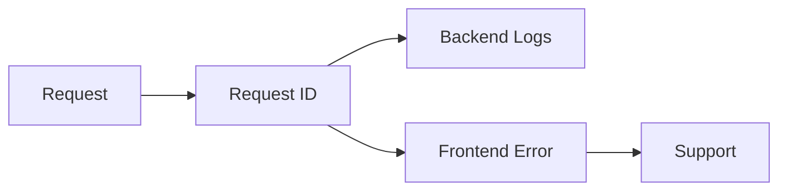

---

# 103. Gestión de errores de componentes

Un error en un componente no debe impedir la inicialización de todos los demás.

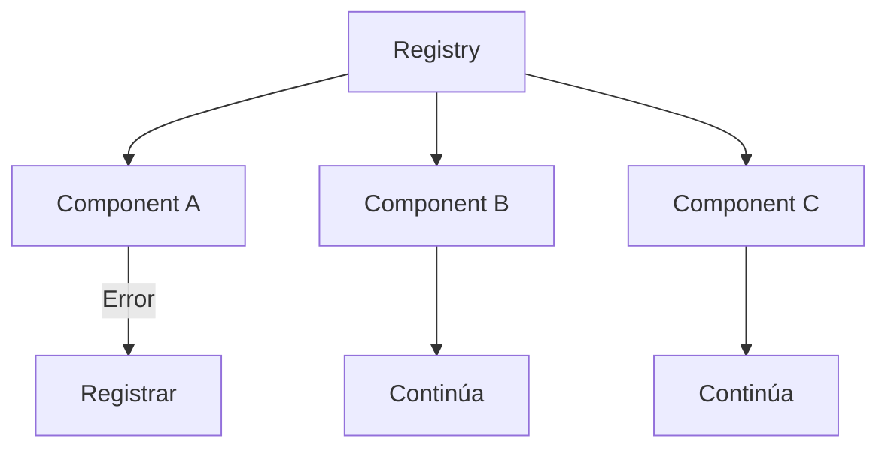

Cada inicialización debe aislarse mediante manejo de errores.

---

# 104. Degradación controlada

Cuando un componente falla:

- se registra el error;
- se conserva el HTML SSR;
- se evita dejar controles bloqueados;
- se muestra fallback cuando proceda;
- el resto de la página continúa operativo.

---

# 105. Convenciones de código

El código debe mantener convenciones uniformes sobre:

- nombres;
- imports;
- exports;
- estructura;
- errores;
- comentarios;
- async/await;
- estilo.

La automatización puede reforzarse mediante ESLint y Prettier.

---

# 106. Nomenclatura

Recomendaciones:

```text
Clases:
PascalCase

Funciones:
camelCase

Constantes:
UPPER_SNAKE_CASE

Archivos:
kebab-case.js

Eventos:
scope:action
```

---

# 107. Funciones asíncronas

Debe preferirse `async/await` por claridad.

```javascript
try {
    const result = await httpClient.post(url, payload);
    handleSuccess(result);
} catch (error) {
    handleError(error);
}
```

Debe evitarse mezclar innecesariamente callbacks, promesas y `async/await`.

---

# 108. Retorno temprano

Los retornos tempranos reducen anidamiento.

```javascript
if (!element) {
    return;
}

if (!isEnabled) {
    return;
}

initialize(element);
```

Esto mejora la legibilidad.

---

# 109. Funciones pequeñas

Las funciones deben:

- cumplir una responsabilidad;
- tener nombres descriptivos;
- evitar demasiados parámetros;
- devolver resultados predecibles;
- mantener efectos secundarios visibles.

---

# 110. Comentarios

Los comentarios deben explicar:

- decisiones;
- restricciones;
- comportamiento no evidente;
- compatibilidad;
- motivos arquitectónicos.

No deben repetir literalmente lo que hace el código.

---

# 111. Documentación JSDoc

Los módulos públicos pueden utilizar JSDoc.

```javascript
/**
 * Muestra una notificación de éxito.
 *
 * @param {string} message
 * @returns {void}
 */
export function showSuccess(message) {
    // ...
}
```

Resulta especialmente útil en servicios y utilidades compartidas.

---

# 112. Type Checking

Aunque el proyecto utilice JavaScript, puede incorporar verificación mediante:

```javascript
// @ts-check
```

y anotaciones JSDoc.

Esto mejora:

- autocompletado;
- detección de errores;
- contratos;
- refactorización.

---

# 113. Evolución hacia TypeScript

La arquitectura modular permite una migración progresiva futura hacia TypeScript.

La transición puede comenzar por:

- HTTP Client;
- Event Bus;
- WebSocket Client;
- modelos de mensajes;
- componentes complejos.

No resulta necesario migrar todo el código simultáneamente.

---

# 114. Límites de esta primera parte

Esta primera parte establece:

- principios generales;
- estructura de carpetas;
- módulos ES;
- Application Bootstrap;
- Component Registry;
- contratos HTML–JavaScript;
- módulos de página;
- Event Bus;
- HTTP Client;
- gestión de formularios;
- seguridad;
- logging;
- convenciones de código.

---

# 115. Arquitectura WebSocket

La comunicación en tiempo real permite que determinados componentes reciban actualizaciones sin necesidad de recargar la página.

La arquitectura separa claramente:

- conexión;
- transporte;
- enrutado de eventos;
- actualización de componentes.

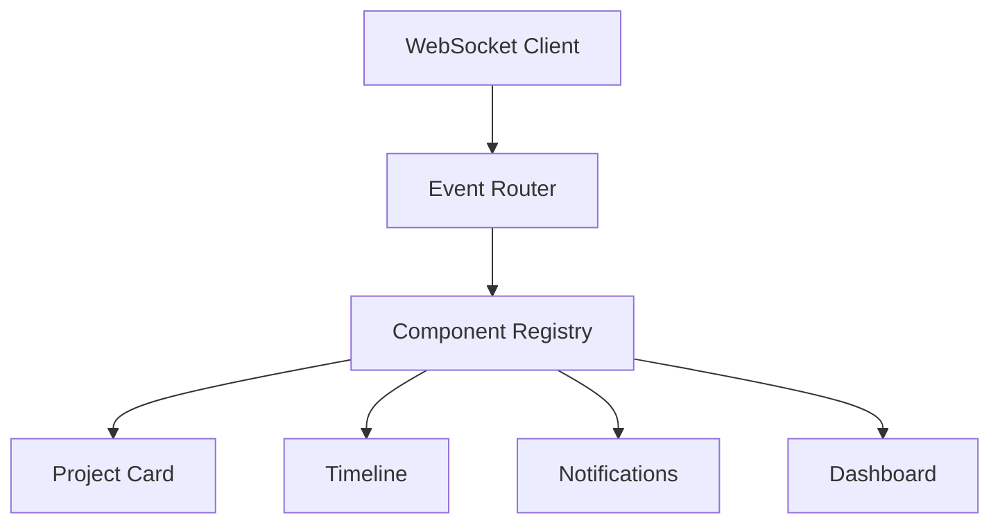

---

# 116. Principios de tiempo real

La capa WebSocket sigue varios principios:

- desacoplamiento;
- mensajes tipados;
- componentes independientes;
- reconexión automática;
- validación de eventos;
- actualización selectiva;
- resiliencia;
- degradación controlada.

---

# 117. WebSocket Client

El cliente WebSocket únicamente mantiene la conexión con el servidor.

Sus responsabilidades son:

- conectar;
- desconectar;
- reconectar;
- enviar mensajes;
- recibir mensajes;
- detectar errores;
- emitir eventos internos.

No debe actualizar directamente el DOM.

---

# 118. Flujo WebSocket

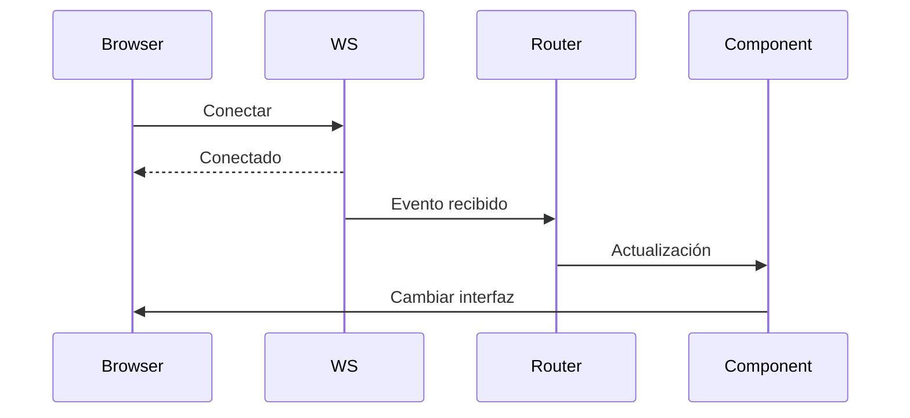

---

# 119. Event Router

El Event Router interpreta cada mensaje recibido.

Puede:

- validar formato;
- comprobar versión;
- identificar tipo;
- descartar eventos;
- reenviar al componente adecuado.

```mermaid
flowchart TD

Evento

↓

Router

↓

¿Tipo?

↙      ↓       ↘

Proyecto Timeline Toast
```

---

# 120. Contrato de mensajes

Todos los mensajes deben seguir una estructura homogénea.

Ejemplo:

```json
{
    "event":"project.updated",
    "version":1,
    "timestamp":"2026-07-25T10:45:00Z",
    "payload":{}
}
```

Esto facilita la evolución del protocolo.

---

# 121. Versionado

Los mensajes pueden incorporar una versión.

```json
{
    "version":2
}
```

El Router puede adaptar distintas versiones durante un periodo de transición.

---

# 122. Eventos tipados

Los nombres deben seguir una convención.

Ejemplos:

```text
project.created

project.updated

activity.assigned

user.connected

timeline.updated

notification.created
```

Evitar nombres ambiguos como:

```text
update

event

message
```

---

# 123. Suscripciones

Los componentes pueden suscribirse únicamente a eventos relevantes.

Ejemplo:

```javascript
eventBus.on(
    "project.updated",
    handler
);
```

Esto evita trabajo innecesario.

---

# 124. Componentes reactivos

Cada componente actualiza exclusivamente su estado.

```mermaid
flowchart TD

Evento

↓

Project Card

↓

Actualizar Badge

↓

Actualizar Fecha
```

No debe reconstruirse toda la página.

---

# 125. Reconexión

La conexión debe recuperarse automáticamente.

```mermaid
flowchart TD

Desconexión

↓

Esperar

↓

Reconectar

↓

¿Correcto?

↙        ↘

Sí        No

↓          ↓

Continuar  Esperar
```

---

# 126. Backoff

Los reintentos deben aumentar progresivamente.

Ejemplo:

```text
1 s

2 s

4 s

8 s

16 s
```

Debe existir un límite superior.

---

# 127. Heartbeat

El servidor puede enviar mensajes periódicos.

```text
PING

↓

PONG
```

Esto permite detectar conexiones caídas.

---

# 128. Estado de conexión

La interfaz puede reflejar:

- conectado;
- reconectando;
- desconectado;
- error.

Un pequeño indicador resulta suficiente.

---

# 129. Offline

Cuando no exista conexión:

- mantener información previa;
- desactivar funciones dependientes;
- informar al usuario;
- reintentar automáticamente.

---

# 130. Sincronización

Tras una reconexión puede ser necesario:

- solicitar cambios perdidos;
- refrescar datos;
- volver a suscribirse;
- actualizar componentes.

---

# 131. Component Registry y WebSocket

El Event Router puede localizar componentes mediante atributos.

```html
<div
    data-component="project-status"
    data-project-id="42"
>
</div>
```

---

# 132. Actualización selectiva

```mermaid
flowchart TD

Evento

↓

Buscar ID

↓

Actualizar componente

↓

Render parcial
```

Evita renderizados innecesarios.

---

# 133. Eventos duplicados

Los eventos repetidos deben descartarse.

Puede utilizarse:

- id;
- timestamp;
- versión;
- secuencia.

---

# 134. Orden de eventos

El Router debe comprobar que un evento no sea más antiguo que el estado actual.

Esto evita inconsistencias.

---

# 135. Integración con Fetch

Algunas operaciones producen:

```text
Fetch

↓

Respuesta inmediata

↓

Evento WebSocket posterior
```

Ambos mecanismos deben convivir sin duplicar actualizaciones.

---

# 136. Estado compartido

Los componentes pueden mantener únicamente el estado imprescindible.

Ejemplos:

- abierto;
- cargando;
- seleccionado;
- expandido;
- conectado.

El estado funcional reside en el backend.

---

# 137. Estado local

Cada componente controla únicamente su propio estado.

```text
Project Card

↓

expanded=true
```

No debe modificar estados de otros componentes.

---

# 138. Estado global

Algunos estados pueden compartirse.

Ejemplos:

- usuario;
- organización;
- idioma;
- conexión;
- configuración.

---

# 139. Store ligero

Cuando exista estado compartido puede utilizarse un pequeño Store.

```mermaid
flowchart TD

Store

↓

Component A

↓

Component B

↓

Component C
```

Debe evitar convertirse en una base de datos del frontend.

---

# 140. Actualizaciones del Store

Los cambios deben producirse mediante acciones controladas.

No modificando propiedades arbitrariamente.

---

# 141. Inmutabilidad

Siempre que resulte práctico, las actualizaciones deben generar nuevos objetos.

Esto facilita detectar cambios y depurar problemas.

---

# 142. Gestión de colecciones

Las listas deben actualizar únicamente los elementos modificados.

Ejemplo:

- insertar;
- eliminar;
- mover;
- actualizar.

No reconstruir toda la tabla.

---

# 143. DOM mínimo

Las modificaciones del DOM deben limitarse al elemento afectado.

Esto mejora el rendimiento.

---

# 144. Renderizado incremental

```mermaid
flowchart LR

Evento

↓

Actualizar Card

↓

Fin
```

En lugar de:

```text
Evento

↓

Reconstruir toda la página
```

---

# 145. Virtualización futura

Listas muy grandes podrán incorporar virtualización.

Casos:

- auditoría;
- logs;
- timeline;
- notificaciones.

---

# 146. Intersection Observer

Puede utilizarse para:

- lazy loading;
- imágenes;
- inicialización;
- animaciones.

Reduce trabajo innecesario.

---

# 147. Mutation Observer

Solo debe utilizarse cuando sea realmente necesario.

El Component Registry suele ser suficiente.

---

# 148. Gestión de memoria

Todo componente debe liberar:

- listeners;
- timers;
- observers;
- sockets;
- callbacks.

---

# 149. Cleanup

```javascript
destroy(){
    removeListeners();
    clearTimeouts();
    unsubscribe();
}
```

La limpieza forma parte del ciclo de vida.

---

# 150. Gestión de timers

Los temporizadores deben cancelarse cuando:

- cambia la página;
- desaparece el componente;
- finaliza la operación.

---

# 151. Gestión de observers

Los observers deben desconectarse.

```javascript
observer.disconnect();
```

---

# 152. Gestión de AbortController

Las peticiones pendientes deben cancelarse.

```javascript
controller.abort();
```

---

# 153. Rendimiento

El código JavaScript debe minimizar:

- listeners;
- reflows;
- repaints;
- cálculos repetidos;
- renderizados completos.

---

# 154. Reflow

Evitar:

```javascript
leer

escribir

leer

escribir
```

Es preferible agrupar operaciones.

---

# 155. Repaint

Las animaciones deben utilizar propiedades aceleradas cuando sea posible.

Ejemplos:

- opacity;
- transform.

---

# 156. requestAnimationFrame

Las actualizaciones visuales frecuentes pueden utilizar:

```javascript
requestAnimationFrame(...)
```

---

# 157. requestIdleCallback

Las tareas secundarias pueden ejecutarse durante periodos de inactividad.

Siempre con fallback.

---

# 158. División de tareas

Las operaciones largas deben dividirse.

Evitar bloquear el hilo principal.

---

# 159. Web Workers (futuro)

Procesos intensivos podrán trasladarse a Web Workers.

Ejemplos:

- procesamiento masivo;
- importaciones;
- IA local;
- OCR.

---

# 160. Caché

El frontend puede mantener pequeñas cachés temporales.

Nunca deben sustituir la persistencia.

---

# 161. Session Storage

Adecuado para:

- filtros;
- pestaña activa;
- scroll.

---

# 162. Local Storage

Solo almacenar:

- preferencias;
- configuración visual;
- idioma;
- tema.

Nunca:

- JWT;
- contraseñas;
- secretos.

---

# 163. IndexedDB (futuro)

Puede utilizarse para:

- modo offline;
- documentos;
- imágenes;
- sincronización.

---

# 164. Integración con SSR

JavaScript siempre parte de HTML generado por FastAPI.

No reconstruye la interfaz desde cero.

---

# 165. Hydration ligera

Solo se inicializan:

- diálogos;
- Toasts;
- formularios;
- WebSockets;
- componentes interactivos.

---

# 166. HTMX (futuro)

La arquitectura permitirá combinar SSR con actualizaciones parciales.

Los módulos JavaScript continuarán siendo reutilizables.

---

# 167. Testing unitario

Los módulos deben probar:

- utilidades;
- HTTP Client;
- Event Bus;
- Component Registry;
- Dialog Manager;
- Toast Manager.

---

# 168. Testing integración

Debe verificarse:

- Fetch;
- WebSockets;
- eventos;
- inicialización;
- actualización.

---

# 169. Testing E2E

Playwright o Selenium pueden comprobar:

- interacción;
- formularios;
- notificaciones;
- tiempo real.

---

# 170. Accesibilidad

Los componentes deben respetar:

- teclado;
- foco;
- ARIA;
- regiones vivas;
- contraste.

---

# 171. Seguridad

JavaScript debe:

- escapar contenido;
- evitar HTML arbitrario;
- respetar CSP;
- utilizar CSRF;
- validar configuración.

---

# 172. Observabilidad

Puede registrarse:

- errores;
- tiempos;
- eventos;
- conexiones;
- reconexiones.

---

# 173. Logging

El Logger debe centralizar toda la instrumentación del frontend.

---

# 174. Métricas

Ejemplos:

- tiempo inicialización;
- conexiones;
- errores;
- peticiones;
- renderizados.

---

# 175. CI/CD

La canalización puede incluir:

- ESLint;
- pruebas;
- cobertura;
- análisis estático.

---

# 176. Bundling

La arquitectura es compatible con:

- Vite;
- Rollup;
- esbuild.

Actualmente puede utilizar módulos ES sin empaquetado complejo.

---

# 177. Minificación

Producción debe utilizar:

- JS minificado;
- hashes;
- compresión;
- caché.

---

# 178. Source Maps

Los Source Maps solo deben exponerse de forma controlada.

---

# 179. Estado actual

Actualmente la arquitectura contempla:

- módulos ES;
- Component Registry;
- Event Bus;
- HTTP Client;
- Dialog System;
- Toast System;
- WebSockets;
- SSR;
- Bootstrap;
- FastAPI.

---

# 180. Evolución futura

Entre las posibles mejoras:

- TypeScript;
- HTMX;
- Service Workers;
- Offline;
- BroadcastChannel;
- IA local;
- sincronización avanzada.

---

# 181. Arquitectura global

```mermaid
flowchart TD
    A[Bootstrap]
    --> B[Config]

    A --> C[Component Registry]

    A --> D[HTTP Client]

    A --> E[Event Bus]

    A --> F[WebSocket Client]

    C --> G[Components]

    G --> H[Dialogs]

    G --> I[Toasts]

    G --> J[Forms]

    G --> K[Tables]

    F --> L[Event Router]

    L --> G
```

---

# 182. Flujo completo

```mermaid
sequenceDiagram
    participant U as Usuario
    participant C as Component
    participant H as HTTP Client
    participant A as FastAPI
    participant W as WebSocket
    participant T as Toast

    U->>C: Acción

    C->>H: Request

    H->>A: HTTP

    A-->>H: Response

    H-->>C: Datos

    C-->>T: Success

    A-->>W: Evento

    W->>C: Actualización
```

---

# 183. Matriz de responsabilidades

| Módulo | Responsabilidad |
|---------|-----------------|
| Bootstrap | Inicialización |
| Config | Configuración |
| Registry | Componentes |
| HTTP Client | Comunicación HTTP |
| Event Bus | Eventos internos |
| WebSocket | Tiempo real |
| Router | Clasificación de eventos |
| Components | Interfaz |
| Toast Manager | Notificaciones |
| Dialog Manager | Confirmaciones |

---

# 184. Criterios de calidad

La arquitectura JavaScript se considera correctamente implementada cuando:

- utiliza módulos ES;
- evita variables globales;
- mantiene responsabilidades claras;
- desacopla componentes;
- funciona sobre SSR;
- respeta accesibilidad;
- integra WebSockets;
- gestiona correctamente errores;
- dispone de pruebas;
- facilita futuras evoluciones.

---

# 185. Conclusiones

La arquitectura JavaScript de Aula Robótica Platform complementa el renderizado en servidor proporcionando una capa de interacción moderna, modular y desacoplada, sin transformar la aplicación en una SPA.

La organización en módulos especializados, junto con servicios transversales como el **HTTP Client**, el **Event Bus**, el **Component Registry**, el **Dialog Manager**, el **Toast Manager** y el **WebSocket Client**, facilita la evolución del frontend manteniendo una clara separación de responsabilidades.

La integración con FastAPI, Jinja2 y los componentes reutilizables permite incorporar funcionalidades avanzadas como comunicación en tiempo real, actualizaciones parciales, validación dinámica y mejora progresiva de la experiencia de usuario, preservando al mismo tiempo la simplicidad, la mantenibilidad y la escalabilidad de la plataforma.

---

# 186. Estrategia de testing JavaScript

La arquitectura JavaScript debe disponer de una estrategia de pruebas proporcional a la criticidad de cada módulo.

No todos los componentes requieren el mismo nivel de cobertura. Los servicios transversales, los componentes reutilizados por toda la aplicación y los flujos que modifican información deben recibir una atención superior.

La estrategia puede organizarse en los siguientes niveles:

- pruebas unitarias;
- pruebas de integración;
- pruebas de contrato;
- pruebas de componentes;
- pruebas End-to-End;
- pruebas de accesibilidad;
- pruebas de rendimiento.

---

# 187. Pirámide de pruebas

```mermaid
flowchart TD
    A[Pruebas End-to-End]
    B[Pruebas de integración]
    C[Pruebas de componentes]
    D[Pruebas unitarias]

    A --> B
    B --> C
    C --> D
```

La mayor parte de la cobertura debe concentrarse en pruebas unitarias y de componentes, mientras que las pruebas End-to-End deben reservarse para los flujos funcionales más relevantes.

---

# 188. Pruebas unitarias

Las pruebas unitarias validan módulos aislados.

Los principales candidatos son:

- utilidades;
- normalizadores;
- validadores;
- Event Bus;
- HTTP Client;
- gestión de errores;
- configuración;
- colas;
- deduplicación;
- máquinas de estado.

Ejemplo conceptual:

```javascript
describe("normalizeWhitespace", () => {
    it("removes repeated whitespace", () => {
        expect(
            normalizeWhitespace(" Aula   Robótica ")
        ).toBe("Aula Robótica");
    });
});
```

---

# 189. Pruebas del HTTP Client

El cliente HTTP debe probar:

- construcción de peticiones;
- incorporación de cabeceras;
- envío de CSRF;
- serialización JSON;
- uso de `FormData`;
- respuestas correctas;
- errores HTTP;
- errores de red;
- timeout;
- cancelación;
- expiración de sesión.

---

# 190. Pruebas del Event Bus

El Event Bus debe verificar:

- registro de listeners;
- emisión de eventos;
- eliminación de listeners;
- múltiples suscriptores;
- aislamiento de errores;
- limpieza;
- ausencia de duplicados.

Ejemplo conceptual:

```javascript
it("notifies registered listeners", () => {
    const handler = vi.fn();

    eventBus.on("project:updated", handler);
    eventBus.emit("project:updated", { projectId: 42 });

    expect(handler).toHaveBeenCalledOnce();
});
```

---

# 191. Pruebas del Component Registry

El Component Registry debe comprobar:

- registro de componentes;
- localización mediante selector;
- inicialización;
- prevención de montaje duplicado;
- aislamiento de errores;
- destrucción;
- reinicialización tras actualización parcial.

---

# 192. Pruebas de componentes

Los componentes interactivos deben probar:

- estado inicial;
- eventos;
- cambios visuales;
- estados de carga;
- errores;
- accesibilidad;
- cleanup;
- integración con servicios.

Ejemplos prioritarios:

- Dialog Manager;
- Toast Manager;
- formularios;
- upload;
- filtros;
- tablas;
- navegación;
- WebSocket indicators.

---

# 193. Pruebas de contrato HTML–JavaScript

La integración entre Jinja2 y JavaScript depende de atributos, selectores y estructuras acordadas.

Las pruebas deben validar que las plantillas generan correctamente:

```text
data-component
data-action-url
data-http-method
data-resource-id
data-page
data-websocket-topic
```

Un cambio en el HTML puede romper un componente sin producir un error evidente durante el renderizado.

---

# 194. Contract Testing

```mermaid
flowchart LR
    A[Jinja2 Template] --> B[HTML Contract]
    B --> C[JavaScript Component]
    C --> D[Expected Behaviour]
```

La prueba debe cubrir tanto la existencia de atributos como la validez de sus valores.

---

# 195. Pruebas de integración

Las pruebas de integración deben verificar la colaboración entre varios módulos.

Ejemplos:

- formulario + HTTP Client;
- diálogo + petición + Toast;
- WebSocket + Event Router + componente;
- mensaje Flash + Toast Manager;
- Component Registry + actualización parcial.

---

# 196. Escenario de integración

```mermaid
sequenceDiagram
    participant U as Usuario
    participant D as Dialog
    participant H as HTTP Client
    participant T as Toast Manager

    U->>D: Confirma eliminación
    D->>H: DELETE
    H-->>D: Respuesta correcta
    D->>T: Mostrar éxito
    T-->>U: Notificación
```

La prueba debe comprobar el flujo completo sin depender necesariamente de un navegador real.

---

# 197. Pruebas End-to-End

Las pruebas End-to-End validan la aplicación desde la perspectiva del usuario.

Herramientas adecuadas:

- Playwright;
- Selenium;
- Cypress, si se adopta;
- navegador automatizado integrado en CI.

---

# 198. Flujos End-to-End prioritarios

Los principales flujos son:

- autenticación;
- navegación;
- creación de recurso;
- edición;
- validación;
- eliminación con confirmación;
- recepción de Toast;
- actualización en tiempo real;
- expiración de sesión;
- recuperación tras error.

---

# 199. Ejemplo de flujo E2E

```mermaid
flowchart TD
    A[Login] --> B[Abrir proyectos]
    B --> C[Crear proyecto]
    C --> D[Guardar]
    D --> E[Comprobar Toast]
    E --> F[Abrir detalle]
    F --> G[Editar]
    G --> H[Eliminar con diálogo]
```

---

# 200. Pruebas de accesibilidad

Las pruebas automáticas pueden detectar:

- roles incorrectos;
- labels ausentes;
- nombres accesibles;
- contraste;
- atributos ARIA inválidos;
- jerarquía semántica;
- foco.

Sin embargo, también deben realizarse pruebas manuales de:

- navegación por teclado;
- lectores de pantalla;
- gestión del foco;
- diálogos;
- notificaciones;
- formularios dinámicos.

---

# 201. Herramientas de accesibilidad

La canalización puede incorporar herramientas como:

- axe-core;
- Lighthouse;
- Playwright con axe;
- validadores HTML;
- auditorías manuales.

Las herramientas deben complementar, no sustituir, la revisión funcional.

---

# 202. Pruebas de rendimiento

La capa JavaScript debe medirse en escenarios reales.

Indicadores principales:

- tiempo de inicialización;
- peso de recursos;
- tiempo hasta interacción;
- tareas largas;
- errores;
- listeners;
- memoria;
- frecuencia de renderizado.

---

# 203. Pruebas de WebSockets

La arquitectura en tiempo real debe validar:

- conexión;
- autenticación;
- recepción;
- orden;
- duplicados;
- desconexión;
- reconexión;
- re-suscripción;
- eventos inválidos;
- degradación offline.

---

# 204. Simulación de eventos

Las pruebas pueden utilizar un WebSocket falso.

```javascript
fakeWebSocket.emit({
    event: "project.updated",
    version: 1,
    payload: {
        projectId: 42,
        status: "active"
    }
});
```

El componente debe actualizar únicamente el recurso correspondiente.

---

# 205. Testing de reconexión

```mermaid
stateDiagram-v2
    [*] --> Connected
    Connected --> Disconnected
    Disconnected --> Reconnecting
    Reconnecting --> Connected
    Reconnecting --> Failed
    Failed --> Reconnecting
```

La prueba debe controlar los temporizadores para evitar esperas reales.

---

# 206. Entorno de testing

La configuración de pruebas debe separar:

- entorno;
- URLs;
- WebSockets;
- logging;
- datos;
- feature flags.

Nunca deben utilizarse credenciales de producción.

---

# 207. Mocks y stubs

Los mocks deben utilizarse para sustituir:

- Fetch;
- WebSocket;
- temporizadores;
- almacenamiento;
- APIs del navegador;
- servicios externos.

Debe evitarse simular tanto comportamiento que la prueba deje de representar el flujo real.

---

# 208. Datos de prueba

Los datos de prueba deben:

- ser deterministas;
- evitar información real;
- cubrir casos límite;
- representar distintos permisos;
- incluir estados correctos y erróneos;
- facilitar la limpieza.

---

# 209. Cobertura

La cobertura debe utilizarse como indicador, no como objetivo aislado.

Las áreas prioritarias son:

- seguridad;
- HTTP Client;
- WebSocket Client;
- formularios;
- diálogos;
- Toasts;
- gestión de errores;
- componentes compartidos.

Una cobertura alta no garantiza pruebas de calidad si no cubre comportamientos relevantes.

---

# 210. Estrategia de empaquetado

La arquitectura puede funcionar inicialmente con módulos ES servidos directamente por Nginx, pero debe quedar preparada para incorporar un proceso de build.

Las principales opciones son:

- Vite;
- esbuild;
- Rollup;
- Webpack, si existiera una necesidad específica.

---

# 211. Objetivos del build

El proceso de construcción puede encargarse de:

- resolver dependencias;
- minificar;
- dividir bundles;
- generar hashes;
- procesar CSS;
- copiar recursos;
- generar manifest;
- crear Source Maps;
- eliminar código muerto.

---

# 212. Arquitectura de build

```mermaid
flowchart LR
    A[Source JS] --> B[Build Tool]
    C[Source CSS] --> B
    D[Assets] --> B

    B --> E[Bundled JS]
    B --> F[Bundled CSS]
    B --> G[Hashed Assets]
    B --> H[Manifest]
```

---

# 213. Development Mode

Durante desarrollo se prioriza:

- legibilidad;
- Source Maps;
- recarga rápida;
- módulos sin minificar;
- errores detallados;
- Hot Module Replacement si se adopta.

---

# 214. Production Mode

En producción se prioriza:

- minificación;
- hashes;
- compresión;
- caché;
- eliminación de código muerto;
- ausencia de logs de depuración;
- protección de Source Maps.

---

# 215. Code Splitting

Los módulos costosos pueden dividirse en bundles independientes.

Ejemplos:

- gráficos;
- simulador;
- editor;
- OCR;
- procesamiento local;
- panel administrativo avanzado.

```mermaid
flowchart TD
    A[Bundle principal] --> B[Componentes básicos]
    A --> C[HTTP Client]
    A --> D[Event Bus]

    E[Bundle gráfico] --> F[Dashboard]
    G[Bundle editor] --> H[Editor avanzado]
```

---

# 216. Tree Shaking

El proceso de build debe eliminar módulos no utilizados cuando las dependencias lo permitan.

Para favorecerlo:

- utilizar imports explícitos;
- evitar efectos secundarios globales;
- exportar funciones independientes;
- mantener módulos pequeños.

---

# 217. Dependencias externas

Toda dependencia debe evaluarse según:

- necesidad;
- mantenimiento;
- tamaño;
- seguridad;
- licencia;
- compatibilidad;
- alternativas nativas.

No debe incorporarse una librería para resolver una operación trivial disponible en el navegador.

---

# 218. Gestión de versiones

Las dependencias JavaScript deben mantenerse en un archivo de gestión como:

```text
package.json
```

El lockfile debe versionarse para garantizar builds reproducibles.

---

# 219. Actualización de dependencias

Las actualizaciones deben seguir un proceso controlado:

```mermaid
flowchart LR
    A[Actualizar dependencia] --> B[Instalar]
    B --> C[Ejecutar tests]
    C --> D[Analizar seguridad]
    D --> E[Build]
    E --> F[Revisión]
```

Las actualizaciones mayores requieren revisar cambios incompatibles.

---

# 220. Seguridad de dependencias

La canalización puede incorporar:

- auditoría de paquetes;
- análisis de vulnerabilidades;
- revisión de licencias;
- bloqueo de versiones;
- eliminación de dependencias abandonadas.

Debe minimizarse la superficie de suministro de software.

---

# 221. Gestión de recursos estáticos

Los recursos generados pueden almacenarse en:

```text
static/dist/
├── app.[hash].js
├── app.[hash].css
├── dashboard.[hash].js
└── manifest.json
```

Jinja2 consulta el manifest para generar las rutas correctas.

---

# 222. Manifest de recursos

Ejemplo conceptual:

```json
{
  "app.js": {
    "file": "assets/app.a82f3d.js",
    "css": [
      "assets/app.8d914c.css"
    ]
  }
}
```

El backend puede exponer un helper para resolver recursos versionados.

---

# 223. Caché

Los archivos con hash pueden utilizar:

```text
Cache-Control: public, max-age=31536000, immutable
```

El HTML debe mantener una política más corta para recibir las referencias actualizadas.

---

# 224. Compresión

Nginx puede aplicar:

- gzip;
- Brotli, si está disponible;
- compresión de JavaScript;
- compresión de CSS;
- compresión de JSON.

La configuración debe evitar comprimir recursos ya comprimidos innecesariamente.

---

# 225. Source Maps

Los Source Maps facilitan la depuración de código minificado.

Opciones de despliegue:

- no publicarlos;
- servirlos solo internamente;
- cargarlos en una plataforma de errores;
- proteger el acceso.

Nunca deben exponer secretos, aunque el código fuente del frontend no debe contenerlos.

---

# 226. Integración con Docker

El proceso de build puede ejecutarse en una etapa independiente.

```dockerfile
FROM node AS frontend-build

WORKDIR /app
COPY package*.json ./
RUN npm ci

COPY static ./static
RUN npm run build
```

Posteriormente los recursos generados se copian a la imagen final.

---

# 227. Multi-stage Build

```mermaid
flowchart LR
    A[Node Build Stage] --> B[Static Assets]
    B --> C[FastAPI Runtime Stage]
    C --> D[Final Image]
```

La imagen final no necesita incluir todas las herramientas de desarrollo frontend.

---

# 228. Docker Compose

Durante desarrollo, Docker Compose puede coordinar:

- FastAPI;
- MariaDB;
- Nginx;
- proceso frontend;
- recarga;
- volúmenes.

En producción, los recursos se construyen previamente.

---

# 229. Integración con Nginx

Nginx puede servir:

```text
/static/
```

directamente.

Responsabilidades:

- caché;
- compresión;
- tipos MIME;
- seguridad;
- entrega eficiente;
- fallback controlado.

---

# 230. Content-Type

Los módulos ES deben servirse con un tipo MIME correcto:

```text
text/javascript
```

Una configuración incorrecta puede impedir la ejecución en navegadores modernos.

---

# 231. CI/CD frontend

La canalización de integración debe incluir:

```mermaid
flowchart LR
    A[Install] --> B[Lint]
    B --> C[Type Check]
    C --> D[Unit Tests]
    D --> E[Build]
    E --> F[Security Scan]
    F --> G[E2E]
    G --> H[Artifact]
```

Las etapas pueden adaptarse al tamaño del proyecto.

---

# 232. Instalación reproducible

En CI debe utilizarse:

```bash
npm ci
```

cuando exista lockfile.

Esto garantiza que las versiones instaladas coincidan con las validadas.

---

# 233. Linting

ESLint puede comprobar:

- errores;
- variables no utilizadas;
- imports;
- promesas;
- estilo;
- prácticas inseguras;
- complejidad.

Las reglas deben adaptarse a la arquitectura del proyecto.

---

# 234. Formato

Prettier puede mantener un formato uniforme.

El formato automático reduce discusiones de estilo durante revisiones y facilita la lectura del código.

---

# 235. Type Checking con JSDoc

Una fase de CI puede ejecutar TypeScript en modo de comprobación sobre JavaScript anotado.

Ejemplo:

```bash
tsc --noEmit
```

Esto permite detectar errores sin migrar completamente a TypeScript.

---

# 236. Quality Gates

La pipeline puede fallar cuando:

- existen errores de lint;
- fallan tests;
- no se genera el build;
- aparecen vulnerabilidades críticas;
- se incumple un umbral acordado;
- fallan pruebas E2E críticas.

---

# 237. Artefactos

El resultado del build debe almacenarse como artefacto versionado.

Ventajas:

- reproducibilidad;
- trazabilidad;
- despliegue consistente;
- rollback;
- promoción entre entornos.

---

# 238. Versionado de frontend

La aplicación puede exponer una versión del frontend.

Ejemplo:

```text
frontendVersion: "1.4.0"
```

Esta versión puede utilizarse para:

- diagnóstico;
- invalidación de caché;
- eventos;
- compatibilidad WebSocket;
- soporte.

---

# 239. Compatibilidad backend–frontend

Cuando el frontend y el backend evolucionan conjuntamente, debe mantenerse un contrato compatible.

Casos críticos:

- respuestas JSON;
- atributos de plantillas;
- eventos WebSocket;
- códigos de error;
- feature flags.

---

# 240. Versionado de contratos

Los contratos sensibles pueden incorporar versión.

Ejemplo:

```json
{
  "schemaVersion": 1,
  "data": {}
}
```

Durante una transición, el frontend puede soportar temporalmente más de una versión.

---

# 241. Observabilidad frontend

La observabilidad permite detectar problemas que solo aparecen en el navegador.

Puede incluir:

- errores JavaScript;
- promesas rechazadas;
- fallos HTTP;
- tiempos de carga;
- errores WebSocket;
- fallos de componentes;
- métricas de interacción.

---

# 242. Arquitectura de observabilidad

```mermaid
flowchart TD
    A[Browser] --> B[Frontend Logger]
    B --> C[Telemetry Buffer]
    C --> D[Backend Endpoint]
    D --> E[Logging Platform]

    A --> F[Performance API]
    F --> C
```

La telemetría debe respetar privacidad, seguridad y volumen.

---

# 243. Error Reporting

Los errores pueden incluir:

- tipo;
- mensaje saneado;
- stack controlado;
- ruta;
- versión;
- navegador;
- request ID;
- componente.

No deben incluir:

- tokens;
- formularios completos;
- contraseñas;
- datos personales innecesarios;
- cookies.

---

# 244. Captura global de errores

```javascript
window.addEventListener("error", (event) => {
    logger.error("Unhandled error", {
        message: event.message,
        source: event.filename,
        line: event.lineno,
        column: event.colno
    });
});
```

La información debe filtrarse antes de enviarla.

---

# 245. Promesas rechazadas

```javascript
window.addEventListener(
    "unhandledrejection",
    (event) => {
        logger.error("Unhandled promise rejection", {
            reason: normalizeError(event.reason)
        });
    }
);
```

Durante desarrollo no debe ocultarse el error original.

---

# 246. Métricas Web Vitals

La plataforma puede medir:

- Largest Contentful Paint;
- Interaction to Next Paint;
- Cumulative Layout Shift;
- First Contentful Paint;
- Time to First Byte.

Estas métricas ayudan a evaluar la experiencia real.

---

# 247. Métricas específicas

También pueden medirse:

- tiempo de bootstrap;
- tiempo de inicialización de componentes;
- duración de Fetch;
- reconexiones WebSocket;
- Toasts de error;
- fallos de formulario;
- módulos cargados.

---

# 248. Performance API

```javascript
performance.mark("app-bootstrap-start");

bootstrapApplication();

performance.mark("app-bootstrap-end");

performance.measure(
    "app-bootstrap",
    "app-bootstrap-start",
    "app-bootstrap-end"
);
```

La instrumentación debe habilitarse de forma controlada.

---

# 249. Correlación HTTP

El backend puede devolver:

```text
X-Request-ID
```

El HTTP Client almacena temporalmente este valor junto al resultado.

Cuando se produce un error, el identificador puede mostrarse como referencia.

---

# 250. Correlación WebSocket

Los eventos WebSocket pueden incluir:

```json
{
  "eventId": "evt_...",
  "correlationId": "req_...",
  "event": "project.updated"
}
```

Esto permite relacionar acciones HTTP, procesamiento backend y actualización del navegador.

---

# 251. Sampling

No todos los eventos necesitan enviarse.

La telemetría puede utilizar:

- muestreo;
- agrupación;
- límites;
- prioridades;
- envío por lotes.

Los errores críticos deben conservar una prioridad superior.

---

# 252. Buffer de telemetría

```mermaid
flowchart LR
    A[Eventos] --> B[Buffer]
    B --> C{¿Límite o intervalo?}
    C -->|Sí| D[Enviar lote]
    C -->|No| B
```

Debe existir un límite para evitar consumo excesivo de memoria.

---

# 253. Privacidad

La observabilidad debe aplicar minimización de datos.

Principios:

- registrar solo lo necesario;
- anonimizar cuando sea posible;
- excluir contenido de usuario;
- controlar retención;
- documentar finalidad;
- proteger transporte.

---

# 254. Health Indicators

La interfaz puede mostrar indicadores operativos como:

- WebSocket conectado;
- sincronización pendiente;
- modo offline;
- versión desactualizada;
- error de servicio.

Estos indicadores deben ser discretos y comprensibles.

---

# 255. Gestión de sesión

La arquitectura JavaScript debe responder adecuadamente a la expiración de sesión.

Casos:

- petición Fetch devuelve `401`;
- WebSocket se cierra por autenticación;
- el backend invalida la sesión;
- el usuario cierra sesión en otra pestaña.

---

# 256. Session Manager

Un módulo especializado puede:

- detectar expiración;
- evitar múltiples avisos;
- mostrar un diálogo;
- conservar la URL;
- redirigir;
- sincronizar pestañas.

No debe acceder al JWT HTTPOnly.

---

# 257. Expiración durante un formulario

Cuando la sesión expira durante una edición:

- informar claramente;
- evitar perder datos cuando sea posible;
- conservar temporalmente contenido no sensible;
- solicitar nuevo login;
- restaurar el contexto de forma segura.

No debe almacenarse automáticamente información sensible.

---

# 258. Sincronización entre pestañas

La aplicación puede utilizar `BroadcastChannel`.

```javascript
const channel = new BroadcastChannel("aula-robotica");

channel.postMessage({
    type: "session:logout"
});
```

Las demás pestañas pueden reaccionar inmediatamente.

---

# 259. Eventos entre pestañas

Casos de uso:

- logout;
- cambio de organización;
- preferencia de tema;
- actualización de sesión;
- deduplicación de notificaciones;
- cambio de idioma.

---

# 260. Fallback de sincronización

Cuando `BroadcastChannel` no esté disponible puede utilizarse el evento `storage` con `localStorage`.

No debe utilizarse para transportar datos sensibles.

---

# 261. Gestión de navegación

La plataforma mantiene navegación SSR tradicional.

JavaScript puede mejorar:

- conservación de scroll;
- historial de filtros;
- apertura de pestañas;
- confirmación de salida;
- actualización parcial.

No debe interferir innecesariamente con el comportamiento nativo del navegador.

---

# 262. History API

La History API puede utilizarse para:

- actualizar filtros;
- reflejar pestañas;
- mantener estado navegable;
- evitar recargas en actualizaciones parciales.

El estado debe seguir siendo representable mediante URL.

---

# 263. Popstate

Cuando se modifica el historial, el módulo debe responder a `popstate`.

```javascript
window.addEventListener("popstate", () => {
    restorePageState();
});
```

La navegación atrás y adelante debe continuar siendo predecible.

---

# 264. Gestión del scroll

La plataforma puede conservar:

- posición de listado;
- elemento seleccionado;
- sección activa.

La restauración debe evitar saltos y no aplicarse cuando el contenido haya cambiado significativamente.

---

# 265. Formularios autosave

Una evolución futura puede incorporar guardado automático.

Requisitos:

- debounce;
- indicador de estado;
- control de versiones;
- resolución de conflictos;
- privacidad;
- recuperación.

---

# 266. Estados de autosave

```mermaid
stateDiagram-v2
    [*] --> Saved
    Saved --> Dirty
    Dirty --> Saving
    Saving --> Saved
    Saving --> Error
    Error --> Saving
```

El usuario debe conocer claramente si los cambios están guardados.

---

# 267. Resolución de conflictos

Cuando dos usuarios modifican el mismo recurso, el backend puede devolver `409`.

La interfaz puede ofrecer:

- recargar;
- comparar;
- conservar copia local;
- sobrescribir, si está permitido;
- cancelar.

La decisión funcional pertenece al backend y al dominio.

---

# 268. Optimistic UI

La actualización optimista puede mejorar la velocidad percibida.

Ejemplo:

```text
Usuario cambia estado

↓

UI actualiza inmediatamente

↓

Backend confirma
```

Si falla, debe revertirse el cambio.

---

# 269. Uso responsable de Optimistic UI

Adecuado para:

- favoritos;
- toggles reversibles;
- ordenación;
- preferencias;
- reacciones.

No adecuado sin diseño específico para:

- eliminación irreversible;
- cambios de permisos;
- operaciones críticas;
- procesos costosos.

---

# 270. Flujo optimista

```mermaid
sequenceDiagram
    participant U as Usuario
    participant C as Componente
    participant API as Backend

    U->>C: Cambiar estado
    C->>C: Actualización optimista
    C->>API: Enviar cambio

    alt Correcto
        API-->>C: Confirmación
    else Error
        API-->>C: Error
        C->>C: Revertir
    end
```

---

# 271. Offline First como evolución futura

La arquitectura no se plantea inicialmente como offline-first, pero debe evitar decisiones que impidan esa evolución.

Posibles componentes futuros:

- Service Worker;
- IndexedDB;
- cola de sincronización;
- estado offline;
- resolución de conflictos;
- caché controlada.

---

# 272. Service Worker

Un Service Worker puede gestionar:

- caché estática;
- fallback offline;
- actualización de recursos;
- sincronización en segundo plano;
- notificaciones push.

Debe introducirse solo cuando exista una necesidad funcional clara.

---

# 273. Estrategias de caché

| Estrategia | Uso |
|---|---|
| Cache First | Recursos estáticos versionados |
| Network First | Contenido dinámico |
| Stale While Revalidate | Datos no críticos |
| Network Only | Operaciones sensibles |
| Cache Only | Recursos preinstalados |

---

# 274. Actualización del Service Worker

Debe informarse al usuario cuando exista una nueva versión que requiera recarga.

Ejemplo:

```text
Hay una nueva versión disponible.

[Actualizar]
```

El proceso debe evitar perder cambios no guardados.

---

# 275. Background Sync

Las operaciones pendientes podrían sincronizarse cuando regrese la conexión.

Solo deben utilizarse para acciones:

- seguras;
- idempotentes o identificadas;
- recuperables;
- compatibles con resolución de conflictos.

---

# 276. Progressive Web App

La plataforma puede evolucionar hacia una PWA si se justifican:

- instalación;
- uso en aula;
- trabajo con conectividad limitada;
- acceso rápido;
- notificaciones;
- funcionamiento móvil.

La adopción debe evaluarse según las necesidades reales.

---

# 277. Internacionalización JavaScript

Los módulos no deben incrustar textos directamente cuando la plataforma incorpore múltiples idiomas.

Ejemplo no recomendado:

```javascript
toastManager.success("Proyecto creado");
```

Ejemplo preparado para internacionalización:

```javascript
toastManager.success(
    i18n.t("projects.created")
);
```

---

# 278. Catálogo de traducciones

El backend puede exponer únicamente las claves necesarias para la página.

```json
{
  "common.cancel": "Cancelar",
  "common.confirm": "Confirmar",
  "projects.created": "Proyecto creado"
}
```

Debe evitarse enviar todo el catálogo si no es necesario.

---

# 279. Formatos locales

La API `Intl` puede utilizarse para:

- fechas;
- horas;
- números;
- porcentajes;
- duraciones.

```javascript
new Intl.DateTimeFormat("es-ES").format(date);
```

Los formatos deben mantenerse coherentes con el backend.

---

# 280. Zona horaria

Las fechas transmitidas deben utilizar formatos inequívocos, preferentemente ISO 8601 con zona horaria.

Ejemplo:

```text
2026-07-25T10:45:00Z
```

El navegador puede convertirlas a la zona local del usuario cuando corresponda.

---

# 281. Accesibilidad dinámica avanzada

Los módulos JavaScript deben mantener accesibilidad durante cambios de estado.

Esto afecta a:

- actualización de listas;
- filtros;
- tabs;
- acordeones;
- mensajes;
- carga;
- errores;
- resultados de búsqueda.

---

# 282. Anuncio de resultados

Tras aplicar filtros puede anunciarse:

```text
Se han encontrado 12 resultados.
```

Debe utilizarse una región viva con prioridad moderada.

---

# 283. Gestión del foco tras actualización parcial

Después de reemplazar contenido:

- conservar foco si el elemento sigue existiendo;
- dirigirlo al nuevo contenido cuando sea necesario;
- evitar llevarlo al inicio de la página sin motivo;
- anunciar cambios relevantes.

---

# 284. Focus Management Service

Un servicio auxiliar puede centralizar:

- guardar foco;
- restaurar foco;
- enfocar errores;
- enfocar encabezados;
- mantener focus trap;
- detectar elementos enfocables.

---

# 285. Preferencias del usuario

La interfaz puede respetar:

```text
prefers-reduced-motion
prefers-color-scheme
prefers-contrast
```

JavaScript solo debe complementar lo que pueda resolverse mediante CSS.

---

# 286. Modo oscuro

La preferencia puede almacenarse como:

```text
system
light
dark
```

El cambio debe aplicarse sin recargar cuando sea posible.

---

# 287. Gestión de tema

```mermaid
flowchart TD
    A[Preferencia] --> B{Valor}
    B -->|system| C[Media Query]
    B -->|light| D[Tema claro]
    B -->|dark| E[Tema oscuro]
```

La preferencia no contiene información sensible y puede persistirse localmente.

---

# 288. API pública interna

Los servicios compartidos deben exponer APIs pequeñas y estables.

Ejemplos:

```javascript
httpClient.request();
eventBus.emit();
eventBus.on();
toastManager.show();
dialogManager.confirm();
componentRegistry.mount();
```

Los detalles internos deben permanecer encapsulados.

---

# 289. Encapsulación

Los consumidores no deben acceder directamente a propiedades internas.

No recomendado:

```javascript
toastManager.queue.push(message);
```

Recomendado:

```javascript
toastManager.show(message);
```

Esto permite modificar la implementación sin romper dependencias.

---

# 290. Gestión de compatibilidad

Cuando una API interna cambie, puede mantenerse temporalmente una capa de compatibilidad.

```javascript
export function showToast(message) {
    console.warn("showToast is deprecated");
    return toastManager.show(message);
}
```

La compatibilidad debe retirarse tras completar la migración.

---

# 291. Deprecación

El proceso de deprecación incluye:

```mermaid
flowchart LR
    A[Marcar deprecated] --> B[Documentar sustituto]
    B --> C[Migrar usos]
    C --> D[Eliminar API antigua]
```

No deben mantenerse indefinidamente APIs obsoletas.

---

# 292. Architecture Decision Records

Las decisiones relevantes de JavaScript deben documentarse mediante ADR.

Ejemplos:

- adopción de módulos ES;
- selección de Vite;
- incorporación de TypeScript;
- uso de Event Bus;
- estrategia WebSocket;
- introducción de HTMX;
- adopción de Service Worker.

---

# 293. Revisión arquitectónica

Los cambios importantes deben evaluar:

- complejidad;
- acoplamiento;
- peso;
- seguridad;
- accesibilidad;
- testing;
- mantenimiento;
- compatibilidad con SSR.

---

# 294. Checklist de revisión de código

Toda revisión de JavaScript debe comprobar:

- responsabilidad única;
- imports explícitos;
- ausencia de globals;
- gestión de errores;
- cleanup;
- accesibilidad;
- seguridad;
- tests;
- nombres;
- rendimiento;
- compatibilidad con SSR;
- documentación del contrato.

---

# 295. Antipatrones

Deben evitarse:

- archivos monolíticos;
- variables globales;
- listeners duplicados;
- manipulación directa dispersa;
- llamadas Fetch repetidas;
- HTML generado con cadenas no seguras;
- lógica de negocio en cliente;
- ausencia de cleanup;
- eventos sin convención;
- dependencia excesiva del DOM;
- librerías innecesarias;
- almacenamiento local de secretos.

---

# 296. Antipatrón: selector frágil

No recomendado:

```javascript
document.querySelector(
    "main > div:nth-child(2) > table > tbody"
);
```

Recomendado:

```javascript
document.querySelector(
    "[data-component='project-table']"
);
```

Los contratos semánticos son más estables que la estructura visual.

---

# 297. Antipatrón: lógica de negocio cliente

No recomendado:

```javascript
if (
    user.role === "teacher" &&
    project.ownerId === user.id
) {
    allowDelete();
}
```

Recomendado:

```javascript
if (element.dataset.canDelete === "true") {
    enableDeleteAction();
}
```

La autorización efectiva debe continuar en el backend.

---

# 298. Antipatrón: múltiples clientes HTTP

No debe existir un `fetch()` distinto en cada componente con tratamiento propio de:

- CSRF;
- errores;
- sesión;
- JSON;
- timeout.

Toda comunicación debe utilizar el HTTP Client compartido salvo una excepción justificada.

---

# 299. Antipatrón: eventos globales indiscriminados

No debe utilizarse un único listener global para interpretar todos los clics sin una estrategia clara.

La delegación de eventos resulta útil, pero debe limitarse a contenedores o contratos concretos.

---

# 300. Antipatrón: estado duplicado

No debe mantenerse la misma información simultáneamente en:

- backend;
- atributos;
- Store;
- variable global;
- Local Storage.

Debe definirse una fuente de verdad clara.

---

# 301. Fuente de verdad

En la arquitectura SSR, la fuente de verdad funcional principal es el backend.

El frontend mantiene únicamente:

- estado de interacción;
- caché temporal;
- preferencias;
- estado de conexión;
- datos necesarios para actualizar la vista.

---

# 302. Estado actual de la arquitectura

Actualmente Aula Robótica Platform dispone o contempla una arquitectura JavaScript basada en:

✅ Renderizado principal mediante FastAPI y Jinja2.

✅ Mejora progresiva sobre HTML SSR.

✅ Módulos ES.

✅ Punto de entrada centralizado.

✅ Component Registry.

✅ Módulos de página.

✅ HTTP Client compartido.

✅ Protección CSRF.

✅ Event Bus.

✅ Dialog Manager.

✅ Toast Manager.

✅ Integración con WebSockets.

✅ Event Router.

✅ Actualización selectiva de componentes.

✅ Gestión de errores.

✅ Configuración inicial controlada.

✅ Preparación para testing automatizado.

---

# 303. Aspectos pendientes de consolidación

Las principales líneas de consolidación son:

- formalizar la estructura de carpetas;
- eliminar scripts inline;
- centralizar todas las llamadas Fetch;
- implementar Component Registry completo;
- documentar contratos HTML–JavaScript;
- incorporar ESLint y Prettier;
- añadir type checking mediante JSDoc;
- aumentar cobertura de pruebas;
- consolidar gestión de errores;
- instrumentar observabilidad;
- mejorar accesibilidad dinámica.

---

# 304. Roadmap de evolución

La evolución puede organizarse en varias fases.

## Fase 1 — Consolidación

- modularización;
- HTTP Client;
- Dialog Manager;
- Toast Manager;
- Component Registry;
- convenciones;
- linting.

## Fase 2 — Calidad

- testing;
- type checking;
- accesibilidad;
- observabilidad;
- build reproducible;
- seguridad.

## Fase 3 — Interactividad avanzada

- WebSockets;
- actualizaciones parciales;
- HTMX;
- Store ligero;
- sincronización entre pestañas.

## Fase 4 — Capacidades futuras

- TypeScript;
- PWA;
- offline;
- Service Workers;
- Web Workers;
- IA local.

---

# 305. Evolución hacia TypeScript

La migración a TypeScript puede realizarse gradualmente.

Orden recomendado:

1. tipos de contratos;
2. HTTP Client;
3. errores;
4. Event Bus;
5. WebSocket Client;
6. componentes complejos;
7. módulos de página.

El código JavaScript puede convivir con TypeScript durante la transición.

---

# 306. Evolución hacia HTMX

HTMX puede complementar el enfoque SSR en casos como:

- filtros;
- paginación;
- formularios inline;
- actualización de tablas;
- tabs;
- carga de fragmentos;
- acciones rápidas.

```mermaid
sequenceDiagram
    participant U as Usuario
    participant H as HTMX
    participant F as FastAPI
    participant J as Jinja2

    U->>H: Interacción
    H->>F: Solicitud parcial
    F->>J: Renderizar partial
    J-->>H: HTML
    H-->>U: Sustituir fragmento
```

Los componentes JavaScript deben reinicializarse sobre el contenido insertado.

---

# 307. Integración Component Registry–HTMX

Tras una sustitución parcial:

```mermaid
flowchart LR
    A[HTMX swap] --> B[Evento afterSwap]
    B --> C[Component Registry]
    C --> D[Inicializar nuevos nodos]
    C --> E[Destruir nodos retirados]
```

Esta integración evita duplicar listeners.

---

# 308. Evolución hacia Type-Safe Contracts

Los contratos backend–frontend pueden generarse o validarse mediante:

- OpenAPI;
- JSON Schema;
- tipos generados;
- validadores runtime;
- Pydantic models compartidos conceptualmente.

Esto reduce errores por cambios incompatibles.

---

# 309. Arquitectura futura de contratos

```mermaid
flowchart LR
    A[Pydantic Models] --> B[OpenAPI]
    B --> C[Generated Types]
    C --> D[HTTP Client]
    D --> E[Components]
```

La generación debe mantenerse dentro de un proceso reproducible.

---

# 310. Evolución hacia IA en navegador

Algunas capacidades futuras podrían ejecutarse parcialmente en el navegador.

Ejemplos:

- clasificación ligera;
- reconocimiento de objetos;
- procesamiento de imágenes;
- OCR;
- asistencia contextual;
- simulación.

Los modelos pesados deben evaluarse según:

- tamaño;
- privacidad;
- compatibilidad;
- consumo;
- rendimiento.

---

# 311. Web Workers para IA

```mermaid
flowchart LR
    A[UI Thread] --> B[Web Worker]
    B --> C[Modelo local]
    C --> B
    B --> A
```

El procesamiento no debe bloquear el hilo principal.

---

# 312. Estado objetivo

La arquitectura objetivo debe mantener:

- backend como fuente de verdad;
- SSR como base;
- JavaScript modular;
- componentes independientes;
- comunicación normalizada;
- tiempo real desacoplado;
- build reproducible;
- seguridad por defecto;
- accesibilidad;
- testing integral;
- evolución incremental.

---

# 313. Arquitectura objetivo global

```mermaid
flowchart TD
    A[FastAPI] --> B[Jinja2 SSR]
    B --> C[HTML Semántico]
    C --> D[Application Bootstrap]

    D --> E[Config Manager]
    D --> F[Component Registry]
    D --> G[HTTP Client]
    D --> H[Event Bus]
    D --> I[WebSocket Client]
    D --> J[Page Registry]

    F --> K[Dialog Manager]
    F --> L[Toast Manager]
    F --> M[Forms]
    F --> N[Tables]
    F --> O[Uploads]
    F --> P[Dashboards]

    G --> A
    I --> Q[Event Router]
    Q --> H
    H --> F

    R[Build System] --> C
    S[Testing] --> D
    T[Observability] --> D
```

---

# 314. Flujo completo de inicialización

```mermaid
sequenceDiagram
    participant U as Usuario
    participant N as Nginx
    participant F as FastAPI
    participant J as Jinja2
    participant A as app.js
    participant R as Component Registry
    participant W as WebSocket Client

    U->>N: GET página
    N->>F: Proxy
    F->>J: Renderizar
    J-->>U: HTML + configuración

    U->>A: Cargar módulos
    A->>A: Validar configuración
    A->>R: Montar componentes
    A->>W: Conectar si procede
    R-->>U: Interfaz enriquecida
```

---

# 315. Flujo completo de una operación asíncrona

```mermaid
sequenceDiagram
    participant U as Usuario
    participant C as Componente
    participant D as Dialog Manager
    participant H as HTTP Client
    participant F as FastAPI
    participant T as Toast Manager
    participant W as WebSocket

    U->>C: Ejecutar acción
    C->>D: Solicitar confirmación
    D-->>U: Mostrar diálogo
    U->>D: Confirmar
    D->>H: Enviar petición
    H->>F: HTTP Request
    F-->>H: Respuesta
    H-->>C: Resultado
    C->>T: Mostrar éxito
    F-->>W: Publicar evento
    W->>C: Actualización normalizada
```

---

# 316. Flujo completo de error

```mermaid
sequenceDiagram
    participant C as Componente
    participant H as HTTP Client
    participant F as FastAPI
    participant E as Error Handler
    participant T as Toast Manager
    participant L as Logger

    C->>H: Petición
    H->>F: HTTP
    F-->>H: Error
    H->>E: Normalizar
    E->>L: Registrar contexto
    E->>T: Mensaje de usuario
    E-->>C: Error tipado
    C->>C: Restaurar estado
```

---

# 317. Matriz de responsabilidades definitiva

| Módulo | Responsabilidad |
|---|---|
| `app.js` | Punto de entrada |
| Bootstrap | Coordinar inicialización |
| Config Manager | Exponer configuración segura |
| Component Registry | Montar y destruir componentes |
| Page Registry | Inicializar lógica específica |
| HTTP Client | Centralizar Fetch |
| Response Normalizer | Normalizar respuestas |
| Error Handler | Clasificar errores |
| Event Bus | Comunicar módulos |
| WebSocket Client | Gestionar conexión |
| Event Router | Clasificar eventos remotos |
| Dialog Manager | Solicitar decisiones |
| Toast Manager | Comunicar resultados |
| Form Controller | Gestionar formularios |
| Logger | Registrar eventos frontend |
| Build System | Generar recursos |
| Test Suite | Validar comportamiento |

---

# 318. Criterios de aceptación arquitectónica

Un nuevo módulo JavaScript puede considerarse integrado correctamente cuando:

- utiliza módulos ES;
- no crea variables globales;
- tiene una única responsabilidad;
- documenta su contrato;
- reutiliza el HTTP Client;
- gestiona errores;
- realiza cleanup;
- mantiene fallback SSR;
- respeta accesibilidad;
- evita HTML inseguro;
- dispone de pruebas;
- no contiene reglas de negocio;
- no almacena secretos;
- funciona con la configuración de producción.

---

# 319. Principios operativos

La arquitectura JavaScript debe cumplir permanentemente los siguientes principios:

1. El backend es la fuente de verdad.
2. El HTML SSR constituye la base funcional.
3. JavaScript mejora, pero no sustituye, la seguridad.
4. Los componentes deben ser independientes.
5. Toda comunicación debe normalizarse.
6. Los errores deben ser comprensibles.
7. El cleanup es obligatorio.
8. La accesibilidad forma parte del diseño.
9. La observabilidad debe respetar la privacidad.
10. La evolución debe ser incremental.

---

# 320. Conclusiones

La arquitectura JavaScript de Aula Robótica Platform establece una capa de interacción moderna sobre una base SSR robusta, evitando la complejidad innecesaria de una aplicación SPA completa.

La utilización de módulos ES, servicios transversales, Component Registry, HTTP Client, Event Bus, WebSocket Client, Dialog Manager y Toast Manager permite estructurar el comportamiento del navegador mediante responsabilidades claras y dependencias explícitas.

El backend FastAPI permanece como fuente de verdad para autenticación, autorización, reglas de negocio y persistencia. JavaScript se limita a mejorar la experiencia de uso, gestionar estados temporales, coordinar componentes y presentar resultados.

La integración con Jinja2 mediante contratos declarativos basados en atributos `data-*` proporciona una conexión estable entre las plantillas y los módulos interactivos. Esta estrategia facilita la reutilización, reduce el acoplamiento y permite mantener una degradación controlada cuando JavaScript no está disponible o un componente falla.

El HTTP Client centralizado garantiza un tratamiento uniforme de CSRF, cookies HTTPOnly, serialización, errores, cancelación y expiración de sesión. De forma complementaria, el Event Bus desacopla módulos internos y el Event Router distribuye los eventos WebSocket exclusivamente a los componentes afectados.

La arquitectura incorpora además criterios de seguridad, accesibilidad, rendimiento, testing, observabilidad, empaquetado y despliegue. Estos elementos permiten que la capa JavaScript evolucione sin degradar la calidad general del sistema.

Finalmente, el diseño queda preparado para incorporar progresivamente TypeScript, HTMX, contratos tipados, Service Workers, funcionamiento offline, Web Workers y capacidades de inteligencia artificial local, manteniendo FastAPI, Jinja2 y SSR como núcleo estable de Aula Robótica Platform.

