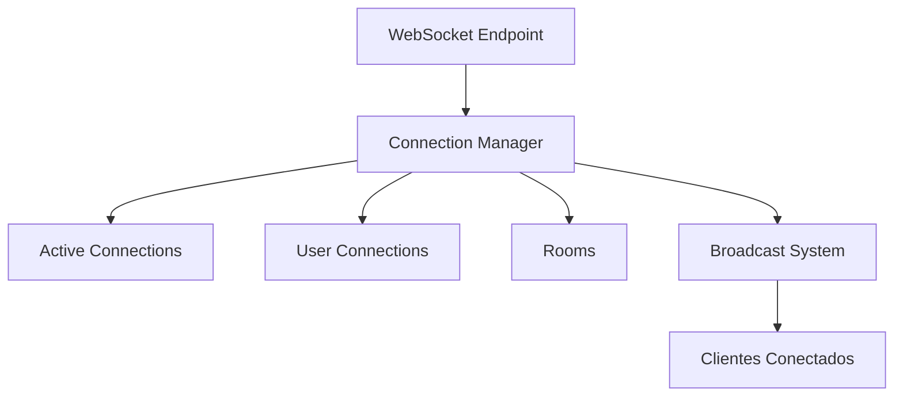
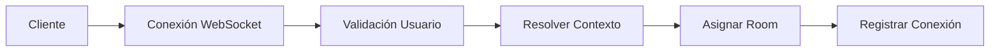
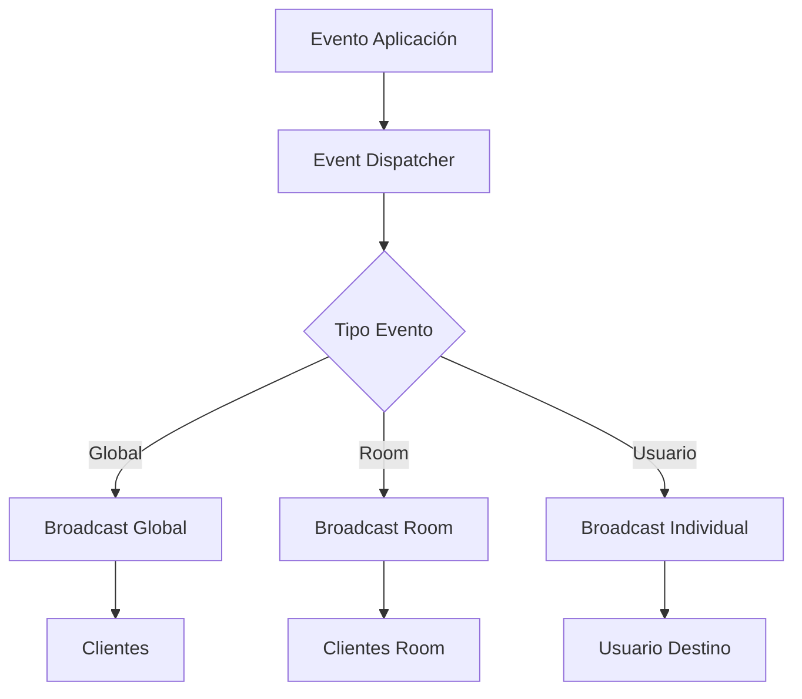
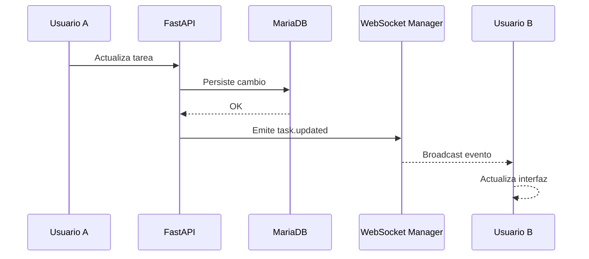
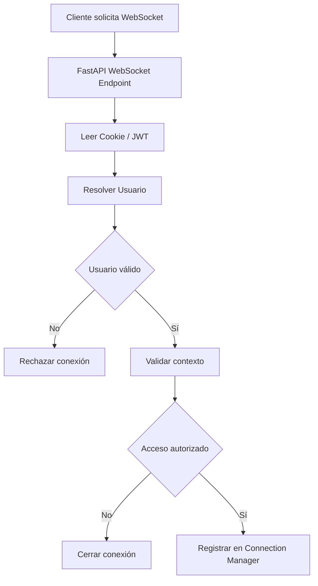
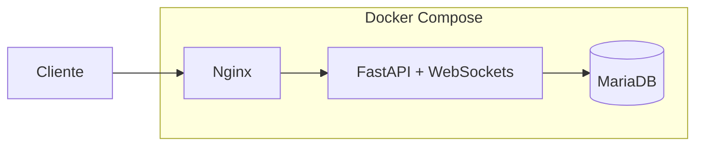
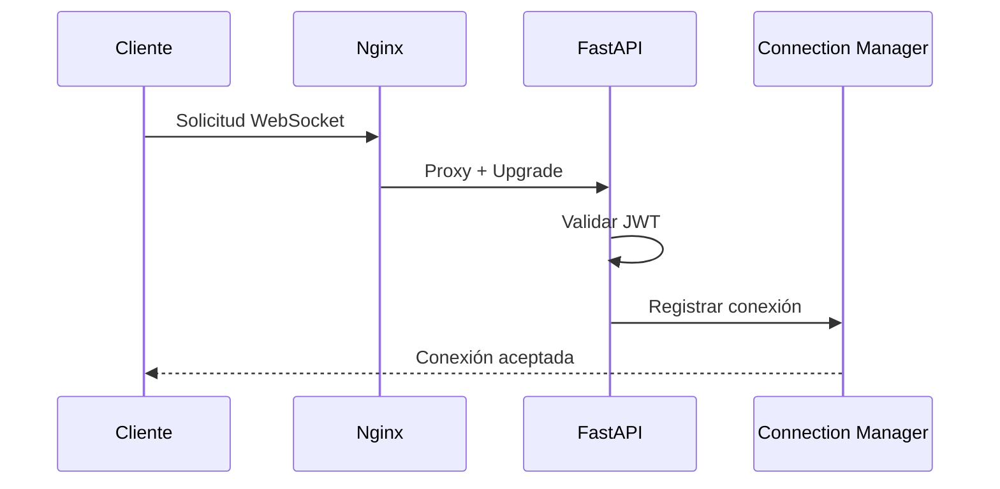
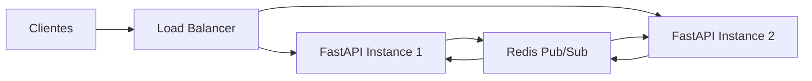

# 21_WEBSOCKET_SYSTEM.md

# ⚡ Sistema WebSocket

---

# 📌 Introducción

Uno de los componentes tecnológicos más importantes de Aula Robótica Platform es su sistema de comunicación en tiempo real basado en **WebSockets**.

A diferencia del modelo tradicional basado exclusivamente en peticiones HTTP, donde el cliente debe consultar periódicamente al servidor para detectar cambios, la utilización de WebSockets permite mantener una conexión persistente entre cliente y servidor, posibilitando la transmisión inmediata de información en ambos sentidos.

Esta arquitectura resulta especialmente adecuada para aplicaciones colaborativas donde varios usuarios trabajan simultáneamente sobre los mismos recursos y requieren una sincronización continua.

La implementación desarrollada en Aula Robótica Platform se basa en **FastAPI**, utilizando capacidades ASGI para gestionar conexiones persistentes, broadcasting de eventos y sincronización multiusuario dentro de una infraestructura desplegada sobre Docker, Nginx y Ubuntu Server.

---

# 🎯 Objetivos

El sistema WebSocket fue diseñado para satisfacer varios objetivos funcionales y técnicos.

## Objetivos funcionales

- sincronizar información en tiempo real;
- mejorar la experiencia de usuario;
- reducir recargas completas de páginas;
- facilitar la colaboración simultánea;
- mantener dashboards dinámicos;
- ofrecer notificaciones instantáneas.

---

## Objetivos técnicos

- mantener conexiones persistentes;
- minimizar la latencia;
- reducir tráfico HTTP innecesario;
- desacoplar comunicación realtime del flujo REST;
- integrarse con FastAPI;
- soportar múltiples clientes simultáneos;
- funcionar correctamente tras un Reverse Proxy Nginx;
- ser compatible con Docker Compose.

---

# 🧠 Principios de Diseño

La arquitectura WebSocket sigue varios principios fundamentales.

---

# Comunicación Orientada a Eventos

La plataforma únicamente transmite información cuando ocurre un cambio relevante.

En lugar de realizar consultas periódicas al servidor, éste envía automáticamente los eventos necesarios únicamente a los clientes interesados.

Este modelo reduce considerablemente el tráfico de red y mejora la capacidad de respuesta de la aplicación.

---

# Persistencia de Conexión

Cada navegador mantiene una conexión abierta mientras la sesión permanece activa.

Gracias a ello es posible:

- recibir eventos instantáneamente;
- enviar información sin establecer nuevas conexiones;
- mantener sincronización continua;
- detectar desconexiones de usuarios.

---

# Separación HTTP / WebSocket

La arquitectura diferencia claramente dos tipos de comunicación.

## HTTP

Se utiliza para:

- autenticación;
- operaciones CRUD;
- carga inicial de páginas;
- renderizado SSR;
- descarga de información.

---

## WebSocket

Se utiliza exclusivamente para:

- sincronización;
- notificaciones;
- actividad reciente;
- Kanban colaborativo;
- presencia de usuarios;
- actualización de dashboards.

Esta separación simplifica considerablemente el mantenimiento del sistema.

---

# Arquitectura General

La comunicación en tiempo real se integra sobre la arquitectura principal del proyecto.

```mermaid
flowchart LR

Cliente

<-- HTTP -->

FastAPI

Cliente

<-- WebSocket -->

WebSocket Endpoint

WebSocket Endpoint

--> Connection Manager

Connection Manager

--> Event Dispatcher

Event Dispatcher

--> Clientes Conectados
```

---

# Arquitectura Desplegada

Una vez desplegada la plataforma sobre infraestructura cloud, las conexiones WebSocket atraviesan varias capas.

```mermaid
flowchart LR

Usuario

--> Internet

Internet

--> Nginx

Nginx

--> FastAPI

FastAPI

--> WebSocket Endpoint

WebSocket Endpoint

--> Connection Manager
```

Esta arquitectura permite que Nginx gestione el protocolo **HTTP Upgrade**, manteniendo posteriormente la comunicación bidireccional entre cliente y servidor.

---

# Componentes Principales

La arquitectura WebSocket está formada por varios componentes especializados.

| Componente | Responsabilidad |
|------------|-----------------|
| Cliente Web | Mantener conexión persistente |
| WebSocket Endpoint | Gestionar handshake |
| Connection Manager | Administrar conexiones |
| Rooms | Agrupar clientes |
| Event Dispatcher | Distribuir eventos |
| Broadcast System | Sincronizar usuarios |

---

# Cliente Web

El navegador inicia automáticamente la conexión WebSocket una vez autenticado el usuario y renderizada la interfaz principal.

Desde ese momento permanece escuchando eventos enviados por el servidor.

Entre sus responsabilidades destacan:

- abrir la conexión;
- detectar desconexiones;
- recibir mensajes;
- actualizar el DOM;
- mantener sincronización visual.

---

# WebSocket Endpoint

FastAPI expone uno o varios endpoints específicos para la comunicación realtime.

Estos endpoints son independientes de la API REST.

Sus responsabilidades incluyen:

- aceptar conexiones;
- validar autenticación;
- registrar usuarios;
- gestionar desconexiones;
- recibir mensajes del cliente.

---

# Ciclo de Vida de una Conexión

Cada conexión WebSocket sigue una secuencia perfectamente definida.

```mermaid
flowchart TD

Cliente

--> Handshake

Handshake

--> Validación

Validación

--> Registro

Registro

--> Comunicación

Comunicación

--> Desconexión

Desconexión

--> Liberación Recursos
```

---

# Fase 1 — Handshake

El navegador solicita el cambio de protocolo utilizando una petición HTTP estándar.

El servidor responde mediante el código:

```text
101 Switching Protocols
```

confirmando el establecimiento de la conexión WebSocket.

---

# Fase 2 — Validación

Antes de aceptar definitivamente la conexión, el servidor verifica:

- identidad del usuario;
- sesión válida;
- token JWT;
- permisos mínimos;
- contexto de acceso.

Solo tras superar estas comprobaciones la conexión queda registrada.

---

# Fase 3 — Registro

Una vez autenticado el usuario:

- la conexión se almacena en el Connection Manager;
- se asocia al usuario correspondiente;
- se incorpora a las rooms necesarias;
- queda preparada para recibir eventos.

---

# Fase 4 — Comunicación

Durante esta fase el servidor puede enviar eventos en cualquier momento sin necesidad de nuevas peticiones HTTP.

La comunicación permanece abierta mientras:

- el navegador permanezca conectado;
- la sesión siga siendo válida;
- no exista una desconexión voluntaria.

---

# Fase 5 — Desconexión

La conexión puede finalizar por distintos motivos.

Entre ellos:

- cierre del navegador;
- pérdida de conectividad;
- cierre de sesión;
- reinicio del servidor;
- timeout.

Cuando esto ocurre el Connection Manager elimina automáticamente la conexión y libera los recursos asociados.

---

# Beneficios de la Arquitectura

La utilización de WebSockets proporciona numerosas ventajas frente al modelo tradicional basado únicamente en HTTP.

Entre las más importantes destacan:

- menor latencia;
- comunicación bidireccional;
- menor tráfico de red;
- mayor sensación de inmediatez;
- colaboración multiusuario;
- dashboards dinámicos;
- sincronización instantánea;
- arquitectura moderna preparada para crecimiento.

---

# Connection Manager

El **Connection Manager** constituye el componente central del sistema WebSocket.

Su responsabilidad principal es mantener el registro de conexiones activas y permitir la comunicación entre el servidor y los clientes conectados.

Actúa como capa de coordinación entre:

- endpoints WebSocket;
- usuarios conectados;
- rooms;
- eventos;
- broadcasting.

---

# Responsabilidades del Connection Manager

Entre sus responsabilidades principales se encuentran:

- registrar nuevas conexiones;
- eliminar conexiones cerradas;
- asociar conexiones a usuarios;
- asociar conexiones a rooms;
- enviar mensajes individuales;
- realizar broadcasting;
- gestionar desconexiones;
- mantener estado de usuarios conectados.

---

# Modelo Conceptual



---

# Gestión de Conexiones Activas

Cada conexión WebSocket aceptada queda almacenada temporalmente mientras el usuario permanece conectado.

El sistema mantiene referencias a:

- conexión WebSocket;
- usuario asociado;
- room asignada;
- contexto funcional;
- timestamp conexión.

Esto permite enviar eventos únicamente a los usuarios adecuados.

---

# Conexiones por Usuario

Un mismo usuario puede mantener más de una conexión activa.

Por ejemplo:

- misma sesión en dos pestañas;
- navegador principal;
- ventana secundaria;
- dispositivo adicional.

Por este motivo, el sistema no asume una relación estrictamente uno-a-uno entre usuario y conexión.

```text
User

↓

Connection 1

↓

Connection 2

↓

Connection 3
```

Esta decisión permite una experiencia más flexible y realista.

---

# Rooms

Las **rooms** permiten agrupar conexiones según el contexto funcional.

En lugar de enviar todos los eventos a todos los clientes, el sistema organiza los usuarios conectados por ámbitos.

---

# Tipos de Rooms

| Room | Uso |
|------|-----|
| dashboard | eventos globales autorizados |
| project:{id} | eventos específicos de proyecto |
| user:{id} | notificaciones privadas |
| notifications | avisos generales |
| kanban:{project_id} | sincronización tablero Kanban |

---

# Ventajas de las Rooms

La utilización de rooms permite:

- reducir tráfico innecesario;
- mejorar rendimiento;
- aislar información;
- limitar eventos por contexto;
- facilitar escalabilidad futura.

---

# Registro en Rooms

Cuando un usuario abre una vista específica, el frontend puede solicitar su incorporación a la room correspondiente.

Ejemplos:

- al entrar en Dashboard → room dashboard;
- al abrir un proyecto → room project:{id};
- al abrir Kanban → room kanban:{project_id};
- al iniciar sesión → room user:{id}.

---

# Flujo de Registro en Room



---

# Broadcasting

El broadcasting permite distribuir eventos desde el servidor hacia múltiples clientes conectados.

---

# Tipos de Broadcasting

## Broadcast global

Envía un evento a todos los usuarios conectados autorizados.

Uso típico:

- actualizaciones generales;
- avisos del sistema;
- cambios de dashboard.

---

## Broadcast por room

Envía eventos únicamente a los usuarios suscritos a una room.

Uso típico:

- actualizaciones de proyecto;
- cambios Kanban;
- actividad reciente;
- notificaciones contextuales.

---

## Broadcast individual

Envía un evento a un usuario concreto.

Uso típico:

- notificación privada;
- aviso de asignación;
- evento personalizado.

---

# Arquitectura de Broadcasting



---

# Tipos de Eventos

El sistema WebSocket trabaja con eventos estructurados.

Cada evento suele incluir:

- tipo;
- payload;
- timestamp;
- contexto;
- usuario origen;
- recurso afectado.

---

# Ejemplo Conceptual de Evento

```json
{
  "type": "task.updated",
  "project_id": 4,
  "task_id": 18,
  "status": "in_progress",
  "updated_by": 2,
  "timestamp": "2026-06-01T10:30:00"
}
```

---

# Eventos de Dashboard

Los eventos de Dashboard actualizan información operativa global.

Pueden afectar a:

- métricas;
- actividad reciente;
- usuarios conectados;
- notificaciones;
- estado de tareas.

---

# Eventos de Kanban

Los eventos Kanban permiten sincronizar cambios entre usuarios.

Ejemplos:

```text
task.created
task.updated
task.moved
task.deleted
task.status_changed
```

Cuando un usuario mueve una tarea, los demás usuarios conectados al mismo tablero reciben el evento y actualizan la interfaz.

---

# Flujo de Evento Kanban



---

# Eventos de Actividad Reciente

El activity feed se actualiza dinámicamente mediante eventos realtime.

Cuando ocurre una acción relevante:

1. El backend registra la actividad.
2. Se construye un evento.
3. El evento se distribuye a los usuarios autorizados.
4. La interfaz inserta el nuevo elemento sin recargar.

---

# Eventos de Notificaciones

Las notificaciones utilizan WebSockets para informar al usuario en tiempo real.

Ejemplos:

- tarea asignada;
- cambio de estado;
- actividad relevante;
- aviso del sistema.

---

# Sincronización Multiusuario

La sincronización multiusuario es uno de los objetivos principales del sistema WebSocket.

Permite que varios usuarios trabajen simultáneamente sobre el mismo contexto sin perder coherencia visual.

---

# Casos de Sincronización

## Caso 1 — Movimiento de tarea

Un usuario mueve una tarea en el Kanban.

Los demás usuarios ven el cambio instantáneamente.

---

## Caso 2 — Nueva actividad

Un usuario registra una actividad.

El activity feed se actualiza automáticamente.

---

## Caso 3 — Nueva notificación

Un usuario recibe una notificación sin recargar la página.

---

## Caso 4 — Usuarios conectados

El sistema actualiza el estado de presencia de usuarios.

---

# Consistencia Visual

El sistema realtime no sustituye a la base de datos.

La fuente de verdad sigue siendo MariaDB.

Los WebSockets actúan como canal de propagación de cambios ya validados y persistidos.

```text
Operación HTTP

↓

Validación Backend

↓

Persistencia MariaDB

↓

Evento WebSocket

↓

Actualización UI
```

---

# Relación con la Base de Datos

Los WebSockets **no escriben directamente en MariaDB**.

La persistencia continúa realizándose a través de:

- routers HTTP;
- servicios backend;
- SQLAlchemy;
- transacciones de base de datos.

Después de persistir un cambio, el backend emite el evento realtime correspondiente.

Esta separación evita inconsistencias y mantiene clara la responsabilidad de cada capa.

---

# Integración con Dashboard

El Dashboard consume eventos realtime para actualizar:

- métricas;
- actividad reciente;
- usuarios conectados;
- notificaciones.

Esto convierte el panel en un punto de observación dinámica del sistema.

---

# Integración con Kanban

El Kanban colaborativo utiliza WebSockets para sincronizar:

- creación de tareas;
- movimiento entre columnas;
- cambios de estado;
- actualizaciones de contenido.

El resultado es una experiencia colaborativa más fluida.

---

# Integración con Notificaciones

Las notificaciones realtime permiten informar al usuario sin polling.

Esto mejora:

- rapidez de respuesta;
- experiencia usuario;
- percepción de sistema vivo;
- coordinación entre participantes.

---

# Beneficios del Sistema de Rooms y Broadcasting

La combinación de rooms y broadcasting aporta:

- menor latencia;
- menor carga servidor;
- menor tráfico red;
- mayor seguridad contextual;
- sincronización granular;
- base preparada para escalabilidad futura.

---

# 🔐 Seguridad WebSocket

Las conexiones WebSocket requieren controles específicos de seguridad porque permanecen abiertas durante periodos prolongados y permiten comunicación bidireccional entre cliente y servidor.

La seguridad del sistema realtime se integra con la arquitectura general de autenticación y autorización de Aula Robótica Platform.

---

# Autenticación de la Conexión

Antes de aceptar una conexión WebSocket, el backend valida la identidad del usuario.

La autenticación se basa en:

* JWT;
* cookies HTTPOnly;
* sesión activa;
* usuario habilitado.

La conexión únicamente se acepta cuando el usuario puede ser resuelto correctamente desde el contexto de autenticación.

---

# Flujo de Seguridad



---

# Autorización Contextual

Además de autenticar al usuario, el sistema verifica si puede acceder al contexto solicitado.

Las comprobaciones pueden incluir:

* pertenencia al proyecto;
* permisos sobre el recurso;
* rol contextual;
* ownership;
* acceso a la room;
* estado activo del usuario.

Esto evita que una conexión autenticada acceda automáticamente a cualquier canal realtime.

---

# Aislamiento por Rooms

Las rooms actúan como mecanismo de segmentación funcional y de seguridad.

Cada usuario únicamente puede incorporarse a aquellas rooms para las que dispone de autorización.

Ejemplos:

```text
project:12
user:8
kanban:12
dashboard
notifications
```

La separación por rooms evita distribuir eventos sensibles a usuarios ajenos al contexto.

---

# Validación de Eventos

Los mensajes recibidos desde cliente nunca se consideran confiables por defecto.

El backend debe validar:

* estructura del mensaje;
* tipo de evento;
* identificadores;
* permisos;
* contexto;
* recurso afectado.

Las operaciones de negocio no deben ejecutarse únicamente por recibir un mensaje WebSocket.

---

# Separación entre Comando y Notificación

En la arquitectura actual, las operaciones críticas se realizan preferentemente mediante HTTP.

El flujo recomendado es:

```text
Cliente envía operación HTTP
        ↓
FastAPI valida y procesa
        ↓
SQLAlchemy persiste
        ↓
Backend genera evento
        ↓
WebSocket notifica a clientes
```

De este modo, WebSocket actúa principalmente como canal de sincronización y no como sustituto de la capa de servicios.

---

# ⚙️ Integración con FastAPI

FastAPI proporciona soporte nativo para WebSockets mediante ASGI.

La implementación realtime se integra con:

* endpoints WebSocket;
* servicios de negocio;
* helpers de autenticación;
* connection managers;
* routers HTTP;
* middleware de seguridad.

---

# Endpoints WebSocket

Los endpoints WebSocket gestionan:

* aceptación de conexiones;
* validación de usuario;
* incorporación a rooms;
* recepción de mensajes;
* gestión de desconexiones.

Ejemplos conceptuales:

```text
/ws/dashboard
/ws/notifications
/ws/projects/{project_id}
```

---

# Integración con la Capa de Servicios

La lógica de negocio no debe residir directamente en el endpoint WebSocket.

El endpoint coordina la comunicación, mientras que los servicios se encargan de:

* validaciones;
* persistencia;
* reglas de negocio;
* autorización;
* generación de eventos.

Esta separación mantiene la arquitectura modular y facilita el testing.

---

# Gestión de Errores

Los errores pueden producirse durante:

* autenticación;
* validación;
* recepción de mensajes;
* broadcasting;
* desconexión;
* pérdida de red.

El sistema debe gestionar estas situaciones evitando que una conexión defectuosa afecte al resto de usuarios.

---

# Tratamiento de Desconexiones

Cuando una conexión se cierra:

1. Se elimina del Connection Manager.
2. Se elimina de sus rooms.
3. Se actualiza la presencia del usuario.
4. Se liberan recursos.
5. Se registra la desconexión si procede.

---

# 🐳 Integración con Docker

El sistema WebSocket se ejecuta dentro del contenedor principal de FastAPI.

Docker permite mantener un entorno reproducible para:

* Uvicorn;
* FastAPI;
* dependencias;
* configuración;
* red interna.

---

# Arquitectura Multicontenedor



---

# Comunicación Interna

La comunicación entre Nginx y FastAPI se realiza mediante la red interna de Docker Compose.

FastAPI no necesita exponerse directamente a Internet.

Esto permite:

* reducir superficie de ataque;
* centralizar entrada;
* simplificar configuración;
* aislar servicios.

---

# 🌐 Integración con Nginx

Nginx actúa como Reverse Proxy tanto para tráfico HTTP como para WebSockets.

Para que una conexión WebSocket funcione correctamente, Nginx debe permitir el cambio de protocolo HTTP.

---

# HTTP Upgrade

El navegador solicita cambiar de protocolo utilizando cabeceras específicas.

Nginx debe reenviar dichas cabeceras a FastAPI.

Configuración conceptual:

```nginx
proxy_set_header Upgrade $http_upgrade;
proxy_set_header Connection "upgrade";
```

---

# Flujo Desplegado



---

# Beneficios de Nginx

Nginx aporta:

* punto único de entrada;
* ocultación de FastAPI;
* proxy WebSocket;
* gestión de cabeceras;
* preparación para HTTPS;
* futura escalabilidad.

---

# ☁️ Validación en Entorno Desplegado

La arquitectura WebSocket fue validada sobre un VPS Linux real en Hetzner Cloud.

La infraestructura utilizada incluye:

* Ubuntu Server 24.04;
* Docker;
* Docker Compose;
* Nginx;
* FastAPI;
* MariaDB persistente.

---

# Pruebas Realizadas

Se verificó:

* conexión inicial;
* handshake correcto;
* código HTTP 101;
* múltiples clientes;
* rooms;
* broadcasting;
* persistencia de la conexión;
* funcionamiento detrás de Nginx;
* comportamiento tras reinicio.

---

# Verificación mediante DevTools

Las herramientas de desarrollo del navegador permitieron comprobar:

* estado de la conexión;
* frames enviados;
* frames recibidos;
* código de respuesta;
* duración;
* eventos intercambiados.

El código esperado durante el handshake es:

```text
101 Switching Protocols
```

---

# Verificación mediante Logs

Los logs de FastAPI y Docker permitieron revisar:

* conexiones aceptadas;
* desconexiones;
* errores;
* broadcasting;
* excepciones;
* actividad realtime.

Comandos habituales:

```bash
docker compose logs -f api
```

```bash
docker compose logs -f nginx
```

---

# Incidencias Detectadas

Durante el despliegue se detectaron problemas reales relacionados con:

* autenticación WebSocket;
* configuración de Nginx;
* uso incorrecto de `await`;
* resolución de usuario;
* desconexiones;
* cabeceras Upgrade.

La resolución de estas incidencias permitió validar la arquitectura completa en un entorno cercano a producción.

---

# 📈 Rendimiento y Concurrencia

WebSockets permiten mantener múltiples conexiones simultáneas con un consumo menor que el polling frecuente.

FastAPI y Uvicorn utilizan un modelo asíncrono basado en ASGI, adecuado para cargas con numerosas conexiones persistentes.

---

# Ventajas del Modelo Asíncrono

* menor bloqueo;
* mejor utilización de recursos;
* alta concurrencia;
* baja latencia;
* integración con `asyncio`.

---

# Consideraciones de Rendimiento

El rendimiento depende de:

* número de conexiones;
* frecuencia de eventos;
* tamaño de mensajes;
* número de rooms;
* lógica ejecutada por evento;
* capacidad del servidor.

---

# Limitaciones Actuales

La implementación actual utiliza gestión de conexiones en memoria dentro de una única instancia de FastAPI.

Esto significa que:

* las conexiones pertenecen a un único proceso;
* el broadcasting no se comparte entre múltiples instancias;
* el escalado horizontal requiere infraestructura adicional.

---

# Escalabilidad Futura

Para soportar múltiples instancias podrían incorporarse tecnologías como:

* Redis Pub/Sub;
* RabbitMQ;
* Apache Kafka;
* backplanes distribuidos;
* balanceadores compatibles con WebSocket;
* sticky sessions.

---

# Arquitectura Distribuida Futura



---

# 🧪 Estrategia de Testing

El sistema realtime requiere validaciones complementarias a los tests HTTP tradicionales.

---

# Testing Unitario

Permite probar:

* Connection Manager;
* registro de conexiones;
* eliminación;
* rooms;
* helpers;
* serialización de eventos.

---

# Testing de Integración

Permite validar:

* apertura de conexiones;
* autenticación;
* recepción de mensajes;
* broadcasting;
* cierre de conexión.

---

# Testing Manual

Se realizaron pruebas con:

* dos navegadores;
* pestañas independientes;
* usuarios diferentes;
* cambios Kanban;
* notificaciones;
* actividad reciente.

---

# Validación Operativa

También se verificó:

* funcionamiento tras Nginx;
* reconexión;
* comportamiento tras reinicio;
* logs;
* estabilidad en VPS.

---

# 📊 Observabilidad

Actualmente la observabilidad realtime se apoya principalmente en logs.

Los eventos registrados pueden incluir:

* apertura de conexión;
* cierre;
* usuario;
* room;
* error;
* tipo de evento.

---

# Mejoras de Observabilidad

La arquitectura queda preparada para incorporar:

* métricas de conexiones activas;
* eventos por segundo;
* latencia;
* errores;
* reconexiones;
* uso por room;
* Prometheus;
* Grafana.

---

# 📈 Estado Actual

Actualmente el sistema WebSocket dispone de:

✅ Conexiones persistentes.

✅ Autenticación mediante JWT.

✅ Connection Manager.

✅ Rooms contextuales.

✅ Broadcasting.

✅ Kanban realtime.

✅ Notificaciones realtime.

✅ Actividad reciente.

✅ Usuarios conectados.

✅ Integración FastAPI.

✅ Integración Docker.

✅ Proxy WebSocket mediante Nginx.

✅ Validación en VPS.

---

# 🔮 Evolución Futura

La arquitectura actual permite evolucionar hacia:

* Redis Pub/Sub;
* múltiples instancias FastAPI;
* escalabilidad horizontal;
* presencia avanzada;
* reconexión automática;
* entrega garantizada;
* versionado de eventos;
* observabilidad avanzada;
* dashboards realtime enriquecidos;
* colaboración distribuida.

---

# 📌 Conclusión

El sistema WebSocket de Aula Robótica Platform constituye una de las piezas técnicas más relevantes de la plataforma.

La combinación de:

* FastAPI;
* ASGI;
* Connection Manager;
* rooms;
* broadcasting;
* JWT;
* Docker;
* Nginx;
* VPS Linux;

permite proporcionar una experiencia colaborativa en tiempo real sobre una infraestructura cloud real.

La arquitectura mantiene una separación clara entre operaciones HTTP, persistencia y propagación de eventos. MariaDB continúa siendo la fuente de verdad, mientras que WebSockets actúan como canal de sincronización entre clientes.

Esta aproximación mejora la experiencia de usuario, facilita la colaboración multiusuario y deja preparada la plataforma para futuras evoluciones hacia arquitecturas distribuidas y escalables.
