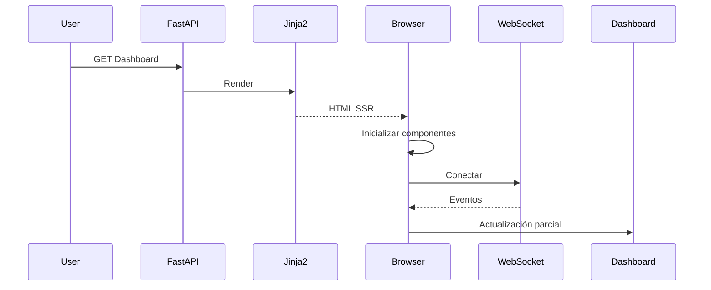
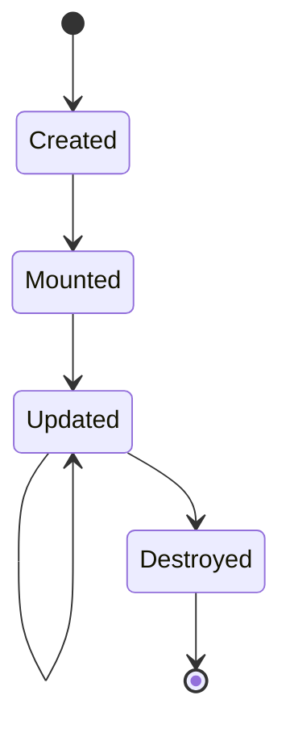
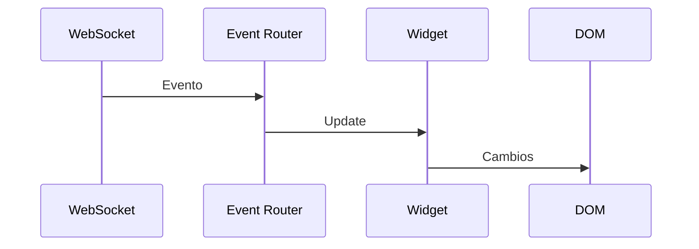
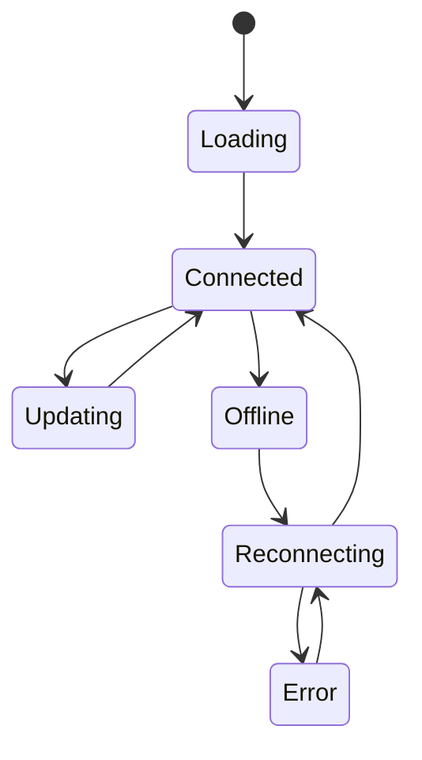
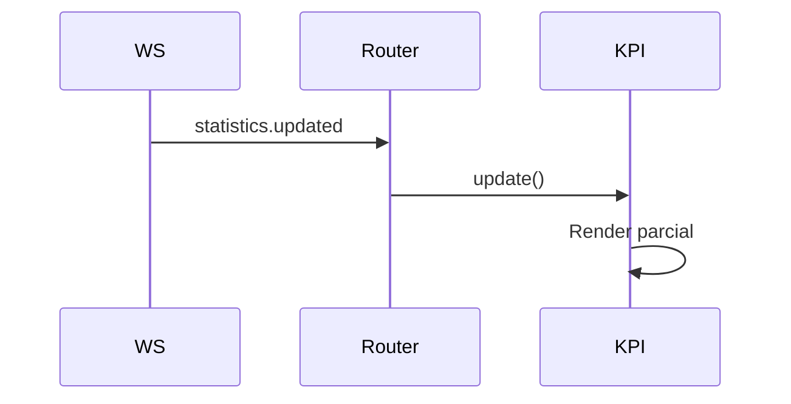
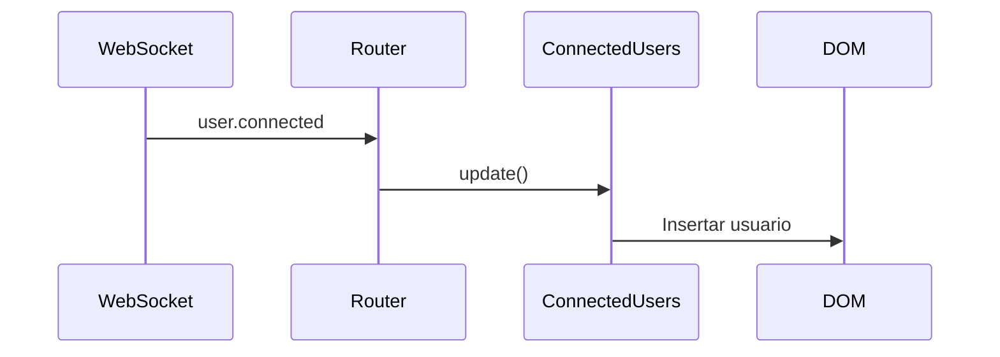

# 22. Realtime Dashboard

---

# 1. Introducción

El **Realtime Dashboard** constituye el centro operativo de Aula Robótica Platform para la visualización en tiempo real del estado global de la plataforma. Su objetivo es ofrecer una representación continuamente actualizada de la información más relevante sin necesidad de recargar la página, proporcionando una experiencia de usuario fluida, reactiva y coherente con la arquitectura basada en **FastAPI**, **Jinja2**, **WebSockets** y **Server-Side Rendering (SSR)**.

A diferencia de una aplicación SPA tradicional, el Dashboard no reemplaza el renderizado generado por el servidor, sino que complementa el HTML inicial mediante actualizaciones parciales controladas por eventos, preservando así las ventajas del renderizado en servidor en términos de rendimiento inicial, SEO, accesibilidad y simplicidad arquitectónica.

El Dashboard actúa como un consumidor especializado de eventos en tiempo real, integrando información procedente de distintos módulos funcionales de la plataforma, como proyectos, actividades, tareas, auditoría, usuarios conectados y notificaciones.

---

# 2. Objetivos

El Dashboard en tiempo real persigue los siguientes objetivos:

- proporcionar una visión global del estado de la plataforma;
- reducir la necesidad de recargas manuales;
- mejorar la capacidad de supervisión de profesores y administradores;
- facilitar la detección inmediata de cambios relevantes;
- minimizar el tráfico HTTP mediante WebSockets;
- actualizar únicamente los componentes afectados;
- mantener una experiencia consistente entre diferentes módulos;
- preservar la filosofía SSR de la aplicación.

---

# 3. Papel dentro de la arquitectura

El Dashboard pertenece a la capa de presentación y consume información publicada por el backend mediante WebSockets.

No contiene lógica de negocio ni realiza consultas directas a la base de datos.

```mermaid
flowchart TD

FastAPI
--> Service Layer
--> Event Publisher
--> WebSocket Server

WebSocket Server
--> Dashboard

Dashboard
--> Widgets
--> Cards
--> Charts
--> Tables
--> Notifications
```

La información sigue siendo generada y validada exclusivamente por el backend.

---

# 4. Principios de diseño

El Dashboard sigue los siguientes principios arquitectónicos:

- Server-Side Rendering como punto de partida.
- Mejora progresiva.
- Actualización incremental.
- Componentes desacoplados.
- Comunicación basada en eventos.
- Alta cohesión.
- Bajo acoplamiento.
- Accesibilidad.
- Escalabilidad.
- Tolerancia a fallos.

---

# 5. Filosofía SSR + Realtime

El HTML inicial se genera completamente mediante Jinja2.

Tras el renderizado:

1. se inicializan los componentes JavaScript;
2. se establece la conexión WebSocket;
3. los widgets comienzan a recibir actualizaciones;
4. únicamente cambian los elementos afectados.



---

# 6. Beneficios

La arquitectura proporciona numerosas ventajas:

- carga inicial rápida;
- excelente indexabilidad;
- menor consumo de CPU del cliente;
- menor complejidad respecto a SPA;
- sincronización inmediata;
- menor tráfico HTTP;
- mejor experiencia de usuario;
- mantenimiento simplificado.

---

# 7. Casos de uso

El Dashboard puede utilizarse para visualizar:

- proyectos activos;
- tareas pendientes;
- actividad reciente;
- usuarios conectados;
- últimas modificaciones;
- incidencias;
- notificaciones;
- estado del sistema;
- estadísticas generales.

Cada organización puede personalizar parcialmente la información mostrada según el perfil del usuario.

---

# 8. Arquitectura general

```mermaid
flowchart TD

Dashboard

--> Header

--> KPI Cards

--> Charts

--> Timeline

--> Activity Feed

--> Connected Users

--> Notifications

--> Recent Projects

--> System Status
```

Cada widget mantiene una responsabilidad completamente independiente.

---

# 9. Arquitectura por componentes

Cada sección del Dashboard se implementa como un componente autónomo.

```mermaid
flowchart LR

Dashboard

--> Widget A

--> Widget B

--> Widget C

--> Widget D

--> Widget E
```

Los componentes no deben depender directamente unos de otros.

---

# 10. Organización de carpetas

Ejemplo recomendado:

```text
templates/
└── dashboard/
    ├── dashboard.html
    ├── widgets/
    │   ├── kpis.html
    │   ├── activity_feed.html
    │   ├── connected_users.html
    │   ├── notifications.html
    │   ├── charts.html
    │   ├── recent_projects.html
    │   └── system_status.html
```

JavaScript:

```text
static/js/pages/dashboard/
    dashboard.js
    dashboard-events.js
    dashboard-widgets.js
```

---

# 11. Dashboard Controller

El Router únicamente solicita la información necesaria.

```mermaid
flowchart LR

Router

↓

Service Layer

↓

Dashboard ViewModel

↓

Jinja2

↓

Dashboard HTML
```

El controlador no construye widgets.

---

# 12. Dashboard Service

El Service Layer prepara la información inicial.

Puede recopilar:

- estadísticas;
- proyectos;
- tareas;
- usuarios;
- auditoría;
- actividad reciente.

Todo el cálculo pertenece al backend.

---

# 13. Dashboard ViewModel

El ViewModel adapta la información para la interfaz.

Responsabilidades:

- transformar DTO;
- ordenar elementos;
- limitar resultados;
- preparar formatos;
- calcular estados visuales.

Nunca debe contener HTML.

---

# 14. Carga inicial

El Dashboard siempre dispone de una representación completa antes de conectar WebSockets.

Esto garantiza:

- funcionamiento sin JavaScript;
- accesibilidad;
- SEO;
- carga inmediata;
- degradación elegante.

---

# 15. Bootstrap

Durante la carga:

```text
HTML

↓

Dashboard JS

↓

Component Registry

↓

Widget Initialization

↓

WebSocket Connection
```

---

# 16. Widgets

Cada widget representa una responsabilidad funcional.

Ejemplos:

- usuarios conectados;
- últimos proyectos;
- actividad reciente;
- tareas críticas;
- KPIs;
- gráficos;
- auditoría.

---

# 17. Widget independiente

Cada widget implementa su propio ciclo de vida.

```mermaid
flowchart TD

Create

↓

Mount

↓

Update

↓

Destroy
```

---

# 18. Contrato de un widget

Todo widget debe exponer conceptualmente:

```text
constructor()

mount()

update()

destroy()
```

La implementación concreta depende del tipo de componente.

---

# 19. Component Registry

El Dashboard reutiliza el Component Registry definido para toda la aplicación.

```mermaid
flowchart TD

Registry

↓

Dashboard Widget

↓

Dashboard Widget

↓

Dashboard Widget
```

La inicialización se realiza automáticamente.

---

# 20. Inicialización declarativa

Ejemplo:

```html
<section
    data-component="dashboard-kpis">
</section>

<section
    data-component="activity-feed">
</section>
```

El HTML declara el comportamiento sin contener lógica JavaScript.

---

# 21. Responsabilidad única

Cada widget responde exclusivamente de su propia información.

Ejemplos:

- Activity Feed no modifica KPIs.
- KPIs no modifican gráficos.
- Usuarios conectados no actualizan tareas.
- Notificaciones no modifican estadísticas.

Esta separación reduce el acoplamiento.

---

# 22. Ciclo de vida



---

# 23. Actualización incremental

Las actualizaciones modifican únicamente el widget afectado.

```mermaid
flowchart LR

Evento

↓

Widget

↓

DOM parcial
```

Nunca se reconstruye todo el Dashboard.

---

# 24. Beneficios del renderizado incremental

Permite:

- menor consumo de CPU;
- menos reflows;
- menos repaint;
- menor tráfico;
- mejor respuesta visual;
- mayor escalabilidad.

---

# 25. Estado del Dashboard

El Dashboard mantiene únicamente estado visual.

Ejemplos:

- cargando;
- conectado;
- desconectado;
- expandido;
- contraído.

El estado funcional pertenece al backend.

---

# 26. Componentes estáticos

Algunos widgets apenas cambian.

Ejemplos:

- enlaces rápidos;
- accesos directos;
- documentación;
- ayudas.

Estos componentes normalmente no utilizan WebSockets.

---

# 27. Componentes dinámicos

Otros widgets reciben eventos continuamente.

Ejemplos:

- actividad;
- usuarios;
- notificaciones;
- KPIs;
- estado del sistema.

---

# 28. Tipos de actualización

Los widgets pueden recibir:

- inserciones;
- modificaciones;
- eliminaciones;
- refrescos;
- cambios de estado;
- animaciones.

---

# 29. Actualización por eventos

```mermaid
flowchart TD

Evento

↓

Event Router

↓

Widget correspondiente

↓

Actualizar DOM
```

---

# 30. Dashboard Event Router

El Dashboard no interpreta directamente mensajes WebSocket.

Existe un Router especializado.

Responsabilidades:

- validar eventos;
- identificar widget;
- distribuir mensajes;
- ignorar eventos desconocidos;
- registrar incidencias.

---

# 31. Flujo de eventos



Cada widget permanece aislado.

---

# 32. Event Types

Ejemplos:

```text
dashboard.refresh

dashboard.statistics.updated

dashboard.activity.created

dashboard.user.connected

dashboard.user.disconnected

dashboard.notification.created
```

Los nombres deben ser consistentes con el resto de la plataforma.

---

# 33. Versionado de eventos

Los mensajes incorporan versión.

```json
{
  "version":1,
  "event":"dashboard.statistics.updated"
}
```

Esto facilita la evolución del protocolo.

---

# 34. Filtrado

Cada widget ignora eventos que no le afectan.

Esto evita trabajo innecesario.

---

# 35. Sincronización

Cuando varios eventos llegan simultáneamente:

- deben mantenerse ordenados;
- evitar duplicados;
- conservar consistencia;
- minimizar renderizados.

---

# 36. Dashboard State Manager

Aunque la fuente de verdad continúa siendo el backend, el Dashboard mantiene un pequeño estado interno para coordinar los distintos widgets.

Este estado nunca sustituye a la persistencia y únicamente representa información necesaria para la interfaz.

Ejemplos:

- estado de conexión;
- widgets activos;
- filtros seleccionados;
- timestamps de sincronización;
- indicadores de carga;
- elementos expandidos.

```mermaid
flowchart TD
    Dashboard
        --> State Manager
        --> Widgets

    State Manager
        --> Connection
        --> Filters
        --> Widget State
        --> Synchronization
```

---

# 37. Estados del Dashboard

El Dashboard puede encontrarse en distintos estados operativos.



Cada transición debe reflejarse visualmente cuando afecte a la experiencia del usuario.

---

# 38. Dashboard KPIs

Los indicadores principales representan una visión resumida del estado de la plataforma.

Ejemplos:

- proyectos activos;
- actividades abiertas;
- tareas pendientes;
- tareas vencidas;
- miembros conectados;
- competiciones activas;
- incidencias.

Cada KPI debe poder actualizarse independientemente.

---

# 39. Arquitectura de KPIs

```mermaid
flowchart LR

WebSocket

↓

Event Router

↓

KPI Widget

↓

Actualizar valor

↓

Animación
```

La actualización nunca reconstruye todas las tarjetas.

---

# 40. KPI Cards

Cada KPI constituye un componente reutilizable.

Puede contener:

- icono;
- valor;
- descripción;
- tendencia;
- variación;
- timestamp;
- enlace.

El diseño debe permanecer consistente en toda la aplicación.

---

# 41. Actualización de KPIs

Cuando cambia una métrica:

1. llega un evento;
2. se valida;
3. se actualiza el valor;
4. se ejecuta una pequeña animación;
5. se registra el timestamp.



---

# 42. Animaciones

Las animaciones deben ser discretas.

Ejemplos:

- fade;
- highlight temporal;
- incremento numérico;
- cambio suave de color.

No deben distraer continuamente al usuario.

---

# 43. Tendencias

Algunos KPIs pueden mostrar evolución.

Ejemplo:

```text
▲ +12

▼ -3

=
```

La representación debe ser comprensible incluso sin utilizar únicamente colores.

---

# 44. Timestamp de actualización

Cada widget puede mostrar:

```text
Actualizado hace 8 segundos
```

o bien almacenar el dato únicamente para diagnóstico.

---

# 45. Activity Feed

El Activity Feed presenta las últimas acciones realizadas dentro de la plataforma.

Ejemplos:

- proyecto creado;
- tarea asignada;
- actividad finalizada;
- usuario incorporado;
- comentario;
- auditoría relevante.

---

# 46. Arquitectura del Activity Feed

```mermaid
flowchart TD

Evento

↓

Activity Feed

↓

Insertar elemento

↓

Animación

↓

Actualizar scroll
```

---

# 47. Inserción incremental

Cuando llega una nueva actividad:

- se inserta al inicio;
- se elimina la última si se supera el límite;
- no se reconstruye la lista completa.

---

# 48. Límite del Feed

El Dashboard únicamente mantiene un número limitado de eventos.

Ejemplo:

```text
Últimos 20 eventos
```

El histórico completo pertenece al módulo de auditoría.

---

# 49. Deduplicación

Puede ocurrir que un mismo evento llegue más de una vez.

El Feed debe comprobar:

- eventId;
- timestamp;
- secuencia.

Los duplicados se descartan silenciosamente.

---

# 50. Orden cronológico

Los eventos deben mantenerse ordenados.

Si llega un evento retrasado:

- puede insertarse correctamente;
- o descartarse según la política del sistema.

---

# 51. Colores semánticos

Las actividades pueden diferenciarse mediante estilos consistentes.

Ejemplo:

- creación;
- modificación;
- eliminación;
- advertencia;
- sistema.

Nunca debe depender únicamente del color.

---

# 52. Iconografía

Cada tipo de actividad puede incorporar un icono.

Ejemplo:

```text
Proyecto

Actividad

Usuario

Auditoría

Competición
```

Los iconos deben pertenecer al Design System.

---

# 53. Timeline

El Activity Feed puede representarse como una línea temporal.

```mermaid
flowchart TD

Evento reciente

↓

Evento anterior

↓

Evento anterior

↓

...
```

La estructura facilita comprender la secuencia de acciones.

---

# 54. Connected Users

El Dashboard puede mostrar usuarios conectados.

Información posible:

- nombre;
- avatar;
- rol;
- proyecto;
- estado;
- última actividad.

---

# 55. Presencia

La presencia se calcula en el backend.

JavaScript únicamente refleja:

- conectado;
- ausente;
- desconectado.

---

# 56. Eventos de presencia

Ejemplos:

```text
user.connected

user.disconnected

user.presence.changed
```

---

# 57. Actualización de presencia



---

# 58. Avatar

Cada usuario puede mostrarse mediante:

- fotografía;
- iniciales;
- color corporativo;
- indicador de estado.

La representación debe ser consistente con el resto de la plataforma.

---

# 59. Estado visual

Los estados habituales pueden ser:

- online;
- idle;
- offline.

El backend determina la transición.

---

# 60. Recent Projects

El Dashboard puede mostrar los proyectos modificados recientemente.

Cada tarjeta puede incluir:

- nombre;
- coordinador;
- estado;
- fecha;
- miembros;
- progreso.

---

# 61. Actualización de proyectos

Los cambios pueden afectar a:

- nombre;
- progreso;
- miembros;
- estado;
- actividad reciente.

Cada tarjeta debe actualizarse independientemente.

---

# 62. Renderizado parcial

```mermaid
flowchart TD

Evento

↓

Project Card

↓

Actualizar campos

↓

Render parcial
```

---

# 63. Estado del sistema

Un widget puede representar el estado operativo.

Ejemplos:

- WebSocket;
- servidor;
- base de datos;
- sincronización;
- cola de eventos.

---

# 64. Indicadores

Ejemplos:

```text
● Operativo

● Advertencia

● Error
```

Debe evitarse terminología excesivamente técnica para usuarios finales.

---

# 65. Dashboard Charts

El Dashboard puede incorporar gráficos.

Ejemplos:

- tareas;
- proyectos;
- progreso;
- actividad;
- competiciones.

---

# 66. Actualización de gráficos

Los gráficos nunca deben reconstruirse completamente cuando cambia un único dato.

Debe modificarse únicamente la serie afectada.

---

# 67. Frecuencia de actualización

No todos los widgets requieren la misma frecuencia.

Ejemplo:

| Widget | Frecuencia |
|---------|------------|
| Usuarios conectados | Inmediata |
| Activity Feed | Inmediata |
| KPIs | Inmediata |
| Gráficos | Agrupada |
| Estadísticas complejas | Bajo demanda |

---

# 68. Batch Updates

Cuando llegan numerosos eventos:

```mermaid
flowchart LR

Eventos

↓

Cola

↓

Batch

↓

Actualizar Widget
```

Esto reduce renderizados consecutivos.

---

# 69. Debounce

Algunos widgets pueden utilizar debounce.

Ejemplos:

- filtros;
- gráficos;
- búsquedas;
- agregaciones.

---

# 70. Throttle

Otros widgets pueden emplear throttle.

Ejemplos:

- indicadores;
- scroll;
- resize;
- timeline.

---

# 71. Cola de eventos

El Dashboard puede mantener una cola temporal.

```text
Evento

↓

Queue

↓

Procesamiento

↓

Widget
```

Evita saturar la interfaz.

---

# 72. Prioridades

No todos los eventos poseen la misma prioridad.

Ejemplo:

Alta:

- desconexión;
- error;
- eliminación.

Media:

- modificación.

Baja:

- métricas.

---

# 73. Scheduler

Un Scheduler ligero puede decidir cuándo actualizar cada componente.

```mermaid
flowchart TD

Queue

↓

Scheduler

↓

Widget

↓

DOM
```

---

# 74. Evitar tormentas de eventos

Cuando múltiples usuarios realizan cambios simultáneamente:

- agrupar;
- limitar frecuencia;
- evitar renderizados repetidos;
- mantener consistencia.

---

# 75. Widget Loading

Cada widget puede mostrar su propio estado.

```text
Loading

↓

Ready

↓

Updating
```

No debe bloquear el resto del Dashboard.

---

# 76. Skeleton Loading

Cuando un widget necesita cargar información adicional puede utilizar skeletons.

Ventajas:

- mejor percepción;
- estabilidad visual;
- menor sensación de espera.

---

# 77. Error aislado

Si un widget falla:

- registra el error;
- muestra estado degradado;
- el resto del Dashboard continúa funcionando.

---

# 78. Arquitectura de aislamiento

```mermaid
flowchart TD

Dashboard

↓

Widget A

↓

Error

Dashboard

↓

Widget B

↓

Continúa
```

---

# 79. Reintentos

Algunos widgets pueden reintentarse automáticamente.

Ejemplo:

- estadísticas;
- indicadores;
- sincronización.

Nunca debe producirse un bucle infinito.

---

# 80. Refresh manual

El Dashboard puede ofrecer un botón:

```text
Actualizar ahora
```

Este refresco solicita nuevamente el estado completo.

---

# 81. Sincronización completa

Tras una reconexión puede ejecutarse:

```text
Reconnect

↓

Full Refresh

↓

Sincronizar Widgets
```

Garantiza consistencia.

---

# 82. Dashboard Filters

El Dashboard puede incorporar filtros.

Ejemplos:

- proyecto;
- organización;
- usuario;
- fecha;
- prioridad.

---

# 83. Estado de filtros

Los filtros forman parte del estado del Dashboard.

No deben perderse tras pequeñas actualizaciones.

---

# 84. Persistencia

Opcionalmente pueden conservarse:

- pestaña;
- filtros;
- ordenación.

Utilizando Session Storage.

---

# 85. Búsqueda

Los widgets pueden reaccionar a una búsqueda común.

```mermaid
flowchart TD

Buscar

↓

Event Bus

↓

Widgets afectados
```

---

# 86. Integración con Event Bus

El Dashboard utiliza el Event Bus interno para coordinar componentes.

Ejemplos:

```text
dashboard.filter.changed

dashboard.widget.refresh

dashboard.layout.changed
```

---

# 87. Comunicación interna

```mermaid
flowchart LR

Widget

↓

Event Bus

↓

Otro Widget
```

Sin referencias directas.

---

# 88. Configuración

Cada widget puede recibir configuración mediante:

```html
data-component

data-refresh

data-project

data-limit
```

La configuración permanece declarativa.

---

# 89. Inicialización

Durante el bootstrap:

```text
Dashboard

↓

Registry

↓

Widgets

↓

WebSocket

↓

Ready
```

---

# 90. Estado Ready

Cuando todos los widgets están inicializados:

- desaparecen indicadores;
- comienza la recepción de eventos;
- se habilitan interacciones;
- queda disponible el Dashboard en tiempo real.

---

# 91. Rendimiento avanzado

El Realtime Dashboard debe mantener una respuesta fluida incluso cuando recibe múltiples eventos simultáneos, contiene numerosos widgets o representa grandes volúmenes de información.

La estrategia de rendimiento debe centrarse en:

- reducir trabajo en el hilo principal;
- evitar actualizaciones redundantes;
- limitar manipulaciones del DOM;
- agrupar eventos;
- priorizar cambios críticos;
- diferir tareas secundarias;
- destruir correctamente recursos no utilizados.

---

# 92. Presupuesto de rendimiento

El Dashboard debe definir presupuestos técnicos orientativos.

Ejemplos:

- tiempo de bootstrap;
- número máximo de listeners;
- frecuencia máxima de renderizado;
- tamaño del bundle;
- número de widgets iniciales;
- volumen de eventos por segundo;
- memoria mantenida en cliente.

Estos límites deben revisarse mediante métricas reales y no utilizarse como valores rígidos sin contexto.

---

# 93. Evitar renderizados innecesarios

Antes de modificar el DOM, cada widget debe comprobar si la información ha cambiado realmente.

```mermaid
flowchart TD
    A[Evento recibido] --> B[Comparar estado]
    B --> C{¿Hay cambios?}
    C -->|No| D[Descartar]
    C -->|Sí| E[Actualizar DOM]
```

Esto resulta especialmente importante en KPIs, presencia y gráficos.

---

# 94. Comparación de estado

La comparación puede realizarse mediante:

- identificadores;
- versiones;
- timestamps;
- secuencias;
- valores normalizados;
- firmas ligeras.

No deben utilizarse comparaciones profundas costosas de forma indiscriminada.

---

# 95. Batch Rendering

Cuando varios eventos afectan al mismo widget, deben agruparse antes de renderizar.

```mermaid
sequenceDiagram
    participant WS as WebSocket
    participant Q as Event Queue
    participant S as Scheduler
    participant W as Widget

    WS->>Q: Evento 1
    WS->>Q: Evento 2
    WS->>Q: Evento 3
    Q->>S: Lote pendiente
    S->>W: Actualización agrupada
    W->>W: Un único render
```

---

# 96. Frame Budget

Las actualizaciones visuales deben respetar el ciclo de renderizado del navegador.

Cuando sea necesario, puede utilizarse:

```javascript
requestAnimationFrame(() => {
    widget.render();
});
```

Las operaciones costosas no deben ejecutarse repetidamente dentro del mismo frame.

---

# 97. Tareas largas

Las tareas que superen aproximadamente varias decenas de milisegundos pueden bloquear la interfaz.

Ejemplos:

- ordenar listas muy grandes;
- procesar series extensas;
- reconstruir gráficos;
- transformar muchos eventos;
- calcular agregados complejos.

Siempre que sea posible, estas tareas deben resolverse en el backend o dividirse en unidades menores.

---

# 98. Lazy Initialization

Los widgets que no sean visibles inicialmente pueden inicializarse cuando entren en viewport.

```mermaid
flowchart TD
    A[Widget fuera de viewport] --> B[Intersection Observer]
    B --> C{¿Visible?}
    C -->|No| A
    C -->|Sí| D[Inicializar widget]
```

Esto resulta útil para gráficos, tablas secundarias y paneles colapsados.

---

# 99. Destrucción de widgets

Cuando un widget desaparece debe liberar:

- listeners;
- suscripciones;
- observers;
- timers;
- AbortController;
- referencias DOM;
- instancias de librerías;
- callbacks del Event Bus.

---

# 100. Gestión de memoria

El Dashboard debe evitar referencias persistentes a nodos eliminados.

Un widget destruido no debe permanecer registrado en:

- Component Registry;
- Event Bus;
- Event Router;
- Scheduler;
- colas;
- mapas internos.

---

# 101. Límites de colecciones

Las colecciones en memoria deben tener límites explícitos.

Ejemplos:

- últimos 20 eventos;
- últimas 50 notificaciones;
- últimos 100 identificadores deduplicados;
- últimas 10 métricas por serie.

Sin estos límites, una sesión larga podría incrementar progresivamente el consumo de memoria.

---

# 102. Virtualización

Las listas extensas pueden incorporar virtualización cuando el volumen lo justifique.

Casos:

- auditoría;
- historial;
- notificaciones;
- actividad;
- miembros;
- logs.

Solo se renderizan los elementos visibles y un pequeño margen adicional.

---

# 103. Gráficos y rendimiento

Los gráficos deben evitar:

- recrear la instancia;
- recalcular todas las series;
- animar cada evento;
- mantener puntos históricos ilimitados;
- actualizar mientras la pestaña está oculta.

---

# 104. Visibilidad de la página

Cuando `document.visibilityState` sea `hidden`, el Dashboard puede:

- reducir frecuencia;
- pausar animaciones;
- agrupar eventos;
- detener métricas secundarias;
- aplazar actualizaciones visuales.

Al recuperar visibilidad debe comprobarse si necesita sincronización.

---

# 105. Pausa inteligente

```mermaid
stateDiagram-v2
    [*] --> Visible
    Visible --> Hidden: visibilitychange
    Hidden --> Buffered
    Buffered --> Visible: visibilitychange
    Visible --> Synchronizing
    Synchronizing --> Visible
```

---

# 106. Rendimiento en dispositivos modestos

La plataforma debe funcionar en equipos educativos con recursos limitados.

Por ello se debe evitar:

- exceso de librerías;
- animaciones complejas;
- actualizaciones continuas;
- gráficos innecesarios;
- bundles muy grandes;
- procesamiento pesado en cliente.

---

# 107. Adaptación por capacidades

Una evolución futura puede reducir efectos visuales cuando se detecten:

- `prefers-reduced-motion`;
- baja memoria aproximada;
- conexión lenta;
- dispositivo móvil;
- pestaña en segundo plano.

La adaptación debe conservar siempre la funcionalidad.

---

# 108. Observabilidad

El Dashboard debe generar información suficiente para diagnosticar errores de cliente y problemas de sincronización.

La observabilidad puede cubrir:

- inicialización;
- conexiones;
- reconexiones;
- eventos recibidos;
- eventos descartados;
- widgets fallidos;
- tiempos de render;
- errores HTTP;
- desfases de sincronización.

---

# 109. Arquitectura de observabilidad

```mermaid
flowchart LR
    A[Dashboard] --> B[Frontend Logger]
    B --> C[Telemetry Buffer]
    C --> D[Backend Telemetry Endpoint]
    D --> E[Logs y métricas]

    A --> F[Performance API]
    F --> B
```

---

# 110. Logging estructurado

Los registros deben utilizar una estructura coherente.

Ejemplo conceptual:

```json
{
  "level": "error",
  "component": "dashboard-activity-feed",
  "event": "render.failed",
  "dashboardVersion": "1.0.0",
  "requestId": "req_123",
  "timestamp": "2026-07-25T10:45:00Z"
}
```

---

# 111. Niveles de logging

Los niveles recomendados son:

- `debug`;
- `info`;
- `warn`;
- `error`;
- `fatal`.

En producción debe evitarse registrar información excesiva o sensible.

---

# 112. Métricas técnicas

Pueden medirse:

- tiempo de carga inicial;
- tiempo de bootstrap;
- tiempo de conexión WebSocket;
- número de reconexiones;
- eventos por minuto;
- eventos descartados;
- widgets activos;
- errores por componente;
- duración de renderizado;
- tamaño de cola.

---

# 113. Métricas funcionales

También pueden recopilarse métricas agregadas sobre:

- uso de filtros;
- widgets consultados;
- frecuencia de actualización manual;
- incidencias de sincronización;
- sesiones en modo offline.

Estas métricas deben respetar la privacidad y responder a una finalidad definida.

---

# 114. Correlación de eventos

Cada evento puede incluir:

```json
{
  "eventId": "evt_456",
  "correlationId": "req_123",
  "event": "dashboard.activity.created"
}
```

Esto permite relacionar:

- acción del usuario;
- petición HTTP;
- procesamiento backend;
- publicación WebSocket;
- actualización del widget.

---

# 115. Medición de renderizado

```javascript
performance.mark("dashboard-widget-start");

widget.update(payload);

performance.mark("dashboard-widget-end");

performance.measure(
    "dashboard-widget-update",
    "dashboard-widget-start",
    "dashboard-widget-end"
);
```

La instrumentación debe activarse de forma controlada.

---

# 116. Sampling

No es necesario enviar todas las métricas.

Puede utilizarse:

- muestreo;
- agregación;
- envío por lotes;
- límites temporales;
- prioridades.

Los errores críticos deben conservarse con mayor fidelidad.

---

# 117. Privacidad

La telemetría no debe incluir:

- JWT;
- cookies;
- contraseñas;
- contenido completo de formularios;
- datos personales innecesarios;
- mensajes privados;
- información académica sensible.

---

# 118. Seguridad

El Dashboard no constituye una frontera de autorización.

Toda información enviada al navegador debe haber sido previamente autorizada por el backend.

JavaScript nunca debe decidir si un usuario tiene permiso real para acceder o modificar un recurso.

---

# 119. Autorización de suscripciones

El servidor debe validar:

- identidad;
- sesión;
- rol global;
- pertenencia a proyecto;
- ámbito organizativo;
- permisos específicos.

Solo después debe permitir la suscripción a un canal.

---

# 120. Canales WebSocket

Los canales pueden organizarse por ámbito.

Ejemplos:

```text
dashboard.global
dashboard.organization.12
dashboard.project.42
dashboard.user.8
```

El cliente no debe poder suscribirse libremente a canales no autorizados.

---

# 121. Filtrado backend

Los eventos deben filtrarse antes de enviarse.

```mermaid
flowchart TD
    A[Evento de dominio] --> B[Resolver destinatarios]
    B --> C[Comprobar permisos]
    C --> D[Construir payload]
    D --> E[Publicar]
```

No debe enviarse información completa para ocultarla posteriormente mediante CSS o JavaScript.

---

# 122. Minimización del payload

Cada evento debe contener únicamente los datos necesarios.

No deben enviarse entidades completas cuando solo cambia:

- un contador;
- un estado;
- una fecha;
- un nombre;
- una métrica.

---

# 123. Validación de mensajes

El Event Router debe validar:

- tipo;
- versión;
- payload;
- identificadores;
- timestamp;
- secuencia;
- ámbito.

Los mensajes inválidos deben descartarse y registrarse de forma limitada.

---

# 124. Prevención de XSS

Los datos recibidos no deben insertarse mediante `innerHTML` salvo que procedan de una fuente controlada y saneada.

Preferir:

```javascript
element.textContent = value;
```

Cuando sea necesario renderizar HTML, debe utilizarse una estrategia de sanitización aprobada.

---

# 125. Content Security Policy

El Dashboard debe ser compatible con una política CSP restrictiva.

Se debe evitar:

- JavaScript inline;
- `eval`;
- constructores dinámicos;
- handlers HTML;
- recursos externos no autorizados.

---

# 126. CSRF

Las operaciones HTTP iniciadas desde widgets deben utilizar el HTTP Client centralizado y su protección CSRF.

WebSocket no sustituye la protección de peticiones mutables realizadas mediante HTTP.

---

# 127. Expiración de sesión

Cuando la sesión expira:

- el HTTP Client detecta `401`;
- el WebSocket puede cerrarse con un código específico;
- el Session Manager coordina la respuesta;
- se evita mostrar múltiples diálogos;
- se conserva la URL actual;
- se redirige al login.

---

# 128. Seguridad de errores

Los mensajes mostrados al usuario no deben exponer:

- trazas;
- nombres internos;
- consultas;
- rutas del servidor;
- configuraciones;
- detalles de infraestructura.

---

# 129. Rate Limiting

El backend puede aplicar límites a:

- reconexiones;
- suscripciones;
- refrescos manuales;
- consultas de sincronización;
- eventos generados por usuario.

Esto reduce abuso y errores accidentales.

---

# 130. Accesibilidad

El Dashboard debe ser plenamente utilizable mediante:

- teclado;
- lector de pantalla;
- zoom;
- alto contraste;
- reducción de movimiento;
- navegación estructurada.

---

# 131. Semántica

Los widgets deben utilizar estructuras semánticas.

Ejemplos:

- `section`;
- `article`;
- `header`;
- `nav`;
- `table`;
- `ul`;
- encabezados jerárquicos.

---

# 132. Regiones del Dashboard

Cada widget debe disponer de un nombre accesible.

Ejemplo:

```html
<section
    aria-labelledby="dashboard-activity-title"
>
    <h2 id="dashboard-activity-title">
        Actividad reciente
    </h2>
</section>
```

---

# 133. Actualizaciones dinámicas

No todas las actualizaciones deben anunciarse.

Deben anunciarse únicamente cambios relevantes, como:

- pérdida de conexión;
- error;
- finalización de sincronización;
- nueva alerta crítica;
- cambio solicitado por el usuario.

---

# 134. Regiones vivas

Puede utilizarse:

```html
<div
    aria-live="polite"
    aria-atomic="true"
></div>
```

Debe evitarse saturar al lector de pantalla con eventos frecuentes.

---

# 135. Foco

Las actualizaciones automáticas no deben desplazar el foco.

El foco solo debe cambiar cuando:

- el usuario abre un diálogo;
- se produce un error de formulario;
- se solicita navegación;
- aparece contenido que requiere interacción inmediata.

---

# 136. Teclado

Todos los controles deben ser accesibles mediante teclado.

Incluye:

- filtros;
- actualización manual;
- enlaces de tarjetas;
- expansión de widgets;
- acciones contextuales;
- paginación.

---

# 137. Animaciones accesibles

Cuando el usuario prefiera movimiento reducido:

```css
@media (prefers-reduced-motion: reduce) {
    .dashboard-update {
        animation: none;
        transition: none;
    }
}
```

La comprensión del cambio no debe depender de la animación.

---

# 138. Contraste y color

Los estados no deben comunicarse solo mediante color.

Deben combinarse:

- texto;
- icono;
- etiqueta;
- patrón;
- posición.

---

# 139. Responsive Design

El Dashboard debe adaptarse a:

- escritorio;
- portátil;
- tableta;
- móvil;
- pantallas de aula.

---

# 140. Reordenación responsive

En pantallas pequeñas pueden priorizarse:

1. alertas;
2. KPIs esenciales;
3. actividad;
4. proyectos;
5. gráficos secundarios.

El orden visual debe mantener un orden lógico de lectura.

---

# 141. Gráficos accesibles

Todo gráfico debe disponer de una alternativa comprensible.

Puede incluir:

- resumen textual;
- tabla;
- descripción;
- valores principales;
- tendencia.

El gráfico nunca debe ser la única fuente de información.

---

# 142. Testing

El Realtime Dashboard requiere pruebas en varios niveles:

- unitarias;
- componentes;
- integración;
- contrato;
- WebSocket;
- End-to-End;
- accesibilidad;
- rendimiento.

---

# 143. Pruebas unitarias

Deben cubrir:

- normalización de eventos;
- deduplicación;
- ordenación;
- Scheduler;
- filtros;
- State Manager;
- cálculos visuales;
- políticas de reintento.

---

# 144. Pruebas de widgets

Cada widget debe verificar:

- montaje;
- estado inicial;
- actualización;
- evento inválido;
- error;
- destrucción;
- accesibilidad;
- ausencia de duplicados.

---

# 145. Pruebas del Event Router

El Router debe probar:

- enrutado correcto;
- rechazo de eventos desconocidos;
- validación de versión;
- aislamiento de errores;
- filtrado por ámbito;
- orden;
- deduplicación.

---

# 146. Pruebas WebSocket

```mermaid
stateDiagram-v2
    [*] --> Connecting
    Connecting --> Connected
    Connected --> Disconnected
    Disconnected --> Reconnecting
    Reconnecting --> Connected
    Reconnecting --> Failed
    Failed --> Reconnecting
```

Las pruebas deben controlar los temporizadores mediante reloj simulado.

---

# 147. Pruebas de sincronización

Escenarios prioritarios:

- evento perdido;
- evento duplicado;
- evento fuera de orden;
- reconexión;
- refresco completo;
- versión incompatible;
- usuario sin permiso;
- pestaña oculta.

---

# 148. Pruebas de contrato HTML–JavaScript

Deben comprobarse atributos como:

```text
data-component
data-widget-id
data-channel
data-limit
data-refresh-url
data-project-id
```

Un cambio en Jinja2 no debe romper silenciosamente la inicialización.

---

# 149. Pruebas End-to-End

Los flujos prioritarios son:

- abrir Dashboard;
- recibir actualización;
- aplicar filtro;
- perder conexión;
- reconectar;
- refrescar manualmente;
- comprobar accesibilidad;
- recibir una alerta;
- mantener estado tras actualización.

---

# 150. Pruebas de rendimiento

Deben medirse:

- bootstrap;
- actualización de 1 widget;
- actualización de múltiples widgets;
- tormenta de eventos;
- consumo de memoria;
- estabilidad durante sesiones largas;
- rendimiento en dispositivo modesto.

---

# 151. Testing de degradación

El Dashboard debe seguir ofreciendo información útil cuando:

- JavaScript falla;
- WebSocket no conecta;
- un widget lanza error;
- una API secundaria no responde;
- la conexión es lenta;
- el navegador no soporta una característica opcional.

---

# 152. Estrategia de errores

Los errores deben clasificarse en:

- error de widget;
- error de red;
- error de autenticación;
- error de autorización;
- error de contrato;
- error de sincronización;
- error crítico de aplicación.

---

# 153. Error Boundary por widget

Aunque JavaScript nativo no ofrece Error Boundaries como algunos frameworks, el Component Registry puede aislar cada actualización mediante `try...catch`.

```javascript
try {
    widget.update(payload);
} catch (error) {
    logger.error("Widget update failed", {
        widget: widget.name
    });

    widget.showErrorState();
}
```

---

# 154. Estados degradados

Un widget puede mostrar:

```text
No se ha podido actualizar este panel.

[Reintentar]
```

El resto del Dashboard debe continuar operativo.

---

# 155. Recuperación

La recuperación puede realizarse mediante:

- reintento;
- refresco parcial;
- sincronización completa;
- reconstrucción del widget;
- recarga de página como último recurso.

---

# 156. Despliegue

El Dashboard forma parte del frontend estático de Aula Robótica Platform.

Su despliegue debe coordinar:

- plantillas Jinja2;
- módulos JavaScript;
- CSS;
- configuración WebSocket;
- versiones de eventos;
- backend compatible.

---

# 157. Compatibilidad de versiones

El despliegue debe evitar que un frontend antiguo interprete eventos incompatibles.

Puede utilizarse:

- versionado de esquema;
- compatibilidad temporal;
- feature flags;
- despliegue coordinado;
- invalidación de caché.

---

# 158. Feature Flags

Los nuevos widgets pueden activarse de forma gradual.

Ejemplo:

```json
{
  "features": {
    "realtimeCharts": true,
    "systemStatusWidget": false
  }
}
```

El backend continúa controlando qué funcionalidades están disponibles.

---

# 159. Configuración por entorno

La configuración puede variar entre:

- local;
- desarrollo;
- integración;
- preproducción;
- producción.

Ejemplos:

- URL WebSocket;
- nivel de logging;
- métricas;
- widgets activos;
- intervalos;
- límites.

---

# 160. Docker

El build frontend puede ejecutarse en una fase independiente y copiarse a la imagen final.

```mermaid
flowchart LR
    A[Frontend Build] --> B[Static Assets]
    B --> C[FastAPI Image]
    C --> D[Deployment]
```

---

# 161. Nginx

Nginx puede encargarse de:

- servir estáticos;
- compresión;
- caché;
- proxy HTTP;
- upgrade WebSocket;
- cabeceras de seguridad.

---

# 162. Proxy WebSocket

La configuración debe permitir:

```text
Connection: Upgrade
Upgrade: websocket
```

También debe definir timeouts adecuados para conexiones persistentes.

---

# 163. Escalado horizontal

Cuando existen varias instancias FastAPI, los eventos deben distribuirse mediante una capa compartida.

Posibles tecnologías:

- Redis Pub/Sub;
- Redis Streams;
- RabbitMQ;
- Kafka;
- broker compatible.

---

# 164. Arquitectura distribuida

```mermaid
flowchart TD
    A[Servicio de dominio] --> B[Event Broker]

    B --> C[FastAPI Instance 1]
    B --> D[FastAPI Instance 2]
    B --> E[FastAPI Instance 3]

    C --> F[WebSocket Clients]
    D --> G[WebSocket Clients]
    E --> H[WebSocket Clients]
```

---

# 165. Consistencia eventual

El Dashboard trabaja bajo un modelo de consistencia eventual.

Esto implica que:

- el backend confirma la operación;
- el evento se publica;
- el cliente actualiza;
- puede existir un pequeño retraso.

Las operaciones críticas deben confirmarse mediante la respuesta HTTP, no únicamente mediante WebSocket.

---

# 166. Idempotencia

Los consumidores deben poder procesar de forma segura un evento repetido.

La deduplicación mediante `eventId` ayuda a garantizar este comportamiento.

---

# 167. Orden distribuido

En un sistema escalado no siempre puede asumirse un orden global perfecto.

Cuando el orden sea importante debe utilizarse:

- versión de entidad;
- secuencia por canal;
- timestamp de servidor;
- control optimista;
- resincronización.

---

# 168. Evolución futura

El Realtime Dashboard queda preparado para incorporar:

- personalización de widgets;
- layouts configurables;
- drag and drop;
- widgets por rol;
- métricas avanzadas;
- alertas inteligentes;
- predicciones;
- integración con competiciones;
- IA aplicada;
- modo kiosco.

---

# 169. Personalización

Una evolución futura puede permitir:

- ocultar widgets;
- reordenar;
- cambiar tamaño;
- guardar filtros;
- elegir densidad;
- configurar alertas.

Las preferencias visuales pueden persistirse por usuario.

---

# 170. Layout configurable

```mermaid
flowchart TD
    A[Preferencias del usuario] --> B[Layout Service]
    B --> C[Dashboard ViewModel]
    C --> D[Jinja2]
    D --> E[Dashboard personalizado]
```

El backend puede validar qué widgets están permitidos para cada rol.

---

# 171. Drag and Drop

La reordenación de widgets puede utilizar drag and drop accesible.

Debe incluir alternativas mediante:

- botones mover arriba;
- botones mover abajo;
- teclado;
- selector de posición.

---

# 172. Alertas inteligentes

El sistema puede detectar:

- acumulación de tareas vencidas;
- baja actividad;
- errores repetidos;
- proyectos bloqueados;
- sobrecarga de miembros;
- desconexiones anómalas.

Las alertas deben originarse en el backend.

---

# 173. IA aplicada

Posibles usos futuros:

- resumir actividad;
- detectar riesgos;
- priorizar tareas;
- identificar patrones;
- generar recomendaciones;
- explicar métricas.

La IA no debe tomar decisiones críticas sin supervisión.

---

# 174. Modo kiosco

En aulas o espacios comunes puede existir una vista de pantalla completa.

Características:

- widgets de alto nivel;
- actualización automática;
- sin controles sensibles;
- información anonimizada;
- diseño para distancia;
- rotación de paneles.

---

# 175. Arquitectura completa

```mermaid
flowchart TD
    A[Usuario] --> B[Nginx]
    B --> C[FastAPI Router]
    C --> D[Dashboard Service]
    D --> E[Repositories]
    E --> F[MariaDB]

    D --> G[Dashboard ViewModel]
    G --> H[Jinja2 SSR]
    H --> I[Browser]

    J[Domain Events] --> K[Event Publisher]
    K --> L[Broker]
    L --> M[WebSocket Manager]
    M --> I

    I --> N[Dashboard Bootstrap]
    N --> O[Component Registry]
    N --> P[State Manager]
    N --> Q[Event Router]
    N --> R[HTTP Client]

    O --> S[KPI Widgets]
    O --> T[Activity Feed]
    O --> U[Connected Users]
    O --> V[Charts]
    O --> W[Projects]
    O --> X[System Status]

    Q --> O
    P --> O
```

---

# 176. Flujo de carga completo

```mermaid
sequenceDiagram
    participant U as Usuario
    participant N as Nginx
    participant F as FastAPI
    participant S as Dashboard Service
    participant J as Jinja2
    participant B as Browser
    participant W as WebSocket

    U->>N: GET /dashboard
    N->>F: Proxy
    F->>S: Obtener ViewModel
    S-->>F: Datos autorizados
    F->>J: Renderizar
    J-->>B: HTML completo
    B->>B: Bootstrap
    B->>B: Montar widgets
    B->>W: Conectar
    W-->>B: Suscripción aceptada
    B-->>U: Dashboard operativo
```

---

# 177. Flujo de actualización completo

```mermaid
sequenceDiagram
    participant U as Usuario A
    participant API as FastAPI
    participant DB as MariaDB
    participant E as Event Publisher
    participant WS as WebSocket
    participant R as Event Router
    participant W as Widget
    participant U2 as Usuario B

    U->>API: Modificar recurso
    API->>DB: Persistir
    DB-->>API: Confirmación
    API->>E: Publicar evento
    API-->>U: Respuesta HTTP

    E->>WS: Evento autorizado
    WS->>R: Mensaje
    R->>W: Actualización
    W-->>U2: Cambio visible
```

---

# 178. Flujo de reconexión

```mermaid
sequenceDiagram
    participant D as Dashboard
    participant W as WebSocket
    participant S as Sync Endpoint

    W--xD: Conexión perdida
    D->>D: Mostrar estado offline
    D->>W: Reintento con backoff
    W-->>D: Reconectado
    D->>S: Solicitar sincronización
    S-->>D: Estado actual
    D->>D: Actualizar widgets
    D->>D: Mostrar estado conectado
```

---

# 179. Matriz de responsabilidades

| Componente | Responsabilidad |
|---|---|
| Dashboard Router | Resolver petición SSR |
| Dashboard Service | Construir información inicial |
| Dashboard ViewModel | Adaptar datos a presentación |
| Jinja2 | Renderizar HTML |
| Dashboard Bootstrap | Inicializar frontend |
| Component Registry | Gestionar widgets |
| State Manager | Mantener estado visual |
| Event Router | Distribuir eventos |
| WebSocket Client | Gestionar conexión |
| Scheduler | Agrupar actualizaciones |
| HTTP Client | Ejecutar peticiones |
| Frontend Logger | Registrar incidencias |
| Widget | Renderizar su información |
| Backend Authorization | Filtrar acceso y eventos |

---

# 180. Checklist de implementación

## Backend

- [ ] Definir Dashboard Service.
- [ ] Crear ViewModel.
- [ ] Aplicar autorización.
- [ ] Definir eventos.
- [ ] Versionar payloads.
- [ ] Publicar mediante WebSocket.
- [ ] Implementar sincronización.
- [ ] Filtrar destinatarios.
- [ ] Añadir métricas.
- [ ] Probar escalado.

## Frontend

- [ ] Crear bootstrap.
- [ ] Registrar widgets.
- [ ] Implementar Event Router.
- [ ] Añadir State Manager.
- [ ] Implementar Scheduler.
- [ ] Gestionar reconexión.
- [ ] Añadir estados de error.
- [ ] Incorporar accesibilidad.
- [ ] Añadir observabilidad.
- [ ] Implementar cleanup.

## Infraestructura

- [ ] Configurar Nginx.
- [ ] Habilitar WebSocket.
- [ ] Revisar timeouts.
- [ ] Configurar broker.
- [ ] Añadir health checks.
- [ ] Definir logs.
- [ ] Preparar escalado.
- [ ] Configurar seguridad.
- [ ] Validar caché.
- [ ] Probar rollback.

---

# 181. Criterios de aceptación arquitectónica

El Realtime Dashboard se considera correctamente implementado cuando:

- el HTML inicial funciona sin WebSocket;
- cada widget es independiente;
- las actualizaciones son incrementales;
- los eventos están versionados;
- los payloads son mínimos;
- el backend filtra permisos;
- existe reconexión automática;
- se ejecuta sincronización tras reconectar;
- los duplicados se descartan;
- los errores quedan aislados;
- se respetan accesibilidad y seguridad;
- existen pruebas automatizadas;
- se dispone de observabilidad;
- el sistema soporta escalado horizontal;
- el frontend no contiene lógica de negocio.

---

# 182. Principios definitivos

1. El backend es la fuente de verdad.
2. El SSR garantiza la representación inicial.
3. WebSocket complementa, no sustituye, HTTP.
4. Cada widget debe ser autónomo.
5. Los eventos deben ser pequeños y tipados.
6. La autorización se aplica antes de publicar.
7. Las actualizaciones deben ser incrementales.
8. Los errores deben quedar aislados.
9. La reconexión debe restaurar consistencia.
10. El Dashboard debe degradarse de forma segura.
11. La accesibilidad forma parte del diseño.
12. La observabilidad debe respetar la privacidad.
13. El rendimiento debe medirse.
14. El escalado requiere distribución de eventos.
15. La evolución debe ser incremental.

---

# 183. Conclusiones

El Realtime Dashboard de Aula Robótica Platform proporciona una capa de supervisión dinámica construida sobre una arquitectura SSR sólida, evitando la complejidad de convertir la aplicación en una SPA completa.

FastAPI y Jinja2 generan una representación inicial completa, autorizada y accesible. JavaScript se encarga posteriormente de enriquecer la página mediante widgets independientes, un Component Registry, un State Manager, un Event Router y una conexión WebSocket gestionada de forma centralizada.

La actualización incremental permite que cada cambio afecte exclusivamente a los componentes relacionados, reduciendo el trabajo del navegador y evitando reconstrucciones innecesarias. El uso de colas, Scheduler, debounce, throttle y renderizado agrupado permite mantener una experiencia fluida incluso durante periodos de actividad elevada.

La arquitectura garantiza que la lógica de negocio, la autorización y la selección de destinatarios permanezcan en el backend. El cliente solo recibe información previamente filtrada y utiliza WebSocket como mecanismo de sincronización, nunca como sustituto de la validación o de la seguridad del servidor.

El diseño contempla además reconexión automática, sincronización completa, deduplicación, control de orden, aislamiento de errores, accesibilidad, observabilidad, testing y escalado horizontal mediante un broker compartido.

Finalmente, el Realtime Dashboard queda preparado para evolucionar hacia personalización por usuario, layouts configurables, alertas inteligentes, analítica avanzada, modo kiosco e integración con capacidades de inteligencia artificial, manteniendo como principios centrales la simplicidad, la seguridad, la modularidad y la coherencia con la arquitectura general de Aula Robótica Platform.

