# 23. Realtime Notifications

---

# 1. Introducción

El **Realtime Notifications System** constituye la capa centralizada de comunicación contextual de Aula Robótica Platform.

Su finalidad es informar a cada usuario sobre eventos relevantes de la plataforma de forma inmediata, persistente, trazable y coherente con sus permisos, sin depender de recargas manuales ni de mensajes efímeros exclusivamente visuales.

El sistema combina:

- persistencia relacional;
- eventos de dominio;
- Service Layer;
- WebSockets;
- canales privados por usuario;
- Server-Side Rendering;
- actualización incremental del frontend;
- Toast System;
- centro de notificaciones;
- contadores de elementos no leídos;
- navegación contextual.

La arquitectura distingue claramente entre:

- el evento funcional que ocurre en la plataforma;
- la decisión de generar una notificación;
- la persistencia de la notificación;
- su distribución en tiempo real;
- su presentación al usuario;
- su lectura y trazabilidad.

---

# 2. Objetivo

El objetivo principal es construir una capa de comunicación de usuario capaz de:

- informar sobre eventos importantes;
- mejorar la colaboración;
- reducir fricción operativa;
- mantener sincronización entre usuarios;
- proporcionar contexto navegable;
- conservar un historial;
- soportar múltiples pestañas y dispositivos;
- degradarse correctamente cuando WebSocket no está disponible.

Conceptualmente:

```text
Realtime User Communication Layer
```

El sistema no debe limitarse a mostrar mensajes temporales, sino ofrecer una solución completa de notificación persistente.

---

# 3. Alcance

El sistema cubre:

- creación de notificaciones;
- persistencia;
- consulta;
- listado;
- paginación;
- filtrado;
- lectura individual;
- lectura masiva;
- contadores;
- entrega WebSocket;
- actualización de dropdown;
- Toasts;
- sincronización tras reconexión;
- deduplicación;
- autorización;
- observabilidad;
- auditoría técnica.

---

# 4. Fuera de alcance

El sistema no debe encargarse directamente de:

- ejecutar reglas de negocio;
- modificar recursos de dominio;
- decidir permisos desde el navegador;
- sustituir el correo electrónico;
- sustituir auditoría;
- sustituir mensajes Flash;
- almacenar conversaciones;
- implementar mensajería instantánea entre usuarios;
- garantizar por sí solo la entrega externa.

Las notificaciones reflejan eventos del dominio, pero no representan el dominio en sí mismas.

---

# 5. Principios arquitectónicos

El sistema se diseña según los siguientes principios:

1. Persistencia antes de emisión.
2. Backend como fuente de verdad.
3. Autorización previa a la entrega.
4. Canales privados por usuario.
5. Actualización incremental.
6. Contratos de eventos versionados.
7. Idempotencia.
8. Bajo acoplamiento.
9. Consistencia eventual controlada.
10. Degradación segura.
11. Observabilidad.
12. Privacidad por diseño.
13. Accesibilidad.
14. Evolución incremental.

---

# 6. Filosofía de persistencia

Las notificaciones son entidades persistentes.

Esto permite que:

- sobrevivan a una recarga;
- sobrevivan a una desconexión;
- aparezcan en diferentes dispositivos;
- puedan marcarse como leídas;
- mantengan historial;
- permitan navegación contextual;
- puedan auditarse;
- puedan resincronizarse.

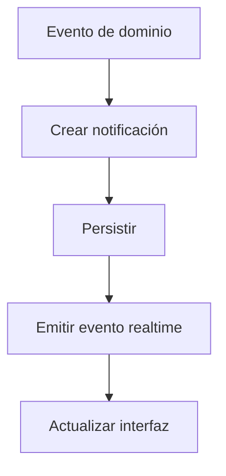

La emisión WebSocket solo debe producirse después de confirmar la persistencia.

---

# 7. Arquitectura general

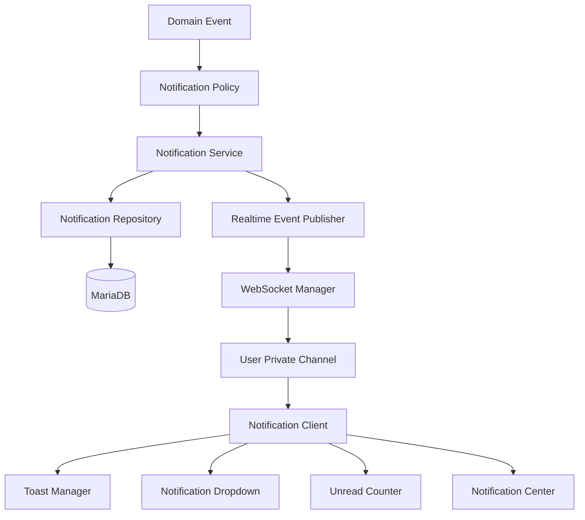

---

# 8. Flujo funcional principal

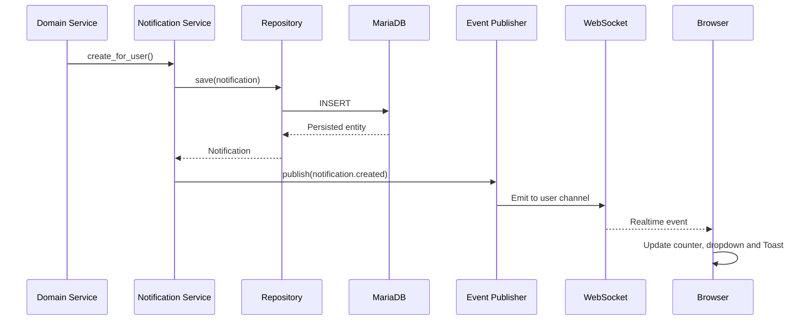

---

# 9. Arquitectura modular

La implementación debe dividirse en módulos con responsabilidades explícitas.

```text
app/modules/notifications/
├── notification_model.py
├── notification_schema.py
├── notification_repository.py
├── notification_service.py
├── notification_policy.py
├── notification_events.py
├── notification_mapper.py
├── notifications_web.py
├── notifications_api.py
└── notification_dependencies.py
```

Frontend:

```text
static/js/notifications/
├── notifications-bootstrap.js
├── notification-client.js
├── notification-store.js
├── notification-dropdown.js
├── notification-counter.js
├── notification-center.js
├── notification-renderer.js
└── notification-events.js
```

Plantillas:

```text
templates/notifications/
├── notifications_list.html
├── notification_detail.html
└── partials/
    ├── notification_item.html
    ├── notification_dropdown.html
    ├── notification_empty.html
    ├── notification_filters.html
    └── notification_pagination.html
```

---

# 10. Componentes backend

Los componentes principales del backend son:

| Componente | Responsabilidad |
|---|---|
| Notification Model | Representar persistencia |
| Notification Schema | Validar datos |
| Notification Repository | Acceder a base de datos |
| Notification Policy | Decidir cuándo notificar |
| Notification Service | Coordinar el caso de uso |
| Notification Mapper | Convertir entidad a DTO |
| Event Publisher | Emitir eventos |
| WebSocket Manager | Entregar por canal |
| Web Router | Servir vistas SSR |
| API Router | Operaciones asíncronas |
| Dependencies | Resolver usuario y permisos |

---

# 11. Notification Model

El modelo representa una notificación persistente asociada a un usuario.

Archivo recomendado:

```text
app/modules/notifications/notification_model.py
```

Responsabilidades:

- definir columnas;
- declarar relaciones;
- establecer índices;
- representar estado;
- mantener timestamps;
- aplicar restricciones estructurales.

No debe:

- emitir WebSockets;
- renderizar mensajes;
- decidir reglas de negocio;
- consultar permisos;
- realizar navegación.

---

# 12. Tabla principal

Nombre recomendado:

```text
notifications
```

La tabla almacena una fila por notificación y destinatario.

Si un mismo evento debe notificarse a diez usuarios, se generan diez registros independientes, salvo que en el futuro se adopte un modelo híbrido de evento compartido y destinatarios.

---

# 13. Esquema conceptual

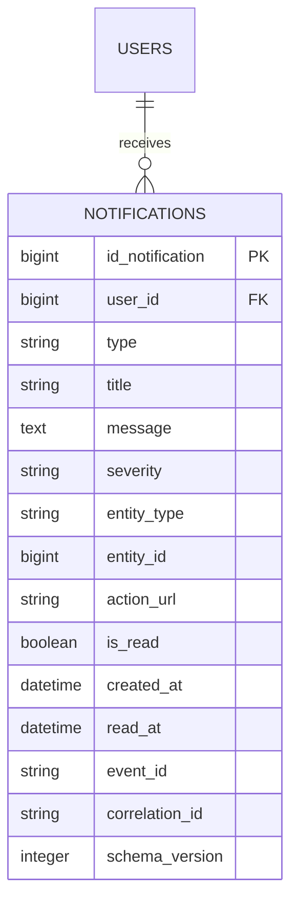

---

# 14. Campos de identidad

```python
id_notification
user_id
```

## `id_notification`

Identificador interno único.

Debe ser:

- inmutable;
- indexado;
- no reutilizable;
- generado por la base de datos o estrategia equivalente.

## `user_id`

Usuario destinatario.

Debe:

- referenciar la tabla de usuarios;
- formar parte de los índices de consulta;
- utilizarse para aislar datos;
- no ser modificable tras la creación.

---

# 15. Campos de contenido

```python
type
title
message
```

## `type`

Representa la categoría funcional.

Ejemplos:

```text
project.created
task.assigned
task.due_soon
competition.updated
system.warning
```

## `title`

Resumen breve, adecuado para:

- dropdown;
- Toast;
- listado;
- lectores de pantalla.

## `message`

Texto descriptivo ampliado.

Debe ser:

- claro;
- breve;
- contextual;
- no técnico;
- seguro para mostrar.

---

# 16. Severidad

Campo recomendado:

```python
severity
```

Valores posibles:

```text
info
success
warning
error
critical
```

La severidad representa la importancia comunicativa, no el tipo funcional.

Ejemplo:

```text
type = task.assigned
severity = info
```

```text
type = project.deadline_exceeded
severity = warning
```

---

# 17. Contexto de entidad

```python
entity_type
entity_id
```

Estos campos permiten relacionar la notificación con un recurso.

Ejemplos:

```text
entity_type = project
entity_id = 42
```

```text
entity_type = task
entity_id = 391
```

El contexto facilita:

- navegación;
- filtrado;
- trazabilidad;
- deduplicación;
- resolución de permisos.

---

# 18. URL de acción

Campo recomendado:

```python
action_url
```

Representa una ruta interna autorizada.

Ejemplo:

```text
/projects/42/tasks/391
```

La URL debe:

- ser generada por el backend;
- apuntar a rutas internas permitidas;
- evitar redirecciones abiertas;
- validarse antes de persistirse;
- poder omitirse.

---

# 19. Estado de lectura

```python
is_read
read_at
```

## `is_read`

Indica si el usuario ha leído la notificación.

## `read_at`

Registra cuándo se marcó como leída.

Reglas:

```text
is_read = false  → read_at = null

is_read = true   → read_at != null
```

La lógica debe mantenerse en el Service Layer.

---

# 20. Timestamps

Campo obligatorio:

```python
created_at
```

Opcionalmente:

```python
updated_at
expires_at
archived_at
```

Las fechas deben:

- generarse en backend;
- utilizar zona horaria explícita;
- almacenarse de forma coherente;
- serializarse como ISO 8601.

Ejemplo:

```text
2026-07-25T10:45:00Z
```

---

# 21. Identificador de evento

Campo recomendado:

```python
event_id
```

Permite identificar el evento origen.

Ejemplo:

```text
evt_01JZKX6V9M3W...
```

Se utiliza para:

- deduplicación;
- idempotencia;
- observabilidad;
- correlación;
- depuración.

---

# 22. Correlation ID

Campo recomendado:

```python
correlation_id
```

Relaciona la notificación con:

- petición HTTP;
- comando;
- proceso;
- evento de dominio;
- publicación WebSocket.

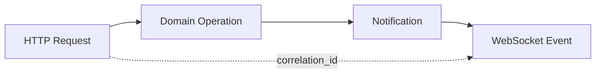

---

# 23. Versionado del esquema

Campo recomendado:

```python
schema_version
```

Permite evolucionar los contratos sin romper clientes anteriores.

Ejemplo:

```python
schema_version = 1
```

El versionado se aplica tanto a:

- persistencia;
- DTO;
- evento realtime.

---

# 24. Índices de base de datos

Índices recomendados:

```text
(user_id, is_read, created_at)

(user_id, created_at)

(event_id)

(entity_type, entity_id)

(user_id, type)
```

Estos índices optimizan:

- contador de no leídas;
- listado cronológico;
- filtrado por tipo;
- navegación contextual;
- deduplicación.

---

# 25. Restricciones

La base de datos debe aplicar restricciones cuando sea posible.

Ejemplos:

- `user_id` no nulo;
- `type` no nulo;
- `title` no nulo;
- `is_read` no nulo;
- `created_at` no nulo;
- longitudes máximas;
- integridad referencial;
- unicidad controlada de eventos.

---

# 26. Eliminación de usuario

La política de eliminación debe definirse expresamente.

Opciones:

- cascade;
- soft delete;
- anonimización;
- retención temporal.

La elección debe alinearse con:

- privacidad;
- auditoría;
- requisitos académicos;
- política de conservación.

---

# 27. Soft Delete

El sistema puede incorporar:

```python
deleted_at
```

cuando sea necesario conservar trazabilidad sin mostrar la notificación.

Sin embargo, no debe introducirse si no existe una necesidad funcional o normativa clara.

---

# 28. Expiración

Algunas notificaciones pueden perder relevancia.

Campo opcional:

```python
expires_at
```

Ejemplos:

- recordatorio temporal;
- invitación;
- aviso de sesión;
- ventana de competición.

La expiración no implica necesariamente eliminación física.

---

# 29. Archivado

Una evolución futura puede diferenciar:

- no leída;
- leída;
- archivada;
- eliminada.

Esto permite mantener un centro de notificaciones más completo.

---

# 30. Notification Schema

Archivo recomendado:

```text
app/modules/notifications/notification_schema.py
```

Debe definir contratos para:

- creación interna;
- respuesta API;
- evento realtime;
- listado;
- contador;
- actualización de estado.

---

# 31. Esquema de creación interna

Ejemplo conceptual:

```python
class NotificationCreate:
    user_id: int
    type: str
    title: str
    message: str
    severity: str = "info"
    entity_type: str | None = None
    entity_id: int | None = None
    action_url: str | None = None
    event_id: str
    correlation_id: str | None = None
```

Este esquema no debe aceptar directamente datos arbitrarios procedentes del navegador.

---

# 32. Esquema de respuesta

Ejemplo conceptual:

```python
class NotificationResponse:
    id_notification: int
    type: str
    title: str
    message: str
    severity: str
    entity_type: str | None
    entity_id: int | None
    action_url: str | None
    is_read: bool
    created_at: datetime
    read_at: datetime | None
```

No debe exponer:

- información interna;
- identificadores innecesarios;
- metadatos de infraestructura;
- datos de otros usuarios.

---

# 33. Notification Repository

Archivo recomendado:

```text
app/modules/notifications/notification_repository.py
```

El Repository encapsula la persistencia.

Responsabilidades:

- crear;
- obtener por ID y usuario;
- listar;
- contar no leídas;
- marcar como leída;
- marcar todas;
- filtrar;
- paginar;
- archivar;
- eliminar según política.

---

# 34. Métodos recomendados

```python
create(notification)

get_by_id_for_user(notification_id, user_id)

list_for_user(user_id, filters, pagination)

count_unread_for_user(user_id)

mark_as_read(notification_id, user_id, read_at)

mark_all_as_read(user_id, read_at)

exists_by_event_and_user(event_id, user_id)
```

Todos los métodos deben incluir explícitamente el ámbito del usuario cuando corresponda.

---

# 35. Aislamiento por usuario

No debe existir una consulta equivalente a:

```python
get_notification(notification_id)
```

para operaciones de usuario final sin comprobar también el destinatario.

Debe utilizarse:

```python
get_by_id_for_user(
    notification_id,
    current_user.id_user
)
```

Esto evita exposición horizontal de información.

---

# 36. Filtrado

Los filtros pueden incluir:

- estado de lectura;
- tipo;
- severidad;
- entidad;
- fecha;
- origen;
- archivado.

Los filtros deben resolverse en base de datos y no sobre una colección completa cargada en memoria.

---

# 37. Paginación

El centro de notificaciones debe utilizar paginación.

Opciones:

- offset pagination;
- cursor pagination.

Para grandes volúmenes o feeds cronológicos, cursor pagination ofrece mayor estabilidad.

---

# 38. Orden

El orden principal debe ser:

```text
created_at DESC
```

Como criterio secundario:

```text
id_notification DESC
```

Esto garantiza un orden determinista.

---

# 39. Contador de no leídas

El contador debe consultarse mediante una operación optimizada.

```sql
SELECT COUNT(*)
FROM notifications
WHERE user_id = :user_id
  AND is_read = FALSE;
```

No debe cargarse el listado completo para calcularlo.

---

# 40. Idempotencia de creación

Antes de crear una notificación, el sistema puede comprobar:

```text
event_id + user_id
```

Esto evita duplicados cuando:

- un evento se reintenta;
- un consumidor procesa dos veces;
- el broker redelivera;
- existe recuperación tras fallo.

---

# 41. Restricción de deduplicación

Puede utilizarse una restricción única:

```text
UNIQUE(event_id, user_id)
```

cuando un evento solo debe generar una notificación por destinatario.

Si un mismo evento puede producir varias notificaciones funcionalmente distintas, debe añadirse una clave de categoría o deduplicación.

---

# 42. Notification Policy

Archivo recomendado:

```text
app/modules/notifications/notification_policy.py
```

La política decide:

- si el evento debe notificar;
- a quién;
- con qué tipo;
- con qué severidad;
- con qué contenido;
- con qué URL;
- si debe agruparse;
- si debe silenciarse.

---

# 43. Separación entre evento y notificación

No todo evento de dominio genera una notificación.

Ejemplo:

```text
task.updated
```

puede ser demasiado genérico.

En cambio:

```text
task.assigned_to_user
task.deadline_changed
task.completed
```

pueden justificar comunicación según destinatario y contexto.

---

# 44. Reglas de destinatarios

Los destinatarios pueden calcularse a partir de:

- usuario asignado;
- coordinador;
- miembros del proyecto;
- profesor;
- administradores;
- seguidores;
- participantes en competición;
- usuario que inició una solicitud.

El usuario que origina la acción puede excluirse cuando la notificación no le aporta valor.

---

# 45. Notification Service

Archivo recomendado:

```text
app/modules/notifications/notification_service.py
```

El Service Layer coordina el caso de uso completo.

Responsabilidades:

- validar destinatario;
- aplicar políticas;
- construir la entidad;
- deduplicar;
- persistir;
- confirmar transacción;
- mapear DTO;
- publicar evento;
- devolver resultado.

---

# 46. Flujo del Service

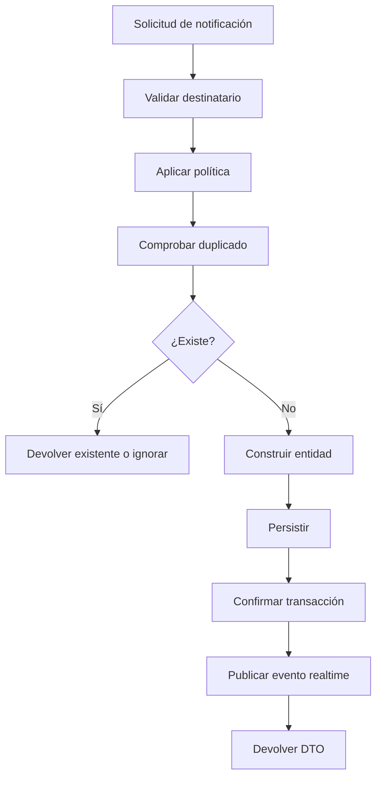

---

# 47. Persistencia antes de broadcasting

La secuencia obligatoria es:

```text
Persist

↓

Commit

↓

Broadcast
```

No debe emitirse un evento antes de confirmar la transacción.

De lo contrario, el navegador podría recibir una notificación inexistente o no recuperable.

---

# 48. Fallo de broadcasting

Si la persistencia se completa pero la emisión falla:

- la notificación continúa almacenada;
- el usuario podrá verla al recargar;
- debe registrarse el error;
- puede reintentarse la publicación;
- la sincronización corregirá el contador.

La persistencia tiene prioridad sobre la entrega inmediata.

---

# 49. Consistencia eventual

El sistema acepta un pequeño intervalo entre:

- creación;
- persistencia;
- emisión;
- visualización.

La fuente de verdad continúa siendo la base de datos.

---

# 50. Creación individual

Caso típico:

```python
create_for_user(
    user_id=user_id,
    notification_type="task.assigned",
    title="Nueva tarea asignada",
    message="Se te ha asignado una nueva tarea.",
    entity_type="task",
    entity_id=task_id,
    action_url=f"/tasks/{task_id}",
)
```

La interfaz exacta debe adaptarse a los DTO y convenciones del proyecto.

---

# 51. Creación múltiple

Para varios destinatarios:

```python
create_for_users(
    user_ids=user_ids,
    notification_data=data,
)
```

La implementación debe:

- deduplicar IDs;
- evitar consultas repetidas;
- utilizar operaciones batch cuando proceda;
- publicar únicamente tras persistir;
- aislar destinatarios.

---

# 52. Notificaciones masivas

Las notificaciones dirigidas a numerosos usuarios no deben ejecutarse mediante un bucle síncrono ilimitado dentro de una petición web.

Para grandes volúmenes pueden utilizarse:

- tareas en segundo plano;
- cola;
- worker;
- broker;
- inserción batch.

---

# 53. Categorías de notificación

Categorías funcionales recomendadas:

```text
project
task
activity
competition
membership
security
system
audit
```

Estas categorías pueden coexistir con tipos más específicos.

---

# 54. Tipos de notificación

Convención recomendada:

```text
<resource>.<action>
```

Ejemplos:

```text
project.invitation
project.updated
task.assigned
task.completed
activity.created
competition.registration_opened
membership.removed
security.session_expired
system.maintenance
```

---

# 55. Catálogo de tipos

Los tipos deben centralizarse mediante:

- Enum;
- constantes;
- catálogo;
- registro de políticas.

No deben distribuirse como cadenas arbitrarias por todo el código.

---

# 56. Contenido de notificación

El contenido puede generarse mediante:

- plantilla de texto;
- builder;
- mapper;
- catálogo de mensajes;
- internacionalización.

No debe construirse de forma inconsistente en múltiples servicios.

---

# 57. Mensajes seguros

El título y el mensaje deben considerarse texto plano por defecto.

El frontend debe utilizar:

```javascript
element.textContent = notification.title;
```

No:

```javascript
element.innerHTML = notification.title;
```

---

# 58. Internacionalización

Una evolución preparada para varios idiomas puede almacenar:

- clave de traducción;
- parámetros;
- locale de entrega;
- texto ya resuelto.

Ejemplo conceptual:

```json
{
  "messageKey": "notifications.task.assigned",
  "parameters": {
    "taskName": "Diseño del robot"
  }
}
```

La estrategia concreta debe evitar inconsistencias entre el historial y cambios posteriores de traducción.

---

# 59. Realtime Event Publisher

El Event Publisher desacopla el Service Layer del transporte WebSocket.

Responsabilidades:

- construir envelope;
- añadir metadatos;
- serializar;
- seleccionar canal;
- delegar entrega;
- registrar fallo.

---

# 60. Envelope de evento

Formato recomendado:

```json
{
  "event": "notification.created",
  "version": 1,
  "eventId": "evt_01JZKX6V9M3W",
  "correlationId": "req_01JZKX6A8Q2P",
  "timestamp": "2026-07-25T10:45:00Z",
  "payload": {
    "notification": {}
  }
}
```

---

# 61. Payload de creación

Ejemplo conceptual:

```json
{
  "notification": {
    "id": 742,
    "type": "task.assigned",
    "severity": "info",
    "title": "Nueva tarea asignada",
    "message": "Se te ha asignado la tarea Diseño del robot.",
    "actionUrl": "/tasks/391",
    "isRead": false,
    "createdAt": "2026-07-25T10:45:00Z"
  },
  "unreadCount": 6
}
```

El contador puede incluirse para evitar recalcularlo en cliente.

---

# 62. Canal privado por usuario

Convención conceptual:

```text
user:{user_id}
```

Ejemplo:

```text
user:84
```

Solo las conexiones autenticadas del usuario 84 pueden recibir eventos de ese canal.

---

# 63. Autorización WebSocket

La conexión debe validar:

- cookie JWT HTTPOnly;
- firma;
- expiración;
- usuario activo;
- estado de cuenta;
- ámbito;
- permisos aplicables.

El navegador no proporciona manualmente el token desde JavaScript.

---

# 64. Múltiples conexiones

Un usuario puede tener:

- varias pestañas;
- varios navegadores;
- varios dispositivos.

El WebSocket Manager debe mantener una colección de conexiones por usuario.

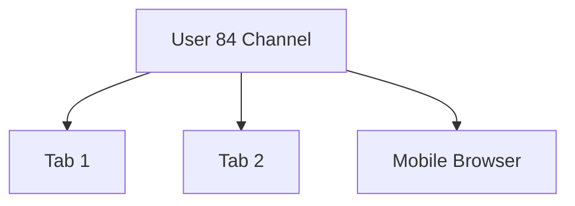

---

# 65. Entrega a todas las sesiones

Una nueva notificación debe llegar a todas las conexiones activas del destinatario.

Esto permite sincronizar:

- contador;
- dropdown;
- Toast;
- centro de notificaciones.

---

# 66. Entrega no garantizada por WebSocket

WebSocket proporciona entrega inmediata mientras la conexión está activa, pero no constituye por sí solo una garantía durable.

La garantía funcional se obtiene mediante:

- persistencia;
- consulta SSR;
- endpoint de sincronización;
- contador real;
- reconexión.

---

# 67. Sincronización inicial

Al abrir una página, el HTML SSR debe incluir:

- contador actual;
- últimas notificaciones;
- estado de lectura;
- rutas;
- configuración necesaria.

WebSocket comienza a aplicar cambios posteriores.

---

# 68. Degradación sin WebSocket

Si WebSocket no está disponible:

- el listado SSR continúa funcionando;
- el usuario puede abrir el centro;
- el contador inicial permanece visible;
- las nuevas notificaciones aparecerán al recargar;
- puede existir polling opcional controlado.

---

# 69. Integración con SSR

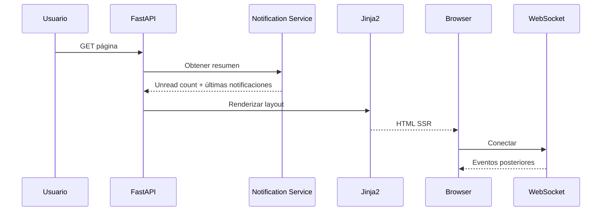

---

# 70. Notification Summary ViewModel

El layout no necesita cargar el historial completo.

Puede recibir un ViewModel resumido:

```python
class NotificationSummaryView:
    unread_count: int
    recent_notifications: list[NotificationView]
    has_more: bool
```

Esto permite renderizar el dropdown inicial de forma eficiente.

---

# 71. Notifications Router

Archivo recomendado:

```text
app/modules/notifications/notifications_web.py
```

Responsabilidades:

- centro de notificaciones;
- detalle;
- filtros;
- paginación;
- navegación SSR;
- acciones POST tradicionales cuando proceda.

---

# 72. API Router

Archivo recomendado:

```text
app/modules/notifications/notifications_api.py
```

Puede exponer operaciones asíncronas como:

```text
GET  /api/notifications
GET  /api/notifications/unread-count
POST /api/notifications/{id}/read
POST /api/notifications/read-all
```

Las rutas exactas deben seguir la convención general de la plataforma.

---

# 73. Separación Web/API

El Router web devuelve:

- HTML;
- redirect;
- mensajes Flash;
- vistas SSR.

El Router API devuelve:

- JSON;
- errores tipados;
- contadores;
- DTO;
- metadatos de paginación.

---

# 74. Endpoint de listado

El endpoint de listado debe:

- resolver usuario actual;
- aplicar filtros;
- paginar;
- ordenar;
- limitar campos;
- devolver solo notificaciones propias.

---

# 75. Endpoint de lectura individual

Flujo:

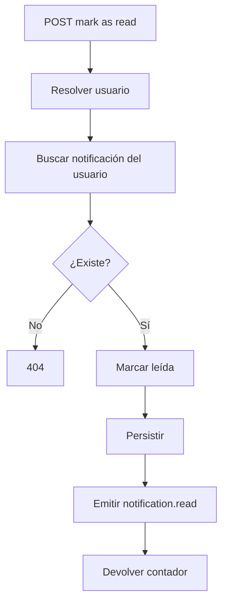

---

# 76. Idempotencia de lectura

Marcar como leída una notificación ya leída debe ser una operación segura.

Puede devolver:

- la notificación actual;
- el contador actual;
- estado `changed = false`.

No debe producir error innecesario.

---

# 77. Marcar todas como leídas

La operación debe limitarse al usuario autenticado.

Debe:

- actualizar únicamente no leídas;
- establecer `read_at`;
- devolver número actualizado;
- emitir evento;
- evitar modificar datos de otros usuarios.

---

# 78. Transacciones

Las operaciones de escritura deben ejecutarse dentro de una transacción.

Ejemplo:

```text
BEGIN

UPDATE notifications

COMMIT

PUBLISH EVENT
```

La publicación no debe preceder al `COMMIT`.

---

# 79. Evento `notification.created`

Se emite cuando una nueva notificación persistente queda disponible.

Consumidores frontend:

- Notification Store;
- unread counter;
- dropdown;
- Toast Manager;
- centro de notificaciones, si está abierto.

---

# 80. Evento `notification.read`

Se emite cuando una notificación cambia a leída.

Payload conceptual:

```json
{
  "notificationId": 742,
  "isRead": true,
  "readAt": "2026-07-25T10:47:12Z",
  "unreadCount": 5
}
```

---

# 81. Evento `notifications.read_all`

Payload conceptual:

```json
{
  "changedCount": 5,
  "unreadCount": 0,
  "readAt": "2026-07-25T10:49:00Z"
}
```

Todas las pestañas pueden sincronizar su estado.

---

# 82. Evento `notification.archived`

Una evolución futura puede emitir:

```text
notification.archived
```

para retirar el elemento del centro activo sin eliminarlo.

---

# 83. Evento `notification.deleted`

Solo debe utilizarse cuando exista una política funcional de eliminación.

El frontend debe retirar el elemento y actualizar el contador si todavía estaba no leído.

---

# 84. Versionado de eventos

Cada evento incluye:

```json
{
  "version": 1
}
```

El cliente debe:

- aceptar versiones soportadas;
- descartar versiones desconocidas;
- registrar incompatibilidad;
- solicitar sincronización cuando proceda.

---

# 85. Contrato de errores

Errores API recomendados:

| Código | Significado |
|---|---|
| `400` | Solicitud inválida |
| `401` | Sesión no válida |
| `403` | Operación no permitida |
| `404` | Notificación no encontrada |
| `409` | Conflicto de estado |
| `422` | Validación |
| `500` | Error interno |

---

# 86. Privacidad de errores

Para evitar enumeración de recursos, una notificación inexistente o perteneciente a otro usuario puede resolverse como:

```text
404 Not Found
```

sin revelar que el registro existe.

---

# 87. Frontend Notification Client

Archivo recomendado:

```text
static/js/notifications/notification-client.js
```

Responsabilidades:

- suscribirse a eventos;
- validar envelope;
- normalizar payload;
- delegar al Store;
- registrar errores;
- solicitar resincronización.

No debe manipular directamente múltiples zonas del DOM.

---

# 88. Notification Store

El Store mantiene una representación temporal limitada.

Puede contener:

```javascript
{
    unreadCount: 5,
    recentItems: [],
    lastEventId: null,
    connectionState: "connected"
}
```

No debe convertirse en fuente de verdad permanente.

---

# 89. Flujo frontend

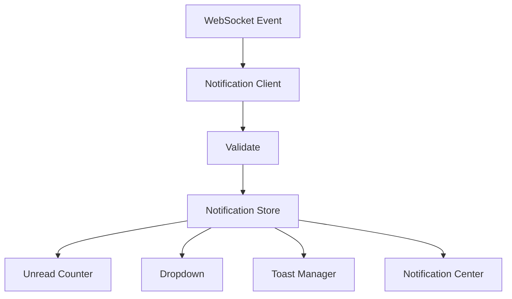

---

# 90. Inicialización declarativa

Ejemplo:

```html
<div
    data-component="notification-counter"
    data-unread-count="5"
></div>

<div
    data-component="notification-dropdown"
    data-limit="10"
></div>
```

El Component Registry monta cada componente.

---

# 91. Unread Counter

El contador muestra el número de notificaciones no leídas.

Responsabilidades:

- representar valor;
- ocultarse en cero;
- anunciar cambios relevantes;
- mantener límite visual;
- sincronizar varias pestañas.

---

# 92. Límite visual del contador

Para valores elevados puede mostrarse:

```text
99+
```

El valor real continúa disponible en estado o mediante texto accesible.

---

# 93. Notification Dropdown

El dropdown presenta un resumen de las notificaciones recientes.

Debe permitir:

- ver últimas notificaciones;
- distinguir leídas;
- navegar;
- marcar como leída;
- abrir el centro completo;
- mostrar estado vacío.

---

# 94. Estructura conceptual del dropdown

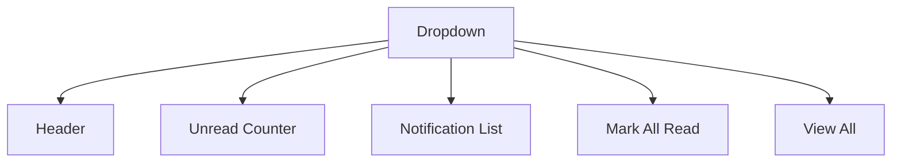

---

# 95. Notification Item

Cada elemento debe mostrar:

- icono;
- título;
- resumen;
- timestamp;
- estado;
- acción contextual.

Puede incorporar:

```html
<article
    data-notification-id="742"
    data-read="false"
>
</article>
```

---

# 96. Toast Integration

Una nueva notificación puede producir un Toast cuando:

- es relevante;
- llega en tiempo real;
- la página está visible;
- no está silenciada;
- no se encuentra ya abierta en primer plano.

No toda notificación persistente debe generar necesariamente un Toast.

---

# 97. Separación entre notificación y Toast

```text
Persistent Notification
        ≠
Transient Toast
```

La notificación representa el registro funcional.

El Toast es solo una estrategia de presentación inmediata.

---

# 98. Política de Toast

La política puede considerar:

- severidad;
- tipo;
- página actual;
- visibilidad;
- preferencias;
- frecuencia;
- duplicados;
- modo silencioso.

---

# 99. Navegación contextual

Cuando el usuario selecciona una notificación:

1. se marca como leída;
2. se actualiza la interfaz;
3. se navega a `action_url`;
4. el backend vuelve a verificar autorización.

La existencia de una URL no garantiza acceso futuro al recurso.

---

# 100. Seguridad de navegación

El frontend debe aceptar únicamente rutas internas autorizadas.

No debe ejecutar automáticamente:

- esquemas `javascript:`;
- URLs externas arbitrarias;
- redirecciones no validadas;
- contenido HTML contenido en el payload.

---

# 101. Estado vacío

Cuando no existen notificaciones debe mostrarse una vista clara.

Ejemplo:

```text
No tienes notificaciones nuevas.
```

Debe evitarse un contenedor vacío sin explicación.

---

# 102. Estado de carga

Cada componente puede mantener:

```text
idle
loading
ready
error
```

La carga del dropdown no debe bloquear el resto de la página.

---

# 103. Error aislado

Si el dropdown falla:

- el contador puede seguir funcionando;
- el centro SSR continúa disponible;
- el Toast puede desactivarse;
- se registra el error;
- se ofrece reintento.

---

# 104. Sincronización tras reconexión

Tras reconectar, el cliente debe consultar:

- contador real;
- nuevas notificaciones desde el último punto;
- cambios de lectura;
- versión de estado.

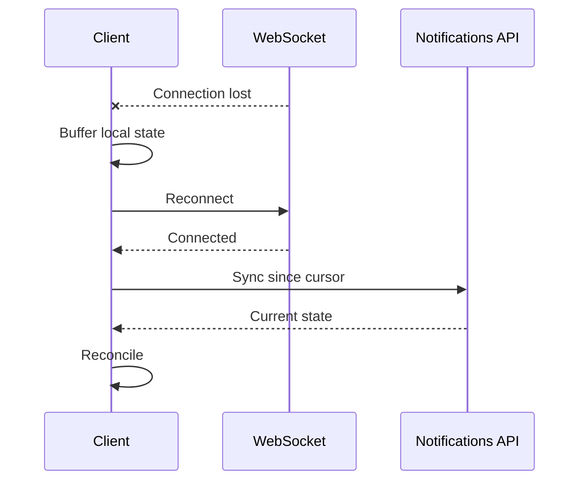

---

# 105. Cursor de sincronización

El cliente puede mantener:

```text
lastEventId
lastNotificationId
lastCreatedAt
```

El backend debe definir un cursor estable y autorizado.

---

# 106. Reconciliación

La reconciliación debe:

- insertar nuevas;
- actualizar leídas;
- retirar eliminadas;
- corregir contador;
- descartar duplicados;
- preservar orden.

---

# 107. Duplicados frontend

El Store debe mantener un conjunto limitado de identificadores procesados.

Ejemplo:

```javascript
processedEventIds.has(event.eventId)
```

La colección debe tener límite para evitar crecimiento indefinido.

---

# 108. Orden de eventos

El cliente no debe asumir que todos los mensajes llegan en orden perfecto.

Puede utilizar:

- versión de notificación;
- secuencia;
- timestamp del servidor;
- estado actual;
- sincronización.

---

# 109. Múltiples pestañas

Todas las pestañas pueden recibir el mismo evento WebSocket.

Esto es correcto, pero puede producir varios Toasts visibles al usuario.

Una evolución puede coordinar pestañas mediante:

```text
BroadcastChannel
```

---

# 110. Coordinación de Toasts

Una pestaña puede actuar temporalmente como líder para mostrar Toasts.

Las demás continúan actualizando contador y Store, pero no muestran el mismo aviso.

---

# 111. Estado de visibilidad

Cuando la pestaña está oculta:

- actualizar Store;
- actualizar contador;
- evitar animaciones;
- limitar Toasts;
- confiar en el centro persistente.

---

# 112. Notificaciones del navegador

Una evolución futura puede utilizar la Notifications API del navegador.

Debe requerir:

- permiso explícito;
- justificación funcional;
- configuración del usuario;
- protección de privacidad;
- fallback interno.

No debe solicitarse permiso al cargar la aplicación sin contexto.

---

# 113. Relación con mensajes Flash

Los mensajes Flash comunican el resultado inmediato de una navegación SSR.

Ejemplo:

```text
Proyecto actualizado correctamente.
```

Las notificaciones persistentes comunican eventos relevantes que deben conservarse o entregarse a otros usuarios.

---

# 114. Relación con auditoría

La auditoría registra acciones relevantes del sistema.

Las notificaciones informan a usuarios concretos.

Un mismo evento puede generar:

- registro de auditoría;
- notificación;
- evento realtime.

Pero cada mecanismo tiene una finalidad distinta.

---

# 115. Relación con Realtime Dashboard

El Dashboard puede consumir eventos agregados relacionados con notificaciones.

Ejemplos:

- contador personal;
- alertas críticas;
- actividad del sistema.

El centro de notificaciones mantiene su propio Store y ciclo de vida.

---

# 116. Matriz de responsabilidades parcial

| Elemento | Responsabilidad |
|---|---|
| Domain Service | Ejecutar caso de uso funcional |
| Notification Policy | Decidir notificación |
| Notification Service | Coordinar creación |
| Repository | Persistir |
| Event Publisher | Publicar evento |
| WebSocket Manager | Entregar a conexiones |
| Notification Client | Consumir evento |
| Store | Mantener estado temporal |
| Counter | Mostrar no leídas |
| Dropdown | Mostrar resumen |
| Toast Manager | Aviso temporal |
| Notification Center | Historial completo |
| Backend Authorization | Proteger datos |

---

# 117. Criterios de calidad de esta capa

La primera capa del sistema se considera correctamente diseñada cuando:

- las notificaciones se persisten;
- cada destinatario dispone de su registro;
- la emisión ocurre después del commit;
- los eventos están versionados;
- el acceso se limita al usuario;
- existe deduplicación;
- el frontend actualiza de forma incremental;
- Toast y notificación están desacoplados;
- el sistema funciona sin WebSocket;
- existe sincronización tras reconexión;
- no se almacena información sensible innecesaria;
- la navegación vuelve a comprobar autorización.

---

# 118. Continuación

La **Parte 2** desarrollará:

- centro de notificaciones completo;
- filtros y paginación;
- lectura individual y masiva;
- preferencias;
- silenciamiento;
- agrupación;
- prioridad;
- frecuencia;
- multiusuario;
- accesibilidad;
- seguridad avanzada;
- observabilidad;
- retención;
- escalado distribuido;
- pruebas unitarias, de integración y End-to-End.

---

# 119. Centro de notificaciones

El **Notification Center** constituye la vista principal para consultar, organizar y gestionar el historial de notificaciones del usuario.

A diferencia del dropdown, que ofrece un resumen limitado, el centro de notificaciones proporciona:

- listado completo;
- filtros;
- paginación;
- búsqueda;
- acciones individuales;
- acciones masivas;
- archivado;
- navegación contextual;
- sincronización en tiempo real.

---

# 120. Objetivos del centro de notificaciones

El centro debe permitir:

- consultar notificaciones recientes;
- distinguir entre leídas y no leídas;
- filtrar por tipo y severidad;
- localizar eventos relevantes;
- marcar elementos como leídos;
- marcar todos como leídos;
- archivar;
- navegar al recurso relacionado;
- mantener sincronización entre pestañas;
- degradarse correctamente sin JavaScript.

---

# 121. Arquitectura del centro

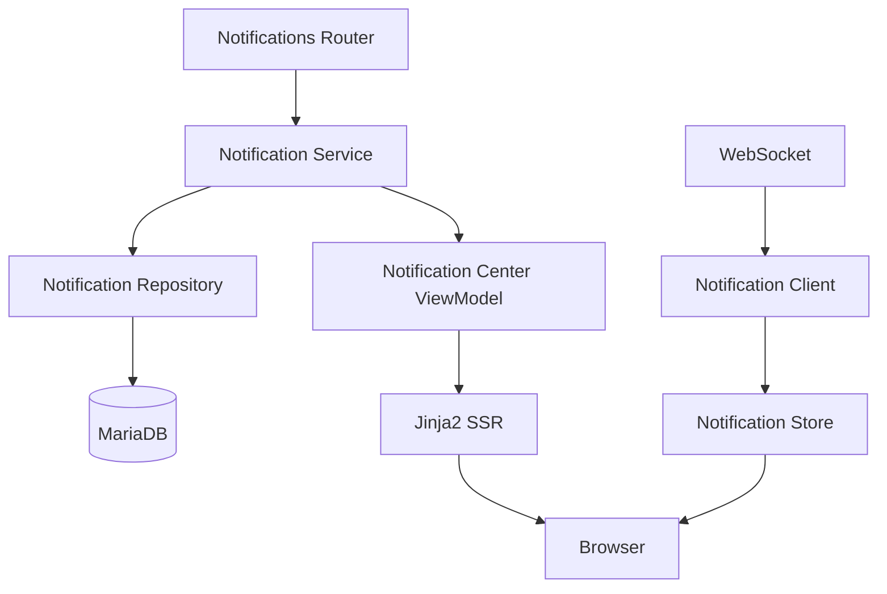

---

# 122. Estructura visual

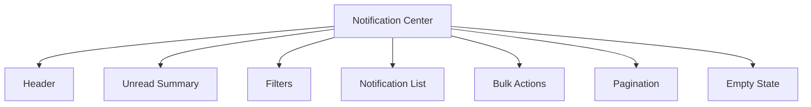

---

# 123. Ruta SSR

Ruta conceptual:

```text
GET /notifications
```

Responsabilidades:

- resolver usuario autenticado;
- aplicar filtros;
- consultar listado;
- calcular contador;
- construir ViewModel;
- renderizar plantilla;
- evitar exponer notificaciones ajenas.

---

# 124. Notification Center ViewModel

Ejemplo conceptual:

```python
class NotificationCenterView:
    notifications: list[NotificationView]
    unread_count: int
    total_count: int
    filters: NotificationFiltersView
    pagination: PaginationView
    has_active_filters: bool
```

El ViewModel debe adaptar datos para presentación sin contener HTML.

---

# 125. Plantilla principal

Archivo recomendado:

```text
templates/notifications/notifications_list.html
```

Responsabilidades:

- extender layout base;
- renderizar cabecera;
- incluir filtros;
- mostrar listado;
- mostrar paginación;
- declarar componentes JavaScript;
- mantener semántica accesible.

---

# 126. Partial de elemento

Archivo recomendado:

```text
templates/notifications/partials/notification_item.html
```

Cada elemento debe ser reutilizable en:

- listado SSR;
- dropdown;
- inserciones dinámicas;
- respuesta parcial futura.

---

# 127. Estructura semántica del elemento

Ejemplo:

```html
<article
    class="notification-item"
    data-notification-id="{{ notification.id }}"
    data-read="{{ notification.is_read | lower }}"
    aria-labelledby="notification-title-{{ notification.id }}"
>
    <header>
        <h2 id="notification-title-{{ notification.id }}">
            {{ notification.title }}
        </h2>
    </header>

    <p>{{ notification.message }}</p>

    <time datetime="{{ notification.created_at_iso }}">
        {{ notification.created_at_label }}
    </time>
</article>
```

---

# 128. Estado visual de lectura

Las notificaciones no leídas pueden diferenciarse mediante:

- peso tipográfico;
- indicador;
- etiqueta;
- icono;
- fondo;
- texto accesible.

Nunca deben diferenciarse únicamente por color.

---

# 129. Filtros disponibles

Los filtros pueden incluir:

- todas;
- no leídas;
- leídas;
- tipo;
- categoría;
- severidad;
- fecha;
- proyecto;
- entidad;
- archivadas.

---

# 130. Modelo de filtros

Ejemplo conceptual:

```python
class NotificationFilters:
    status: str | None
    type: str | None
    severity: str | None
    entity_type: str | None
    date_from: date | None
    date_to: date | None
```

Los filtros deben validarse antes de llegar al Repository.

---

# 131. Persistencia de filtros en URL

Los filtros deben representarse mediante query parameters.

Ejemplo:

```text
/notifications?status=unread&type=task.assigned&page=2
```

Ventajas:

- navegación atrás;
- enlaces compartibles;
- recarga consistente;
- SSR completo;
- mejor trazabilidad.

---

# 132. Filtros declarativos

Ejemplo:

```html
<form
    method="get"
    action="/notifications"
    data-component="notification-filters"
>
</form>
```

La funcionalidad básica debe funcionar sin JavaScript.

---

# 133. Aplicación de filtros

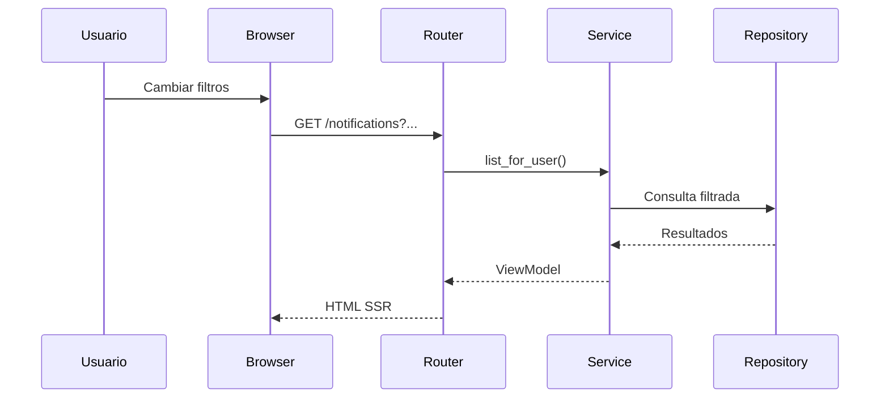

---

# 134. Filtrado dinámico opcional

JavaScript puede mejorar la experiencia mediante:

- envío asíncrono;
- sustitución parcial del listado;
- preservación de URL;
- estado de carga;
- cancelación de peticiones previas.

Sin embargo, el fallback SSR debe mantenerse.

---

# 135. Paginación

El centro debe utilizar paginación para evitar cargar todo el historial.

Tipos posibles:

- offset pagination;
- cursor pagination;
- carga incremental.

La elección depende del volumen esperado y del modelo de navegación.

---

# 136. Offset Pagination

Ejemplo:

```text
?page=3&page_size=20
```

Ventajas:

- sencilla;
- compatible con SSR;
- permite saltar a páginas.

Limitaciones:

- puede sufrir desplazamientos cuando llegan nuevas notificaciones.

---

# 137. Cursor Pagination

Ejemplo:

```text
?before=742
```

Ventajas:

- estable para feeds;
- eficiente en grandes volúmenes;
- evita duplicados por inserciones recientes.

Limitaciones:

- navegación menos intuitiva entre páginas arbitrarias.

---

# 138. Estrategia recomendada

Para una primera versión puede utilizarse offset pagination.

Si el volumen crece significativamente, puede evolucionarse hacia cursor pagination sin modificar el contrato funcional del centro.

---

# 139. Orden determinista

La consulta debe ordenar por:

```text
created_at DESC,
id_notification DESC
```

Esto evita resultados inconsistentes cuando varias notificaciones comparten timestamp.

---

# 140. Tamaño de página

Valores recomendados:

```text
10
20
50
```

El backend debe imponer un máximo.

No debe confiar en un valor arbitrario recibido del cliente.

---

# 141. Estado vacío

El centro debe distinguir entre:

- no existen notificaciones;
- no existen resultados para los filtros;
- todas están archivadas;
- error de carga.

Ejemplos:

```text
Todavía no tienes notificaciones.
```

```text
No se encontraron notificaciones con estos filtros.
```

---

# 142. Búsqueda textual

Una evolución puede incorporar búsqueda sobre:

- título;
- mensaje;
- tipo;
- entidad relacionada.

Debe implementarse en base de datos, no filtrando todos los resultados en cliente.

---

# 143. Acción de lectura individual

Cada elemento puede ofrecer:

```text
Marcar como leída
```

o:

```text
Marcar como no leída
```

La acción debe ser idempotente.

---

# 144. Marcado al abrir

Una notificación puede marcarse como leída cuando:

- el usuario pulsa el elemento;
- se abre su detalle;
- se navega al recurso;
- se ejecuta una acción explícita.

La política debe ser consistente.

---

# 145. Flujo de lectura individual

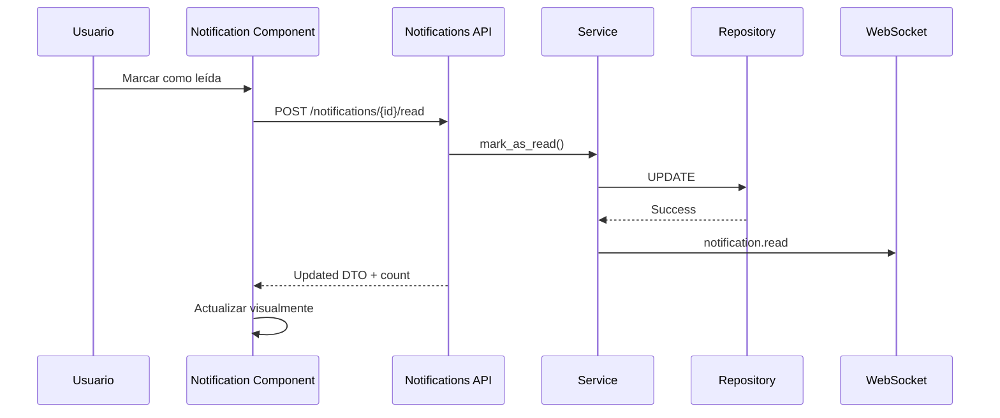

---

# 146. Actualización optimista

El frontend puede actualizar el estado antes de recibir respuesta.

Solo debe utilizarse cuando:

- la operación es reversible;
- el error puede restaurar el estado;
- el contador puede corregirse;
- no existe riesgo funcional.

---

# 147. Rollback optimista

Si la petición falla:

- restaurar estado;
- restaurar contador;
- mostrar Toast de error;
- registrar incidencia;
- mantener acción disponible.

---

# 148. Acción masiva

El centro debe permitir:

```text
Marcar todas como leídas
```

Opcionalmente:

```text
Archivar seleccionadas
```

```text
Eliminar seleccionadas
```

Las acciones masivas deben mostrar claramente su alcance.

---

# 149. Selección múltiple

Una evolución avanzada puede permitir checkboxes por elemento.

Debe incluir:

- seleccionar todas visibles;
- deseleccionar;
- contador de selección;
- acciones accesibles;
- confirmación cuando proceda.

---

# 150. Lectura masiva

La operación debe actualizar solo notificaciones del usuario actual.

Puede aceptar:

- todas las no leídas;
- IDs seleccionados;
- resultados del filtro actual.

El alcance debe ser explícito.

---

# 151. Endpoint de lectura masiva

Ejemplo conceptual:

```text
POST /api/notifications/read-all
```

Respuesta:

```json
{
  "changedCount": 7,
  "unreadCount": 0,
  "readAt": "2026-07-25T11:30:00Z"
}
```

---

# 152. Concurrencia en lectura masiva

Puede ocurrir que otra pestaña marque algunas notificaciones mientras la operación está en curso.

La respuesta debe reflejar el estado real final, no una estimación del cliente.

---

# 153. Archivado

El archivado permite retirar una notificación de la vista principal sin eliminarla físicamente.

Campos posibles:

```python
is_archived
archived_at
```

---

# 154. Reglas de archivado

Una notificación archivada:

- permanece persistida;
- puede consultarse con filtro;
- no aparece en el dropdown activo;
- normalmente no cuenta como pendiente;
- conserva trazabilidad.

---

# 155. Archivado individual

Flujo:

```text
POST /notifications/{id}/archive
```

Debe comprobar:

- destinatario;
- estado actual;
- política;
- idempotencia.

---

# 156. Archivado masivo

Debe evitar operaciones fila a fila cuando puede utilizarse una sentencia batch.

Ejemplo conceptual:

```sql
UPDATE notifications
SET is_archived = TRUE,
    archived_at = :now
WHERE user_id = :user_id
  AND id_notification IN (...);
```

---

# 157. Eliminación

La eliminación física debe utilizarse con cautela.

Alternativas preferibles:

- archivado;
- soft delete;
- retención limitada;
- anonimización.

La política debe definirse según necesidades funcionales y legales.

---

# 158. Detalle de notificación

Ruta opcional:

```text
GET /notifications/{id}
```

Puede mostrar:

- título;
- mensaje;
- fecha;
- tipo;
- severidad;
- recurso relacionado;
- acciones;
- metadatos no sensibles.

---

# 159. Autorización del detalle

La consulta debe utilizar siempre:

```text
notification_id + current_user_id
```

Una notificación ajena debe responder como no encontrada.

---

# 160. Navegación contextual

Al abrir una notificación con acción:

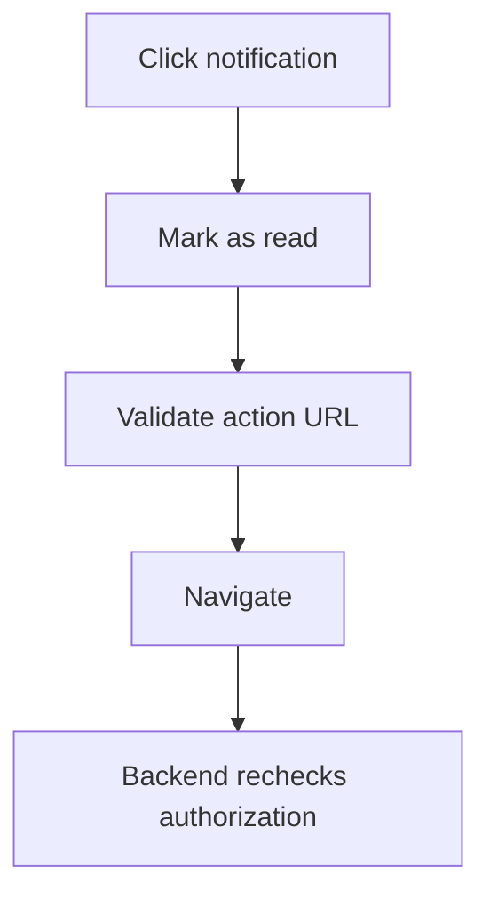

---

# 161. Preferencias de notificación

El sistema puede permitir configurar qué tipos de notificación desea recibir cada usuario.

Ejemplos:

- asignaciones;
- cambios de fecha;
- competiciones;
- menciones;
- alertas del sistema;
- resúmenes.

---

# 162. Modelo de preferencias

Tabla conceptual:

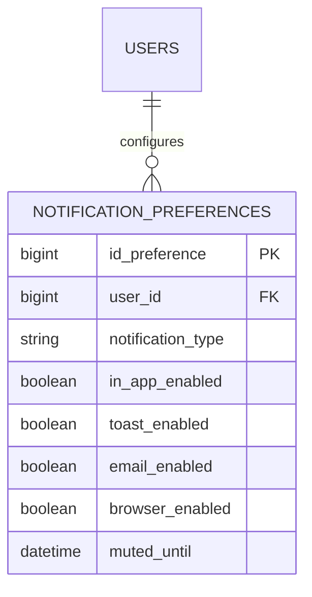

---

# 163. Preferencias por canal

Cada usuario puede configurar independientemente:

- in-app;
- Toast;
- correo;
- navegador;
- resumen periódico.

La desactivación de Toast no implica eliminar la notificación persistente.

---

# 164. Preferencias por tipo

Ejemplo:

| Tipo | In-app | Toast | Email |
|---|---:|---:|---:|
| `task.assigned` | Sí | Sí | No |
| `task.completed` | Sí | No | No |
| `system.critical` | Sí | Sí | Sí |
| `project.updated` | Sí | No | No |

---

# 165. Tipos obligatorios

Algunas notificaciones no deben poder desactivarse completamente.

Ejemplos:

- seguridad;
- sesión;
- cambios críticos;
- avisos legales;
- mantenimiento urgente.

La política debe estar centralizada en backend.

---

# 166. Silenciamiento temporal

El usuario puede silenciar:

- todos los Toasts;
- un tipo;
- un proyecto;
- una ventana temporal.

Campo conceptual:

```python
muted_until
```

---

# 167. Modo no molestar

Una evolución puede incorporar:

```text
Do Not Disturb
```

Durante este modo:

- las notificaciones se persisten;
- el contador se actualiza;
- no se muestran Toasts;
- no se emiten sonidos;
- las críticas pueden exceptuarse.

---

# 168. Horarios de silencio

Configuración posible:

```text
22:00–08:00
```

El backend debe interpretar la zona horaria del usuario.

---

# 169. Zona horaria

Toda preferencia temporal debe considerar:

- zona horaria del usuario;
- horario de verano;
- timestamps UTC en persistencia;
- conversión en presentación.

---

# 170. Frecuencia

Algunos eventos pueden agruparse para evitar saturación.

Ejemplo:

En lugar de cinco notificaciones:

```text
La tarea A ha cambiado.
La tarea B ha cambiado.
La tarea C ha cambiado.
```

puede mostrarse:

```text
Se han actualizado 5 tareas del proyecto Robot Challenge.
```

---

# 171. Agrupación

La agrupación puede basarse en:

- tipo;
- proyecto;
- entidad;
- ventana temporal;
- destinatario;
- actor.

---

# 172. Clave de agrupación

Campo conceptual:

```python
group_key
```

Ejemplo:

```text
project:42:task-updates
```

---

# 173. Ventana de agrupación

Ejemplo:

```text
5 minutos
```

Durante ese intervalo, eventos compatibles pueden consolidarse.

La ventana debe configurarse según el tipo de notificación.

---

# 174. Notificación agregada

Campos adicionales posibles:

```python
group_count
last_grouped_at
```

Ejemplo:

```text
3 nuevas tareas asignadas
```

---

# 175. Estrategia de actualización agregada

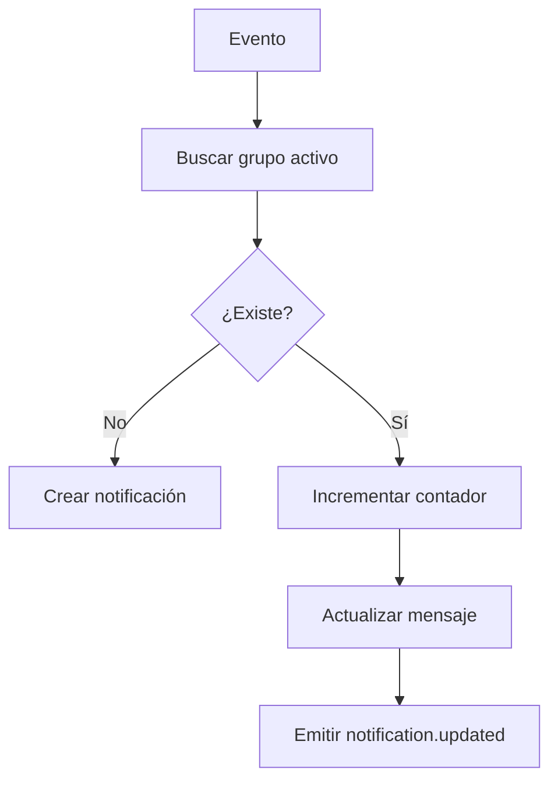

---

# 176. Evento `notification.updated`

Se utiliza cuando una notificación persistente cambia sin crear una nueva.

Ejemplo:

```json
{
  "event": "notification.updated",
  "version": 1,
  "payload": {
    "notificationId": 742,
    "title": "5 tareas actualizadas",
    "message": "Se han actualizado 5 tareas del proyecto.",
    "groupCount": 5,
    "updatedAt": "2026-07-25T11:40:00Z"
  }
}
```

---

# 177. Prioridad

Además de severidad, puede existir prioridad de entrega.

Valores posibles:

```text
low
normal
high
urgent
```

La prioridad influye en:

- Toast;
- orden;
- sonido;
- interrupción;
- persistencia;
- canal adicional.

---

# 178. Diferencia entre severidad y prioridad

```text
Severity = naturaleza del mensaje

Priority = urgencia de entrega
```

Ejemplo:

```text
severity = warning
priority = normal
```

---

# 179. Limitación de frecuencia

El sistema debe evitar tormentas de notificaciones.

Puede aplicar:

- rate limit por usuario;
- rate limit por tipo;
- agrupación;
- cooldown;
- digest;
- silenciamiento automático.

---

# 180. Cooldown

Ejemplo:

```text
No mostrar más de un Toast del mismo tipo cada 30 segundos.
```

La notificación puede persistirse igualmente.

---

# 181. Digest

Una evolución puede generar resúmenes periódicos.

Ejemplos:

- diario;
- semanal;
- al finalizar una sesión;
- al volver tras inactividad.

---

# 182. Digest conceptual

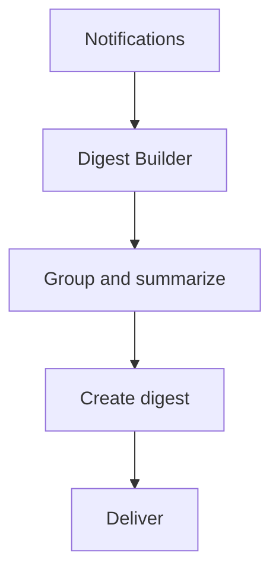

---

# 183. Actores

Una notificación puede incluir el usuario que originó la acción.

Campos conceptuales:

```python
actor_user_id
actor_display_name
```

Debe evitarse persistir información duplicada innecesaria si puede resolverse de forma segura.

---

# 184. Notificación actor-destinatario

Ejemplo:

```text
Ana te ha asignado la tarea “Diseño del sensor”.
```

La información del actor debe respetar:

- privacidad;
- visibilidad;
- estado de cuenta;
- anonimización futura.

---

# 185. Usuario eliminado

Si el actor deja de existir, el historial no debe romperse.

Opciones:

- snapshot de nombre;
- texto genérico;
- usuario anonimizado;
- referencia nullable.

---

# 186. Multiusuario

Las notificaciones pueden generarse para:

- un usuario;
- varios miembros;
- coordinadores;
- profesores;
- administradores;
- toda una organización.

---

# 187. Fan-out

La distribución a múltiples destinatarios puede seguir dos enfoques:

```text
Fan-out on write
```

o:

```text
Fan-out on read
```

---

# 188. Fan-out on write

Se crea una fila por destinatario.

Ventajas:

- lectura sencilla;
- estado independiente;
- contador eficiente;
- preferencias individuales.

Inconvenientes:

- más escrituras;
- mayor almacenamiento.

Es el enfoque recomendado para la plataforma actual.

---

# 189. Fan-out on read

Se almacena un evento compartido y se resuelven destinatarios al consultar.

Ventajas:

- menos duplicación.

Inconvenientes:

- consultas más complejas;
- estado de lectura adicional;
- mayor dificultad de autorización;
- contadores más costosos.

---

# 190. Creación batch

Para muchos destinatarios:

```mermaid
flowchart TD
    A[Recipient IDs] --> B[Deduplicate]
    B --> C[Load preferences]
    C --> D[Build entities]
    D --> E[Bulk insert]
    E --> F[Publish per channel]
```

---

# 191. Operaciones asíncronas

Cuando el volumen supera un umbral razonable, la creación puede delegarse a:

- worker;
- cola;
- broker;
- tarea programada.

La petición principal no debe quedar bloqueada innecesariamente.

---

# 192. Outbox Pattern

Para garantizar coherencia entre persistencia y publicación puede utilizarse Outbox Pattern.

```mermaid
flowchart TD
    A[Transaction]
    A --> B[Insert Notification]
    A --> C[Insert Outbox Event]

    C --> D[Outbox Worker]
    D --> E[Event Broker]
    E --> F[WebSocket Delivery]
```

---

# 193. Beneficios del Outbox Pattern

Permite:

- evitar eventos perdidos;
- desacoplar commit y publicación;
- reintentar;
- auditar entregas;
- escalar consumidores;
- mantener atomicidad.

---

# 194. Outbox Table

Esquema conceptual:

```text
outbox_events
```

Campos:

```python
id
event_type
aggregate_type
aggregate_id
payload
status
attempts
created_at
published_at
last_error
```

---

# 195. Procesamiento de Outbox

Estados posibles:

```text
pending
processing
published
failed
```

El worker debe ser idempotente.

---

# 196. Reintentos

Los reintentos deben utilizar:

- backoff;
- límite de intentos;
- registro de error;
- dead-letter;
- alertas.

---

# 197. Dead Letter Queue

Los eventos que no pueden publicarse tras varios intentos pueden trasladarse a una cola de fallos.

Esto permite:

- análisis;
- replay;
- corrección;
- alertas operativas.

---

# 198. Escalado distribuido

En producción con varias instancias FastAPI, cada instancia no conoce todas las conexiones.

Es necesario un broker compartido.

```mermaid
flowchart TD
    A[Notification Service] --> B[Broker]

    B --> C[FastAPI Instance 1]
    B --> D[FastAPI Instance 2]
    B --> E[FastAPI Instance 3]

    C --> F[Connections]
    D --> G[Connections]
    E --> H[Connections]
```

---

# 199. Tecnologías posibles

Opciones:

- Redis Pub/Sub;
- Redis Streams;
- RabbitMQ;
- Kafka;
- NATS.

La elección debe basarse en:

- volumen;
- durabilidad;
- complejidad;
- experiencia del equipo;
- necesidades de replay.

---

# 200. Redis Pub/Sub

Adecuado cuando:

- se necesita baja latencia;
- la persistencia ya existe en MariaDB;
- no se requiere replay del broker;
- la escala es moderada.

---

# 201. Redis Streams

Adecuado cuando se requiere:

- retención temporal;
- grupos de consumidores;
- replay;
- confirmación;
- mayor durabilidad.

---

# 202. Kafka

Puede considerarse en una evolución de gran escala.

No debe introducirse prematuramente si el volumen y complejidad no lo justifican.

---

# 203. Presencia de conexiones

El WebSocket Manager debe mantener:

```text
user_id → set(connection)
```

En entorno distribuido puede complementarse con un registro compartido de presencia.

---

# 204. Entrega por dispositivo

Cada conexión puede registrar:

- connection_id;
- user_id;
- session_id;
- device_id opcional;
- connected_at;
- last_seen.

No debe almacenarse más información de la necesaria.

---

# 205. Confirmación de entrega

El sistema puede diferenciar:

- persistida;
- publicada;
- entregada al socket;
- recibida por cliente;
- leída.

No todos estos estados son necesarios en la primera versión.

---

# 206. Acknowledgement

Una evolución puede permitir que el cliente confirme recepción:

```text
notification.received
```

Debe evaluarse cuidadosamente para no añadir complejidad sin beneficio funcional.

---

# 207. Estado de entrega

Campos opcionales:

```python
delivered_at
received_at
```

No deben confundirse con `read_at`.

---

# 208. Diferencia de estados

```text
Created

↓

Published

↓

Delivered

↓

Received

↓

Read
```

Cada estado representa un significado distinto.

---

# 209. Multi-dispositivo

Si una notificación se lee en un dispositivo:

- el backend actualiza el registro;
- emite `notification.read`;
- todas las sesiones reciben el cambio;
- el contador se sincroniza.

---

# 210. BroadcastChannel

En un mismo navegador, `BroadcastChannel` puede reducir trabajo duplicado.

Usos:

- coordinar Toasts;
- propagar lectura;
- elegir pestaña líder;
- compartir estado de conexión.

---

# 211. Elección de pestaña líder

Conceptualmente:

```mermaid
stateDiagram-v2
    [*] --> Candidate
    Candidate --> Leader
    Candidate --> Follower
    Leader --> Candidate: tab closes
    Follower --> Candidate: leader timeout
```

Solo la pestaña líder muestra Toasts.

---

# 212. Almacenamiento local

No debe almacenarse el historial completo en `localStorage`.

Puede almacenarse temporalmente:

- ID de último evento;
- preferencia de UI;
- estado de pestaña líder;
- timestamp de sincronización.

---

# 213. Seguridad del almacenamiento

Nunca deben almacenarse:

- JWT;
- contenido sensible;
- datos completos de notificación;
- identificadores secretos;
- información de otros usuarios.

---

# 214. Accesibilidad del centro

El centro debe ser navegable con:

- teclado;
- lector de pantalla;
- zoom;
- contraste alto;
- movimiento reducido.

---

# 215. Jerarquía de encabezados

La página debe utilizar:

```text
h1 → Centro de notificaciones

h2 → Notificaciones

h3 → Título de cada elemento, si procede
```

Debe mantenerse una jerarquía lógica.

---

# 216. Regiones

Los filtros, listado y acciones deben tener nombres accesibles.

Ejemplo:

```html
<section aria-labelledby="notification-filters-title">
</section>
```

---

# 217. Anuncio de cambios

Cuando se marca una notificación como leída, puede anunciarse:

```text
Notificación marcada como leída.
```

Debe evitarse anunciar cada actualización automática del contador.

---

# 218. Acciones masivas accesibles

Los controles deben indicar:

- alcance;
- número seleccionado;
- resultado;
- estado deshabilitado;
- confirmación.

---

# 219. Foco tras actualización

Tras una acción:

- mantener foco en el control;
- mover foco solo si el elemento desaparece;
- usar un destino lógico;
- evitar saltos inesperados.

---

# 220. Estado de carga accesible

Puede utilizarse:

```html
<div aria-busy="true">
</div>
```

El estado debe anunciarse de forma limitada.

---

# 221. Toasts accesibles

Los Toasts de severidad normal deben utilizar `aria-live="polite"`.

Los críticos pueden utilizar `assertive` de forma excepcional.

---

# 222. Sonido

El sonido debe estar desactivado por defecto o requerir preferencia explícita.

Nunca debe ser el único mecanismo de aviso.

---

# 223. Seguridad avanzada

El sistema debe proteger:

- confidencialidad;
- integridad;
- aislamiento;
- navegación;
- contenido;
- transporte.

---

# 224. Validación de payload

El frontend debe validar:

- envelope;
- versión;
- evento;
- tipos;
- campos obligatorios;
- URL;
- timestamp;
- severidad.

---

# 225. URLs internas

`action_url` debe cumplir:

```text
empieza por /
```

y no:

```text
//
http:
https:
javascript:
data:
```

La validación principal debe realizarse en backend.

---

# 226. HTML seguro

Los mensajes deben tratarse como texto plano.

Si en el futuro se admiten fragmentos enriquecidos, debe utilizarse:

- catálogo limitado;
- componentes predefinidos;
- sanitización estricta;
- CSP.

---

# 227. Enumeración de IDs

Los endpoints deben comprobar usuario y devolver `404` cuando no exista acceso.

No deben revelar:

- propietario;
- tipo;
- existencia;
- estado de una notificación ajena.

---

# 228. Mass Assignment

Los endpoints de actualización no deben aceptar un objeto completo de notificación.

Solo deben permitir acciones específicas:

```text
mark read
mark unread
archive
delete
```

---

# 229. Protección CSRF

Todas las operaciones mutables HTTP deben usar protección CSRF centralizada.

WebSocket no elimina esta necesidad.

---

# 230. Rate Limiting de acciones

Puede aplicarse a:

- marcar todas;
- sincronizar;
- listar;
- archivar masivamente;
- solicitar preferencias.

---

# 231. Abuso de creación

Los usuarios no deben poder crear notificaciones arbitrarias para otros usuarios salvo que exista un caso de uso autorizado.

La creación pública directa no debe exponerse.

---

# 232. Datos sensibles

No deben incluirse en el mensaje:

- contraseñas;
- tokens;
- datos personales innecesarios;
- evaluaciones sensibles;
- información privada de otros proyectos;
- detalles internos de seguridad.

---

# 233. Retención

Debe definirse cuánto tiempo se conservan las notificaciones.

Ejemplo conceptual:

| Tipo | Retención |
|---|---|
| Operativa | 90 días |
| Seguridad | 180 días |
| Sistema | 60 días |
| Archivada | 180 días |

Los valores deben decidirse según requisitos reales.

---

# 234. Limpieza automática

Una tarea programada puede:

- eliminar expiradas;
- anonimizar antiguas;
- purgar soft-deleted;
- compactar datos;
- registrar resultados.

---

# 235. Flujo de retención

```mermaid
flowchart TD
    A[Scheduled Job] --> B[Select expired]
    B --> C[Apply retention policy]
    C --> D[Delete or anonymize]
    D --> E[Audit result]
```

---

# 236. Cumplimiento y privacidad

El sistema debe aplicar:

- minimización;
- finalidad;
- retención limitada;
- acceso restringido;
- trazabilidad;
- borrado cuando corresponda.

---

# 237. Auditoría

No todas las acciones de notificación requieren auditoría funcional.

Pueden auditarse:

- cambios de preferencias;
- eliminación masiva;
- fallos de seguridad;
- notificaciones críticas;
- operaciones administrativas.

---

# 238. Observabilidad

La observabilidad debe cubrir:

- notificaciones creadas;
- duplicados evitados;
- tiempo de persistencia;
- eventos publicados;
- fallos de entrega;
- reconexiones;
- errores de cliente;
- tamaño de cola;
- outbox pendiente.

---

# 239. Métricas backend

Ejemplos:

```text
notifications_created_total
notifications_duplicate_total
notifications_read_total
notifications_archived_total
notification_publish_failures_total
notification_outbox_pending
```

---

# 240. Métricas frontend

Ejemplos:

```text
notification_event_received
notification_event_discarded
notification_sync_requested
notification_sync_failed
notification_toast_shown
notification_component_error
```

---

# 241. Correlation ID

Debe mantenerse desde el evento origen hasta:

- registro;
- outbox;
- broker;
- WebSocket;
- cliente;
- logs.

---

# 242. Logging seguro

Los logs no deben contener el mensaje completo por defecto.

Pueden registrar:

- ID;
- tipo;
- destinatario anonimizado;
- estado;
- duración;
- error técnico.

---

# 243. Alertas operativas

Deben generarse alertas cuando:

- crece el outbox pendiente;
- aumenta la tasa de fallos;
- se acumulan DLQ;
- WebSocket pierde conexiones;
- la sincronización falla repetidamente.

---

# 244. Pruebas unitarias

Deben cubrir:

- políticas;
- deduplicación;
- preferencias;
- agrupación;
- prioridad;
- silenciamiento;
- construcción de URLs;
- transición de estados.

---

# 245. Pruebas de Repository

Casos:

- crear;
- listar por usuario;
- contar no leídas;
- filtrar;
- paginar;
- marcar leída;
- marcar todas;
- archivar;
- aislamiento entre usuarios.

---

# 246. Pruebas de Service

Casos:

- creación válida;
- duplicado;
- destinatario inexistente;
- preferencia desactivada;
- tipo obligatorio;
- commit;
- fallo de publicación;
- operación batch.

---

# 247. Pruebas de API

Deben verificar:

- autenticación;
- CSRF;
- autorización;
- lectura individual;
- lectura masiva;
- archivado;
- errores;
- idempotencia;
- payload.

---

# 248. Pruebas WebSocket

Escenarios:

- usuario conectado;
- varias pestañas;
- destinatario correcto;
- usuario incorrecto;
- reconexión;
- versión incompatible;
- evento duplicado;
- out-of-order.

---

# 249. Pruebas frontend

Deben cubrir:

- Store;
- contador;
- dropdown;
- centro;
- Toast;
- filtros;
- optimismo;
- rollback;
- cleanup;
- accesibilidad.

---

# 250. Pruebas End-to-End

Flujos prioritarios:

1. recibir una nueva notificación;
2. ver incremento del contador;
3. abrir dropdown;
4. marcar como leída;
5. navegar al recurso;
6. marcar todas;
7. filtrar;
8. reconectar;
9. sincronizar entre pestañas;
10. validar acceso ajeno.

---

# 251. Pruebas de carga

Deben simular:

- muchos destinatarios;
- muchas conexiones;
- ráfagas de eventos;
- batch insert;
- broker;
- outbox;
- sincronización simultánea.

---

# 252. Pruebas de resiliencia

Escenarios:

- MariaDB no disponible;
- broker caído;
- WebSocket desconectado;
- worker detenido;
- evento duplicado;
- commit correcto y publicación fallida;
- cliente desactualizado.

---

# 253. Contratos

Los contratos de eventos deben validarse mediante:

- schemas;
- pruebas snapshot controladas;
- consumer-driven contracts;
- versionado;
- compatibilidad hacia atrás.

---

# 254. Criterios de aceptación de la Parte 2

La capa avanzada se considera correctamente diseñada cuando:

- existe centro completo;
- los filtros son persistentes en URL;
- la paginación es determinista;
- las operaciones son idempotentes;
- las acciones masivas están autorizadas;
- existen preferencias;
- Toast e in-app están desacoplados;
- se soporta silenciamiento;
- puede aplicarse agrupación;
- existe estrategia de escalado;
- se contempla Outbox Pattern;
- se preserva aislamiento entre usuarios;
- existen métricas;
- se definen pruebas;
- la retención está documentada.

---

# 255. Continuación

La **Parte 3** desarrollará:

- estrategia de entrega completa;
- sincronización avanzada;
- retry y replay;
- diseño del Notification Store;
- componentes frontend en detalle;
- ciclo de vida;
- rendering incremental;
- integración con Event Bus;
- integración con Dashboard;
- integración con WebSocket Manager;
- despliegue;
- Nginx;
- Docker;
- CI/CD;
- arquitectura final;
- checklist;
- matriz de responsabilidades;
- criterios definitivos;
- conclusiones.

---

# 256. Estrategia completa de entrega

El sistema de notificaciones debe diferenciar claramente los distintos estados del ciclo de vida de una notificación.

```mermaid
stateDiagram-v2
    [*] --> Created
    Created --> Persisted
    Persisted --> Published
    Published --> Delivered
    Delivered --> Received
    Received --> Read
    Read --> Archived
    Archived --> Deleted
```

Cada transición representa un significado funcional distinto y no debe confundirse con las demás.

---

# 257. Persistencia como fuente de verdad

La entrega mediante WebSocket mejora la inmediatez, pero la persistencia continúa siendo la referencia definitiva.

Consecuencias:

- una desconexión no provoca pérdida de información;
- una recarga reconstruye el estado;
- un nuevo dispositivo recibe el historial;
- la sincronización siempre puede recuperar consistencia.

---

# 258. Entrega en tiempo real

La secuencia recomendada es:

```mermaid
sequenceDiagram
    participant S as Notification Service
    participant DB as MariaDB
    participant P as Publisher
    participant W as WebSocket
    participant C as Client

    S->>DB: Persist
    DB-->>S: Commit OK
    S->>P: Publish
    P->>W: User Channel
    W-->>C: notification.created
```

Nunca debe invertirse el orden.

---

# 259. Confirmación de recepción

Una evolución futura puede incorporar un evento de confirmación enviado por el cliente.

```text
notification.received
```

Su finalidad sería:

- diagnóstico;
- métricas;
- reintentos inteligentes;
- seguimiento de entrega.

No debe confundirse con la lectura por parte del usuario.

---

# 260. Confirmación de lectura

La lectura representa una acción explícita del usuario.

```mermaid
flowchart TD
    A[Usuario abre notificación]
    --> B[POST mark read]
    --> C[Persist read_at]
    --> D[Emit notification.read]
    --> E[Actualizar otras sesiones]
```

---

# 261. Resincronización completa

Cuando el cliente sospecha que ha perdido eventos debe solicitar una sincronización.

Casos:

- reconexión;
- cambio de versión;
- error del Store;
- reinicio del navegador;
- timeout prolongado.

---

# 262. Endpoint de sincronización

Ejemplo conceptual:

```text
GET /api/notifications/sync
```

Puede aceptar:

```text
last_event_id

last_notification_id

since
```

La política concreta depende del mecanismo elegido.

---

# 263. Flujo de resincronización

```mermaid
sequenceDiagram
    participant C as Client
    participant API as Notifications API

    C->>API: GET sync
    API-->>C: Current unread count
    API-->>C: New notifications
    API-->>C: Updated notifications
    API-->>C: Deleted notifications
```

Tras recibir la respuesta, el Store debe reconciliar su estado.

---

# 264. Reconciliación

La reconciliación consiste en comparar el estado local con el autorizado por el backend.

Puede implicar:

- insertar;
- actualizar;
- archivar;
- eliminar;
- corregir contador;
- descartar duplicados.

---

# 265. Event Ordering

Los eventos no siempre llegan exactamente en el mismo orden en sistemas distribuidos.

El cliente debe utilizar:

- `eventId`;
- `schemaVersion`;
- `timestamp`;
- `entityVersion`;
- `sequence`, cuando exista.

---

# 266. Event Replay

Cuando se detecta pérdida de eventos, el backend puede reconstruir el estado a partir de la persistencia.

No debe depender exclusivamente del broker WebSocket.

---

# 267. Retry Strategy

Los reintentos deben utilizar backoff exponencial.

```mermaid
flowchart TD
    A[Failure]
    --> B[Retry 1]
    --> C[Retry 2]
    --> D[Retry 3]
    --> E[Stop]
```

Debe existir un número máximo de intentos.

---

# 268. Exponential Backoff

Ejemplo conceptual:

```text
1 s

2 s

4 s

8 s

16 s
```

El algoritmo puede incorporar jitter para evitar reconexiones simultáneas.

---

# 269. Jitter

El jitter reduce tormentas de reconexión.

En lugar de:

```text
Todos los clientes → 8 s
```

puede utilizarse:

```text
7.4 s

8.8 s

9.1 s
```

---

# 270. Dead Letter

Los eventos que no puedan entregarse tras varios intentos pueden registrarse para análisis.

No deben perderse silenciosamente.

---

# 271. Notification Store

El Store constituye la representación temporal del estado del cliente.

No sustituye a MariaDB.

Responsabilidades:

- contador;
- últimas notificaciones;
- eventos recientes;
- estado de conexión;
- sincronización;
- preferencias de UI.

---

# 272. Estado interno

Ejemplo conceptual:

```javascript
{
    unreadCount: 5,
    notifications: [],
    lastEventId: null,
    syncState: "ready",
    websocketState: "connected"
}
```

---

# 273. Ciclo de vida del Store

```mermaid
stateDiagram-v2
    [*] --> Created
    Created --> Initialized
    Initialized --> Updating
    Updating --> Synced
    Synced --> Updating
    Synced --> Destroyed
```

---

# 274. Notification Client

El cliente WebSocket especializado debe encargarse únicamente de:

- validar mensajes;
- normalizar payload;
- delegar al Store;
- registrar errores;
- solicitar sincronización.

No debe modificar directamente múltiples componentes.

---

# 275. Notification Renderer

El Renderer transforma los datos del Store en representación visual.

Debe actualizar únicamente los elementos afectados.

---

# 276. Render incremental

```mermaid
flowchart TD
    Evento
    --> Store
    --> Renderer
    --> DOM parcial
```

Nunca debe reconstruirse el centro completo por una sola notificación.

---

# 277. Notification Counter Component

Responsabilidades:

- mostrar contador;
- ocultarlo cuando sea cero;
- anunciar cambios relevantes;
- actualizar badge;
- mantener accesibilidad.

---

# 278. Dropdown Component

Debe reaccionar a:

- nueva notificación;
- lectura;
- archivado;
- sincronización;
- reconexión.

Cada operación debe afectar únicamente a los elementos necesarios.

---

# 279. Notification Center Component

El centro mantiene:

- listado;
- filtros;
- paginación;
- selección;
- acciones masivas.

Las actualizaciones en tiempo real no deben romper la interacción del usuario.

---

# 280. Inserción inteligente

Cuando llega una nueva notificación:

- insertarla al inicio;
- respetar filtros;
- mantener scroll cuando proceda;
- actualizar contador;
- limitar longitud.

---

# 281. Scroll Preservation

Si el usuario está leyendo páginas antiguas, las nuevas notificaciones no deben desplazar inesperadamente el contenido.

Puede mostrarse:

```text
3 nuevas notificaciones

[Mostrar]
```

---

# 282. Agrupación visual

Varias notificaciones consecutivas pueden agruparse visualmente por:

- fecha;
- proyecto;
- tipo;
- actor.

Esto mejora la legibilidad.

---

# 283. Integración con Event Bus

Los componentes frontend deben comunicarse mediante el Event Bus.

Ejemplos:

```text
notification.created

notification.updated

notification.read

notification.archived

notification.counter.changed
```

---

# 284. Flujo interno

```mermaid
flowchart LR
    WebSocket
    --> Notification Client
    --> Notification Store
    --> Event Bus
    --> Components
```

Los componentes no deben conocerse entre sí.

---

# 285. Integración con Toast Manager

Cuando la política lo permita:

```text
notification.created

↓

Toast Manager

↓

Toast
```

El Toast desaparece.

La notificación permanece.

---

# 286. Integración con Dialog Manager

Las operaciones destructivas como:

- eliminar;
- archivar masivamente;
- borrar historial;

deben solicitar confirmación mediante Dialog Manager.

---

# 287. Integración con Dashboard

El Dashboard puede consumir:

- unreadCount;
- alertas críticas;
- actividad reciente.

No debe duplicar el Notification Store.

---

# 288. Integración con Auditoría

Algunas acciones pueden generar simultáneamente:

- registro de auditoría;
- notificación;
- evento realtime.

Cada mecanismo mantiene responsabilidades distintas.

---

# 289. Integración con RBAC

La autorización pertenece exclusivamente al backend.

El frontend solo refleja la información recibida.

---

# 290. Integración con WebSocket Manager

El Notification Client no conoce conexiones individuales.

El WebSocket Manager se limita a entregar eventos autorizados.

---

# 291. Integración con Scheduler

Las actualizaciones frecuentes pueden agruparse mediante Scheduler.

Beneficios:

- menos renderizados;
- menor consumo;
- mayor fluidez.

---

# 292. Integración con Component Registry

Todos los componentes de notificaciones deben registrarse automáticamente.

Ejemplo:

```html
<div
    data-component="notification-counter">
</div>
```

---

# 293. Gestión de memoria

Al destruir un componente deben liberarse:

- listeners;
- timers;
- observers;
- referencias;
- suscripciones.

---

# 294. Cleanup

Cada componente debe implementar conceptualmente:

```text
mount()

update()

destroy()
```

---

# 295. Performance

El sistema debe minimizar:

- consultas;
- renderizados;
- eventos redundantes;
- payload;
- consumo de memoria.

---

# 296. Payload mínimo

Un evento debe incluir únicamente la información necesaria.

Ejemplo:

```json
{
  "notificationId": 742,
  "title": "...",
  "severity": "info",
  "unreadCount": 6
}
```

No debe enviarse toda la entidad si no es necesario.

---

# 297. Cache-Control

Las respuestas HTML pueden utilizar políticas distintas de los eventos realtime.

Los eventos WebSocket no deben depender de caché HTTP.

---

# 298. Docker

El módulo de notificaciones no requiere una imagen independiente.

Forma parte del backend FastAPI.

---

# 299. Docker Compose

Servicios habituales:

```text
FastAPI

MariaDB

Redis

Nginx
```

Redis puede utilizarse para Pub/Sub o Streams.

---

# 300. Nginx

Responsabilidades:

- servir estáticos;
- proxy HTTP;
- upgrade WebSocket;
- seguridad;
- compresión.

---

# 301. Upgrade WebSocket

Debe permitirse:

```text
Connection: Upgrade

Upgrade: websocket
```

---

# 302. Escalado horizontal

El diseño debe admitir múltiples instancias FastAPI.

```mermaid
flowchart TD
    Broker
    --> FastAPI 1
    --> FastAPI 2
    --> FastAPI 3

    FastAPI 1 --> Clients
    FastAPI 2 --> Clients
    FastAPI 3 --> Clients
```

---

# 303. Broker

El broker desacopla:

- persistencia;
- publicación;
- conexiones.

No sustituye a MariaDB.

---

# 304. Health Checks

La infraestructura puede supervisar:

- broker;
- WebSocket;
- base de datos;
- outbox;
- workers.

---

# 305. CI/CD

La pipeline debe validar:

- lint;
- tests;
- contratos;
- seguridad;
- build;
- integración.

---

# 306. Quality Gates

No debe desplegarse cuando:

- fallan pruebas;
- falla contrato;
- vulnerabilidades críticas;
- cobertura insuficiente acordada;
- errores de lint.

---

# 307. Versionado

Los contratos de notificación deben versionarse.

```json
{
    "version": 1
}
```

---

# 308. Compatibilidad

Las nuevas versiones deben mantener compatibilidad cuando sea posible.

Si no es viable:

- documentar cambio;
- coordinar despliegue;
- invalidar caché;
- resincronizar clientes.

---

# 309. Feature Flags

Puede activarse progresivamente:

- agrupación;
- digest;
- browser notifications;
- archivado;
- IA.

---

# 310. Browser Notifications

Una futura evolución puede integrar:

```text
Notification API
```

Siempre:

- con permiso;
- configurable;
- opcional;
- respetando privacidad.

---

# 311. Push Notifications

Otra evolución posible consiste en integrar:

- Service Worker;
- Push API;
- Web Push.

No forma parte del alcance inicial.

---

# 312. Email Notifications

El sistema puede reutilizar Notification Policy para decidir también el envío por correo.

La generación de correo debe desacoplarse mediante cola.

---

# 313. Mobile Push

Una futura aplicación móvil podría consumir el mismo Notification Service.

Solo cambiaría el canal de entrega.

---

# 314. Arquitectura completa

```mermaid
flowchart TD
    Domain Event
    --> Notification Policy
    --> Notification Service
    --> Repository
    --> MariaDB

    Notification Service
    --> Outbox
    --> Publisher
    --> Broker
    --> WebSocket Manager
    --> User Channel

    User Channel
    --> Notification Client
    --> Notification Store
    --> Event Bus

    Event Bus
    --> Counter
    --> Dropdown
    --> Notification Center
    --> Toast Manager
    --> Dashboard
```

---

# 315. Flujo completo

```mermaid
sequenceDiagram
    participant U as Usuario A
    participant API as FastAPI
    participant DB as MariaDB
    participant O as Outbox
    participant B as Broker
    participant WS as WebSocket
    participant C as Cliente Usuario B

    U->>API: Acción
    API->>DB: Persistir dominio
    API->>DB: Persistir notificación
    API->>O: Registrar evento
    API-->>U: Respuesta HTTP

    O->>B: Publicar
    B->>WS: Emitir
    WS-->>C: notification.created
    C->>C: Actualizar Store
    C->>C: Actualizar UI
```

---

# 316. Matriz de responsabilidades

| Componente | Responsabilidad |
|---|---|
| Notification Policy | Decidir si debe notificarse |
| Notification Service | Coordinar el caso de uso |
| Repository | Persistencia |
| Outbox | Garantizar publicación |
| Publisher | Construir eventos |
| Broker | Distribución |
| WebSocket Manager | Entrega |
| Notification Client | Consumir eventos |
| Store | Estado temporal |
| Renderer | Actualizar DOM |
| Counter | Badge |
| Dropdown | Resumen |
| Notification Center | Historial |
| Toast Manager | Comunicación inmediata |

---

# 317. Checklist de implementación

## Backend

- [ ] Modelo.
- [ ] Repository.
- [ ] Service.
- [ ] Policy.
- [ ] DTO.
- [ ] API.
- [ ] Router SSR.
- [ ] Eventos.
- [ ] Outbox.
- [ ] Broker.

## Frontend

- [ ] Notification Client.
- [ ] Store.
- [ ] Renderer.
- [ ] Counter.
- [ ] Dropdown.
- [ ] Notification Center.
- [ ] Event Bus.
- [ ] Toast.
- [ ] Cleanup.
- [ ] Accesibilidad.

## Infraestructura

- [ ] Redis.
- [ ] Nginx.
- [ ] WebSocket.
- [ ] Docker.
- [ ] Health Checks.
- [ ] Observabilidad.
- [ ] CI/CD.
- [ ] Escalado.

---

# 318. Criterios de aceptación

La arquitectura se considera completa cuando:

- las notificaciones son persistentes;
- existe separación entre dominio y comunicación;
- la publicación ocurre tras el commit;
- existe desacoplamiento mediante eventos;
- la autorización se aplica antes de entregar;
- el frontend utiliza Store;
- las actualizaciones son incrementales;
- la sincronización corrige inconsistencias;
- el sistema escala horizontalmente;
- existe observabilidad;
- existen pruebas automatizadas;
- el historial funciona sin WebSocket.

---

# 319. Principios definitivos

1. Persistir antes de emitir.
2. El backend es la fuente de verdad.
3. Una notificación pertenece a un destinatario.
4. Toast y notificación son conceptos distintos.
5. WebSocket complementa la persistencia.
6. La autorización pertenece al backend.
7. Los contratos deben versionarse.
8. Las actualizaciones son incrementales.
9. La reconexión restaura consistencia.
10. El sistema debe degradarse correctamente.
11. La privacidad prevalece sobre la comodidad.
12. La arquitectura debe evolucionar sin romper contratos.

---

# 320. Conclusiones

El sistema **Realtime Notifications** de Aula Robótica Platform proporciona una infraestructura completa de comunicación entre la plataforma y sus usuarios, combinando persistencia, sincronización en tiempo real y una arquitectura desacoplada basada en eventos.

La creación de notificaciones se realiza siempre desde el backend mediante políticas explícitas, persistiendo primero la información en MariaDB y publicando posteriormente eventos WebSocket únicamente para los destinatarios autorizados. Esta secuencia garantiza consistencia, resiliencia y recuperación ante fallos.

La separación entre Notification Service, Repository, Outbox, Event Publisher, WebSocket Manager y Notification Client permite mantener responsabilidades claras, facilitar la evolución del sistema y soportar despliegues distribuidos mediante un broker compartido.

En el frontend, el uso de un Notification Store, componentes especializados, renderizado incremental y comunicación mediante Event Bus evita acoplamientos innecesarios y permite sincronizar contador, dropdown, centro de notificaciones, Dashboard y Toast Manager sin duplicar lógica.

La arquitectura incorpora además preferencias de usuario, agrupación, priorización, sincronización tras reconexión, observabilidad, pruebas automatizadas, accesibilidad y estrategias de escalado horizontal, quedando preparada para futuras extensiones como Browser Notifications, Push API, aplicaciones móviles o asistentes basados en inteligencia artificial, manteniendo siempre como principios fundamentales la seguridad, la persistencia, la modularidad y la coherencia con la arquitectura global de Aula Robótica Platform.
