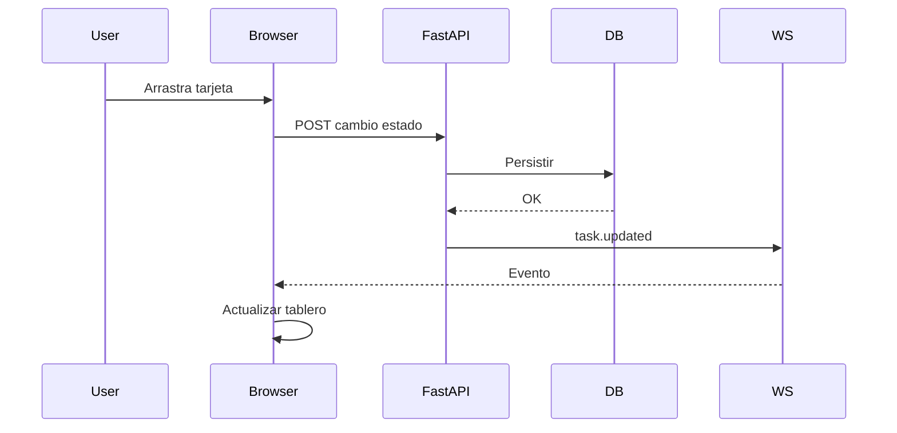
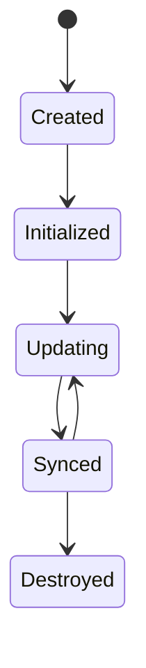
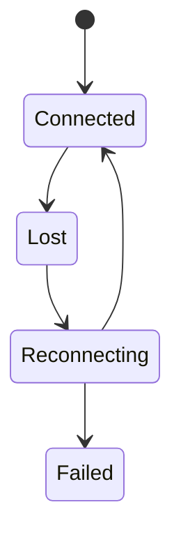
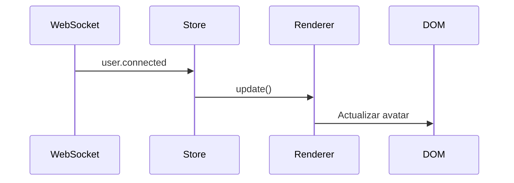
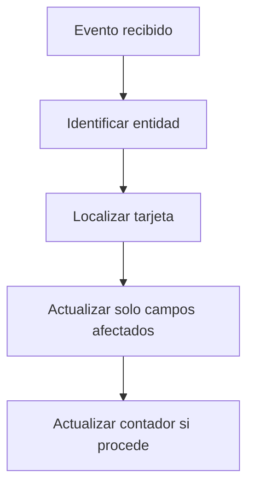
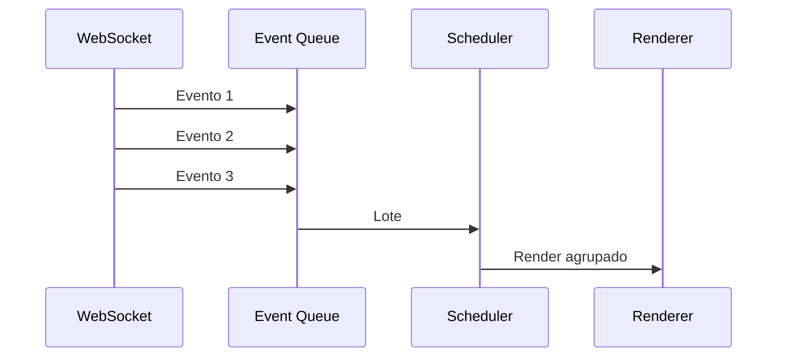
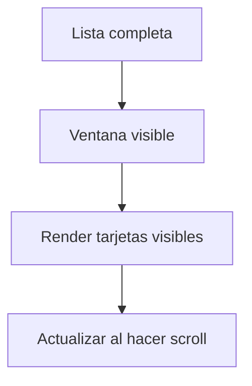
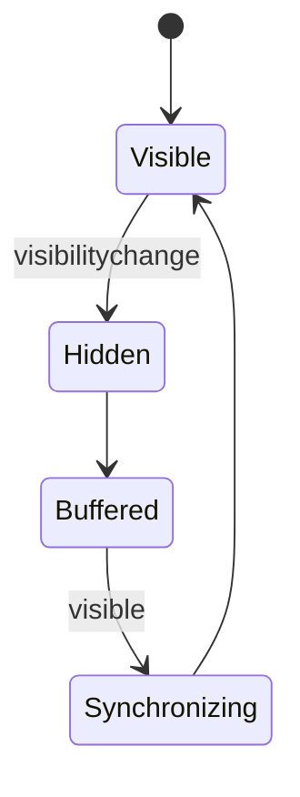
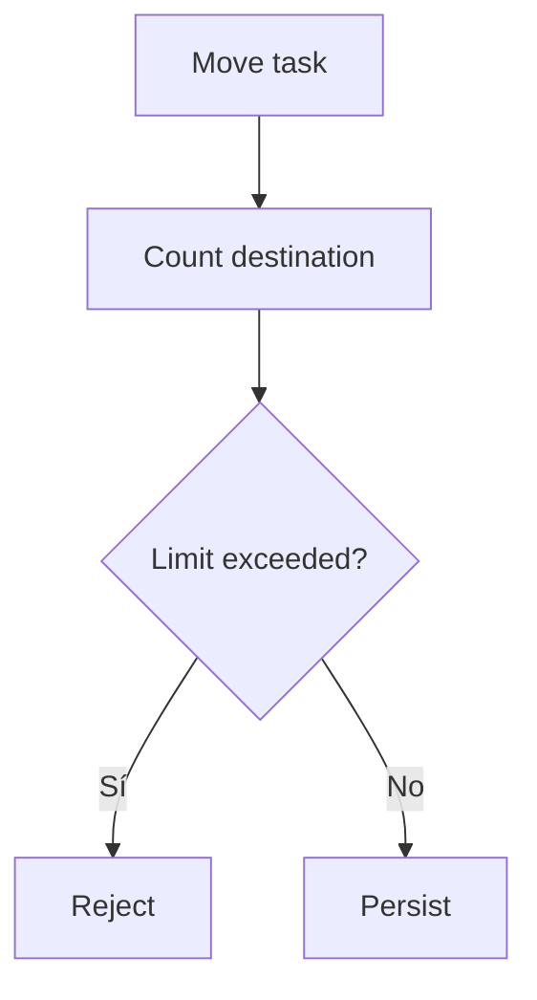

# 24. Realtime Kanban

---

# 1. Introducción

El **Realtime Kanban System** constituye el módulo colaborativo encargado de representar y gestionar el flujo de trabajo de las tareas de un proyecto mediante un tablero visual sincronizado en tiempo real.

Su objetivo es proporcionar una experiencia de colaboración inmediata entre múltiples usuarios, manteniendo como principios fundamentales:

- Server Side Rendering (SSR);
- Backend como fuente de verdad;
- actualización incremental;
- sincronización mediante WebSockets;
- autorización contextual;
- consistencia eventual;
- auditoría completa;
- desacoplamiento entre dominio y presentación.

El Kanban no implementa lógica de negocio propia; representa visualmente el estado autorizado por el backend.

---

# 2. Objetivo

El sistema debe permitir que varios usuarios colaboren simultáneamente sobre un mismo proyecto observando en tiempo real:

- creación de tareas;
- movimiento entre columnas;
- cambios de prioridad;
- asignaciones;
- modificaciones;
- eliminaciones;
- comentarios futuros;
- presencia de otros usuarios.

Todo ello sin necesidad de recargar la página.

---

# 3. Alcance

El módulo cubre:

- representación Kanban;
- columnas;
- tarjetas;
- drag & drop;
- actualización incremental;
- sincronización WebSocket;
- resolución de conflictos;
- auditoría;
- permisos;
- indicadores visuales;
- presencia;
- reconexión;
- sincronización completa.

---

# 4. Fuera de alcance

No corresponde al Kanban:

- decidir permisos;
- modificar directamente la base de datos;
- validar reglas de negocio;
- ejecutar procesos batch;
- generar informes;
- sustituir la auditoría;
- implementar chat;
- gestionar notificaciones persistentes.

Estas responsabilidades pertenecen a otros módulos de la plataforma.

---

# 5. Principios arquitectónicos

El diseño sigue los siguientes principios:

1. Backend como fuente de verdad.
2. SSR como representación inicial.
3. Eventos tipados.
4. Componentes independientes.
5. Actualización incremental.
6. Desacoplamiento.
7. Autorización backend.
8. Auditoría completa.
9. Consistencia eventual.
10. Degradación segura.
11. Accesibilidad.
12. Observabilidad.

---

# 6. Filosofía del Kanban

El tablero representa únicamente una proyección visual del estado del proyecto.

Conceptualmente:

```text
Project

↓

Activities

↓

Tasks

↓

Kanban View
```

Mover una tarjeta nunca implica modificar directamente el DOM como fuente de verdad.

El flujo correcto es:

```text
Usuario

↓

Solicitud HTTP

↓

Backend

↓

Persistencia

↓

Evento WebSocket

↓

Actualizar tablero
```

---

# 7. Arquitectura general

```mermaid
flowchart TD

Task Service

↓

Task Repository

↓

MariaDB

↓

Task Event Publisher

↓

WebSocket Manager

↓

Kanban Client

↓

Kanban Store

↓

Kanban Renderer

↓

DOM
```

---

# 8. Flujo completo



---

# 9. Arquitectura modular

Backend:

```text
tasks/

task_service.py

task_repository.py

task_events.py

task_websocket.py

task_mapper.py
```

Frontend:

```text
kanban/

kanban-bootstrap.js

kanban-store.js

kanban-client.js

kanban-renderer.js

kanban-dragdrop.js

kanban-events.js

kanban-columns.js

kanban-card.js
```

---

# 10. Componentes principales

| Componente | Responsabilidad |
|------------|----------------|
| Kanban Store | Estado temporal |
| Kanban Renderer | Actualización DOM |
| Drag Manager | Gestión drag & drop |
| Event Client | WebSocket |
| Column Component | Columna |
| Card Component | Tarjeta |
| Scheduler | Agrupación |
| Event Bus | Comunicación interna |

---

# 11. Representación SSR

La página debe renderizar inicialmente:

- columnas;
- tarjetas;
- usuarios;
- prioridades;
- fechas;
- estados.

El usuario puede utilizar el tablero incluso antes de conectar WebSocket.

---

# 12. Bootstrap

Durante la carga:

```text
SSR

↓

Bootstrap

↓

Component Registry

↓

Store

↓

WebSocket

↓

Ready
```

---

# 13. Component Registry

Cada componente Kanban se registra automáticamente.

Ejemplo:

```html
<div
data-component="kanban-board">
```

```html
<div
data-component="kanban-column">
```

```html
<div
data-component="kanban-card">
```

---

# 14. Kanban Store

El Store mantiene:

- columnas;
- tarjetas;
- orden;
- filtros;
- usuario actual;
- estado de conexión.

No sustituye nunca la persistencia.

---

# 15. Estado del Store

Ejemplo conceptual:

```javascript
{

projectId:42,

columns:[],

cards:[],

filters:{},

connection:"connected"

}
```

---

# 16. Ciclo de vida



---

# 17. Kanban Renderer

Responsabilidades:

- crear tarjetas;
- actualizar tarjetas;
- mover tarjetas;
- eliminar tarjetas;
- actualizar columnas;
- actualizar contadores.

Nunca consulta la base de datos.

---

# 18. Render incremental

```mermaid
flowchart TD

Evento

↓

Store

↓

Renderer

↓

DOM parcial
```

No se reconstruye el tablero completo.

---

# 19. Columnas

Cada columna representa un estado del flujo de trabajo.

Ejemplo:

```text
TODO

↓

DOING

↓

DONE
```

La arquitectura permite añadir nuevos estados en el futuro.

---

# 20. Column Component

Cada columna mantiene:

- título;
- contador;
- tarjetas;
- zona drag;
- indicadores.

Debe poder actualizarse independientemente.

---

# 21. Arquitectura de columnas

```mermaid
flowchart TD

Column

↓

Header

↓

Counter

↓

Cards

↓

Footer
```

---

# 22. Contador

Cada columna puede mostrar:

```text
Doing

(5)
```

El contador se actualiza automáticamente al mover tarjetas.

---

# 23. Tarjetas

Cada tarjeta representa una tarea.

Debe mostrar únicamente información relevante.

Ejemplo:

- título;
- prioridad;
- responsable;
- fecha;
- etiquetas;
- actividad.

---

# 24. Card Component

Responsabilidades:

- renderizar información;
- actualizar contenido;
- cambiar estado visual;
- gestionar selección;
- abrir detalle.

---

# 25. Arquitectura de tarjeta

```mermaid
flowchart TD

Card

↓

Header

↓

Body

↓

Footer
```

---

# 26. Cabecera

Puede contener:

- prioridad;
- icono;
- identificador;
- acciones.

---

# 27. Cuerpo

Puede mostrar:

- título;
- descripción corta;
- etiquetas.

---

# 28. Pie

Puede incluir:

- responsable;
- fecha;
- progreso;
- comentarios;
- adjuntos.

---

# 29. Identificador

Cada tarjeta mantiene:

```text
taskId
```

Este identificador nunca cambia durante la vida de la tarea.

---

# 30. Prioridad

Puede representarse mediante:

```text
Low

Medium

High

Critical
```

La prioridad no debe depender únicamente del color.

---

# 31. Responsable

La tarjeta puede mostrar:

- avatar;
- iniciales;
- nombre corto;
- estado.

---

# 32. Fechas

Ejemplos:

```text
Hoy

Mañana

Vencida

12 Jul
```

El backend determina el estado temporal.

---

# 33. Etiquetas

Las etiquetas ayudan a clasificar tareas.

Ejemplos:

- Backend;
- IA;
- Hardware;
- Competición.

---

# 34. Estados visuales

Una tarjeta puede estar:

- seleccionada;
- bloqueada;
- vencida;
- recién actualizada;
- sincronizando.

---

# 35. Animaciones

Las animaciones deben ser discretas.

Ejemplos:

- fade;
- highlight;
- desplazamiento suave.

No deben dificultar el trabajo continuo.

---

# 36. Selección

Una tarjeta puede seleccionarse para mostrar acciones adicionales.

La selección pertenece al estado del cliente.

---

# 37. Navegación

Seleccionar una tarjeta puede:

- abrir panel lateral;
- abrir diálogo;
- navegar al detalle.

La política dependerá del diseño general de la plataforma.

---

# 38. Acciones

Ejemplos:

- editar;
- asignar;
- mover;
- archivar;
- eliminar.

La disponibilidad depende siempre de RBAC.

---

# 39. Integración con permisos

El frontend únicamente oculta acciones autorizadas por el backend.

La validación definitiva siempre se realiza en el servidor.

---

# 40. Estado de conexión

El Kanban puede indicar:

```text
Conectado

Sincronizando

Desconectado
```

---

# 41. Reconexión

Tras recuperar la conexión:

```text
Reconnect

↓

Sync

↓

Actualizar Store

↓

Actualizar DOM
```

---

# 42. Actualización parcial

Cuando cambia una tarjeta:

- solo cambia esa tarjeta;
- no cambia toda la columna;
- no cambia todo el tablero.

---

# 43. Cambio de columna

Mover una tarjeta implica:

```mermaid
flowchart TD

Card

↓

Remove old column

↓

Insert new column

↓

Actualizar contadores
```

---

# 44. Creación de tareas

Cuando otro usuario crea una tarea:

- llega evento;
- Store inserta;
- Renderer crea tarjeta;
- contador aumenta.

---

# 45. Eliminación

Eliminar una tarea:

- elimina tarjeta;
- actualiza contador;
- registra auditoría;
- sincroniza sesiones.

---

# 46. Actualización

Modificar una tarea puede afectar:

- título;
- prioridad;
- responsable;
- fecha;
- etiquetas.

Solo deben actualizarse esos campos.

---

# 47. Orden de tarjetas

El orden puede depender de:

- prioridad;
- posición;
- fecha;
- algoritmo configurable.

La política debe ser consistente.

---

# 48. Posición

Puede mantenerse mediante:

```text
position
```

o una estrategia equivalente.

No debe depender únicamente del orden visual del navegador.

---

# 49. Drag & Drop

El sistema soporta movimiento mediante arrastrar y soltar.

Este comportamiento constituye una mejora de la interfaz, no una modificación directa del estado persistente.

---

# 50. Filosofía Drag & Drop

El usuario arrastra una tarjeta.

El backend valida.

El backend persiste.

El backend publica.

El cliente actualiza.

Nunca al revés.

---

# 51. Arquitectura Drag Manager

```mermaid
flowchart TD

Pointer

↓

Drag Manager

↓

Preview

↓

Drop

↓

HTTP Request
```

---

# 52. Eventos drag

Ejemplos:

```text
dragstart

dragenter

dragover

drop

dragend
```

Todos deben encapsularse en el Drag Manager.

---

# 53. Drop Zone

Cada columna representa una zona válida de destino.

La validación definitiva pertenece al backend.

---

# 54. Preview

Durante el arrastre puede mostrarse:

- sombra;
- marcador;
- placeholder;
- resaltado.

No debe alterar permanentemente el DOM.

---

# 55. Placeholder

Mientras la tarjeta se mueve puede aparecer un espacio reservado.

Esto mejora la percepción del usuario.

---

# 56. Validación previa

El frontend puede impedir movimientos evidentemente inválidos.

Ejemplo:

usuario sin permiso.

Sin embargo, la validación definitiva corresponde siempre al backend.

---

# 57. Solicitud HTTP

El movimiento se envía mediante:

```text
POST

/tasks/{id}/status
```

o la ruta equivalente definida por la plataforma.

---

# 58. Estado optimista

El proyecto puede utilizar:

- actualización optimista;
- actualización confirmada.

La estrategia recomendada prioriza consistencia confirmada.

---

# 59. Confirmación

Solo tras la respuesta correcta del backend debe consolidarse visualmente el cambio.

---

# 60. Continuación

La **Parte 2** desarrollará el sistema de sincronización en tiempo real, WebSockets, Event Router, resolución de conflictos, colaboración multiusuario, presencia, auditoría, rendimiento y arquitectura distribuida del Realtime Kanban.

---

# 61. Sincronización en tiempo real

El Kanban debe mantenerse sincronizado entre todos los usuarios conectados al mismo proyecto.

Cada modificación persistida genera un evento que actualiza únicamente los elementos afectados.

El flujo general es:

```text
Cambio

↓

Persistencia

↓

Evento

↓

WebSocket

↓

Kanban Store

↓

Renderer

↓

DOM
```

---

# 62. Eventos del Kanban

El módulo consume eventos tipados.

Ejemplos:

```text
task.created

task.updated

task.deleted

task.status.changed

task.priority.changed

task.assigned

task.unassigned

activity.updated

project.updated
```

Los nombres deben mantenerse estables y versionados.

---

# 63. Event Envelope

Todos los eventos deben compartir una estructura común.

Ejemplo conceptual:

```json
{
  "event": "task.status.changed",
  "version": 1,
  "eventId": "evt_01JZ...",
  "timestamp": "2026-07-25T12:15:00Z",
  "correlationId": "req_01JZ...",
  "payload": {}
}
```

---

# 64. Versionado de eventos

Cada evento incluye:

```json
{
    "version": 1
}
```

El cliente debe:

- aceptar versiones compatibles;
- descartar versiones desconocidas;
- registrar incidencias;
- solicitar sincronización cuando sea necesario.

---

# 65. Event Router

El Event Router distribuye los eventos a los componentes correspondientes.

```mermaid
flowchart TD

WebSocket

↓

Event Router

↓

Kanban Store

↓

Renderer
```

El Router nunca modifica directamente el DOM.

---

# 66. Validación del evento

Antes de procesar un mensaje se debe validar:

- versión;
- tipo;
- payload;
- identificadores;
- timestamp;
- proyecto;
- usuario.

Los eventos inválidos deben descartarse.

---

# 67. Normalización

Tras validar el mensaje, el cliente genera un modelo interno homogéneo.

Esto evita que cada componente conozca el formato WebSocket original.

---

# 68. Eventos desconocidos

Si llega un evento no soportado:

- registrar advertencia;
- ignorarlo;
- mantener funcionamiento del tablero.

Nunca debe detenerse el resto del sistema.

---

# 69. Actualización incremental

Cada tipo de evento modifica únicamente la parte necesaria del tablero.

Ejemplos:

| Evento | Actualización |
|---------|---------------|
| task.created | Nueva tarjeta |
| task.updated | Tarjeta existente |
| task.deleted | Eliminar tarjeta |
| task.status.changed | Mover tarjeta |
| task.priority.changed | Actualizar prioridad |

---

# 70. task.created

Cuando llega una nueva tarea:

```mermaid
flowchart TD

Evento

↓

Store

↓

Crear Card

↓

Insertar columna

↓

Actualizar contador
```

No debe reconstruirse el tablero completo.

---

# 71. task.updated

Puede modificar:

- título;
- descripción;
- prioridad;
- responsable;
- fecha;
- etiquetas.

Solo cambian esos elementos.

---

# 72. task.deleted

El flujo consiste en:

```text
Eliminar tarjeta

↓

Actualizar contador

↓

Eliminar referencias

↓

Render parcial
```

---

# 73. task.status.changed

Es el evento más frecuente.

Produce:

- extracción de columna origen;
- inserción en destino;
- actualización de contadores;
- animación;
- auditoría visual.

---

# 74. task.priority.changed

Solo modifica:

- indicador;
- color;
- icono;
- texto;
- orden, si la política así lo establece.

---

# 75. task.assigned

La actualización afecta a:

- avatar;
- responsable;
- información contextual.

No requiere reconstrucción de la tarjeta.

---

# 76. task.unassigned

Debe eliminar:

- avatar;
- responsable;
- indicadores asociados.

---

# 77. activity.updated

Cuando cambia una actividad:

- actualizar nombre;
- actualizar progreso;
- actualizar tarjetas relacionadas si procede.

---

# 78. project.updated

Puede afectar a:

- permisos;
- miembros;
- configuración;
- columnas.

Algunos cambios requieren sincronización completa.

---

# 79. Sincronización de columnas

Si cambia la configuración del flujo:

```text
TODO

↓

IN REVIEW

↓

DONE
```

el tablero puede reconstruir únicamente la estructura de columnas manteniendo las tarjetas.

---

# 80. Canales WebSocket

Los eventos deben distribuirse por proyecto.

Ejemplo:

```text
project:42
```

Solo los miembros autorizados reciben esos mensajes.

---

# 81. Canales privados

Además del canal del proyecto pueden existir canales privados.

Ejemplos:

```text
user:18

project:42
```

---

# 82. Autorización

El backend valida:

- usuario;
- pertenencia;
- rol;
- permisos;
- estado.

Solo después permite la suscripción.

---

# 83. Reconexión

Cuando WebSocket se pierde:



---

# 84. Backoff

La reconexión debe utilizar:

- espera creciente;
- jitter;
- límite máximo;
- reinicio tras éxito.

---

# 85. Resincronización

Tras reconectar:

```text
Reconnect

↓

Sync Endpoint

↓

Actualizar Store

↓

Actualizar DOM
```

---

# 86. Endpoint de sincronización

Ejemplo:

```text
GET

/projects/{id}/kanban/sync
```

Puede devolver:

- tarjetas;
- columnas;
- usuarios;
- versión;
- timestamp.

---

# 87. Estado de sincronización

El Store puede mantener:

```javascript
syncState
```

Valores:

```text
idle

syncing

ready

failed
```

---

# 88. Cursor

La sincronización puede apoyarse en:

```text
lastEventId
```

o:

```text
lastUpdated
```

según la estrategia elegida.

---

# 89. Deduplicación

Cada evento debe procesarse una sola vez.

Ejemplo:

```javascript
processedEvents.has(eventId)
```

La colección debe tener tamaño limitado.

---

# 90. Orden

Los eventos pueden llegar fuera de orden.

Para resolverlo puede utilizarse:

- versión;
- secuencia;
- timestamp;
- sincronización.

---

# 91. Colaboración multiusuario

El Kanban está diseñado para varios usuarios simultáneos.

Todos observan:

- movimientos;
- altas;
- bajas;
- modificaciones.

La actualización debe ser prácticamente inmediata.

---

# 92. Usuarios concurrentes

Ejemplo:

```mermaid
flowchart LR

Usuario A

Usuario B

Usuario C

↓

Backend

↓

Proyecto
```

Todos reciben únicamente los eventos autorizados.

---

# 93. Conflictos

Puede ocurrir que dos usuarios modifiquen la misma tarea.

El backend resuelve el conflicto.

El cliente nunca decide.

---

# 94. Tipos de conflicto

Ejemplos:

- cambio de estado;
- edición simultánea;
- eliminación;
- reasignación;
- cambio de prioridad.

---

# 95. Estrategias

Posibles estrategias:

- last write wins;
- optimistic locking;
- versionado;
- bloqueo.

La decisión pertenece al dominio.

---

# 96. Versionado de entidad

Cada tarea puede mantener:

```text
entityVersion
```

Esto permite detectar modificaciones concurrentes.

---

# 97. Optimistic Lock

Flujo conceptual:

```mermaid
flowchart TD

Leer versión

↓

Modificar

↓

Comparar

↓

Actualizar

↓

Nueva versión
```

Si la versión no coincide, el backend rechaza la operación.

---

# 98. Respuesta al conflicto

El cliente puede:

- mostrar diálogo;
- recargar tarjeta;
- resincronizar.

Nunca debe sobrescribir silenciosamente información confirmada.

---

# 99. Actualización visual

Cuando otro usuario modifica una tarjeta puede resaltarse brevemente.

Ejemplo:

- borde;
- fade;
- icono temporal.

---

# 100. Indicadores de edición

Una evolución futura puede mostrar:

```text
Ana está editando esta tarea.
```

Esto requiere eventos adicionales.

---

# 101. Presencia

El Kanban puede mostrar miembros conectados.

Información:

- nombre;
- avatar;
- estado.

---

# 102. Estados de presencia

Ejemplos:

```text
online

idle

offline
```

---

# 103. Eventos de presencia

```text
user.connected

user.disconnected

user.presence.changed
```

---

# 104. Actualización de presencia



---

# 105. Cursores colaborativos

Una evolución puede mostrar dónde trabaja cada usuario.

Ejemplo:

```text
Ana

↓

Task #54
```

---

# 106. Bloqueos suaves

El sistema puede indicar:

```text
Otro usuario está editando.
```

No implica necesariamente bloqueo técnico.

---

# 107. Auditoría

Cada cambio relevante genera auditoría.

Ejemplos:

- mover;
- editar;
- asignar;
- eliminar.

---

# 108. Relación con Audit System

```text
Task moved

↓

Audit

↓

Notification

↓

Realtime Event
```

Son mecanismos independientes.

---

# 109. Timeline

El detalle de la tarea puede mostrar:

```text
Creada

↓

Asignada

↓

Doing

↓

Done
```

---

# 110. Integración con Notification System

Algunos cambios pueden generar:

- notificación;
- actualización Kanban;
- auditoría.

Todo ello a partir del mismo evento de dominio.

---

# 111. Integración con Dashboard

El Dashboard puede reflejar:

- tareas Doing;
- tareas Done;
- progreso.

El Kanban continúa siendo el módulo especializado.

---

# 112. Integración con RBAC

Cada acción visible depende de:

- rol global;
- rol de proyecto;
- permisos.

La decisión final siempre pertenece al backend.

---

# 113. Integración con Dialog System

Operaciones sensibles:

- eliminar;
- archivar;
- cerrar actividad.

Deben confirmarse mediante Dialog Manager.

---

# 114. Integración con Toast System

Operaciones exitosas pueden generar Toast.

Ejemplo:

```text
Tarea movida correctamente.
```

---

# 115. Integración con Component Registry

Todos los componentes Kanban deben inicializarse automáticamente mediante atributos declarativos.

---

# 116. Integración con Event Bus

Comunicación interna:

```text
kanban.card.updated

kanban.column.updated

kanban.sync.completed

kanban.connection.changed
```

Los componentes permanecen desacoplados.

---

# 117. Scheduler

Cuando llegan muchos eventos:

```mermaid
flowchart TD

Eventos

↓

Queue

↓

Scheduler

↓

Renderer
```

---

# 118. Batch Updates

Varias modificaciones consecutivas pueden agruparse.

Beneficios:

- menos renderizados;
- mayor fluidez;
- menor consumo.

---

# 119. Debounce

Adecuado para:

- filtros;
- búsqueda;
- redimensionado.

---

# 120. Throttle

Adecuado para:

- drag;
- scroll;
- resize;
- indicadores.

---

# 121. Render Budget

El Renderer debe minimizar:

- consultas DOM;
- repintados;
- recalculos.

---

# 122. Observabilidad

Deben registrarse:

- conexiones;
- eventos;
- errores;
- sincronizaciones;
- conflictos.

---

# 123. Logging

Ejemplo conceptual:

```json
{
  "component":"kanban",
  "event":"task.status.changed",
  "taskId":42
}
```

---

# 124. Métricas

Ejemplos:

- movimientos;
- reconexiones;
- conflictos;
- tiempo de render;
- sincronizaciones.

---

# 125. Cleanup

Al destruir el tablero deben liberarse:

- listeners;
- timers;
- observers;
- WebSocket handlers.

---

# 126. Gestión de memoria

No deben mantenerse referencias a tarjetas eliminadas.

---

# 127. Estado offline

Si la conexión desaparece:

- mostrar indicador;
- bloquear drag cuando proceda;
- mantener tablero visible.

---

# 128. Recuperación

Tras volver la conexión:

- sincronizar;
- actualizar;
- continuar trabajo.

---

# 129. Error aislado

Si una tarjeta falla:

- registrar error;
- mantener el resto operativo.

---

# 130. Continuación

La **Parte 3** desarrollará el rendimiento avanzado, escalado horizontal, accesibilidad, testing, despliegue, Docker, Nginx, arquitectura distribuida, checklist, criterios de aceptación y conclusiones del Realtime Kanban.

---

# 131. Rendimiento avanzado

El Realtime Kanban debe mantener una interacción fluida incluso cuando:

- existen numerosos proyectos;
- una columna contiene muchas tareas;
- varios usuarios trabajan simultáneamente;
- llegan ráfagas de eventos;
- se ejecutan cambios frecuentes;
- el dispositivo dispone de recursos limitados.

La estrategia de rendimiento debe centrarse en:

- minimizar operaciones DOM;
- evitar renderizados completos;
- agrupar eventos;
- diferir trabajo no crítico;
- limitar estructuras en memoria;
- destruir correctamente recursos;
- medir tiempos reales.

---

# 132. Presupuesto de rendimiento

El módulo debe definir presupuestos técnicos orientativos para:

- tiempo de bootstrap;
- tiempo de render inicial;
- movimiento de una tarjeta;
- actualización de una tarjeta;
- procesamiento de eventos;
- tamaño del bundle;
- memoria del Store;
- número máximo de nodos activos.

Estos valores deben revisarse mediante mediciones reales.

---

# 133. Evitar renderizados completos

El tablero no debe reconstruirse por cambios individuales.



---

# 134. Comparación de estado

Antes de actualizar una tarjeta debe comprobarse si existe un cambio real.

Pueden compararse:

- versión de entidad;
- estado;
- posición;
- prioridad;
- responsable;
- fecha;
- checksum ligero.

---

# 135. Renderizado agrupado

Cuando múltiples eventos afectan a la misma columna, el Scheduler puede procesarlos como lote.



---

# 136. requestAnimationFrame

Las modificaciones visuales pueden agruparse mediante:

```javascript
requestAnimationFrame(() => {
    renderer.flush();
});
```

Esto ayuda a alinear las actualizaciones con el ciclo de pintura del navegador.

---

# 137. Tareas largas

Operaciones potencialmente costosas:

- ordenar muchas tarjetas;
- recalcular todas las posiciones;
- aplicar filtros complejos;
- reconstruir columnas;
- procesar cientos de eventos;
- generar estadísticas.

Estas operaciones deben desplazarse al backend o dividirse cuando sea posible.

---

# 138. Virtualización

Cuando una columna contiene muchas tarjetas puede utilizarse virtualización.



Solo se mantienen en el DOM:

- tarjetas visibles;
- pequeño margen superior;
- pequeño margen inferior.

---

# 139. Lazy Rendering

Las columnas fuera del viewport pueden inicializarse parcialmente.

Esto resulta útil en tableros con muchas columnas o scroll horizontal.

---

# 140. IntersectionObserver

Puede utilizarse para:

- activar columnas;
- cargar detalles;
- pausar tarjetas invisibles;
- reducir observadores activos.

---

# 141. Límites del Store

El Store debe contener únicamente datos necesarios para el tablero actual.

No debe almacenar:

- históricos completos;
- proyectos no abiertos;
- auditoría completa;
- notificaciones ajenas;
- entidades no utilizadas.

---

# 142. Gestión de memoria

Al eliminar una tarjeta deben retirarse:

- referencias del Store;
- listeners;
- observers;
- timers;
- nodos;
- callbacks;
- estado de selección.

---

# 143. Destrucción del tablero

El método `destroy()` debe liberar:

- WebSocket subscriptions;
- Event Bus subscriptions;
- listeners drag;
- listeners teclado;
- observers;
- AbortController;
- timers;
- referencias DOM;
- cola de eventos.

---

# 144. Página oculta

Cuando la pestaña está oculta, el Kanban puede:

- pausar animaciones;
- agrupar eventos;
- reducir frecuencia;
- posponer renderizado;
- mantener el Store actualizado.

Al volver a estar visible debe comprobar consistencia.

---

# 145. Visibility API



---

# 146. Rendimiento durante drag

Durante el arrastre deben minimizarse:

- lecturas de layout;
- escrituras repetidas;
- cálculo de posiciones;
- creación de nodos;
- listeners globales innecesarios.

---

# 147. Eventos de puntero

Siempre que sea viable deben utilizarse Pointer Events para unificar:

- ratón;
- táctil;
- stylus.

---

# 148. Throttle de movimiento

Los eventos de movimiento pueden ejecutarse muchas veces por segundo.

Debe aplicarse throttle o coordinación con `requestAnimationFrame`.

---

# 149. Placeholder eficiente

El placeholder debe:

- reutilizarse;
- evitar recreación;
- mantener tamaño;
- no forzar reflow excesivo.

---

# 150. Ordenación eficiente

Si el orden se basa en `position`, no debe reordenarse todo el tablero cuando solo cambia una tarjeta.

La actualización debe limitarse a:

- columna origen;
- columna destino;
- tarjetas afectadas.

---

# 151. Estrategias de posición

Opciones:

- enteros secuenciales;
- índices espaciados;
- orden fraccional;
- identificadores lexicográficos.

---

# 152. Índices secuenciales

Ejemplo:

```text
1
2
3
4
```

Al insertar entre dos posiciones puede ser necesario renumerar.

---

# 153. Índices espaciados

Ejemplo:

```text
100
200
300
```

Insertar entre 100 y 200 permite usar 150 sin renumerar inicialmente.

---

# 154. Posición fraccional

Ejemplo:

```text
100.0
150.0
200.0
```

Debe controlarse la precisión y compactarse periódicamente.

---

# 155. Orden lexicográfico

Una estrategia avanzada puede utilizar claves ordenables.

Debe evaluarse solo si el volumen y la concurrencia lo justifican.

---

# 156. WIP Limits

El Kanban puede incorporar límites de trabajo en curso.

Ejemplo:

```text
DOING: máximo 5 tareas
```

---

# 157. Validación de WIP

El backend debe validar el límite.



---

# 158. Representación de WIP

La columna puede mostrar:

```text
Doing 4/5
```

No debe depender únicamente del color.

---

# 159. Violaciones de WIP

Si el movimiento supera el límite:

- rechazar;
- mantener tarjeta en origen;
- mostrar explicación;
- restaurar placeholder;
- registrar conflicto si procede.

---

# 160. Transiciones permitidas

No todos los estados deben ser alcanzables desde cualquier columna.

Ejemplo:

```text
TODO → DOING

DOING → DONE

DONE → DOING
```

El backend mantiene la matriz válida.

---

# 161. Máquina de estados

```mermaid
stateDiagram-v2
    TODO --> DOING
    DOING --> DONE
    DONE --> DOING
    DOING --> TODO
```

---

# 162. Validación de transición

El cliente puede reflejar destinos permitidos, pero el servidor decide definitivamente.

---

# 163. Columnas dinámicas

Una evolución puede permitir configurar columnas por proyecto.

Ejemplos:

- Backlog;
- Ready;
- Doing;
- Review;
- Done.

---

# 164. Configuración de columnas

La configuración puede contener:

```text
id
name
status
position
wip_limit
is_terminal
```

---

# 165. Migración de columnas

Si se elimina una columna con tareas, debe existir una política explícita:

- impedir eliminación;
- mover tareas;
- archivar;
- solicitar destino.

---

# 166. Accesibilidad

El tablero debe ser completamente utilizable sin arrastrar con ratón.

El drag & drop no puede ser el único mecanismo de movimiento.

---

# 167. Alternativa accesible

Cada tarjeta puede ofrecer una acción:

```text
Mover a...
```

Esta acción abre un menú o diálogo con estados válidos.

---

# 168. Navegación por teclado

El usuario debe poder:

- recorrer columnas;
- recorrer tarjetas;
- seleccionar tarjeta;
- abrir detalle;
- mover tarea;
- cancelar operación;
- confirmar destino.

---

# 169. Patrón de teclado

Ejemplo conceptual:

- `Tab`: recorrer controles;
- `Enter`: abrir tarjeta;
- `Space`: iniciar movimiento accesible;
- flechas: elegir destino;
- `Escape`: cancelar.

Debe documentarse y probarse.

---

# 170. Semántica del tablero

Ejemplo:

```html
<section aria-labelledby="kanban-title">
    <h1 id="kanban-title">Tablero del proyecto</h1>
</section>
```

Cada columna debe disponer de nombre accesible.

---

# 171. Semántica de columna

```html
<section
    aria-labelledby="column-doing-title"
    data-kanban-column="doing"
>
    <h2 id="column-doing-title">
        En curso
    </h2>
</section>
```

---

# 172. Semántica de tarjeta

Cada tarjeta puede representarse como:

```html
<article
    tabindex="0"
    aria-labelledby="task-title-42"
>
</article>
```

---

# 173. Actualizaciones dinámicas accesibles

No debe anunciarse cada evento recibido.

Deben anunciarse cambios relevantes como:

- tarea movida por el usuario;
- error;
- conflicto;
- desconexión;
- sincronización completada.

---

# 174. Región viva

Puede utilizarse una región `aria-live="polite"` para mensajes concretos.

Ejemplo:

```text
La tarea Diseño del sensor se ha movido a En curso.
```

---

# 175. Foco tras movimiento

Tras mover una tarjeta mediante teclado:

- mantener foco en la tarjeta;
- trasladarlo a su nueva posición;
- anunciar el nuevo estado.

---

# 176. Foco tras eliminación

Si se elimina una tarjeta:

- mover foco a la siguiente;
- o a la anterior;
- o al encabezado de columna.

La elección debe ser predecible.

---

# 177. Contraste

Las prioridades, estados y alertas deben combinar:

- texto;
- icono;
- color;
- etiqueta.

---

# 178. Movimiento reducido

Con `prefers-reduced-motion` deben desactivarse animaciones de desplazamiento no esenciales.

---

# 179. Responsive Design

El Kanban debe adaptarse a:

- escritorio;
- portátil;
- tableta;
- móvil;
- pantallas de aula.

---

# 180. Escritorio

En escritorio puede utilizarse:

- varias columnas visibles;
- scroll horizontal;
- drag & drop;
- panel lateral.

---

# 181. Móvil

En móvil puede preferirse:

- una columna por vista;
- selector de estado;
- navegación por pestañas;
- acción “Mover a...”;
- tarjetas compactas.

---

# 182. Densidad visual

Puede existir:

- modo cómodo;
- modo compacto.

La preferencia debe conservar accesibilidad.

---

# 183. Seguridad

El Kanban no constituye una frontera de autorización.

Toda operación debe volver a validarse en backend.

---

# 184. Autorización contextual

Las comprobaciones deben considerar:

- usuario autenticado;
- rol global;
- pertenencia;
- rol de proyecto;
- permiso sobre tareas;
- estado del proyecto;
- actividad relacionada.

---

# 185. Protección horizontal

Todos los endpoints deben incluir el ámbito del proyecto.

No basta con recibir `task_id`.

Debe verificarse que la tarea pertenece a un proyecto accesible.

---

# 186. Validación de payload

Un cambio de estado debe validar:

- task ID;
- project ID;
- estado destino;
- posición;
- versión;
- CSRF;
- usuario.

---

# 187. Mass Assignment

El endpoint de movimiento no debe aceptar una entidad Task completa.

Debe aceptar únicamente campos específicos.

Ejemplo conceptual:

```python
class TaskMoveRequest:
    target_status: TaskStatus
    target_position: str | int | float | None
    expected_version: int
```

---

# 188. CSRF

Toda operación HTTP mutable debe usar la protección CSRF centralizada.

---

# 189. XSS

Los títulos y descripciones deben insertarse como texto plano por defecto.

No debe utilizarse `innerHTML` con datos procedentes de eventos.

---

# 190. Content Security Policy

El módulo debe ser compatible con:

- scripts externos controlados;
- ausencia de handlers inline;
- ausencia de `eval`;
- módulos JavaScript;
- nonces o hashes cuando proceda.

---

# 191. URLs internas

Las acciones de tarjeta deben usar rutas internas validadas.

No deben confiar en URLs arbitrarias recibidas por WebSocket.

---

# 192. Rate Limiting

El backend puede limitar:

- movimientos repetidos;
- cambios masivos;
- sincronizaciones;
- reconexiones;
- endpoints de ordenación.

---

# 193. Protección ante replay

Una solicitud repetida con la misma versión o command ID debe tratarse de forma idempotente cuando sea posible.

---

# 194. Command ID

Cada movimiento puede incluir:

```text
commandId
```

Esto permite correlación y deduplicación.

---

# 195. Optimistic Locking

La tarea debe incluir una versión.

Ejemplo conceptual:

```text
version = 7
```

La petición envía `expected_version = 7`.

---

# 196. Conflicto de versión

Si la tarea ya está en versión 8:

```text
409 Conflict
```

El cliente debe recuperar la versión actual.

---

# 197. Flujo de conflicto

```mermaid
sequenceDiagram
    participant C as Client
    participant API as FastAPI
    participant DB as MariaDB

    C->>API: Move task expectedVersion=7
    API->>DB: UPDATE WHERE version=7
    DB-->>API: 0 rows
    API-->>C: 409 + current task
    C->>C: Reconcile and notify
```

---

# 198. Resolución de conflicto

El cliente puede:

- restaurar estado;
- actualizar tarjeta;
- mostrar Toast;
- solicitar confirmación;
- reintentar manualmente.

---

# 199. Auditoría de conflictos

Los conflictos relevantes pueden registrarse técnicamente para diagnóstico.

No deben generar necesariamente un evento funcional de auditoría.

---

# 200. Validación de eliminación

Eliminar una tarea puede requerir:

- permiso específico;
- confirmación;
- comprobar dependencias;
- comprobar estado;
- auditoría.

---

# 201. Soft Delete

Puede utilizarse soft delete cuando se necesite:

- recuperar;
- mantener historial;
- preservar auditoría;
- evitar pérdida accidental.

---

# 202. Testing

El Realtime Kanban requiere pruebas:

- unitarias;
- Repository;
- Service;
- API;
- WebSocket;
- frontend;
- integración;
- End-to-End;
- accesibilidad;
- rendimiento;
- concurrencia.

---

# 203. Pruebas unitarias backend

Deben cubrir:

- transición válida;
- transición inválida;
- WIP limit;
- permisos;
- posición;
- optimistic locking;
- creación de evento;
- auditoría.

---

# 204. Pruebas de Repository

Casos:

- buscar tareas por proyecto;
- actualizar estado;
- actualizar posición;
- conflicto de versión;
- aislamiento entre proyectos;
- orden determinista;
- eliminación.

---

# 205. Pruebas de Service

Casos:

- movimiento válido;
- usuario sin permiso;
- tarea inexistente;
- columna inválida;
- WIP excedido;
- conflicto;
- publicación de evento;
- fallo de publicación tras commit.

---

# 206. Pruebas API

Deben verificar:

- autenticación;
- autorización;
- CSRF;
- payload;
- respuesta;
- `404`;
- `409`;
- `422`;
- idempotencia.

---

# 207. Pruebas WebSocket

Escenarios:

- suscripción autorizada;
- suscripción rechazada;
- evento correcto;
- varias pestañas;
- varios usuarios;
- reconexión;
- duplicado;
- fuera de orden;
- versión incompatible.

---

# 208. Pruebas del Store

Deben cubrir:

- bootstrap;
- insertar;
- actualizar;
- mover;
- eliminar;
- deduplicar;
- reconciliar;
- limpiar;
- mantener orden.

---

# 209. Pruebas del Renderer

Casos:

- crear tarjeta;
- actualizar campo;
- mover entre columnas;
- eliminar;
- actualizar contadores;
- preservar foco;
- evitar render completo.

---

# 210. Pruebas Drag & Drop

Deben verificar:

- inicio;
- destino válido;
- destino inválido;
- cancelación;
- fallo HTTP;
- rollback;
- conflicto;
- cleanup.

---

# 211. Pruebas de teclado

Casos:

- seleccionar;
- iniciar movimiento;
- recorrer destinos;
- confirmar;
- cancelar;
- foco final;
- anuncio accesible.

---

# 212. Pruebas End-to-End

Flujos prioritarios:

1. abrir tablero;
2. mover tarea;
3. recibir actualización en otra sesión;
4. crear tarea;
5. modificar prioridad;
6. eliminar;
7. perder conexión;
8. reconectar;
9. resolver conflicto;
10. usar teclado.

---

# 213. Pruebas multiusuario

Debe simularse:

- usuario A mueve;
- usuario B edita;
- usuario C elimina;
- eventos simultáneos;
- conflicto de versión;
- sincronización final.

---

# 214. Pruebas de carga

Deben simular:

- muchos usuarios;
- muchos eventos;
- muchas tarjetas;
- varias columnas;
- reconexiones simultáneas;
- sincronizaciones completas.

---

# 215. Pruebas de resiliencia

Escenarios:

- MariaDB caída;
- broker no disponible;
- WebSocket interrumpido;
- evento duplicado;
- publicación fallida;
- cliente desactualizado;
- timeout de API.

---

# 216. Pruebas de rendimiento

Métricas:

- tiempo de movimiento;
- render de tarjeta;
- render de columna;
- memoria;
- procesamiento de ráfaga;
- scroll con virtualización;
- bootstrap.

---

# 217. Observabilidad

El sistema debe permitir rastrear un movimiento completo desde el cliente hasta todas las sesiones.

---

# 218. Correlation ID

Cada operación debe poder correlacionarse mediante:

```text
commandId
correlationId
eventId
taskId
projectId
```

---

# 219. Logging estructurado

Ejemplo conceptual:

```json
{
  "level": "info",
  "component": "kanban",
  "event": "task.status.changed",
  "projectId": 42,
  "taskId": 391,
  "from": "TODO",
  "to": "DOING",
  "correlationId": "req_01JZ"
}
```

---

# 220. Privacidad de logs

No deben registrarse por defecto:

- descripciones completas;
- datos personales innecesarios;
- JWT;
- cookies;
- contenido sensible;
- información de otros proyectos.

---

# 221. Métricas backend

Ejemplos:

```text
kanban_task_moves_total
kanban_move_conflicts_total
kanban_move_rejected_total
kanban_sync_requests_total
kanban_events_published_total
kanban_event_publish_failures_total
```

---

# 222. Métricas frontend

Ejemplos:

```text
kanban_event_received
kanban_event_discarded
kanban_render_duration
kanban_drag_cancelled
kanban_sync_failed
kanban_component_error
```

---

# 223. Alertas operativas

Deben contemplarse alertas cuando:

- aumentan conflictos;
- falla publicación;
- crece la cola;
- se repiten sincronizaciones;
- se pierde conectividad;
- aumenta el tiempo de respuesta.

---

# 224. Escalado horizontal

Cuando existen varias instancias FastAPI, los eventos deben distribuirse mediante un broker compartido.

```mermaid
flowchart TD
    A[Task Service] --> B[Event Broker]

    B --> C[FastAPI Instance 1]
    B --> D[FastAPI Instance 2]
    B --> E[FastAPI Instance 3]

    C --> F[WebSocket Clients]
    D --> G[WebSocket Clients]
    E --> H[WebSocket Clients]
```

---

# 225. Broker

Opciones:

- Redis Pub/Sub;
- Redis Streams;
- RabbitMQ;
- Kafka;
- NATS.

---

# 226. Redis Pub/Sub

Adecuado para:

- baja latencia;
- escala moderada;
- persistencia ya garantizada en MariaDB;
- arquitectura sencilla.

---

# 227. Redis Streams

Adecuado cuando se necesita:

- replay;
- grupos de consumidores;
- retención temporal;
- acknowledgements;
- mayor resiliencia.

---

# 228. Kafka

Puede considerarse en una evolución de gran escala.

No debe introducirse sin una necesidad clara.

---

# 229. Outbox Pattern

Para evitar pérdida de eventos tras el commit puede utilizarse Outbox Pattern.

```mermaid
flowchart TD
    A[Transaction] --> B[Update Task]
    A --> C[Insert Audit]
    A --> D[Insert Outbox Event]

    D --> E[Outbox Worker]
    E --> F[Broker]
    F --> G[WebSocket]
```

---

# 230. Atomicidad

La modificación de tarea, auditoría y registro de outbox pueden formar parte de la misma transacción.

---

# 231. Reintentos de publicación

El worker debe utilizar:

- backoff;
- límite;
- estados;
- dead-letter;
- métricas.

---

# 232. Idempotencia del consumidor

Los consumidores deben ignorar eventos ya procesados.

---

# 233. Orden por proyecto

Puede mantenerse una secuencia por proyecto para detectar huecos o desorden.

Ejemplo:

```text
projectSequence = 1287
```

---

# 234. Detección de huecos

Si el cliente recibe:

```text
1287
1289
```

puede detectar que falta `1288` y solicitar sincronización.

---

# 235. Consistencia eventual

El Kanban opera con consistencia eventual entre clientes.

La operación se considera confirmada por la respuesta HTTP del backend.

---

# 236. Despliegue

El módulo forma parte de la aplicación FastAPI y de sus assets frontend.

Debe desplegarse coordinadamente con:

- plantillas;
- JavaScript;
- CSS;
- contratos;
- endpoints;
- eventos.

---

# 237. Docker

Servicios habituales:

```text
FastAPI
MariaDB
Redis
Nginx
```

---

# 238. Docker Compose

En desarrollo, Docker Compose puede levantar:

- backend;
- base de datos;
- broker;
- proxy;
- worker opcional.

---

# 239. Nginx

Responsabilidades:

- servir estáticos;
- proxy HTTP;
- upgrade WebSocket;
- compresión;
- cabeceras;
- timeouts.

---

# 240. WebSocket Proxy

Debe permitir:

```text
Connection: Upgrade
Upgrade: websocket
```

y configurar timeouts adecuados.

---

# 241. Cache de assets

Los assets versionados pueden utilizar caché larga.

El HTML y los endpoints dinámicos requieren políticas diferentes.

---

# 242. CI/CD

La pipeline debe ejecutar:

- lint;
- tests backend;
- tests frontend;
- contratos;
- seguridad;
- build;
- pruebas de integración;
- análisis estático.

---

# 243. Quality Gates

No debe desplegarse cuando:

- fallan tests;
- existen vulnerabilidades críticas;
- fallan contratos;
- falla lint;
- el build no es reproducible;
- no se cumplen umbrales acordados.

---

# 244. Compatibilidad de versiones

El frontend y backend deben compartir versiones compatibles de eventos.

---

# 245. Feature Flags

Pueden utilizarse para activar gradualmente:

- WIP limits;
- columnas dinámicas;
- presencia avanzada;
- virtualización;
- drag táctil;
- optimistic updates.

---

# 246. Rollback

El despliegue debe permitir volver a una versión anterior sin dejar contratos incompatibles.

---

# 247. Arquitectura completa

```mermaid
flowchart TD
    A[Usuario] --> B[Kanban UI]
    B --> C[HTTP Client]
    C --> D[FastAPI Router]
    D --> E[Task Service]
    E --> F[Task Repository]
    F --> G[(MariaDB)]

    E --> H[Audit Service]
    E --> I[Outbox]
    I --> J[Worker]
    J --> K[Broker]
    K --> L[WebSocket Manager]
    L --> M[Kanban Client]

    M --> N[Event Router]
    N --> O[Kanban Store]
    O --> P[Scheduler]
    P --> Q[Kanban Renderer]
    Q --> B
```

---

# 248. Flujo completo de movimiento

```mermaid
sequenceDiagram
    participant U as Usuario A
    participant UI as Kanban UI
    participant API as FastAPI
    participant S as Task Service
    participant DB as MariaDB
    participant O as Outbox
    participant B as Broker
    participant WS as WebSocket
    participant U2 as Usuario B

    U->>UI: Mover tarjeta
    UI->>API: POST cambio de estado
    API->>S: move_task()
    S->>DB: Validar y persistir
    S->>DB: Registrar auditoría
    S->>O: Registrar evento
    DB-->>S: Commit
    S-->>API: Task actualizada
    API-->>UI: 200 OK

    O->>B: Publicar evento
    B->>WS: Distribuir
    WS-->>UI: task.status.changed
    WS-->>U2: task.status.changed

    UI->>UI: Reconciliar
    U2->>U2: Actualizar tablero
```

---

# 249. Flujo de reconexión

```mermaid
sequenceDiagram
    participant K as Kanban Client
    participant W as WebSocket
    participant API as Sync API

    W--xK: Conexión perdida
    K->>K: Mostrar estado offline
    K->>K: Bloquear acciones según política
    K->>W: Reconnect con backoff
    W-->>K: Connected
    K->>API: GET sync
    API-->>K: Estado actual
    K->>K: Reconciliar Store
    K->>K: Render incremental
```

---

# 250. Flujo de conflicto

```mermaid
sequenceDiagram
    participant A as Usuario A
    participant B as Usuario B
    participant API as FastAPI
    participant DB as MariaDB

    A->>API: Move task version 7
    API->>DB: Update to version 8
    DB-->>API: Success
    API-->>A: 200

    B->>API: Edit task version 7
    API->>DB: Update where version 7
    DB-->>API: 0 rows
    API-->>B: 409 Conflict
    B->>B: Refresh task and notify
```

---

# 251. Matriz de responsabilidades

| Componente | Responsabilidad |
|---|---|
| Kanban Router | Exponer vistas y endpoints |
| Task Service | Ejecutar reglas de negocio |
| Task Repository | Persistencia |
| Audit Service | Registrar cambios |
| Outbox | Garantizar publicación |
| Broker | Distribuir eventos |
| WebSocket Manager | Entregar eventos |
| Kanban Client | Consumir mensajes |
| Event Router | Validar y enrutar |
| Kanban Store | Mantener estado temporal |
| Scheduler | Agrupar cambios |
| Renderer | Actualizar DOM |
| Drag Manager | Gestionar interacción |
| Column Component | Representar columna |
| Card Component | Representar tarea |
| Backend Authorization | Validar acceso |

---

# 252. Checklist de implementación

## Backend

- [ ] Definir estados.
- [ ] Validar transiciones.
- [ ] Implementar WIP limits.
- [ ] Añadir versión de entidad.
- [ ] Crear endpoint de movimiento.
- [ ] Aplicar autorización.
- [ ] Registrar auditoría.
- [ ] Publicar eventos.
- [ ] Implementar sync.
- [ ] Añadir Outbox.

## Frontend

- [ ] Crear Kanban Store.
- [ ] Implementar Event Router.
- [ ] Crear Renderer.
- [ ] Crear Card Component.
- [ ] Crear Column Component.
- [ ] Implementar Drag Manager.
- [ ] Añadir alternativa teclado.
- [ ] Gestionar reconexión.
- [ ] Implementar reconciliación.
- [ ] Añadir cleanup.

## Infraestructura

- [ ] Configurar broker.
- [ ] Configurar Nginx.
- [ ] Habilitar WebSocket.
- [ ] Revisar timeouts.
- [ ] Añadir health checks.
- [ ] Configurar logs.
- [ ] Añadir métricas.
- [ ] Preparar escalado.
- [ ] Validar rollback.
- [ ] Probar resiliencia.

---

# 253. Criterios de aceptación arquitectónica

El Realtime Kanban se considera correctamente implementado cuando:

- el tablero inicial funciona mediante SSR;
- el backend mantiene la fuente de verdad;
- el movimiento requiere validación HTTP;
- cada evento está tipado y versionado;
- las actualizaciones son incrementales;
- los permisos se aplican en backend;
- existe optimistic locking;
- los conflictos se tratan explícitamente;
- la reconexión ejecuta sincronización;
- el sistema evita duplicados;
- se mantiene auditoría;
- existe alternativa accesible al drag;
- el sistema soporta varios usuarios;
- existe observabilidad;
- puede escalar horizontalmente;
- el frontend no contiene lógica de negocio.

---

# 254. Principios definitivos

1. El tablero es una proyección, no la fuente de verdad.
2. Todo cambio se valida en backend.
3. El DOM nunca sustituye a la persistencia.
4. WebSocket sincroniza, HTTP confirma.
5. Cada evento debe ser tipado y versionado.
6. El renderizado debe ser incremental.
7. Los conflictos deben ser visibles.
8. La versión de entidad protege la concurrencia.
9. La auditoría acompaña los cambios relevantes.
10. Drag & drop debe tener alternativa accesible.
11. La reconexión debe restaurar consistencia.
12. Los consumidores deben ser idempotentes.
13. La seguridad pertenece al backend.
14. El escalado requiere broker compartido.
15. El rendimiento debe medirse.

---

# 255. Conclusiones

El Realtime Kanban de Aula Robótica Platform proporciona una experiencia colaborativa avanzada sin abandonar los principios de una arquitectura SSR modular y segura.

El tablero se genera inicialmente mediante FastAPI y Jinja2, garantizando una representación completa, accesible y utilizable incluso antes de establecer la conexión WebSocket. A partir de ese estado inicial, JavaScript añade interacción, drag & drop, renderizado incremental y sincronización en tiempo real.

Cada movimiento de una tarea se procesa como una operación de dominio. El backend valida permisos, transición, límite WIP, posición y versión de entidad antes de persistir el cambio. Solo después del commit se publica el evento correspondiente, evitando que el cliente represente estados inexistentes.

La separación entre Task Service, Repository, Audit Service, Outbox, Broker, WebSocket Manager, Event Router, Kanban Store y Renderer permite mantener responsabilidades claras y soportar despliegues distribuidos.

La arquitectura contempla colaboración multiusuario, optimistic locking, resolución de conflictos, presencia, deduplicación, orden de eventos, resincronización, accesibilidad por teclado, virtualización, observabilidad y pruebas automatizadas.

El uso de un broker compartido y del Outbox Pattern permite evolucionar desde una instalación sencilla hacia un sistema escalable horizontalmente, manteniendo consistencia entre múltiples instancias FastAPI y clientes conectados.

Finalmente, el Realtime Kanban queda preparado para incorporar columnas configurables, límites WIP avanzados, edición colaborativa, cursores de presencia, personalización de vistas, analítica operativa e integración con capacidades de inteligencia artificial, preservando siempre los principios fundamentales de seguridad, modularidad, trazabilidad y control backend.

