# 25_DATABASE_SCHEMA.md

# 1. Introducción

El **Database Schema** constituye la representación estructural de toda la información persistente de Aula Robótica Platform.

El modelo ha sido diseñado siguiendo una arquitectura relacional modular que prioriza:

- integridad de los datos;
- separación de responsabilidades;
- escalabilidad progresiva;
- seguridad;
- trazabilidad;
- mantenibilidad;
- simplicidad evolutiva.

MariaDB actúa como sistema de persistencia principal para todos los módulos funcionales de la plataforma.

---

# 2. Objetivos del modelo de datos

El esquema persigue los siguientes objetivos:

- mantener una única fuente de verdad;
- minimizar redundancias;
- garantizar integridad referencial;
- facilitar el crecimiento funcional;
- permitir auditoría completa;
- soportar autorización contextual;
- optimizar consultas frecuentes;
- facilitar futuras migraciones.

---

# 3. Filosofía de diseño

El modelo sigue una aproximación **Domain Driven Database Design**, donde cada módulo funcional mantiene entidades claramente delimitadas.

```mermaid
flowchart TD

IAM

Projects

Activities

Tasks

Audit

Competitions

Notifications

Files

↓

MariaDB
```

Cada módulo representa un agregado lógico independiente aunque relacionado mediante claves foráneas.

---

# 4. Principios fundamentales

El diseño del esquema sigue los siguientes principios:

1. Normalización.
2. Integridad.
3. Consistencia.
4. Escalabilidad.
5. Seguridad.
6. Bajo acoplamiento.
7. Evolución incremental.
8. Compatibilidad con ORM.
9. Claridad semántica.
10. Auditabilidad.

---

# 5. Arquitectura de persistencia

```mermaid
flowchart TD

FastAPI

↓

Service Layer

↓

Repository Layer

↓

SQLAlchemy ORM

↓

MariaDB
```

Las entidades nunca acceden directamente a la base de datos.

Toda interacción se realiza mediante Repository Pattern.

---

# 6. Organización del esquema

El modelo se divide conceptualmente en módulos.

```text
IAM

Projects

Activities

Tasks

Teams

Audit

Files

Competitions

Notifications

System
```

Cada uno agrupa entidades relacionadas funcionalmente.

---

# 7. Dominios funcionales

El esquema puede clasificarse en cuatro grandes categorías:

### Seguridad

- users
- identities
- roles
- permissions

### Gestión

- projects
- project_members
- teams
- tasks
- activities

### Infraestructura

- audit_logs
- attachments
- notifications

### Futuras extensiones

- competitions
- websocket state
- scheduler
- AI
- analytics

---

# 8. Modelo relacional

La plataforma utiliza un modelo relacional clásico.

Características:

- Primary Keys.
- Foreign Keys.
- índices.
- restricciones.
- tablas puente.
- relaciones N:M.
- integridad referencial.

No se emplean estructuras NoSQL como almacenamiento principal.

---

# 9. Motor de base de datos

Motor recomendado:

```text
MariaDB 11.x
```

Compatibilidad prevista:

- MariaDB
- MySQL 8

No se depende de características exclusivas de un único proveedor siempre que sea posible.

---

# 10. Codificación

Toda la base de datos debe utilizar:

```text
UTF8MB4
```

Collation recomendada:

```text
utf8mb4_unicode_ci
```

Esto garantiza soporte completo para:

- español;
- francés;
- portugués;
- emojis;
- símbolos Unicode.

---

# 11. Zona horaria

La persistencia debe realizarse siempre utilizando UTC.

```text
UTC

↓

Persistencia

↓

Conversión en presentación
```

Nunca deben almacenarse fechas dependientes de la zona horaria del cliente.

---

# 12. Convenciones de nombres

Las tablas utilizan:

```text
snake_case
```

Ejemplos:

```text
project_members

audit_logs

activity_attachments
```

---

# 13. Convenciones para columnas

Ejemplos:

```text
created_at

updated_at

created_by

assigned_to

project_id
```

No se utilizan espacios ni caracteres especiales.

---

# 14. Convenciones para claves

Primary Keys:

```text
id_project

id_task

id_activity
```

Foreign Keys:

```text
project_id

task_id

user_id
```

El nombre refleja siempre la entidad referenciada.

---

# 15. Identificadores

Todas las entidades persistentes disponen de un identificador único.

Generalmente:

```text
BIGINT AUTO_INCREMENT
```

La estrategia puede evolucionar hacia UUID si fuese necesario para arquitecturas distribuidas.

---

# 16. Claves primarias

Cada tabla posee exactamente una Primary Key.

Responsabilidades:

- identificar registros;
- soportar relaciones;
- facilitar índices;
- garantizar unicidad.

---

# 17. Claves foráneas

Las Foreign Keys representan relaciones explícitas.

Ejemplo:

```text
tasks.project_id

↓

projects.id_project
```

Nunca deben sustituirse por referencias implícitas.

---

# 18. Integridad referencial

La base de datos garantiza:

- existencia del padre;
- consistencia;
- eliminación controlada;
- actualización segura.

Las reglas ON DELETE y ON UPDATE deben definirse explícitamente según el caso de uso.

---

# 19. Relaciones

El esquema utiliza:

- 1:1
- 1:N
- N:M

Las relaciones N:M se implementan mediante tablas intermedias.

---

# 20. Tablas puente

Ejemplos actuales:

```text
user_role

role_permissions

project_members

team_members

project_teams
```

Estas tablas no contienen lógica de negocio propia, sino relaciones.

---

# 21. Normalización

El esquema sigue aproximadamente Tercera Forma Normal (3NF).

Objetivos:

- evitar duplicación;
- reducir inconsistencias;
- facilitar mantenimiento.

En casos concretos pueden aceptarse desnormalizaciones justificadas por rendimiento.

---

# 22. Denormalización controlada

Solo debe introducirse cuando:

- exista un problema medido;
- la consulta sea crítica;
- el coste de JOIN sea significativo;
- el beneficio sea demostrable.

Nunca de forma preventiva.

---

# 23. Tipos de datos

Se utilizan tipos simples y ampliamente soportados.

Ejemplos:

```text
BIGINT

VARCHAR

TEXT

BOOLEAN

DATE

DATETIME

ENUM

FLOAT

INTEGER
```

---

# 24. VARCHAR

Se utiliza para:

- nombres;
- emails;
- rutas;
- identificadores externos;
- MIME Types;
- estados cortos.

Debe definirse siempre una longitud razonable.

---

# 25. TEXT

Reservado para:

- descripciones;
- observaciones;
- auditoría;
- comentarios.

No debe emplearse cuando VARCHAR resulta suficiente.

---

# 26. BOOLEAN

Se utiliza para representar estados binarios.

Ejemplos:

```text
activo

enabled

archived

deleted
```

Debe evitarse almacenar estos valores como cadenas.

---

# 27. DATE

Adecuado para:

- inicio;
- fin;
- vencimiento.

No almacena información horaria.

---

# 28. DATETIME

Representa eventos temporales.

Ejemplos:

```text
created_at

updated_at

deleted_at

login_at
```

Todos deben persistirse en UTC.

---

# 29. ENUM

Los ENUM representan conjuntos cerrados de valores.

Ejemplos:

```text
TaskStatus

ProjectStatus

Priority

IdentityProvider
```

Su catálogo completo se documenta en **27_ENUMS_AND_CONSTRAINTS.md**.

---

# 30. Campos de auditoría

La mayoría de entidades deben incorporar metadatos mínimos.

Ejemplo conceptual:

```text
created_at

created_by

updated_at

updated_by
```

Según el tipo de entidad podrán añadirse:

```text
deleted_at

archived_at

version
```

---

# 31. Auditoría transversal

La auditoría no depende únicamente de la tabla `audit_logs`.

Las entidades conservan información suficiente para reconstruir su ciclo de vida.

---

# 32. Soft Delete

Cuando resulte apropiado podrá utilizarse:

```text
deleted_at
```

o

```text
is_deleted
```

La elección dependerá del módulo.

---

# 33. Ownership

Las entidades creadas por usuarios suelen conservar:

```text
created_by
```

Esto permite:

- trazabilidad;
- autorización;
- estadísticas;
- auditoría.

---

# 34. Versionado

Las entidades susceptibles de edición concurrente podrán incorporar:

```text
version
```

Este campo soporta Optimistic Locking.

---

# 35. Índices

Los índices deben definirse atendiendo al patrón real de consultas.

No deben crearse indiscriminadamente.

Los criterios específicos se desarrollarán en la Parte 2.

---

# 36. Restricciones

Además de las claves, el esquema emplea:

- UNIQUE;
- NOT NULL;
- CHECK (cuando proceda);
- Foreign Keys.

Las reglas completas se documentan en **27_ENUMS_AND_CONSTRAINTS.md**.

---

# 37. Compatibilidad con SQLAlchemy

Todas las entidades están diseñadas para mapearse de forma natural mediante SQLAlchemy ORM.

Esto facilita:

- relaciones;
- lazy loading;
- eager loading;
- migraciones;
- validación.

---

# 38. Compatibilidad con Alembic

Toda modificación estructural debe implementarse mediante migraciones versionadas.

Nunca deben alterarse tablas manualmente en producción.

---

# 39. Modularidad

Cada módulo mantiene independencia lógica.

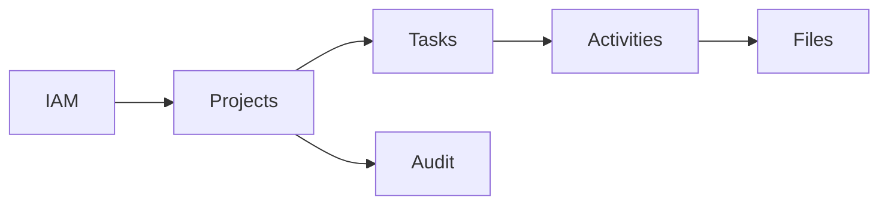

Esta organización facilita el crecimiento del sistema.

---

# 40. Evolución

El modelo ha sido diseñado para permitir futuras incorporaciones sin romper la estructura existente.

Entre las ampliaciones previstas:

- competiciones;
- IA;
- notificaciones avanzadas;
- scheduler;
- analytics;
- integración SAML ampliada;
- almacenamiento distribuido.

---

# 41. Continuación

La **Parte 2** desarrollará de forma detallada todas las entidades del esquema, describiendo tablas, columnas, relaciones, índices, claves, reglas de integridad y organización lógica completa de la base de datos.

---

# 42. Visión detallada del esquema

El esquema de Aula Robótica Platform se organiza en dominios funcionales claramente diferenciados.

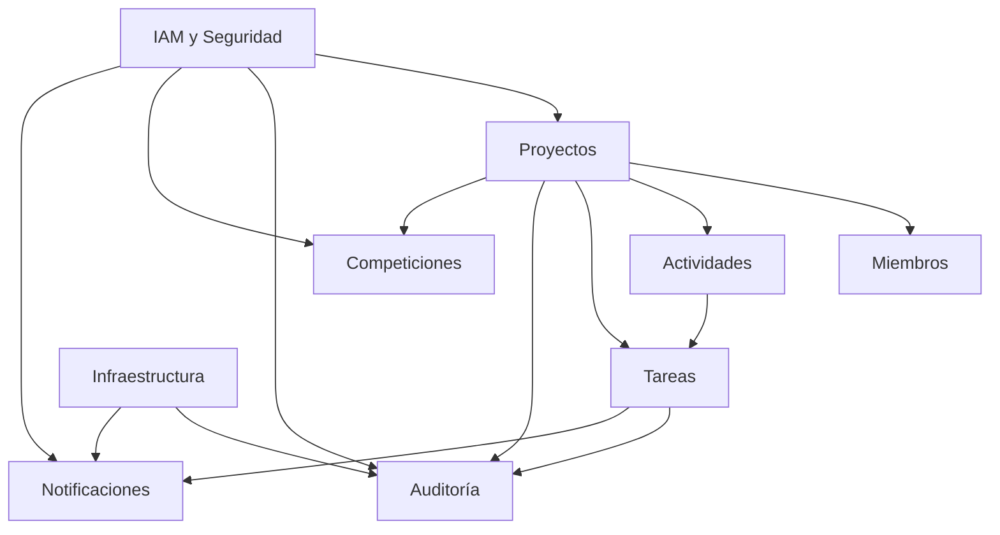

La estructura debe reflejar los límites funcionales del dominio sin impedir relaciones transversales controladas.

---

# 43. Inventario principal de tablas

El esquema funcional puede incluir las siguientes tablas principales:

```text
usuarios
identities
roles
permissions
user_roles
role_permissions

projects
project_members

activities
tasks

audit_logs

competitions
competition_projects
competition_participants

notifications
notification_preferences

attachments

outbox_events
```

La incorporación real de cada tabla depende del estado de implementación de cada módulo.

---

# 44. Módulo IAM

El dominio IAM concentra:

- identidad;
- autenticación;
- autorización;
- perfiles;
- roles;
- permisos;
- proveedores externos;
- estado de cuenta.

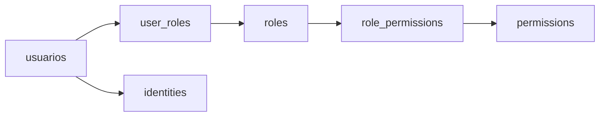

---

# 45. Tabla `usuarios`

La tabla `usuarios` representa las cuentas principales de la plataforma.

Nombre recomendado:

```text
usuarios
```

Se mantiene la denominación en español por compatibilidad con el esquema existente.

---

# 46. Responsabilidad de `usuarios`

La tabla debe almacenar únicamente información propia de la cuenta y del perfil básico.

No debe contener:

- permisos serializados;
- listas de proyectos;
- tokens JWT;
- contraseñas en texto plano;
- sesiones activas;
- información derivada que pueda consultarse mediante relaciones.

---

# 47. Estructura conceptual de `usuarios`

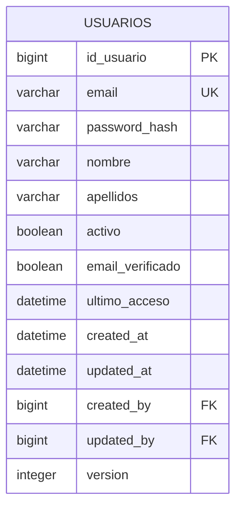

---

# 48. Columnas de `usuarios`

| Columna | Tipo orientativo | Nulo | Descripción |
|---|---|---:|---|
| `id_usuario` | BIGINT | No | Identificador principal |
| `email` | VARCHAR(254) | No | Identificador de acceso |
| `password_hash` | VARCHAR(255) | Sí | Hash de contraseña local |
| `nombre` | VARCHAR(100) | No | Nombre del usuario |
| `apellidos` | VARCHAR(150) | Sí | Apellidos |
| `activo` | BOOLEAN | No | Estado operativo |
| `email_verificado` | BOOLEAN | No | Verificación del correo |
| `ultimo_acceso` | DATETIME | Sí | Último acceso correcto |
| `created_at` | DATETIME | No | Fecha de creación |
| `updated_at` | DATETIME | Sí | Última modificación |
| `created_by` | BIGINT | Sí | Usuario creador |
| `updated_by` | BIGINT | Sí | Último usuario editor |
| `version` | INTEGER | No | Optimistic locking |

---

# 49. Email de usuario

El campo `email` debe:

- ser único;
- almacenarse normalizado;
- validarse en capa de aplicación;
- utilizar una longitud compatible con estándares;
- disponer de índice único.

Normalización habitual:

```text
trim

↓

lowercase
```

La dirección original puede conservarse para presentación si se considera necesario.

---

# 50. Contraseña

El campo `password_hash` solo se utiliza cuando la identidad dispone de autenticación local.

Debe almacenar:

- hash robusto;
- algoritmo moderno;
- parámetros del hash;
- salt embebido cuando el algoritmo lo soporte.

Nunca debe almacenar:

- contraseña original;
- contraseña cifrada reversiblemente;
- secretos de recuperación;
- JWT.

---

# 51. Usuarios externos

Cuando la autenticación se realiza mediante SAML, OAuth u otro proveedor, `password_hash` puede ser nulo.

La identidad externa se gestiona mediante la tabla `identities`.

---

# 52. Estado de usuario

El campo `activo` permite deshabilitar una cuenta sin eliminarla.

Una cuenta inactiva:

- no puede iniciar sesión;
- no debe recibir nuevas asignaciones;
- puede conservar relaciones históricas;
- mantiene trazabilidad.

---

# 53. Eliminación de usuarios

La eliminación física de usuarios debe evitarse cuando existan referencias históricas.

Alternativas:

- desactivación;
- anonimización;
- soft delete;
- conservación restringida.

---

# 54. Índices de `usuarios`

Índices recomendados:

```text
UNIQUE(email)

INDEX(activo)

INDEX(created_at)
```

Los índices sobre nombre y apellidos solo deben añadirse si existe búsqueda frecuente.

---

# 55. Tabla `identities`

La tabla `identities` representa identidades vinculadas a proveedores de autenticación.

Ejemplos:

- local;
- SAML;
- OAuth;
- OpenID Connect;
- directorio corporativo.

---

# 56. Estructura conceptual de `identities`

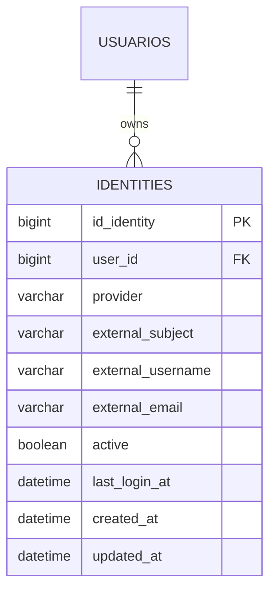

---

# 57. Columnas de `identities`

| Columna | Tipo orientativo | Nulo | Descripción |
|---|---|---:|---|
| `id_identity` | BIGINT | No | Identificador |
| `user_id` | BIGINT | No | Usuario asociado |
| `provider` | VARCHAR(50) | No | Proveedor |
| `external_subject` | VARCHAR(255) | No | Identificador externo |
| `external_username` | VARCHAR(255) | Sí | Nombre remoto |
| `external_email` | VARCHAR(254) | Sí | Correo remoto |
| `active` | BOOLEAN | No | Estado |
| `last_login_at` | DATETIME | Sí | Último acceso |
| `created_at` | DATETIME | No | Alta |
| `updated_at` | DATETIME | Sí | Modificación |

---

# 58. Unicidad de identidad

Restricción recomendada:

```text
UNIQUE(provider, external_subject)
```

Esto evita que la misma identidad externa se asocie a varios usuarios.

---

# 59. Tabla `roles`

La tabla `roles` representa agrupaciones funcionales de permisos.

Ejemplos actuales:

```text
ADMINISTRADOR

PROFESOR
```

Los roles específicos de proyecto no deben confundirse con roles globales.

---

# 60. Estructura de `roles`

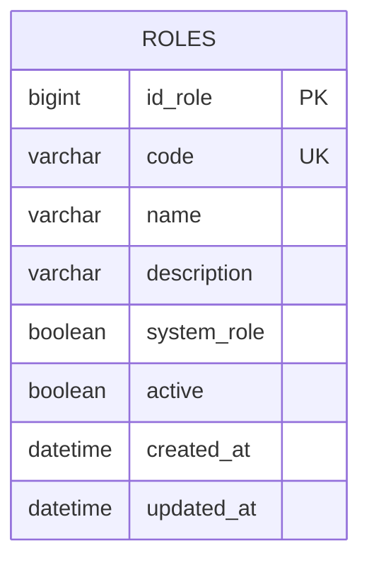

---

# 61. Columnas de `roles`

| Columna | Tipo orientativo | Nulo | Descripción |
|---|---|---:|---|
| `id_role` | BIGINT | No | Identificador |
| `code` | VARCHAR(50) | No | Código técnico |
| `name` | VARCHAR(100) | No | Nombre visible |
| `description` | VARCHAR(500) | Sí | Descripción |
| `system_role` | BOOLEAN | No | Rol protegido |
| `active` | BOOLEAN | No | Estado |
| `created_at` | DATETIME | No | Creación |
| `updated_at` | DATETIME | Sí | Modificación |

---

# 62. Código de rol

El campo `code` debe:

- ser único;
- ser estable;
- no depender del idioma;
- utilizarse en autorización;
- no modificarse libremente.

Ejemplo:

```text
ADMINISTRATOR
TEACHER
```

El nombre visible puede traducirse.

---

# 63. Tabla `permissions`

La tabla `permissions` representa acciones autorizables.

Ejemplos:

```text
projects.create
projects.read
projects.update
projects.delete
tasks.manage
users.manage
audit.read
```

---

# 64. Estructura de `permissions`

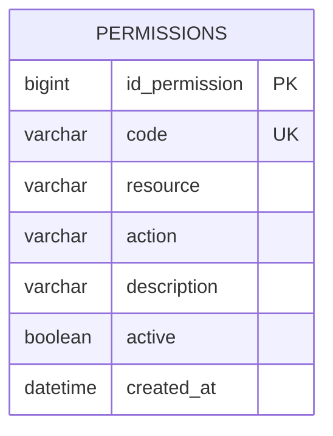

---

# 65. Columnas de `permissions`

| Columna | Tipo orientativo | Nulo | Descripción |
|---|---|---:|---|
| `id_permission` | BIGINT | No | Identificador |
| `code` | VARCHAR(100) | No | Código único |
| `resource` | VARCHAR(50) | No | Recurso |
| `action` | VARCHAR(50) | No | Acción |
| `description` | VARCHAR(500) | Sí | Descripción |
| `active` | BOOLEAN | No | Estado |
| `created_at` | DATETIME | No | Creación |

---

# 66. Tabla `user_roles`

La tabla `user_roles` implementa la relación N:M entre usuarios y roles globales.

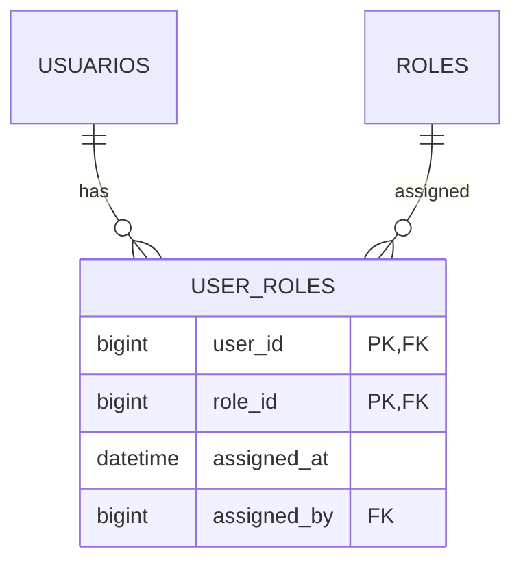

---

# 67. Clave de `user_roles`

La clave primaria puede ser compuesta:

```text
PRIMARY KEY(user_id, role_id)
```

Esto evita asignaciones duplicadas.

---

# 68. Tabla `role_permissions`

Implementa la relación N:M entre roles y permisos.

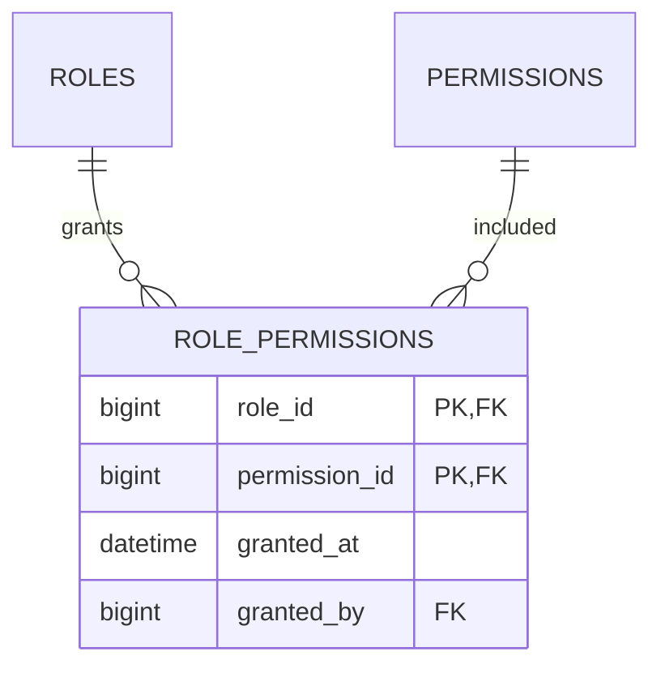

---

# 69. Integridad del RBAC

La autorización efectiva se obtiene conceptualmente mediante:

```text
User

↓

Roles

↓

Permissions
```

Las tablas no deben almacenar listas serializadas de permisos.

---

# 70. Módulo Projects

El módulo Projects representa los proyectos de trabajo colaborativo.

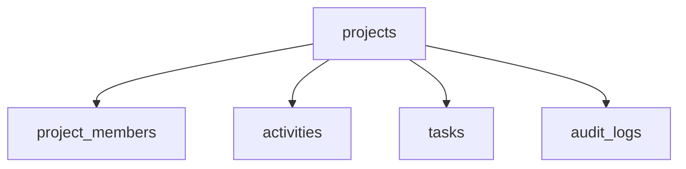

---

# 71. Tabla `projects`

La tabla `projects` representa cada proyecto gestionado en la plataforma.

---

# 72. Estructura conceptual de `projects`

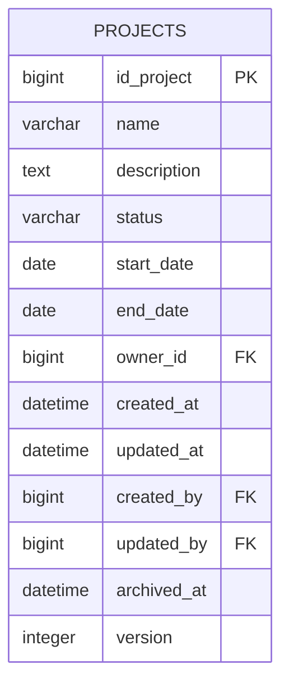

---

# 73. Columnas de `projects`

| Columna | Tipo orientativo | Nulo | Descripción |
|---|---|---:|---|
| `id_project` | BIGINT | No | Identificador |
| `name` | VARCHAR(150) | No | Nombre |
| `description` | TEXT | Sí | Descripción |
| `status` | VARCHAR/ENUM | No | Estado |
| `start_date` | DATE | Sí | Inicio |
| `end_date` | DATE | Sí | Fin |
| `owner_id` | BIGINT | Sí | Responsable principal |
| `created_at` | DATETIME | No | Creación |
| `updated_at` | DATETIME | Sí | Modificación |
| `created_by` | BIGINT | No | Creador |
| `updated_by` | BIGINT | Sí | Último editor |
| `archived_at` | DATETIME | Sí | Archivado |
| `version` | INTEGER | No | Versión |

---

# 74. Nombre del proyecto

El nombre debe:

- ser obligatorio;
- limitar su longitud;
- normalizar espacios;
- evitar contenido vacío;
- poder repetirse si el dominio lo permite.

Si debe ser único dentro de una organización, la restricción deberá ser compuesta.

---

# 75. Estado del proyecto

Estados posibles:

```text
DRAFT

ACTIVE

COMPLETED

ARCHIVED

CANCELLED
```

El catálogo definitivo se documenta en `27_ENUMS_AND_CONSTRAINTS.md`.

---

# 76. Fechas del proyecto

Regla conceptual:

```text
start_date <= end_date
```

Cuando ambas fechas estén informadas.

La validación debe existir en:

- esquema de entrada;
- Service Layer;
- restricción CHECK cuando sea viable.

---

# 77. Propietario del proyecto

El campo `owner_id` puede representar:

- profesor responsable;
- creador funcional;
- responsable institucional.

No sustituye la relación de miembros.

---

# 78. Índices de `projects`

Índices recomendados:

```text
INDEX(status)

INDEX(owner_id)

INDEX(created_by)

INDEX(start_date, end_date)

INDEX(archived_at)
```

---

# 79. Tabla `project_members`

La tabla `project_members` representa la pertenencia de usuarios a proyectos.

También almacena el rol contextual.

Roles actuales:

```text
COORDINATOR

MEMBER
```

---

# 80. Estructura de `project_members`

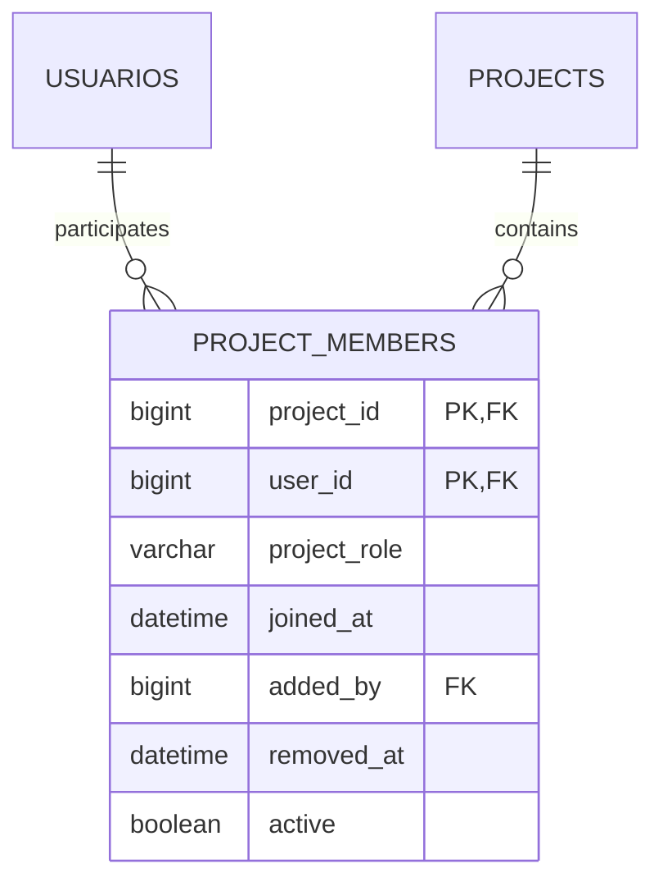

---

# 81. Columnas de `project_members`

| Columna | Tipo orientativo | Nulo | Descripción |
|---|---|---:|---|
| `project_id` | BIGINT | No | Proyecto |
| `user_id` | BIGINT | No | Usuario |
| `project_role` | VARCHAR/ENUM | No | Rol contextual |
| `joined_at` | DATETIME | No | Fecha de incorporación |
| `added_by` | BIGINT | Sí | Usuario que añadió |
| `removed_at` | DATETIME | Sí | Fecha de baja |
| `active` | BOOLEAN | No | Membresía activa |

---

# 82. Unicidad de miembro

Restricción principal:

```text
PRIMARY KEY(project_id, user_id)
```

o:

```text
UNIQUE(project_id, user_id)
```

si existe un identificador técnico independiente.

---

# 83. Historial de membresía

Si se necesita conservar múltiples periodos de pertenencia, la clave no debe impedir nuevas altas.

Alternativa:

```text
id_project_member
```

como PK y una restricción que garantice una única membresía activa.

---

# 84. Rol contextual

El rol de proyecto controla acciones como:

- gestionar miembros;
- crear actividades;
- crear tareas;
- asignar tareas;
- modificar Kanban;
- cerrar proyecto.

No debe almacenarse como rol global en `user_roles`.

---

# 85. Índices de `project_members`

Índices recomendados:

```text
INDEX(user_id, active)

INDEX(project_id, active)

INDEX(project_id, project_role)

INDEX(added_by)
```

---

# 86. Módulo Activities

Las actividades agrupan tareas dentro de un proyecto.


---

# 87. Tabla `activities`

Representa una unidad funcional o fase de trabajo dentro de un proyecto.

---

# 88. Estructura conceptual de `activities`

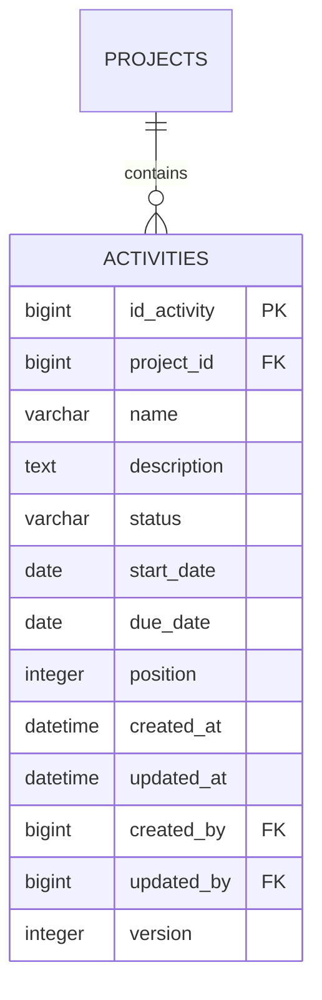

---

# 89. Columnas de `activities`

| Columna | Tipo orientativo | Nulo | Descripción |
|---|---|---:|---|
| `id_activity` | BIGINT | No | Identificador |
| `project_id` | BIGINT | No | Proyecto |
| `name` | VARCHAR(150) | No | Nombre |
| `description` | TEXT | Sí | Descripción |
| `status` | VARCHAR/ENUM | No | Estado |
| `start_date` | DATE | Sí | Inicio |
| `due_date` | DATE | Sí | Vencimiento |
| `position` | INTEGER | Sí | Orden |
| `created_at` | DATETIME | No | Creación |
| `updated_at` | DATETIME | Sí | Modificación |
| `created_by` | BIGINT | No | Creador |
| `updated_by` | BIGINT | Sí | Editor |
| `version` | INTEGER | No | Versión |

---

# 90. Actividades y proyecto

Toda actividad debe pertenecer a un proyecto.

Restricción:

```text
activities.project_id NOT NULL
```

No deben existir actividades huérfanas.

---

# 91. Orden de actividades

El campo `position` permite controlar el orden visual.

Puede definirse una restricción:

```text
UNIQUE(project_id, position)
```

solo si la estrategia de reordenación garantiza posiciones estrictamente únicas.

---

# 92. Índices de `activities`

Índices recomendados:

```text
INDEX(project_id)

INDEX(project_id, status)

INDEX(project_id, position)

INDEX(due_date)

INDEX(created_by)
```

---

# 93. Módulo Tasks

Las tareas constituyen la principal unidad operativa del Kanban.

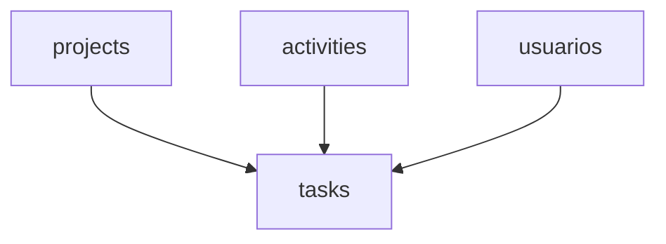

---

# 94. Tabla `tasks`

La tabla `tasks` representa tareas asignables y movibles dentro del flujo Kanban.

---

# 95. Estructura conceptual de `tasks`

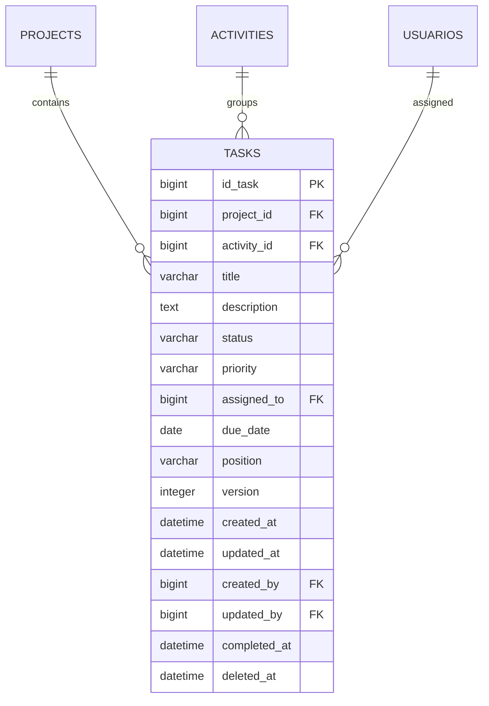

---

# 96. Columnas de `tasks`

| Columna | Tipo orientativo | Nulo | Descripción |
|---|---|---:|---|
| `id_task` | BIGINT | No | Identificador |
| `project_id` | BIGINT | No | Proyecto |
| `activity_id` | BIGINT | Sí | Actividad |
| `title` | VARCHAR(200) | No | Título |
| `description` | TEXT | Sí | Descripción |
| `status` | VARCHAR/ENUM | No | Estado Kanban |
| `priority` | VARCHAR/ENUM | No | Prioridad |
| `assigned_to` | BIGINT | Sí | Responsable |
| `due_date` | DATE | Sí | Vencimiento |
| `position` | VARCHAR/DECIMAL | Sí | Orden |
| `version` | INTEGER | No | Control concurrente |
| `created_at` | DATETIME | No | Creación |
| `updated_at` | DATETIME | Sí | Modificación |
| `created_by` | BIGINT | No | Creador |
| `updated_by` | BIGINT | Sí | Editor |
| `completed_at` | DATETIME | Sí | Finalización |
| `deleted_at` | DATETIME | Sí | Soft delete |

---

# 97. Relación directa con proyecto

Aunque una tarea pueda pertenecer a una actividad, conservar `project_id` en `tasks` puede resultar útil para:

- autorización;
- consultas Kanban;
- índices;
- integridad contextual;
- rendimiento.

Esta duplicación debe mantenerse consistente con `activity.project_id`.

---

# 98. Integridad actividad-proyecto

Cuando `activity_id` no sea nulo, la actividad debe pertenecer al mismo proyecto que la tarea.

Esta regla no se garantiza completamente mediante una FK simple.

Debe validarse en:

- Service Layer;
- Repository;
- constraint compuesta si el diseño lo permite;
- pruebas de integración.

---

# 99. Estado de tarea

Estados actuales:

```text
TODO

DOING

DONE
```

El esquema debe permitir una evolución controlada hacia estados configurables.

---

# 100. Prioridad de tarea

Valores orientativos:

```text
LOW

MEDIUM

HIGH

CRITICAL
```

La prioridad debe disponer de valor por defecto explícito.

---

# 101. Usuario asignado

`assigned_to` puede ser nulo.

Cuando esté informado:

- el usuario debe existir;
- debe estar activo;
- debe pertenecer al proyecto;
- debe poder recibir tareas.

Las últimas reglas requieren validación funcional.

---

# 102. Fecha de vencimiento

`due_date` puede estar vacía.

El estado “vencida” debe calcularse, no almacenarse como booleano redundante.

Conceptualmente:

```text
due_date < current_date

AND

status != DONE
```

---

# 103. Fecha de finalización

`completed_at` debe:

- establecerse al pasar a estado terminal;
- conservarse mientras permanezca completada;
- limpiarse o versionarse si se reabre según política.

---

# 104. Posición Kanban

El campo `position` mantiene el orden dentro de una columna.

Puede utilizar:

- INTEGER;
- DECIMAL;
- VARCHAR lexicográfico.

La estrategia elegida debe documentarse y aplicarse consistentemente.

---

# 105. Versión de tarea

El campo `version` permite optimistic locking.

Flujo:

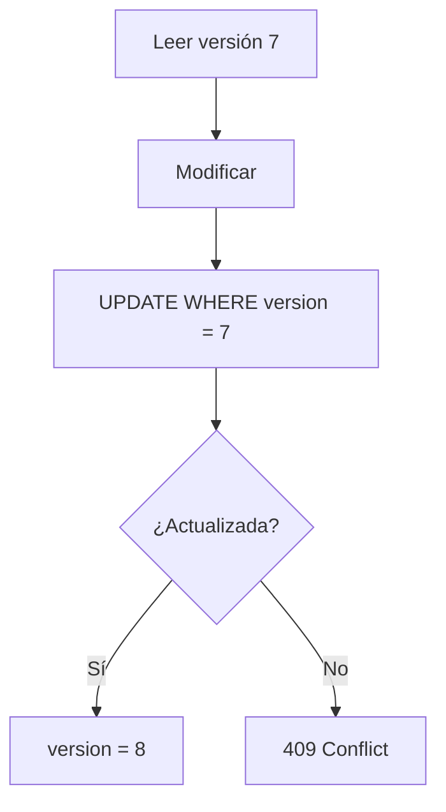

---

# 106. Índices de `tasks`

Índices recomendados:

```text
INDEX(project_id, status)

INDEX(project_id, status, position)

INDEX(activity_id)

INDEX(assigned_to, status)

INDEX(due_date, status)

INDEX(created_by)

INDEX(updated_at)

INDEX(deleted_at)
```

---

# 107. Índice principal del Kanban

La consulta habitual:

```sql
SELECT *
FROM tasks
WHERE project_id = :project_id
  AND deleted_at IS NULL
ORDER BY status, position;
```

Puede beneficiarse de:

```text
INDEX(project_id, deleted_at, status, position)
```

El orden exacto debe validarse mediante planes de ejecución.

---

# 108. Soft delete de tareas

Una tarea eliminada lógicamente:

- no aparece en el Kanban;
- conserva auditoría;
- no debe modificarse;
- puede recuperarse según política.

Las consultas deben filtrar sistemáticamente:

```text
deleted_at IS NULL
```

---

# 109. Módulo Audit

El módulo Audit mantiene trazabilidad transversal.

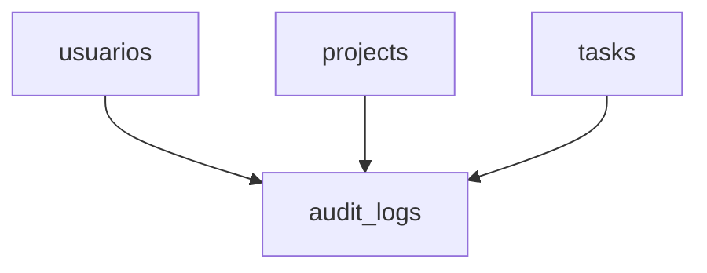

---

# 110. Tabla `audit_logs`

La tabla `audit_logs` registra acciones relevantes sobre recursos.

---

# 111. Estructura conceptual de `audit_logs`

```mermaid
erDiagram
    USUARIOS ||--o{ AUDIT_LOGS : performs

    AUDIT_LOGS {
        bigint id_audit_log PK
        bigint user_id FK
        varchar action
        varchar resource_type
        varchar resource_id
        bigint project_id FK
        json old_values
        json new_values
        varchar correlation_id
        varchar ip_address
        varchar user_agent
        datetime created_at
    }
```

---

# 112. Columnas de `audit_logs`

| Columna | Tipo orientativo | Nulo | Descripción |
|---|---|---:|---|
| `id_audit_log` | BIGINT | No | Identificador |
| `user_id` | BIGINT | Sí | Actor |
| `action` | VARCHAR(100) | No | Acción |
| `resource_type` | VARCHAR(50) | No | Tipo de recurso |
| `resource_id` | VARCHAR(100) | Sí | Identificador lógico |
| `project_id` | BIGINT | Sí | Contexto de proyecto |
| `old_values` | JSON/TEXT | Sí | Estado previo |
| `new_values` | JSON/TEXT | Sí | Estado posterior |
| `correlation_id` | VARCHAR(100) | Sí | Correlación |
| `ip_address` | VARCHAR(45) | Sí | IP |
| `user_agent` | VARCHAR(500) | Sí | Agente |
| `created_at` | DATETIME | No | Fecha |

---

# 113. Actor de auditoría

`user_id` puede ser nulo para representar:

- procesos automáticos;
- tareas programadas;
- integraciones;
- sistema.

Puede añadirse:

```text
actor_type
```

para diferenciar el origen.

---

# 114. Identificador de recurso

`resource_id` puede almacenarse como cadena para admitir:

- BIGINT;
- UUID;
- claves compuestas;
- identificadores externos.

---

# 115. Valores anteriores y posteriores

Los campos `old_values` y `new_values` deben limitarse a información relevante.

No deben registrar:

- contraseñas;
- hashes;
- tokens;
- cookies;
- secretos;
- datos sensibles innecesarios.

---

# 116. Índices de auditoría

Índices recomendados:

```text
INDEX(user_id, created_at)

INDEX(resource_type, resource_id, created_at)

INDEX(project_id, created_at)

INDEX(action, created_at)

INDEX(correlation_id)

INDEX(created_at)
```

---

# 117. Inmutabilidad de auditoría

Los registros de auditoría no deben editarse desde operaciones funcionales ordinarias.

Política recomendada:

```text
INSERT only
```

Las tareas de retención deben estar restringidas administrativamente.

---

# 118. Módulo Notifications

El módulo Notifications persiste comunicaciones dirigidas a usuarios.

```mermaid
flowchart LR
    A[usuarios] --> B[notifications]
    A --> C[notification_preferences]
```

---

# 119. Tabla `notifications`

Estructura resumida:

```mermaid
erDiagram
    USUARIOS ||--o{ NOTIFICATIONS : receives

    NOTIFICATIONS {
        bigint id_notification PK
        bigint user_id FK
        varchar type
        varchar title
        text message
        varchar severity
        varchar entity_type
        bigint entity_id
        varchar action_url
        boolean is_read
        datetime created_at
        datetime read_at
        varchar event_id
        varchar correlation_id
    }
```

---

# 120. Índices de `notifications`

Índices recomendados:

```text
INDEX(user_id, is_read, created_at)

INDEX(user_id, created_at)

INDEX(event_id)

INDEX(entity_type, entity_id)

UNIQUE(event_id, user_id)
```

La restricción única debe aplicarse solo cuando el evento deba producir una única notificación por usuario.

---

# 121. Tabla `notification_preferences`

Permite configurar canales y silenciamiento.

```mermaid
erDiagram
    USUARIOS ||--o{ NOTIFICATION_PREFERENCES : configures

    NOTIFICATION_PREFERENCES {
        bigint id_preference PK
        bigint user_id FK
        varchar notification_type
        boolean in_app_enabled
        boolean toast_enabled
        boolean email_enabled
        boolean browser_enabled
        datetime muted_until
        datetime created_at
        datetime updated_at
    }
```

---

# 122. Unicidad de preferencias

Restricción recomendada:

```text
UNIQUE(user_id, notification_type)
```

---

# 123. Módulo Competitions

El módulo Competitions permite representar competiciones, proyectos participantes y miembros vinculados.

Su implementación puede evolucionar según los requisitos reales.

---

# 124. Tabla `competitions`

Estructura conceptual:

```mermaid
erDiagram
    COMPETITIONS {
        bigint id_competition PK
        varchar name
        text description
        varchar status
        datetime registration_start_at
        datetime registration_end_at
        datetime start_at
        datetime end_at
        varchar location
        bigint created_by FK
        datetime created_at
        datetime updated_at
        integer version
    }
```

---

# 125. Columnas de `competitions`

| Columna | Tipo orientativo | Nulo | Descripción |
|---|---|---:|---|
| `id_competition` | BIGINT | No | Identificador |
| `name` | VARCHAR(200) | No | Nombre |
| `description` | TEXT | Sí | Descripción |
| `status` | VARCHAR/ENUM | No | Estado |
| `registration_start_at` | DATETIME | Sí | Inicio inscripción |
| `registration_end_at` | DATETIME | Sí | Fin inscripción |
| `start_at` | DATETIME | Sí | Inicio competición |
| `end_at` | DATETIME | Sí | Fin competición |
| `location` | VARCHAR(255) | Sí | Ubicación |
| `created_by` | BIGINT | No | Creador |
| `created_at` | DATETIME | No | Creación |
| `updated_at` | DATETIME | Sí | Modificación |
| `version` | INTEGER | No | Versión |

---

# 126. Reglas temporales de competición

Reglas conceptuales:

```text
registration_start_at <= registration_end_at

start_at <= end_at

registration_end_at <= start_at
```

Las reglas exactas dependerán del modelo funcional.

---

# 127. Tabla `competition_projects`

Relaciona proyectos con competiciones.

```mermaid
erDiagram
    COMPETITIONS ||--o{ COMPETITION_PROJECTS : includes
    PROJECTS ||--o{ COMPETITION_PROJECTS : participates

    COMPETITION_PROJECTS {
        bigint competition_id PK, FK
        bigint project_id PK, FK
        varchar status
        datetime registered_at
        bigint registered_by FK
    }
```

---

# 128. Tabla `competition_participants`

Puede representar participación individual cuando sea necesaria.

```mermaid
erDiagram
    COMPETITIONS ||--o{ COMPETITION_PARTICIPANTS : includes
    USUARIOS ||--o{ COMPETITION_PARTICIPANTS : participates

    COMPETITION_PARTICIPANTS {
        bigint competition_id PK, FK
        bigint user_id PK, FK
        varchar role
        datetime registered_at
    }
```

---

# 129. Módulo Attachments

Los adjuntos representan metadatos de archivos asociados a entidades.

El contenido binario no debe almacenarse necesariamente en MariaDB.

---

# 130. Tabla `attachments`

```mermaid
erDiagram
    ATTACHMENTS {
        bigint id_attachment PK
        varchar original_name
        varchar stored_name
        varchar storage_key
        varchar mime_type
        bigint size_bytes
        varchar checksum
        varchar entity_type
        bigint entity_id
        bigint uploaded_by FK
        datetime created_at
        datetime deleted_at
    }
```

---

# 131. Metadatos de archivo

La tabla debe almacenar:

- nombre original;
- clave de almacenamiento;
- MIME Type;
- tamaño;
- checksum;
- entidad relacionada;
- usuario;
- fecha.

No debe contener rutas locales confiadas directamente al cliente.

---

# 132. Almacenamiento físico

El archivo puede almacenarse en:

- volumen Docker;
- sistema de archivos protegido;
- almacenamiento S3-compatible;
- servicio externo.

La base de datos conserva únicamente referencia y metadatos.

---

# 133. Índices de adjuntos

Índices recomendados:

```text
INDEX(entity_type, entity_id)

INDEX(uploaded_by)

INDEX(checksum)

INDEX(created_at)

INDEX(deleted_at)
```

---

# 134. Módulo Outbox

La tabla `outbox_events` garantiza publicación fiable de eventos después de una transacción.

---

# 135. Estructura de `outbox_events`

```mermaid
erDiagram
    OUTBOX_EVENTS {
        bigint id_outbox_event PK
        varchar event_id UK
        varchar event_type
        varchar aggregate_type
        varchar aggregate_id
        json payload
        varchar status
        integer attempts
        datetime next_attempt_at
        datetime created_at
        datetime published_at
        text last_error
    }
```

---

# 136. Estados de Outbox

Valores conceptuales:

```text
PENDING

PROCESSING

PUBLISHED

FAILED

DEAD
```

---

# 137. Índices de Outbox

Índices recomendados:

```text
UNIQUE(event_id)

INDEX(status, next_attempt_at)

INDEX(created_at)

INDEX(aggregate_type, aggregate_id)
```

---

# 138. Consulta de worker

Consulta típica:

```sql
SELECT *
FROM outbox_events
WHERE status = 'PENDING'
  AND next_attempt_at <= CURRENT_TIMESTAMP
ORDER BY created_at
LIMIT :batch_size;
```

Debe estar respaldada por un índice adecuado.

---

# 139. Relaciones transversales

El modelo contiene relaciones que atraviesan varios dominios.

Ejemplos:

- usuarios crean proyectos;
- usuarios pertenecen a proyectos;
- proyectos contienen actividades;
- actividades agrupan tareas;
- tareas se asignan a usuarios;
- cambios generan auditoría;
- cambios generan notificaciones;
- eventos se registran en Outbox.

---

# 140. Diagrama relacional principal

```mermaid
erDiagram
    USUARIOS ||--o{ IDENTITIES : owns
    USUARIOS ||--o{ USER_ROLES : has
    ROLES ||--o{ USER_ROLES : assigned
    ROLES ||--o{ ROLE_PERMISSIONS : grants
    PERMISSIONS ||--o{ ROLE_PERMISSIONS : includes

    USUARIOS ||--o{ PROJECTS : creates
    USUARIOS ||--o{ PROJECT_MEMBERS : joins
    PROJECTS ||--o{ PROJECT_MEMBERS : contains

    PROJECTS ||--o{ ACTIVITIES : contains
    PROJECTS ||--o{ TASKS : contains
    ACTIVITIES ||--o{ TASKS : groups
    USUARIOS ||--o{ TASKS : assigned

    USUARIOS ||--o{ AUDIT_LOGS : performs
    PROJECTS ||--o{ AUDIT_LOGS : contextualizes

    USUARIOS ||--o{ NOTIFICATIONS : receives
    USUARIOS ||--o{ NOTIFICATION_PREFERENCES : configures

    COMPETITIONS ||--o{ COMPETITION_PROJECTS : includes
    PROJECTS ||--o{ COMPETITION_PROJECTS : participates

    COMPETITIONS ||--o{ COMPETITION_PARTICIPANTS : includes
    USUARIOS ||--o{ COMPETITION_PARTICIPANTS : participates
```

---

# 141. Políticas `ON DELETE`

Cada relación debe definir una política explícita.

Opciones:

```text
RESTRICT

CASCADE

SET NULL

NO ACTION
```

La elección depende de la semántica del dominio.

---

# 142. Recomendaciones generales `ON DELETE`

| Relación | Política orientativa |
|---|---|
| usuario → identity | CASCADE |
| usuario → user_roles | CASCADE |
| role → role_permissions | CASCADE |
| project → project_members | CASCADE o RESTRICT |
| project → activities | RESTRICT |
| project → tasks | RESTRICT |
| activity → tasks | SET NULL o RESTRICT |
| user → assigned tasks | SET NULL |
| user → audit logs | SET NULL |
| user → notifications | CASCADE |
| project → audit logs | SET NULL o RESTRICT |

La política definitiva debe alinearse con retención y auditoría.

---

# 143. Evitar cascadas destructivas

No deben configurarse cascadas amplias sin analizar su impacto.

Ejemplo peligroso:

```text
Eliminar proyecto

↓

Eliminar actividades

↓

Eliminar tareas

↓

Eliminar auditoría

↓

Eliminar adjuntos
```

Para entidades centrales suele ser preferible:

- archivado;
- soft delete;
- restricción;
- eliminación administrada.

---

# 144. Políticas `ON UPDATE`

Las claves primarias no deberían modificarse.

Política recomendada:

```text
ON UPDATE RESTRICT
```

o comportamiento equivalente por defecto.

---

# 145. Integridad de referencias de usuario

Campos como:

```text
created_by
updated_by
assigned_to
added_by
```

requieren políticas distintas.

- `assigned_to`: normalmente `SET NULL`.
- `created_by`: normalmente `RESTRICT` o anonimización.
- `updated_by`: puede permitir `SET NULL`.
- `added_by`: puede conservarse o quedar nulo.

---

# 146. Índices de claves foráneas

Toda Foreign Key utilizada en JOIN o filtrado frecuente debe disponer de índice.

MariaDB puede crear algunos índices automáticamente, pero el diseño debe comprobarlos explícitamente.

---

# 147. Índices compuestos

El orden de columnas importa.

Ejemplo:

```text
INDEX(project_id, status, position)
```

favorece consultas que filtran por:

- `project_id`;
- `project_id + status`;
- `project_id + status + position`.

No favorece necesariamente una consulta solo por `position`.

---

# 148. Índices únicos

Los índices únicos protegen reglas estructurales.

Ejemplos:

```text
usuarios.email

roles.code

permissions.code

identities(provider, external_subject)

project_members(project_id, user_id)

notifications(event_id, user_id)
```

---

# 149. Índices parciales

MariaDB no ofrece las mismas capacidades de índices parciales que otros motores.

Cuando sea necesario optimizar registros activos, pueden utilizarse:

- columnas auxiliares;
- índices compuestos;
- tablas separadas;
- consultas adaptadas.

---

# 150. Índices sobre columnas de baja cardinalidad

Campos como:

```text
activo

is_read

status
```

pueden tener poca selectividad.

Normalmente funcionan mejor combinados con una clave de mayor cardinalidad.

Ejemplo:

```text
INDEX(user_id, is_read, created_at)
```

---

# 151. Índices sobre fechas

Los índices temporales resultan útiles para:

- retención;
- auditoría;
- notificaciones;
- tareas vencidas;
- Outbox;
- actividad reciente.

---

# 152. Índices sobre JSON

Si se utiliza JSON, no debe dependerse de búsquedas arbitrarias frecuentes dentro del documento.

Los campos consultados habitualmente deben extraerse a columnas explícitas o columnas generadas indexables.

---

# 153. Longitud de índices

Los campos VARCHAR extensos incrementan el tamaño del índice.

No deben indexarse textos completos sin necesidad.

Para búsqueda textual avanzada puede evaluarse:

```text
FULLTEXT
```

solo cuando exista un caso de uso claro.

---

# 154. Restricciones de longitud

Ejemplos orientativos:

| Campo | Longitud |
|---|---:|
| email | 254 |
| nombre de usuario | 100 |
| título de tarea | 200 |
| nombre de proyecto | 150 |
| código de rol | 50 |
| código de permiso | 100 |
| URL interna | 500 |
| correlation ID | 100 |

---

# 155. Valores por defecto

Los defaults deben ser explícitos.

Ejemplos:

```text
activo = TRUE

is_read = FALSE

version = 1

status = TODO

priority = MEDIUM

attempts = 0
```

---

# 156. Defaults temporales

Puede utilizarse:

```text
CURRENT_TIMESTAMP
```

para `created_at` cuando la estrategia del proyecto sea consistente.

No debe combinarse de forma descontrolada generación en aplicación y generación en base de datos.

---

# 157. Responsabilidad sobre timestamps

Debe elegirse una política uniforme:

- timestamps generados por aplicación;
- timestamps generados por base de datos.

Para trazabilidad distribuida suele ser útil generar tiempos en backend con reloj explícito y UTC.

---

# 158. Nulos

Un campo debe ser nullable solo cuando la ausencia tenga significado válido.

Ejemplos razonables:

```text
assigned_to

activity_id

due_date

read_at

completed_at
```

Ejemplos normalmente no nulos:

```text
title

status

created_at

user_id destinatario
```

---

# 159. Valores vacíos

Una cadena vacía no debe sustituir a `NULL` cuando el dato sea opcional.

Ejemplo incorrecto:

```text
description = ""
```

cuando la ausencia se representa con:

```text
description = NULL
```

La convención debe aplicarse consistentemente.

---

# 160. Coherencia de nombres temporales

Convención recomendada:

```text
created_at

updated_at

deleted_at

archived_at

completed_at

read_at

published_at
```

Los sufijos deben indicar claramente que almacenan fecha y hora.

---

# 161. Coherencia de nombres de fecha

Para campos sin hora:

```text
start_date

end_date

due_date
```

---

# 162. Coherencia de booleanos

Los booleanos deben utilizar prefijos claros:

```text
is_read

is_active

is_archived

has_access
```

o una convención equivalente uniforme.

---

# 163. Coherencia de identificadores

Las relaciones deben utilizar el nombre de la entidad referenciada:

```text
project_id

activity_id

user_id

task_id
```

No se recomienda mezclar:

```text
id_project
projectId
project_fk
```

para Foreign Keys.

---

# 164. Mapeo ORM

SQLAlchemy puede mapear:

- PK;
- FK;
- relaciones;
- cascadas ORM;
- enums;
- timestamps;
- optimistic locking;
- índices.

Las cascadas ORM y las cascadas SQL deben configurarse de forma coherente.

---

# 165. Relaciones SQLAlchemy

Ejemplo conceptual:

```python
class Project(Base):
    members = relationship(
        "ProjectMember",
        back_populates="project",
    )
```

La carga debe configurarse según el caso de uso.

---

# 166. Lazy Loading

El lazy loading puede provocar consultas N+1.

Debe utilizarse con cautela en:

- listados;
- Dashboard;
- Kanban;
- auditoría;
- notificaciones.

---

# 167. Eager Loading

Puede utilizarse:

```text
joinedload

selectinload
```

cuando se conozcan las relaciones necesarias.

---

# 168. N+1 Queries

Ejemplo:

```text
1 consulta de proyectos

+

N consultas de miembros
```

Debe detectarse mediante:

- logging SQL;
- tests;
- profiling;
- revisión de Repository.

---

# 169. Proyecciones

Las vistas complejas no deben cargar siempre entidades completas.

Puede utilizarse:

- DTO;
- select específico;
- agregaciones;
- ViewModel;
- consultas optimizadas.

---

# 170. Contadores

Los contadores de:

- tareas;
- miembros;
- notificaciones;
- actividades;

deben calcularse mediante agregaciones SQL cuando no sea necesaria la colección completa.

---

# 171. Transacciones

Toda operación de negocio debe definir claramente sus límites transaccionales.

Ejemplo:

```mermaid
flowchart TD
    A[BEGIN] --> B[Actualizar tarea]
    B --> C[Insertar auditoría]
    C --> D[Insertar Outbox]
    D --> E[COMMIT]
```

---

# 172. Operaciones atómicas

Deben ejecutarse de forma atómica:

- movimiento de tarea;
- registro de auditoría;
- publicación diferida mediante Outbox;
- incorporación de miembro;
- cambio de rol contextual.

---

# 173. Rollback

Ante error:

```text
ROLLBACK
```

debe restaurar el conjunto completo de cambios de la transacción.

---

# 174. Aislamiento

El nivel de aislamiento debe equilibrar:

- consistencia;
- concurrencia;
- bloqueo;
- rendimiento.

El comportamiento real debe probarse sobre MariaDB.

---

# 175. Bloqueos pesimistas

`SELECT ... FOR UPDATE` debe utilizarse solo cuando exista una necesidad real.

Casos posibles:

- asignación de posición;
- límite WIP;
- contador crítico;
- transición concurrente.

---

# 176. Optimistic Locking

Es preferible para entidades con:

- muchas lecturas;
- pocas colisiones;
- edición concurrente ocasional.

Ejemplos:

- proyectos;
- actividades;
- tareas;
- competiciones.

---

# 177. Integridad lógica

Algunas reglas no pueden expresarse completamente con Foreign Keys.

Ejemplos:

- usuario asignado pertenece al proyecto;
- actividad pertenece al mismo proyecto que la tarea;
- coordinador es miembro activo;
- fecha final posterior a fecha inicial;
- transición de estado válida.

Estas reglas pertenecen al Service Layer y deben cubrirse con pruebas.

---

# 178. Integridad estructural

La base de datos sí debe garantizar:

- claves;
- tipos;
- nulabilidad;
- unicidad;
- referencias;
- checks simples;
- longitudes.

---

# 179. Vistas SQL

Las vistas pueden utilizarse para consultas complejas estables.

Ejemplos futuros:

```text
active_project_summary

task_workload_summary

user_project_permissions
```

No deben utilizarse para ocultar un modelo mal diseñado.

---

# 180. Materialized Views

MariaDB no ofrece vistas materializadas nativas de la misma forma que otros motores.

Las agregaciones persistidas deben implementarse mediante:

- tablas resumen;
- jobs;
- caché;
- eventos.

Solo cuando exista una necesidad medida.

---

# 181. Continuación

La **Parte 3** desarrollará:

- migraciones;
- gestión de versiones;
- seed data;
- estrategia de backups;
- recuperación;
- rendimiento;
- mantenimiento;
- particionado;
- archivado;
- seguridad de datos;
- observabilidad;
- pruebas;
- diagramas finales;
- checklist;
- criterios de aceptación;
- conclusiones.

---

# 182. Evolución del esquema

El esquema debe diseñarse para evolucionar de forma incremental, evitando cambios disruptivos que afecten a los módulos existentes.

Toda modificación estructural debe cumplir los siguientes principios:

- compatibilidad hacia atrás cuando sea posible;
- migraciones versionadas;
- reversibilidad controlada;
- despliegues repetibles;
- ausencia de cambios manuales en producción.

---

# 183. Gestión de migraciones

Todas las modificaciones del esquema deben gestionarse mediante un sistema de migraciones.

Arquitectura recomendada:

```text
SQLAlchemy

↓

Alembic

↓

Migration Scripts

↓

MariaDB
```

Cada migración representa una única evolución lógica del modelo.

---

# 184. Versionado de migraciones

Cada migración debe poseer:

- identificador único;
- fecha;
- autor (opcional);
- descripción funcional;
- operaciones `upgrade`;
- operaciones `downgrade` cuando sean viables.

Ejemplo conceptual:

```text
20260815_add_notifications_table
```

---

# 185. Principios de migración

Las migraciones deben ser:

- deterministas;
- repetibles;
- atómicas cuando sea posible;
- revisables;
- trazables;
- compatibles con CI/CD.

No deben depender del estado manual de la base de datos.

---

# 186. Orden de ejecución

```mermaid
flowchart TD
    A[Migration 001] --> B[Migration 002]
    B --> C[Migration 003]
    C --> D[Migration 004]
```

El orden constituye parte de la historia del esquema y no debe alterarse.

---

# 187. Compatibilidad durante despliegues

Cuando backend y frontend evolucionan conjuntamente, las migraciones deben permitir una ventana de compatibilidad.

Secuencia recomendada:

```text
Nueva BD compatible

↓

Nuevo Backend

↓

Nuevo Frontend

↓

Eliminar compatibilidad antigua
```

---

# 188. Cambios incompatibles

Cambios como:

- eliminar columnas;
- renombrar tablas;
- modificar tipos incompatibles;
- cambiar claves primarias;

deben planificarse en varias fases para evitar interrupciones.

---

# 189. Estrategia Expand-Contract

Para cambios importantes se recomienda:

```mermaid
flowchart LR
    A[Expand]
    --> B[Compatibilidad]
    --> C[Migración de datos]
    --> D[Contract]
```

Esta estrategia reduce riesgos durante el despliegue.

---

# 190. Seed Data

Algunas tablas requieren datos iniciales.

Ejemplos:

- roles;
- permisos;
- estados;
- configuraciones;
- administradores iniciales (según entorno).

Estos datos deben gestionarse de forma controlada y versionada.

---

# 191. Datos de referencia

Los datos de referencia deben permanecer estables.

Ejemplos:

```text
Roles

Permisos

Prioridades

Estados

Proveedores de identidad
```

No deben mezclarse con datos funcionales.

---

# 192. Inicialización del sistema

El primer despliegue debe permitir:

1. crear esquema;
2. ejecutar migraciones;
3. insertar datos de referencia;
4. crear usuario administrador inicial;
5. validar consistencia.

---

# 193. Entornos

El esquema debe ser idéntico en:

- desarrollo;
- integración;
- preproducción;
- producción.

Las diferencias deben limitarse a:

- datos;
- configuración;
- credenciales.

---

# 194. Datos de prueba

Los entornos de desarrollo pueden incorporar datos ficticios.

Nunca deben reutilizar datos personales reales sin anonimización.

---

# 195. Anonimización

Cuando se utilicen copias de producción deben anonimizarse:

- nombres;
- correos;
- direcciones;
- identificadores externos;
- IP;
- cualquier dato personal.

---

# 196. Backups

Debe existir una estrategia documentada de copias de seguridad.

Objetivos:

- recuperación ante desastre;
- restauración puntual;
- auditoría;
- continuidad operativa.

---

# 197. Tipos de copia

Pueden combinarse:

- copia completa;
- incremental;
- binlog;
- snapshot.

La elección dependerá de los requisitos operativos.

---

# 198. Restauración

Las copias deben probarse periódicamente.

Un backup no verificado no garantiza recuperación.

Proceso conceptual:

```mermaid
flowchart TD
    A[Backup]
    --> B[Restore]
    --> C[Verificación]
    --> D[Aprobación]
```

---

# 199. Retención

La política de retención debe definir:

- duración;
- frecuencia;
- ubicación;
- cifrado;
- eliminación segura.

---

# 200. Archivado

Los datos históricos pueden archivarse cuando:

- ya no participan en operaciones habituales;
- existen obligaciones legales;
- el rendimiento comienza a degradarse.

---

# 201. Estrategias de archivado

Opciones:

- tablas históricas;
- bases de datos independientes;
- almacenamiento frío;
- exportaciones firmadas.

---

# 202. Particionado

Cuando el volumen lo justifique pueden evaluarse estrategias de particionado.

Ejemplos:

- auditoría;
- notificaciones;
- eventos Outbox;
- registros históricos.

No debe introducirse prematuramente.

---

# 203. Escalabilidad

El modelo debe admitir crecimiento en:

- usuarios;
- proyectos;
- tareas;
- auditoría;
- notificaciones;
- eventos.

Sin requerir rediseños estructurales.

---

# 204. Rendimiento

La optimización debe basarse en:

- planes de ejecución;
- métricas;
- consultas reales;
- índices adecuados.

Nunca en suposiciones.

---

# 205. EXPLAIN

Las consultas críticas deben revisarse periódicamente mediante:

```sql
EXPLAIN
```

o herramientas equivalentes del motor.

---

# 206. Consultas frecuentes

Especial atención a:

- Kanban;
- Dashboard;
- autenticación;
- permisos;
- notificaciones;
- auditoría;
- proyectos activos.

---

# 207. Evitar SELECT *

Las consultas deben recuperar únicamente las columnas necesarias.

Beneficios:

- menor tráfico;
- menor memoria;
- menor tiempo de procesamiento.

---

# 208. Paginación

Los listados deben paginarse.

Ejemplos:

- proyectos;
- tareas;
- auditoría;
- notificaciones;
- usuarios.

---

# 209. Estrategia de paginación

Preferentemente mediante:

```text
LIMIT

OFFSET
```

o cursores cuando el volumen lo requiera.

---

# 210. Consultas N+1

Las consultas N+1 deben detectarse mediante:

- pruebas;
- profiling;
- revisión de código;
- métricas.

---

# 211. Caché

La base de datos constituye la fuente de verdad.

Las capas de caché deben considerarse aceleradores temporales.

Nunca deben convertirse en almacenamiento principal.

---

# 212. Integridad continua

El esquema debe revisarse periódicamente para detectar:

- registros huérfanos;
- índices redundantes;
- restricciones ausentes;
- datos inconsistentes.

---

# 213. Consistencia transaccional

Las operaciones críticas deben completarse íntegramente o revertirse.

Ejemplos:

- crear proyecto;
- mover tarea;
- registrar auditoría;
- publicar evento.

---

# 214. Observabilidad

El sistema debe permitir observar:

- consultas lentas;
- bloqueos;
- conflictos;
- crecimiento de tablas;
- uso de índices.

---

# 215. Slow Query Log

Debe habilitarse en entornos donde sea apropiado para detectar consultas costosas.

---

# 216. Métricas

Ejemplos:

```text
Número de proyectos

Número de tareas

Tiempo medio de consulta

Eventos Outbox pendientes

Notificaciones no leídas

Auditorías por día
```

---

# 217. Seguridad de datos

La base de datos debe proteger:

- confidencialidad;
- integridad;
- disponibilidad.

---

# 218. Principio de mínimo privilegio

Cada cuenta técnica debe disponer únicamente de los permisos imprescindibles.

Ejemplos:

- aplicación;
- migraciones;
- backup;
- administración.

---

# 219. Credenciales

Las credenciales nunca deben almacenarse:

- en el código fuente;
- en repositorios;
- en imágenes Docker.

Deben gestionarse mediante variables de entorno o sistemas de secretos.

---

# 220. Cifrado

Debe evaluarse el cifrado:

- en tránsito;
- en copias;
- en almacenamiento cuando el contexto lo requiera.

---

# 221. Protección de datos

El modelo debe facilitar el cumplimiento normativo mediante:

- minimización;
- trazabilidad;
- eliminación controlada;
- anonimización;
- auditoría.

---

# 222. Integración con Auditoría

Las operaciones relevantes generan registros en `audit_logs`.

El esquema debe facilitar la correlación entre entidades y auditoría.

---

# 223. Integración con Outbox

Las operaciones que producen eventos deben registrar información en `outbox_events` antes de la publicación.

---

# 224. Integración con WebSocket

WebSocket no persiste datos.

Consume información ya confirmada en MariaDB mediante el flujo Outbox → Broker → Cliente.

---

# 225. Integración con RBAC

Las relaciones entre:

- usuarios;
- roles;
- permisos;
- miembros de proyecto;

permiten resolver la autorización contextual sin duplicar información.

---

# 226. Integración con Kanban

El esquema soporta el tablero mediante:

- proyectos;
- actividades;
- tareas;
- posición;
- estado;
- versión;
- usuario asignado.

---

# 227. Integración con Notificaciones

Las notificaciones referencian entidades existentes.

No duplican información funcional del dominio.

---

# 228. Integración con IA

Una futura integración con IA podrá apoyarse en:

- proyectos;
- actividades;
- tareas;
- auditoría;
- competiciones.

Sin modificar el núcleo del esquema.

---

# 229. Integración con Analítica

Las consultas analíticas deben utilizar:

- vistas;
- agregaciones;
- tablas resumen;
- procesos ETL.

No deben degradar las operaciones transaccionales.

---

# 230. Integración con CI/CD

Toda modificación del esquema debe pasar por:

- revisión;
- pruebas;
- migración;
- validación automática.

---

# 231. Calidad

Antes del despliegue deben verificarse:

- migraciones;
- integridad;
- índices;
- rendimiento;
- compatibilidad.

---

# 232. Testing del esquema

Las pruebas deben cubrir:

- creación;
- relaciones;
- restricciones;
- cascadas;
- índices;
- migraciones;
- rollback.

---

# 233. Pruebas Repository

Cada Repository debe verificar:

- CRUD;
- consultas;
- filtros;
- paginación;
- concurrencia;
- relaciones.

---

# 234. Pruebas de migración

Cada migración importante debe probar:

- upgrade;
- downgrade (si aplica);
- compatibilidad;
- conservación de datos.

---

# 235. Pruebas de concurrencia

Especialmente para:

- tareas;
- Kanban;
- asignaciones;
- notificaciones;
- Outbox.

---

# 236. Pruebas de rendimiento

Deben medirse:

- consultas críticas;
- inserciones masivas;
- actualizaciones;
- auditoría;
- sincronización.

---

# 237. Documentación

Toda entidad debe documentar:

- propósito;
- columnas;
- relaciones;
- restricciones;
- índices;
- reglas funcionales.

---

# 238. Trazabilidad

Debe poder reconstruirse:

- quién creó;
- quién modificó;
- cuándo;
- sobre qué entidad;
- mediante qué operación.

---

# 239. Diagrama global del esquema

```mermaid
flowchart TD
    IAM --> Projects
    Projects --> Activities
    Activities --> Tasks

    Projects --> Audit
    Tasks --> Audit

    Tasks --> Notifications

    Tasks --> Outbox

    Outbox --> Broker

    Broker --> WebSocket

    WebSocket --> Clients

    Projects --> Competitions
```

---

# 240. Flujo completo de persistencia

```mermaid
sequenceDiagram
    participant UI
    participant API
    participant Service
    participant Repository
    participant MariaDB
    participant Outbox

    UI->>API: Solicitud
    API->>Service: Caso de uso
    Service->>Repository: Persistir
    Repository->>MariaDB: Transacción
    MariaDB-->>Repository: Commit
    Repository->>Outbox: Registrar evento
    Repository-->>Service: OK
    Service-->>API: Respuesta
```

---

# 241. Matriz de responsabilidades

| Elemento | Responsabilidad |
|---|---|
| MariaDB | Persistencia |
| SQLAlchemy | Mapeo ORM |
| Repository | Acceso a datos |
| Alembic | Migraciones |
| Outbox | Publicación fiable |
| Audit | Trazabilidad |
| RBAC | Autorización |
| WebSocket | Sincronización |

---

# 242. Checklist de implementación

## Esquema

- [ ] Tablas definidas.
- [ ] PK.
- [ ] FK.
- [ ] Índices.
- [ ] Restricciones.
- [ ] Auditoría.
- [ ] Versionado.

## Migraciones

- [ ] Alembic.
- [ ] Upgrade.
- [ ] Downgrade.
- [ ] Datos iniciales.

## Calidad

- [ ] Tests Repository.
- [ ] Integridad.
- [ ] Rendimiento.
- [ ] Documentación.

---

# 243. Criterios de aceptación

El esquema se considera correcto cuando:

- mantiene integridad referencial;
- soporta todos los módulos funcionales;
- evita redundancias innecesarias;
- facilita autorización contextual;
- soporta auditoría;
- permite evolución incremental;
- admite migraciones versionadas;
- presenta consultas optimizables;
- mantiene coherencia semántica;
- está completamente documentado.

---

# 244. Principios definitivos

1. MariaDB es la fuente de verdad.
2. Toda modificación pasa por Repository.
3. Las relaciones son explícitas.
4. La integridad prevalece sobre la comodidad.
5. Los índices responden a consultas reales.
6. Toda evolución requiere migración.
7. El modelo debe ser comprensible.
8. La auditoría es transversal.
9. La autorización reutiliza relaciones.
10. El esquema debe crecer sin romper compatibilidad.

---

# 245. Conclusiones

El esquema de base de datos de Aula Robótica Platform constituye el núcleo persistente sobre el que se apoyan todos los módulos funcionales de la plataforma. Su diseño sigue una arquitectura relacional modular, normalizada y orientada al dominio, garantizando integridad referencial, trazabilidad y facilidad de evolución.

La separación entre módulos como IAM, Projects, Activities, Tasks, Audit, Notifications, Competitions y Outbox permite mantener responsabilidades claramente delimitadas, facilitando tanto el mantenimiento como la incorporación de nuevas capacidades sin comprometer la estabilidad del modelo.

El uso de claves primarias y foráneas explícitas, restricciones de integridad, índices optimizados, control de versiones mediante optimistic locking y migraciones gestionadas con Alembic proporciona una base sólida para soportar operaciones concurrentes, sincronización en tiempo real y despliegues continuos.

Asimismo, la integración del esquema con los sistemas de autorización contextual, auditoría, notificaciones, Kanban y publicación de eventos garantiza que la persistencia no sea únicamente un repositorio de datos, sino un elemento central de la arquitectura global de la plataforma.

Gracias a estos principios, el modelo de datos queda preparado para evolucionar hacia nuevas funcionalidades —como inteligencia artificial, analítica avanzada, almacenamiento distribuido o ampliaciones del sistema de competiciones— preservando siempre la coherencia, la mantenibilidad y la escalabilidad de Aula Robótica Platform.

