# 26_DATABASE_RELATIONS.md

# 1. Introducción

Las relaciones entre entidades constituyen el mecanismo que permite transformar un conjunto de tablas independientes en un modelo de datos coherente, consistente y alineado con el dominio de Aula Robótica Platform.

Este documento describe la arquitectura relacional completa del sistema, definiendo:

- relaciones estructurales;
- relaciones funcionales;
- cardinalidades;
- dependencias;
- reglas de integridad;
- estrategias ORM;
- políticas de carga;
- cascadas;
- buenas prácticas.

No se describen aquí las columnas individuales de cada tabla, sino la forma en que todas ellas colaboran para representar el dominio.

---

# 2. Objetivos

El modelo relacional persigue los siguientes objetivos:

- mantener la integridad del dominio;
- evitar inconsistencias;
- facilitar la navegación ORM;
- minimizar redundancias;
- soportar autorización contextual;
- facilitar consultas complejas;
- garantizar escalabilidad.

---

# 3. Filosofía relacional

Toda relación debe representar una dependencia funcional real del dominio.

Nunca debe existir una relación únicamente por conveniencia técnica.

```mermaid
flowchart TD

Dominio

↓

Entidad

↓

Relación

↓

Persistencia
```

Las relaciones nacen del dominio, no del modelo físico.

---

# 4. Principios arquitectónicos

Las relaciones del esquema siguen los principios:

1. Relaciones explícitas.
2. Integridad referencial.
3. Bajo acoplamiento.
4. Navegación bidireccional solo cuando aporte valor.
5. Carga diferida cuando proceda.
6. Optimización mediante consultas específicas.
7. Evitar dependencias circulares.
8. Compatibilidad con SQLAlchemy.

---

# 5. Tipos de relaciones

El esquema utiliza únicamente relaciones relacionales clásicas.

```text
1 : 1

1 : N

N : M
```

Las relaciones N:M se implementan siempre mediante tablas puente.

---

# 6. Relaciones conceptuales

```mermaid
flowchart TD

Usuarios

↓

Proyectos

↓

Actividades

↓

Tareas

↓

Auditoría

↓

Notificaciones
```

Cada nivel añade contexto al anterior.

---

# 7. Relaciones físicas y lógicas

Debe distinguirse entre:

### Relación física

Representada mediante Foreign Keys.

### Relación lógica

Representada mediante reglas del dominio.

No todas las reglas lógicas pueden expresarse mediante una FK.

---

# 8. Integridad referencial

La integridad referencial garantiza que ninguna entidad haga referencia a otra inexistente.

Ejemplo:

```text
task.project_id

↓

projects.id_project
```

Una tarea nunca puede pertenecer a un proyecto inexistente.

---

# 9. Cardinalidad

Cada relación debe documentar su cardinalidad.

Ejemplos:

```text
Usuario → Proyectos

1:N

Proyecto → Actividades

1:N

Proyecto ↔ Usuario

N:M
```

---

# 10. Navegación ORM

SQLAlchemy permite navegar entre entidades.

Ejemplo conceptual:

```text
Project

↓

activities

↓

tasks
```

La navegación no implica necesariamente consultas automáticas.

---

# 11. Relaciones unidireccionales

Se utilizan cuando únicamente una entidad necesita conocer a la otra.

Ejemplo:

```text
Notification

↓

User
```

El usuario no necesita navegar constantemente hacia todas sus notificaciones.

---

# 12. Relaciones bidireccionales

Son apropiadas cuando ambas entidades requieren navegación frecuente.

Ejemplo:

```text
Project

↓

Members

↓

Project
```

---

# 13. Relaciones fuertes

Representan dependencias estructurales.

Ejemplos:

- actividad → proyecto;
- tarea → proyecto.

La entidad hija pierde sentido sin la entidad padre.

---

# 14. Relaciones débiles

Representan asociaciones opcionales.

Ejemplos:

- tarea → usuario asignado;
- auditoría → usuario;
- notificación → entidad.

La ausencia del padre no invalida necesariamente la entidad.

---

# 15. Dependencias funcionales

El modelo debe respetar dependencias reales.

Ejemplo:

```text
Task

depende

de

Project
```

pero no:

```text
Task

depende

de

Notification
```

---

# 16. Ciclo de vida

Las relaciones también representan ciclos de vida.

```mermaid
flowchart TD

Proyecto

↓

Actividad

↓

Tarea

↓

Auditoría
```

Eliminar un proyecto afecta al resto de entidades relacionadas.

---

# 17. Relaciones obligatorias

Ejemplos:

```text
Task

↓

Project
```

Una tarea debe pertenecer a un proyecto.

---

# 18. Relaciones opcionales

Ejemplo:

```text
Task

↓

Assigned User
```

Una tarea puede existir sin usuario asignado.

---

# 19. Relación Usuario-Proyecto

Uno de los núcleos del modelo.

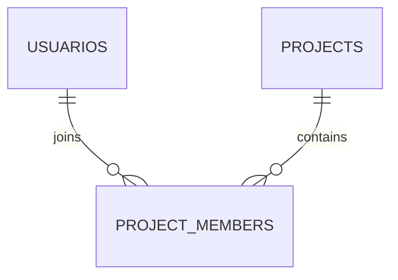

No existe relación directa N:M.

---

# 20. Tabla puente Project Members

La tabla puente representa:

- pertenencia;
- rol contextual;
- fecha incorporación;
- estado.

No es únicamente una tabla técnica.

Tiene significado funcional propio.

---

# 21. Beneficios de Project Members

Permite:

- varios miembros;
- distintos roles;
- auditoría;
- historial;
- ampliaciones futuras.

---

# 22. Rol contextual

El rol contextual pertenece exclusivamente a la relación.

```text
Usuario

+

Proyecto

↓

Coordinator
```

No pertenece al usuario global.

---

# 23. Relación Proyecto-Actividad

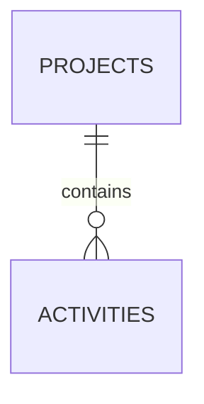

Cada actividad pertenece exactamente a un proyecto.

---

# 24. Responsabilidad

La actividad representa una subdivisión lógica del proyecto.

No puede existir independientemente.

---

# 25. Navegación

```text
Project

↓

Activities

↓

Activity
```

y

```text
Activity

↓

Project
```

Ambas direcciones resultan útiles.

---

# 26. Relación Proyecto-Tarea

Existe una relación directa.

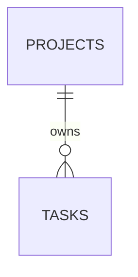

Aunque exista actividad.

---

# 27. Justificación

Mantener `project_id` en Task facilita:

- autorización;
- consultas Kanban;
- Dashboard;
- índices;
- rendimiento.

---

# 28. Consistencia

Debe mantenerse la regla:

```text
Task.project_id

=

Activity.project_id
```

cuando la tarea pertenezca a una actividad.

---

# 29. Relación Actividad-Tarea

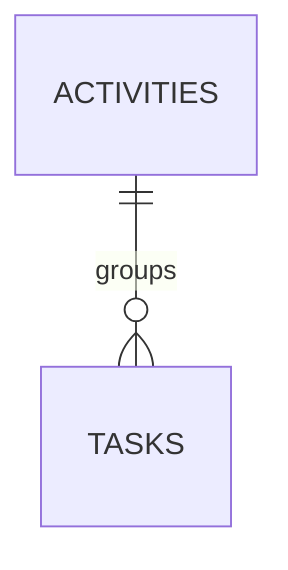

Una actividad puede contener muchas tareas.

---

# 30. Actividad opcional

Según la evolución funcional, puede permitirse:

```text
Task

↓

Project

↓

sin Activity
```

Esto aporta flexibilidad.

---

# 31. Relación Usuario-Tarea

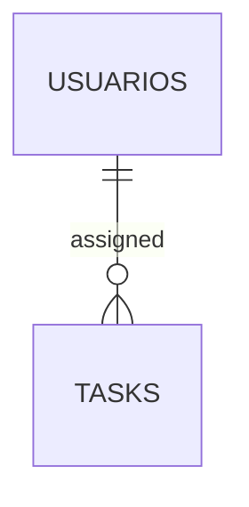

Representa asignación funcional.

---

# 32. Usuario asignado

La asignación:

- puede cambiar;
- puede eliminarse;
- no altera la identidad de la tarea.

---

# 33. Restricción lógica

El usuario asignado debe pertenecer al proyecto.

Esta regla no puede garantizarse únicamente mediante Foreign Keys.

---

# 34. Validación

Debe realizarse en:

- Service Layer;
- Repository;
- pruebas.

---

# 35. Relación Usuario-Creador

Muchas entidades contienen:

```text
created_by
```

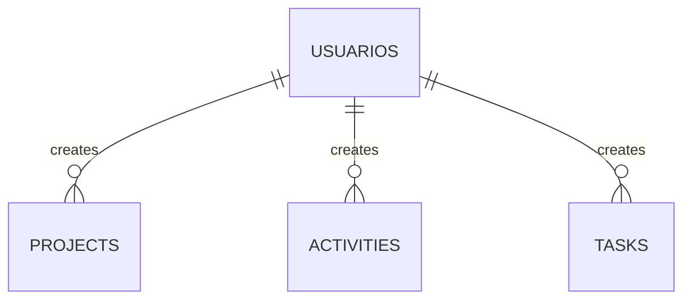

---

# 36. Valor histórico

El creador constituye información histórica.

Eliminar el usuario no debería eliminar automáticamente las entidades creadas.

---

# 37. Relación Usuario-Editor

También aparece:

```text
updated_by
```

Representa la última modificación conocida.

---

# 38. Relación Usuario-Auditoría

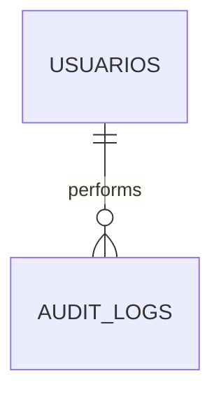

Una acción puede existir incluso cuando el usuario ya no esté activo.

---

# 39. Relación Proyecto-Auditoría

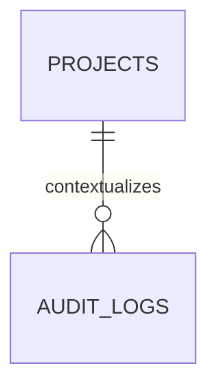

Permite reconstruir el historial completo del proyecto.

---

# 40. Auditoría transversal

La auditoría puede relacionarse con:

- proyecto;
- tarea;
- actividad;
- usuario;
- competición.

No depende de una única entidad.

---

# 41. Resource Type

La auditoría utiliza:

```text
resource_type

resource_id
```

Esto desacopla la auditoría del resto del modelo.

---

# 42. Relación Usuario-Notificación

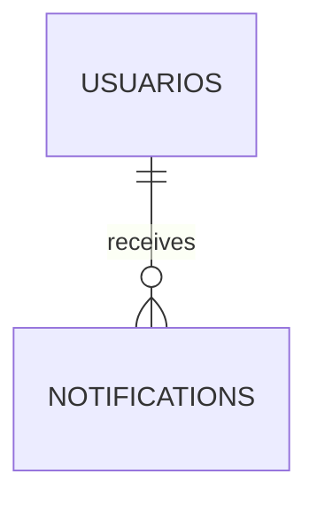

Cada notificación pertenece a un usuario.

---

# 43. Independencia

Las notificaciones no sustituyen al dominio.

Una tarea existe aunque se eliminen sus notificaciones.

---

# 44. Relación Usuario-Preferencias

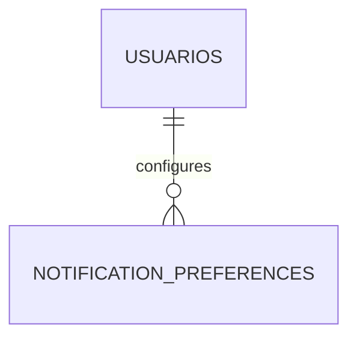

Cada usuario mantiene su propia configuración.

---

# 45. Relación Competición-Proyecto

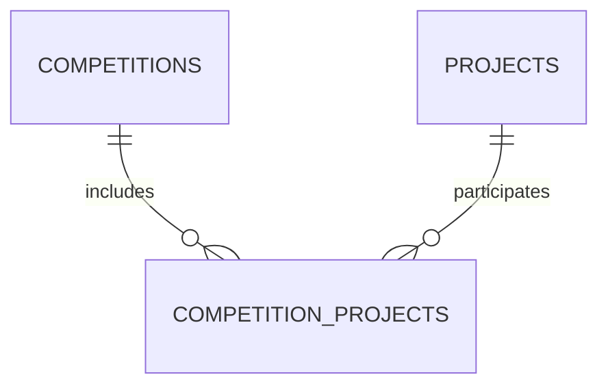

Representa participación de proyectos.

---

# 46. Tabla puente Competition Projects

Permite almacenar:

- estado;
- inscripción;
- puntuación futura;
- clasificación futura.

---

# 47. Relación Competición-Usuario

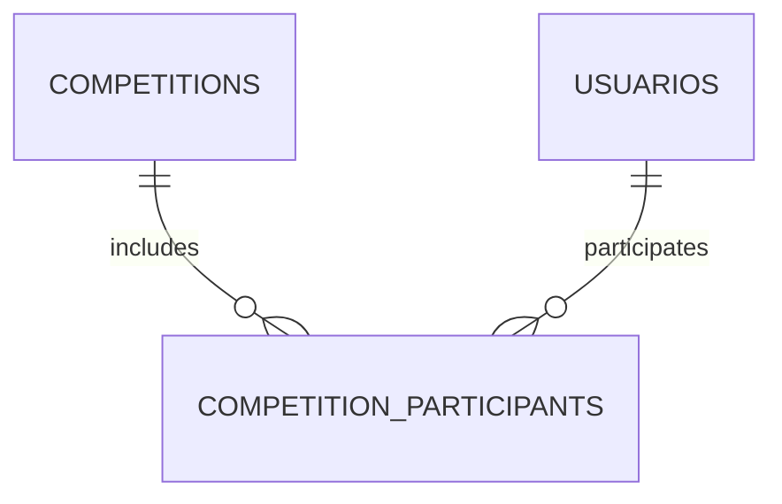

---

# 48. Participación

La participación puede evolucionar con:

- roles;
- equipos;
- puntuaciones;
- categorías.

---

# 49. Relación Archivo-Entidad

Los adjuntos utilizan una relación lógica.

```text
entity_type

entity_id
```

No múltiples columnas FK.

---

# 50. Beneficios

Permite reutilizar Attachment para:

- proyectos;
- tareas;
- actividades;
- competiciones.

Sin duplicar tablas.

---

# 51. Relación Outbox

Outbox mantiene referencias lógicas.

```text
aggregate_type

aggregate_id
```

---

# 52. Agregados

Ejemplos:

```text
Project

Task

Competition
```

No depende directamente del esquema físico.

---

# 53. Relaciones de autorización

La autorización contextual utiliza simultáneamente:

```mermaid
flowchart TD

Usuario

↓

Roles

↓

Permissions

↓

Project Members

↓

Proyecto

↓

Acción
```

---

# 54. Relaciones de navegación

No todas las relaciones deben exponerse mediante ORM.

Algunas consultas resultan más eficientes mediante SQL específico.

---

# 55. Relaciones de agregación

Un agregado representa una unidad coherente.

Ejemplo:

```text
Project

↓

Activities

↓

Tasks
```

---

# 56. Relaciones de composición

Las tareas forman parte del ciclo de vida del proyecto.

Su independencia es limitada.

---

# 57. Relaciones transversales

Existen relaciones utilizadas por múltiples módulos:

- usuarios;
- proyectos;
- auditoría.

Estas entidades constituyen ejes del dominio.

---

# 58. Evitar dependencias circulares

Nunca debe existir una cadena de dependencias imposible de mantener.

Ejemplo incorrecto:

```text
Task

↓

Notification

↓

Task
```

---

# 59. Consistencia

Toda relación debe representar un hecho estable del dominio.

No debe utilizarse para almacenar información temporal.

---

# 60. Continuación

La **Parte 2** desarrollará en profundidad las estrategias de carga ORM, cascadas, `ON DELETE`, `ON UPDATE`, relaciones complejas, optimización de JOINs, patrones de navegación, rendimiento, concurrencia y arquitectura relacional avanzada del modelo de Aula Robótica Platform.

---

# 61. Estrategias de carga ORM

Las relaciones definidas en SQLAlchemy no deben cargarse siempre del mismo modo.

La estrategia de carga debe seleccionarse según:

- frecuencia de acceso;
- cardinalidad;
- volumen esperado;
- profundidad de navegación;
- tipo de endpoint;
- impacto sobre el número de consultas;
- tamaño de la respuesta;
- contexto transaccional.

Las principales estrategias disponibles son:

```text
lazy loading

selectin loading

joined loading

subquery loading

explicit loading

no loading
```

La elección incorrecta puede producir:

- consultas N+1;
- JOIN excesivos;
- duplicación de filas;
- aumento de memoria;
- tiempos de respuesta impredecibles;
- errores fuera de la sesión ORM.

---

# 62. Lazy Loading

El lazy loading recupera una relación únicamente cuando se accede a ella.

Flujo conceptual:

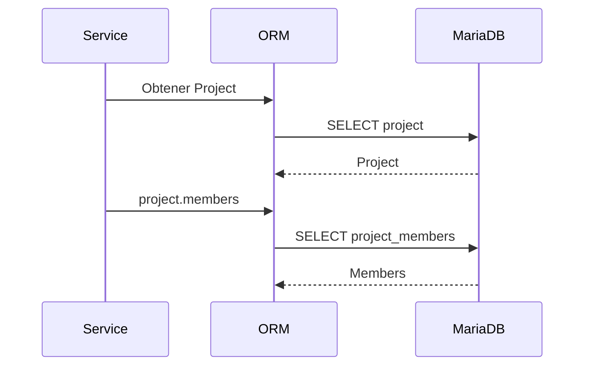

Ventajas:

- evita cargar relaciones innecesarias;
- reduce el tamaño de consultas simples;
- resulta cómodo para navegación puntual.

Riesgos:

- genera consultas adicionales implícitas;
- favorece el problema N+1;
- puede fallar si la sesión ya está cerrada;
- oculta el coste real de acceso a datos.

---

# 63. Uso recomendado de Lazy Loading

Puede utilizarse en:

- relaciones poco consultadas;
- pantallas de detalle;
- operaciones administrativas aisladas;
- objetos con colecciones pequeñas;
- casos en los que la sesión permanece abierta de forma controlada.

No debe utilizarse como estrategia general para:

- listados;
- Dashboard;
- Kanban;
- activity feed;
- notificaciones;
- auditoría;
- serialización masiva.

---

# 64. Selectin Loading

`selectinload` recupera las entidades principales y después carga las relaciones mediante una segunda consulta basada en los identificadores obtenidos.

Ejemplo conceptual:

```text
SELECT * FROM projects;

SELECT * FROM project_members
WHERE project_id IN (...);
```

Flujo:

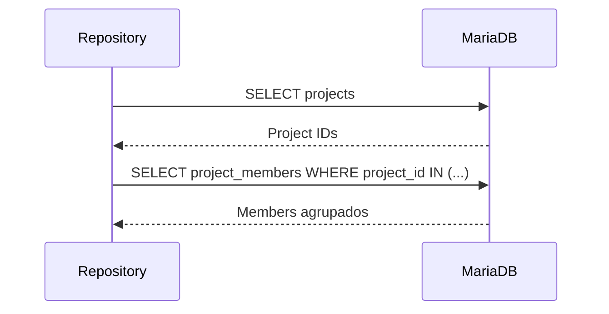

Es una estrategia especialmente adecuada para relaciones:

```text
1:N

N:M
```

---

# 65. Ventajas de `selectinload`

- evita N+1;
- mantiene consultas relativamente simples;
- reduce duplicación de filas;
- funciona bien con colecciones;
- suele escalar mejor que un JOIN masivo;
- mantiene clara la separación entre entidades.

Ejemplo:

```python
select(Project).options(
    selectinload(Project.members)
)
```

---

# 66. Joined Loading

`joinedload` recupera la entidad principal y la relación mediante un `JOIN`.

Ejemplo conceptual:

```sql
SELECT *
FROM projects
LEFT JOIN project_members
    ON project_members.project_id = projects.id_project;
```

Es apropiado principalmente para:

- relaciones N:1;
- relaciones 1:1;
- colecciones muy pequeñas;
- acceso inmediato a una relación obligatoria.

---

# 67. Riesgos de `joinedload`

En relaciones 1:N puede multiplicar las filas devueltas.

Ejemplo:

```text
1 proyecto

×

20 miembros

×

40 tareas

=

800 filas intermedias
```

Aunque SQLAlchemy reconstruya los objetos correctamente, la base de datos debe procesar y transferir toda la combinación.

---

# 68. Comparación de estrategias

| Estrategia | Consultas | Duplicación de filas | Uso recomendado |
|---|---:|---:|---|
| Lazy | Variable | Baja | Acceso puntual |
| `selectinload` | 2 o más controladas | Baja | Colecciones |
| `joinedload` | 1 | Puede ser alta | N:1 o 1:1 |
| Carga explícita | Control total | Depende de consulta | Casos complejos |
| Sin carga | 1 | Ninguna | Operaciones que no necesitan relaciones |

---

# 69. Política orientativa por relación

| Relación | Estrategia habitual |
|---|---|
| `Identity.user` | `joinedload` o lazy |
| `User.identities` | `selectinload` |
| `User.roles` | `selectinload` |
| `Role.permissions` | `selectinload` |
| `Project.creator` | `joinedload` |
| `Project.members` | `selectinload` |
| `Project.tasks` | Carga explícita o `selectinload` |
| `Task.project` | `joinedload` |
| `Task.assignee` | `joinedload` |
| `Task.activities` | `selectinload` |
| `Activity.attachments` | `selectinload` |
| `Notification.user` | Normalmente no se carga |
| `AuditLog.user` | `joinedload` opcional |
| `ProjectActivityFeed.user` | `joinedload` opcional |

Estas decisiones deben validarse mediante consultas reales y pruebas de rendimiento.

---

# 70. Problema N+1

El problema N+1 aparece cuando una consulta principal genera una consulta adicional por cada resultado.

Ejemplo:

```text
1 consulta para proyectos

+

20 consultas para miembros

=

21 consultas
```

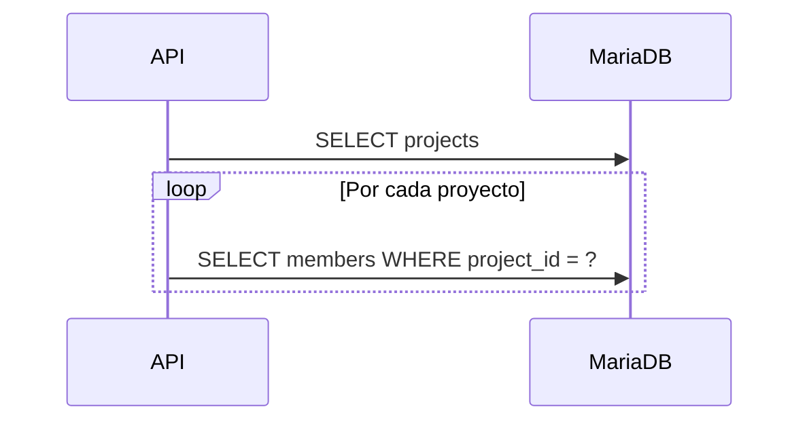

---

# 71. Prevención de N+1

Las medidas principales son:

- `selectinload`;
- `joinedload`;
- consultas agregadas;
- DTOs específicos;
- revisión del SQL generado;
- pruebas automatizadas de número de consultas;
- evitar serializar relaciones no planificadas.

---

# 72. Serialización y relaciones

Los modelos ORM no deben serializarse directamente de forma indiscriminada.

Una respuesta que recorra automáticamente:

```text
Project

→ members

→ user

→ projects

→ members
```

puede provocar:

- ciclos;
- consultas inesperadas;
- respuestas enormes;
- exposición de información;
- errores de rendimiento.

Debe utilizarse una capa de DTO o ViewModel.

---

# 73. Límites de navegación

Cada caso de uso debe decidir explícitamente qué relaciones necesita.

Ejemplo para un listado de proyectos:

```text
ProjectSummaryDTO

- id
- name
- status
- member_count
- task_count
```

No es necesario cargar:

- todos los miembros;
- todas las tareas;
- toda la auditoría;
- todo el feed.

---

# 74. Cascadas ORM

Las cascadas ORM determinan cómo SQLAlchemy propaga operaciones entre objetos relacionados.

Valores habituales:

```text
save-update

merge

refresh-expire

expunge

delete

delete-orphan
```

La combinación:

```python
cascade="all, delete-orphan"
```

debe utilizarse únicamente cuando la entidad hija pertenezca exclusivamente al ciclo de vida del padre.

---

# 75. Diferencia entre cascada ORM y cascada SQL

La cascada ORM pertenece a SQLAlchemy.

La cascada SQL pertenece a MariaDB.

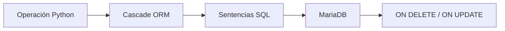

Ambas pueden coexistir, pero deben estar coordinadas.

---

# 76. Riesgo de cascadas duplicadas

Si ORM y base de datos intentan resolver la misma eliminación sin una configuración coherente, pueden producirse:

- consultas innecesarias;
- cargas completas de colecciones;
- errores de integridad;
- dobles eliminaciones conceptuales;
- comportamiento diferente según el origen de la operación.

Cuando la base de datos gestiona la eliminación, SQLAlchemy puede utilizar:

```python
passive_deletes=True
```

---

# 77. `passive_deletes`

`passive_deletes=True` indica que SQLAlchemy no debe cargar y eliminar manualmente todos los hijos cuando la base de datos dispone de `ON DELETE CASCADE`.

Ejemplo conceptual:

```python
attachments = relationship(
    "ActivityAttachment",
    back_populates="activity",
    cascade="all, delete-orphan",
    passive_deletes=True,
)
```

Esto evita una consulta previa para recuperar todos los adjuntos.

---

# 78. Cascada User-Identity

Relación:

```text
User 1:N Identity
```

Política recomendada:

```text
ON DELETE CASCADE
```

Justificación:

- una identidad no puede existir sin usuario;
- no tiene valor histórico independiente;
- forma parte del agregado IAM del usuario.

Configuración conceptual:

```python
identities = relationship(
    "Identity",
    back_populates="user",
    cascade="all, delete-orphan",
    passive_deletes=True,
)
```

---

# 79. Cascada User-Notification

Relación:

```text
User 1:N Notification
```

Política actual:

```text
ON DELETE CASCADE
```

Es coherente cuando las notificaciones se consideran datos operativos privados del usuario.

Debe revisarse si aparecen requisitos de:

- retención;
- trazabilidad legal;
- investigación de incidentes;
- métricas históricas.

---

# 80. Cascada User-AuditLog

Relación:

```text
User 1:N AuditLog
```

Política recomendada:

```text
ON DELETE SET NULL
```

La eliminación del actor no debe destruir la auditoría.

El registro conserva:

- acción;
- recurso;
- fecha;
- contexto;
- identificadores técnicos no sensibles.

---

# 81. Cascada User-ProjectActivityFeed

Relación:

```text
User 1:N ProjectActivityFeed
```

Política recomendada:

```text
ON DELETE SET NULL
```

El evento funcional continúa siendo relevante aunque el usuario desaparezca.

La UI puede mostrar:

```text
Usuario eliminado
```

o un nombre histórico anonimizado si se conserva de forma legítima.

---

# 82. Cascada Project-ProjectMember

Relación:

```text
Project 1:N ProjectMember
```

Configuración habitual:

```text
ON DELETE CASCADE
```

y:

```python
cascade="all, delete-orphan"
```

La membresía contextual carece de sentido sin proyecto.

---

# 83. Cascada Project-Task

Relación:

```text
Project 1:N Task
```

El modelo actual utiliza una dependencia fuerte.

Política técnica posible:

```text
ON DELETE CASCADE
```

Sin embargo, la eliminación física de un proyecto completo debe restringirse funcionalmente en producción.

La operación habitual debería ser:

```text
archivar proyecto
```

en lugar de:

```text
eliminar proyecto
```

---

# 84. Cascada Task-Activity

En el modelo real, una actividad representa trabajo registrado sobre una tarea.

Relación:

```text
Task 1:N Activity
```

No debe confundirse con una agrupación estructural de tareas.

Política actual:

```text
ON DELETE CASCADE
```

y:

```python
cascade="all, delete-orphan"
```

La eliminación de una tarea elimina sus actividades asociadas, siempre que se permita realmente la eliminación física de la tarea.

---

# 85. Cascada Activity-ActivityAttachment

Relación:

```text
Activity 1:N ActivityAttachment
```

Política recomendada:

```text
ON DELETE CASCADE
```

y:

```python
cascade="all, delete-orphan"
passive_deletes=True
```

La eliminación del registro debe coordinarse con la eliminación del archivo físico.

---

# 86. Eliminación del archivo físico

La cascada SQL solo elimina metadatos.

No elimina automáticamente el archivo almacenado en:

- volumen Docker;
- sistema de archivos;
- almacenamiento S3-compatible;
- servicio externo.

Se requiere un flujo de aplicación.

```mermaid
sequenceDiagram
    participant Service
    participant DB as MariaDB
    participant Storage

    Service->>DB: Marcar o eliminar attachment
    DB-->>Service: Commit
    Service->>Storage: Eliminar objeto físico
    Storage-->>Service: Confirmación
```

Para mayor fiabilidad puede utilizarse Outbox.

---

# 87. Cascadas RBAC

Las tablas puente:

```text
user_rol

role_permissions
```

deben utilizar:

```text
ON DELETE CASCADE
```

Cuando se elimina una entidad principal, sus asignaciones dejan de tener significado.

No debe eliminarse en cascada:

```text
Role

desde UserRole
```

La dirección de dependencia es únicamente desde la tabla puente.

---

# 88. Matriz de políticas de eliminación

| Entidad padre | Entidad dependiente | Política orientativa |
|---|---|---|
| User | Identity | CASCADE |
| User | UserRole | CASCADE |
| Role | UserRole | CASCADE |
| Role | RolePermission | CASCADE |
| Permission | RolePermission | CASCADE |
| Project | ProjectMember | CASCADE |
| Project | Task | CASCADE técnico / archivado funcional |
| Task | Activity | CASCADE |
| Activity | ActivityAttachment | CASCADE |
| User | Notification | CASCADE |
| User | AuditLog | SET NULL |
| User | ProjectActivityFeed | SET NULL |
| Project | ProjectActivityFeed | CASCADE |

---

# 89. `ON DELETE RESTRICT`

`RESTRICT` impide eliminar una entidad cuando existen dependencias.

Es apropiado para entidades cuyo historial debe preservarse.

Casos posibles:

- permisos utilizados;
- roles del sistema;
- proyectos activos;
- usuarios con responsabilidades críticas;
- tareas vinculadas a procesos externos.

---

# 90. `ON DELETE SET NULL`

`SET NULL` resulta adecuado cuando:

- la relación es opcional;
- el dato hijo debe conservarse;
- la desaparición del padre no invalida el registro.

Casos principales:

```text
AuditLog.user_id

ProjectActivityFeed.user_id

Task.assigned_to
```

Para utilizarlo, la columna debe permitir `NULL`.

---

# 91. `ON UPDATE`

Las claves primarias no deben modificarse durante la vida de la entidad.

Política recomendada:

```text
ON UPDATE RESTRICT
```

o el comportamiento equivalente del motor.

Los identificadores técnicos deben considerarse inmutables.

---

# 92. Relaciones múltiples hacia User

Una misma tabla puede contener varias claves foráneas hacia `usuarios`.

Ejemplo conceptual:

```text
tasks.assigned_to

tasks.created_by

tasks.updated_by
```

Cada relación ORM debe indicar explícitamente qué FK utiliza.

```python
assignee = relationship(
    "User",
    foreign_keys=[assigned_to],
)

creator = relationship(
    "User",
    foreign_keys=[created_by],
)
```

---

# 93. Ambigüedad de Foreign Keys

Cuando una tabla posee varias FK hacia la misma entidad, SQLAlchemy no siempre puede inferir la relación correcta.

Sin `foreign_keys`, puede producirse:

```text
AmbiguousForeignKeysError
```

Por tanto, deben declararse explícitamente:

- `foreign_keys`;
- `primaryjoin`, cuando sea necesario;
- `back_populates`;
- nombres semánticos diferenciados.

---

# 94. `back_populates`

`back_populates` define una relación bidireccional explícita.

Ejemplo:

```python
class Task(Base):
    project = relationship(
        "Project",
        back_populates="tasks",
    )

class Project(Base):
    tasks = relationship(
        "Task",
        back_populates="project",
    )
```

Ventajas:

- mayor claridad;
- sincronización en memoria;
- validación de configuración;
- navegación consistente.

---

# 95. `backref`

`backref` crea implícitamente la relación inversa.

Aunque reduce código, puede ocultar:

- nombre de la relación;
- estrategia de carga;
- cascadas;
- responsabilidad del modelo.

Para una arquitectura grande se recomienda preferir:

```text
back_populates
```

---

# 96. Relación User-Role mediante entidad asociativa

`user_rol` no debe tratarse necesariamente como una tabla invisible si incorpora metadatos.

Si únicamente contiene:

```text
user_id

rol_id
```

puede modelarse como relación N:M simple.

Si incorpora:

```text
assigned_at

assigned_by

expires_at

active
```

debe representarse mediante una entidad ORM `UserRole`.

---

# 97. Association Object Pattern

El patrón Association Object convierte una tabla puente en una entidad con comportamiento propio.

```mermaid
classDiagram
    class User {
        +id_usuario
    }

    class UserRole {
        +user_id
        +role_id
        +assigned_at
        +assigned_by
    }

    class Role {
        +id_rol
    }

    User "1" --> "*" UserRole
    Role "1" --> "*" UserRole
```

Este patrón también resulta adecuado para:

```text
ProjectMember
```

---

# 98. ProjectMember como entidad de dominio

`ProjectMember` no es una simple tabla puente.

Representa:

- pertenencia;
- rol contextual;
- fecha de incorporación;
- posible estado;
- actor que realizó el alta;
- futura fecha de salida.

Por tanto, debe gestionarse mediante:

- modelo ORM propio;
- Repository;
- Service Layer;
- auditoría;
- restricciones específicas.

---

# 99. Clave primaria de ProjectMember

Existen dos estrategias válidas.

## Clave compuesta

```text
PRIMARY KEY(project_id, user_id)
```

Ventajas:

- evita duplicados de forma natural;
- refleja la identidad funcional;
- no añade un identificador artificial.

Limitaciones:

- dificulta referenciar una membresía concreta;
- complica historial de altas y bajas;
- puede ser menos cómoda en API.

## Identificador técnico

```text
id_project_member
```

más:

```text
UNIQUE(project_id, user_id)
```

Ventajas:

- facilita auditoría;
- simplifica URLs y referencias;
- admite evolución hacia historial.

---

# 100. Historial de membresías

Si un usuario puede abandonar y volver al mismo proyecto, una restricción simple:

```text
UNIQUE(project_id, user_id)
```

impide conservar varias etapas históricas.

Alternativas:

1. reutilizar la misma fila;
2. utilizar `active` y `removed_at`;
3. crear una tabla histórica;
4. permitir varias filas y garantizar una única membresía activa desde el servicio;
5. crear una clave única basada en una columna generada.

La estrategia debe definirse antes de ampliar el módulo.

---

# 101. Relación Project.creator

La FK:

```text
projects.created_by → usuarios.id_usuario
```

es nullable en el modelo actual.

Esto permite conservar el proyecto aunque desaparezca su creador.

Política recomendada:

```text
ON DELETE SET NULL
```

La relación ORM debería ser explícita:

```python
creator = relationship(
    "User",
    foreign_keys=[created_by],
)
```

---

# 102. Relación Task.creator

La FK:

```text
tasks.created_by → usuarios.id_usuario
```

es actualmente obligatoria.

Debe decidirse cómo actuar si se elimina el usuario:

- impedir eliminación mediante `RESTRICT`;
- anonimizar al usuario;
- convertir la FK en nullable y usar `SET NULL`;
- evitar la eliminación física de usuarios.

La decisión debe alinearse con auditoría y protección de datos.

---

# 103. Relación Task.assignee

La relación de asignación es opcional.

Política recomendada:

```text
ON DELETE SET NULL
```

Una tarea continúa existiendo aunque desaparezca el usuario asignado.

La aplicación debe validar que el usuario:

- está activo;
- pertenece al proyecto;
- puede recibir tareas;
- no ha sido retirado del proyecto.

---

# 104. Integridad contextual de asignación

Una FK simple garantiza:

```text
assigned_to existe en usuarios
```

pero no garantiza:

```text
assigned_to pertenece a task.project_id
```

Esta regla se resuelve mediante una consulta de dominio.

```mermaid
flowchart TD
    A[Asignar usuario] --> B{¿Existe?}
    B -->|No| C[404]
    B -->|Sí| D{¿Es miembro activo?}
    D -->|No| E[422 o 403]
    D -->|Sí| F[Actualizar tarea]
```

---

# 105. Integridad contextual de coordinadores

El sistema debe garantizar que:

```text
ProjectMember.role = coordinator
```

solo se asigne a miembros válidos del proyecto.

También debe definir si:

- puede haber varios coordinadores;
- debe existir al menos uno;
- el último coordinador puede abandonar;
- un administrador puede sustituirlo.

Estas reglas son funcionales, no meramente relacionales.

---

# 106. Relación Task-Activity en el modelo real

En Aula Robótica Platform, `Activity` representa un registro de trabajo realizado sobre una tarea.

Ejemplos:

- comentario;
- cambio de estado;
- progreso;
- evidencia;
- actualización funcional;
- registro manual de actividad.

Relación:

```text
Task 1:N Activity
```

Cada actividad pertenece a una única tarea.

---

# 107. Diferencia entre Activity y AuditLog

Aunque ambas registran hechos, tienen propósitos distintos.

| Aspecto | Activity | AuditLog |
|---|---|---|
| Audiencia | Usuario funcional | Administradores y soporte |
| Contenido | Trabajo y colaboración | Acción técnica |
| Visibilidad | Interfaz del proyecto | Área de auditoría |
| Mutabilidad | Según reglas del dominio | Idealmente inmutable |
| Relación principal | Task | Recurso polimórfico |
| Adjuntos | Sí | Normalmente no |

---

# 108. Relación Activity-User

Cada actividad pertenece a un usuario mediante:

```text
activities.user_id → usuarios.id_usuario
```

El modelo actual la considera obligatoria.

Debe definirse una política para:

- usuarios eliminados;
- eventos automáticos;
- procesos de sistema;
- importaciones.

Una futura ampliación puede incorporar:

```text
actor_type

system_actor

integration_name
```

---

# 109. ActivityAttachment y uploader

Un adjunto mantiene dos relaciones distintas:

```text
activity_id → activities.id_activity

uploaded_by → usuarios.id_usuario
```

La primera representa pertenencia.

La segunda representa autoría.

La eliminación de la actividad puede eliminar el adjunto, pero la eliminación del usuario no debería necesariamente borrar el archivo.

Política orientativa para `uploaded_by`:

```text
ON DELETE SET NULL
```

si se desea conservar el adjunto.

---

# 110. Relación Notification-Entity

Las notificaciones utilizan referencia polimórfica ligera:

```text
entity_type

entity_id
```

Ejemplos:

```text
task / 125

project / 18

activity / 942
```

No existe una FK física hacia cada tabla funcional.

---

# 111. Ventajas de la referencia polimórfica

- evita múltiples columnas nullable;
- permite incorporar nuevas entidades;
- reduce acoplamiento;
- simplifica un subsistema transversal;
- facilita construir enlaces dinámicos.

---

# 112. Riesgos de la referencia polimórfica

- no existe integridad referencial SQL;
- pueden quedar referencias huérfanas;
- requiere validación de tipos;
- dificulta JOIN directos;
- exige control de seguridad;
- el identificador puede ser ambiguo sin `entity_type`.

---

# 113. Validación de referencias polimórficas

El Service Layer debe validar:

1. que `entity_type` está permitido;
2. que la entidad existe;
3. que el usuario puede acceder a ella;
4. que la URL generada es interna y segura;
5. que la entidad no está eliminada o archivada de forma incompatible.

---

# 114. Catálogo de tipos polimórficos

No deben aceptarse valores arbitrarios.

Debe existir un Enum o catálogo cerrado:

```text
task

project

activity

project_member

competition

system
```

Esto reduce errores y riesgos de seguridad.

---

# 115. AuditLog y recurso polimórfico

`AuditLog` utiliza:

```text
resource_type

resource_id
```

La auditoría debe poder conservar referencias incluso si el recurso original desaparece.

Por esta razón no siempre es deseable una FK directa.

El registro debe almacenar suficiente contexto histórico para resultar útil sin consultar la entidad original.

---

# 116. ProjectActivityFeed y entidad polimórfica

`ProjectActivityFeed` combina:

```text
project_id

entity_type

entity_id

user_id
```

`project_id` establece el contexto fuerte.

`entity_type` y `entity_id` identifican el objeto funcional que originó el evento.

Esto permite consultas eficientes:

```sql
SELECT *
FROM project_activity_feed
WHERE project_id = :project_id
ORDER BY created_at DESC;
```

---

# 117. Integridad del feed

La creación de un evento debe validar:

```text
la entidad referenciada pertenece al project_id indicado
```

Ejemplo:

```text
entity_type = task

entity_id = 25

project_id = 7
```

La tarea 25 debe pertenecer al proyecto 7.

---

# 118. AuditLog frente a ProjectActivityFeed

```mermaid
flowchart LR
    A[Acción de usuario] --> B[Service Layer]
    B --> C[Entidad funcional]
    B --> D[AuditLog]
    B --> E[ProjectActivityFeed]
```

Un mismo caso de uso puede generar ambos registros, pero con contenidos diferentes.

Ejemplo:

```text
Task moved from TODO to DOING
```

En auditoría:

```text
valores previos y posteriores
correlation_id
actor
ip
```

En feed:

```text
Fran movió la tarea a En curso
```

---

# 119. Integridad transaccional de relaciones

Cuando una operación modifica varias entidades relacionadas, debe ejecutarse dentro de una única transacción.

Ejemplo: añadir un miembro.

```mermaid
sequenceDiagram
    participant Service
    participant DB as MariaDB

    Service->>DB: BEGIN
    Service->>DB: INSERT project_members
    Service->>DB: INSERT audit_logs
    Service->>DB: INSERT project_activity_feed
    Service->>DB: INSERT notifications
    Service->>DB: COMMIT
```

Si una operación crítica falla antes del `COMMIT`, debe realizarse `ROLLBACK`.

---

# 120. Transacciones y WebSocket

Las notificaciones WebSocket no deben emitirse antes del `COMMIT`.

Flujo correcto:

```mermaid
flowchart TD
    A[Modificar entidades] --> B[Crear auditoría/feed]
    B --> C[COMMIT]
    C --> D[Publicar evento]
    D --> E[WebSocket]
```

Flujo incorrecto:

```text
publicar WebSocket

↓

fallar transacción

↓

cliente ve un estado inexistente
```

---

# 121. Orden de persistencia

SQLAlchemy determina el orden de inserción mediante las dependencias entre entidades.

Ejemplo:

```text
Project

↓

ProjectMember

↓

Notification
```

Para evitar errores:

- las relaciones deben estar correctamente declaradas;
- las FK deben ser explícitas;
- la sesión debe realizar `flush` cuando se necesite un identificador;
- no deben hacerse commits parciales dentro de un mismo caso de uso.

---

# 122. `flush` frente a `commit`

`flush` envía cambios pendientes a la base de datos sin confirmar la transacción.

Puede utilizarse para obtener:

- identificadores autoincrementales;
- validación temprana de restricciones;
- acceso a datos generados.

```text
session.add(project)

session.flush()

project.id_project disponible

session.commit()
```

El Repository no debe confundir `flush` con confirmación definitiva.

---

# 123. Ownership transaccional

Debe existir una política clara sobre quién controla la transacción.

Recomendación:

```text
Service Layer
```

El Repository:

- añade;
- consulta;
- actualiza;
- elimina;
- realiza `flush` cuando proceda.

El Service:

- inicia el caso de uso;
- coordina varios Repository;
- confirma;
- revierte;
- traduce errores.

---

# 124. JOINs principales del dominio

Las consultas relacionales más frecuentes incluyen:

```text
User ↔ Identity

User ↔ Role ↔ Permission

Project ↔ ProjectMember ↔ User

Project ↔ Task ↔ Activity

Activity ↔ ActivityAttachment

Project ↔ ProjectActivityFeed ↔ User

User ↔ Notification
```

---

# 125. JOIN de autorización global

Consulta conceptual:

```sql
SELECT p.nombre
FROM permissions p
JOIN role_permissions rp
    ON rp.permission_id = p.id_permission
JOIN roles r
    ON r.id_rol = rp.role_id
JOIN user_rol ur
    ON ur.rol_id = r.id_rol
WHERE ur.user_id = :user_id;
```

Debe respaldarse mediante:

- PK compuestas;
- índices en FK;
- unicidad en permisos;
- caché contextual cuando sea apropiado.

---

# 126. JOIN de autorización contextual

Consulta conceptual:

```sql
SELECT pm.role
FROM project_members pm
WHERE pm.project_id = :project_id
  AND pm.user_id = :user_id;
```

Índice recomendado:

```text
UNIQUE(project_id, user_id)
```

Este acceso se encuentra en la ruta crítica de muchas operaciones.

---

# 127. JOIN de Kanban

Consulta conceptual:

```sql
SELECT
    t.*,
    u.nombre AS assignee_name
FROM tasks t
LEFT JOIN usuarios u
    ON u.id_usuario = t.assigned_to
WHERE t.project_id = :project_id
ORDER BY t.status, t.position;
```

La consulta debe evitar cargar innecesariamente:

- actividades completas;
- adjuntos;
- auditoría;
- notificaciones.

---

# 128. JOIN de detalle de tarea

Un detalle completo puede necesitar:

- tarea;
- proyecto;
- usuario asignado;
- creador;
- actividades;
- usuarios de actividades;
- adjuntos;
- uploader.

No debe resolverse mediante un único JOIN gigantesco.

Estrategia orientativa:

```text
Task + Project + Assignee

mediante joinedload

Activities

mediante selectinload

Attachments

mediante selectinload
```

---

# 129. JOIN del Activity Feed

Consulta habitual:

```sql
SELECT
    f.*,
    u.nombre,
    u.apellidos
FROM project_activity_feed f
LEFT JOIN usuarios u
    ON u.id_usuario = f.user_id
WHERE f.project_id = :project_id
ORDER BY f.created_at DESC
LIMIT :limit;
```

Índice recomendado:

```text
(project_id, created_at)
```

---

# 130. JOIN de notificaciones

Las notificaciones no deben realizar JOIN automático con todas las entidades referenciadas.

La referencia polimórfica se resuelve solo cuando sea necesario.

La bandeja principal puede cargarse desde:

```text
notifications
```

más información mínima ya persistida:

- título;
- mensaje;
- tipo;
- acción;
- estado de lectura.

---

# 131. Optimización de relaciones de alta cardinalidad

Relaciones potencialmente grandes:

- `User.notifications`;
- `User.audit_logs`;
- `Project.tasks`;
- `Task.activities`;
- `Project.project_activity_feed`;
- `Activity.attachments`.

No deben cargarse completas por defecto.

Deben utilizar:

- paginación;
- límites;
- filtros;
- ordenación indexada;
- consultas específicas.

---

# 132. Colecciones `dynamic`

Las relaciones dinámicas pueden devolver una consulta en lugar de una colección completa.

Sin embargo, en SQLAlchemy moderno debe preferirse una arquitectura basada en consultas explícitas desde Repository.

Esto evita acoplar el modelo ORM a lógica de acceso.

---

# 133. Conteos de relaciones

Para obtener el número de elementos no debe cargarse la colección completa.

Incorrecto:

```text
len(project.tasks)
```

si existen miles de tareas.

Correcto:

```sql
SELECT COUNT(*)
FROM tasks
WHERE project_id = :project_id;
```

---

# 134. `EXISTS` frente a carga completa

Para verificar membresía:

Incorrecto:

```text
cargar todos los miembros

↓

buscar usuario
```

Correcto:

```sql
SELECT EXISTS (
    SELECT 1
    FROM project_members
    WHERE project_id = :project_id
      AND user_id = :user_id
);
```

---

# 135. Eliminación de huérfanos

`delete-orphan` elimina un hijo cuando deja de estar asociado al padre.

Debe usarse cuando:

- el hijo pertenece exclusivamente al padre;
- no puede reasignarse;
- su identidad depende de la relación.

Casos adecuados:

```text
Identity respecto a User

ProjectMember respecto a Project

ActivityAttachment respecto a Activity
```

Debe revisarse cuidadosamente para:

```text
Task

Activity
```

si se permite mover o conservar registros históricos.

---

# 136. Reasignación de hijos

Una relación con `delete-orphan` puede interferir con la reasignación.

Ejemplo:

```text
mover Activity de una Task a otra
```

Si la actividad representa un registro histórico de la tarea original, no debería reasignarse.

Si se necesitara una operación de traslado, debería definirse explícitamente y auditarse.

---

# 137. Ordenación de relaciones

Las colecciones ORM pueden declarar:

```python
order_by="Activity.created_at"
```

Esto resulta útil cuando la relación siempre necesita un orden estable.

Sin embargo, para colecciones grandes es preferible ordenar en consultas paginadas desde Repository.

---

# 138. Relaciones y soft delete

Cuando una entidad utiliza soft delete, la FK continúa existiendo.

Ejemplo:

```text
Task.deleted_at IS NOT NULL
```

Las relaciones ORM deben decidir si incluyen o excluyen tareas eliminadas.

No conviene ocultar este comportamiento de forma poco visible.

---

# 139. Filtros globales de soft delete

Puede utilizarse un criterio global para excluir entidades eliminadas.

Riesgos:

- dificultad para consultas administrativas;
- comportamiento implícito;
- problemas con auditoría;
- restauración compleja.

Alternativa recomendada:

- métodos Repository explícitos;
- consultas separadas para activos e históricos.

---

# 140. Relaciones y archivado

Archivar un proyecto no elimina sus relaciones.

Debe conservar:

- miembros;
- tareas;
- actividades;
- adjuntos;
- feed;
- auditoría.

La aplicación puede impedir nuevas modificaciones según el estado del proyecto.

---

# 141. Relaciones y concurrencia

Las relaciones también están sujetas a conflictos concurrentes.

Ejemplos:

- dos coordinadores añaden al mismo miembro;
- dos usuarios asignan la misma tarea;
- dos procesos eliminan el mismo adjunto;
- dos administradores modifican roles.

---

# 142. Control de duplicados concurrentes

La validación previa no sustituye a una restricción única.

Flujo vulnerable:

```text
Proceso A comprueba que no existe

Proceso B comprueba que no existe

A inserta

B inserta
```

La base de datos debe impedir el duplicado mediante:

```text
UNIQUE(project_id, user_id)
```

---

# 143. Traducción de errores de integridad

Los errores de restricciones deben traducirse a errores de dominio.

Ejemplos:

| Error SQL | Respuesta funcional |
|---|---|
| Unique violation | El usuario ya pertenece al proyecto |
| Foreign key violation | La entidad relacionada no existe |
| NOT NULL violation | Falta un dato obligatorio |
| CHECK violation | La transición o valor no es válido |

No debe exponerse el mensaje interno de MariaDB al cliente.

---

# 144. Bloqueos y relaciones

Puede utilizarse bloqueo pesimista cuando varias operaciones compiten por una relación crítica.

Ejemplo:

```text
cambiar el último coordinador del proyecto
```

Flujo:

```sql
SELECT *
FROM project_members
WHERE project_id = :project_id
FOR UPDATE;
```

Debe evitarse bloquear más filas de las necesarias.

---

# 145. Optimistic Locking en agregados

El campo `version` puede detectar modificaciones concurrentes sobre:

- Project;
- Task;
- Activity;
- Competition.

No protege automáticamente colecciones completas.

Añadir un `ProjectMember` no incrementa necesariamente la versión de `Project` salvo que se implemente expresamente.

---

# 146. Relaciones y autorización

Nunca debe confiarse únicamente en que una entidad esté relacionada con el usuario.

Ejemplo:

```text
task.assigned_to = current_user.id
```

no implica automáticamente permiso para modificarla.

La autorización debe combinar:

- rol global;
- permiso;
- membresía;
- rol contextual;
- estado de la entidad;
- reglas del caso de uso.

---

# 147. Prevención de IDOR

Las relaciones son esenciales para prevenir accesos inseguros por identificador.

Antes de devolver:

```text
GET /tasks/{task_id}
```

debe verificarse:

```text
la tarea existe

↓

pertenece a un proyecto

↓

el usuario puede acceder a ese proyecto

↓

dispone del permiso requerido
```

---

# 148. Consultas seguras por contexto

En lugar de:

```sql
SELECT *
FROM tasks
WHERE id_task = :task_id;
```

puede utilizarse:

```sql
SELECT t.*
FROM tasks t
JOIN project_members pm
    ON pm.project_id = t.project_id
WHERE t.id_task = :task_id
  AND pm.user_id = :user_id;
```

Esto integra parte del control contextual en la consulta.

---

# 149. Relaciones y exposición de datos

Las relaciones ORM no deben provocar exposición accidental de:

- email;
- identidades externas;
- roles globales;
- permisos;
- datos de auditoría;
- metadatos de seguridad.

Los DTO deben seleccionar únicamente la información necesaria.

---

# 150. Diagramas de relaciones ORM principales

```mermaid
classDiagram
    class User {
        +id_usuario
        +identidades
        +roles
        +project_memberships
        +activities
        +notifications
        +audit_logs
    }

    class Identity {
        +id_identity
        +user_id
    }

    class Role {
        +id_rol
        +permissions
    }

    class Permission {
        +id_permission
    }

    class Project {
        +id_project
        +members
        +tasks
        +activity_feed
    }

    class ProjectMember {
        +project_id
        +user_id
        +role
    }

    class Task {
        +id_task
        +project_id
        +assigned_to
        +created_by
        +activities
    }

    class Activity {
        +id_activity
        +task_id
        +user_id
        +attachments
    }

    class ActivityAttachment {
        +id_attachment
        +activity_id
        +uploaded_by
    }

    User "1" --> "*" Identity
    User "*" --> "*" Role
    Role "*" --> "*" Permission
    User "1" --> "*" ProjectMember
    Project "1" --> "*" ProjectMember
    Project "1" --> "*" Task
    Task "1" --> "*" Activity
    User "1" --> "*" Activity
    Activity "1" --> "*" ActivityAttachment
```

---

# 151. Matriz de carga recomendada

| Caso de uso | Relaciones | Estrategia |
|---|---|---|
| Login | User + Identity + Roles | `joinedload`/`selectinload` |
| Listado de proyectos | Creator + contadores | JOIN controlado + agregados |
| Detalle de proyecto | Members + users | `selectinload` |
| Kanban | Tasks + assignee | JOIN o `joinedload` |
| Detalle de tarea | Project + assignee + activities | Mixta |
| Activity Feed | User actor | LEFT JOIN |
| Bandeja de notificaciones | Ninguna relación funcional | Consulta directa |
| Auditoría | User actor opcional | LEFT JOIN |
| Gestión RBAC | Roles + permissions | `selectinload` |

---

# 152. Reglas arquitectónicas para relaciones

1. Toda FK debe responder a una relación del dominio.
2. Toda relación obligatoria debe ser `NOT NULL`.
3. Toda relación opcional debe definir su política de eliminación.
4. Las cascadas deben alinearse entre ORM y MariaDB.
5. Las colecciones grandes no se cargan por defecto.
6. Las relaciones polimórficas se validan en Service Layer.
7. Las tablas puente con metadatos son entidades propias.
8. La autorización contextual se apoya en relaciones, pero no se delega únicamente en ellas.
9. Las restricciones SQL protegen frente a concurrencia.
10. Los DTO controlan la profundidad de navegación.

---

# 153. Checklist de revisión relacional

## Foreign Keys

- [ ] Todas las FK apuntan a la tabla correcta.
- [ ] La nulabilidad coincide con la cardinalidad.
- [ ] Las políticas `ON DELETE` están definidas.
- [ ] Las FK de alta frecuencia disponen de índice.
- [ ] Las múltiples FK hacia User usan `foreign_keys`.

## ORM

- [ ] Se utiliza `back_populates` cuando la navegación es bidireccional.
- [ ] Las cascadas están justificadas.
- [ ] `passive_deletes` coincide con las cascadas SQL.
- [ ] No existen cargas lazy accidentales.
- [ ] Las colecciones grandes se consultan desde Repository.

## Integridad

- [ ] ProjectMember evita duplicados.
- [ ] UserRole evita duplicados.
- [ ] RolePermission evita duplicados.
- [ ] El assignee pertenece al proyecto.
- [ ] Las referencias polimórficas se validan.
- [ ] Los recursos del feed pertenecen al proyecto indicado.

## Rendimiento

- [ ] No existen consultas N+1.
- [ ] Los JOIN críticos están indexados.
- [ ] Los conteos usan agregaciones.
- [ ] Los listados están paginados.
- [ ] Las relaciones no generan productos cartesianos.

---

# 154. Continuación

La **Parte 3** completará el documento con:

- diagramas relacionales globales;
- recorridos completos por casos de uso;
- validación de consistencia;
- patrones y antipatrones;
- estrategia de pruebas;
- evolución futura;
- criterios de aceptación;
- conclusiones arquitectónicas.

---

# 155. Visión relacional global

El modelo relacional de Aula Robótica Platform debe entenderse como una red de agregados conectados mediante relaciones explícitas, restricciones de integridad y reglas contextuales.

La estructura global se apoya en cuatro ejes principales:

- identidad y autorización;
- proyectos y colaboración;
- trabajo operativo;
- trazabilidad e integración.

```mermaid
flowchart TD
    A[IAM]
    B[Projects]
    C[Work Management]
    D[Audit and Events]
    E[Notifications]
    F[Competitions]

    A --> B
    B --> C
    C --> D
    D --> E
    B --> F
    A --> E
```

---

# 156. Diagrama entidad-relación global

```mermaid
erDiagram
    USUARIOS ||--o{ IDENTITIES : owns
    USUARIOS ||--o{ USER_ROL : receives
    ROLES ||--o{ USER_ROL : assigned
    ROLES ||--o{ ROLE_PERMISSIONS : grants
    PERMISSIONS ||--o{ ROLE_PERMISSIONS : includes

    USUARIOS ||--o{ PROJECTS : creates
    USUARIOS ||--o{ PROJECT_MEMBERS : participates
    PROJECTS ||--o{ PROJECT_MEMBERS : contains

    PROJECTS ||--o{ TASKS : contains
    USUARIOS ||--o{ TASKS : assigned
    USUARIOS ||--o{ TASKS : creates

    TASKS ||--o{ ACTIVITIES : records
    USUARIOS ||--o{ ACTIVITIES : performs
    ACTIVITIES ||--o{ ACTIVITY_ATTACHMENTS : owns
    USUARIOS ||--o{ ACTIVITY_ATTACHMENTS : uploads

    USUARIOS ||--o{ AUDIT_LOGS : performs
    PROJECTS ||--o{ PROJECT_ACTIVITY_FEED : contains
    USUARIOS ||--o{ PROJECT_ACTIVITY_FEED : generates

    USUARIOS ||--o{ NOTIFICATIONS : receives
    USUARIOS ||--o{ NOTIFICATION_PREFERENCES : configures

    COMPETITIONS ||--o{ COMPETITION_PROJECTS : includes
    PROJECTS ||--o{ COMPETITION_PROJECTS : participates

    COMPETITIONS ||--o{ COMPETITION_PARTICIPANTS : includes
    USUARIOS ||--o{ COMPETITION_PARTICIPANTS : participates
```

---

# 157. Agregados principales

El modelo puede organizarse en los siguientes agregados:

```text
User Aggregate

Project Aggregate

Task Aggregate

Competition Aggregate

Notification Aggregate

Audit Aggregate
```

Cada agregado debe disponer de una raíz clara.

---

# 158. User Aggregate

Raíz:

```text
User
```

Entidades dependientes:

```text
Identity

UserRole

NotificationPreference
```

Relaciones externas:

```text
ProjectMember

Task

Activity

AuditLog

Notification
```

---

# 159. Project Aggregate

Raíz:

```text
Project
```

Entidades dependientes:

```text
ProjectMember

Task

ProjectActivityFeed
```

Relaciones externas:

```text
User

Competition
```

---

# 160. Task Aggregate

Raíz:

```text
Task
```

Entidades dependientes:

```text
Activity

ActivityAttachment
```

Relaciones externas:

```text
Project

Assigned User

Creator
```

---

# 161. Competition Aggregate

Raíz:

```text
Competition
```

Entidades dependientes:

```text
CompetitionProject

CompetitionParticipant
```

Relaciones externas:

```text
Project

User
```

---

# 162. Notification Aggregate

Raíz:

```text
Notification
```

Entidades relacionadas:

```text
User

Entity Reference

NotificationPreference
```

La referencia a la entidad funcional es lógica y no una FK múltiple.

---

# 163. Audit Aggregate

Raíz:

```text
AuditLog
```

La auditoría debe permanecer desacoplada de los agregados funcionales.

Referencias:

```text
actor

resource_type

resource_id

project_id

correlation_id
```

---

# 164. Límites transaccionales

Cada caso de uso debe modificar un número controlado de agregados dentro de la misma transacción.

Ejemplo: creación de tarea.

```mermaid
flowchart TD
    A[Crear Task]
    B[Crear AuditLog]
    C[Crear ProjectActivityFeed]
    D[Crear Notification]
    E[Crear Outbox Event]
    F[COMMIT]

    A --> B
    B --> C
    C --> D
    D --> E
    E --> F
```

---

# 165. Caso de uso: alta de usuario local

Relaciones implicadas:

```text
User

↓

Identity local

↓

UserRole
```

```mermaid
sequenceDiagram
    participant API
    participant UserService
    participant UserRepository
    participant DB as MariaDB

    API->>UserService: Crear usuario
    UserService->>DB: BEGIN
    UserService->>UserRepository: Insert User
    UserRepository->>DB: INSERT usuarios
    UserService->>UserRepository: Insert Identity
    UserRepository->>DB: INSERT identities
    UserService->>UserRepository: Assign Role
    UserRepository->>DB: INSERT user_rol
    UserService->>DB: COMMIT
```

---

# 166. Validaciones del alta de usuario

Antes de persistir:

- email válido;
- email normalizado;
- email no duplicado;
- rol existente;
- proveedor permitido;
- contraseña conforme a política;
- identidad externa no duplicada.

La restricción única de email debe seguir existiendo incluso si la validación previa se realiza en la aplicación.

---

# 167. Caso de uso: login federado

Relaciones:

```text
Identity

↓

User

↓

UserRole

↓

RolePermission
```

```mermaid
sequenceDiagram
    participant IdP
    participant AuthService
    participant DB as MariaDB

    IdP->>AuthService: Assertion SAML
    AuthService->>DB: Buscar Identity
    DB-->>AuthService: Identity + User
    AuthService->>DB: Cargar roles y permisos
    DB-->>AuthService: Authorization context
    AuthService-->>IdP: Sesión autenticada
```

---

# 168. Caso de uso: creación de proyecto

Relaciones implicadas:

```text
User

↓

Project

↓

ProjectMember
```

El creador puede incorporarse automáticamente como coordinador.

```mermaid
sequenceDiagram
    participant User
    participant Service
    participant DB as MariaDB

    User->>Service: Crear proyecto
    Service->>DB: BEGIN
    Service->>DB: INSERT projects
    Service->>DB: INSERT project_members role=COORDINATOR
    Service->>DB: INSERT audit_logs
    Service->>DB: INSERT project_activity_feed
    Service->>DB: COMMIT
```

---

# 169. Invariantes de creación de proyecto

Al finalizar la operación deben cumplirse:

```text
El proyecto existe

El creador existe

El creador es miembro

El creador es coordinador

La auditoría existe

El feed refleja la creación
```

Si alguna condición falla, debe revertirse toda la transacción.

---

# 170. Caso de uso: añadir miembro

Relaciones:

```text
Project

↓

ProjectMember

↓

User
```

```mermaid
flowchart TD
    A[Solicitar alta]
    B{¿Proyecto existe?}
    C{¿Usuario existe?}
    D{¿Ya es miembro?}
    E{¿Actor puede gestionar miembros?}
    F[Crear ProjectMember]
    G[Auditar]
    H[Notificar]
    I[Commit]

    A --> B
    B -->|No| X1[404]
    B -->|Sí| C
    C -->|No| X2[404]
    C -->|Sí| D
    D -->|Sí| X3[409]
    D -->|No| E
    E -->|No| X4[403]
    E -->|Sí| F
    F --> G
    G --> H
    H --> I
```

---

# 171. Invariantes de membresía

Debe garantizarse:

```text
Un usuario no puede tener dos membresías activas iguales

El rol contextual es válido

El usuario está activo

El actor tiene permiso

El proyecto admite modificaciones
```

---

# 172. Caso de uso: cambiar rol contextual

Relaciones:

```text
ProjectMember

↓

Project

↓

User
```

Reglas:

- el miembro debe existir;
- el nuevo rol debe estar permitido;
- no debe dejarse el proyecto sin coordinadores;
- el actor no puede elevar privilegios sin permiso;
- el cambio debe auditarse.

---

# 173. Último coordinador

Una regla crítica consiste en impedir la eliminación o degradación del último coordinador activo.

Consulta conceptual:

```sql
SELECT COUNT(*)
FROM project_members
WHERE project_id = :project_id
  AND project_role = 'COORDINATOR'
  AND active = TRUE;
```

Si el resultado es uno y ese miembro va a dejar de ser coordinador, la operación debe rechazarse o requerir sustitución previa.

---

# 174. Caso de uso: crear tarea

Relaciones:

```text
Project

↓

Task

↓

Creator

↓

Assignee opcional
```

```mermaid
sequenceDiagram
    participant User
    participant TaskService
    participant DB as MariaDB

    User->>TaskService: Crear tarea
    TaskService->>DB: Validar proyecto
    TaskService->>DB: Validar membresía
    TaskService->>DB: Validar assignee
    TaskService->>DB: BEGIN
    TaskService->>DB: INSERT task
    TaskService->>DB: INSERT audit_log
    TaskService->>DB: INSERT project_activity_feed
    TaskService->>DB: INSERT notification
    TaskService->>DB: COMMIT
```

---

# 175. Invariantes de tarea

Toda tarea debe cumplir:

```text
project_id válido

title no vacío

status permitido

priority permitida

assignee nulo o miembro activo

position válida

creator válido
```

---

# 176. Caso de uso: asignar tarea

Relaciones:

```text
Task

↓

Project

↓

ProjectMember

↓

User
```

Validación:

```mermaid
flowchart TD
    A[Asignar Task]
    B{¿Task existe?}
    C{¿Usuario existe?}
    D{¿Usuario activo?}
    E{¿Miembro del proyecto?}
    F{¿Actor autorizado?}
    G[Actualizar assigned_to]
    H[Auditar y notificar]

    A --> B
    B -->|No| X1[404]
    B -->|Sí| C
    C -->|No| X2[404]
    C -->|Sí| D
    D -->|No| X3[422]
    D -->|Sí| E
    E -->|No| X4[422]
    E -->|Sí| F
    F -->|No| X5[403]
    F -->|Sí| G
    G --> H
```

---

# 177. Caso de uso: mover tarea en Kanban

Relaciones y campos:

```text
Task.project_id

Task.status

Task.position

Task.version
```

```mermaid
sequenceDiagram
    participant UI
    participant API
    participant Service
    participant DB as MariaDB
    participant WS as WebSocket

    UI->>API: Mover tarea
    API->>Service: task_id, status, position, version
    Service->>DB: UPDATE WHERE version = expected
    alt Actualización correcta
        DB-->>Service: 1 fila
        Service->>DB: INSERT audit/feed/outbox
        Service->>DB: COMMIT
        Service->>WS: Publicar cambio
        WS-->>UI: task.updated
    else Conflicto
        DB-->>Service: 0 filas
        Service-->>API: 409 Conflict
    end
```

---

# 178. Reordenación relacional

Cuando varias tareas comparten columna y posición, puede ser necesario actualizar varias filas.

Estrategias:

- posiciones enteras consecutivas;
- posiciones decimales;
- claves lexicográficas;
- reequilibrado periódico.

La relación principal es:

```text
Project + Status + Position
```

---

# 179. Caso de uso: registrar actividad

Relaciones:

```text
Task

↓

Activity

↓

User
```

Una actividad debe pertenecer a una tarea visible para el actor.

```mermaid
flowchart TD
    A[Crear actividad]
    B[Validar Task]
    C[Obtener Project]
    D[Validar acceso]
    E[Insert Activity]
    F[Insert AuditLog]
    G[Insert Feed]
    H[Commit]

    A --> B
    B --> C
    C --> D
    D --> E
    E --> F
    F --> G
    G --> H
```

---

# 180. Caso de uso: adjuntar archivo

Relaciones:

```text
Activity

↓

ActivityAttachment

↓

Uploader
```

El archivo físico y el registro relacional deben mantenerse coherentes.

```mermaid
sequenceDiagram
    participant Client
    participant Service
    participant Storage
    participant DB as MariaDB

    Client->>Service: Subir archivo
    Service->>Service: Validar tipo y tamaño
    Service->>Storage: Guardar archivo
    Storage-->>Service: storage_key
    Service->>DB: INSERT attachment
    alt Error en DB
        Service->>Storage: Eliminar archivo
    else Commit
        DB-->>Service: OK
    end
```

---

# 181. Estrategia alternativa con estado pendiente

Para evitar inconsistencias puede utilizarse:

```text
PENDING

ACTIVE

DELETE_PENDING

DELETED
```

Flujo:

```mermaid
flowchart LR
    A[Crear metadato PENDING]
    B[Guardar archivo]
    C[Marcar ACTIVE]
    D[Publicar evento]

    A --> B
    B --> C
    C --> D
```

Un job de limpieza puede eliminar registros `PENDING` antiguos.

---

# 182. Caso de uso: eliminación de archivo

La eliminación debe considerar:

- permiso;
- relación con Activity;
- almacenamiento físico;
- auditoría;
- concurrencia;
- reintentos.

Flujo fiable:

```text
Marcar DELETE_PENDING

↓

Commit

↓

Eliminar almacenamiento

↓

Marcar DELETED
```

---

# 183. Caso de uso: notificar cambio

Relaciones:

```text
Notification.user_id

Notification.entity_type

Notification.entity_id
```

La notificación debe generarse después de identificar a los destinatarios mediante relaciones del dominio.

Ejemplo:

```text
Tarea actualizada

↓

Miembros del proyecto

↓

Excluir actor

↓

Aplicar preferencias

↓

Crear notificaciones
```

---

# 184. Selección de destinatarios

Consulta conceptual:

```sql
SELECT pm.user_id
FROM project_members pm
WHERE pm.project_id = :project_id
  AND pm.active = TRUE
  AND pm.user_id <> :actor_id;
```

Después deben aplicarse:

- preferencias;
- silenciamiento;
- tipo de evento;
- reglas de severidad;
- deduplicación.

---

# 185. Caso de uso: cerrar proyecto

Relaciones afectadas:

```text
Project

ProjectMember

Task

Activity

ProjectActivityFeed

CompetitionProject
```

Cerrar no debe equivaler necesariamente a eliminar.

Acciones posibles:

- cambiar estado;
- bloquear nuevas tareas;
- conservar miembros;
- mantener histórico;
- finalizar tareas pendientes según política;
- emitir auditoría y notificaciones.

---

# 186. Caso de uso: archivar proyecto

El archivado debe preservar todas las relaciones.

```mermaid
flowchart TD
    A[Project ACTIVE]
    B[Validar reglas]
    C[Project ARCHIVED]
    D[Conservar miembros]
    E[Conservar tasks]
    F[Conservar activities]
    G[Conservar audit/feed]

    A --> B
    B --> C
    C --> D
    C --> E
    C --> F
    C --> G
```

---

# 187. Caso de uso: eliminación de usuario

La eliminación de usuario es uno de los procesos relacionales más delicados.

Debe decidirse entre:

- desactivación;
- anonimización;
- soft delete;
- eliminación física.

---

# 188. Impacto relacional de eliminar un usuario

El usuario puede estar relacionado con:

- identidades;
- roles;
- proyectos;
- membresías;
- tareas asignadas;
- tareas creadas;
- actividades;
- adjuntos;
- auditoría;
- feed;
- notificaciones;
- competiciones.

```mermaid
flowchart TD
    U[User]
    U --> I[Identity]
    U --> R[UserRole]
    U --> PM[ProjectMember]
    U --> T[Task]
    U --> A[Activity]
    U --> AA[Attachment]
    U --> AL[AuditLog]
    U --> F[ActivityFeed]
    U --> N[Notification]
    U --> C[CompetitionParticipant]
```

---

# 189. Estrategia recomendada para usuarios

En producción debe priorizarse:

```text
desactivación

↓

anonimización cuando corresponda

↓

eliminación física excepcional
```

Esto evita destruir información histórica.

---

# 190. Anonimización relacional

La anonimización puede:

- reemplazar nombre;
- reemplazar email;
- revocar identidades;
- eliminar credenciales;
- conservar identificador interno;
- mantener referencias históricas.

Ejemplo:

```text
nombre = Usuario eliminado

email = deleted_<id>@invalid.local

password_hash = NULL

activo = FALSE
```

---

# 191. Caso de uso: eliminar proyecto

La eliminación física solo debería permitirse cuando:

- está en borrador;
- no tiene actividad relevante;
- no participa en competiciones;
- no existen requisitos de conservación;
- el actor es administrador.

En otros casos debe utilizarse archivado.

---

# 192. Validación de consistencia relacional

Deben existir procesos periódicos para detectar anomalías.

Ejemplos:

- tareas con assignee que no es miembro;
- proyectos sin coordinador;
- adjuntos sin archivo físico;
- archivos sin registro;
- feed con entidad inexistente;
- notificaciones con tipo no reconocido;
- memberships duplicadas;
- auditorías incompletas.

---

# 193. Consulta de tareas asignadas a no miembros

```sql
SELECT t.id_task, t.assigned_to, t.project_id
FROM tasks t
LEFT JOIN project_members pm
    ON pm.project_id = t.project_id
   AND pm.user_id = t.assigned_to
   AND pm.active = TRUE
WHERE t.assigned_to IS NOT NULL
  AND pm.user_id IS NULL;
```

Esta consulta debe devolver cero filas en un sistema consistente.

---

# 194. Consulta de proyectos sin coordinador

```sql
SELECT p.id_project
FROM projects p
LEFT JOIN project_members pm
    ON pm.project_id = p.id_project
   AND pm.project_role = 'COORDINATOR'
   AND pm.active = TRUE
WHERE p.status = 'ACTIVE'
GROUP BY p.id_project
HAVING COUNT(pm.user_id) = 0;
```

---

# 195. Consulta de membresías duplicadas

```sql
SELECT project_id, user_id, COUNT(*)
FROM project_members
GROUP BY project_id, user_id
HAVING COUNT(*) > 1;
```

Si existe una restricción única correcta, esta consulta no debe devolver resultados.

---

# 196. Consulta de referencias polimórficas inválidas

Las referencias polimórficas deben validarse por tipo.

Ejemplo conceptual para tareas:

```sql
SELECT n.id_notification
FROM notifications n
LEFT JOIN tasks t
    ON t.id_task = n.entity_id
WHERE n.entity_type = 'task'
  AND t.id_task IS NULL;
```

---

# 197. Consistencia de adjuntos

Debe compararse periódicamente:

```text
registros DB

vs

objetos físicos
```

Casos:

```text
DB sin archivo

archivo sin DB

checksum incorrecto

tamaño distinto
```

---

# 198. Patrones relacionales recomendados

## Association Object

Para relaciones N:M con metadatos.

Ejemplos:

```text
ProjectMember

UserRole

CompetitionProject
```

## Aggregate Root

Para controlar modificaciones.

Ejemplos:

```text
Project

Task

Competition
```

## Polymorphic Reference

Para subsistemas transversales.

Ejemplos:

```text
AuditLog

Notification

ProjectActivityFeed
```

## Soft Delete

Para preservar histórico.

Ejemplos:

```text
User

Project

Task
```

---

# 199. Patrón de enlace contextual

Una relación contextual combina:

```text
subject

resource

context

role
```

Ejemplo:

```text
User

+

Project

+

ProjectMember.role
```

Este patrón constituye la base de la autorización por proyecto.

---

# 200. Patrón de actor histórico

Las entidades históricas pueden mantener una FK nullable hacia User.

Ejemplos:

```text
AuditLog.user_id

ProjectActivityFeed.user_id
```

Cuando el usuario desaparece, el evento permanece.

---

# 201. Patrón de referencia lógica

Una referencia lógica utiliza:

```text
entity_type

entity_id
```

Debe emplearse solo en módulos transversales y nunca para sustituir relaciones fuertes del dominio.

---

# 202. Patrón de tabla puente enriquecida

Una tabla puente enriquecida almacena atributos propios de la relación.

Ejemplo:

```text
ProjectMember

- project_id
- user_id
- role
- joined_at
- added_by
- active
```

La relación deja de ser puramente técnica y pasa a tener comportamiento de dominio.

---

# 203. Antipatrón: lista de IDs serializada

Incorrecto:

```text
projects.member_ids = "1,2,3,4"
```

Problemas:

- sin integridad referencial;
- búsquedas ineficientes;
- duplicados;
- dificultad para auditar;
- imposibilidad de añadir atributos.

Debe utilizarse `project_members`.

---

# 204. Antipatrón: permisos serializados en User

Incorrecto:

```json
{
  "permissions": [
    "tasks.create",
    "tasks.update"
  ]
}
```

como fuente persistente principal.

Debe utilizarse:

```text
UserRole

Role

RolePermission

Permission
```

---

# 205. Antipatrón: relación polimórfica para todo

No debe utilizarse:

```text
entity_type

entity_id
```

para relaciones estructurales como:

```text
Task → Project

Activity → Task
```

Las relaciones fuertes deben utilizar Foreign Keys reales.

---

# 206. Antipatrón: cascada destructiva global

Una cadena de cascadas puede borrar cantidades masivas de información.

Ejemplo peligroso:

```text
Delete User

↓

Delete Projects

↓

Delete Tasks

↓

Delete Activities

↓

Delete Attachments

↓

Delete Audit
```

La eliminación de usuario no debe provocar esta cadena.

---

# 207. Antipatrón: doble fuente de verdad

Incorrecto:

```text
Task.assigned_to

y

ProjectMember.assigned_task_ids
```

La asignación debe almacenarse una sola vez.

Las colecciones inversas se derivan mediante consultas.

---

# 208. Antipatrón: duplicar el rol contextual

Incorrecto:

```text
User.global_role = COORDINATOR
```

El rol de coordinador depende del proyecto.

Debe almacenarse en:

```text
ProjectMember.project_role
```

---

# 209. Antipatrón: navegar colecciones ilimitadas

Incorrecto:

```python
user.notifications
project.tasks
task.activities
```

sin filtro ni paginación cuando el volumen puede crecer.

Debe utilizarse Repository con consultas específicas.

---

# 210. Antipatrón: serialización recursiva

Una serialización automática puede producir:

```text
Project

→ members

→ user

→ memberships

→ project

→ members
```

Debe evitarse mediante DTOs acotados.

---

# 211. Antipatrón: validar solo en aplicación

Comprobar duplicados únicamente en Python no protege frente a concurrencia.

Debe existir también:

```text
UNIQUE
```

en MariaDB.

---

# 212. Antipatrón: confiar solo en cascadas ORM

Una eliminación directa en SQL, script o migración puede ignorar cascadas ORM.

Las reglas críticas deben estar respaldadas por constraints SQL.

---

# 213. Antipatrón: JOIN universal

No debe crearse una consulta que una:

- proyectos;
- miembros;
- tareas;
- actividades;
- adjuntos;
- feed;
- auditoría;
- notificaciones.

El producto cartesiano resultante puede ser enorme.

---

# 214. Estrategia de consultas por pantalla

## Dashboard

Utilizar:

- agregaciones;
- subconsultas;
- contadores;
- últimas actividades limitadas.

## Detalle de proyecto

Utilizar:

- proyecto;
- miembros paginados o limitados;
- resumen de tareas;
- feed reciente.

## Kanban

Utilizar:

- tareas;
- assignee;
- posición;
- estado.

## Detalle de tarea

Utilizar:

- relaciones directas;
- actividades paginadas;
- adjuntos bajo demanda.

---

# 215. Relación entre Repository y ORM

El Repository debe encapsular:

- JOINs;
- estrategias de carga;
- paginación;
- filtros;
- locking;
- agregaciones.

El Service Layer no debe construir consultas ORM complejas.

---

# 216. Métodos Repository orientativos

```text
get_user_with_roles()

get_project_with_members()

exists_active_membership()

get_project_kanban()

get_task_detail()

list_task_activities()

list_project_feed()

list_user_notifications()

count_project_coordinators()
```

Cada método debe responder a un caso de uso claro.

---

# 217. Consultas explícitas frente a relaciones automáticas

Las relaciones ORM sirven para modelar el dominio, pero no obligan a navegar siempre mediante atributos.

Ejemplo:

```text
Project.tasks
```

puede existir en el modelo, mientras que el Kanban utiliza una consulta específica:

```text
TaskRepository.list_by_project_and_status()
```

---

# 218. Pruebas de relaciones

Las pruebas deben cubrir:

- cardinalidad;
- nulabilidad;
- cascadas;
- unicidad;
- asignación;
- navegación ORM;
- carga;
- concurrencia;
- eliminación;
- restauración.

---

# 219. Prueba User-Identity

Debe verificarse:

- un usuario puede tener varias identidades;
- una identidad pertenece a un usuario;
- `provider + external_subject` es único;
- eliminar usuario elimina identidades cuando proceda.

---

# 220. Prueba User-Role-Permission

Debe verificarse:

- asignación de rol;
- ausencia de duplicados;
- recuperación de permisos;
- eliminación de tabla puente;
- protección de roles del sistema;
- permisos efectivos.

---

# 221. Prueba ProjectMember

Debe verificarse:

- alta correcta;
- duplicado rechazado;
- rol válido;
- usuario activo;
- proyecto existente;
- último coordinador protegido;
- baja auditada;
- consulta de membresía eficiente.

---

# 222. Prueba Task-Assignee

Debe verificarse:

- assignee opcional;
- usuario inexistente rechazado;
- no miembro rechazado;
- miembro inactivo rechazado;
- eliminación de assignee deja tarea sin asignar;
- cambio genera auditoría y notificación.

---

# 223. Prueba Task-Activity

Debe verificarse:

- actividad vinculada a tarea;
- actividad vinculada a usuario;
- tarea inexistente rechazada;
- acceso contextual;
- orden cronológico;
- eliminación conforme a política.

---

# 224. Prueba Activity-Attachment

Debe verificarse:

- metadato correcto;
- actividad obligatoria;
- uploader válido;
- tipo MIME;
- tamaño;
- checksum;
- limpieza física;
- cascada de metadatos.

---

# 225. Prueba AuditLog

Debe verificarse:

- actor nullable;
- recurso identificado;
- datos sensibles excluidos;
- inmutabilidad;
- orden temporal;
- búsqueda por correlación;
- conservación tras anonimización.

---

# 226. Prueba Notification-Entity

Debe verificarse:

- tipo permitido;
- destinatario válido;
- referencia coherente;
- deduplicación;
- preferencias;
- lectura;
- entidad eliminada;
- URL segura.

---

# 227. Pruebas de cascadas

Cada `ON DELETE` debe contar con una prueba de integración.

Ejemplo:

```text
Eliminar Activity

↓

ActivityAttachment desaparece

↓

Archivo físico se elimina o queda pendiente de limpieza
```

---

# 228. Pruebas de carga ORM

Debe comprobarse:

- número de consultas;
- ausencia de N+1;
- relaciones cargadas;
- relaciones no solicitadas;
- tamaño de respuesta;
- comportamiento con sesión cerrada.

---

# 229. Prueba de número de consultas

Ejemplo conceptual:

```text
Listar 50 proyectos con miembros

Máximo esperado:

2 o 3 consultas

No 51
```

La prueba puede instrumentar el engine SQLAlchemy y contar sentencias.

---

# 230. Pruebas de concurrencia

Casos esenciales:

- alta simultánea del mismo miembro;
- cambio simultáneo de rol;
- movimiento simultáneo de tarea;
- reasignación concurrente;
- eliminación concurrente de adjunto;
- lectura y eliminación simultáneas.

---

# 231. Pruebas de integridad contextual

Deben cubrir reglas que no puede imponer una FK.

Ejemplos:

```text
Assignee pertenece al proyecto

Feed entity pertenece al proyecto

Coordinator es miembro activo

CompetitionProject usa proyecto válido y elegible
```

---

# 232. Pruebas de eliminación de usuario

Debe verificarse el impacto completo:

- identities eliminadas o revocadas;
- roles desasignados;
- memberships conservadas o cerradas;
- tareas no eliminadas;
- auditoría conservada;
- feed conservado;
- notificaciones tratadas según política;
- datos personales anonimizados.

---

# 233. Evolución futura del modelo relacional

El esquema puede crecer con nuevos módulos:

- equipos;
- organizaciones;
- centros educativos;
- rúbricas;
- evaluaciones;
- sensores;
- robots;
- inventario;
- calendarios;
- IA;
- analítica.

Las nuevas relaciones deben respetar los mismos principios.

---

# 234. Futuro módulo Teams

Posibles entidades:

```text
teams

team_members

project_teams
```

```mermaid
erDiagram
    TEAMS ||--o{ TEAM_MEMBERS : contains
    USUARIOS ||--o{ TEAM_MEMBERS : joins
    PROJECTS ||--o{ PROJECT_TEAMS : uses
    TEAMS ||--o{ PROJECT_TEAMS : participates
```

`TeamMember` y `ProjectTeam` pueden convertirse en entidades asociativas enriquecidas.

---

# 235. Futuro módulo Organizations

Posibles relaciones:

```text
Organization 1:N User

Organization 1:N Project

Organization 1:N Competition
```

En un modelo multi-tenant, `organization_id` puede convertirse en parte crítica de índices y restricciones.

---

# 236. Futuro multi-tenancy

Si la plataforma soporta varias organizaciones, las relaciones deben garantizar aislamiento.

Ejemplo:

```text
Task.organization_id

=

Project.organization_id

=

UserMembership.organization_id
```

Las claves únicas pueden pasar de:

```text
UNIQUE(email)
```

a:

```text
UNIQUE(organization_id, email)
```

según el modelo de identidad elegido.

---

# 237. Futuro módulo Evaluations

Relaciones posibles:

```text
Project

↓

Evaluation

↓

Rubric

↓

Score
```

```mermaid
erDiagram
    PROJECTS ||--o{ EVALUATIONS : receives
    RUBRICS ||--o{ EVALUATIONS : applies
    USUARIOS ||--o{ EVALUATIONS : evaluates
```

---

# 238. Futuro módulo Robotics Assets

Posibles entidades:

```text
robots

components

inventory_items

project_assets

asset_loans
```

Relaciones:

```text
Project N:M Asset

User 1:N AssetLoan
```

Las tablas puente deberán almacenar:

- cantidad;
- fecha;
- estado;
- responsable.

---

# 239. Futuro módulo AI

Los resultados de IA no deben almacenarse como columnas arbitrarias en entidades existentes.

Puede crearse:

```text
ai_runs

ai_suggestions

ai_feedback
```

Relaciones:

```text
AI Run → Project

AI Run → Task

AI Suggestion → User

AI Feedback → Suggestion
```

---

# 240. Futuro módulo Analytics

La analítica puede requerir un modelo separado.

Arquitectura:

```mermaid
flowchart LR
    A[Transactional MariaDB]
    B[ETL / CDC]
    C[Analytics Store]
    D[Dashboards]

    A --> B
    B --> C
    C --> D
```

No deben sobrecargarse relaciones transaccionales con consultas analíticas masivas.

---

# 241. Estrategia de migración relacional

Los cambios de relaciones deben desplegarse de forma gradual.

Ejemplo: convertir `Task.assigned_to` en una relación N:M.

Fases:

1. crear nueva tabla `task_assignees`;
2. mantener la columna antigua;
3. copiar datos;
4. escribir en ambos modelos;
5. migrar lecturas;
6. validar;
7. eliminar columna antigua.

---

# 242. Cambio de cardinalidad

Modificar una relación de:

```text
1:N
```

a:

```text
N:M
```

es un cambio estructural importante.

Debe analizarse:

- migración de datos;
- compatibilidad de API;
- DTO;
- consultas;
- índices;
- autorización;
- auditoría;
- impacto de UI.

---

# 243. Renombrado de relaciones

No debe renombrarse una FK directamente en producción sin estrategia de compatibilidad.

Ejemplo:

```text
assigned_to

↓

assignee_id
```

Puede requerir:

- nueva columna;
- sincronización temporal;
- migración;
- despliegue coordinado;
- eliminación posterior.

---

# 244. Eliminación de relaciones

Antes de eliminar una relación debe comprobarse:

- uso en código;
- uso en plantillas;
- uso en consultas;
- uso en reportes;
- datos existentes;
- dependencias externas;
- migraciones históricas.

---

# 245. Observabilidad relacional

Deben monitorizarse:

- consultas con JOIN lentos;
- bloqueos;
- deadlocks;
- errores de FK;
- violaciones de UNIQUE;
- crecimiento de tablas puente;
- cardinalidad real;
- relaciones huérfanas lógicas.

---

# 246. Métricas recomendadas

```text
project_members por proyecto

tasks por proyecto

activities por tarea

attachments por actividad

notifications pendientes por usuario

audit_logs por día

consultas SQL por request

tiempo medio de JOIN
```

---

# 247. Alertas operativas

Pueden definirse alertas cuando:

- aumenta el número de Outbox pendientes;
- aparecen errores de FK;
- crecen los deadlocks;
- una consulta supera el umbral;
- existen proyectos sin coordinador;
- aparecen tareas con assignee inválido;
- fallan procesos de limpieza de archivos.

---

# 248. Documentación de cada relación

Toda relación nueva debe documentar:

| Campo | Contenido |
|---|---|
| Entidad origen | Tabla o agregado padre |
| Entidad destino | Tabla relacionada |
| Cardinalidad | 1:1, 1:N o N:M |
| Obligatoria | Sí o no |
| FK | Columna física |
| `ON DELETE` | Política |
| `ON UPDATE` | Política |
| ORM | `relationship` |
| Carga | Lazy, joined, selectin o explícita |
| Cascada | ORM y SQL |
| Regla funcional | Validaciones adicionales |
| Índices | Soporte de consulta |

---

# 249. Plantilla de decisión relacional

Antes de crear una relación deben responderse estas preguntas:

1. ¿Representa una relación real del dominio?
2. ¿Cuál es la cardinalidad?
3. ¿Puede existir la entidad hija sin el padre?
4. ¿La relación es obligatoria?
5. ¿Qué ocurre al eliminar el padre?
6. ¿Necesita metadatos?
7. ¿Debe ser tabla puente enriquecida?
8. ¿Cómo se cargará?
9. ¿Qué consultas la utilizarán?
10. ¿Qué índice necesita?
11. ¿Qué reglas no puede garantizar la FK?
12. ¿Cómo se probará?

---

# 250. Criterios de aceptación

La arquitectura relacional se considera correctamente implementada cuando:

- todas las relaciones representan hechos del dominio;
- las cardinalidades son correctas;
- las FK garantizan integridad estructural;
- las reglas contextuales se validan en Service Layer;
- las tablas puente con metadatos son entidades propias;
- las cascadas están documentadas;
- no existen consultas N+1 en rutas críticas;
- las colecciones grandes están paginadas;
- la autorización contextual utiliza membresías;
- las referencias polimórficas están controladas;
- los procesos de eliminación preservan el histórico;
- las operaciones multi-entidad son transaccionales;
- las restricciones protegen frente a concurrencia;
- las relaciones disponen de pruebas de integración;
- la documentación refleja el modelo real.

---

# 251. Checklist final

## Diseño

- [ ] Cada relación tiene propósito de dominio.
- [ ] La cardinalidad está documentada.
- [ ] La obligatoriedad coincide con la nulabilidad.
- [ ] Las relaciones N:M usan tabla puente.
- [ ] Las tablas puente enriquecidas tienen modelo propio.
- [ ] Los agregados tienen raíz clara.

## Integridad

- [ ] Las FK existen.
- [ ] Las restricciones UNIQUE están definidas.
- [ ] Las políticas `ON DELETE` son explícitas.
- [ ] Las relaciones lógicas se validan en Service Layer.
- [ ] No existen duplicados funcionales.
- [ ] No existen referencias huérfanas.

## ORM

- [ ] Se utiliza `back_populates`.
- [ ] Las FK ambiguas declaran `foreign_keys`.
- [ ] Las cascadas ORM coinciden con MariaDB.
- [ ] `passive_deletes` está configurado cuando procede.
- [ ] No se serializan entidades ORM directamente.
- [ ] Las estrategias de carga están justificadas.

## Rendimiento

- [ ] Las FK consultadas están indexadas.
- [ ] Los JOIN críticos se revisan con `EXPLAIN`.
- [ ] No existen N+1.
- [ ] Los conteos usan SQL.
- [ ] Los listados están paginados.
- [ ] No se cargan colecciones ilimitadas.
- [ ] No existen JOIN universales.

## Seguridad

- [ ] Las relaciones se validan en contexto.
- [ ] Se previene IDOR.
- [ ] Los DTO limitan exposición.
- [ ] Los roles globales y contextuales están separados.
- [ ] Las referencias polimórficas usan catálogos cerrados.
- [ ] La eliminación de usuarios no destruye datos históricos.

## Operación

- [ ] Las transacciones abarcan todo el caso de uso.
- [ ] WebSocket publica después del commit.
- [ ] Los archivos físicos se coordinan con metadatos.
- [ ] Existen consultas de consistencia.
- [ ] Existen métricas y alertas.
- [ ] Las migraciones relacionales son compatibles.

---

# 252. Principios definitivos

1. Toda relación debe representar una verdad del dominio.
2. Las relaciones fuertes utilizan Foreign Keys reales.
3. Las relaciones N:M utilizan entidades asociativas cuando contienen metadatos.
4. El rol contextual pertenece a la membresía, no al usuario.
5. La integridad estructural corresponde a MariaDB.
6. La integridad contextual corresponde al Service Layer.
7. Las cascadas destructivas deben evitarse.
8. El histórico debe sobrevivir a la desaparición de actores.
9. Las referencias polimórficas se reservan para módulos transversales.
10. Las colecciones grandes nunca se cargan sin control.
11. El ORM no sustituye el diseño de consultas.
12. Toda operación multi-entidad debe ser transaccional.
13. Las restricciones únicas protegen frente a concurrencia.
14. La autorización debe recorrer relaciones contextuales verificables.
15. Las relaciones deben poder evolucionar mediante migraciones seguras.

---

# 253. Conclusiones

Las relaciones de base de datos de Aula Robótica Platform constituyen la estructura que conecta los módulos de identidad, autorización, proyectos, tareas, actividades, auditoría, notificaciones y competiciones.

El diseño relacional no se limita a enlazar tablas mediante claves foráneas. Cada asociación representa una regla del dominio, una dependencia de ciclo de vida o un contexto de autorización. Por esta razón, las relaciones deben diseñarse conjuntamente con sus cardinalidades, restricciones, cascadas, estrategias ORM, políticas de carga y validaciones funcionales.

La separación entre roles globales y roles contextuales, materializada mediante `UserRole` y `ProjectMember`, permite construir un sistema de autorización flexible y coherente. Del mismo modo, la composición `Project → Task → Activity → ActivityAttachment` establece una jerarquía operativa clara para la gestión del trabajo y de sus evidencias.

Los subsistemas transversales, como auditoría, feed y notificaciones, utilizan referencias desacopladas que permiten registrar hechos relacionados con múltiples tipos de entidad sin introducir una dependencia rígida con cada módulo funcional. Estas referencias deben acompañarse de validaciones estrictas para compensar la ausencia de integridad referencial física.

La coordinación entre MariaDB y SQLAlchemy resulta esencial. Las claves foráneas, restricciones únicas y políticas `ON DELETE` protegen la consistencia estructural, mientras que el ORM facilita la navegación y gestión de agregados. No obstante, las estrategias de carga deben seleccionarse explícitamente para evitar problemas de rendimiento, consultas N+1 y serializaciones recursivas.

Finalmente, el modelo relacional queda preparado para evolucionar hacia nuevos dominios —equipos, organizaciones, inventario robótico, evaluaciones, inteligencia artificial y analítica— manteniendo como principios centrales la integridad, la trazabilidad, el aislamiento contextual, la eficiencia y la evolución segura mediante migraciones versionadas.
