# 27_ENUMS_AND_CONSTRAINTS.md

# Enums, constraints y reglas de integridad

## Parte 1 — Fundamentos, catálogo de enumeraciones y estados del dominio

---

# 1. Introducción

Los enums, las restricciones y las reglas de integridad constituyen la capa que protege la coherencia interna del modelo de datos de Aula Robótica Platform.

Mientras que el esquema define qué entidades existen y las relaciones describen cómo se conectan, esta capa determina:

- qué valores son válidos;
- qué estados puede adoptar una entidad;
- qué transiciones están permitidas;
- qué campos son obligatorios;
- qué combinaciones deben ser únicas;
- qué referencias deben conservarse;
- qué operaciones deben rechazarse;
- qué invariantes deben mantenerse en todo momento.

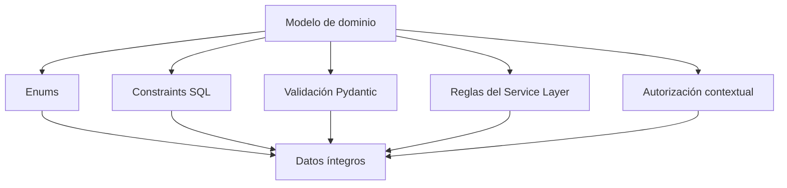

La integridad no debe depender de una única capa. Debe construirse mediante defensas complementarias que protejan el sistema desde la entrada del usuario hasta la persistencia definitiva.

---

# 2. Objetivo del documento

Este documento define de forma centralizada:

- enums funcionales;
- estados de entidades;
- acciones auditables;
- tipos de eventos;
- recursos protegidos;
- restricciones SQL;
- restricciones ORM;
- validaciones Pydantic;
- invariantes de negocio;
- reglas de transición;
- políticas de nulabilidad;
- restricciones de unicidad;
- políticas de eliminación;
- recomendaciones de evolución.

Su finalidad es evitar que los valores y reglas del dominio queden dispersos entre:

- modelos SQLAlchemy;
- esquemas Pydantic;
- servicios;
- plantillas;
- JavaScript;
- scripts SQL;
- pruebas;
- documentación.

---

# 3. Alcance

El documento cubre especialmente los dominios:

```text
IAM

RBAC

Projects

Project Members

Tasks

Activities

Attachments

Notifications

Audit

Project Activity Feed

Competitions

Realtime

System Events
```

No sustituye a:

- `25_DATABASE_SCHEMA.md`;
- `26_DATABASE_RELATIONS.md`;
- documentación de servicios;
- documentación de rutas;
- documentación de autorización.

Los complementa definiendo las reglas que deben compartir todas las capas.

---

# 4. Filosofía general de integridad

La arquitectura de datos se apoya en cinco principios:

1. integridad fuerte;
2. validación multicapa;
3. enums estables;
4. reglas explícitas;
5. evolución controlada.

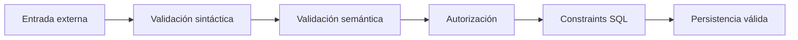

---

# 5. Integridad fuerte

La base de datos debe proteger directamente aquellas reglas que siempre deben cumplirse, independientemente de la aplicación que escriba los datos.

Ejemplos:

- claves primarias;
- claves foráneas;
- unicidad;
- nulabilidad;
- longitudes máximas;
- valores permitidos;
- integridad de relaciones;
- prevención de duplicados.

No debe asumirse que toda escritura llegará necesariamente desde la API principal.

Los datos también pueden modificarse mediante:

- migraciones;
- tareas administrativas;
- scripts;
- importaciones;
- procesos batch;
- herramientas de mantenimiento.

---

# 6. Flexibilidad evolutiva

La integridad fuerte no debe impedir la evolución del dominio.

Debe diferenciarse entre:

## Catálogos cerrados y estables

Apropiados para enums.

Ejemplos:

```text
TaskStatus

TaskPriority

ProjectRole

IdentityProvider
```

## Catálogos configurables

Apropiados para tablas de referencia.

Ejemplos futuros:

```text
tipos de competición

categorías de proyecto

rúbricas

tipos de equipamiento

estados configurables por organización
```

## Referencias polimórficas controladas

Utilizadas en subsistemas transversales:

```text
resource_type

entity_type

aggregate_type
```

Estas referencias aportan flexibilidad, pero requieren validación adicional porque no disponen de una Foreign Key convencional.

---

# 7. Validación multicapa

Las validaciones se distribuyen entre varias capas.

| Capa | Responsabilidad |
|---|---|
| Pydantic | Formato, longitud, estructura y obligatoriedad |
| FastAPI | Contrato HTTP y serialización |
| Service Layer | Reglas de negocio e invariantes |
| Authorization | Permisos globales y contextuales |
| Repository | Consultas de existencia y persistencia |
| SQLAlchemy | Mapeo, tipos, relaciones y cascadas |
| MariaDB | Integridad estructural definitiva |
| Frontend | Ayuda inmediata al usuario, nunca única defensa |

---

# 8. Defensa en profundidad

Una misma regla puede validarse en varias capas.

Ejemplo: email único.

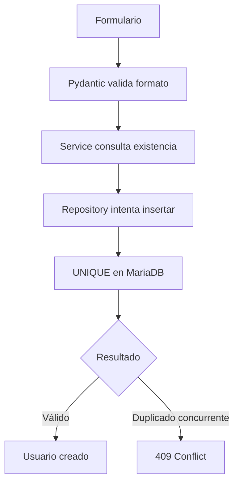

La comprobación previa mejora la experiencia del usuario.

La restricción SQL garantiza la integridad incluso ante concurrencia.

---

# 9. Fuente de verdad de los enums

Los enums deben definirse en una ubicación central del backend.

Estructura orientativa:

```text
app/
└── core/
    └── enums/
        ├── task.py
        ├── project.py
        ├── security.py
        ├── notification.py
        ├── audit.py
        └── competition.py
```

Alternativamente, pueden agruparse por módulo:

```text
app/modules/tasks/enums.py
app/modules/projects/enums.py
app/modules/audit/enums.py
```

Debe evitarse mantener listas independientes de valores en distintos archivos.

---

# 10. Representación recomendada

En Python se recomienda utilizar enums basados en `str`.

```python
from enum import StrEnum


class TaskStatus(StrEnum):
    TODO = "todo"
    DOING = "doing"
    DONE = "done"
```

Ventajas:

- serialización directa;
- compatibilidad con JSON;
- validación Pydantic;
- uso en SQLAlchemy;
- comparación segura;
- reducción de cadenas mágicas.

---

# 11. Nombres internos y valores persistidos

Debe diferenciarse entre:

```text
nombre simbólico del enum
```

y:

```text
valor persistido
```

Ejemplo:

```python
class TaskStatus(StrEnum):
    TODO = "todo"
    DOING = "doing"
    DONE = "done"
```

| Elemento | Ejemplo |
|---|---|
| Nombre simbólico | `TaskStatus.TODO` |
| Valor persistido | `"todo"` |
| Etiqueta visible | `"Por hacer"` |

La etiqueta visible no debe persistirse como valor del enum.

---

# 12. Convención de nomenclatura

Se recomienda:

## Código Python

```text
UPPER_SNAKE_CASE
```

Ejemplo:

```text
TASK_STATUS_CHANGED
```

## Valor persistido

```text
lower_snake_case
```

Ejemplo:

```text
task_status_changed
```

## Etiqueta de interfaz

```text
Texto localizado
```

Ejemplo:

```text
Estado de tarea actualizado
```

---

# 13. Separación entre persistencia y presentación

Los enums no deben incorporar textos finales dependientes del idioma.

Incorrecto:

```python
class TaskStatus(StrEnum):
    TODO = "Por hacer"
```

Correcto:

```python
class TaskStatus(StrEnum):
    TODO = "todo"
```

Mapeo de presentación:

```python
TASK_STATUS_LABELS = {
    TaskStatus.TODO: "Por hacer",
    TaskStatus.DOING: "En curso",
    TaskStatus.DONE: "Finalizada",
}
```

Esto permite:

- internacionalización;
- cambios de terminología;
- consistencia entre interfaces;
- independencia del esquema.

---

# 14. Estrategias de persistencia de enums

Existen tres estrategias principales:

1. tipo `ENUM` nativo;
2. `VARCHAR` con `CHECK`;
3. `VARCHAR` validado únicamente por aplicación.

---

# 15. ENUM nativo de MariaDB

Ejemplo:

```sql
status ENUM('todo', 'doing', 'done') NOT NULL;
```

Ventajas:

- validación directa;
- almacenamiento compacto;
- catálogo visible en esquema.

Limitaciones:

- cambios mediante migración;
- mayor acoplamiento al motor;
- evolución menos flexible;
- diferencias con otros motores;
- complejidad al retirar valores.

---

# 16. VARCHAR con CHECK

Ejemplo:

```sql
status VARCHAR(20) NOT NULL,
CONSTRAINT ck_task_status
CHECK (status IN ('todo', 'doing', 'done'))
```

Ventajas:

- claridad;
- portabilidad;
- migraciones más controlables;
- integración sencilla con SQLAlchemy.

Limitaciones:

- requiere comprobar compatibilidad real del motor;
- la longitud debe gestionarse;
- necesita sincronización con el enum Python.

---

# 17. VARCHAR validado en aplicación

Ejemplo:

```sql
status VARCHAR(20) NOT NULL
```

con validación únicamente mediante Pydantic y Service Layer.

No es la opción preferida para valores críticos porque permite insertar valores inválidos desde:

- scripts;
- consola SQL;
- migraciones defectuosas;
- procesos externos.

Puede aceptarse temporalmente durante una transición, pero debe existir una estrategia de endurecimiento posterior.

---

# 18. Estrategia recomendada para la plataforma

Para los enums centrales se recomienda:

```text
StrEnum en Python

+

VARCHAR en MariaDB

+

CHECK constraint cuando sea compatible

+

validación Pydantic

+

reglas de transición en Service Layer
```

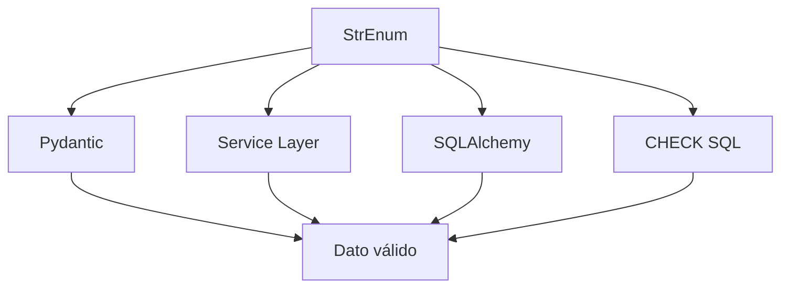

---

# 19. Versionado de enums

Añadir, renombrar o eliminar un valor es una modificación del contrato del sistema.

Debe analizarse su impacto en:

- datos persistidos;
- API;
- frontend;
- filtros;
- plantillas;
- JavaScript;
- WebSocket;
- auditoría;
- notificaciones;
- pruebas;
- migraciones.

---

# 20. Añadir un valor

Añadir un valor suele ser compatible hacia atrás, pero requiere:

1. actualizar enum Python;
2. actualizar constraint SQL;
3. actualizar esquemas Pydantic;
4. actualizar UI;
5. actualizar lógica de negocio;
6. actualizar pruebas;
7. revisar clientes antiguos.

---

# 21. Renombrar un valor

Renombrar un valor no debe realizarse directamente.

Ejemplo:

```text
doing

↓

in_progress
```

Estrategia recomendada:

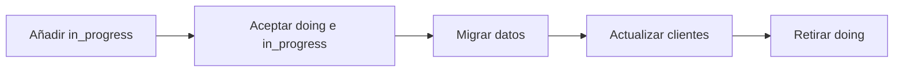

---

# 22. Eliminar un valor

Antes de eliminar un valor deben localizarse todos los registros existentes.

Ejemplo:

```sql
SELECT COUNT(*)
FROM tasks
WHERE status = 'cancelled';
```

La migración debe definir a qué nuevo valor se transforman los datos antiguos.

Nunca debe eliminarse un valor que todavía esté persistido.

---

# 23. Catálogo general de enums

El catálogo principal incluye:

```text
TaskStatus

TaskPriority

ProjectRole

ProjectStatus

ActivityStatus

IdentityProvider

NotificationType

NotificationSeverity

FeedEvent

AuditAction

Action

Resource

AttachmentStatus

CompetitionStatus

OutboxStatus
```

No todos deben estar implementados desde la primera versión, pero su responsabilidad debe quedar claramente delimitada.

---

# 24. `TaskStatus`

`TaskStatus` define el flujo operativo de las tareas en el tablero Kanban.

## Valores actuales

```text
todo

doing

done
```

```python
class TaskStatus(StrEnum):
    TODO = "todo"
    DOING = "doing"
    DONE = "done"
```

---

# 25. Semántica de `TaskStatus.TODO`

Representa una tarea:

- creada;
- pendiente;
- todavía no iniciada;
- disponible para planificación;
- visible en la primera columna del Kanban.

No implica necesariamente:

- ausencia de usuario asignado;
- ausencia de fecha límite;
- prioridad baja.

---

# 26. Semántica de `TaskStatus.DOING`

Representa una tarea:

- iniciada;
- en ejecución;
- visible en la columna de trabajo activo;
- susceptible de recibir nuevas actividades;
- todavía no finalizada.

Puede utilizarse para calcular:

- trabajo en curso;
- carga por usuario;
- tiempo de ciclo;
- límites WIP futuros.

---

# 27. Semántica de `TaskStatus.DONE`

Representa una tarea:

- finalizada;
- visible en la columna final;
- con trabajo operativo completado;
- candidata a establecer `completed_at`.

No implica necesariamente:

- cierre irreversible;
- archivado;
- eliminación;
- validación externa.

---

# 28. Máquina de estados de tarea

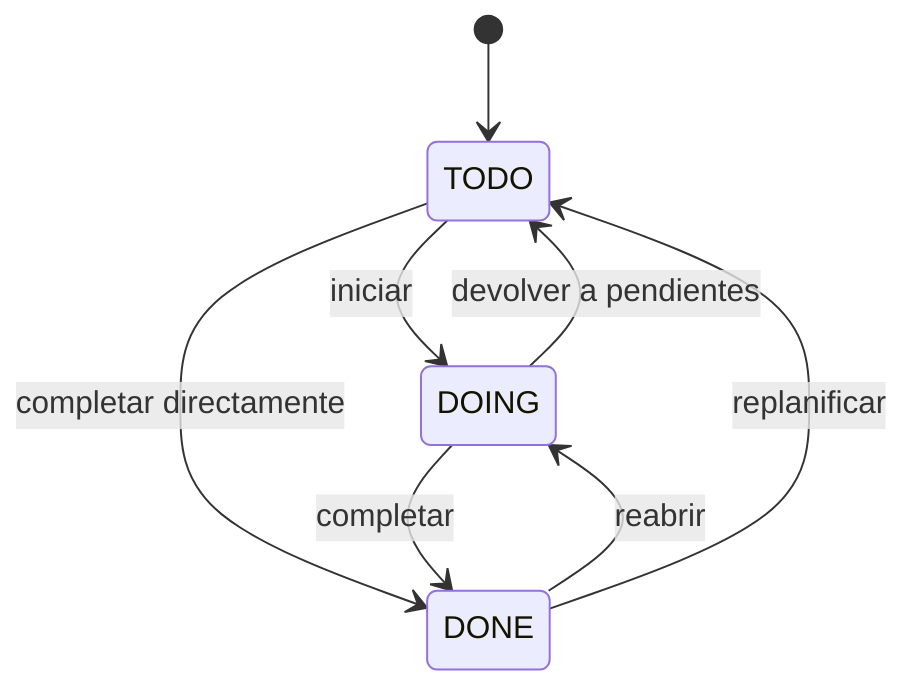

Las transiciones directas permitidas deben acordarse funcionalmente.

La máquina anterior representa un modelo flexible.

---

# 29. Matriz de transición de tarea

| Estado actual | Estado destino | Permitido | Consideraciones |
|---|---|---:|---|
| `todo` | `doing` | Sí | Inicio normal |
| `todo` | `done` | Configurable | Finalización directa |
| `doing` | `todo` | Sí | Replanificación |
| `doing` | `done` | Sí | Finalización |
| `done` | `doing` | Sí | Reapertura |
| `done` | `todo` | Configurable | Replanificación completa |
| Cualquiera | Igual | No-op o rechazo | Evitar eventos duplicados |

---

# 30. Reglas asociadas a `TaskStatus`

Al cambiar el estado deben aplicarse reglas adicionales.

## Al entrar en `done`

```text
completed_at = current UTC timestamp
```

## Al salir de `done`

```text
completed_at = NULL
```

o conservar un histórico separado, según la política funcional.

## En toda transición

Debe:

- comprobarse autorización;
- incrementarse `version`;
- registrarse auditoría;
- añadirse evento al feed;
- emitirse notificación cuando proceda;
- publicarse evento realtime tras el commit.

---

# 31. Validación de transición

La validación no debe limitarse a comprobar que el valor pertenece al enum.

También debe verificarse que la transición es válida.

```python
ALLOWED_TASK_TRANSITIONS = {
    TaskStatus.TODO: {
        TaskStatus.DOING,
        TaskStatus.DONE,
    },
    TaskStatus.DOING: {
        TaskStatus.TODO,
        TaskStatus.DONE,
    },
    TaskStatus.DONE: {
        TaskStatus.TODO,
        TaskStatus.DOING,
    },
}
```

---

# 32. Estado y posición Kanban

La posición de una tarea tiene sentido dentro de una columna.

La identidad lógica de ordenación es:

```text
project_id

+

status

+

position
```

Cuando cambia `status`, debe calcularse una posición válida dentro de la columna destino.

---

# 33. `TaskPriority`

`TaskPriority` define la prioridad operativa de una tarea.

## Valores actuales

```text
low

medium

high
```

```python
class TaskPriority(StrEnum):
    LOW = "low"
    MEDIUM = "medium"
    HIGH = "high"
```

---

# 34. Semántica de las prioridades

| Valor | Significado |
|---|---|
| `low` | Puede posponerse sin impacto inmediato |
| `medium` | Prioridad ordinaria |
| `high` | Requiere atención preferente |

La prioridad no debe utilizarse como sustituto de:

- fecha límite;
- severidad;
- estado;
- orden Kanban.

---

# 35. Valor por defecto de prioridad

Se recomienda:

```text
medium
```

como valor por defecto.

Debe definirse de forma coherente en:

- esquema Pydantic;
- modelo SQLAlchemy;
- migración SQL;
- formulario;
- pruebas.

No deben existir defaults distintos en cada capa.

---

# 36. Evolución de `TaskPriority`

Puede evaluarse en el futuro:

```text
critical
```

Sin embargo, antes de incorporarlo debe definirse:

- quién puede asignarlo;
- qué impacto visual tiene;
- si genera alertas;
- si afecta a ordenación;
- si modifica notificaciones;
- si puede abusarse de él.

---

# 37. Orden de prioridad

Los valores textuales no deben ordenarse alfabéticamente.

Orden funcional:

```text
high

medium

low
```

Debe definirse mediante:

- expresión `CASE`;
- mapeo numérico;
- propiedad del enum;
- lógica de presentación.

Ejemplo SQL:

```sql
ORDER BY CASE priority
    WHEN 'high' THEN 1
    WHEN 'medium' THEN 2
    WHEN 'low' THEN 3
    ELSE 4
END;
```

---

# 38. `ProjectRole`

`ProjectRole` define el rol contextual de un usuario dentro de un proyecto.

## Valores actuales

```text
coordinator

member
```

```python
class ProjectRole(StrEnum):
    COORDINATOR = "coordinator"
    MEMBER = "member"
```

---

# 39. Separación entre rol global y contextual

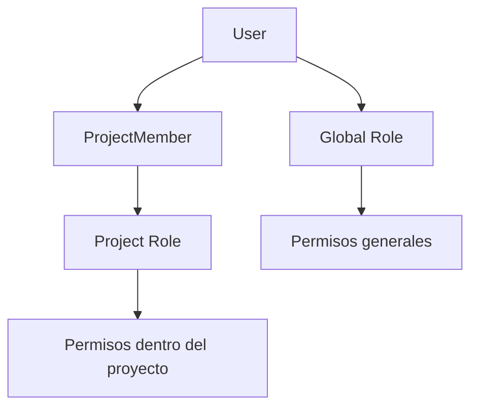

Ejemplos:

```text
Profesor
```

es un rol global.

```text
Coordinador
```

es un rol contextual dentro de un proyecto concreto.

---

# 40. Semántica de `coordinator`

Un coordinador puede, según las reglas actuales:

- gestionar miembros;
- crear tareas;
- actualizar tareas;
- asignar tareas;
- mover tareas en Kanban;
- crear actividades;
- editar información del proyecto;
- consultar información contextual ampliada.

Estas capacidades deben comprobarse mediante autorización, no únicamente comparando cadenas en rutas o plantillas.

---

# 41. Semántica de `member`

Un miembro puede:

- acceder al proyecto;
- consultar tareas;
- participar en actividades;
- actualizar elementos permitidos;
- recibir asignaciones;
- consultar información compartida.

Las acciones exactas dependen del sistema de permisos contextual.

---

# 42. Invariantes de `ProjectRole`

Deben cumplirse:

1. todo `ProjectMember` tiene exactamente un rol contextual activo;
2. el rol pertenece al catálogo permitido;
3. solo usuarios autorizados pueden modificarlo;
4. un proyecto activo debe conservar al menos un coordinador;
5. el último coordinador no puede eliminarse o degradarse sin sustitución;
6. un rol contextual no concede permisos globales.

---

# 43. Transición de rol contextual

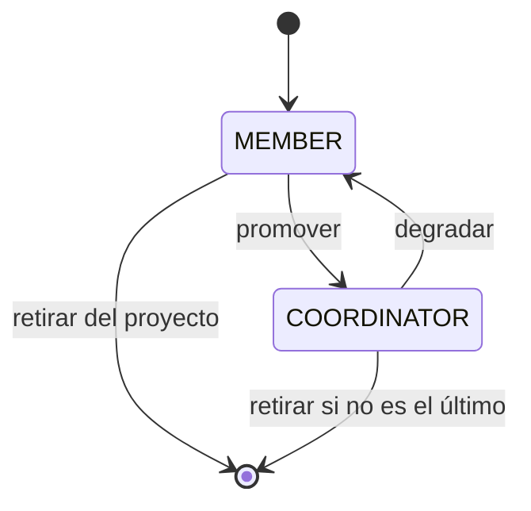

---

# 44. Validación del último coordinador

Antes de degradar o eliminar un coordinador:

```sql
SELECT COUNT(*)
FROM project_members
WHERE project_id = :project_id
  AND project_role = 'coordinator'
  AND active = TRUE;
```

Si el resultado es uno, la operación debe rechazarse salvo que se realice una sustitución atómica.

---

# 45. `ProjectStatus`

Aunque el catálogo inicial puede evolucionar, se recomienda formalizar el estado del proyecto.

## Valores propuestos

```text
draft

active

completed

archived

cancelled
```

```python
class ProjectStatus(StrEnum):
    DRAFT = "draft"
    ACTIVE = "active"
    COMPLETED = "completed"
    ARCHIVED = "archived"
    CANCELLED = "cancelled"
```

---

# 46. Semántica de estados de proyecto

| Estado | Significado |
|---|---|
| `draft` | Proyecto en preparación |
| `active` | Proyecto operativo |
| `completed` | Objetivos finalizados |
| `archived` | Conservado en modo histórico |
| `cancelled` | Interrumpido antes de finalizar |

---

# 47. Máquina de estados de proyecto

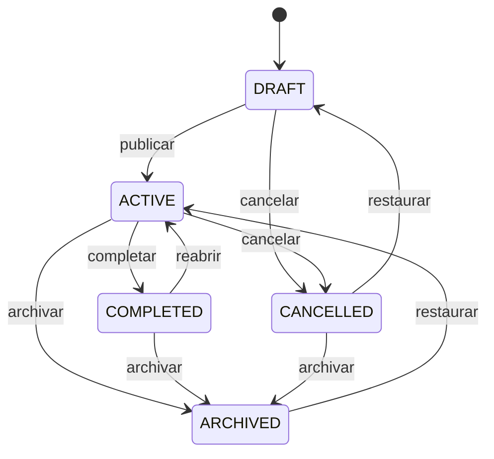

No todas las transiciones tienen que habilitarse inicialmente.

---

# 48. Restricciones asociadas a proyecto archivado

Un proyecto archivado debe conservar:

- miembros;
- tareas;
- actividades;
- adjuntos;
- auditoría;
- feed;
- relaciones con competiciones.

Normalmente debe impedir:

- crear tareas;
- cambiar asignaciones;
- añadir miembros;
- modificar el Kanban;
- añadir nuevas actividades.

Las excepciones deben reservarse a administradores o procesos de restauración.

---

# 49. Restricciones asociadas a proyecto completado

Un proyecto completado puede permitir:

- consulta;
- generación de informes;
- correcciones administrativas;
- reapertura autorizada.

Debe definirse si permite:

- nuevas tareas;
- nuevas actividades;
- cambios de miembros;
- edición descriptiva.

La política debe aplicarse en Service Layer.

---

# 50. `ActivityStatus`

El documento original contempla un estado para las actividades.

Su catálogo debe ajustarse al significado funcional real de `Activity`.

Si una actividad representa una unidad de trabajo registrada sobre una tarea, una propuesta es:

```text
planned

in_progress

completed

cancelled
```

```python
class ActivityStatus(StrEnum):
    PLANNED = "planned"
    IN_PROGRESS = "in_progress"
    COMPLETED = "completed"
    CANCELLED = "cancelled"
```

Si `Activity` representa exclusivamente un evento histórico ya producido, puede no necesitar estado.

---

# 51. Decisión sobre `ActivityStatus`

Antes de consolidar este enum debe determinarse cuál de estos modelos utiliza realmente la plataforma:

## Modelo A — Actividad planificable

La actividad tiene ciclo de vida propio.

```text
planned → in_progress → completed
```

## Modelo B — Registro histórico

La actividad se crea cuando el hecho ya ha ocurrido.

```text
created
```

En este caso, un campo `status` puede ser redundante.

---

# 52. Máquina de estados de actividad planificable

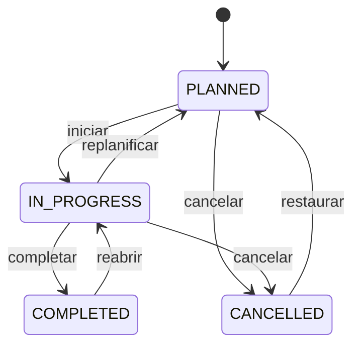

---

# 53. `IdentityProvider`

`IdentityProvider` identifica el sistema que autentica una identidad.

## Valores orientativos

```text
local

saml

oauth

oidc

google

github

microsoft
```

```python
class IdentityProvider(StrEnum):
    LOCAL = "local"
    SAML = "saml"
    OAUTH = "oauth"
    OIDC = "oidc"
    GOOGLE = "google"
    GITHUB = "github"
    MICROSOFT = "microsoft"
```

Solo deben habilitarse proveedores realmente configurados.

---

# 54. Semántica de proveedor local

Una identidad `local`:

- utiliza credencial propia;
- requiere `password_hash`;
- puede requerir verificación de email;
- no necesita `external_subject`;
- está gestionada por la propia plataforma.

---

# 55. Semántica de proveedor externo

Una identidad externa:

- no necesita contraseña local;
- requiere identificador estable del proveedor;
- puede sincronizar email y nombre;
- puede estar sujeta a SSO;
- debe validar issuer y audience;
- puede revocarse desde el proveedor.

---

# 56. Invariantes por proveedor

## Para `local`

```text
password_hash IS NOT NULL
```

## Para proveedor externo

```text
external_subject IS NOT NULL
password_hash puede ser NULL
```

Estas reglas pueden expresarse parcialmente mediante `CHECK`.

Ejemplo conceptual:

```sql
CHECK (
    (provider = 'local' AND password_hash IS NOT NULL)
    OR
    (provider <> 'local' AND external_subject IS NOT NULL)
)
```

---

# 57. Unicidad de identidades

El modelo inicial basado en:

```text
UNIQUE(email)
```

limita la asociación de múltiples proveedores al mismo correo.

La estrategia recomendada para soporte multiproveedor es:

```text
UNIQUE(provider, external_subject)
```

El email no debe utilizarse como identificador estable de un proveedor externo salvo que el protocolo lo garantice explícitamente.

---

# 58. `NotificationType`

`NotificationType` clasifica las notificaciones funcionales del sistema.

## Valores actuales

```text
TASK_ASSIGNED

TASK_STATUS_CHANGED

TASK_UPDATED

PROJECT_MEMBER_ADDED

PROJECT_UPDATED

ACTIVITY_CREATED

SYSTEM
```

Representación recomendada:

```python
class NotificationType(StrEnum):
    TASK_ASSIGNED = "task_assigned"
    TASK_STATUS_CHANGED = "task_status_changed"
    TASK_UPDATED = "task_updated"
    PROJECT_MEMBER_ADDED = "project_member_added"
    PROJECT_UPDATED = "project_updated"
    ACTIVITY_CREATED = "activity_created"
    SYSTEM = "system"
```

---

# 59. Clasificación funcional de notificaciones

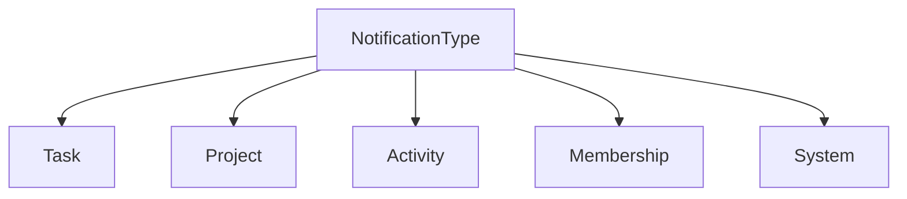

---

# 60. Notificaciones de tarea

## `task_assigned`

Se genera cuando un usuario pasa a ser responsable de una tarea.

Debe contener:

- destinatario;
- identificador de tarea;
- identificador de proyecto;
- actor;
- enlace seguro;
- fecha;
- event ID para deduplicación.

## `task_status_changed`

Se genera cuando una tarea cambia de columna o estado.

Puede dirigirse a:

- usuario asignado;
- coordinadores;
- miembros suscritos;
- actor excluido, según política.

## `task_updated`

Se utiliza para cambios relevantes distintos del estado:

- título;
- descripción;
- prioridad;
- fecha límite;
- asignación.

Debe evitarse generar notificaciones por modificaciones técnicas irrelevantes.

---

# 61. Notificaciones de proyecto

## `project_member_added`

Se genera cuando un usuario se incorpora a un proyecto.

Debe dirigirse principalmente al nuevo miembro.

## `project_updated`

Se reserva para cambios importantes:

- estado;
- fechas;
- descripción principal;
- archivado;
- cierre.

No debe utilizarse para cualquier cambio menor si produce ruido excesivo.

---

# 62. Notificaciones de actividad

## `activity_created`

Se genera cuando aparece una actividad relevante vinculada a una tarea.

La política debe decidir si se notifica a:

- usuario asignado;
- creador de la tarea;
- coordinadores;
- usuarios mencionados;
- todos los miembros.

---

# 63. Notificaciones de sistema

## `system`

Se reserva para:

- mantenimiento;
- seguridad;
- anuncios;
- incidencias;
- cambios administrativos;
- mensajes no asociados a una entidad concreta.

Su uso debe estar restringido a servicios autorizados.

---

# 64. `NotificationSeverity`

Para separar el tipo funcional de la importancia visual se recomienda un enum específico.

## Valores propuestos

```text
info

success

warning

error
```

```python
class NotificationSeverity(StrEnum):
    INFO = "info"
    SUCCESS = "success"
    WARNING = "warning"
    ERROR = "error"
```

---

# 65. Tipo frente a severidad

```text
NotificationType
```

responde:

> ¿Qué ocurrió?

```text
NotificationSeverity
```

responde:

> ¿Con qué importancia debe mostrarse?

Ejemplo:

```text
type = task_status_changed

severity = info
```

---

# 66. Reglas de severidad

| Severidad | Uso |
|---|---|
| `info` | Información ordinaria |
| `success` | Finalización o confirmación positiva |
| `warning` | Atención requerida |
| `error` | Fallo o situación crítica |

La severidad no debe derivarse exclusivamente en frontend.

Debe persistirse o calcularse de forma consistente en backend.

---

# 67. `FeedEvent`

`FeedEvent` define los tipos de eventos visibles en el activity feed del proyecto.

Debe representar lenguaje funcional comprensible para los usuarios.

---

# 68. Eventos de tareas

Valores actuales:

```text
TASK_CREATED

TASK_UPDATED

TASK_DELETED

TASK_STATUS_CHANGED
```

Representación recomendada:

```python
class FeedEvent(StrEnum):
    TASK_CREATED = "task_created"
    TASK_UPDATED = "task_updated"
    TASK_DELETED = "task_deleted"
    TASK_STATUS_CHANGED = "task_status_changed"
```

---

# 69. Eventos de actividades

```text
ACTIVITY_CREATED

ACTIVITY_UPDATED

ACTIVITY_DELETED
```

Valores persistidos:

```text
activity_created

activity_updated

activity_deleted
```

---

# 70. Eventos de proyectos

```text
PROJECT_CREATED

PROJECT_UPDATED

PROJECT_DELETED
```

Si la aplicación evita eliminación física, puede sustituirse o ampliarse con:

```text
PROJECT_ARCHIVED

PROJECT_RESTORED

PROJECT_COMPLETED

PROJECT_CANCELLED
```

---

# 71. Eventos de miembros

Valores actuales:

```text
MEMBER_JOINED

MEMBER_REMOVED
```

Se recomienda añadir:

```text
MEMBER_ROLE_CHANGED
```

para diferenciar cambios de rol de altas y bajas.

---

# 72. Catálogo recomendado de `FeedEvent`

```python
class FeedEvent(StrEnum):
    PROJECT_CREATED = "project_created"
    PROJECT_UPDATED = "project_updated"
    PROJECT_ARCHIVED = "project_archived"
    PROJECT_RESTORED = "project_restored"

    MEMBER_JOINED = "member_joined"
    MEMBER_REMOVED = "member_removed"
    MEMBER_ROLE_CHANGED = "member_role_changed"

    TASK_CREATED = "task_created"
    TASK_UPDATED = "task_updated"
    TASK_DELETED = "task_deleted"
    TASK_STATUS_CHANGED = "task_status_changed"
    TASK_ASSIGNED = "task_assigned"
    TASK_UNASSIGNED = "task_unassigned"

    ACTIVITY_CREATED = "activity_created"
    ACTIVITY_UPDATED = "activity_updated"
    ACTIVITY_DELETED = "activity_deleted"

    ATTACHMENT_ADDED = "attachment_added"
    ATTACHMENT_REMOVED = "attachment_removed"
```

---

# 73. Feed funcional frente a auditoría

Un evento del feed debe ser:

- comprensible;
- resumido;
- visible;
- contextual;
- adecuado para usuarios del proyecto.

Una acción de auditoría debe ser:

- técnica;
- precisa;
- investigable;
- completa;
- orientada a seguridad y soporte.

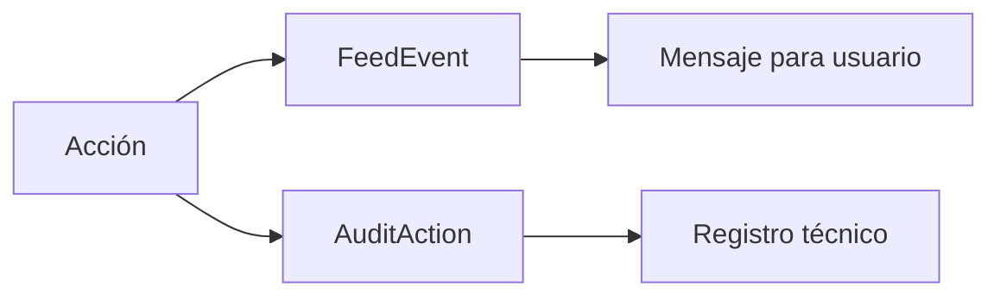

---

# 74. Inmutabilidad de eventos del feed

Los eventos del feed deben tratarse como históricos.

No deberían editarse libremente.

Si cambia la información visible de la entidad relacionada, debe decidirse si el feed:

- conserva snapshot histórico;
- reconstruye el mensaje dinámicamente;
- combina ambos enfoques.

La opción más robusta suele ser conservar datos mínimos de snapshot.

---

# 75. Deduplicación de eventos

Los eventos deben poder incorporar:

```text
event_id

correlation_id
```

## `event_id`

Identifica de forma única un evento.

## `correlation_id`

Relaciona varios registros generados por el mismo caso de uso.

Ejemplo:

```text
cambio de estado de tarea

↓

AuditLog

FeedEvent

Notification

OutboxEvent
```

Todos pueden compartir el mismo `correlation_id`.

---

# 76. `AuditAction`

`AuditAction` define acciones técnicas y funcionales registrables en el sistema de auditoría.

El catálogo debe ser:

- estable;
- explícito;
- extensible;
- coherente;
- independiente de textos de interfaz.

---

# 77. Acciones de sesión

Valores actuales:

```text
LOGIN

LOGOUT
```

Valores persistidos recomendados:

```text
login

logout
```

Puede ampliarse con:

```text
login_failed

session_expired

password_changed

identity_linked

identity_unlinked
```

---

# 78. Acciones de usuario

Valores actuales:

```text
CREATE_USER

UPDATE_USER

DELETE_USER

ACTIVATE_USER

DEACTIVATE_USER
```

Valores adicionales recomendados:

```text
ANONYMIZE_USER

ASSIGN_ROLE

REMOVE_ROLE

RESET_PASSWORD

VERIFY_EMAIL
```

---

# 79. Acciones de proyecto

Valores actuales:

```text
CREATE_PROJECT

UPDATE_PROJECT

DELETE_PROJECT
```

Se recomienda ampliar con:

```text
ARCHIVE_PROJECT

RESTORE_PROJECT

COMPLETE_PROJECT

CANCEL_PROJECT
```

Esto evita representar todos los cambios semánticos como una actualización genérica.

---

# 80. Acciones de tarea

Valores actuales:

```text
CREATE_TASK

UPDATE_TASK

DELETE_TASK

TASK_STATUS_CHANGE
```

Se recomienda una convención uniforme:

```text
CREATE_TASK

UPDATE_TASK

DELETE_TASK

CHANGE_TASK_STATUS

ASSIGN_TASK

UNASSIGN_TASK

CHANGE_TASK_PRIORITY

REORDER_TASK
```

---

# 81. Acciones de miembro

Catálogo recomendado:

```text
ADD_PROJECT_MEMBER

REMOVE_PROJECT_MEMBER

CHANGE_PROJECT_MEMBER_ROLE
```

Estas acciones son especialmente importantes para seguridad y autorización.

---

# 82. Acciones de actividad y adjuntos

```text
CREATE_ACTIVITY

UPDATE_ACTIVITY

DELETE_ACTIVITY

ADD_ATTACHMENT

DELETE_ATTACHMENT

DOWNLOAD_ATTACHMENT
```

El registro de descarga puede ser necesario si existen documentos sensibles.

---

# 83. Catálogo consolidado de `AuditAction`

```python
class AuditAction(StrEnum):
    LOGIN = "login"
    LOGOUT = "logout"
    LOGIN_FAILED = "login_failed"

    CREATE_USER = "create_user"
    UPDATE_USER = "update_user"
    DELETE_USER = "delete_user"
    ANONYMIZE_USER = "anonymize_user"
    ACTIVATE_USER = "activate_user"
    DEACTIVATE_USER = "deactivate_user"
    ASSIGN_ROLE = "assign_role"
    REMOVE_ROLE = "remove_role"

    CREATE_PROJECT = "create_project"
    UPDATE_PROJECT = "update_project"
    DELETE_PROJECT = "delete_project"
    ARCHIVE_PROJECT = "archive_project"
    RESTORE_PROJECT = "restore_project"
    COMPLETE_PROJECT = "complete_project"

    ADD_PROJECT_MEMBER = "add_project_member"
    REMOVE_PROJECT_MEMBER = "remove_project_member"
    CHANGE_PROJECT_MEMBER_ROLE = "change_project_member_role"

    CREATE_TASK = "create_task"
    UPDATE_TASK = "update_task"
    DELETE_TASK = "delete_task"
    CHANGE_TASK_STATUS = "change_task_status"
    ASSIGN_TASK = "assign_task"
    UNASSIGN_TASK = "unassign_task"
    REORDER_TASK = "reorder_task"

    CREATE_ACTIVITY = "create_activity"
    UPDATE_ACTIVITY = "update_activity"
    DELETE_ACTIVITY = "delete_activity"

    ADD_ATTACHMENT = "add_attachment"
    DELETE_ATTACHMENT = "delete_attachment"
```

---

# 84. Granularidad de auditoría

Un catálogo excesivamente genérico reduce utilidad.

Ejemplo poco informativo:

```text
UPDATE_TASK
```

cuando la acción real fue:

```text
ASSIGN_TASK
```

Un catálogo excesivamente granular también puede resultar difícil de mantener.

La regla recomendada es crear una acción específica cuando:

- tenga relevancia de seguridad;
- afecte autorización;
- cambie estado;
- cambie ownership;
- deba buscarse independientemente;
- genere notificación propia;
- tenga impacto operativo.

---

# 85. `Action`

`Action` representa las operaciones atómicas utilizadas por RBAC.

## Valores actuales

```text
read

create

update

delete
```

```python
class Action(StrEnum):
    READ = "read"
    CREATE = "create"
    UPDATE = "update"
    DELETE = "delete"
```

---

# 86. Acciones RBAC ampliables

Puede ser necesario añadir acciones más específicas:

```text
manage

assign

archive

restore

export

invite

approve

execute
```

No deben incorporarse hasta que exista una diferencia real de autorización.

---

# 87. CRUD frente a acciones de dominio

Las cuatro acciones CRUD son suficientes para muchos recursos.

Sin embargo, algunas operaciones no se representan correctamente como `update`.

Ejemplos:

```text
tasks:assign

projects:archive

members:manage

audit:export
```

Estas acciones mejoran la expresividad del RBAC.

---

# 88. Composición de permisos

Los permisos se forman mediante:

```text
resource:action
```

Ejemplos:

```text
projects:read

projects:create

projects:update

projects:delete

tasks:assign

audit:export
```

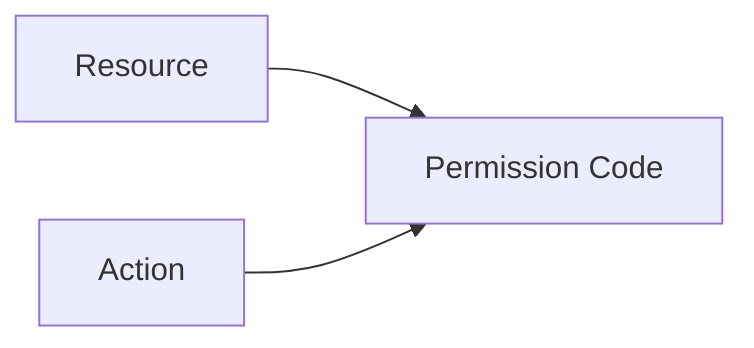

---

# 89. Normalización de códigos de permiso

Los códigos deben:

- estar en minúsculas;
- utilizar separador estable;
- no contener espacios;
- ser únicos;
- no depender del idioma;
- conservarse aunque cambie el nombre visible.

Formato recomendado:

```text
resource:action
```

---

# 90. `Resource`

`Resource` representa los recursos protegidos por RBAC.

## Valores actuales

```text
users

roles

identities

dashboard

students

audit

projects

tasks

activities
```

---

# 91. Catálogo recomendado de recursos

```python
class Resource(StrEnum):
    USERS = "users"
    ROLES = "roles"
    PERMISSIONS = "permissions"
    IDENTITIES = "identities"
    DASHBOARD = "dashboard"
    STUDENTS = "students"
    AUDIT = "audit"
    PROJECTS = "projects"
    PROJECT_MEMBERS = "project_members"
    TASKS = "tasks"
    ACTIVITIES = "activities"
    ATTACHMENTS = "attachments"
    NOTIFICATIONS = "notifications"
    COMPETITIONS = "competitions"
    SYSTEM = "system"
```

---

# 92. Granularidad de recursos

Un recurso debe representar una unidad sobre la que tenga sentido asignar permisos diferentes.

Ejemplo:

```text
projects

project_members
```

pueden separarse si gestionar miembros requiere más privilegios que editar datos generales del proyecto.

No deben crearse recursos distintos únicamente por cada endpoint.

---

# 93. Recursos globales y contextuales

Los recursos pueden ser:

## Globales

```text
users

roles

permissions

audit

system
```

## Contextuales

```text
projects

project_members

tasks

activities

attachments
```

Las acciones sobre recursos contextuales requieren comprobar también el proyecto correspondiente.

---

# 94. Permiso global frente a autorización contextual

Tener:

```text
tasks:update
```

no implica necesariamente poder actualizar cualquier tarea.

Debe comprobarse además:

```text
el usuario pertenece al proyecto

y

su rol contextual permite la operación
```

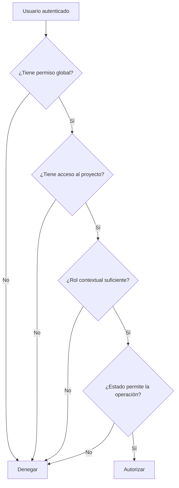

---

# 95. `AttachmentStatus`

Para coordinar base de datos y almacenamiento físico puede incorporarse un estado de adjunto.

## Valores propuestos

```text
pending

active

delete_pending

deleted

failed
```

```python
class AttachmentStatus(StrEnum):
    PENDING = "pending"
    ACTIVE = "active"
    DELETE_PENDING = "delete_pending"
    DELETED = "deleted"
    FAILED = "failed"
```

---

# 96. Máquina de estados de adjunto

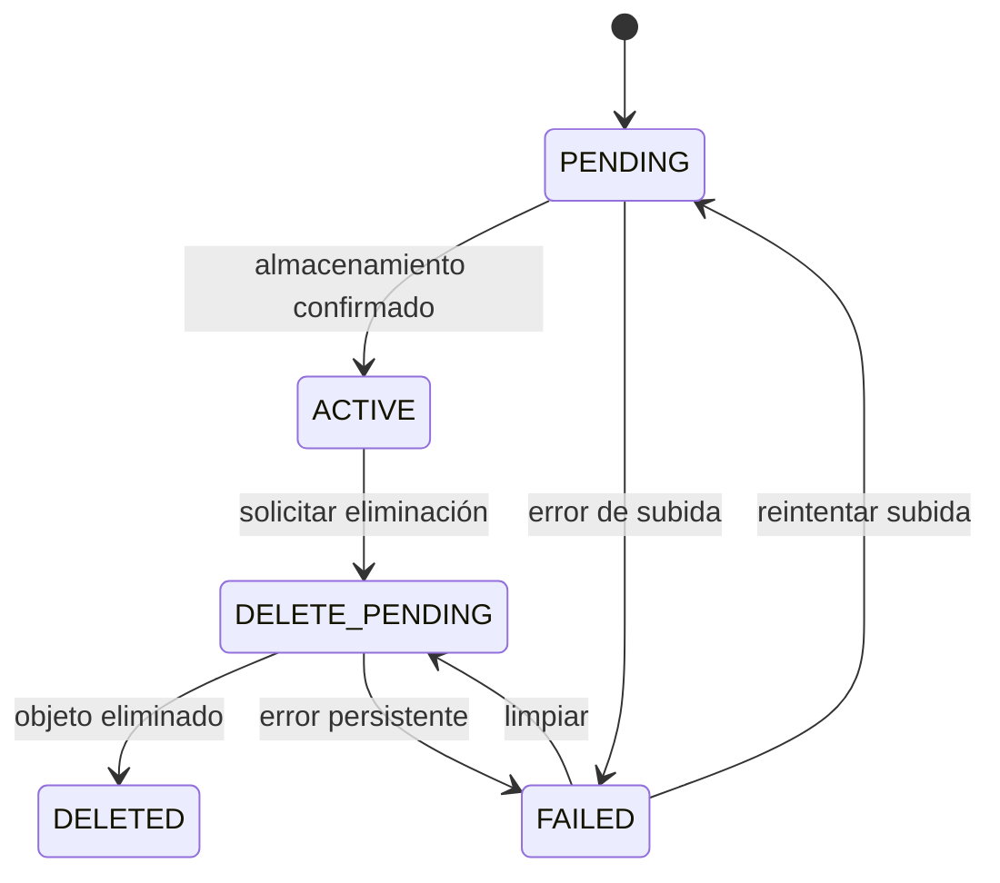

---

# 97. Invariantes de adjuntos

## `pending`

- puede existir metadato provisional;
- el archivo todavía no se considera disponible;
- no debe mostrarse como descarga válida.

## `active`

- el objeto físico existe;
- checksum y tamaño están verificados;
- puede descargarse con autorización.

## `delete_pending`

- no debe ofrecerse al usuario;
- un worker debe completar la eliminación.

## `deleted`

- no debe existir objeto físico;
- puede conservarse metadato histórico mínimo.

---

# 98. `CompetitionStatus`

Para el módulo de competiciones se recomienda:

```text
draft

registration_open

registration_closed

in_progress

completed

cancelled

archived
```

```python
class CompetitionStatus(StrEnum):
    DRAFT = "draft"
    REGISTRATION_OPEN = "registration_open"
    REGISTRATION_CLOSED = "registration_closed"
    IN_PROGRESS = "in_progress"
    COMPLETED = "completed"
    CANCELLED = "cancelled"
    ARCHIVED = "archived"
```

---

# 99. Máquina de estados de competición

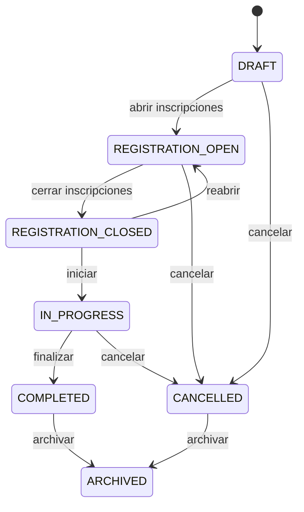

---

# 100. Reglas temporales de competición

Las transiciones deben ser coherentes con las fechas.

Ejemplos:

```text
registration_start_at <= registration_end_at

registration_end_at <= start_at

start_at <= end_at
```

Una competición no debería pasar a `in_progress` antes de `start_at` salvo override administrativo explícito.

---

# 101. `OutboxStatus`

El patrón Outbox necesita un catálogo de estados técnicos.

## Valores recomendados

```text
pending

processing

published

failed

dead
```

```python
class OutboxStatus(StrEnum):
    PENDING = "pending"
    PROCESSING = "processing"
    PUBLISHED = "published"
    FAILED = "failed"
    DEAD = "dead"
```

---

# 102. Máquina de estados de Outbox

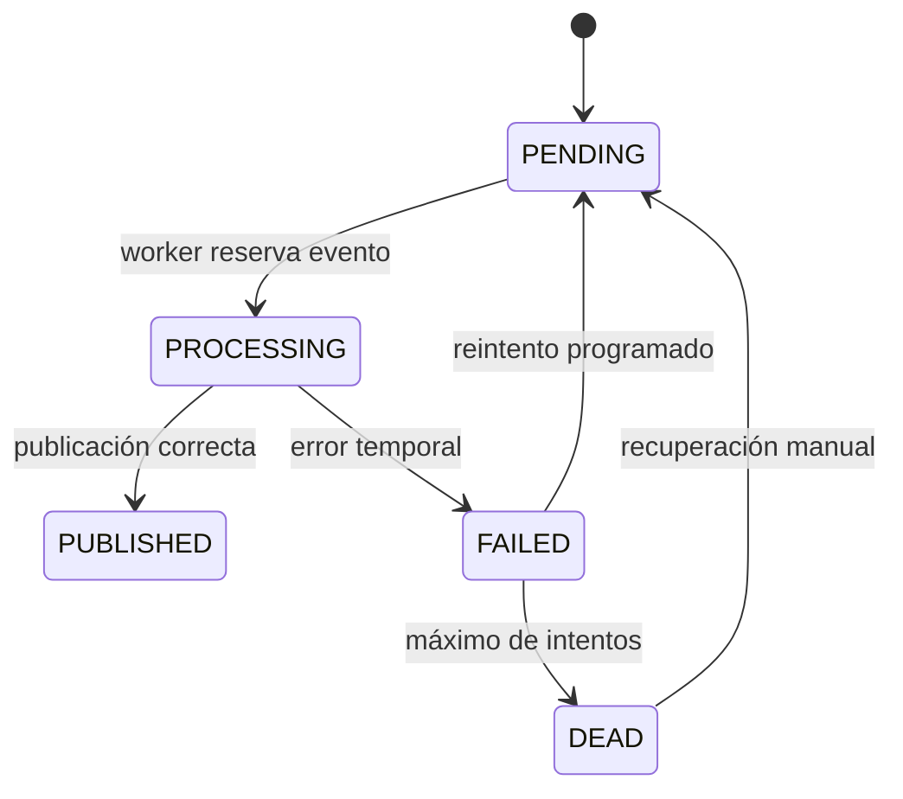

---

# 103. Invariantes de Outbox

## `pending`

```text
published_at IS NULL
```

## `processing`

Debe existir una estrategia de:

- timeout;
- lease;
- recuperación tras caída del worker.

## `published`

```text
published_at IS NOT NULL
```

## `failed`

```text
attempts > 0
last_error IS NOT NULL
```

## `dead`

No debe reintentarse automáticamente sin intervención o política específica.

---

# 104. Consistencia entre enums relacionados

Algunos enums representan el mismo hecho desde perspectivas distintas.

Ejemplo: cambio de estado de tarea.

```text
TaskStatus.DOING

AuditAction.CHANGE_TASK_STATUS

FeedEvent.TASK_STATUS_CHANGED

NotificationType.TASK_STATUS_CHANGED

Outbox event_type = task.status_changed
```

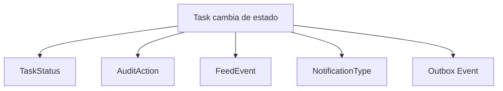

Estos catálogos no deben confundirse ni reutilizarse incorrectamente.

---

# 105. Separación de responsabilidades entre enums

| Enum | Pregunta que responde |
|---|---|
| `TaskStatus` | ¿En qué estado está la tarea? |
| `TaskPriority` | ¿Qué prioridad tiene? |
| `ProjectRole` | ¿Qué función tiene el usuario en el proyecto? |
| `NotificationType` | ¿Qué tipo de notificación es? |
| `NotificationSeverity` | ¿Qué importancia visual tiene? |
| `FeedEvent` | ¿Qué evento funcional se muestra? |
| `AuditAction` | ¿Qué acción se audita? |
| `Action` | ¿Qué operación protege RBAC? |
| `Resource` | ¿Sobre qué recurso opera el permiso? |
| `OutboxStatus` | ¿En qué fase técnica está el evento? |

---

# 106. Cadenas mágicas

Debe evitarse:

```python
if task.status == "done":
    ...
```

Debe utilizarse:

```python
if task.status == TaskStatus.DONE:
    ...
```

Beneficios:

- autocompletado;
- detección de errores;
- refactor seguro;
- consistencia;
- menor duplicación.

---

# 107. Enums en plantillas Jinja2

Las plantillas no deben decidir reglas de negocio complejas.

Pueden recibir:

- valor normalizado;
- etiqueta;
- clase visual;
- acciones permitidas.

Ejemplo de ViewModel:

```python
{
    "status": "doing",
    "status_label": "En curso",
    "status_badge": "warning",
    "can_move": True,
}
```

---

# 108. Enums en JavaScript

Los valores enviados al frontend deben coincidir con el contrato del backend.

Ejemplo:

```javascript
const TASK_STATUS = Object.freeze({
    TODO: "todo",
    DOING: "doing",
    DONE: "done",
});
```

La definición JavaScript no constituye una fuente de verdad independiente.

Debe derivarse del contrato o mantenerse sincronizada mediante pruebas.

---

# 109. Enums y WebSocket

Los eventos realtime deben utilizar tipos estables.

Ejemplo:

```json
{
  "event_type": "task.status_changed",
  "entity_type": "task",
  "entity_id": 42,
  "project_id": 7,
  "payload": {
    "old_status": "todo",
    "new_status": "doing"
  }
}
```

No deben utilizarse textos de interfaz como tipo de evento.

---

# 110. Compatibilidad de clientes

Los clientes deben ignorar de forma segura valores o eventos desconocidos cuando sea posible.

Ejemplo:

```text
evento desconocido

↓

registrar warning

↓

no romper la conexión

↓

solicitar sincronización si procede
```

Esto facilita despliegues progresivos.

---

# 111. Validación de enums en Pydantic

Ejemplo:

```python
from pydantic import BaseModel


class TaskUpdateRequest(BaseModel):
    status: TaskStatus | None = None
    priority: TaskPriority | None = None
```

Pydantic rechazará valores fuera del catálogo antes de entrar en el Service Layer.

---

# 112. Errores de validación de enum

Una petición inválida:

```json
{
  "status": "started"
}
```

debe producir una respuesta `422 Unprocessable Entity` con información comprensible.

No debe convertirse silenciosamente en un valor por defecto.

---

# 113. Validación estricta

No se recomienda aceptar alias indefinidamente.

Ejemplo temporal:

```text
in-progress

in_progress

doing
```

Aceptar múltiples variantes puede facilitar una migración, pero debe existir fecha de retirada y normalización.

---

# 114. Defaults de enums

Todo default debe declararse de forma coherente.

Ejemplo de tarea:

```text
status = todo

priority = medium
```

Capas:

```text
Pydantic

SQLAlchemy

Migración SQL

Formulario

Tests
```

---

# 115. Evitar defaults implícitos

No debe dependerse de que:

```text
el primer valor del enum
```

sea el valor por defecto.

Debe declararse explícitamente.

Ejemplo:

```python
status: TaskStatus = TaskStatus.TODO
```

---

# 116. Enums y datos históricos

Los eventos de auditoría deben conservar el valor existente en el momento de la acción.

Si un enum cambia, debe garantizarse que los datos históricos continúan siendo interpretables.

Opciones:

- mantener valores antiguos como deprecated;
- migrar registros históricos;
- conservar snapshots;
- versionar el esquema de eventos.

---

# 117. Valores deprecated

Puede mantenerse temporalmente un valor marcado como obsoleto.

Ejemplo:

```python
class TaskStatus(StrEnum):
    TODO = "todo"
    DOING = "doing"
    DONE = "done"
    IN_PROGRESS_LEGACY = "in_progress"
```

No debe permitirse crear nuevos registros con el valor obsoleto.

Solo leerlo durante la transición.

---

# 118. Registro de enums desconocidos

Si aparecen datos persistidos fuera del catálogo, debe considerarse una inconsistencia grave.

Proceso recomendado:

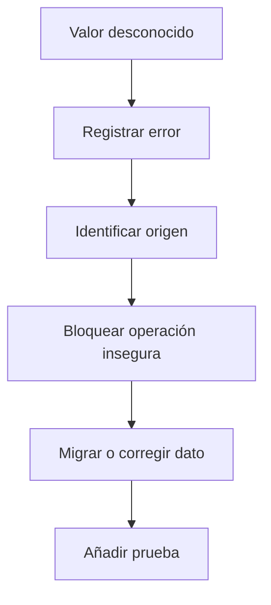

---

# 119. Pruebas unitarias de enums

Cada enum debe verificar:

- valores esperados;
- serialización;
- deserialización;
- rechazo de valores inválidos;
- orden funcional cuando exista;
- defaults;
- etiquetas;
- compatibilidad con Pydantic.

---

# 120. Pruebas de transiciones

Las máquinas de estado deben contar con pruebas parametrizadas.

Ejemplo conceptual:

```python
@pytest.mark.parametrize(
    ("current", "target", "allowed"),
    [
        (TaskStatus.TODO, TaskStatus.DOING, True),
        (TaskStatus.DOING, TaskStatus.DONE, True),
        (TaskStatus.DONE, TaskStatus.DONE, False),
    ],
)
def test_task_status_transition(current, target, allowed):
    ...
```

---

# 121. Pruebas de sincronización

Debe comprobarse que coinciden:

- enum Python;
- constraint SQL;
- valores Pydantic;
- valores frontend;
- datos seed;
- documentación.

Una discrepancia puede provocar que una capa acepte valores que otra rechaza.

---

# 122. Migraciones de enums

Toda modificación del catálogo debe incluir una migración cuando exista constraint SQL o tipo nativo.

La migración debe:

1. analizar datos existentes;
2. ampliar temporalmente valores;
3. transformar registros;
4. actualizar constraint;
5. validar;
6. retirar valores antiguos.

---

# 123. Checklist del catálogo de enums

## Definición

- [ ] El enum tiene responsabilidad única.
- [ ] Los nombres simbólicos son claros.
- [ ] Los valores persistidos son estables.
- [ ] Las etiquetas están separadas.
- [ ] Existe documentación funcional.
- [ ] No contiene cadenas dependientes del idioma.

## Persistencia

- [ ] La columna tiene longitud suficiente.
- [ ] Existe constraint SQL cuando procede.
- [ ] El default es explícito.
- [ ] Los valores antiguos se migran.
- [ ] La nulabilidad está justificada.

## Aplicación

- [ ] Pydantic utiliza el enum.
- [ ] Service Layer valida transiciones.
- [ ] SQLAlchemy utiliza el tipo correcto.
- [ ] Frontend utiliza valores compatibles.
- [ ] WebSocket utiliza contratos estables.
- [ ] Auditoría conserva valores históricos.

## Calidad

- [ ] Existen pruebas unitarias.
- [ ] Existen pruebas de transición.
- [ ] Existen pruebas de migración.
- [ ] Se detectan valores desconocidos.
- [ ] No existen cadenas mágicas.

---

# 124. Principios definitivos sobre enums

1. Un enum representa un catálogo cerrado del dominio.
2. El valor persistido debe ser estable y neutral.
3. La etiqueta visible debe permanecer separada.
4. Los enums no sustituyen las máquinas de estado.
5. Pertenecer al enum no implica que toda transición sea válida.
6. Los defaults deben ser explícitos.
7. Los valores no deben renombrarse sin migración.
8. Los clientes deben tolerar eventos desconocidos cuando sea viable.
9. Los valores históricos deben seguir siendo interpretables.
10. Toda capa debe compartir el mismo contrato semántico.

---

# 125. Continuación

La **Parte 2** desarrollará de forma detallada:

- Primary Keys;
- claves compuestas;
- Foreign Keys;
- restricciones `UNIQUE`;
- restricciones `NOT NULL`;
- restricciones `CHECK`;
- valores por defecto;
- políticas `ON DELETE`;
- políticas `ON UPDATE`;
- índices asociados a constraints;
- constraints ORM;
- `delete-orphan`;
- `passive_deletes`;
- integridad de las entidades principales;
- reglas SQL recomendadas para MariaDB.

---

# 126. Introducción a las constraints

Las restricciones (constraints) constituyen la última barrera de protección de la integridad de los datos.

Aunque el Service Layer valide todas las operaciones funcionales, la base de datos debe impedir que se almacenen datos imposibles.

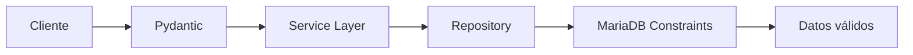

Las constraints no sustituyen a las reglas de negocio.

Garantizan únicamente la integridad estructural.

---

# 127. Clasificación de constraints

La plataforma utiliza distintos tipos de restricciones.

```text
PRIMARY KEY

FOREIGN KEY

UNIQUE

NOT NULL

CHECK

DEFAULT

INDEX

ON DELETE

ON UPDATE
```

Cada una protege un aspecto diferente del modelo.

---

# 128. Jerarquía de validaciones

Debe distinguirse claramente:

| Capa | Función |
|--------|----------|
| Frontend | Ayuda al usuario |
| Pydantic | Validación sintáctica |
| Service Layer | Reglas de negocio |
| SQLAlchemy | Tipado ORM |
| MariaDB | Integridad definitiva |

La base de datos nunca debe confiar únicamente en la aplicación.

---

# 129. PRIMARY KEY

La clave primaria identifica de forma única una fila.

Debe cumplir:

- unicidad;
- no nulabilidad;
- estabilidad;
- inmutabilidad.

No debe reutilizarse un identificador eliminado.

---

# 130. Claves primarias del modelo

| Tabla | PK |
|---------|----------------|
| usuarios | id_usuario |
| identities | id_identity |
| roles | id_rol |
| permissions | id_permission |
| projects | id_project |
| project_members | id_project_member *(o compuesta)* |
| tasks | id_task |
| activities | id_activity |
| activity_attachments | id_attachment |
| audit_logs | id_audit |
| notifications | id_notification |
| competitions | id_competition |

---

# 131. Claves técnicas

Las claves primarias deben ser técnicas.

No deben utilizar:

```text
email

username

nombre

DNI

matrícula

external_subject
```

Estos datos pueden cambiar.

---

# 132. Requisitos de una PK

Una Primary Key debe ser:

- corta;
- estable;
- sin significado funcional;
- única;
- permanente;
- eficiente para índices.

---

# 133. BIGINT frente a UUID

Dos estrategias habituales.

## BIGINT autoincremental

Ventajas:

- compacto;
- rápido;
- excelente para índices.

Limitaciones:

- predecible;
- expone volumen aproximado.

## UUID

Ventajas:

- difícil de adivinar;
- útil en sistemas distribuidos.

Limitaciones:

- mayor tamaño;
- índices más costosos.

---

# 134. Estrategia recomendada

Para Aula Robótica Platform:

```text
BIGINT AUTO_INCREMENT
```

es adecuado mientras exista una única base de datos transaccional.

Los UUID pueden añadirse posteriormente como identificadores públicos si fuese necesario.

---

# 135. Claves públicas

Puede diferenciarse entre:

```text
id interno

uuid público
```

Ejemplo:

```text
id_task = 125

public_id = "3c4dfd1f..."
```

La API puede exponer únicamente el identificador público.

---

# 136. PRIMARY KEY compuesta

Una PK compuesta utiliza varias columnas.

Ejemplo:

```sql
PRIMARY KEY (
    project_id,
    user_id
)
```

---

# 137. Ventajas de PK compuesta

- representa identidad natural;
- evita duplicados;
- menos columnas;
- mayor coherencia conceptual.

---

# 138. Inconvenientes

- referencias más complejas;
- URLs menos cómodas;
- auditoría más difícil;
- APIs más verbosas.

---

# 139. ProjectMember

Existen dos alternativas.

## Opción A

```text
PRIMARY KEY(project_id,user_id)
```

## Opción B

```text
id_project_member

+

UNIQUE(project_id,user_id)
```

La segunda suele facilitar la evolución del dominio.

---

# 140. UserRole

Si únicamente contiene:

```text
user_id

role_id
```

puede utilizar:

```text
PRIMARY KEY(user_id,role_id)
```

Si incorpora metadatos propios puede beneficiarse de un identificador técnico.

---

# 141. RolePermission

La estrategia recomendada es:

```sql
PRIMARY KEY(
    role_id,
    permission_id
)
```

Evita duplicados de asignación.

---

# 142. FOREIGN KEY

Una Foreign Key garantiza que una referencia apunta a un registro existente.

Ejemplo:

```text
task.project_id

↓

projects.id_project
```

---

# 143. Objetivos de las FK

Una FK protege:

- integridad;
- navegación;
- consistencia;
- eliminación;
- actualización.

---

# 144. Foreign Keys principales

```text
Identity → User

Project → User

ProjectMember → Project

ProjectMember → User

Task → Project

Task → User

Activity → Task

Activity → User

Attachment → Activity

Attachment → User

Notification → User
```

---

# 145. FK User → Identity

```sql
FOREIGN KEY(user_id)
REFERENCES usuarios(id_usuario)
```

Política:

```text
ON DELETE CASCADE
```

---

# 146. FK Project → Creator

```sql
created_by

↓

usuarios.id_usuario
```

Recomendación:

```text
ON DELETE SET NULL
```

---

# 147. FK ProjectMember → User

Debe impedir miembros inexistentes.

```sql
FOREIGN KEY(user_id)
REFERENCES usuarios(id_usuario)
```

---

# 148. FK ProjectMember → Project

```sql
FOREIGN KEY(project_id)
REFERENCES projects(id_project)
```

---

# 149. FK Task → Project

Toda tarea pertenece exactamente a un proyecto.

Debe ser:

```text
NOT NULL
```

---

# 150. FK Task → Assigned User

Puede ser:

```text
NULL
```

cuando la tarea no está asignada.

---

# 151. FK Task → Creator

Debe existir política clara.

Opciones:

```text
SET NULL

RESTRICT

soft delete usuario
```

---

# 152. FK Activity → Task

Una actividad nunca debe existir sin tarea.

```text
NOT NULL

CASCADE
```

---

# 153. FK Attachment → Activity

Todo adjunto pertenece a una actividad.

```text
CASCADE
```

---

# 154. FK Notification → User

Las notificaciones pertenecen al usuario destinatario.

```text
CASCADE
```

si no existe obligación legal de conservación.

---

# 155. Restricciones NOT NULL

Un campo obligatorio debe definirse:

```text
NOT NULL
```

No basta con validarlo desde Python.

---

# 156. Campos NOT NULL recomendados

Usuarios:

```text
email

active

created_at
```

Projects:

```text
name

status

created_at
```

Tasks:

```text
title

status

priority

project_id

created_at
```

---

# 157. Nullable justificado

Son candidatos a permitir NULL:

```text
completed_at

assigned_to

deleted_at

archived_at

creator

updated_by
```

Siempre debe existir una justificación funcional.

---

# 158. Riesgos de NULL

NULL representa:

```text
desconocido

o

no aplicable
```

No debe utilizarse como sustituto de:

```text
cadena vacía

0

false
```

---

# 159. UNIQUE

UNIQUE evita duplicados.

Ejemplo:

```sql
UNIQUE(email)
```

---

# 160. UNIQUE principales

```text
usuarios.email

provider+external_subject

project_id+user_id

role_id+permission_id
```

---

# 161. Email

```sql
UNIQUE(email)
```

Si existe multitenancy puede convertirse en:

```text
organization_id

+

email
```

---

# 162. Identity

La identidad externa debe ser única.

```sql
UNIQUE(
provider,
external_subject
)
```

---

# 163. ProjectMember

```sql
UNIQUE(
project_id,
user_id
)
```

Evita membresías duplicadas.

---

# 164. RolePermission

```sql
UNIQUE(
role_id,
permission_id
)
```

---

# 165. Notification deduplication

Puede añadirse:

```text
user_id

event_id
```

como clave única.

Impide crear varias veces la misma notificación.

---

# 166. UNIQUE y concurrencia

La validación previa:

```text
¿Existe?
```

no protege frente a:

```text
dos inserciones simultáneas
```

La restricción SQL sí.

---

# 167. Traducción de UNIQUE

Una violación de unicidad no debe devolverse como error SQL.

Debe transformarse en:

```text
409 Conflict
```

con mensaje funcional.

---

# 168. CHECK

Los CHECK validan reglas sencillas.

Ejemplos:

```sql
priority IN (...)

status IN (...)
```

---

# 169. CHECK de TaskStatus

```sql
CHECK(
status IN(
'todo',
'doing',
'done'
))
```

---

# 170. CHECK de prioridad

```sql
CHECK(
priority IN(
'low',
'medium',
'high'
))
```

---

# 171. CHECK fechas

```sql
CHECK(
due_date>=created_at
)
```

cuando la semántica lo permita.

---

# 172. CHECK longitud

Ejemplo:

```sql
CHECK(
CHAR_LENGTH(title)>0
)
```

---

# 173. CHECK Identity

Ejemplo conceptual:

```text
provider=local

↓

password_hash obligatorio
```

---

# 174. CHECK porcentaje

Futuros módulos:

```sql
score BETWEEN 0 AND 100
```

---

# 175. CHECK posiciones

Kanban:

```sql
position>=0
```

---

# 176. Limitaciones CHECK

No deben utilizarse para:

- consultar otras tablas;
- validar membresías;
- comprobar permisos;
- reglas temporales complejas.

Eso pertenece al Service Layer.

---

# 177. DEFAULT

Los defaults simplifican inserciones.

Ejemplos:

```text
created_at

active

status
```

---

# 178. Defaults recomendados

Usuarios

```text
active=true
```

Task

```text
status=todo

priority=medium
```

---

# 179. Defaults temporales

```text
CURRENT_TIMESTAMP
```

Debe utilizar UTC.

---

# 180. Defaults peligrosos

No debe utilizarse un default cuando el dato:

- debe decidirlo el usuario;
- depende de permisos;
- depende del contexto.

---

# 181. Índices

Los índices no son constraints, pero forman parte de la estrategia de integridad y rendimiento.

---

# 182. Índices automáticos

Toda PK crea índice.

Toda UNIQUE crea índice.

---

# 183. Índices recomendados

```text
project_id

user_id

created_at

status

priority
```

---

# 184. Índice compuesto Kanban

```text
project_id

status

position
```

---

# 185. Índice Activity Feed

```text
project_id

created_at DESC
```

---

# 186. Índice Auditoría

```text
resource_type

resource_id

created_at
```

---

# 187. Índice Notifications

```text
user_id

read

created_at
```

---

# 188. Índice Identities

```text
provider

external_subject
```

---

# 189. Índice ProjectMember

```text
project_id

user_id
```

---

# 190. Índice Assigned Tasks

```text
assigned_to

status
```

---

# 191. Índices innecesarios

No deben indexarse:

- columnas con muy pocos valores;
- campos nunca consultados;
- columnas enormes;
- blobs.

---

# 192. Sobrecoste

Cada índice implica:

- escritura adicional;
- espacio;
- mantenimiento;
- coste en inserciones.

---

# 193. EXPLAIN

Toda consulta crítica debe analizarse mediante:

```sql
EXPLAIN
```

---

# 194. Cardinalidad

El índice debe elegirse considerando:

- selectividad;
- volumen;
- frecuencia.

---

# 195. Constraint ORM

SQLAlchemy también define restricciones.

Ejemplo:

```python
UniqueConstraint(...)
CheckConstraint(...)
ForeignKey(...)
```

---

# 196. Declaración ORM

Ejemplo:

```python
__table_args__=(
UniqueConstraint(
"project_id",
"user_id"
),
)
```

---

# 197. Check ORM

```python
CheckConstraint(
"position>=0"
)
```

---

# 198. Nombres de constraints

Se recomienda:

```text
pk_

fk_

uq_

ck_

idx_
```

Ejemplo:

```text
fk_task_project
```

---

# 199. Beneficios

Facilitan:

- migraciones;
- depuración;
- rollback;
- soporte.

---

# 200. Continuación

La **Parte 3** desarrollará:

- `ON DELETE`;
- `ON UPDATE`;
- cascadas ORM;
- `delete-orphan`;
- `passive_deletes`;
- invariantes completas;
- reglas de dominio;
- constraints temporales;
- validaciones complejas;
- patrones y antipatrones;
- pruebas;
- checklist final.

---

# 201. Introducción a las políticas de eliminación y actualización

Las políticas `ON DELETE`, `ON UPDATE` y las cascadas ORM determinan cómo se comportan las relaciones cuando una entidad principal cambia o desaparece.

Estas reglas son críticas porque una configuración incorrecta puede provocar:

- eliminación accidental de datos;
- registros huérfanos;
- pérdida de trazabilidad;
- inconsistencias entre ORM y base de datos;
- consultas innecesarias;
- bloqueos;
- errores de integridad difíciles de diagnosticar.

```mermaid
flowchart TD
    A[Operación sobre entidad padre]
    B[SQLAlchemy ORM]
    C[Política de cascada ORM]
    D[Sentencia SQL]
    E[MariaDB]
    F[ON DELETE / ON UPDATE]
    G[Resultado consistente]

    A --> B
    B --> C
    C --> D
    D --> E
    E --> F
    F --> G
```

Toda relación debe definir explícitamente:

- si la entidad hija depende del padre;
- si debe conservarse;
- si la FK puede quedar nula;
- si la eliminación física está permitida;
- si la base de datos o el ORM ejecuta la cascada;
- qué datos históricos deben preservarse.

---

# 202. Políticas `ON DELETE`

MariaDB permite las siguientes políticas principales:

```text
CASCADE

SET NULL

RESTRICT

NO ACTION
```

Cada una representa una semántica distinta del dominio.

---

# 203. `ON DELETE CASCADE`

`CASCADE` elimina automáticamente las filas dependientes cuando se elimina la entidad padre.

Ejemplo:

```text
User

↓

Identity
```

Si el usuario desaparece, sus identidades dejan de tener sentido.

```sql
FOREIGN KEY (user_id)
REFERENCES usuarios(id_usuario)
ON DELETE CASCADE
```

---

# 204. Casos apropiados para `CASCADE`

Debe utilizarse cuando la entidad hija:

- carece de significado sin el padre;
- pertenece exclusivamente a su ciclo de vida;
- no requiere conservación histórica;
- no es compartida por otros agregados.

Ejemplos:

```text
User → Identity

Role → RolePermission

Permission → RolePermission

Project → ProjectMember

Activity → ActivityAttachment
```

---

# 205. Riesgos de `CASCADE`

Una cascada puede propagarse por varias relaciones.

Ejemplo peligroso:

```mermaid
flowchart TD
    A[Eliminar Project]
    B[Eliminar ProjectMember]
    C[Eliminar Task]
    D[Eliminar Activity]
    E[Eliminar Attachment]
    F[Eliminar Feed]
    G[Pérdida masiva de datos]

    A --> B
    A --> C
    C --> D
    D --> E
    A --> F
    B --> G
    E --> G
    F --> G
```

Por ello, aunque exista una cascada técnica, la aplicación puede impedir funcionalmente la eliminación física del padre.

---

# 206. `ON DELETE SET NULL`

`SET NULL` conserva la fila hija y elimina únicamente la referencia.

Ejemplo:

```text
Task.assigned_to

↓

User
```

Si el usuario desaparece:

```text
Task.assigned_to = NULL
```

La tarea continúa existiendo.

---

# 207. Casos apropiados para `SET NULL`

Debe utilizarse cuando:

- la relación es opcional;
- el hijo conserva significado sin el padre;
- se necesita preservar histórico;
- la eliminación del padre no debe borrar el registro.

Ejemplos:

```text
Task.assigned_to

Project.created_by

AuditLog.user_id

ProjectActivityFeed.user_id

ActivityAttachment.uploaded_by
```

---

# 208. Requisitos de `SET NULL`

La columna debe permitir:

```text
NULL
```

Una configuración incoherente:

```text
NOT NULL

+

ON DELETE SET NULL
```

provocará errores o será rechazada por la migración.

---

# 209. `ON DELETE RESTRICT`

`RESTRICT` impide eliminar el padre mientras existan referencias hijas.

Ejemplo:

```text
Role

↓

UserRole
```

Puede impedir eliminar un rol todavía asignado.

---

# 210. Casos apropiados para `RESTRICT`

Debe utilizarse cuando:

- la relación requiere intervención explícita;
- la eliminación automática sería peligrosa;
- existen responsabilidades activas;
- se necesita mantener consistencia operativa.

Ejemplos:

```text
Proyecto activo con tareas

Usuario creador de registros críticos

Rol de sistema en uso

Competición con participantes
```

---

# 211. `NO ACTION`

En MariaDB, `NO ACTION` suele comportarse de forma equivalente a `RESTRICT`.

La preferencia documental debe ser mantener una convención única.

Se recomienda utilizar:

```text
RESTRICT
```

cuando se desea expresar explícitamente que la operación debe bloquearse.

---

# 212. Matriz general `ON DELETE`

| Entidad padre | Entidad hija | Política recomendada | Justificación |
|---|---|---|---|
| User | Identity | CASCADE | Identidad dependiente |
| User | UserRole | CASCADE | Asignación sin sentido |
| Role | UserRole | CASCADE o RESTRICT | Según protección del rol |
| Role | RolePermission | CASCADE | Relación dependiente |
| Permission | RolePermission | CASCADE o RESTRICT | Según catálogo |
| Project | ProjectMember | CASCADE | Membresía contextual |
| Project | Task | RESTRICT funcional / CASCADE técnico controlado | Preservar trabajo |
| Task | Activity | CASCADE | Actividad dependiente |
| Activity | Attachment | CASCADE | Metadato dependiente |
| User | Task.assigned_to | SET NULL | Mantener tarea |
| User | AuditLog | SET NULL | Mantener histórico |
| User | ProjectActivityFeed | SET NULL | Mantener feed |
| User | Notification | CASCADE | Dato privado operativo |
| Competition | CompetitionProject | CASCADE | Relación dependiente |
| Competition | Participant | CASCADE o RESTRICT | Según histórico |

---

# 213. Política para `User → Identity`

Configuración recomendada:

```text
ON DELETE CASCADE
```

Razones:

- la identidad autentica al usuario;
- no puede reasignarse arbitrariamente;
- no debe quedar huérfana;
- forma parte del agregado User.

ORM:

```python
identities = relationship(
    "Identity",
    back_populates="user",
    cascade="all, delete-orphan",
    passive_deletes=True,
)
```

---

# 214. Política para `User → UserRole`

Configuración recomendada:

```text
ON DELETE CASCADE
```

Eliminar o anonimizar un usuario debe retirar sus asignaciones globales.

No debe eliminarse el rol.

La dirección correcta es:

```text
UserRole desaparece

Role permanece
```

---

# 215. Política para `Role → UserRole`

Existen dos enfoques.

## Roles eliminables

```text
ON DELETE CASCADE
```

Las asignaciones desaparecen automáticamente.

## Roles protegidos

```text
ON DELETE RESTRICT
```

Especialmente para:

```text
ADMINISTRATOR

TEACHER
```

La eliminación debe bloquearse si el rol es de sistema.

---

# 216. Política para `Role → RolePermission`

Configuración habitual:

```text
ON DELETE CASCADE
```

La asignación deja de tener sentido si desaparece el rol.

No debe eliminarse el permiso relacionado.

---

# 217. Política para `Permission → RolePermission`

Puede utilizarse:

```text
ON DELETE CASCADE
```

si los permisos son eliminables.

En una arquitectura más estricta, los permisos de sistema pueden protegerse mediante:

```text
RESTRICT
```

y un atributo:

```text
system_permission = TRUE
```

---

# 218. Política para `Project → ProjectMember`

Configuración técnica:

```text
ON DELETE CASCADE
```

La membresía no puede sobrevivir al proyecto.

Sin embargo, la eliminación física del proyecto debe estar restringida funcionalmente.

La operación habitual será:

```text
archivar
```

---

# 219. Política para `Project → Task`

Existen dos estrategias.

## Estrategia A — CASCADE

```text
ON DELETE CASCADE
```

Adecuada solo si:

- la eliminación física está muy restringida;
- no se requiere conservar tareas;
- el proyecto es un borrador sin actividad relevante.

## Estrategia B — RESTRICT

```text
ON DELETE RESTRICT
```

Obliga a resolver o archivar las tareas antes.

Es más segura en entornos productivos.

---

# 220. Recomendación para proyectos

Se recomienda combinar:

```text
eliminación funcional bloqueada

+

archivado

+

RESTRICT en relaciones críticas
```

y permitir eliminación física únicamente para proyectos vacíos o de prueba.

---

# 221. Política para `Task → Activity`

Si Activity representa un registro inseparable de la tarea:

```text
ON DELETE CASCADE
```

Si Activity debe conservarse como histórico incluso después de eliminar la tarea, debe reconsiderarse el modelo y utilizar:

- soft delete de tarea;
- referencia nullable;
- tabla histórica;
- snapshot.

---

# 222. Política para `Activity → Attachment`

Configuración recomendada:

```text
ON DELETE CASCADE
```

La fila de metadatos deja de tener sentido sin Activity.

Debe coordinarse la eliminación del archivo físico.

---

# 223. Política para `User → Task.assigned_to`

Configuración recomendada:

```text
ON DELETE SET NULL
```

La desaparición del usuario no debe eliminar tareas.

Después de la operación:

```text
assigned_to = NULL
```

La tarea pasa a estado sin asignar.

---

# 224. Política para `User → Task.created_by`

Opciones:

## `RESTRICT`

Impide eliminar al creador.

## `SET NULL`

Conserva la tarea sin referencia.

## Soft delete de usuario

Mantiene la FK intacta.

La estrategia recomendada para producción es evitar la eliminación física y utilizar desactivación o anonimización.

---

# 225. Política para `User → Activity.user_id`

Si la actividad es histórica, eliminarla junto al usuario no es aceptable.

Opciones recomendadas:

```text
SET NULL
```

o:

```text
usuario anonimizado y conservado
```

Una FK obligatoria con eliminación física de usuario puede provocar bloqueo mediante `RESTRICT`.

---

# 226. Política para `User → Attachment.uploaded_by`

Configuración recomendada:

```text
ON DELETE SET NULL
```

El archivo puede seguir siendo relevante aunque el uploader ya no exista.

---

# 227. Política para `User → AuditLog`

Configuración recomendada:

```text
ON DELETE SET NULL
```

La auditoría debe sobrevivir.

Puede conservar además:

```text
actor_display_name

actor_type

actor_external_id
```

como snapshot controlado.

---

# 228. Política para `User → ProjectActivityFeed`

Configuración recomendada:

```text
ON DELETE SET NULL
```

El evento del feed sigue formando parte de la historia del proyecto.

---

# 229. Política para `User → Notification`

Configuración habitual:

```text
ON DELETE CASCADE
```

Las notificaciones son datos privados del destinatario.

Si existen requisitos analíticos, deben extraerse métricas agregadas antes de eliminar.

---

# 230. Política para competiciones

## Competition → CompetitionProject

```text
ON DELETE CASCADE
```

si se elimina una competición en borrador.

## Competition → CompetitionParticipant

Puede utilizarse:

```text
CASCADE
```

para borradores o:

```text
RESTRICT
```

si hay resultados históricos.

---

# 231. Políticas `ON UPDATE`

Las claves primarias deben ser inmutables.

Por tanto, la política recomendada es:

```text
ON UPDATE RESTRICT
```

o el comportamiento equivalente por defecto.

---

# 232. Razones para no actualizar PK

Modificar una PK:

- invalida caches;
- complica auditoría;
- afecta referencias;
- rompe enlaces externos;
- puede provocar cascadas masivas;
- carece de valor funcional.

Los identificadores técnicos nunca deben cambiar.

---

# 233. Renombrado funcional frente a PK

Cambiar:

```text
nombre del proyecto
```

no requiere modificar:

```text
id_project
```

La identidad técnica permanece estable.

---

# 234. Cascadas ORM

SQLAlchemy dispone de cascadas propias.

Valores habituales:

```text
save-update

merge

refresh-expire

expunge

delete

delete-orphan
```

---

# 235. `save-update`

Propaga la incorporación de objetos relacionados a la sesión.

Ejemplo:

```python
project.members.append(member)
session.add(project)
```

SQLAlchemy puede añadir también `member`.

Es una cascada habitual por defecto.

---

# 236. `merge`

Propaga operaciones `merge` a relaciones.

Es útil al reintegrar objetos desacoplados, aunque su uso debe ser controlado.

---

# 237. `delete`

Propaga la eliminación ORM al hijo.

Ejemplo:

```python
session.delete(project)
```

puede marcar también sus `ProjectMember` para eliminación.

---

# 238. `delete-orphan`

Elimina un hijo cuando deja de pertenecer a su padre.

Ejemplo:

```python
project.members.remove(member)
```

Con `delete-orphan`, la fila `ProjectMember` se elimina.

---

# 239. Requisitos para `delete-orphan`

Debe utilizarse solo cuando:

- el hijo pertenece a un único padre;
- no tiene sentido independiente;
- no puede compartirse;
- no debe reasignarse libremente.

---

# 240. Casos apropiados de `delete-orphan`

```text
User → Identity

Project → ProjectMember

Task → Activity

Activity → Attachment
```

Siempre que el modelo funcional confirme esa dependencia.

---

# 241. Casos inapropiados de `delete-orphan`

No debe utilizarse para:

```text
User → Role

Project → User

Competition → Project
```

porque las entidades relacionadas tienen vida independiente.

---

# 242. `single_parent`

SQLAlchemy puede exigir que un hijo pertenezca a un único padre.

Ejemplo:

```python
single_parent=True
```

Puede resultar adecuado junto con `delete-orphan` para evitar asociaciones múltiples inválidas.

---

# 243. `passive_deletes`

`passive_deletes=True` indica que la base de datos gestiona la cascada mediante `ON DELETE`.

Sin esta opción, SQLAlchemy puede cargar hijos y emitir eliminaciones individuales.

---

# 244. Beneficios de `passive_deletes`

- menos consultas;
- menor consumo de memoria;
- mejor rendimiento;
- delegación consistente en MariaDB;
- evita cargar colecciones grandes.

---

# 245. Riesgos de `passive_deletes`

Debe existir realmente:

```text
ON DELETE CASCADE
```

o la eliminación fallará por FK.

La configuración ORM y SQL deben coincidir.

---

# 246. Ejemplo completo de cascada

```python
class Activity(Base):
    attachments = relationship(
        "ActivityAttachment",
        back_populates="activity",
        cascade="all, delete-orphan",
        passive_deletes=True,
    )
```

FK:

```python
activity_id = mapped_column(
    ForeignKey(
        "activities.id_activity",
        ondelete="CASCADE",
    ),
    nullable=False,
)
```

---

# 247. Coherencia ORM-SQL

Debe evitarse:

```text
ORM: delete-orphan

SQL: RESTRICT
```

sin una razón clara.

También debe evitarse:

```text
ORM: sin cascade

SQL: CASCADE
```

si el estado en memoria puede quedar incoherente dentro de la sesión.

---

# 248. Matriz de cascadas ORM

| Relación | Cascade ORM | Passive deletes |
|---|---|---:|
| User → Identity | `all, delete-orphan` | Sí |
| User → UserRole | `all, delete-orphan` | Sí |
| Role → RolePermission | `all, delete-orphan` | Sí |
| Project → ProjectMember | `all, delete-orphan` | Sí |
| Project → Task | Según política | Según SQL |
| Task → Activity | `all, delete-orphan` | Sí |
| Activity → Attachment | `all, delete-orphan` | Sí |
| User → AuditLog | Ninguna destructiva | No |
| User → Notification | `all, delete-orphan` opcional | Sí |
| Competition → Participants | Según histórico | Según SQL |

---

# 249. Constraints temporales

Las fechas deben respetar relaciones lógicas.

Ejemplos:

```text
start_date <= end_date

created_at <= updated_at

registration_start_at <= registration_end_at

start_at <= end_at
```

---

# 250. CHECK de fechas de proyecto

Ejemplo:

```sql
CONSTRAINT ck_project_dates
CHECK (
    end_date IS NULL
    OR start_date IS NULL
    OR start_date <= end_date
)
```

---

# 251. CHECK de fechas de competición

```sql
CONSTRAINT ck_competition_registration_dates
CHECK (
    registration_start_at IS NULL
    OR registration_end_at IS NULL
    OR registration_start_at <= registration_end_at
)
```

Y:

```sql
CONSTRAINT ck_competition_event_dates
CHECK (
    start_at IS NULL
    OR end_at IS NULL
    OR start_at <= end_at
)
```

---

# 252. Regla inscripción frente a inicio

Regla conceptual:

```text
registration_end_at <= start_at
```

Puede representarse mediante CHECK si ambas columnas pertenecen a la misma tabla.

```sql
CHECK (
    registration_end_at IS NULL
    OR start_at IS NULL
    OR registration_end_at <= start_at
)
```

---

# 253. Constraints de timestamps de estado

Ejemplos:

## Tarea completada

```text
status = done
```

debería implicar:

```text
completed_at IS NOT NULL
```

## Tarea no completada

```text
status != done
```

puede implicar:

```text
completed_at IS NULL
```

---

# 254. CHECK de tarea completada

Ejemplo:

```sql
CONSTRAINT ck_task_completed_at
CHECK (
    (status = 'done' AND completed_at IS NOT NULL)
    OR
    (status <> 'done' AND completed_at IS NULL)
)
```

Debe analizarse si la aplicación permite conservar la última fecha de finalización al reabrir.

---

# 255. Constraint de notificación leída

Regla:

```text
is_read = TRUE
```

debería ser coherente con:

```text
read_at IS NOT NULL
```

Ejemplo:

```sql
CHECK (
    (is_read = TRUE AND read_at IS NOT NULL)
    OR
    (is_read = FALSE AND read_at IS NULL)
)
```

---

# 256. Constraint de adjunto activo

Regla conceptual:

```text
status = active
```

requiere:

- `storage_key`;
- `checksum`;
- `size_bytes`.

Ejemplo:

```sql
CHECK (
    status <> 'active'
    OR (
        storage_key IS NOT NULL
        AND checksum IS NOT NULL
        AND size_bytes IS NOT NULL
    )
)
```

---

# 257. Constraint de Outbox publicado

```sql
CHECK (
    (status = 'published' AND published_at IS NOT NULL)
    OR
    (status <> 'published')
)
```

Puede ampliarse para validar:

```text
attempts >= 0
```

---

# 258. CHECK de intentos Outbox

```sql
CONSTRAINT ck_outbox_attempts
CHECK (attempts >= 0)
```

---

# 259. CHECK de tamaño de archivo

```sql
CONSTRAINT ck_attachment_size
CHECK (size_bytes >= 0)
```

El máximo debe validarse principalmente en aplicación porque puede depender de configuración.

---

# 260. CHECK de posición Kanban

Si la posición es entera:

```sql
CHECK (position >= 0)
```

Si utiliza decimal o clave lexicográfica, la regla debe adaptarse.

---

# 261. CHECK de texto no vacío

`NOT NULL` no impide:

```text
""
```

Ejemplo:

```sql
CHECK (CHAR_LENGTH(TRIM(title)) > 0)
```

Aplicable a:

- nombre de proyecto;
- título de tarea;
- nombre de rol;
- código de permiso.

---

# 262. CHECK de email

La base de datos no debe intentar validar completamente el estándar de email.

Puede garantizar únicamente:

- no vacío;
- longitud máxima;
- normalización;
- unicidad.

La validación semántica corresponde a Pydantic.

---

# 263. Constraints de roles de sistema

Un rol de sistema puede protegerse mediante:

```text
system_role = TRUE
```

La base de datos no puede impedir fácilmente su eliminación mediante CHECK.

La restricción debe aplicarse en:

- Service Layer;
- Repository;
- permisos administrativos;
- pruebas.

Puede complementarse con triggers, aunque no se recomiendan como primera opción.

---

# 264. Constraints de último coordinador

La regla:

```text
todo proyecto activo debe tener al menos un coordinador
```

no puede expresarse con una FK o CHECK simple.

Requiere:

- Service Layer;
- transacción;
- consulta con bloqueo cuando proceda;
- pruebas concurrentes.

---

# 265. Constraint de assignee miembro

La regla:

```text
Task.assigned_to debe pertenecer al proyecto
```

tampoco puede expresarse con una FK simple.

Se valida mediante:

```text
Task.project_id

+

ProjectMember.user_id
```

---

# 266. FK compuesta para assignee

Una alternativa avanzada consiste en modelar una FK compuesta:

```text
(task.project_id, task.assigned_to)

↓

(project_members.project_id, project_members.user_id)
```

Ventajas:

- integridad estructural fuerte.

Limitaciones:

- `assigned_to` nullable;
- complejidad ORM;
- dependencia de una clave única compuesta;
- dificultad con membresías históricas;
- mayor acoplamiento.

Debe evaluarse con cautela.

---

# 267. Constraint de actividad y proyecto

Si Activity solo referencia Task, el proyecto se deriva de:

```text
Activity → Task → Project
```

No debe duplicarse `project_id` en Activity salvo que exista una razón de rendimiento o autorización.

Si se duplica, debe mantenerse coherente mediante:

- FK compuesta;
- Service Layer;
- trigger;
- migración controlada.

---

# 268. Invariantes de User

Un usuario válido debe cumplir:

- email normalizado;
- email único;
- estado conocido;
- al menos una identidad válida si puede autenticarse;
- password hash solo para autenticación local;
- roles existentes;
- timestamps coherentes;
- versión positiva.

---

# 269. Invariantes de Identity

Una identidad válida debe cumplir:

- usuario existente;
- provider válido;
- `external_subject` según proveedor;
- unicidad de proveedor y subject;
- estado activo coherente;
- no compartir subject con otra cuenta;
- no almacenar secretos innecesarios.

---

# 270. Invariantes de Role

Un rol válido debe cumplir:

- código único;
- nombre no vacío;
- estado activo conocido;
- permisos existentes;
- protección si es de sistema;
- ausencia de asignaciones duplicadas.

---

# 271. Invariantes de Permission

Un permiso válido debe cumplir:

- código único;
- recurso válido;
- acción válida;
- formato normalizado;
- ausencia de espacios;
- estabilidad semántica.

---

# 272. Invariantes de Project

Un proyecto válido debe cumplir:

- nombre no vacío;
- estado válido;
- fechas coherentes;
- creador existente o nullable;
- al menos un coordinador cuando esté activo;
- versión positiva;
- archivado coherente con `archived_at`.

---

# 273. Constraint de proyecto archivado

Regla:

```text
status = archived
```

debería implicar:

```text
archived_at IS NOT NULL
```

Ejemplo:

```sql
CHECK (
    (status = 'archived' AND archived_at IS NOT NULL)
    OR
    (status <> 'archived')
)
```

---

# 274. Invariantes de ProjectMember

Debe cumplir:

- proyecto existente;
- usuario existente;
- rol contextual válido;
- unicidad de membresía;
- joined_at informado;
- removed_at coherente;
- active coherente;
- no duplicar membresía activa.

---

# 275. Constraint de membresía activa

Ejemplo:

```sql
CHECK (
    (active = TRUE AND removed_at IS NULL)
    OR
    (active = FALSE)
)
```

Puede ampliarse para exigir `removed_at` cuando `active = FALSE`.

---

# 276. Invariantes de Task

Debe cumplir:

- proyecto existente;
- título no vacío;
- estado válido;
- prioridad válida;
- posición válida;
- assignee miembro activo;
- creator válido;
- completed_at coherente;
- version positiva;
- deleted_at coherente con soft delete.

---

# 277. Constraint de versión

```sql
CHECK (version >= 1)
```

Aplicable a:

- projects;
- tasks;
- activities;
- competitions.

---

# 278. Invariantes de Activity

Debe cumplir:

- tarea existente;
- usuario existente o actor válido;
- contenido no vacío;
- fecha válida;
- estado válido si existe;
- adjuntos coherentes.

---

# 279. Invariantes de Attachment

Debe cumplir:

- Activity existente;
- nombre original válido;
- storage key segura;
- MIME type permitido;
- tamaño no negativo;
- checksum válido;
- uploader válido o nullable;
- estado coherente.

---

# 280. Invariantes de Notification

Debe cumplir:

- destinatario existente;
- tipo válido;
- severidad válida;
- título no vacío;
- estado de lectura coherente;
- event ID único cuando proceda;
- referencia de entidad válida;
- URL interna segura.

---

# 281. Invariantes de AuditLog

Debe cumplir:

- acción válida;
- resource type permitido;
- timestamp obligatorio;
- actor opcional;
- correlation ID bien formado;
- ausencia de secretos;
- inmutabilidad;
- payload serializable.

---

# 282. Invariantes de ProjectActivityFeed

Debe cumplir:

- proyecto existente;
- evento válido;
- actor opcional;
- entidad relacionada con el proyecto;
- timestamp obligatorio;
- event ID único si existe;
- mensaje o snapshot suficiente.

---

# 283. Invariantes de Competition

Debe cumplir:

- nombre no vacío;
- estado válido;
- fechas coherentes;
- transición permitida;
- participantes válidos;
- proyectos elegibles;
- versión positiva.

---

# 284. Invariantes de Outbox

Debe cumplir:

- event ID único;
- tipo de evento válido;
- aggregate type permitido;
- payload serializable;
- status válido;
- attempts no negativo;
- published_at coherente;
- next_attempt_at coherente;
- last_error cuando procede.

---

# 285. Validaciones que pertenecen a Pydantic

Pydantic debe validar:

- tipos;
- formato;
- longitud;
- enums;
- fechas recibidas;
- estructuras JSON;
- campos obligatorios;
- rangos simples;
- normalización básica.

---

# 286. Validaciones que pertenecen al Service Layer

El Service Layer debe validar:

- transición de estado;
- autorización;
- membresía;
- rol contextual;
- existencia de entidades;
- último coordinador;
- assignee permitido;
- proyecto modificable;
- coherencia entre agregados;
- duplicados funcionales;
- límites configurables.

---

# 287. Validaciones que pertenecen a MariaDB

MariaDB debe garantizar:

- PK;
- FK;
- UNIQUE;
- NOT NULL;
- CHECK simples;
- defaults;
- políticas de eliminación;
- integridad estructural;
- prevención de duplicados concurrentes.

---

# 288. Errores de constraints

Los errores SQL deben traducirse a errores de dominio.

| Constraint | Respuesta habitual |
|---|---|
| UNIQUE | `409 Conflict` |
| FK inexistente | `404` o `422` |
| NOT NULL | `422 Unprocessable Entity` |
| CHECK | `422 Unprocessable Entity` |
| RESTRICT | `409 Conflict` |
| Optimistic lock | `409 Conflict` |

---

# 289. No exponer errores internos

Incorrecto:

```text
IntegrityError: Cannot add or update a child row...
```

Correcto:

```text
El usuario ya pertenece al proyecto.
```

Los detalles técnicos deben quedar en logs internos.

---

# 290. Naming convention de constraints

Se recomienda configurar una convención global en SQLAlchemy.

Ejemplo:

```python
NAMING_CONVENTION = {
    "ix": "ix_%(column_0_label)s",
    "uq": "uq_%(table_name)s_%(column_0_name)s",
    "ck": "ck_%(table_name)s_%(constraint_name)s",
    "fk": "fk_%(table_name)s_%(column_0_name)s_%(referred_table_name)s",
    "pk": "pk_%(table_name)s",
}
```

---

# 291. Beneficios de naming convention

- migraciones Alembic estables;
- nombres previsibles;
- rollback más sencillo;
- logs comprensibles;
- menor dependencia del nombre generado por el motor.

---

# 292. Nombres recomendados

Ejemplos:

```text
pk_tasks

fk_tasks_project_id_projects

fk_tasks_assigned_to_usuarios

uq_project_members_project_id_user_id

ck_tasks_status

ck_tasks_completed_at

ix_tasks_project_status_position
```

---

# 293. Migraciones de constraints

Toda modificación de una constraint debe realizarse mediante Alembic.

Proceso:

1. identificar constraint actual;
2. analizar datos existentes;
3. corregir datos inválidos;
4. eliminar constraint antigua;
5. crear constraint nueva;
6. validar;
7. desplegar aplicación compatible.

---

# 294. Endurecimiento progresivo

Cuando existen datos antiguos, puede aplicarse:

```mermaid
flowchart LR
    A[Constraint ausente]
    B[Detectar datos inválidos]
    C[Corregir datos]
    D[Añadir constraint permisiva]
    E[Actualizar aplicación]
    F[Endurecer constraint]

    A --> B
    B --> C
    C --> D
    D --> E
    E --> F
```

---

# 295. Cambio de nullable a NOT NULL

No debe aplicarse directamente si existen valores nulos.

Fases:

1. identificar nulos;
2. definir valor correcto;
3. migrar datos;
4. actualizar aplicación;
5. añadir `NOT NULL`;
6. eliminar defaults temporales si procede.

---

# 296. Añadir UNIQUE a datos existentes

Antes de crearla:

```sql
SELECT column_name, COUNT(*)
FROM table_name
GROUP BY column_name
HAVING COUNT(*) > 1;
```

Los duplicados deben resolverse de forma explícita.

---

# 297. Añadir FK a datos existentes

Debe comprobarse si existen huérfanos:

```sql
SELECT child.*
FROM child
LEFT JOIN parent
    ON parent.id = child.parent_id
WHERE parent.id IS NULL;
```

La migración debe corregir o eliminar dichos registros antes de crear la FK.

---

# 298. Patrones recomendados

## Constraint estructural

Utilizar MariaDB para reglas absolutas.

## Regla de dominio

Utilizar Service Layer.

## Validación de entrada

Utilizar Pydantic.

## Presentación

Utilizar frontend y Jinja2.

## Concurrencia

Utilizar constraints únicas y versionado.

---

# 299. Antipatrón: confiar solo en frontend

La interfaz puede evitar entradas inválidas, pero no protege:

- API directa;
- scripts;
- clientes modificados;
- concurrencia;
- errores internos.

---

# 300. Antipatrón: usar CHECK para autorización

Una constraint SQL no debe decidir:

- si el usuario es coordinador;
- si puede editar;
- si posee un permiso;
- si el proyecto está visible.

Eso pertenece al sistema de autorización.

---

# 301. Antipatrón: triggers como lógica principal

Los triggers pueden ocultar comportamiento y dificultar:

- pruebas;
- migraciones;
- debugging;
- portabilidad;
- observabilidad.

Deben reservarse para casos excepcionales y documentados.

---

# 302. Antipatrón: cascada indiscriminada

No debe aplicarse:

```text
CASCADE
```

por comodidad.

Cada relación debe justificar su política.

---

# 303. Antipatrón: nullable por defecto

Permitir NULL en todas las columnas debilita el modelo.

La nulabilidad debe representar una ausencia válida del dominio.

---

# 304. Antipatrón: enum sin constraint

Definir un Enum en Python pero almacenar cualquier cadena en MariaDB permite inconsistencias.

Debe existir al menos:

- CHECK;
- tipo ENUM;
- validación de integridad periódica.

---

# 305. Antipatrón: defaults contradictorios

Ejemplo incorrecto:

```text
Pydantic: priority = medium

SQLAlchemy: priority = low

MariaDB: priority = high
```

Debe existir un único valor coherente.

---

# 306. Antipatrón: borrar históricos por cascada

No deben desaparecer automáticamente:

- auditorías;
- feed;
- resultados;
- evidencias relevantes.

La retención debe definirse explícitamente.

---

# 307. Pruebas de constraints

Cada constraint crítica debe disponer de pruebas de integración.

Debe comprobarse:

- caso válido;
- caso inválido;
- error esperado;
- traducción funcional;
- comportamiento concurrente.

---

# 308. Pruebas de Primary Keys

- autoincremento;
- unicidad;
- no reutilización;
- generación correcta;
- exposición pública controlada.

---

# 309. Pruebas de Foreign Keys

- padre válido;
- padre inexistente;
- eliminación del padre;
- `SET NULL`;
- `CASCADE`;
- `RESTRICT`.

---

# 310. Pruebas de UNIQUE

Casos esenciales:

- email duplicado;
- identidad externa duplicada;
- miembro duplicado;
- permiso duplicado;
- notificación duplicada;
- inserción concurrente.

---

# 311. Pruebas de CHECK

- estado inválido;
- prioridad inválida;
- título vacío;
- posición negativa;
- fechas incoherentes;
- timestamp de lectura incoherente;
- attempts negativo.

---

# 312. Pruebas de cascadas ORM

Debe comprobarse:

```text
eliminar padre mediante ORM

↓

resultado en MariaDB
```

y también:

```text
eliminar padre directamente en SQL

↓

resultado consistente
```

---

# 313. Pruebas de `passive_deletes`

Debe verificarse que:

- SQLAlchemy no carga toda la colección;
- MariaDB ejecuta la cascada;
- la sesión no mantiene objetos inconsistentes;
- no se producen consultas N+1 de eliminación.

---

# 314. Pruebas de invariantes de dominio

Deben cubrir:

- último coordinador;
- assignee miembro activo;
- transición válida;
- proyecto archivado inmutable;
- actividad vinculada a tarea accesible;
- referencia polimórfica válida;
- fechas de competición coherentes.

---

# 315. Pruebas de concurrencia

Casos críticos:

```text
dos altas del mismo miembro

dos asignaciones simultáneas

dos cambios de estado

dos notificaciones con mismo event_id

dos workers procesando Outbox
```

Las constraints deben garantizar un resultado consistente.

---

# 316. Auditoría de constraints

Debe revisarse periódicamente:

- constraints existentes;
- nombres;
- cobertura;
- índices redundantes;
- FK sin índice;
- columnas nullable injustificadas;
- valores fuera de enums;
- cascadas peligrosas.

---

# 317. Consulta de valores enum inválidos

Ejemplo:

```sql
SELECT DISTINCT status
FROM tasks
WHERE status NOT IN (
    'todo',
    'doing',
    'done'
);
```

Debe devolver cero filas.

---

# 318. Consulta de prioridades inválidas

```sql
SELECT DISTINCT priority
FROM tasks
WHERE priority NOT IN (
    'low',
    'medium',
    'high'
);
```

---

# 319. Consulta de notificaciones incoherentes

```sql
SELECT id_notification
FROM notifications
WHERE
    (is_read = TRUE AND read_at IS NULL)
    OR
    (is_read = FALSE AND read_at IS NOT NULL);
```

---

# 320. Consulta de tareas completadas incoherentes

```sql
SELECT id_task
FROM tasks
WHERE
    (status = 'done' AND completed_at IS NULL)
    OR
    (status <> 'done' AND completed_at IS NOT NULL);
```

---

# 321. Consulta de proyectos archivados incoherentes

```sql
SELECT id_project
FROM projects
WHERE
    (status = 'archived' AND archived_at IS NULL)
    OR
    (status <> 'archived' AND archived_at IS NOT NULL);
```

La segunda condición depende de si se conserva la fecha histórica tras restaurar.

---

# 322. Consulta de Outbox incoherente

```sql
SELECT id_outbox_event
FROM outbox_events
WHERE
    attempts < 0
    OR
    (status = 'published' AND published_at IS NULL);
```

---

# 323. Checklist final de constraints

## Primary Keys

- [ ] Todas las tablas tienen PK.
- [ ] Las PK son inmutables.
- [ ] No contienen significado funcional.
- [ ] Las claves compuestas están justificadas.
- [ ] Los identificadores públicos se separan cuando procede.

## Foreign Keys

- [ ] Todas las referencias fuertes tienen FK.
- [ ] La nulabilidad coincide con la cardinalidad.
- [ ] `ON DELETE` está definido.
- [ ] `ON UPDATE` está definido.
- [ ] Las FK frecuentes están indexadas.
- [ ] No existen huérfanos.

## Unicidad

- [ ] Email normalizado y único.
- [ ] Identidad externa única.
- [ ] Membresía única.
- [ ] Rol-permiso único.
- [ ] Event ID deduplicado.
- [ ] Las carreras concurrentes están cubiertas.

## CHECK

- [ ] Estados válidos.
- [ ] Prioridades válidas.
- [ ] Fechas coherentes.
- [ ] Textos obligatorios no vacíos.
- [ ] Versiones positivas.
- [ ] Posiciones válidas.
- [ ] Timestamps de estado coherentes.

## Cascadas

- [ ] ORM y MariaDB coinciden.
- [ ] `delete-orphan` está justificado.
- [ ] `passive_deletes` solo se usa con cascada SQL.
- [ ] Los históricos no se eliminan accidentalmente.
- [ ] Los archivos físicos se gestionan fuera de la FK.
- [ ] Las eliminaciones masivas están restringidas.

## Enums

- [ ] Catálogos centralizados.
- [ ] Valores persistidos estables.
- [ ] Etiquetas separadas.
- [ ] Defaults coherentes.
- [ ] Migraciones documentadas.
- [ ] Frontend y backend sincronizados.
- [ ] No existen cadenas mágicas.

## Dominio

- [ ] El último coordinador está protegido.
- [ ] El assignee pertenece al proyecto.
- [ ] Las transiciones están validadas.
- [ ] Los proyectos archivados bloquean cambios.
- [ ] Las referencias polimórficas se verifican.
- [ ] Las reglas temporales están cubiertas.

---

# 324. Criterios de aceptación

El sistema de enums y constraints se considera correctamente implementado cuando:

- todos los estados funcionales están centralizados;
- los valores persistidos son estables y neutrales;
- las transiciones se validan explícitamente;
- las tablas disponen de claves primarias coherentes;
- las relaciones fuertes utilizan Foreign Keys;
- las reglas de unicidad protegen frente a concurrencia;
- los campos obligatorios son `NOT NULL`;
- los estados y prioridades están protegidos mediante constraints;
- las fechas mantienen coherencia;
- las cascadas están alineadas entre SQLAlchemy y MariaDB;
- las entidades históricas no se eliminan accidentalmente;
- los errores SQL se traducen a mensajes funcionales;
- las migraciones preservan los datos existentes;
- existen pruebas de integración para cada constraint crítica;
- la documentación coincide con el esquema real.

---

# 325. Principios definitivos

1. Los enums definen catálogos cerrados, no reglas completas.
2. Las máquinas de estado determinan las transiciones.
3. MariaDB protege la integridad estructural.
4. Pydantic protege el contrato de entrada.
5. El Service Layer protege las invariantes del dominio.
6. La autorización protege el contexto de la operación.
7. Toda PK debe ser estable e inmutable.
8. Toda relación fuerte debe disponer de FK.
9. Toda carrera de duplicados debe estar protegida por UNIQUE.
10. Toda nulabilidad debe tener significado funcional.
11. Toda cascada debe estar justificada.
12. La auditoría y el histórico deben sobrevivir a eliminaciones.
13. ORM y base de datos deben aplicar políticas coherentes.
14. Los valores persistidos no deben depender del idioma.
15. Toda evolución del catálogo requiere una migración controlada.

---

# 326. Conclusiones

Los enums y constraints de Aula Robótica Platform constituyen la capa de protección que mantiene el modelo de datos coherente frente a entradas inválidas, errores de aplicación, procesos concurrentes, scripts administrativos y futuras evoluciones del sistema.

Los enums permiten representar de forma explícita los estados, prioridades, roles, acciones y tipos de evento del dominio. Su valor no reside únicamente en evitar cadenas mágicas, sino en proporcionar un contrato semántico compartido por Pydantic, SQLAlchemy, MariaDB, Jinja2, JavaScript, WebSocket, auditoría y notificaciones.

Las constraints de base de datos garantizan que dicho contrato no dependa exclusivamente de la aplicación. Primary Keys, Foreign Keys, restricciones `UNIQUE`, campos `NOT NULL`, condiciones `CHECK` y políticas `ON DELETE` forman una defensa estructural que debe mantenerse activa incluso cuando los datos se modifican fuera de la API principal.

La integridad completa requiere combinar varias capas. MariaDB protege reglas absolutas; Pydantic valida la forma de entrada; el Service Layer garantiza invariantes contextuales; y el sistema de autorización comprueba que el actor puede ejecutar la operación. Ninguna de estas capas sustituye a las demás.

La coordinación entre cascadas ORM y políticas SQL resulta especialmente importante. Relaciones dependientes como `User → Identity`, `Project → ProjectMember` o `Activity → Attachment` pueden utilizar eliminación en cascada, mientras que entidades históricas como `AuditLog` y `ProjectActivityFeed` deben conservarse mediante referencias anulables o usuarios anonimizados.

Finalmente, el sistema queda preparado para evolucionar de forma segura. Nuevos estados, recursos, acciones, tipos de notificación o módulos funcionales podrán incorporarse mediante migraciones versionadas, pruebas de transición y actualización coordinada de todas las capas, preservando la integridad, la trazabilidad y la mantenibilidad de Aula Robótica Platform.

