# 28_PROJECTS_MODULE.md

# Módulo de Gestión de Proyectos

## Parte 1 — Arquitectura, dominio, seguridad y modelo funcional

---

# 1. Introducción

El módulo de proyectos constituye el núcleo organizativo de Aula Robótica Platform.

Un proyecto representa el contexto funcional dentro del cual colaboran los usuarios, se asignan responsabilidades y se desarrolla el trabajo operativo mediante tareas, actividades, adjuntos, eventos, auditoría y comunicaciones en tiempo real.

El módulo no debe interpretarse como un CRUD aislado. Actúa como agregado principal para coordinar:

- miembros;
- roles contextuales;
- tareas;
- actividades;
- Kanban;
- archivos adjuntos;
- trazabilidad;
- notificaciones;
- activity feed;
- WebSockets;
- métricas;
- futuras competiciones.

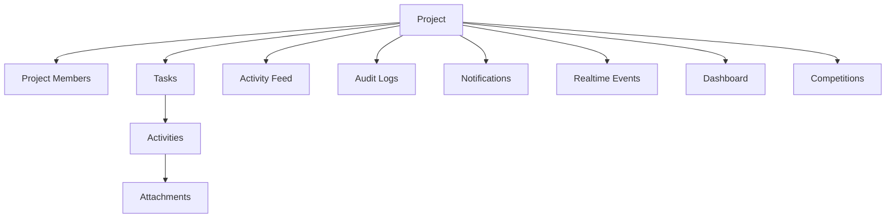

---

# 2. Propósito del módulo

El módulo proporciona las capacidades necesarias para gestionar el ciclo de vida completo de un proyecto.

Incluye:

- creación;
- consulta;
- edición;
- archivado;
- restauración;
- eliminación controlada;
- incorporación de miembros;
- asignación de roles contextuales;
- organización del trabajo;
- consulta del estado operativo;
- trazabilidad de cambios;
- sincronización realtime;
- integración con otros módulos.

---

# 3. Responsabilidad arquitectónica

El módulo Projects es responsable de:

1. representar la entidad `Project`;
2. gestionar el ciclo de vida de los proyectos;
3. controlar la membresía;
4. establecer el contexto de autorización;
5. ofrecer vistas SSR de listado, formulario y detalle;
6. coordinar operaciones relacionadas;
7. emitir eventos funcionales;
8. registrar auditoría;
9. alimentar el activity feed;
10. generar notificaciones;
11. publicar cambios realtime.

No debe asumir directamente responsabilidades propias de:

- autenticación;
- persistencia física de archivos;
- entrega WebSocket;
- render de notificaciones;
- auditoría técnica interna;
- lógica detallada de tareas;
- lógica detallada de actividades.

---

# 4. Límites del módulo

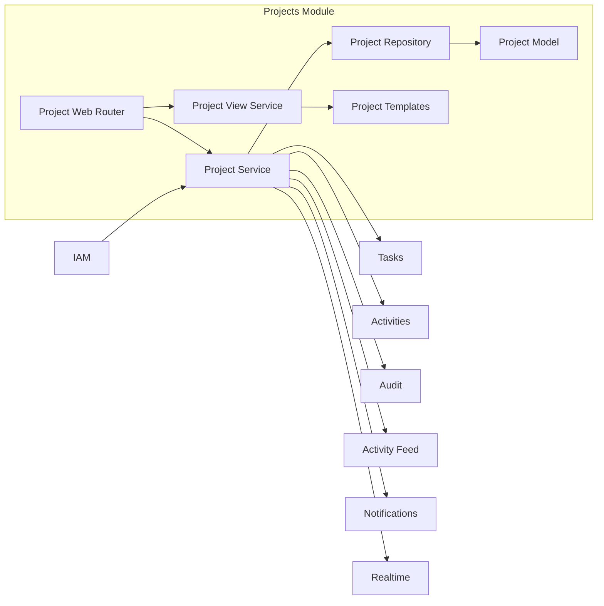

---

# 5. Principios de diseño

El módulo sigue los principios:

- separación de responsabilidades;
- autorización contextual;
- persistencia mediante Repository Pattern;
- orquestación mediante Service Layer;
- render SSR;
- mejora progresiva con JavaScript;
- eventos realtime posteriores al commit;
- trazabilidad transversal;
- modelos de entrada independientes del ORM;
- DTOs y ViewModels explícitos;
- transacciones atómicas;
- evolución mediante migraciones.

---

# 6. Arquitectura por capas

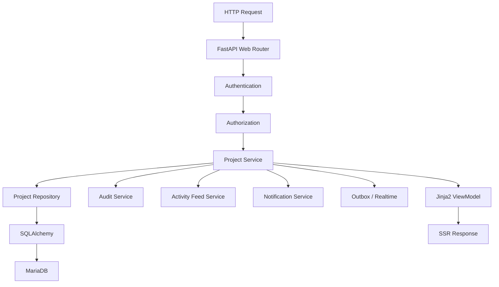

---

# 7. Estructura del módulo

Estructura recomendada:

```text
app/
└── modules/
    └── projects/
        ├── __init__.py
        ├── project_model.py
        ├── project_repository.py
        ├── project_schemas.py
        ├── project_service.py
        ├── project_view_service.py
        ├── project_permissions.py
        ├── project_events.py
        ├── project_exceptions.py
        └── projects_web.py
```

Plantillas:

```text
templates/
└── projects/
    ├── projects_list.html
    ├── projects_form.html
    ├── projects_detail.html
    ├── projects_members.html
    └── partials/
        ├── project_card.html
        ├── project_summary.html
        ├── project_member_row.html
        ├── project_task_column.html
        └── project_activity_item.html
```

JavaScript:

```text
static/
└── js/
    └── projects/
        ├── project_list.js
        ├── project_form.js
        ├── project_detail.js
        ├── project_members.js
        └── project_realtime.js
```

---

# 8. Agregado Project

`Project` actúa como raíz del agregado funcional.

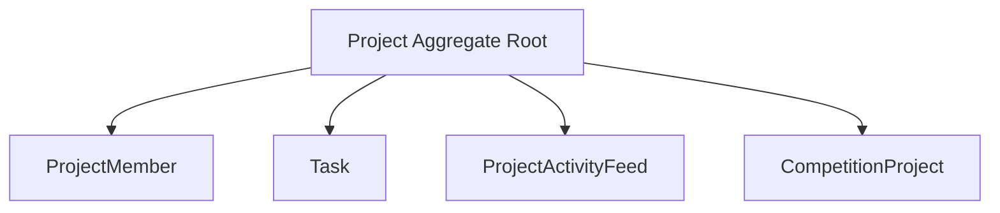

La raíz controla operaciones que afectan al proyecto como conjunto:

- cambio de estado;
- archivado;
- gestión de miembros;
- validación del contexto;
- acceso al Kanban;
- cierre;
- integración con competiciones.

---

# 9. Entidad `Project`

La entidad representa una iniciativa colaborativa o académica gestionada dentro de la plataforma.

Campos conceptuales:

```text
id_project
name
description
status
start_date
end_date
created_by
created_at
updated_by
updated_at
archived_at
version
```

---

# 10. Modelo relacional de proyecto

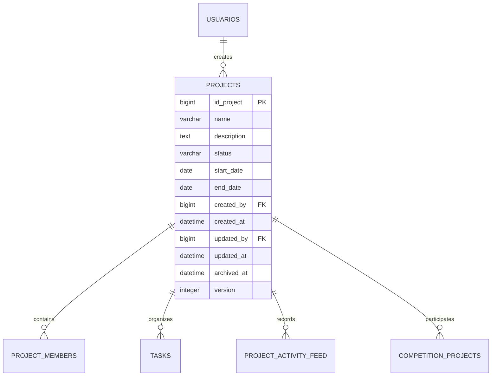

---

# 11. Campos de `Project`

| Campo | Tipo orientativo | Nulo | Responsabilidad |
|---|---|---:|---|
| `id_project` | BIGINT | No | Identificador interno |
| `name` | VARCHAR(150) | No | Nombre del proyecto |
| `description` | TEXT | Sí | Descripción funcional |
| `status` | VARCHAR(30) | No | Estado del ciclo de vida |
| `start_date` | DATE | Sí | Fecha prevista de inicio |
| `end_date` | DATE | Sí | Fecha prevista o real de fin |
| `created_by` | BIGINT | Sí | Usuario creador |
| `created_at` | DATETIME | No | Fecha de creación |
| `updated_by` | BIGINT | Sí | Último editor |
| `updated_at` | DATETIME | Sí | Última modificación |
| `archived_at` | DATETIME | Sí | Fecha de archivado |
| `version` | INTEGER | No | Control de concurrencia |

---

# 12. Identificador

`id_project` debe ser:

- único;
- inmutable;
- sin significado funcional;
- generado por la base de datos;
- utilizado para relaciones internas.

Puede añadirse en el futuro un `public_id` UUID para exposición externa.

---

# 13. Nombre del proyecto

El nombre debe:

- ser obligatorio;
- contener al menos un carácter no vacío;
- tener longitud limitada;
- normalizar espacios;
- evitar HTML no confiable;
- ser apto para presentación en listados y cabeceras.

Validación conceptual:

```text
1 <= len(trim(name)) <= 150
```

---

# 14. Descripción

La descripción:

- es opcional;
- puede contener texto extenso;
- debe escaparse durante el render;
- no debe almacenar HTML arbitrario sin sanitización;
- puede utilizarse en búsquedas futuras.

---

# 15. Estado del proyecto

Estados recomendados:

```text
draft
active
completed
archived
cancelled
```

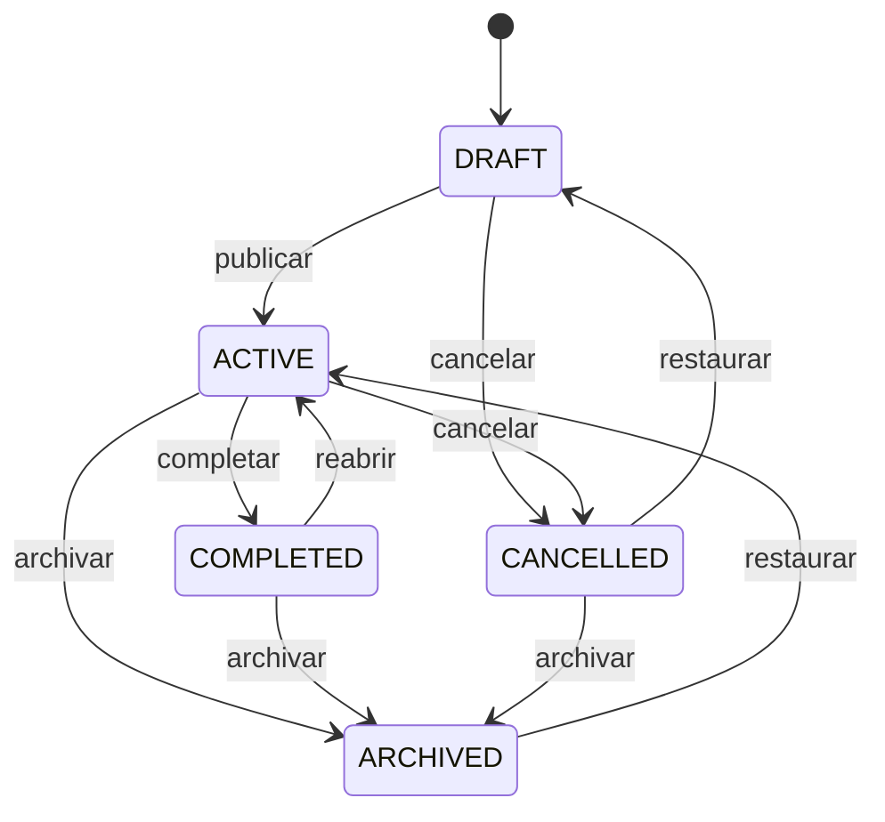

---

# 16. Proyecto en borrador

Un proyecto `draft`:

- puede editarse;
- puede recibir configuración inicial;
- puede incorporar coordinadores;
- puede mantenerse fuera de vistas generales;
- todavía no representa trabajo operativo activo.

Según la política funcional, puede impedirse:

- crear tareas;
- emitir notificaciones generales;
- participar en competiciones;
- aparecer en dashboards públicos.

---

# 17. Proyecto activo

Un proyecto `active`:

- admite miembros;
- admite tareas;
- admite actividades;
- aparece en Dashboard;
- permite eventos realtime;
- participa en el flujo colaborativo normal.

Debe disponer de al menos un coordinador activo.

---

# 18. Proyecto completado

Un proyecto `completed` representa trabajo finalizado.

Debe conservar:

- miembros;
- tareas;
- actividades;
- adjuntos;
- activity feed;
- auditoría;
- métricas.

Puede permitir:

- consulta;
- exportación;
- generación de informes;
- reapertura autorizada.

---

# 19. Proyecto archivado

Un proyecto `archived`:

- se conserva como histórico;
- deja de aceptar modificaciones ordinarias;
- puede excluirse de los listados activos;
- mantiene todas sus relaciones;
- puede restaurarse mediante una operación autorizada.

Regla recomendada:

```text
status = archived

↓

archived_at IS NOT NULL
```

---

# 20. Proyecto cancelado

Un proyecto `cancelled` representa una iniciativa interrumpida antes de completarse.

Debe diferenciarse de:

- proyecto completado;
- proyecto archivado;
- proyecto eliminado.

La cancelación debe registrar:

- actor;
- fecha;
- motivo cuando proceda;
- auditoría;
- evento funcional.

---

# 21. Fechas del proyecto

Regla:

```text
start_date <= end_date
```

cuando ambas fechas están informadas.

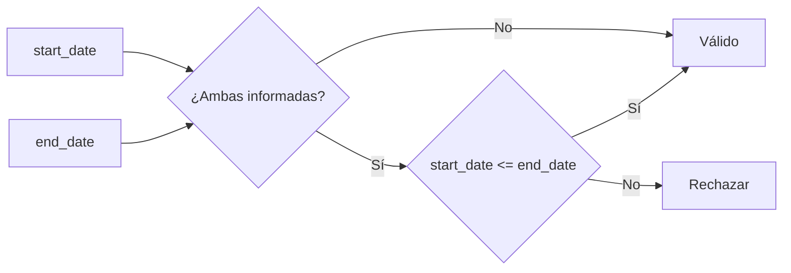

---

# 22. Auditoría temporal

Se recomienda mantener:

```text
created_at
updated_at
archived_at
```

Todos los timestamps deben almacenarse en UTC.

Las conversiones a zona horaria local deben realizarse en presentación.

---

# 23. Optimistic Locking

El campo `version` protege modificaciones concurrentes.

Ejemplo:

```sql
UPDATE projects
SET
    name = :name,
    version = version + 1
WHERE id_project = :project_id
  AND version = :expected_version;
```

Si no se actualiza ninguna fila:

```text
409 Conflict
```

---

# 24. Relaciones del proyecto

Un proyecto se relaciona con:

- usuario creador;
- miembros;
- tareas;
- activity feed;
- auditoría;
- notificaciones indirectas;
- competiciones.

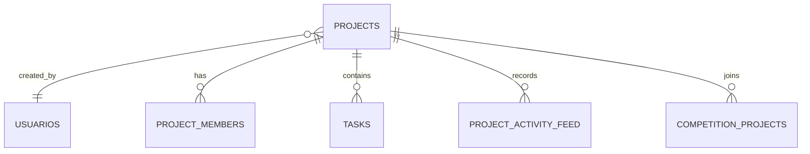

---

# 25. Relación con el creador

`created_by` representa al usuario que originó el proyecto.

No debe confundirse con:

- propietario actual;
- coordinador;
- último editor;
- responsable académico.

El creador puede ser también coordinador inicial, pero son conceptos diferentes.

---

# 26. Relación con miembros

La relación N:M entre proyectos y usuarios se implementa mediante `ProjectMember`.

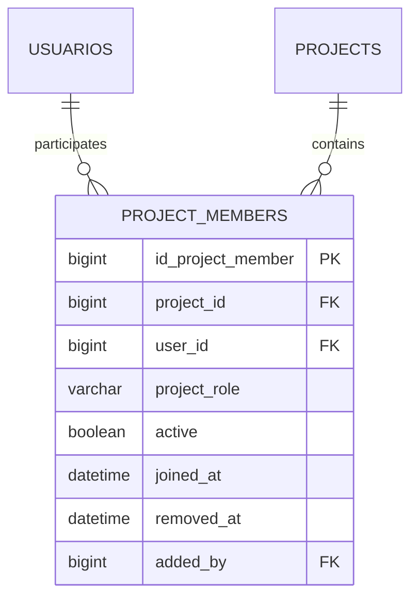

---

# 27. Entidad `ProjectMember`

`ProjectMember` representa una relación funcional con significado propio.

No es una tabla puente puramente técnica.

Almacena:

- pertenencia;
- rol contextual;
- fecha de incorporación;
- usuario que realizó el alta;
- estado;
- posible fecha de salida.

---

# 28. Campos de `ProjectMember`

| Campo | Tipo orientativo | Nulo | Responsabilidad |
|---|---|---:|---|
| `id_project_member` | BIGINT | No | Identificador |
| `project_id` | BIGINT | No | Proyecto |
| `user_id` | BIGINT | No | Usuario |
| `project_role` | VARCHAR(30) | No | Rol contextual |
| `active` | BOOLEAN | No | Membresía activa |
| `joined_at` | DATETIME | No | Incorporación |
| `removed_at` | DATETIME | Sí | Retirada |
| `added_by` | BIGINT | Sí | Actor que añadió |

---

# 29. Roles contextuales

Roles actuales:

```text
coordinator
member
```

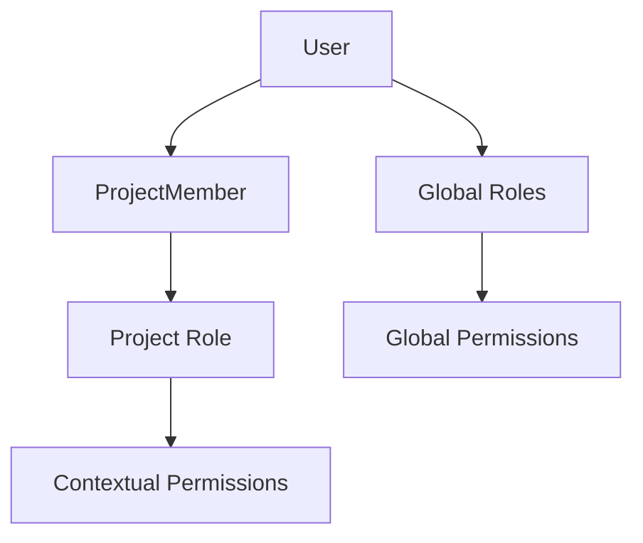

---

# 30. Coordinador

Un coordinador puede gestionar, según permisos:

- datos del proyecto;
- miembros;
- roles contextuales;
- tareas;
- asignaciones;
- actividades;
- Kanban;
- operaciones de cierre;
- información colaborativa.

La capacidad real debe resolverse mediante `can_user_action()` o el servicio unificado de autorización.

---

# 31. Miembro

Un miembro puede:

- consultar el proyecto;
- consultar tareas;
- recibir asignaciones;
- registrar actividades;
- consultar el feed;
- interactuar con elementos autorizados.

No debe asumir automáticamente capacidad para:

- gestionar miembros;
- eliminar el proyecto;
- cambiar roles;
- archivar;
- modificar cualquier tarea.

---

# 32. Invariantes de membresía

Deben cumplirse:

1. el proyecto existe;
2. el usuario existe;
3. el usuario está activo;
4. el rol contextual es válido;
5. no existe membresía activa duplicada;
6. solo un actor autorizado puede crearla;
7. un proyecto activo conserva al menos un coordinador;
8. la fecha de salida es coherente con el estado.

---

# 33. Unicidad de membresía

Restricción habitual:

```text
UNIQUE(project_id, user_id)
```

Si se requiere conservar múltiples periodos históricos, debe utilizarse otra estrategia.

Ejemplo:

```text
id_project_member

+

restricción de una sola membresía activa
```

---

# 34. Estado de membresía

Regla conceptual:

```text
active = TRUE

↓

removed_at IS NULL
```

y:

```text
active = FALSE

↓

removed_at IS NOT NULL
```

La desactivación puede conservar la fila para trazabilidad.

---

# 35. Último coordinador

No debe permitirse:

- eliminar;
- desactivar;
- degradar;

al último coordinador activo de un proyecto operativo.

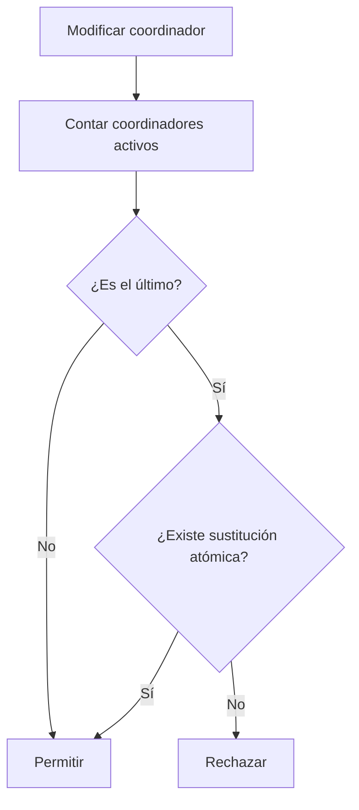

---

# 36. Sustitución de coordinador

La sustitución debe ejecutarse dentro de una única transacción.

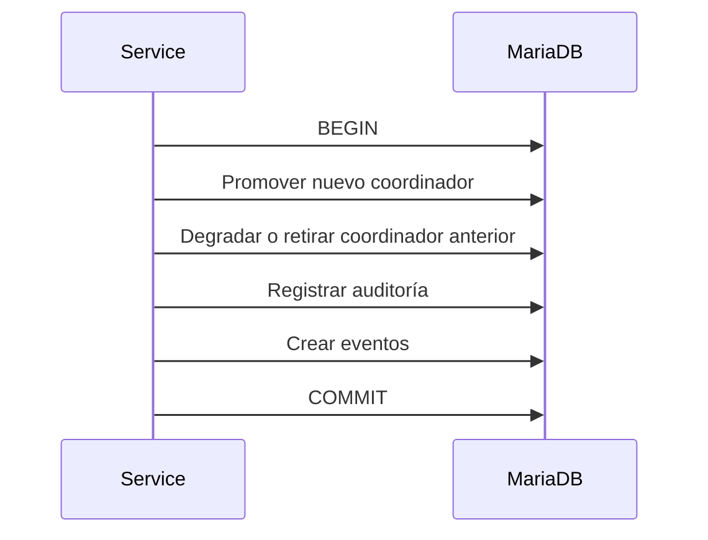

No deben realizarse commits parciales.

---

# 37. Relación con tareas

Cada tarea pertenece obligatoriamente a un proyecto.

```text
Project 1 ─── N Task
```

El proyecto proporciona:

- contexto de autorización;
- agrupación Kanban;
- miembros asignables;
- activity feed;
- canal realtime.

---

# 38. Integridad de tareas

Toda tarea del proyecto debe cumplir:

- `task.project_id` válido;
- usuario asignado miembro activo;
- estado válido;
- operaciones permitidas por estado del proyecto;
- actor con autorización contextual.

---

# 39. Relación con actividades

Las actividades se relacionan indirectamente con el proyecto mediante la tarea.

```text
Project

↓

Task

↓

Activity
```

Esta cadena permite determinar:

- acceso;
- contexto;
- feed;
- notificaciones;
- canal realtime.

---

# 40. Relación con adjuntos

Los adjuntos pertenecen normalmente a una actividad.

```text
Project

↓

Task

↓

Activity

↓

Attachment
```

La autorización de descarga debe resolver toda la cadena contextual.

---

# 41. Relación con Activity Feed

Cada evento funcional se asocia directamente al proyecto.

```text
Project 1 ─── N ProjectActivityFeed
```

Esto permite consultar el timeline sin recorrer todas las entidades funcionales.

---

# 42. Relación con auditoría

La auditoría puede utilizar:

```text
resource_type = project
resource_id = id_project
```

y, cuando proceda:

```text
project_id = id_project
```

La auditoría debe conservarse aunque el proyecto se archive.

---

# 43. Relación con notificaciones

Las notificaciones no pertenecen directamente al proyecto mediante FK obligatoria.

Utilizan referencias:

```text
entity_type = project
entity_id = project_id
```

o se originan a partir de eventos de entidades internas.

---

# 44. Relación con WebSocket

Cada proyecto dispone de un contexto realtime.

Canal conceptual:

```text
/projects/ws/{project_id}
```

El acceso requiere:

- JWT válido;
- usuario activo;
- autorización sobre el proyecto;
- membresía o permiso global suficiente.

---

# 45. Contexto de autorización

El proyecto actúa como frontera principal de seguridad contextual.

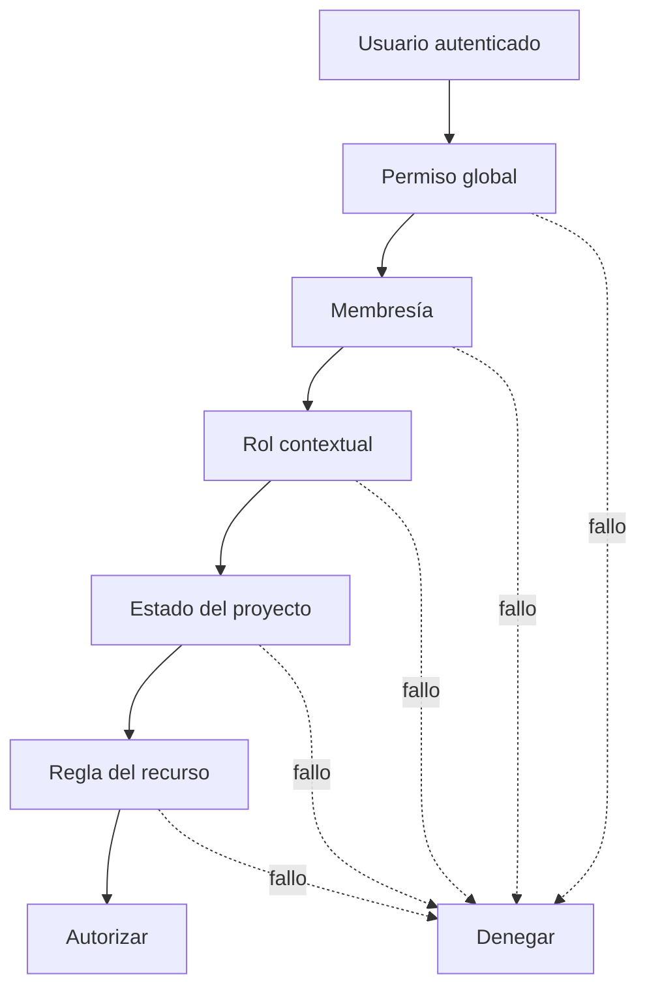

---

# 46. Capas de autorización

La autorización debe combinar:

1. autenticación;
2. estado del usuario;
3. permiso global;
4. acceso al proyecto;
5. rol contextual;
6. estado del proyecto;
7. regla de negocio específica.

---

# 47. Permisos globales

Recursos orientativos:

```text
projects
project_members
tasks
activities
attachments
```

Acciones:

```text
read
create
update
delete
manage
archive
restore
```

Ejemplos:

```text
projects:read
projects:create
projects:update
projects:archive
project_members:manage
```

---

# 48. Permisos contextuales

Los permisos contextuales se derivan de:

```text
ProjectMember.project_role
```

Ejemplo:

| Acción | Coordinator | Member |
|---|---:|---:|
| Consultar proyecto | Sí | Sí |
| Editar proyecto | Sí | No |
| Gestionar miembros | Sí | No |
| Crear tarea | Sí | Configurable |
| Asignar tarea | Sí | No |
| Registrar actividad | Sí | Sí |
| Archivar proyecto | Sí o Admin | No |
| Eliminar proyecto | Admin | No |

---

# 49. Administrador global

Un administrador puede disponer de acceso transversal.

Sin embargo, la excepción administrativa debe:

- ser explícita;
- registrarse;
- no depender de lógica dispersa;
- respetar restricciones críticas;
- diferenciar lectura de modificación.

---

# 50. Profesor global

El rol global Profesor puede:

- crear proyectos;
- coordinar proyectos;
- consultar proyectos permitidos;
- gestionar trabajo según el contexto.

No debe asumirse que todo profesor puede modificar cualquier proyecto.

---

# 51. Función unificada de autorización

Toda comprobación debe converger en una función central.

Firma conceptual:

```python
can_user_action(
    db=db,
    user=current_user,
    resource=Resource.PROJECTS,
    action=Action.UPDATE,
    project_id=project_id,
)
```

Debe evitarse duplicar lógica como:

```python
if user.role == "admin":
```

en routers, servicios, plantillas y JavaScript.

---

# 52. Decoradores y dependencias web

Rutas SSR:

```python
@require_permission_web(
    Resource.PROJECTS,
    Action.READ,
)
```

Las dependencias generales no sustituyen la validación contextual del proyecto concreto.

---

# 53. Autorización de detalle

Para acceder a:

```text
GET /projects/{project_id}
```

debe comprobarse:

1. el proyecto existe;
2. el usuario está autenticado;
3. el usuario está activo;
4. dispone de acceso global o contextual;
5. el proyecto es visible en su estado actual.

---

# 54. Prevención de IDOR

No debe bastar con conocer `project_id`.

Consulta segura conceptual:

```sql
SELECT p.*
FROM projects p
LEFT JOIN project_members pm
    ON pm.project_id = p.id_project
   AND pm.user_id = :user_id
WHERE p.id_project = :project_id
  AND (
      pm.user_id IS NOT NULL
      OR :is_global_admin = TRUE
  );
```

---

# 55. Autorización de edición

Para editar debe comprobarse además:

- rol contextual suficiente;
- permiso `projects:update`;
- proyecto modificable;
- versión esperada;
- ausencia de bloqueo funcional.

---

# 56. Autorización de gestión de miembros

Requiere:

```text
project_members:manage
```

y normalmente:

```text
ProjectRole.COORDINATOR
```

o privilegio administrativo global.

---

# 57. Autorización de archivado

El archivado debe limitarse a:

- coordinador autorizado;
- profesor responsable;
- administrador.

Debe impedirse cuando existan condiciones funcionales incompatibles, si la política así lo define.

---

# 58. Autorización de eliminación

La eliminación física debe ser excepcional.

Puede requerir simultáneamente:

- rol administrador;
- permiso `projects:delete`;
- proyecto en `draft`;
- ausencia de actividad;
- ausencia de competición;
- confirmación explícita;
- auditoría obligatoria.

---

# 59. Estado y operaciones permitidas

| Operación | Draft | Active | Completed | Archived | Cancelled |
|---|---:|---:|---:|---:|---:|
| Editar metadatos | Sí | Sí | Limitado | No | Limitado |
| Añadir miembros | Sí | Sí | Configurable | No | No |
| Crear tareas | Configurable | Sí | No | No | No |
| Registrar actividades | No | Sí | Configurable | No | No |
| Completar | No | Sí | — | No | No |
| Archivar | Sí | Sí | Sí | — | Sí |
| Restaurar | — | — | — | Sí | Configurable |
| Eliminar físicamente | Condicional | No | No | No | Condicional |

---

# 60. Modelo de entrada para creación

Esquema conceptual:

```python
class ProjectCreate(BaseModel):
    name: str
    description: str | None = None
    start_date: date | None = None
    end_date: date | None = None
```

El estado inicial debe establecerse explícitamente.

Recomendación:

```text
draft
```

o `active` si el flujo actual no contempla borradores.

---

# 61. Validaciones de creación

Debe validarse:

- nombre no vacío;
- longitud;
- fechas coherentes;
- actor autorizado;
- estado inicial permitido;
- posibles duplicados funcionales;
- creación del coordinador inicial.

---

# 62. Creación atómica

La creación de proyecto puede incluir:

- insertar proyecto;
- añadir creador como coordinador;
- registrar auditoría;
- crear evento de feed;
- registrar evento Outbox.

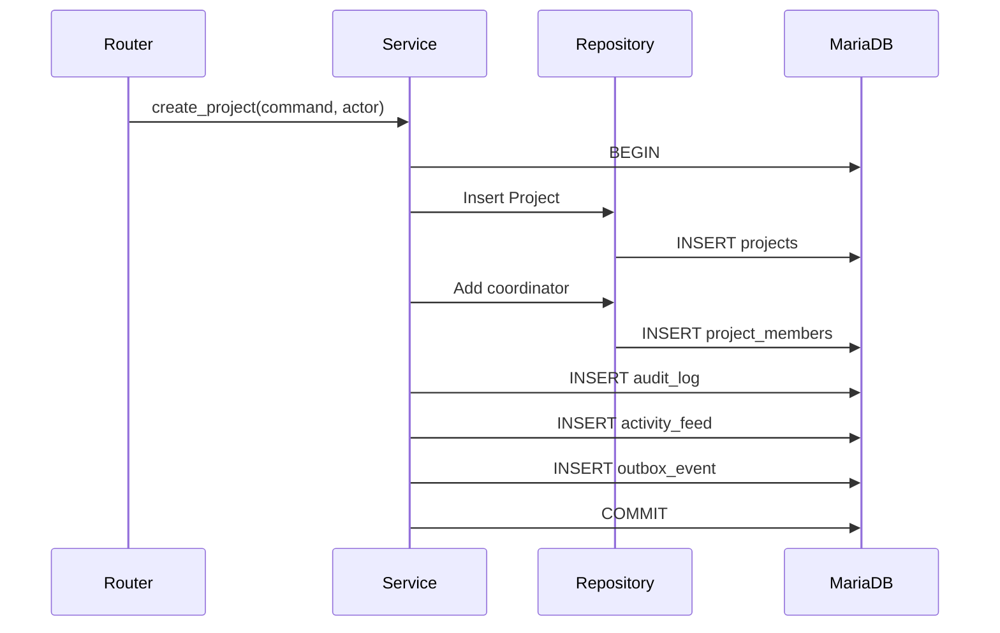

---

# 63. Resultado de creación

El servicio debe devolver un resultado de dominio o DTO.

Ejemplo:

```python
ProjectResult(
    id_project=project.id_project,
    name=project.name,
    status=project.status,
    version=project.version,
)
```

No debe devolver una entidad ORM abierta a modificación arbitraria fuera de la transacción.

---

# 64. Modelo de actualización

Esquema conceptual:

```python
class ProjectUpdate(BaseModel):
    name: str | None = None
    description: str | None = None
    start_date: date | None = None
    end_date: date | None = None
    expected_version: int
```

El cambio de estado debe realizarse mediante operaciones específicas.

---

# 65. Commands específicos

En lugar de una actualización genérica para todo, se recomiendan casos de uso:

```text
CreateProject

UpdateProjectDetails

ActivateProject

CompleteProject

ArchiveProject

RestoreProject

CancelProject

DeleteDraftProject

AddProjectMember

ChangeProjectMemberRole

RemoveProjectMember
```

---

# 66. Razones para commands específicos

Permiten:

- autorización diferenciada;
- auditoría precisa;
- eventos semánticos;
- validaciones específicas;
- menor riesgo;
- mejor trazabilidad;
- pruebas más claras.

---

# 67. Modelo de consulta

Las lecturas deben utilizar modelos específicos.

Ejemplos:

```text
ProjectSummaryDTO

ProjectDetailDTO

ProjectMemberDTO

ProjectKanbanDTO

ProjectMetricsDTO
```

---

# 68. `ProjectSummaryDTO`

Campos orientativos:

```text
id_project
name
status
start_date
end_date
member_count
task_count
completed_task_count
created_at
can_edit
can_archive
```

---

# 69. `ProjectDetailDTO`

Puede incluir:

```text
project
members
kanban_summary
recent_activity
metrics
permissions
realtime_config
```

No debe cargar ilimitadamente:

- todas las actividades;
- toda la auditoría;
- todas las notificaciones;
- todos los adjuntos.

---

# 70. ViewModel del proyecto

Ejemplo conceptual:

```python
ProjectDetailViewModel(
    project=project_dto,
    members=members,
    kanban=kanban,
    recent_feed=feed,
    permissions=permissions,
    websocket=websocket_config,
)
```

La plantilla debe recibir datos preparados para presentación.

---

# 71. Estado de la interfaz

El ViewModel puede incluir:

```text
status_label
status_badge
can_edit
can_manage_members
can_create_task
can_archive
can_restore
can_delete
is_read_only
```

La interfaz utiliza estos valores para renderizar acciones.

La autorización real continúa en backend.

---

# 72. Reglas de dominio principales

El agregado Project debe mantener:

1. nombre válido;
2. estado válido;
3. fechas coherentes;
4. al menos un coordinador cuando está activo;
5. membresías no duplicadas;
6. cambios autorizados;
7. tareas asignadas solo a miembros válidos;
8. archivado sin pérdida de relaciones;
9. eliminación física restringida;
10. trazabilidad de operaciones relevantes.

---

# 73. Excepciones de dominio

Excepciones recomendadas:

```text
ProjectNotFoundError

ProjectAccessDeniedError

ProjectAlreadyArchivedError

ProjectNotEditableError

InvalidProjectTransitionError

ProjectVersionConflictError

ProjectMemberAlreadyExistsError

ProjectMemberNotFoundError

LastCoordinatorError

InvalidProjectDateRangeError

ProjectDeletionNotAllowedError
```

---

# 74. Traducción HTTP de excepciones

| Excepción | Estado |
|---|---:|
| `ProjectNotFoundError` | 404 |
| `ProjectAccessDeniedError` | 403 |
| `ProjectMemberAlreadyExistsError` | 409 |
| `ProjectVersionConflictError` | 409 |
| `InvalidProjectTransitionError` | 422 |
| `LastCoordinatorError` | 409 |
| `InvalidProjectDateRangeError` | 422 |
| `ProjectDeletionNotAllowedError` | 409 |

---

# 75. Transacciones

El Service Layer debe controlar la transacción.

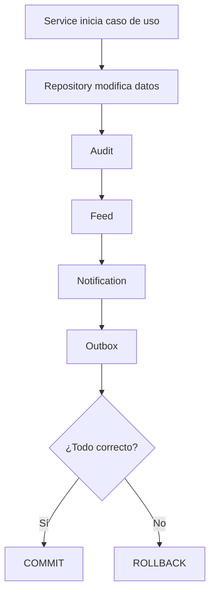

---

# 76. Regla de publicación realtime

Los eventos realtime deben publicarse únicamente después del commit.

Incorrecto:

```text
Emitir WebSocket

↓

Fallar transacción
```

Correcto:

```text
Persistir

↓

Commit

↓

Publicar evento
```

---

# 77. Eventos del módulo

Eventos de dominio recomendados:

```text
project.created
project.updated
project.activated
project.completed
project.archived
project.restored
project.cancelled
project.deleted

project.member_added
project.member_removed
project.member_role_changed
```

---

# 78. Estructura de evento

Ejemplo:

```json
{
  "event_id": "uuid",
  "event_type": "project.updated",
  "aggregate_type": "project",
  "aggregate_id": "27",
  "project_id": 27,
  "actor_id": 8,
  "occurred_at": "2026-07-26T10:00:00Z",
  "correlation_id": "uuid",
  "payload": {
    "changed_fields": [
      "name",
      "end_date"
    ],
    "version": 4
  }
}
```

---

# 79. Eventos y consumidores

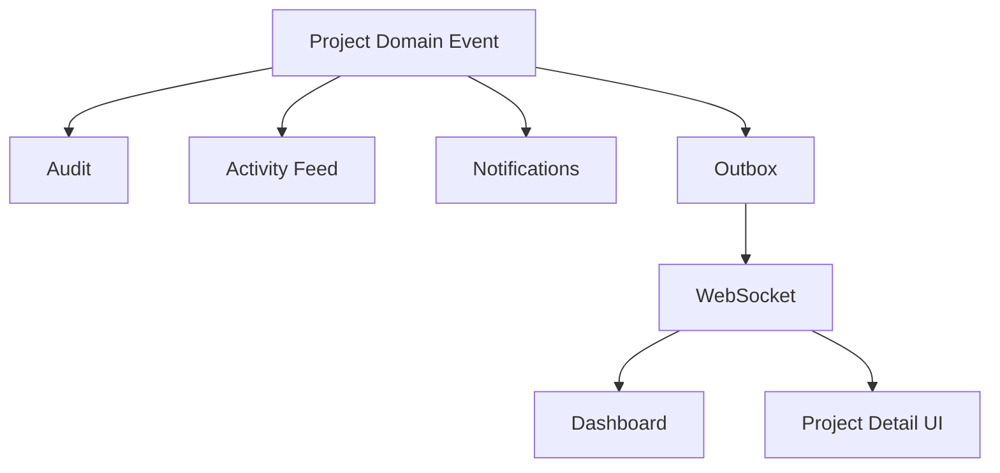

---

# 80. Auditoría del proyecto

Acciones recomendadas:

```text
create_project
update_project
activate_project
complete_project
archive_project
restore_project
cancel_project
delete_project

add_project_member
remove_project_member
change_project_member_role
```

---

# 81. Contenido de auditoría

Debe registrar:

- actor;
- acción;
- proyecto;
- timestamp;
- valores anteriores;
- valores posteriores;
- IP cuando proceda;
- user agent;
- correlation ID;
- resultado;
- motivo cuando corresponda.

No debe registrar:

- JWT;
- cookies;
- secretos;
- contraseñas;
- datos innecesarios.

---

# 82. Activity Feed del proyecto

Eventos visibles:

```text
project_created
project_updated
project_archived
project_restored
project_completed

member_joined
member_removed
member_role_changed
```

El mensaje debe ser comprensible para los miembros.

Ejemplo:

```text
Fran archivó el proyecto.
```

---

# 83. Notificaciones del proyecto

Tipos orientativos:

```text
project_updated
project_archived
project_restored
project_member_added
project_member_removed
project_role_changed
```

Los destinatarios deben calcularse según:

- tipo de evento;
- rol;
- actor;
- preferencias;
- estado de membresía.

---

# 84. Evitar auto-notificación innecesaria

El actor normalmente no necesita recibir una notificación sobre su propia acción.

Excepciones:

- confirmación de operación crítica;
- mensajes de sistema;
- procesos asíncronos;
- errores;
- tareas programadas.

---

# 85. Realtime del proyecto

Los eventos WebSocket deben permitir:

- actualizar cabecera;
- actualizar estado;
- insertar feed;
- refrescar métricas;
- actualizar miembros;
- modificar acciones disponibles;
- mostrar toast.

---

# 86. Canal de proyecto

Ruta conceptual:

```text
/ws/projects/{project_id}
```

o:

```text
/projects/ws/{project_id}
```

La convención definitiva debe coincidir con la configuración real del router.

---

# 87. Autorización WebSocket

El handshake debe validar:

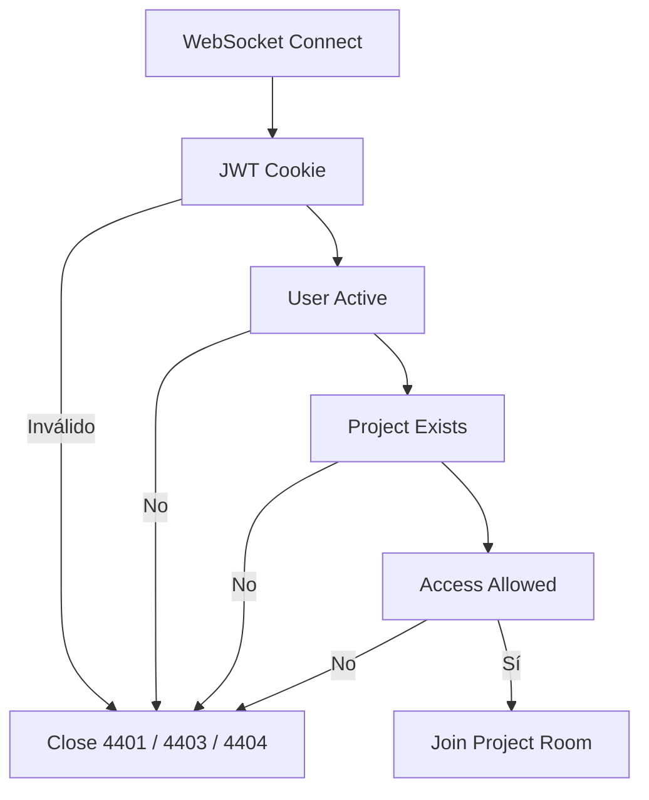

---

# 88. Contrato realtime

Ejemplo:

```json
{
  "type": "project.member_added",
  "project_id": 27,
  "entity_type": "project_member",
  "entity_id": 144,
  "event_id": "uuid",
  "occurred_at": "2026-07-26T10:00:00Z",
  "payload": {
    "user_id": 19,
    "display_name": "Usuario",
    "project_role": "member"
  }
}
```

---

# 89. Idempotencia en cliente

El cliente debe registrar `event_id` procesados para evitar duplicados.

```text
evento recibido

↓

¿event_id ya procesado?

├── Sí → ignorar
└── No → aplicar y registrar
```

---

# 90. Recuperación tras desconexión

El cliente debe:

1. detectar cierre;
2. reintentar con backoff;
3. recuperar el estado actual;
4. reconciliar la UI;
5. continuar procesando eventos.

WebSocket no sustituye a la consulta HTTP como fuente de verdad.

---

# 91. SSR como estado inicial

La pantalla debe funcionar con render inicial SSR.

```text
GET project detail

↓

Autorización

↓

Consultas

↓

ViewModel

↓

HTML completo
```

JavaScript añade:

- drag and drop;
- WebSocket;
- actualizaciones incrementales;
- diálogos;
- toasts;
- reconexión.

---

# 92. Mejora progresiva

El proyecto debe seguir siendo consultable si falla:

- WebSocket;
- JavaScript no crítico;
- conexión realtime;
- actualización incremental.

Las operaciones críticas deben disponer de endpoint HTTP.

---

# 93. Integración con Context Injection

El router puede inyectar en `request.scope`:

```text
db
current_user
permissions
project_context
```

Los helpers de plantillas no deben ejecutar consultas arbitrarias.

La preparación principal corresponde al View Service.

---

# 94. Contexto de proyecto

Objeto conceptual:

```python
ProjectContext(
    project_id=project.id_project,
    user_id=current_user.id_usuario,
    membership=membership,
    project_role=membership.project_role,
    permissions=effective_permissions,
    read_only=project.status == ProjectStatus.ARCHIVED,
)
```

---

# 95. Uso del contexto

Debe reutilizarse para:

- rutas;
- servicios;
- plantillas;
- WebSocket;
- tareas;
- actividades;
- adjuntos;
- feed.

Evita repetir consultas de membresía en una misma petición.

---

# 96. Integración con Dashboard

El Dashboard puede obtener:

- proyectos activos;
- proyectos coordinados;
- proyectos recientes;
- tareas por estado;
- actividad reciente;
- miembros;
- progreso.

Las métricas deben calcularse mediante agregaciones.

---

# 97. Progreso del proyecto

Métrica básica:

```text
completed_tasks / total_tasks
```

Debe definirse el comportamiento cuando:

```text
total_tasks = 0
```

Recomendación:

```text
0 %
```

o estado:

```text
Sin tareas
```

---

# 98. Métricas recomendadas

```text
member_count

task_count

todo_count

doing_count

done_count

overdue_count

activity_count

attachment_count

completion_percentage

last_activity_at
```

---

# 99. Evitar carga de colecciones completas

Incorrecto:

```python
len(project.tasks)
```

si existen muchas tareas.

Correcto:

```sql
SELECT COUNT(*)
FROM tasks
WHERE project_id = :project_id;
```

---

# 100. Consultas del detalle

El detalle puede requerir varias consultas optimizadas:

```text
1. Project + creator
2. Membership + effective role
3. Project members
4. Kanban tasks + assignees
5. Metrics
6. Recent feed
```

No debe construirse un JOIN universal.

---

# 101. Estrategias de carga ORM

| Relación | Estrategia recomendada |
|---|---|
| `Project.creator` | `joinedload` |
| `Project.memberships` | `selectinload` o consulta explícita |
| `Project.tasks` | Consulta específica |
| `Project.feed` | Consulta paginada |
| `Project.competitions` | Bajo demanda |

---

# 102. Índices recomendados

```text
projects(status)

projects(created_by)

projects(created_at)

projects(start_date, end_date)

projects(archived_at)

project_members(project_id, user_id)

project_members(user_id, active)

project_members(project_id, project_role, active)

tasks(project_id, status, position)

project_activity_feed(project_id, created_at)
```

---

# 103. Constraints recomendadas

```text
PK projects.id_project

FK projects.created_by → usuarios.id_usuario

CHECK project.status

CHECK project.start_date <= project.end_date

CHECK project.version >= 1

CHECK archived_at coherente con status

UNIQUE project_members(project_id, user_id)
```

---

# 104. Política de eliminación

El proyecto no debe eliminarse mediante cascada ordinaria desde un usuario.

Políticas:

```text
User → Project.created_by = SET NULL

Project → ProjectMember = CASCADE

Project → Task = RESTRICT o CASCADE controlado

Project → Feed = CASCADE técnico / conservación funcional

Project → Audit = conservar
```

---

# 105. Soft delete frente a archivado

El archivado es un estado funcional.

El soft delete representa retirada lógica.

No deben confundirse.

```text
archived

=

visible como histórico
```

```text
deleted

=

oculto de operaciones ordinarias
```

Puede no ser necesario soft delete si la eliminación física está suficientemente restringida y el archivado cubre el caso funcional.

---

# 106. Eliminación de proyecto borrador

Puede permitirse cuando:

- estado `draft`;
- sin tareas;
- sin actividades;
- sin adjuntos;
- sin participación en competiciones;
- actor autorizado.

Debe generar auditoría antes de eliminarse, preferiblemente fuera del ciclo de cascada destructiva.

---

# 107. Archivado

Flujo:

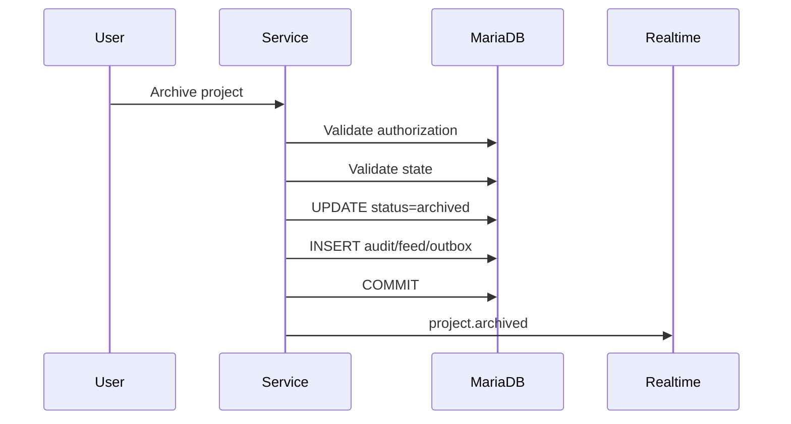

---

# 108. Restauración

Debe:

- validar que está archivado;
- comprobar permisos;
- establecer estado destino;
- limpiar o conservar `archived_at` según política;
- reactivar operaciones;
- emitir eventos;
- actualizar vistas realtime.

---

# 109. Cierre de proyecto

Completar el proyecto puede requerir:

- revisar tareas pendientes;
- solicitar confirmación;
- impedir nuevas tareas;
- conservar actividad;
- registrar fecha;
- notificar a miembros.

La política debe decidir si se permite completar con tareas abiertas.

---

# 110. Política de tareas abiertas

Opciones:

## Estricta

No se puede completar mientras existan tareas no finalizadas.

## Flexible

Se permite completar con advertencia.

## Automática

Las tareas abiertas pasan a canceladas o se archivan.

La estrategia estricta resulta más segura mientras no exista un estado de tarea cancelada.

---

# 111. Compatibilidad con competiciones

Un proyecto participante puede tener restricciones adicionales:

- no eliminar;
- no archivar durante competición;
- conservar miembros;
- bloquear cambios estructurales;
- mantener evidencias.

Estas reglas deben resolverse en Service Layer.

---

# 112. Integridad transversal

El módulo debe garantizar:

```text
ProjectMember.project_id = Project.id_project

Task.project_id = Project.id_project

Feed.project_id = Project.id_project

CompetitionProject.project_id = Project.id_project
```

Las referencias polimórficas deben validarse manualmente.

---

# 113. Logging

El logging técnico debe incluir:

- operation;
- project_id;
- actor_id;
- correlation_id;
- result;
- duration;
- exception type.

No debe incluir:

- tokens;
- cookies;
- datos sensibles;
- contenido completo innecesario.

---

# 114. Correlation ID

Una operación debe compartir `correlation_id` entre:

- log técnico;
- auditoría;
- activity feed;
- notificaciones;
- Outbox;
- eventos realtime.

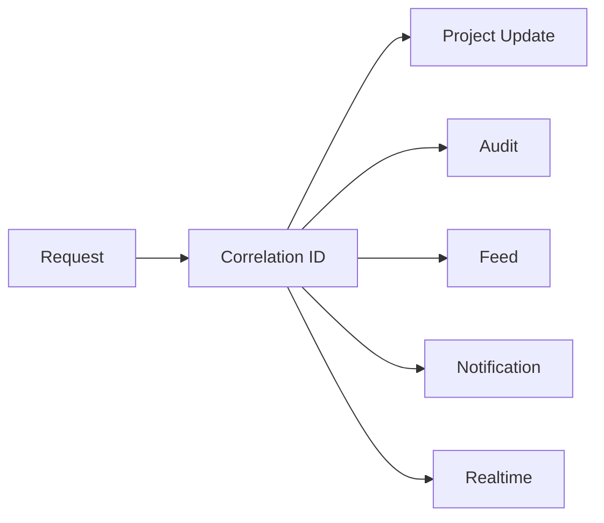

---

# 115. Observabilidad

Métricas recomendadas:

```text
projects_created_total

projects_archived_total

project_updates_total

project_member_changes_total

project_operation_failures_total

project_conflicts_total

project_request_duration_seconds

active_projects_total
```

---

# 116. Alertas

Puede alertarse cuando:

- aumentan conflictos de versión;
- fallan transacciones;
- existen proyectos activos sin coordinador;
- crecen referencias inconsistentes;
- fallan eventos Outbox;
- se producen errores de autorización anómalos.

---

# 117. Continuación

La **Parte 2** desarrollará:

- Repository Pattern;
- Service Layer;
- operaciones de creación, edición, transición y eliminación;
- gestión completa de miembros;
- rutas SSR;
- contratos HTTP;
- formularios;
- listado;
- detalle;
- Kanban contextual;
- consultas y paginación;
- integración con plantillas;
- JavaScript modular;
- diálogos;
- toasts;
- realtime;
- manejo de errores;
- estrategia de pruebas;
- criterios de aceptación;
- checklist y conclusiones.

---

# 118. Repository Pattern

El acceso a datos del módulo de proyectos debe concentrarse en un único repositorio especializado.

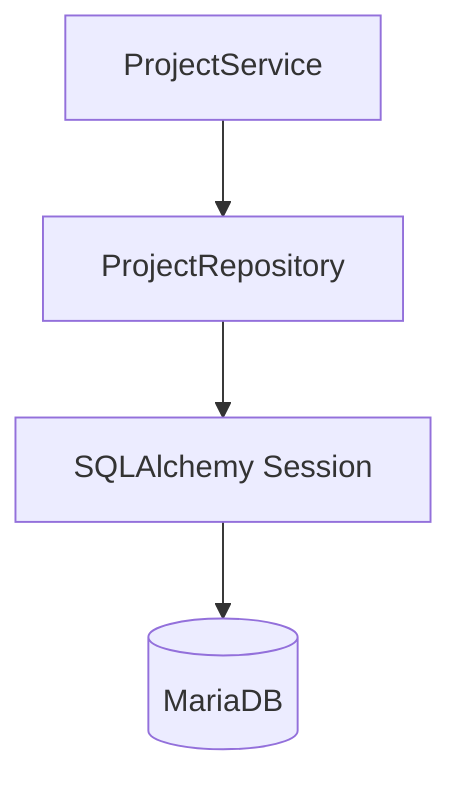

El repositorio:

- encapsula las consultas;
- evita SQL disperso;
- centraliza optimizaciones;
- facilita testing;
- desacopla el Service Layer del ORM.

---

# 119. Responsabilidades del Repository

El repositorio **no contiene reglas de negocio**.

Su responsabilidad se limita a:

- consultar;
- insertar;
- actualizar;
- eliminar;
- paginar;
- realizar agregaciones;
- aplicar estrategias de carga.

Nunca debe decidir:

- permisos;
- transiciones;
- estados;
- autorización;
- auditoría.

---

# 120. Interfaz recomendada

```python
class ProjectRepository:

    def get_by_id(...):
        ...

    def get_detail(...):
        ...

    def list_projects(...):
        ...

    def create(...):
        ...

    def update(...):
        ...

    def archive(...):
        ...

    def delete(...):
        ...

    def add_member(...):
        ...

    def remove_member(...):
        ...
```

---

# 121. Consulta de detalle

La consulta de detalle debe cargar únicamente la información necesaria.

```mermaid
flowchart TD
    A[Project]
    B[Creator]
    C[Permissions]
    D[Project Summary]

    A --> B
    A --> C
    A --> D
```

Las colecciones pesadas deben recuperarse mediante consultas específicas.

---

# 122. Estrategias ORM

Se recomienda:

| Relación | Estrategia |
|----------|------------|
| creator | joinedload |
| members | selectinload |
| tasks | consulta específica |
| feed | paginado |
| audit | consulta independiente |

---

# 123. Paginación

Los listados nunca deben devolver todos los proyectos.

Modelo recomendado:

```text
page

size

sort

filters
```

Respuesta:

```text
items

page

size

total

pages
```

---

# 124. Filtros soportados

El listado puede admitir:

```text
status

creator

member

date

text search

active

archived
```

Los filtros deben combinarse.

---

# 125. Ordenación

Campos habituales:

```text
created_at

updated_at

name

status

last_activity

member_count
```

---

# 126. Consulta optimizada

Debe evitarse:

```python
for project in projects:
    len(project.members)
```

Provoca N+1.

Debe utilizarse agregación SQL.

---

# 127. Service Layer

El Service Layer constituye el núcleo funcional del módulo.

```mermaid
flowchart LR
    Router --> Service
    Service --> Repository
    Service --> Audit
    Service --> Feed
    Service --> Notifications
    Service --> Outbox
```

Toda operación pasa por él.

---

# 128. Responsabilidades del Service

Debe:

- validar;
- autorizar;
- coordinar;
- iniciar transacciones;
- registrar auditoría;
- crear eventos;
- devolver DTOs.

No debe renderizar HTML.

---

# 129. Caso de uso CreateProject

Proceso completo:

```mermaid
sequenceDiagram
    participant UI
    participant Service
    participant Repo
    participant DB

    UI->>Service: CreateProject
    Service->>Repo: validar
    Repo->>DB: INSERT Project
    Service->>Repo: crear coordinator
    Repo->>DB: INSERT Member
    Service->>DB: Audit
    Service->>DB: Feed
    Service->>DB: Outbox
    Service->>DB: COMMIT
```

---

# 130. Validaciones de creación

Antes del INSERT:

- permiso;
- nombre;
- fechas;
- estado inicial;
- usuario activo;
- duplicados funcionales.

---

# 131. Coordinador inicial

Todo proyecto debe crearse con un coordinador.

Normalmente:

```text
actor

↓

coordinator
```

La creación debe ser atómica.

---

# 132. UpdateProject

La actualización debe limitarse a:

- nombre;
- descripción;
- fechas.

No debe modificar:

- estado;
- miembros;
- roles.

Estas operaciones poseen casos de uso propios.

---

# 133. ArchiveProject

Proceso:

```text
validar

↓

autorizar

↓

status=archived

↓

archived_at

↓

audit

↓

feed

↓

notification

↓

outbox
```

---

# 134. RestoreProject

Debe:

- comprobar estado;
- restaurar;
- emitir eventos;
- actualizar Dashboard;
- refrescar Kanban.

---

# 135. CompleteProject

Debe comprobar:

- tareas abiertas;
- reglas académicas;
- permisos;
- estado.

La política depende del dominio.

---

# 136. DeleteProject

Debe ser excepcional.

Sólo cuando:

- borrador;
- sin actividad;
- autorizado.

Nunca mediante un botón visible para usuarios normales.

---

# 137. Gestión de miembros

Casos de uso:

```text
AddMember

RemoveMember

ChangeRole

DeactivateMember

ReactivateMember
```

---

# 138. AddMember

Validaciones:

- proyecto existe;
- usuario existe;
- usuario activo;
- permiso;
- no duplicado.

---

# 139. RemoveMember

Debe impedir:

- eliminar último coordinador;
- romper tareas críticas;
- dejar proyecto inconsistente.

---

# 140. ChangeRole

Transición:

```text
Member

↓

Coordinator
```

o

```text
Coordinator

↓

Member
```

Debe comprobar siempre la regla del último coordinador.

---

# 141. Eventos funcionales

Cada operación genera un evento.

Ejemplos:

```text
project.created

project.updated

project.archived

project.member_added

project.member_removed

project.member_role_changed
```

---

# 142. Auditoría

Toda operación importante registra:

- actor;
- recurso;
- acción;
- timestamp;
- cambios.

---

# 143. Activity Feed

Eventos visibles:

```text
Fran creó el proyecto

María se unió

Juan archivó el proyecto
```

No muestra detalles internos.

---

# 144. Notificaciones

Ejemplos:

```text
Nuevo miembro

Proyecto archivado

Proyecto restaurado

Has sido añadido
```

---

# 145. Outbox

Los eventos no deben enviarse directamente.

```text
Service

↓

Outbox

↓

Worker

↓

Realtime
```

---

# 146. Router Web

Responsabilidades:

- recibir request;
- validar formulario;
- autenticar;
- invocar servicio;
- devolver respuesta.

---

# 147. Endpoints SSR

```text
GET /projects

GET /projects/create

POST /projects/create

GET /projects/{id}

GET /projects/{id}/edit

POST /projects/{id}/edit
```

---

# 148. Endpoints operativos

```text
POST archive

POST restore

POST complete

POST delete

POST member/add

POST member/remove

POST member/change-role
```

---

# 149. Convención REST

Se recomienda evolucionar hacia:

```text
PATCH

DELETE

PUT
```

cuando exista API pública.

---

# 150. Projects List

La vista principal muestra:

- nombre;
- estado;
- miembros;
- tareas;
- progreso;
- última actividad.

---

# 151. Tarjeta de proyecto

Cada tarjeta puede incluir:

```text
Nombre

Estado

Progreso

Miembros

Tareas

Última actividad
```

---

# 152. Acciones rápidas

Dependiendo de permisos:

```text
Abrir

Editar

Archivar

Restaurar

Gestionar miembros
```

---

# 153. Búsqueda

Debe soportar:

- nombre;
- descripción.

Preparada para búsqueda avanzada.

---

# 154. Filtros UI

```text
Todos

Activos

Archivados

Finalizados

Cancelados
```

---

# 155. Projects Detail

Pantalla principal del proyecto.

Debe agrupar:

- resumen;
- miembros;
- Kanban;
- actividad reciente;
- métricas.

---

# 156. Cabecera

Incluye:

- nombre;
- estado;
- fechas;
- acciones.

---

# 157. Panel lateral

Puede mostrar:

- miembros;
- estadísticas;
- enlaces rápidos;
- competiciones.

---

# 158. Métricas

```text
Miembros

Tareas

Doing

Done

%

Última actividad
```

---

# 159. Responsive

La interfaz debe adaptarse:

```text
Desktop

Tablet

Mobile
```

sin perder funcionalidad.

---

# 160. ViewModel

El controlador entrega:

```python
ProjectDetailViewModel(
    summary,
    members,
    metrics,
    permissions,
    feed
)
```

No debe montar lógica dentro de Jinja2.

---

# 161. Formularios

El formulario debe reutilizarse para:

```text
Create

Edit
```

---

# 162. Validación

Cliente:

- campos obligatorios.

Servidor:

- reglas reales.

---

# 163. Confirmaciones

Operaciones críticas:

- archivar;
- eliminar;
- quitar coordinador.

Siempre mediante diálogo.

---

# 164. Toasts

Operaciones satisfactorias:

```text
Proyecto actualizado

Miembro añadido

Proyecto archivado
```

---

# 165. Errores

Mensajes funcionales.

Nunca:

```text
IntegrityError
```

---

# 166. Paginación UI

Debe mostrar:

- página;
- total;
- tamaño.

---

# 167. Estado vacío

Ejemplo:

```text
No existen proyectos.

Crear el primero.
```

---

# 168. Estado error

Debe diferenciar:

- permisos;
- inexistente;
- error servidor.

---

# 169. Loading

Las operaciones AJAX muestran indicador de carga.

---

# 170. Optimistic UI

Puede utilizarse para:

- añadir miembro;
- actualizar estado.

Siempre reconciliando con backend.

---

# 171. Integración JS

Módulos:

```text
project_detail.js

project_form.js

project_members.js

project_realtime.js
```

---

# 172. Eventos JS

```text
member-added

project-updated

project-archived

member-role-changed
```

---

# 173. Componentes reutilizables

```text
Member Card

Progress Bar

Status Badge

Metric Card
```

---

# 174. Realtime

Eventos:

```text
project.updated

member.added

member.removed

project.archived
```

---

# 175. Reconexión

El cliente debe:

```text
Reconnect

↓

Reload summary

↓

Continue
```

---

# 176. Idempotencia

Todos los eventos utilizan:

```text
event_id
```

---

# 177. Seguridad

Nunca confiar en:

```javascript
canEdit=true
```

La autorización definitiva permanece en backend.

---

# 178. Observabilidad

Logs:

```text
project_id

actor

operation

duration
```

---

# 179. Testing

Debe cubrir:

- Repository;
- Service;
- Router;
- Templates;
- JS.

---

# 180. Continuación

La **Parte 3** desarrollará:

- integración completa con Kanban;
- Dashboard;
- competiciones;
- rendimiento;
- caché;
- WebSockets avanzados;
- Activity Feed;
- observabilidad;
- monitorización;
- métricas;
- pruebas de integración;
- checklist enterprise;
- criterios de aceptación;
- conclusiones finales del módulo.

---

# 181. Integración con el módulo Tasks

El módulo Projects constituye el contexto funcional del módulo Tasks.

Toda tarea pertenece exactamente a un proyecto.

```mermaid
flowchart TD
    A[Project]
    B[Task Service]
    C[Task Repository]
    D[Task]
    E[Kanban]

    A --> B
    B --> C
    C --> D
    D --> E
```

El proyecto determina:

- autorización;
- miembros asignables;
- estado operativo;
- canal realtime;
- métricas.

---

# 182. Integración con Activities

Las actividades dependen funcionalmente del proyecto a través de la tarea.

```text
Project

↓

Task

↓

Activity
```

Esto permite:

- auditoría contextual;
- Activity Feed;
- permisos;
- Dashboard;
- WebSocket.

---

# 183. Integración con Attachments

Los adjuntos nunca pertenecen directamente al proyecto.

La relación correcta es:

```text
Project

↓

Task

↓

Activity

↓

Attachment
```

La autorización siempre debe resolverse siguiendo esta cadena.

---

# 184. Integración con Dashboard

El Dashboard consume información resumida del proyecto.

Ejemplos:

- proyectos activos;
- tareas abiertas;
- progreso;
- miembros;
- actividad reciente;
- últimas modificaciones.

Nunca debe consultar entidades completas.

---

# 185. Integración con Activity Feed

Cada operación relevante genera eventos visibles.

```text
Proyecto creado

Miembro añadido

Proyecto archivado

Proyecto restaurado

Proyecto completado
```

El Feed constituye el historial colaborativo del proyecto.

---

# 186. Integración con Notifications

El módulo Projects genera notificaciones cuando:

- se incorpora un miembro;
- cambia el rol;
- el proyecto se archiva;
- el proyecto se restaura;
- el proyecto se completa;
- existe una incidencia relevante.

Los destinatarios dependen del contexto.

---

# 187. Integración con Auditoría

Toda operación crítica registra:

- actor;
- acción;
- proyecto;
- timestamp;
- valores anteriores;
- valores nuevos;
- correlation_id.

La auditoría nunca sustituye al Activity Feed.

---

# 188. Integración con IAM

El proyecto utiliza dos niveles de autorización.

```mermaid
flowchart LR
    A[Global Permissions]
    B[Project Membership]
    C[Project Role]
    D[Effective Permission]

    A --> D
    B --> C
    C --> D
```

La decisión final combina ambos niveles.

---

# 189. Integración con Competitions

El módulo queda preparado para futuras competiciones.

Relación conceptual:

```text
Competition

↓

CompetitionProject

↓

Project
```

El proyecto puede participar en varias convocatorias a lo largo de su ciclo de vida.

---

# 190. Integración con WebSocket

Cada proyecto posee una sala lógica.

```text
/ws/projects/{project_id}
```

Los clientes autorizados reciben:

- cambios;
- miembros;
- tareas;
- actividad;
- métricas.

---

# 191. Broadcast de eventos

Ejemplo:

```mermaid
sequenceDiagram
    participant Service
    participant Outbox
    participant Worker
    participant WS

    Service->>Outbox: project.updated
    Outbox->>Worker: pending
    Worker->>WS: publish
```

Nunca se publica antes del commit.

---

# 192. Estado de la interfaz

La interfaz mantiene un estado consistente mediante:

- SSR inicial;
- WebSocket;
- reconciliación;
- consultas HTTP.

El servidor continúa siendo la fuente de verdad.

---

# 193. Actualización incremental

No debe recargarse toda la página.

Únicamente:

- cabecera;
- métricas;
- miembros;
- badges;
- Feed;
- acciones.

---

# 194. Kanban contextual

El proyecto proporciona el contexto del tablero.

```mermaid
flowchart TD
    A[Project]
    B[Kanban]
    C[Todo]
    D[Doing]
    E[Done]

    A --> B
    B --> C
    B --> D
    B --> E
```

---

# 195. Dashboard contextual

El Dashboard del proyecto puede mostrar:

```text
Resumen

Miembros

Tareas

Actividad

Progreso

Indicadores
```

No debe duplicar el Dashboard global.

---

# 196. Cálculo del progreso

Fórmula básica:

```text
done

/

total
```

Debe evitar divisiones entre cero.

---

# 197. Métricas principales

```text
Tasks

Completed

Members

Activities

Attachments

Completion %

Last Activity
```

---

# 198. Métricas avanzadas

Preparadas para futuro:

```text
Lead Time

Cycle Time

Velocity

Average Completion

Workload

Blocked Tasks
```

---

# 199. Indicadores del coordinador

Puede visualizar:

- miembros inactivos;
- tareas vencidas;
- carga de trabajo;
- actividad reciente.

---

# 200. Indicadores del miembro

Debe visualizar únicamente:

- tareas propias;
- progreso;
- actividad reciente;
- avisos relevantes.

---

# 201. Consultas agregadas

Las métricas deben obtenerse mediante:

```sql
COUNT

SUM

AVG

MAX
```

Nunca recorriendo colecciones completas.

---

# 202. Optimización

Debe minimizarse:

- JOIN innecesarios;
- SELECT *;
- carga de relaciones completas.

---

# 203. Caché

Puede incorporarse posteriormente.

Ejemplos:

```text
Project Summary

Metrics

Permissions

Configuration
```

Siempre con invalidación controlada.

---

# 204. Invalidación

Se invalida cuando:

- cambia estado;
- cambia miembro;
- cambia tarea;
- cambia actividad.

---

# 205. Escalabilidad

El diseño soporta:

- miles de proyectos;
- decenas de miles de tareas;
- múltiples coordinadores;
- usuarios concurrentes.

---

# 206. Consistencia

Toda modificación debe cumplir:

```text
Repository

↓

Commit

↓

Audit

↓

Feed

↓

Notification

↓

Outbox

↓

Realtime
```

---

# 207. Consistencia eventual

El usuario puede observar:

```text
Commit

↓

WebSocket

↓

UI
```

unos milisegundos después.

El dato persistido siempre prevalece.

---

# 208. Concurrencia

El módulo utiliza:

- optimistic locking;
- transacciones;
- constraints;
- versionado.

---

# 209. Resolución de conflictos

Cuando existe conflicto:

```text
409 Conflict
```

La interfaz debe permitir:

- refrescar;
- reintentar;
- informar al usuario.

---

# 210. Gestión de errores

Errores esperados:

```text
404

403

409

422

500
```

Siempre traducidos a mensajes funcionales.

---

# 211. Logging

Cada operación registra:

```text
operation

project_id

actor

duration

result
```

---

# 212. Correlation ID

Todos los módulos relacionados comparten:

```text
correlation_id
```

Facilita trazabilidad distribuida.

---

# 213. Monitorización

Indicadores recomendados:

```text
Projects Created

Projects Archived

Project Updates

Errors

Latency

Conflicts
```

---

# 214. Health funcional

Puede comprobar:

- proyectos sin coordinador;
- referencias huérfanas;
- estados inválidos;
- duplicados.

---

# 215. Observabilidad

Preparado para:

- Prometheus;
- Grafana;
- OpenTelemetry;
- Loki.

---

# 216. Seguridad

El proyecto protege frente a:

- IDOR;
- CSRF;
- modificación concurrente;
- acceso indebido;
- escalado horizontal.

---

# 217. Protección IDOR

Nunca basta conocer:

```text
project_id
```

Debe comprobarse siempre la membresía o el permiso global.

---

# 218. Protección CSRF

Las operaciones POST deben utilizar:

- token CSRF;
- cookies seguras;
- SameSite;
- validación backend.

---

# 219. Protección XSS

Todo contenido generado por usuarios:

- nombre;
- descripción;
- comentarios futuros;

debe escaparse durante el render.

---

# 220. Protección frente a fuerza bruta

Las operaciones administrativas pueden registrar:

- intentos;
- origen;
- usuario;
- IP.

Preparado para limitación futura.

---

# 221. Internacionalización

El modelo almacena:

```text
status=active
```

La interfaz traduce:

```text
Activo
```

No deben persistirse textos localizados.

---

# 222. Accesibilidad

Las pantallas deben cumplir:

- navegación teclado;
- etiquetas;
- contraste;
- lectores de pantalla.

---

# 223. Responsive

Las vistas deben adaptarse a:

- escritorio;
- portátil;
- tablet;
- móvil.

---

# 224. Testing unitario

Debe cubrir:

- Service;
- Repository;
- validaciones;
- autorización.

---

# 225. Testing integración

Debe comprobar:

- creación;
- edición;
- archivado;
- restauración;
- miembros;
- auditoría.

---

# 226. Testing Web

Debe validar:

- formularios;
- permisos;
- redirecciones;
- mensajes.

---

# 227. Testing Selenium

Escenarios:

- crear proyecto;
- editar;
- añadir miembro;
- archivar;
- restaurar.

---

# 228. Testing concurrencia

Debe comprobar:

- doble edición;
- doble incorporación;
- conflicto de versión.

---

# 229. Testing WebSocket

Escenarios:

- conexión;
- desconexión;
- reconexión;
- recepción;
- idempotencia.

---

# 230. Testing seguridad

Debe validar:

- acceso sin login;
- acceso sin permisos;
- IDOR;
- CSRF.

---

# 231. Checklist Repository

- [ ] Consultas encapsuladas
- [ ] Sin reglas de negocio
- [ ] Sin N+1
- [ ] Paginación

---

# 232. Checklist Service

- [ ] Autorización
- [ ] Validación
- [ ] Transacción
- [ ] Auditoría
- [ ] Eventos

---

# 233. Checklist UI

- [ ] SSR
- [ ] Responsive
- [ ] Accesible
- [ ] Progressive Enhancement

---

# 234. Checklist Realtime

- [ ] Commit previo
- [ ] Event ID
- [ ] Reconexión
- [ ] Idempotencia

---

# 235. Checklist Seguridad

- [ ] JWT
- [ ] CSRF
- [ ] IDOR
- [ ] Roles
- [ ] Contexto

---

# 236. Checklist Rendimiento

- [ ] Índices
- [ ] Agregaciones SQL
- [ ] Lazy adecuado
- [ ] Sin consultas repetidas

---

# 237. Checklist Dominio

- [ ] Un coordinador mínimo
- [ ] Estados válidos
- [ ] Fechas coherentes
- [ ] Miembros únicos

---

# 238. Criterios de aceptación

El módulo se considera completo cuando:

- permite gestionar proyectos;
- controla miembros;
- integra autorización contextual;
- mantiene auditoría;
- publica eventos;
- alimenta el Dashboard;
- sincroniza el Activity Feed;
- soporta WebSocket;
- mantiene consistencia transaccional;
- supera las pruebas funcionales y de integración.

---

# 239. Evolución futura

Preparado para incorporar:

- plantillas de proyecto;
- proyectos jerárquicos;
- etiquetas;
- hitos;
- calendarios;
- dependencias;
- estimaciones;
- Gantt;
- exportación;
- IA para planificación.

---

# 240. Conclusiones

El módulo **Projects** constituye el agregado raíz de Aula Robótica Platform y actúa como eje organizativo del resto del sistema. Su diseño va mucho más allá de un CRUD tradicional: define el contexto de seguridad, coordina la colaboración entre usuarios y sirve como punto de integración para tareas, actividades, adjuntos, auditoría, notificaciones, Dashboard y comunicaciones en tiempo real.

La arquitectura propuesta separa claramente responsabilidades entre Repository, Service Layer, routers web, plantillas SSR y componentes JavaScript, permitiendo una evolución sencilla y una alta mantenibilidad. Las operaciones críticas se ejecutan de forma transaccional, generan auditoría y eventos de dominio, y publican actualizaciones mediante el patrón Outbox para garantizar consistencia incluso en escenarios distribuidos.

Gracias a esta estructura, el módulo queda preparado para escalar funcionalmente con futuras capacidades —como competiciones, planificación avanzada, analítica o inteligencia artificial— sin comprometer la integridad del dominio ni la claridad arquitectónica del sistema.


