# 29_TASKS_MODULE.md

# Módulo de Tareas

## Parte 1 — Arquitectura, dominio, ciclo de vida y modelo funcional

---

# 1. Introducción

El módulo **Tasks** constituye el núcleo operativo de Aula Robótica Platform.

Mientras que el módulo **Projects** organiza el contexto colaborativo, el módulo **Tasks** representa el trabajo real que deben realizar los miembros del proyecto.

Una tarea puede:

- planificarse;
- asignarse;
- priorizarse;
- moverse por el Kanban;
- generar actividades;
- incorporar adjuntos;
- producir auditoría;
- emitir notificaciones;
- actualizar el Dashboard;
- sincronizarse mediante WebSocket.

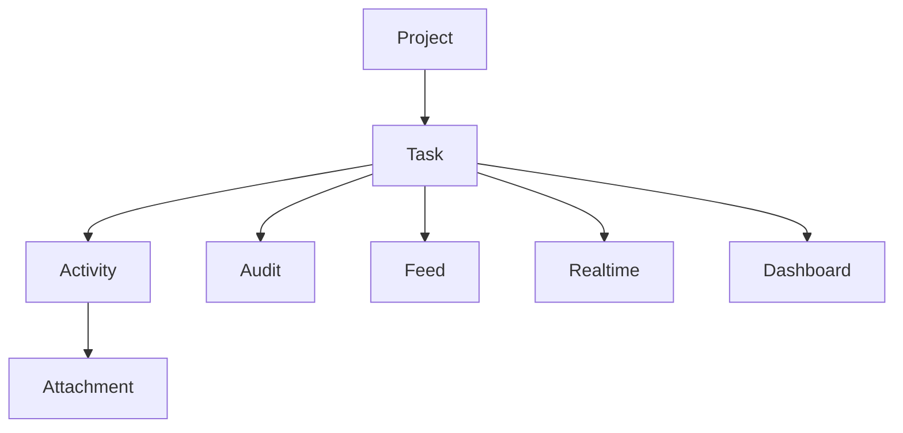

---

# 2. Objetivo del módulo

El módulo permite gestionar el ciclo de vida completo de las tareas.

Incluye:

- creación;
- edición;
- asignación;
- cambio de prioridad;
- movimiento Kanban;
- finalización;
- reapertura;
- consulta;
- auditoría;
- sincronización realtime.

---

# 3. Responsabilidad arquitectónica

El módulo es responsable de:

- representar la entidad Task;
- controlar su ciclo de vida;
- validar transiciones;
- gestionar asignaciones;
- coordinar actividades;
- generar eventos;
- alimentar el Dashboard;
- alimentar el Activity Feed;
- producir auditoría;
- publicar eventos WebSocket.

No debe encargarse directamente de:

- autenticación;
- almacenamiento de archivos;
- entrega de notificaciones;
- render HTML;
- autorización global.

---

# 4. Límites del agregado

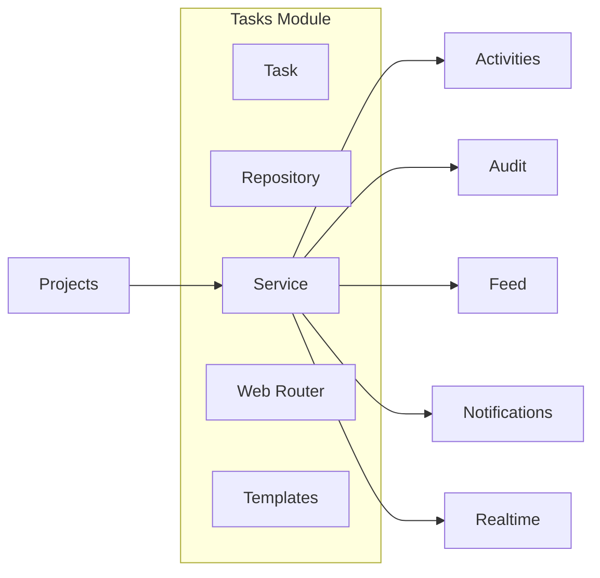

---

# 5. Principios de diseño

El módulo sigue:

- agregado único;
- Repository Pattern;
- Service Layer;
- SSR + Progressive Enhancement;
- eventos de dominio;
- autorización contextual;
- transacciones atómicas;
- consistencia eventual;
- trazabilidad completa.

---

# 6. Arquitectura

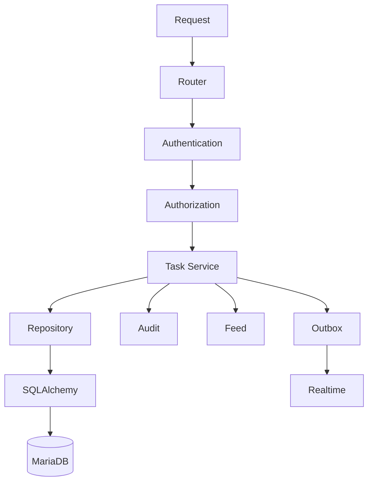

---

# 7. Organización del módulo

```text
modules/
└── tasks/
    ├── task_model.py
    ├── task_repository.py
    ├── task_service.py
    ├── task_schemas.py
    ├── task_permissions.py
    ├── task_events.py
    ├── task_exceptions.py
    ├── task_view_service.py
    └── tasks_web.py
```

---

# 8. Papel de Task

Task representa una unidad de trabajo planificable.

Es el agregado raíz del trabajo operativo.

Todas las actividades dependen de una tarea.

---

# 9. Entidad Task

Campos conceptuales:

```text
id_task

project_id

title

description

status

priority

position

assigned_to

created_by

created_at

updated_by

updated_at

completed_at

due_date

version
```

---

# 10. Modelo relacional

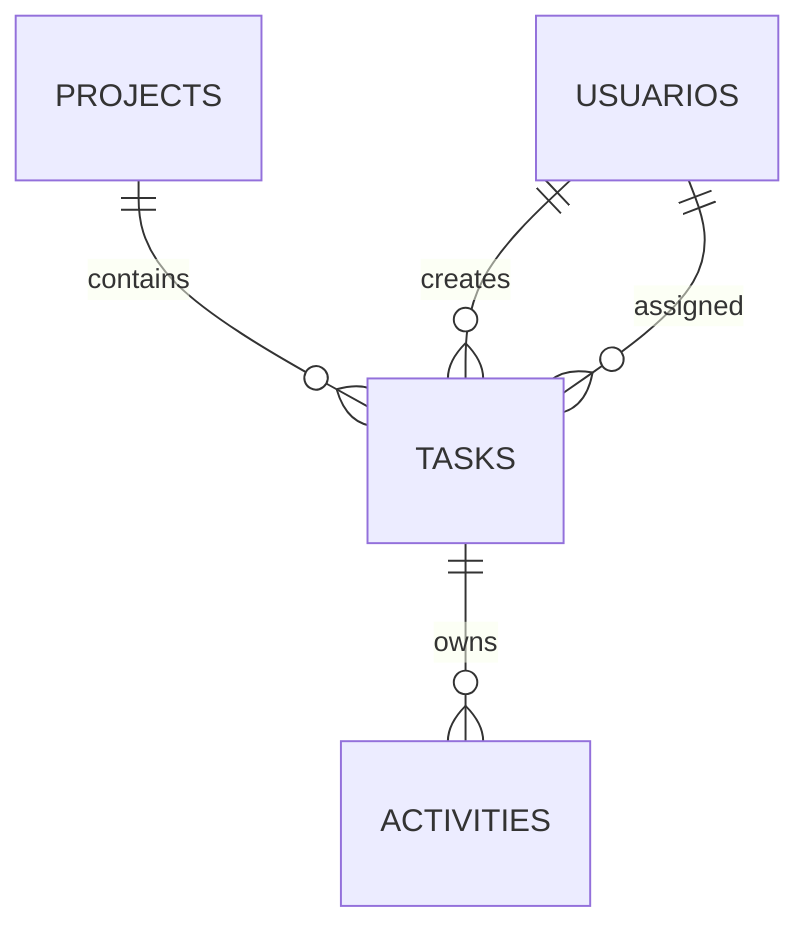

---

# 11. Campos principales

| Campo | Descripción |
|---------|------------|
| id_task | PK |
| project_id | Proyecto |
| title | Título |
| description | Descripción |
| status | Estado |
| priority | Prioridad |
| assigned_to | Responsable |
| due_date | Fecha límite |
| position | Orden Kanban |
| version | Concurrencia |

---

# 12. Identificador

Debe ser:

- técnico;
- estable;
- único;
- inmutable.

---

# 13. Título

Debe cumplir:

- obligatorio;
- longitud limitada;
- sin HTML inseguro;
- sin cadenas vacías.

---

# 14. Descripción

Puede contener:

- texto;
- Markdown futuro;
- referencias.

Nunca HTML arbitrario.

---

# 15. Estado

Estados actuales:

```text
todo

doing

done
```

---

# 16. Máquina de estados

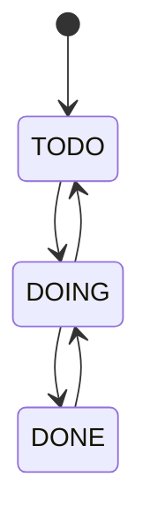

---

# 17. Estado TODO

Representa trabajo pendiente.

Características:

- aún no iniciado;
- visible en Kanban;
- asignable;
- editable.

---

# 18. Estado DOING

Representa trabajo en ejecución.

Puede:

- generar actividades;
- recibir adjuntos;
- actualizar progreso.

---

# 19. Estado DONE

Representa trabajo finalizado.

Debe registrar:

```text
completed_at
```

Puede reabrirse si la política lo permite.

---

# 20. Prioridad

Prioridades:

```text
low

medium

high
```

Preparado para:

```text
critical
```

---

# 21. Orden Kanban

Cada columna mantiene:

```text
position
```

La posición determina el orden visual.

---

# 22. Posición

Debe cumplir:

```text
position >= 0
```

No debe utilizarse el índice del array del navegador.

---

# 23. Fecha límite

```text
due_date
```

Es opcional.

Puede utilizarse para:

- avisos;
- Dashboard;
- indicadores.

---

# 24. Fecha de finalización

```text
completed_at
```

Debe mantenerse coherente con:

```text
status
```

---

# 25. Usuario asignado

```text
assigned_to
```

Puede ser NULL.

Cuando existe:

- debe pertenecer al proyecto;
- debe estar activo.

---

# 26. Creador

```text
created_by
```

Representa el actor que creó la tarea.

No necesariamente el responsable.

---

# 27. Auditoría temporal

```text
created_at

updated_at

completed_at
```

Todos almacenados en UTC.

---

# 28. Versionado

La entidad incorpora:

```text
version
```

para optimistic locking.

---

# 29. Relaciones

Task mantiene relaciones con:

- Project;
- User;
- Activities;
- Feed;
- Audit.

---

# 30. Relación Project

```text
Project

1

↓

N

Task
```

Toda tarea pertenece exactamente a un proyecto.

---

# 31. Relación Assigned User

```text
Task

↓

User
```

Opcional.

---

# 32. Relación Activities

```text
Task

↓

Activity
```

Toda actividad pertenece a una tarea.

---

# 33. Relación Feed

Los eventos de tarea generan:

```text
Project Activity Feed
```

---

# 34. Relación Dashboard

Las métricas consumen:

- total;
- doing;
- done;
- overdue.

---

# 35. Agregado

Task controla:

- estado;
- prioridad;
- asignación;
- actividades.

---

# 36. Reglas de dominio

Una tarea válida cumple:

- proyecto existente;
- estado válido;
- prioridad válida;
- título obligatorio;
- versión positiva.

---

# 37. Restricción de proyecto

El proyecto debe encontrarse accesible.

No pueden crearse tareas sobre proyectos inexistentes.

---

# 38. Restricción de asignación

Si existe responsable:

```text
assigned_to

↓

ProjectMember
```

Debe pertenecer al proyecto.

---

# 39. Restricción de estado

No existen estados libres.

Sólo:

```text
todo

doing

done
```

---

# 40. Restricción de prioridad

Sólo:

```text
low

medium

high
```

---

# 41. Restricción temporal

```text
completed_at

↓

status=done
```

---

# 42. Restricción de versión

```text
version>=1
```

---

# 43. Restricción de posición

```text
position>=0
```

---

# 44. Restricción de fechas

Cuando existan:

```text
created_at

<=

completed_at
```

---

# 45. Asignación

Proceso:

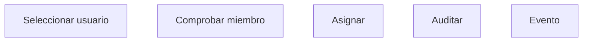

---

# 46. Reasignación

Puede cambiar:

```text
User A

↓

User B
```

Debe generar:

- auditoría;
- feed;
- notificación.

---

# 47. Desasignación

Puede dejar:

```text
assigned_to=NULL
```

La tarea continúa existiendo.

---

# 48. Cambio de prioridad

Produce:

- auditoría;
- realtime;
- actualización visual.

---

# 49. Cambio de estado

Debe utilizar siempre el Service Layer.

Nunca modificar directamente:

```python
task.status="done"
```

desde un router.

---

# 50. Finalización

Proceso:

```text
status=done

↓

completed_at

↓

Audit

↓

Feed

↓

Outbox
```

---

# 51. Reapertura

Puede permitirse:

```text
done

↓

doing
```

o

```text
done

↓

todo
```

Según política.

---

# 52. Eliminación

Debe restringirse.

Preferible:

- sólo coordinadores;
- sin actividades;
- auditoría.

---

# 53. Archivado

Actualmente la tarea no necesita estado archivado.

La conservación depende del proyecto.

---

# 54. Dependencia funcional

Las tareas sobreviven mientras exista el proyecto.

---

# 55. Autorización

Combina:

- permiso global;
- membresía;
- rol contextual;
- estado.

---

# 56. Coordinador

Puede:

- crear;
- editar;
- asignar;
- eliminar.

---

# 57. Miembro

Puede:

- consultar;
- actualizar progreso;
- registrar actividad.

Según configuración.

---

# 58. Administrador

Puede intervenir transversalmente.

Toda actuación queda auditada.

---

# 59. Visibilidad

Sólo miembros autorizados pueden consultar la tarea.

Debe evitarse cualquier IDOR.

---

# 60. Continuación

La **Parte 2** desarrollará:

- Repository Pattern;
- Service Layer;
- operaciones CRUD completas;
- movimiento Kanban;
- drag & drop;
- rutas SSR;
- ViewModels;
- integración con Activities;
- Activity Feed;
- Dashboard;
- WebSocket;
- auditoría;
- notificaciones;
- testing;
- criterios de aceptación.

---

# 61. Repository Pattern

El acceso a datos del módulo Tasks debe centralizarse mediante un repositorio especializado.

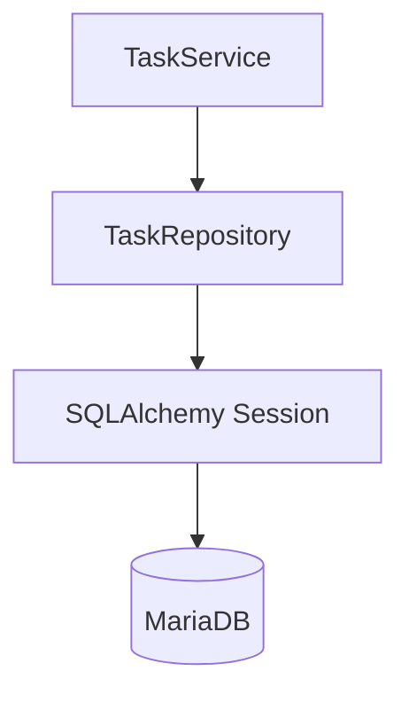

El Repository debe encapsular:

- consultas;
- filtros;
- paginación;
- agregaciones;
- estrategias de carga;
- actualización con control de versión;
- ordenación Kanban;
- persistencia de tareas.

No debe contener:

- autorización;
- reglas de transición;
- notificaciones;
- mensajes de interfaz;
- lógica de auditoría;
- commits independientes del caso de uso.

---

# 62. Estructura recomendada del Repository

```python
class TaskRepository:
    def get_by_id(self, db, task_id):
        ...

    def get_by_id_for_update(self, db, task_id):
        ...

    def get_detail(self, db, task_id):
        ...

    def list_by_project(self, db, project_id, filters):
        ...

    def list_kanban(self, db, project_id):
        ...

    def create(self, db, task):
        ...

    def update(self, db, task):
        ...

    def update_status_and_position(
        self,
        db,
        task_id,
        status,
        position,
        expected_version,
    ):
        ...

    def delete(self, db, task):
        ...

    def count_by_project_and_status(self, db, project_id):
        ...
```

---

# 63. Consulta básica por identificador

La consulta básica debe recuperar únicamente la entidad Task.

```python
def get_by_id(
    self,
    db: Session,
    task_id: int,
) -> Task | None:
    return db.get(Task, task_id)
```

Debe reservarse para casos donde no sean necesarias relaciones adicionales.

---

# 64. Consulta de detalle

El detalle puede necesitar:

- proyecto;
- usuario asignado;
- creador;
- actividades recientes;
- permisos contextuales;
- metadatos de concurrencia.

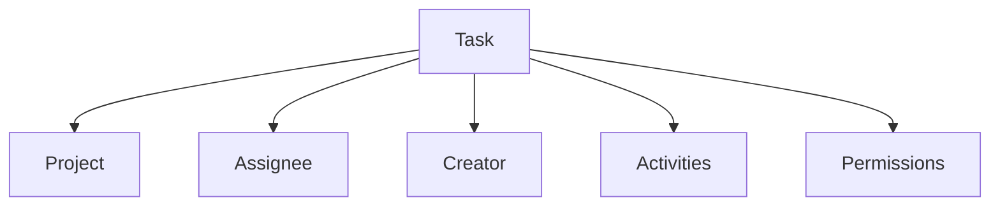

No debe resolverse mediante un JOIN universal.

---

# 65. Estrategias de carga ORM

| Relación | Estrategia recomendada |
|---|---|
| `Task.project` | `joinedload` |
| `Task.assignee` | `joinedload` |
| `Task.creator` | `joinedload` |
| `Task.activities` | Consulta paginada o `selectinload` limitado |
| `Activity.attachments` | Carga bajo demanda |

Ejemplo:

```python
stmt = (
    select(Task)
    .options(
        joinedload(Task.project),
        joinedload(Task.assignee),
        joinedload(Task.creator),
    )
    .where(Task.id_task == task_id)
)
```

---

# 66. Consulta Kanban

El Kanban debe recuperar las tareas del proyecto ordenadas por:

```text
status

position
```

Consulta conceptual:

```sql
SELECT
    t.id_task,
    t.title,
    t.description,
    t.status,
    t.priority,
    t.position,
    t.assigned_to,
    t.due_date,
    t.version,
    u.nombre,
    u.apellidos
FROM tasks t
LEFT JOIN usuarios u
    ON u.id_usuario = t.assigned_to
WHERE t.project_id = :project_id
ORDER BY
    t.status,
    t.position,
    t.id_task;
```

---

# 67. Índice principal del Kanban

Índice recomendado:

```text
(project_id, status, position)
```

Si existe soft delete:

```text
(project_id, deleted_at, status, position)
```

Debe validarse mediante `EXPLAIN`.

---

# 68. Filtros de tareas

El Repository puede soportar:

```text
project_id

status

priority

assigned_to

created_by

due_before

due_after

overdue

text

has_assignee

has_due_date
```

Los filtros deben componerse sin duplicar consultas.

---

# 69. Ordenación de listados

Campos permitidos:

```text
created_at

updated_at

due_date

priority

status

position

title
```

La ordenación no debe aceptar nombres de columnas arbitrarios provenientes del cliente.

Debe existir una lista blanca.

---

# 70. Paginación

Los listados fuera del Kanban deben paginarse.

Entrada:

```text
page

size

sort

direction

filters
```

Salida:

```text
items

page

size

total

pages
```

---

# 71. Conteos agregados

El Dashboard y el resumen del proyecto deben obtener conteos mediante SQL.

```sql
SELECT
    status,
    COUNT(*) AS total
FROM tasks
WHERE project_id = :project_id
GROUP BY status;
```

No debe utilizarse:

```python
len(project.tasks)
```

para colecciones grandes.

---

# 72. Tareas vencidas

Una tarea está vencida cuando:

```text
due_date < fecha actual

AND

status != done
```

Consulta conceptual:

```sql
SELECT COUNT(*)
FROM tasks
WHERE project_id = :project_id
  AND due_date < CURRENT_DATE
  AND status <> 'done';
```

La fecha actual debe calcularse de forma coherente con la zona horaria funcional.

---

# 73. Control de versión en Repository

La actualización concurrente debe utilizar el campo `version`.

```sql
UPDATE tasks
SET
    title = :title,
    description = :description,
    version = version + 1,
    updated_at = :updated_at,
    updated_by = :updated_by
WHERE id_task = :task_id
  AND version = :expected_version;
```

Resultado esperado:

```text
1 fila actualizada
```

Si el resultado es cero:

```text
TaskVersionConflictError
```

---

# 74. Actualización de estado y posición

Debe ejecutarse mediante una operación específica.

```python
def update_status_and_position(
    self,
    db: Session,
    *,
    task_id: int,
    status: TaskStatus,
    position: int,
    expected_version: int,
    updated_by: int,
) -> bool:
    ...
```

No debe realizarse una actualización genérica desde el router.

---

# 75. Bloqueo pesimista

Puede utilizarse `SELECT ... FOR UPDATE` cuando sea necesario reordenar varias tareas dentro de la misma columna.

```python
stmt = (
    select(Task)
    .where(
        Task.project_id == project_id,
        Task.status == target_status,
    )
    .with_for_update()
)
```

Debe evitarse bloquear tareas de otros proyectos.

---

# 76. Repositorio y transacciones

El Repository no debe ejecutar `commit()` por defecto.

Puede utilizar:

```text
add

flush

refresh
```

El Service Layer controla:

```text
commit

rollback
```

Esto permite que la modificación de la tarea, auditoría, feed, notificaciones y Outbox formen una única transacción.

---

# 77. Service Layer

El Service Layer concentra la lógica del módulo.

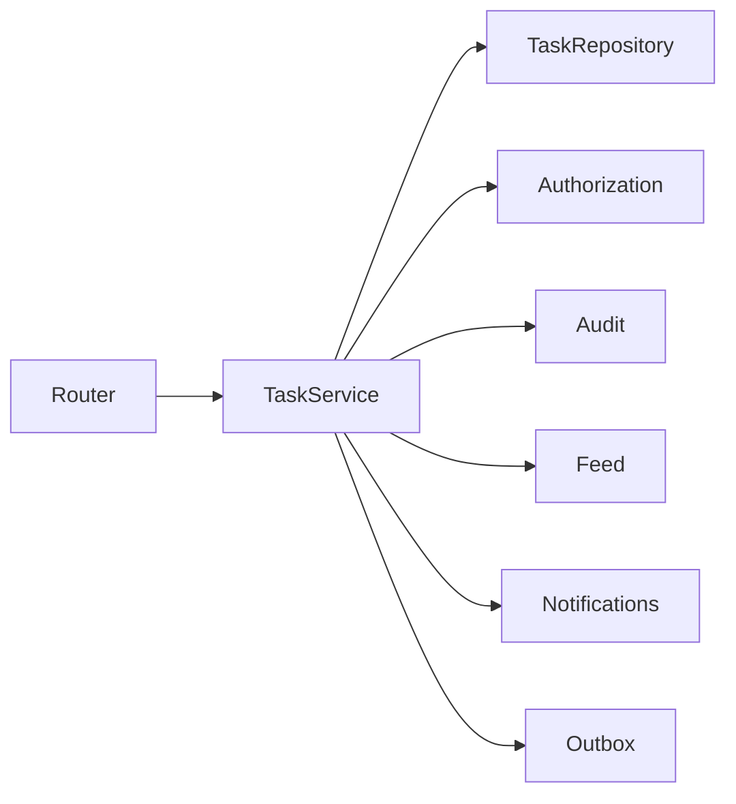

---

# 78. Responsabilidades del Service

Debe:

- validar el proyecto;
- validar el actor;
- resolver autorización;
- validar el usuario asignado;
- validar transiciones;
- coordinar el Repository;
- controlar la transacción;
- registrar auditoría;
- generar feed;
- crear notificaciones;
- registrar eventos Outbox;
- devolver DTOs.

---

# 79. Casos de uso principales

```text
CreateTask

UpdateTaskDetails

AssignTask

UnassignTask

ChangeTaskPriority

MoveTask

CompleteTask

ReopenTask

DeleteTask

GetTaskDetail

ListProjectTasks

GetProjectKanban
```

Cada caso de uso debe disponer de reglas, permisos y eventos específicos.

---

# 80. Command de creación

Ejemplo conceptual:

```python
@dataclass(frozen=True)
class CreateTaskCommand:
    project_id: int
    title: str
    description: str | None
    priority: TaskPriority
    assigned_to: int | None
    due_date: date | None
```

El actor debe recibirse separadamente desde el contexto autenticado.

---

# 81. Flujo de creación

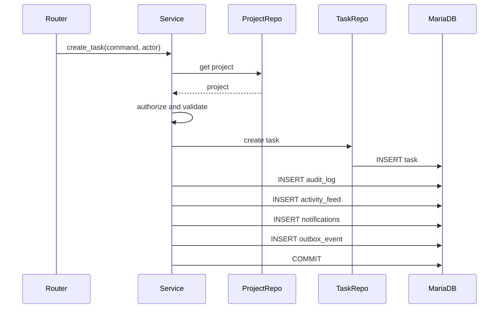

---

# 82. Validaciones de creación

Debe comprobarse:

- proyecto existente;
- proyecto modificable;
- actor autorizado;
- título válido;
- prioridad permitida;
- fecha límite válida;
- usuario asignado válido;
- posición inicial disponible;
- estado inicial permitido.

---

# 83. Estado inicial

El estado inicial recomendado es:

```text
todo
```

Debe declararse de forma explícita en:

- Pydantic;
- Service Layer;
- SQLAlchemy;
- migración;
- pruebas.

---

# 84. Posición inicial

Una nueva tarea puede situarse:

- al final de la columna;
- al principio;
- según prioridad;
- en una posición enviada por el cliente.

La estrategia recomendada inicial es:

```text
al final de TODO
```

---

# 85. Cálculo de posición inicial

Ejemplo:

```sql
SELECT COALESCE(MAX(position), -1) + 1
FROM tasks
WHERE project_id = :project_id
  AND status = 'todo';
```

Esta estrategia puede requerir bloqueo o reintento en escenarios concurrentes.

---

# 86. Resultado de creación

El servicio debe devolver un DTO estable.

```python
@dataclass(frozen=True)
class TaskResult:
    id_task: int
    project_id: int
    title: str
    status: TaskStatus
    priority: TaskPriority
    assigned_to: int | None
    due_date: date | None
    position: int
    version: int
```

---

# 87. Actualización de detalles

`UpdateTaskDetails` debe permitir modificar:

- título;
- descripción;
- fecha límite.

Puede incluir prioridad si no existe un command específico.

No debe permitir modificar directamente:

- proyecto;
- estado;
- posición;
- versión;
- creador;
- timestamps.

---

# 88. Esquema de actualización

```python
class TaskUpdateRequest(BaseModel):
    title: str | None = None
    description: str | None = None
    due_date: date | None = None
    expected_version: int
```

---

# 89. Flujo de actualización

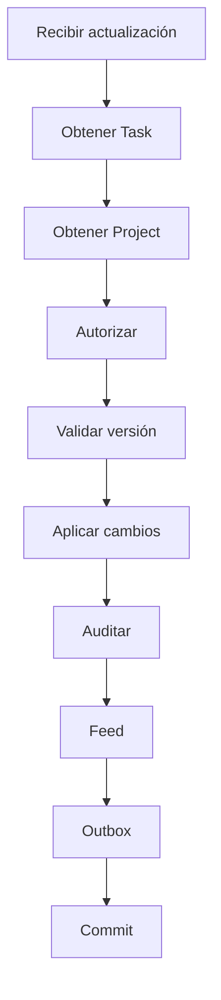

---

# 90. Asignación de tarea

`AssignTask` debe validar:

1. tarea existente;
2. proyecto existente;
3. actor autorizado;
4. usuario destino existente;
5. usuario activo;
6. membresía activa;
7. proyecto modificable;
8. versión esperada.

---

# 91. Flujo de asignación

```mermaid
sequenceDiagram
    participant Actor
    participant TaskService
    participant MemberRepo
    participant TaskRepo
    participant DB as MariaDB

    Actor->>TaskService: assign_task
    TaskService->>TaskRepo: get task
    TaskService->>MemberRepo: verify membership
    MemberRepo-->>TaskService: active member
    TaskService->>TaskRepo: update assigned_to
    TaskService->>DB: audit + feed + notification + outbox
    TaskService->>DB: COMMIT
```

---

# 92. Eventos de asignación

Debe generar:

```text
AuditAction.ASSIGN_TASK

FeedEvent.TASK_ASSIGNED

NotificationType.TASK_ASSIGNED

task.assigned
```

Todos deben compartir:

```text
correlation_id
```

---

# 93. Reasignación

Cuando cambia el responsable:

```text
User A

↓

User B
```

el sistema debe:

- registrar valor anterior y nuevo;
- notificar al nuevo responsable;
- decidir si notifica al anterior;
- actualizar realtime;
- incrementar versión.

---

# 94. Desasignación

`UnassignTask` establece:

```text
assigned_to = NULL
```

Debe generar un evento específico:

```text
task.unassigned
```

La tarea permanece en el mismo proyecto y estado.

---

# 95. Cambio de prioridad

`ChangeTaskPriority` debe:

- validar prioridad;
- validar permisos;
- aplicar optimistic locking;
- registrar auditoría;
- actualizar feed cuando sea relevante;
- emitir evento realtime.

Evento:

```text
task.priority_changed
```

---

# 96. Transición de estado

El cambio de estado debe delegarse a una función de dominio.

```python
def validate_task_transition(
    current: TaskStatus,
    target: TaskStatus,
) -> None:
    ...
```

No basta con que ambos valores pertenezcan al enum.

---

# 97. Matriz de transiciones

| Origen | Destino | Permitido |
|---|---|---:|
| `todo` | `doing` | Sí |
| `todo` | `done` | Configurable |
| `doing` | `todo` | Sí |
| `doing` | `done` | Sí |
| `done` | `doing` | Sí |
| `done` | `todo` | Configurable |
| Igual | Igual | No-op o rechazo |

---

# 98. Finalización

Al entrar en `done`:

```text
completed_at = now(UTC)
```

Debe utilizarse un reloj explícito o una función temporal centralizada.

Además:

- incrementa versión;
- registra auditoría;
- genera feed;
- actualiza métricas;
- notifica cuando proceda;
- publica realtime.

---

# 99. Reapertura

Al salir de `done`:

```text
completed_at = NULL
```

salvo que exista un modelo histórico separado.

Debe registrarse como operación semántica:

```text
task.reopened
```

---

# 100. Movimiento Kanban

`MoveTask` combina:

- cambio de estado;
- cambio de posición;
- control de versión;
- reordenación de columnas;
- evento realtime.

Es una operación de dominio, no una actualización superficial de interfaz.

---

# 101. Command de movimiento

```python
@dataclass(frozen=True)
class MoveTaskCommand:
    task_id: int
    target_status: TaskStatus
    target_position: int
    expected_version: int
```

El proyecto debe derivarse de la propia tarea o incluirse únicamente para reforzar el contexto de la ruta.

---

# 102. Flujo de movimiento

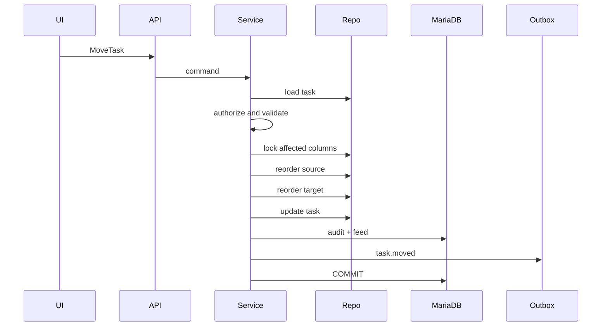

---

# 103. Reordenación dentro de la misma columna

Ejemplo:

```text
Posición anterior: 5

Posición nueva: 2
```

Las tareas en posiciones:

```text
2, 3, 4
```

deben desplazarse una posición hacia abajo.

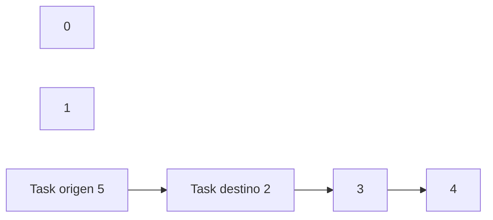

---

# 104. Movimiento entre columnas

Al mover de `todo` a `doing`:

1. cerrar el hueco en `todo`;
2. abrir espacio en `doing`;
3. cambiar estado;
4. asignar nueva posición;
5. actualizar `completed_at` si procede;
6. incrementar versión.

---

# 105. Algoritmo con posiciones enteras

Columna origen:

```sql
UPDATE tasks
SET position = position - 1
WHERE project_id = :project_id
  AND status = :source_status
  AND position > :source_position;
```

Columna destino:

```sql
UPDATE tasks
SET position = position + 1
WHERE project_id = :project_id
  AND status = :target_status
  AND position >= :target_position;
```

Después se actualiza la tarea movida.

---

# 106. Riesgos de posiciones enteras

- múltiples `UPDATE`;
- bloqueos;
- colisiones concurrentes;
- coste creciente en columnas grandes;
- necesidad de transacción.

Para la escala inicial de la plataforma es una estrategia válida y comprensible.

---

# 107. Estrategias futuras de posición

Puede evolucionarse hacia:

- posiciones decimales;
- claves lexicográficas;
- ranking fraccional;
- reequilibrado periódico.

La estrategia no debe cambiarse sin migración y pruebas de concurrencia.

---

# 108. Optimistic locking en Kanban

El cliente envía:

```text
expected_version
```

El backend actualiza únicamente si coincide.

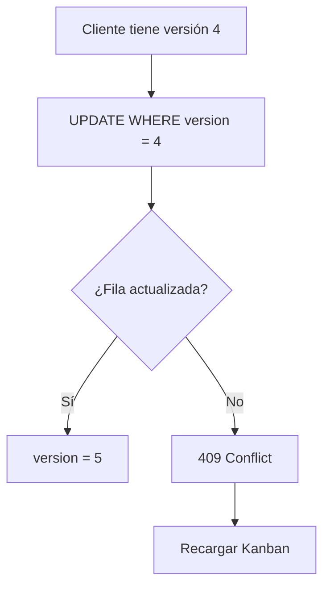

---

# 109. Conflictos de movimiento

Cuando otro usuario ha modificado la tarea:

- no debe sobrescribirse silenciosamente;
- debe devolverse `409 Conflict`;
- la interfaz debe restaurar el estado;
- debe solicitar el Kanban actualizado;
- debe mostrar un toast informativo.

---

# 110. Idempotencia de movimiento

Puede utilizarse un `command_id` o `request_id`.

Si el cliente repite la misma solicitud por un fallo de red, el backend debe evitar aplicar dos veces el movimiento.

Estrategia futura:

```text
UNIQUE(command_id)
```

o almacenamiento temporal de comandos procesados.

---

# 111. Eliminación de tarea

`DeleteTask` debe validar:

- actor autorizado;
- proyecto modificable;
- versión;
- existencia de actividades;
- existencia de adjuntos;
- política de conservación.

---

# 112. Estrategias de eliminación

## Eliminación física

Adecuada únicamente para tareas:

- recién creadas;
- sin actividad;
- sin adjuntos;
- sin relevancia histórica.

## Soft delete

Mediante:

```text
deleted_at
deleted_by
```

Adecuado para preservar trazabilidad.

## Cancelación

Requeriría un nuevo estado funcional.

---

# 113. Recomendación de eliminación

Mientras no exista estado `cancelled`, se recomienda:

- soft delete para tareas con historia;
- eliminación física solo para errores de creación;
- auditoría obligatoria;
- exclusión sistemática de registros eliminados en consultas ordinarias.

---

# 114. Integración con Activities

Una tarea puede contener múltiples actividades.

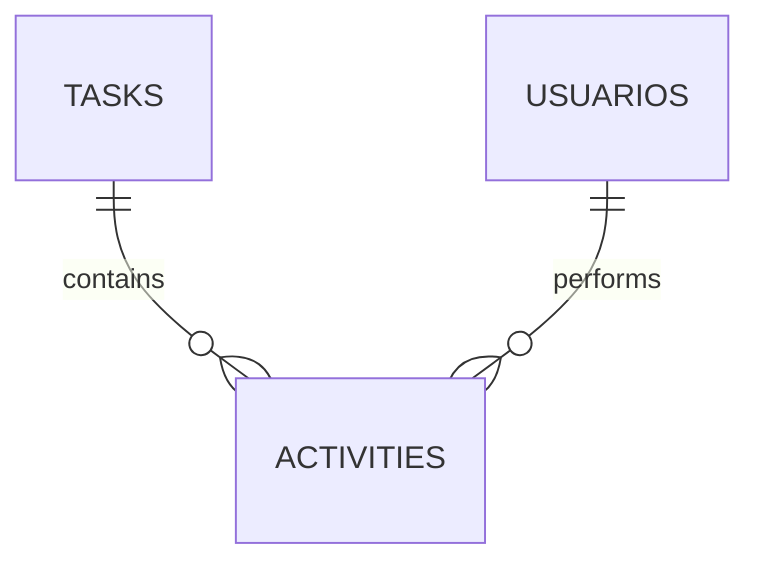

Las actividades deben consultarse mediante paginación.

---

# 115. Creación de actividad desde tarea

El Task Service puede delegar en Activity Service.

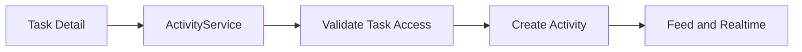

No debe duplicarse lógica de actividad dentro del Task Service.

---

# 116. Activity Feed

Eventos recomendados:

```text
task_created
task_updated
task_assigned
task_unassigned
task_status_changed
task_priority_changed
task_reopened
task_deleted
```

El feed debe mostrar mensajes funcionales.

Ejemplos:

```text
Fran creó la tarea «Diseñar el sensor».
```

```text
Marta movió la tarea a En curso.
```

---

# 117. Auditoría

Acciones recomendadas:

```text
create_task
update_task
assign_task
unassign_task
change_task_status
change_task_priority
reorder_task
delete_task
reopen_task
```

La auditoría debe almacenar:

- actor;
- tarea;
- proyecto;
- valores previos;
- valores posteriores;
- correlation ID;
- fecha;
- origen.

---

# 118. Notificaciones

Tipos principales:

```text
task_assigned
task_status_changed
task_updated
```

Puede ampliarse con:

```text
task_due_soon
task_overdue
task_reopened
task_completed
```

---

# 119. Selección de destinatarios

Ejemplo para asignación:

```text
nuevo assignee
```

Ejemplo para cambio de estado:

```text
assignee
coordinadores
usuarios suscritos
```

Debe excluirse normalmente al actor.

---

# 120. Outbox

Los eventos de tarea deben persistirse en la misma transacción.

Ejemplo:

```json
{
  "event_type": "task.status_changed",
  "aggregate_type": "task",
  "aggregate_id": "84",
  "project_id": 12,
  "payload": {
    "old_status": "todo",
    "new_status": "doing",
    "position": 2,
    "version": 5
  }
}
```

---

# 121. Eventos realtime

Eventos recomendados:

```text
task.created
task.updated
task.assigned
task.unassigned
task.moved
task.completed
task.reopened
task.deleted
```

---

# 122. Contrato realtime

```json
{
  "event_id": "uuid",
  "type": "task.moved",
  "project_id": 12,
  "entity_type": "task",
  "entity_id": 84,
  "occurred_at": "2026-07-26T15:30:00Z",
  "payload": {
    "old_status": "todo",
    "new_status": "doing",
    "old_position": 4,
    "new_position": 2,
    "version": 5
  }
}
```

---

# 123. Rutas SSR

Rutas orientativas:

```text
GET  /projects/{project_id}/tasks
GET  /projects/{project_id}/tasks/create
POST /projects/{project_id}/tasks/create

GET  /tasks/{task_id}
GET  /tasks/{task_id}/edit
POST /tasks/{task_id}/edit
```

---

# 124. Rutas operativas

```text
POST /tasks/{task_id}/assign
POST /tasks/{task_id}/unassign
POST /tasks/{task_id}/priority
POST /tasks/{task_id}/status
POST /tasks/{task_id}/move
POST /tasks/{task_id}/delete
POST /tasks/{task_id}/reopen
```

La convención definitiva debe ser coherente con el router existente.

---

# 125. Ruta de cambio de estado

La ruta ya prevista:

```text
POST /tasks/{task_id}/status
```

debe:

- autenticar;
- autorizar;
- validar payload;
- invocar Task Service;
- registrar auditoría;
- crear evento;
- devolver JSON estable.

---

# 126. Request de cambio de estado

```json
{
  "status": "doing",
  "position": 2,
  "expected_version": 4
}
```

---

# 127. Response de cambio de estado

```json
{
  "ok": true,
  "task": {
    "id": 84,
    "status": "doing",
    "position": 2,
    "completed_at": null,
    "version": 5
  }
}
```

---

# 128. Errores del endpoint

| Situación | Estado |
|---|---:|
| No autenticado | 401 |
| Sin acceso al proyecto | 403 |
| Tarea inexistente | 404 |
| Transición inválida | 422 |
| Versión desactualizada | 409 |
| Error inesperado | 500 |

---

# 129. Rutas y contexto del proyecto

El backend no debe confiar únicamente en un `project_id` enviado por el cliente.

Debe resolver:

```text
Task.project_id
```

y comprobar que coincide con el contexto esperado.

---

# 130. Prevención de IDOR

Para consultar o modificar una tarea:

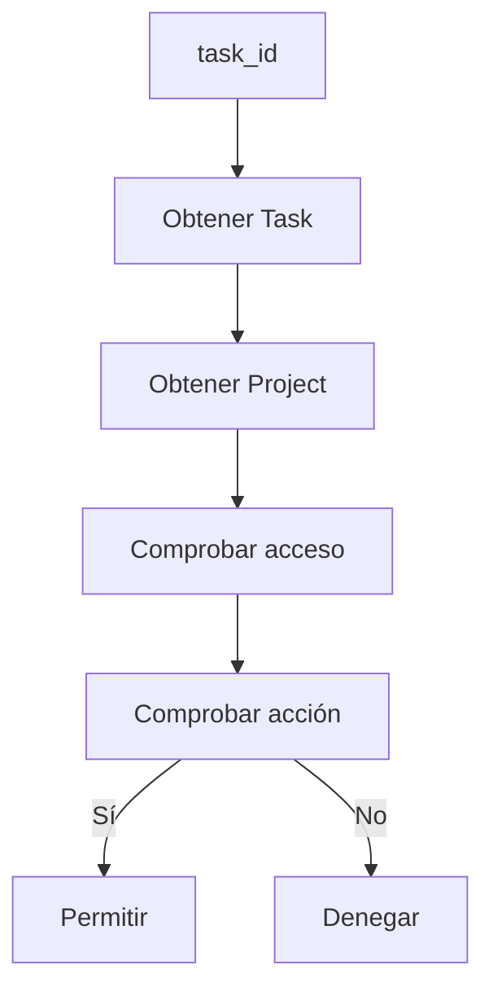

---

# 131. ViewModels

Modelos recomendados:

```text
TaskCardViewModel

TaskDetailViewModel

TaskFormViewModel

TaskKanbanColumnViewModel

TaskAssignmentViewModel
```

---

# 132. `TaskCardViewModel`

Campos orientativos:

```text
id_task
title
description_preview
status
status_label
priority
priority_label
assignee
due_date
is_overdue
position
version
can_edit
can_move
can_assign
```

---

# 133. `TaskDetailViewModel`

Puede contener:

```text
task
project
assignee
creator
activities
attachments_summary
permissions
realtime_config
```

---

# 134. `TaskFormViewModel`

Debe incluir:

```text
form_data
validation_errors
available_priorities
available_members
submit_url
cancel_url
is_edit
expected_version
```

---

# 135. Plantillas

Estructura recomendada:

```text
templates/
└── tasks/
    ├── task_detail.html
    ├── task_form.html
    ├── task_list.html
    └── partials/
        ├── task_card.html
        ├── task_badges.html
        ├── task_assignee.html
        ├── task_actions.html
        └── task_activity_list.html
```

---

# 136. Tarjeta Kanban

Debe mostrar:

- título;
- prioridad;
- responsable;
- fecha límite;
- indicador de vencimiento;
- versión en dataset interno;
- acciones permitidas.

Ejemplo:

```html
<article
    class="task-card"
    data-task-id="{{ task.id_task }}"
    data-task-version="{{ task.version }}"
    data-task-status="{{ task.status }}"
>
    ...
</article>
```

---

# 137. Formulario de tarea

Campos principales:

```text
title
description
priority
assigned_to
due_date
```

El estado y la posición deben gestionarse mediante operaciones específicas.

---

# 138. Validación del formulario

Debe mostrar errores por campo.

Ejemplo:

```text
El título es obligatorio.

La fecha límite no es válida.

El usuario seleccionado no pertenece al proyecto.
```

---

# 139. JavaScript modular

Estructura recomendada:

```text
static/js/tasks/
├── task_form.js
├── task_detail.js
├── task_assignment.js
├── task_kanban.js
├── task_realtime.js
└── task_api.js
```

---

# 140. `task_api.js`

Debe encapsular llamadas HTTP.

Funciones orientativas:

```javascript
export async function moveTask(payload) {}
export async function assignTask(taskId, payload) {}
export async function updateTask(taskId, payload) {}
export async function deleteTask(taskId, payload) {}
```

No debe mezclar manipulación DOM.

---

# 141. `task_kanban.js`

Responsabilidades:

- inicializar drag and drop;
- validar interacción local;
- construir comando;
- mostrar estado de carga;
- invocar API;
- reconciliar resultado;
- revertir ante error.

---

# 142. Flujo Drag & Drop

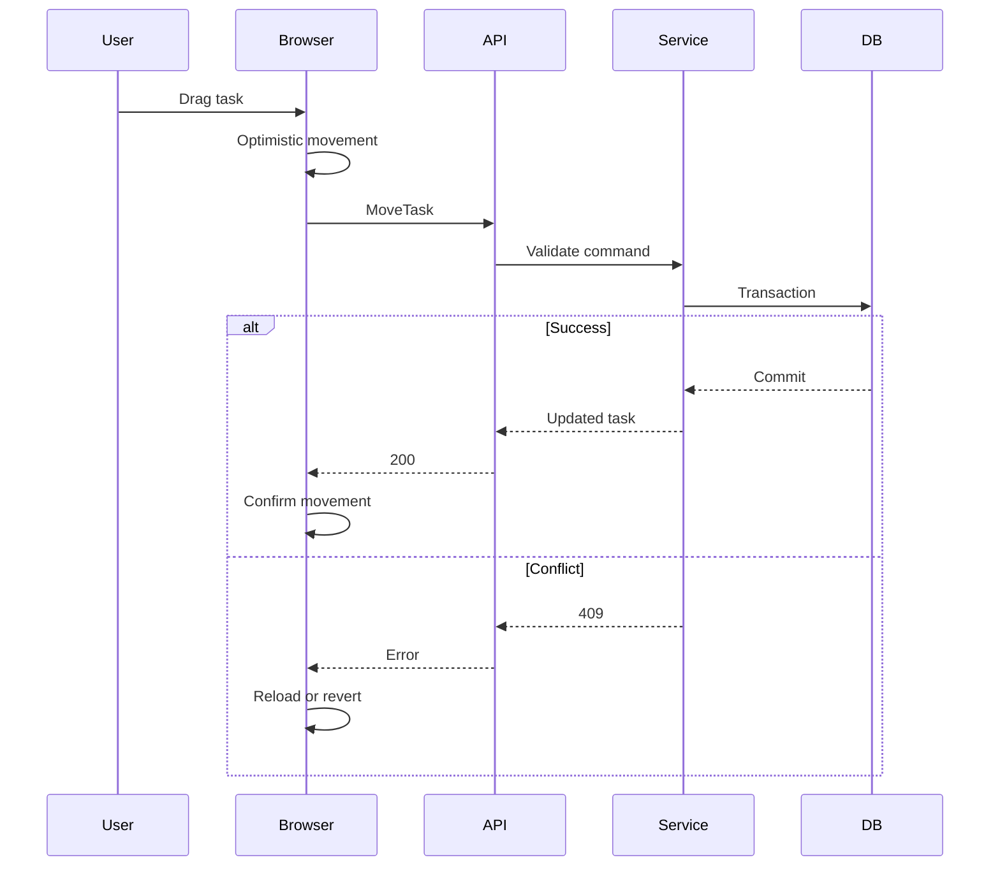

---

# 143. Estado de carga

Durante una operación:

- bloquear temporalmente la tarjeta;
- añadir indicador visual;
- impedir movimientos duplicados;
- conservar accesibilidad;
- liberar el estado al finalizar.

---

# 144. Rollback visual

Ante error:

1. restaurar columna original;
2. restaurar posición;
3. limpiar indicador;
4. mostrar toast;
5. solicitar estado actualizado si hubo conflicto.

---

# 145. Accesibilidad del Kanban

El movimiento no debe depender exclusivamente del ratón.

Debe prepararse una alternativa mediante:

- botones;
- menú de estado;
- teclado;
- formularios accesibles.

---

# 146. Diálogos

Operaciones que requieren confirmación:

- eliminar tarea;
- completar con condiciones pendientes;
- reabrir;
- desasignar;
- mover a estado no habitual.

El diálogo debe mostrar el título de la tarea y la consecuencia.

---

# 147. Toasts

Mensajes orientativos:

```text
Tarea creada correctamente.

Tarea asignada.

La tarea se movió a En curso.

La tarea fue completada.

La tarea ha cambiado en otra sesión. Se ha actualizado el tablero.
```

---

# 148. Realtime en la UI

`task_realtime.js` debe procesar:

```text
task.created
task.updated
task.assigned
task.unassigned
task.moved
task.deleted
```

Debe ignorar eventos duplicados mediante `event_id`.

---

# 149. Reconciliación realtime

Si la tarea existe en DOM:

- actualizar contenido;
- mover tarjeta;
- actualizar versión;
- actualizar badges.

Si no existe:

- insertar tarjeta si corresponde al filtro;
- ignorar;
- solicitar recarga parcial.

---

# 150. Conflicto entre acción local y evento remoto

Puede ocurrir que el mismo cliente reciba por WebSocket el evento originado por su propia petición.

Estrategias:

- deduplicar mediante `event_id`;
- asociar `client_id`;
- reconocer `correlation_id`;
- aplicar el evento de forma idempotente.

---

# 151. Dashboard

El módulo Tasks proporciona métricas:

```text
total_tasks

todo_tasks

doing_tasks

done_tasks

overdue_tasks

assigned_to_me

completion_percentage
```

---

# 152. Métricas por usuario

Consultas posibles:

```text
tareas asignadas

tareas en curso

tareas vencidas

tareas completadas recientemente
```

Deben respetar el contexto de acceso.

---

# 153. Rendimiento

Debe evitarse:

- cargar todas las actividades en el Kanban;
- cargar adjuntos en las tarjetas;
- resolver permisos por tarea individual;
- realizar una consulta por assignee;
- contar tareas en memoria.

---

# 154. Permisos precalculados

El contexto del proyecto puede proporcionar:

```text
can_create_task

can_update_task

can_assign_task

can_move_task

can_delete_task
```

Las tarjetas pueden heredar estos permisos generales y aplicar reglas específicas adicionales.

---

# 155. Excepciones de dominio

Excepciones recomendadas:

```text
TaskNotFoundError

TaskAccessDeniedError

TaskNotEditableError

TaskVersionConflictError

InvalidTaskTransitionError

InvalidTaskPriorityError

InvalidTaskPositionError

InvalidTaskAssigneeError

TaskDeletionNotAllowedError

ProjectNotAvailableForTasksError
```

---

# 156. Traducción HTTP

| Excepción | Estado |
|---|---:|
| `TaskNotFoundError` | 404 |
| `TaskAccessDeniedError` | 403 |
| `TaskVersionConflictError` | 409 |
| `InvalidTaskTransitionError` | 422 |
| `InvalidTaskAssigneeError` | 422 |
| `TaskDeletionNotAllowedError` | 409 |
| `ProjectNotAvailableForTasksError` | 409 |

---

# 157. Logging

Cada operación debe registrar:

```text
operation
task_id
project_id
actor_id
expected_version
result
duration
correlation_id
```

No debe registrar descripciones completas si contienen información sensible.

---

# 158. Observabilidad

Métricas recomendadas:

```text
tasks_created_total

tasks_updated_total

tasks_moved_total

tasks_completed_total

tasks_reopened_total

task_conflicts_total

task_operation_failures_total

task_operation_duration_seconds
```

---

# 159. Health checks funcionales

Procesos de consistencia pueden detectar:

- tareas con estado inválido;
- posiciones duplicadas;
- assignees no miembros;
- tareas completadas sin `completed_at`;
- versiones inválidas;
- tareas activas en proyectos archivados cuando no esté permitido.

---

# 160. Consultas de consistencia

Tareas con assignee inválido:

```sql
SELECT t.id_task
FROM tasks t
LEFT JOIN project_members pm
    ON pm.project_id = t.project_id
   AND pm.user_id = t.assigned_to
   AND pm.active = TRUE
WHERE t.assigned_to IS NOT NULL
  AND pm.user_id IS NULL;
```

---

# 161. Posiciones duplicadas

```sql
SELECT
    project_id,
    status,
    position,
    COUNT(*)
FROM tasks
GROUP BY
    project_id,
    status,
    position
HAVING COUNT(*) > 1;
```

La conveniencia de una restricción única depende del algoritmo de reordenación y del estado transitorio durante la transacción.

---

# 162. Tareas completadas incoherentes

```sql
SELECT id_task
FROM tasks
WHERE
    (status = 'done' AND completed_at IS NULL)
    OR
    (status <> 'done' AND completed_at IS NOT NULL);
```

---

# 163. Continuación

La **Parte 3** completará `29_TASKS_MODULE.md` con:

- integración avanzada con Project, Activities, Attachments, Notifications, Dashboard y Activity Feed;
- arquitectura realtime completa;
- seguridad;
- CSRF;
- validación;
- concurrencia;
- rendimiento;
- caché;
- pruebas unitarias, de integración, web, Selenium y WebSocket;
- fixtures;
- datos de prueba;
- criterios de aceptación;
- checklist enterprise;
- evolución futura;
- conclusiones.

---

# 164. Integración con Projects

El módulo Tasks depende funcionalmente del módulo Projects.

Toda tarea debe pertenecer exactamente a un proyecto válido.

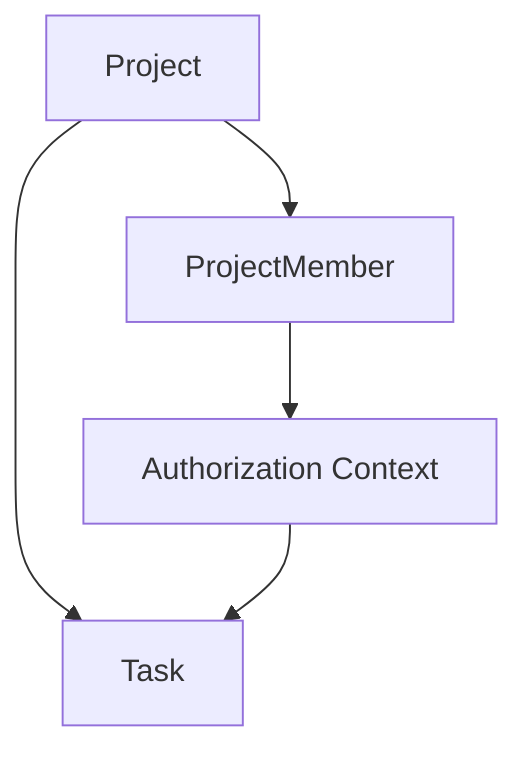

El proyecto proporciona:

- contexto de seguridad;
- miembros asignables;
- estado operativo;
- canal realtime;
- métricas;
- activity feed;
- reglas de visibilidad.

---

# 165. Validación del proyecto

Antes de crear o modificar una tarea debe comprobarse:

- el proyecto existe;
- el proyecto no está eliminado;
- el proyecto permite modificaciones;
- el actor puede acceder;
- el actor dispone del permiso requerido;
- el estado del proyecto permite la operación.

---

# 166. Proyecto archivado

Una tarea perteneciente a un proyecto archivado debe considerarse de solo lectura.

Normalmente debe impedirse:

- editar título;
- cambiar prioridad;
- asignar responsable;
- mover en Kanban;
- registrar nuevas actividades;
- eliminar.

Puede permitirse:

- consulta;
- exportación;
- auditoría;
- restauración administrativa.

---

# 167. Proyecto completado

La política debe definir si un proyecto completado permite:

- reabrir tareas;
- añadir actividad;
- corregir datos;
- reasignar tareas.

La recomendación es mantenerlo en modo de solo lectura salvo operación explícita de reapertura del proyecto.

---

# 168. Proyecto cancelado

Las tareas de un proyecto cancelado deben conservarse como histórico.

No deben continuar recibiendo cambios ordinarios.

Puede resultar necesario distinguir en el futuro entre:

```text
tarea completada

tarea cancelada

tarea pendiente al cancelar el proyecto
```

---

# 169. Integración con ProjectMember

La asignación y autorización contextual dependen de `ProjectMember`.

```mermaid
erDiagram
    PROJECTS ||--o{ PROJECT_MEMBERS : contains
    USUARIOS ||--o{ PROJECT_MEMBERS : participates
    PROJECTS ||--o{ TASKS : contains
    USUARIOS ||--o{ TASKS : assigned
```

---

# 170. Miembros asignables

Un usuario es asignable cuando:

```text
ProjectMember.project_id = Task.project_id

AND

ProjectMember.user_id = target_user_id

AND

ProjectMember.active = TRUE
```

También debe comprobarse que el usuario global está activo.

---

# 171. Salida de un miembro

Cuando un miembro abandona el proyecto debe definirse qué ocurre con sus tareas.

Opciones:

1. desasignar automáticamente;
2. impedir la baja mientras tenga tareas abiertas;
3. reasignar dentro de la misma operación;
4. conservar la asignación histórica solo para tareas finalizadas.

La estrategia recomendada es:

- bloquear la baja si tiene tareas activas, o
- exigir una reasignación explícita.

---

# 172. Baja de miembro con tareas activas

Flujo recomendado:

```mermaid
flowchart TD
    A[Solicitar retirada]
    B[Buscar tareas activas asignadas]
    C{¿Existen?}
    D[Solicitar reasignación]
    E[Desasignar o reasignar]
    F[Retirar miembro]

    A --> B
    B --> C
    C -->|Sí| D
    D --> E
    E --> F
    C -->|No| F
```

---

# 173. Integración con Activities

Las actividades representan trabajo, comentarios, progreso o evidencias asociadas a una tarea.

```text
Task

1

↓

N

Activity
```

La tarea proporciona:

- proyecto;
- permisos;
- visibilidad;
- contexto del feed;
- canal realtime.

---

# 174. Creación de actividad

Antes de crear una actividad debe verificarse:

- tarea existente;
- acceso al proyecto;
- estado de la tarea;
- estado del proyecto;
- autorización;
- contenido válido.

El módulo Tasks no debe implementar internamente la persistencia completa de Activity.

Debe delegar en `ActivityService`.

---

# 175. Actividades y tarea finalizada

Debe definirse si una tarea `done` admite nuevas actividades.

Opciones:

## Permitido

Útil para:

- revisión;
- comentarios;
- evidencias finales;
- correcciones.

## Restringido

Solo coordinadores o administradores pueden añadir actividad.

## Bloqueado

La tarea debe reabrirse primero.

La política debe ser consistente en UI y backend.

---

# 176. Integración con Attachments

Los adjuntos se vinculan normalmente a actividades.

```text
Task

↓

Activity

↓

Attachment
```

No deben almacenarse directamente en Task salvo que exista un caso funcional específico.

---

# 177. Autorización de adjuntos

Para descargar un adjunto asociado a una tarea:

1. obtener Attachment;
2. resolver Activity;
3. resolver Task;
4. resolver Project;
5. comprobar acceso;
6. verificar estado del archivo;
7. entregar mediante respuesta segura.

```mermaid
flowchart TD
    A[Attachment ID]
    B[Activity]
    C[Task]
    D[Project]
    E[Authorization]
    F[Secure Download]
    G[Denied]

    A --> B
    B --> C
    C --> D
    D --> E
    E -->|Allowed| F
    E -->|Denied| G
```

---

# 178. Integración con Notifications

El módulo Tasks es uno de los principales productores de notificaciones.

Eventos relevantes:

```text
task_assigned

task_unassigned

task_status_changed

task_priority_changed

task_updated

task_completed

task_reopened

task_due_soon

task_overdue
```

---

# 179. Política de notificaciones

No toda modificación debe generar una notificación.

Debe notificarse cuando el cambio:

- afecta directamente al usuario;
- modifica responsabilidad;
- requiere atención;
- cambia significativamente el estado;
- puede provocar incumplimiento;
- tiene impacto colaborativo.

---

# 180. Notificación de asignación

Destinatario principal:

```text
nuevo responsable
```

Puede incluir:

- título;
- proyecto;
- prioridad;
- fecha límite;
- actor;
- enlace.

Ejemplo conceptual:

```json
{
  "type": "task_assigned",
  "severity": "info",
  "entity_type": "task",
  "entity_id": 84,
  "title": "Nueva tarea asignada",
  "message": "Se te ha asignado la tarea «Diseñar el soporte».",
  "action_url": "/tasks/84"
}
```

---

# 181. Notificación de desasignación

Puede dirigirse al usuario anterior cuando sea relevante.

Debe evitar mensajes confusos si la desasignación forma parte de una reasignación inmediata.

En ese caso pueden generarse eventos diferenciados:

```text
task_unassigned

task_assigned
```

o un único evento:

```text
task_reassigned
```

---

# 182. Notificación de vencimiento próximo

Puede generarse mediante tarea programada.

Regla orientativa:

```text
due_date - today <= threshold

AND

status != done

AND

reminder_not_sent = FALSE
```

Debe evitarse enviar recordatorios duplicados.

---

# 183. Notificación de tarea vencida

Una tarea está vencida cuando:

```text
due_date < current_date

AND

status != done
```

Puede notificarse a:

- responsable;
- coordinador;
- creador;
- usuarios suscritos.

---

# 184. Integración con Dashboard

El módulo expone datos agregados para:

- Dashboard global;
- Dashboard de proyecto;
- panel personal;
- estadísticas del coordinador.

---

# 185. Métricas globales

Ejemplos:

```text
tareas totales

tareas abiertas

tareas finalizadas

tareas vencidas

tareas asignadas al usuario

tareas sin responsable
```

---

# 186. Métricas por proyecto

```text
todo_count

doing_count

done_count

overdue_count

unassigned_count

completion_percentage
```

---

# 187. Métricas por usuario

```text
assigned_total

assigned_doing

assigned_overdue

completed_last_7_days

average_completion_time
```

---

# 188. Cálculo de progreso

Fórmula básica:

```text
done_count / total_count * 100
```

Cuando `total_count = 0`:

```text
completion_percentage = 0
```

o mostrar:

```text
Sin tareas
```

---

# 189. Integración con Activity Feed

El módulo Tasks produce eventos funcionales visibles por los miembros.

Catálogo recomendado:

```text
task_created

task_updated

task_assigned

task_unassigned

task_priority_changed

task_status_changed

task_completed

task_reopened

task_deleted
```

---

# 190. Mensajes del feed

Ejemplos:

```text
Fran creó la tarea «Montar el sensor».
```

```text
Lucía asignó la tarea a Pablo.
```

```text
Pablo movió la tarea a En curso.
```

```text
Pablo completó la tarea.
```

---

# 191. Snapshot del feed

El feed debe conservar datos mínimos para seguir siendo comprensible aunque cambie la tarea.

Ejemplo:

```json
{
  "task_id": 84,
  "task_title": "Montar el sensor",
  "old_status": "todo",
  "new_status": "doing"
}
```

---

# 192. Integración con Audit

La auditoría debe registrar operaciones con mayor precisión técnica que el feed.

Ejemplo para movimiento:

```json
{
  "action": "change_task_status",
  "resource_type": "task",
  "resource_id": "84",
  "project_id": 12,
  "old_values": {
    "status": "todo",
    "position": 4,
    "version": 3
  },
  "new_values": {
    "status": "doing",
    "position": 1,
    "version": 4
  }
}
```

---

# 193. Acciones auditables

```text
create_task

update_task

assign_task

unassign_task

change_task_priority

change_task_status

reorder_task

complete_task

reopen_task

delete_task

restore_task
```

---

# 194. Integración con Outbox

Los eventos que deban salir del límite transaccional deben registrarse en Outbox.

```mermaid
flowchart TD
    A[Task Service]
    B[Task Update]
    C[Audit]
    D[Feed]
    E[Notification]
    F[Outbox]
    G[Commit]
    H[Worker]
    I[WebSocket]

    A --> B
    B --> C
    C --> D
    D --> E
    E --> F
    F --> G
    G --> H
    H --> I
```

---

# 195. Eventos Outbox

Catálogo recomendado:

```text
task.created

task.updated

task.assigned

task.unassigned

task.priority_changed

task.moved

task.completed

task.reopened

task.deleted
```

---

# 196. Payload mínimo

Todo evento debe incluir:

```text
event_id

event_type

task_id

project_id

actor_id

occurred_at

correlation_id

version
```

El payload específico dependerá del evento.

---

# 197. Arquitectura realtime

El módulo Tasks utiliza la sala WebSocket del proyecto.

```text
project:{project_id}
```

No se recomienda una sala distinta por cada tarea salvo un caso de uso real.

---

# 198. Flujo realtime

```mermaid
sequenceDiagram
    participant UserA
    participant API
    participant DB as MariaDB
    participant Worker
    participant WS
    participant UserB

    UserA->>API: Move task
    API->>DB: Transaction + Outbox
    DB-->>API: Commit
    Worker->>DB: Read pending event
    Worker->>WS: Broadcast task.moved
    WS-->>UserB: Update Kanban
```

---

# 199. Contrato de evento

Ejemplo:

```json
{
  "event_id": "2f7db070-6e49-47d7-95e8-1fa359f43a39",
  "event_type": "task.moved",
  "project_id": 12,
  "entity_type": "task",
  "entity_id": 84,
  "actor_id": 7,
  "occurred_at": "2026-07-26T16:10:00Z",
  "correlation_id": "7b6c5e14-b2e8-46d9-bf80-c8393922bce2",
  "payload": {
    "old_status": "todo",
    "new_status": "doing",
    "old_position": 3,
    "new_position": 1,
    "version": 5
  }
}
```

---

# 200. Seguridad WebSocket

Antes de unirse a la sala:

- validar JWT de cookie;
- cargar usuario;
- comprobar estado activo;
- resolver proyecto;
- comprobar permiso;
- comprobar membresía;
- registrar conexión.

---

# 201. Revocación de acceso

Si un usuario deja de ser miembro mientras mantiene la conexión:

- debe expulsarse de la sala;
- deben invalidarse futuras operaciones;
- debe recibir un evento de acceso revocado o cerrarse el socket;
- el backend debe seguir validando cada operación HTTP.

---

# 202. Presencia

La presencia puede mostrar:

- usuarios conectados;
- usuario que está viendo el proyecto;
- actividad reciente.

No debe interpretarse como garantía de disponibilidad real.

---

# 203. Reconexión

El cliente debe utilizar backoff progresivo.

Ejemplo:

```text
1 s

2 s

4 s

8 s

16 s

máximo configurable
```

Tras reconectar debe solicitar el estado actual del Kanban.

---

# 204. Pérdida de eventos

WebSocket no garantiza por sí solo que el cliente reciba todos los eventos.

Estrategias:

- `last_event_id`;
- endpoint de sincronización;
- recarga del Kanban;
- snapshot;
- secuencia por proyecto.

---

# 205. Secuencia de eventos

Puede incorporarse:

```text
project_sequence
```

Cada evento del proyecto incrementa una secuencia monotónica.

El cliente puede detectar saltos:

```text
esperado 121

recibido 124

↓

sincronizar
```

---

# 206. Idempotencia

El cliente debe mantener una caché limitada de `event_id`.

Flujo:

```mermaid
flowchart TD
    A[Recibir evento]
    B{¿event_id conocido?}
    C[Ignorar]
    D[Aplicar]
    E[Guardar event_id]

    A --> B
    B -->|Sí| C
    B -->|No| D
    D --> E
```

---

# 207. Seguridad HTTP

Toda ruta de modificación debe protegerse mediante:

- autenticación;
- autorización;
- CSRF;
- validación;
- control de versión;
- límites de entrada.

---

# 208. Protección CSRF

Las operaciones desde formularios o `fetch` con cookies deben enviar token CSRF.

Ejemplo:

```text
X-CSRF-Token
```

El backend debe comprobar:

- presencia;
- validez;
- correspondencia con sesión;
- origen cuando proceda.

---

# 209. Protección IDOR

Nunca debe autorizarse por el mero hecho de que:

```text
task_id existe
```

Debe comprobarse:

```text
task.project_id

↓

project access

↓

effective permission
```

---

# 210. Protección XSS

Los campos:

```text
title

description
```

deben escaparse en Jinja2.

Si se incorpora Markdown:

- sanitizar HTML resultante;
- usar lista blanca;
- bloquear scripts;
- bloquear URLs peligrosas;
- bloquear atributos inseguros.

---

# 211. Mass Assignment

No debe aplicarse directamente el payload sobre la entidad ORM.

Incorrecto:

```python
for key, value in payload.items():
    setattr(task, key, value)
```

Correcto:

```python
task.title = command.title
task.description = command.description
task.due_date = command.due_date
```

---

# 212. Campos protegidos

El cliente nunca debe modificar directamente:

```text
id_task

project_id

created_by

created_at

updated_at

completed_at

version

deleted_at
```

---

# 213. Validación de longitud

Valores orientativos:

```text
title: 1..200

description: límite funcional configurable
```

La longitud debe validarse en:

- Pydantic;
- SQLAlchemy;
- MariaDB;
- formulario.

---

# 214. Validación de fecha límite

Debe comprobarse:

- formato válido;
- coherencia con política del proyecto;
- límites razonables;
- zona horaria si se convierte desde datetime;
- posibilidad de fecha pasada según el caso.

Una fecha pasada puede ser válida al importar o corregir datos, pero debe advertirse.

---

# 215. Concurrencia

El módulo debe soportar:

- ediciones simultáneas;
- movimientos simultáneos;
- asignaciones simultáneas;
- eventos duplicados;
- reconexiones.

---

# 216. Optimistic Locking

Todas las modificaciones relevantes deben comprobar `version`.

```mermaid
sequenceDiagram
    participant ClientA
    participant ClientB
    participant DB as MariaDB

    ClientA->>DB: Read version 5
    ClientB->>DB: Read version 5
    ClientA->>DB: Update where version=5
    DB-->>ClientA: Success, version=6
    ClientB->>DB: Update where version=5
    DB-->>ClientB: Conflict
```

---

# 217. Reordenación concurrente

El reordenado puede requerir:

- bloqueo de filas afectadas;
- orden estable de adquisición de bloqueos;
- transacción corta;
- reintento ante deadlock.

---

# 218. Prevención de deadlocks

Recomendaciones:

- bloquear siempre en el mismo orden;
- limitar filas;
- mantener transacciones cortas;
- evitar llamadas externas durante la transacción;
- reintentar errores transitorios.

---

# 219. Reintentos

Solo deben reintentarse operaciones idempotentes o protegidas por identificador de comando.

No debe repetirse ciegamente una operación si puede duplicar:

- feed;
- notificación;
- auditoría;
- Outbox.

---

# 220. Rendimiento

Las rutas críticas son:

- carga Kanban;
- movimiento;
- detalle;
- tareas personales;
- métricas;
- actividad reciente.

---

# 221. Índices

Índices recomendados:

```text
(project_id, status, position)

(project_id, assigned_to)

(assigned_to, status)

(project_id, due_date, status)

(project_id, priority)

(created_by)

(updated_at)

(deleted_at)
```

---

# 222. Consultas N+1

Debe evitarse:

```text
una consulta de tareas

+

una consulta por assignee

+

una consulta por actividad
```

El Kanban debe cargar assignees mediante JOIN o estrategia equivalente.

Las actividades no deben cargarse en el listado.

---

# 223. Payload del Kanban

Debe contener solo lo necesario:

```text
id

title

status

priority

position

assignee summary

due_date

version

permissions
```

No debe incluir:

- descripción completa;
- actividades;
- adjuntos;
- auditoría;
- notificaciones.

---

# 224. Paginación de actividades

El detalle de una tarea debe cargar actividades mediante:

```text
cursor

o

page/size
```

El primer render puede incluir únicamente las más recientes.

---

# 225. Caché

Puede aplicarse a:

- métricas;
- catálogos de prioridad;
- permisos efectivos;
- resumen de tareas.

No debe cachearse sin invalidación:

- estado Kanban;
- versión;
- asignación;
- posición.

---

# 226. Invalidación

Eventos que invalidan métricas:

```text
task.created

task.deleted

task.moved

task.completed

task.reopened

task.assigned
```

---

# 227. Logging estructurado

Ejemplo:

```json
{
  "event": "task.move",
  "task_id": 84,
  "project_id": 12,
  "actor_id": 7,
  "source_status": "todo",
  "target_status": "doing",
  "expected_version": 4,
  "result": "success",
  "duration_ms": 38,
  "correlation_id": "uuid"
}
```

---

# 228. Privacidad del logging

No debe registrarse por defecto:

- descripción completa;
- cookies;
- JWT;
- contenido de adjuntos;
- datos personales no necesarios;
- payloads completos sin filtrado.

---

# 229. Métricas técnicas

```text
task_create_duration_seconds

task_move_duration_seconds

task_update_duration_seconds

task_conflict_total

task_forbidden_total

task_not_found_total

task_deadlock_retry_total

task_outbox_failure_total
```

---

# 230. Métricas funcionales

```text
tasks_created_total

tasks_completed_total

tasks_reopened_total

tasks_overdue_total

tasks_unassigned_total

task_completion_time_seconds
```

---

# 231. Alertas operativas

Alertas posibles:

- aumento de conflictos;
- movimientos fallidos;
- deadlocks;
- posiciones duplicadas;
- Outbox acumulado;
- WebSocket sin publicación;
- tareas completadas incoherentes;
- assignees inválidos.

---

# 232. Pruebas unitarias

Deben cubrir:

- transición de estado;
- validación de prioridad;
- cálculo de vencimiento;
- finalización;
- reapertura;
- permisos;
- selección de destinatarios;
- construcción de eventos.

---

# 233. Pruebas de transición

Casos mínimos:

```text
todo → doing

doing → done

done → doing

doing → todo

estado igual

valor inválido
```

Deben cubrir transiciones configurables por separado.

---

# 234. Pruebas de finalización

Debe comprobarse:

- `status = done`;
- `completed_at` informado;
- versión incrementada;
- auditoría creada;
- feed creado;
- evento Outbox creado;
- métricas actualizadas.

---

# 235. Pruebas de reapertura

Debe comprobarse:

- estado destino permitido;
- `completed_at` limpiado o gestionado;
- versión incrementada;
- evento correcto;
- notificación según política.

---

# 236. Pruebas de asignación

Casos:

- miembro activo;
- usuario inexistente;
- usuario inactivo;
- no miembro;
- miembro retirado;
- reasignación;
- desasignación;
- mismo usuario ya asignado.

---

# 237. Pruebas Repository

Deben cubrir:

- creación;
- consulta por ID;
- detalle;
- filtros;
- ordenación;
- paginación;
- conteos;
- optimistic locking;
- Kanban;
- tareas vencidas.

---

# 238. Pruebas de integración

Deben ejecutarse sobre una base compatible con MariaDB cuando sea posible.

Casos:

- constraints;
- FK;
- índices;
- transacciones;
- rollback;
- cascadas;
- bloqueo;
- concurrencia.

---

# 239. Prueba de transacción completa

Forzar un fallo después de actualizar la tarea pero antes de crear Outbox.

Resultado esperado:

```text
Task no modificada

Audit no creado

Feed no creado

Notification no creada

Outbox no creado
```

---

# 240. Pruebas Web

Rutas:

- listado;
- detalle;
- creación;
- edición;
- asignación;
- cambio de estado;
- eliminación.

Debe comprobarse:

- estado HTTP;
- redirección;
- mensaje;
- permiso;
- contenido renderizado.

---

# 241. Pruebas de seguridad

Casos:

```text
sin autenticación

usuario no miembro

miembro sin permiso

IDOR entre proyectos

CSRF ausente

CSRF inválido

mass assignment

payload manipulado
```

---

# 242. Pruebas de concurrencia

Escenarios:

- dos usuarios editan versión 5;
- dos usuarios mueven la misma tarea;
- dos usuarios insertan en la misma posición;
- dos asignaciones simultáneas;
- dos workers procesan el mismo evento.

---

# 243. Pruebas WebSocket

Debe comprobarse:

- conexión autorizada;
- rechazo sin acceso;
- recepción de `task.created`;
- recepción de `task.moved`;
- deduplicación;
- reconexión;
- sincronización tras pérdida;
- expulsión tras retirada de membresía.

---

# 244. Pruebas JavaScript

Deben cubrir:

- construcción del comando;
- movimiento optimista;
- rollback;
- manejo de `409`;
- actualización de versión;
- procesamiento idempotente;
- actualización de badges;
- accesibilidad.

---

# 245. Pruebas Selenium

Escenarios recomendados:

1. crear tarea;
2. asignar miembro;
3. mover `todo → doing`;
4. completar;
5. reabrir;
6. editar;
7. observar actualización desde otra sesión;
8. conflicto concurrente;
9. eliminar según política.

---

# 246. Fixtures

Fixtures mínimas:

```text
administrator_user

teacher_user

project_coordinator

project_member

external_user

active_project

archived_project

todo_task

doing_task

done_task

unassigned_task

overdue_task
```

---

# 247. Factories

Se recomienda utilizar factories para crear:

- usuarios;
- proyectos;
- membresías;
- tareas;
- actividades.

Deben permitir sobrescribir:

```text
status

priority

assigned_to

due_date

version
```

---

# 248. Datos de prueba

No deben depender de IDs fijos.

Incorrecto:

```text
task_id = 1
```

Correcto:

```text
task = task_factory(...)
task.id_task
```

---

# 249. Checklist de dominio

- [ ] Toda tarea pertenece a un proyecto.
- [ ] El título es obligatorio.
- [ ] El estado pertenece al enum.
- [ ] La prioridad pertenece al enum.
- [ ] El assignee es miembro activo.
- [ ] La posición es válida.
- [ ] `completed_at` es coherente.
- [ ] La versión es positiva.
- [ ] Las transiciones están controladas.
- [ ] Los proyectos archivados bloquean cambios.

---

# 250. Checklist Repository

- [ ] No contiene autorización.
- [ ] No ejecuta commits aislados.
- [ ] Las consultas están encapsuladas.
- [ ] El Kanban evita N+1.
- [ ] Los listados están paginados.
- [ ] Los conteos usan SQL.
- [ ] El locking está limitado.
- [ ] Los filtros usan lista blanca.
- [ ] Existe control de versión.

---

# 251. Checklist Service Layer

- [ ] Valida proyecto.
- [ ] Resuelve autorización.
- [ ] Valida assignee.
- [ ] Controla transacción.
- [ ] Registra auditoría.
- [ ] Genera feed.
- [ ] Genera notificaciones.
- [ ] Registra Outbox.
- [ ] Traduce errores.
- [ ] Devuelve DTOs.

---

# 252. Checklist HTTP

- [ ] Rutas coherentes.
- [ ] Pydantic valida payload.
- [ ] CSRF activo.
- [ ] IDOR prevenido.
- [ ] Errores funcionales.
- [ ] `409` en conflictos.
- [ ] No existe mass assignment.
- [ ] No se exponen excepciones SQL.

---

# 253. Checklist UI

- [ ] SSR inicial completo.
- [ ] Kanban accesible.
- [ ] Drag and drop reversible.
- [ ] Indicador de carga.
- [ ] Toasts claros.
- [ ] Diálogos en operaciones críticas.
- [ ] Estado vacío.
- [ ] Estado de error.
- [ ] Responsive.
- [ ] Versiones actualizadas en DOM.

---

# 254. Checklist realtime

- [ ] Publicación posterior al commit.
- [ ] `event_id` único.
- [ ] `correlation_id`.
- [ ] Idempotencia cliente.
- [ ] Reconexión con backoff.
- [ ] Reconciliación HTTP.
- [ ] Autorización de sala.
- [ ] Revocación de acceso.
- [ ] Payload estable.
- [ ] Compatibilidad evolutiva.

---

# 255. Checklist observabilidad

- [ ] Logs estructurados.
- [ ] Duración de operaciones.
- [ ] Contadores funcionales.
- [ ] Métricas de conflicto.
- [ ] Métricas Outbox.
- [ ] Alertas de incoherencias.
- [ ] Correlation ID transversal.
- [ ] Datos sensibles excluidos.

---

# 256. Criterios de aceptación

El módulo Tasks se considera correctamente implementado cuando:

- permite crear, consultar y editar tareas;
- permite asignar y desasignar miembros válidos;
- soporta prioridades y fechas límite;
- controla transiciones de estado;
- soporta movimiento Kanban;
- mantiene posiciones consistentes;
- utiliza optimistic locking;
- previene IDOR;
- respeta el estado del proyecto;
- registra auditoría;
- alimenta el Activity Feed;
- genera notificaciones;
- publica eventos realtime después del commit;
- actualiza Dashboard y métricas;
- evita consultas N+1;
- supera pruebas unitarias, de integración, seguridad, concurrencia, WebSocket y Selenium.

---

# 257. Evolución futura

El módulo queda preparado para incorporar:

- subtareas;
- dependencias;
- bloqueos;
- etiquetas;
- estimaciones;
- tiempo registrado;
- checklist;
- comentarios;
- menciones;
- múltiples responsables;
- estado `blocked`;
- estado `cancelled`;
- límites WIP;
- automatizaciones;
- recurrencia;
- plantillas;
- IA para priorización;
- predicción de retrasos;
- recomendaciones de asignación.

---

# 258. Subtareas

Una evolución posible:

```text
Task

↓

Subtask
```

Puede implementarse mediante:

- tabla específica;
- autorrelación `parent_task_id`.

Debe analizarse:

- profundidad;
- progreso;
- permisos;
- Kanban;
- eliminación;
- ciclos.

---

# 259. Dependencias entre tareas

Relación futura:

```text
Task A

bloquea

Task B
```

Tabla:

```text
task_dependencies
```

Debe impedir ciclos.

```mermaid
flowchart LR
    A[Task A] --> B[Task B]
    B --> C[Task C]
```

---

# 260. Estado bloqueado

Puede calcularse a partir de dependencias o persistirse como estado.

La recomendación es diferenciar:

```text
workflow status

blocked condition
```

Una tarea puede estar en `todo` y bloqueada.

---

# 261. Múltiples responsables

La evolución de:

```text
Task.assigned_to
```

a una relación N:M requeriría:

```text
task_assignees
```

Debe aplicarse mediante migración gradual.

---

# 262. Etiquetas

Posible modelo:

```text
task_labels

labels
```

Permitiría:

- clasificación;
- búsqueda;
- filtros;
- automatizaciones.

---

# 263. Estimaciones

Campos futuros:

```text
estimated_minutes

actual_minutes

story_points
```

No deben incorporarse sin un caso de uso claro.

---

# 264. Registro de tiempo

Posible entidad:

```text
task_time_entries
```

Relaciones:

```text
Task

User

StartedAt

EndedAt

Duration
```

---

# 265. Automatizaciones

Ejemplos:

```text
al completar todas las subtareas → completar tarea

al vencer → notificar

al mover a done → cerrar temporizador

al asignar → enviar aviso
```

Deben ejecutarse mediante eventos y workers, no mediante lógica dispersa.

---

# 266. IA aplicada

Capacidades futuras:

- sugerir prioridad;
- estimar duración;
- detectar tareas similares;
- recomendar responsable;
- resumir actividad;
- detectar bloqueos;
- proponer descomposición en subtareas.

La IA nunca debe modificar tareas sin:

- trazabilidad;
- autorización;
- confirmación cuando proceda;
- registro de origen.

---

# 267. Principios definitivos

1. Task es la unidad operativa principal.
2. Toda tarea pertenece a un proyecto.
3. El proyecto define el contexto de autorización.
4. El assignee debe ser miembro activo.
5. Los estados forman una máquina explícita.
6. La posición pertenece a una columna Kanban.
7. Toda modificación relevante incrementa versión.
8. Los conflictos no se sobrescriben silenciosamente.
9. Las actividades dependen de la tarea.
10. Los eventos se persisten antes de publicarse.
11. La auditoría y el feed tienen responsabilidades distintas.
12. WebSocket mejora la experiencia, pero HTTP mantiene la verdad.
13. Las consultas deben evitar N+1.
14. Las eliminaciones deben preservar el histórico cuando proceda.
15. Toda regla crítica debe disponer de pruebas.

---

# 268. Conclusiones

El módulo Tasks constituye el motor operativo de Aula Robótica Platform. Su función no se limita a almacenar títulos y estados, sino que coordina planificación, asignación, colaboración, trazabilidad, métricas y sincronización en tiempo real dentro del contexto seguro de cada proyecto.

El diseño propuesto sitúa la lógica de negocio en el Service Layer, encapsula la persistencia en Repository y mantiene las operaciones críticas dentro de transacciones atómicas. La combinación de validaciones contextuales, optimistic locking, constraints SQL y eventos Outbox permite conservar la integridad incluso en escenarios concurrentes.

La arquitectura del Kanban trata cada movimiento como una operación de dominio que modifica estado, posición y versión, generando auditoría, activity feed y eventos realtime. Esto evita que la interfaz se convierta en la fuente de verdad y permite reconciliar múltiples clientes conectados.

La integración con Projects, Activities, Attachments, Notifications, Dashboard y Activity Feed mantiene límites claros entre módulos. Cada componente conserva su responsabilidad, mientras que los eventos de dominio permiten coordinar efectos transversales sin introducir acoplamiento innecesario.

Gracias a este enfoque, el módulo queda preparado para evolucionar hacia capacidades avanzadas como subtareas, dependencias, múltiples responsables, automatizaciones, analítica e inteligencia artificial, sin comprometer la coherencia, la seguridad ni la mantenibilidad de Aula Robótica Platform.

