# 30_ACTIVITIES_MODULE.md

# Módulo de Actividades

## Parte 1 — Arquitectura, dominio, modelo de datos y ciclo de vida

---

# 1. Introducción

El módulo **Activities** representa el trabajo realmente ejecutado sobre las tareas de Aula Robótica Platform.

Mientras que:

```text
Project
```

define el contexto,

```text
Task
```

define el trabajo planificado,

y

```text
Activity
```

representa la ejecución real de dicho trabajo.

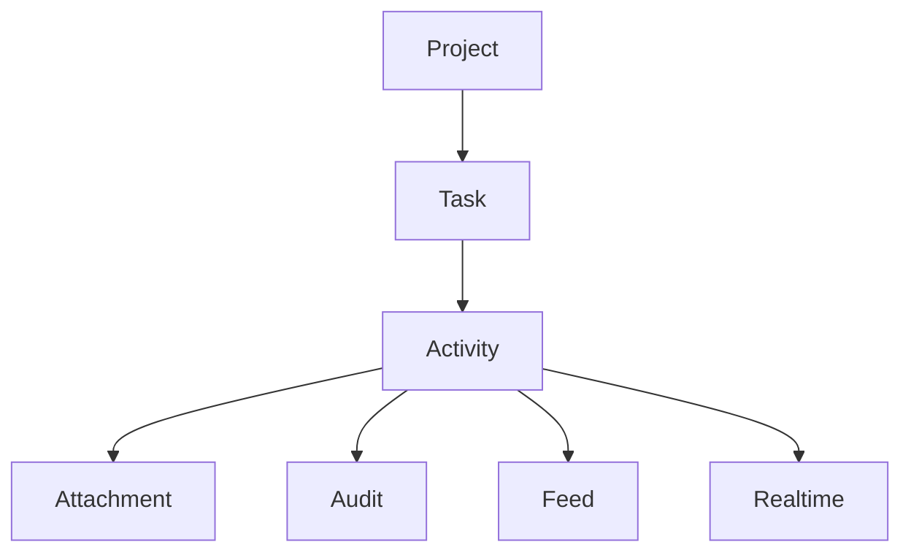

---

# 2. Objetivos del módulo

El módulo debe permitir:

- registrar trabajo realizado;
- documentar avances;
- almacenar evidencias;
- registrar tiempo empleado;
- generar auditoría;
- alimentar el Activity Feed;
- actualizar Dashboard;
- emitir eventos realtime;
- mantener trazabilidad completa.

---

# 3. Responsabilidad arquitectónica

Activities es responsable de:

- representar una actividad;
- asociarla a una tarea;
- registrar autor;
- registrar duración;
- gestionar estado;
- coordinar adjuntos;
- generar eventos.

No debe encargarse de:

- autenticación;
- autorización global;
- almacenamiento físico de archivos;
- renderizado HTML;
- envío directo de notificaciones.

---

# 4. Posición dentro de la arquitectura

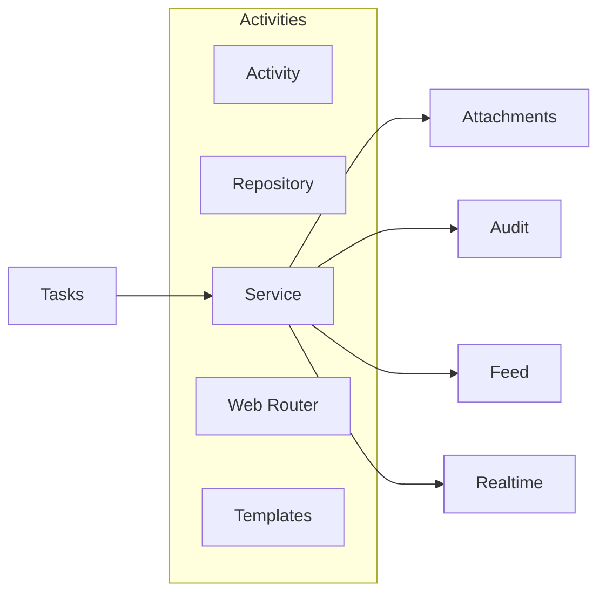

---

# 5. Principios de diseño

El módulo sigue:

- Repository Pattern;
- Service Layer;
- separación de responsabilidades;
- eventos de dominio;
- auditoría completa;
- autorización contextual;
- SSR + Progressive Enhancement;
- transacciones atómicas.

---

# 6. Arquitectura

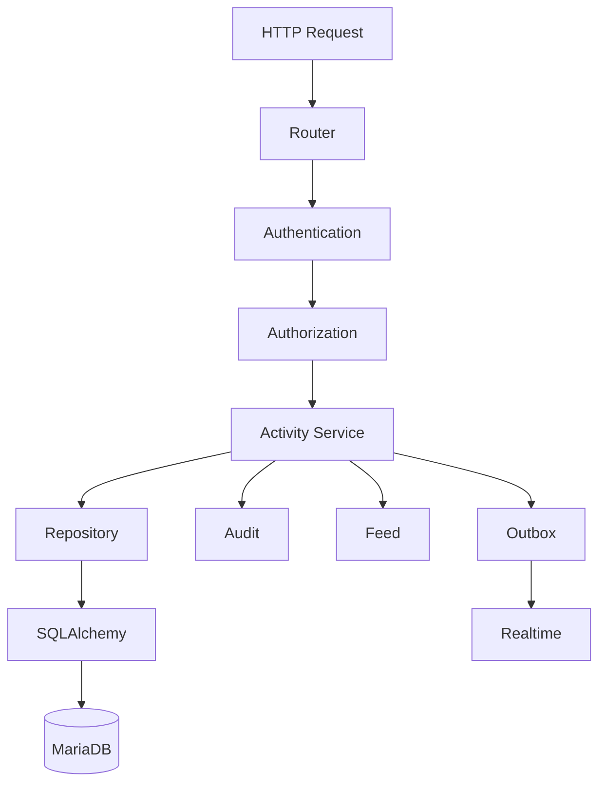

---

# 7. Organización recomendada

```text
modules/
└── activities/
    ├── activity_model.py
    ├── activity_repository.py
    ├── activity_service.py
    ├── activity_schemas.py
    ├── activity_permissions.py
    ├── activity_events.py
    ├── activity_view_service.py
    ├── activity_exceptions.py
    └── activities_web.py
```

---

# 8. Papel de Activity

Una Activity representa una acción realizada por un usuario sobre una tarea.

Puede representar:

- trabajo realizado;
- avance;
- comentario técnico;
- evidencia;
- sesión de trabajo;
- registro temporal.

---

# 9. Modelo conceptual

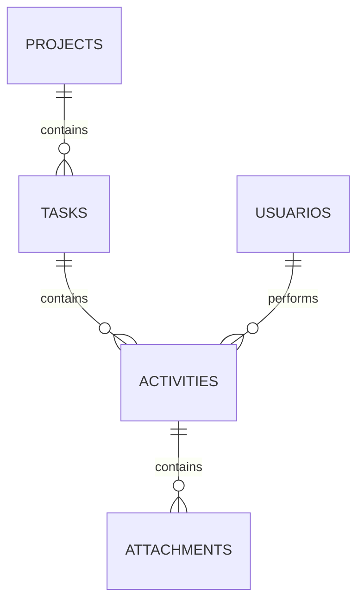

---

# 10. Entidad Activity

Campos conceptuales:

```text
id_activity

task_id

created_by

title

description

status

hours

started_at

finished_at

created_at

updated_at

version
```

---

# 11. Campos principales

| Campo | Descripción |
|---------|------------|
| id_activity | PK |
| task_id | Tarea asociada |
| created_by | Usuario autor |
| title | Resumen |
| description | Descripción |
| status | Estado |
| hours | Tiempo empleado |
| started_at | Inicio |
| finished_at | Fin |
| version | Optimistic locking |

---

# 12. Identificador

Debe ser:

- único;
- técnico;
- inmutable;
- sin significado funcional.

---

# 13. Título

Debe resumir la actividad.

Ejemplos:

```text
Montaje del robot

Configuración del sensor

Pruebas del algoritmo
```

Debe evitarse:

```text
Actividad
```

---

# 14. Descripción

Permite documentar:

- acciones realizadas;
- incidencias;
- resultados;
- decisiones.

Debe admitir ampliaciones futuras como Markdown seguro.

---

# 15. Estado

Estados recomendados:

```text
draft

completed
```

Preparado para:

```text
validated

rejected
```

---

# 16. Máquina de estados

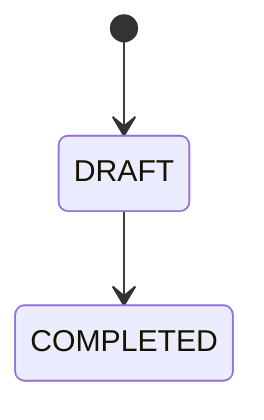

En versiones futuras:

```text
completed

↓

validated
```

---

# 17. Estado Draft

Representa una actividad todavía editable.

Permite:

- modificar texto;
- añadir adjuntos;
- actualizar duración.

---

# 18. Estado Completed

Representa una actividad finalizada.

Debe quedar registrada como parte del histórico del proyecto.

---

# 19. Tiempo invertido

Campo:

```text
hours
```

Puede evolucionar hacia:

```text
minutes

duration
```

---

# 20. Recomendación temporal

Internamente resulta preferible almacenar:

```text
duration_minutes
```

y calcular:

```text
1 h 30 min
```

en la interfaz.

---

# 21. Inicio

```text
started_at
```

Es opcional.

Puede utilizarse para cronómetros futuros.

---

# 22. Finalización

```text
finished_at
```

Permite calcular duración real.

---

# 23. Autor

```text
created_by
```

Representa al usuario que registró la actividad.

No debe modificarse posteriormente.

---

# 24. Fechas de auditoría

```text
created_at

updated_at
```

Siempre en UTC.

---

# 25. Versionado

La entidad incorpora:

```text
version
```

para optimistic locking.

---

# 26. Relaciones

Activity mantiene relaciones con:

- Task;
- User;
- Attachments;
- Audit;
- Feed.

---

# 27. Relación Task

```text
Task

1

↓

N

Activity
```

Toda actividad pertenece exactamente a una tarea.

---

# 28. Relación Usuario

```text
User

1

↓

N

Activity
```

El autor queda registrado permanentemente.

---

# 29. Relación Attachments

```text
Activity

1

↓

N

Attachment
```

Los archivos siempre dependen de una actividad.

---

# 30. Relación Feed

Las actividades generan eventos visibles.

Ejemplo:

```text
Fran registró una actividad.
```

---

# 31. Relación Dashboard

El Dashboard obtiene:

- actividades recientes;
- tiempo invertido;
- productividad;
- actividad por usuario.

---

# 32. Agregado

Activity controla:

- contenido;
- estado;
- duración;
- adjuntos.

---

# 33. Reglas de dominio

Una actividad válida requiere:

- tarea existente;
- usuario autorizado;
- título válido;
- estado válido;
- versión válida.

---

# 34. Restricción Task

No pueden existir actividades sin tarea.

Debe mantenerse la integridad referencial.

---

# 35. Restricción Usuario

El autor debe:

- existir;
- estar activo;
- tener acceso al proyecto.

---

# 36. Restricción Estado

Sólo valores definidos por el enum.

---

# 37. Restricción Duración

La duración debe ser:

```text
>= 0
```

No pueden registrarse tiempos negativos.

---

# 38. Restricción Temporal

Cuando existan:

```text
started_at

<=

finished_at
```

---

# 39. Restricción de versión

```text
version >= 1
```

---

# 40. Restricción de texto

El contenido no puede superar los límites definidos por el dominio.

---

# 41. Dependencia funcional

Las actividades dependen completamente de la existencia de la tarea.

No pueden trasladarse entre tareas arbitrariamente.

---

# 42. Autorización

La autorización depende del contexto:

```text
Project

↓

Task

↓

Activity
```

Nunca únicamente del identificador de actividad.

---

# 43. Coordinador

Puede:

- crear;
- editar;
- validar;
- eliminar.

Según la política del proyecto.

---

# 44. Miembro

Puede:

- registrar actividad propia;
- editar borradores;
- consultar historial autorizado.

---

# 45. Administrador

Puede intervenir transversalmente.

Toda actuación queda auditada.

---

# 46. Visibilidad

Una actividad sólo es visible para usuarios con acceso al proyecto.

Debe evitarse cualquier vulnerabilidad IDOR.

---

# 47. Actividades y tareas finalizadas

La política del proyecto debe decidir si una tarea `done` admite nuevas actividades.

Opciones:

- permitido;
- restringido;
- prohibido.

---

# 48. Integridad histórica

Una actividad nunca debe perder:

- autor;
- fecha;
- contenido;
- contexto.

Incluso si posteriormente cambia la tarea.

---

# 49. Evolución prevista

El modelo queda preparado para incorporar:

- validaciones;
- revisiones;
- firmas;
- cronómetros;
- comentarios;
- IA.

---

# 50. Casos de uso principales

```text
CreateActivity

UpdateActivity

CompleteActivity

DeleteActivity

UploadEvidence

ListActivities

GetActivityDetail
```

---

# 51. Ciclo de vida

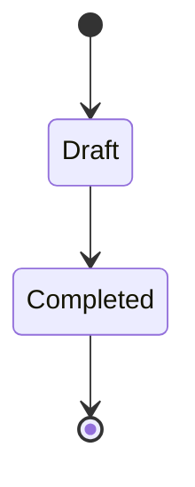

---

# 52. Persistencia

Las actividades deben almacenarse mediante Repository Pattern.

Nunca directamente desde los routers.

---

# 53. Auditoría

Toda operación relevante debe registrar:

- actor;
- actividad;
- acción;
- timestamp;
- valores anteriores;
- valores nuevos.

---

# 54. Eventos

Eventos principales:

```text
activity.created

activity.updated

activity.completed

activity.deleted

attachment.added
```

---

# 55. Integración

El módulo interactúa con:

- Tasks;
- Attachments;
- Dashboard;
- Feed;
- Audit;
- Realtime.

---

# 56. Escalabilidad

El diseño permite:

- miles de actividades;
- múltiples usuarios;
- evidencias;
- trabajo colaborativo.

---

# 57. Consistencia

Toda modificación sigue:

```text
Repository

↓

Commit

↓

Audit

↓

Feed

↓

Outbox

↓

Realtime
```

---

# 58. Principio fundamental

Una Activity representa evidencia objetiva del trabajo realizado.

No es únicamente un comentario.

---

# 59. Preparación futura

El modelo admite:

- validación por profesor;
- evaluación;
- rúbricas;
- IA;
- métricas avanzadas.

---

# 60. Continuación

La **Parte 2** desarrollará:

- Repository Pattern;
- Service Layer;
- CRUD completo;
- integración con Tasks;
- gestión de adjuntos;
- auditoría;
- Activity Feed;
- Dashboard;
- WebSocket;
- ViewModels;
- rutas SSR;
- validaciones;
- control de concurrencia.

---

# 61. Repository Pattern

El acceso a datos del módulo Activities debe centralizarse mediante un repositorio especializado.

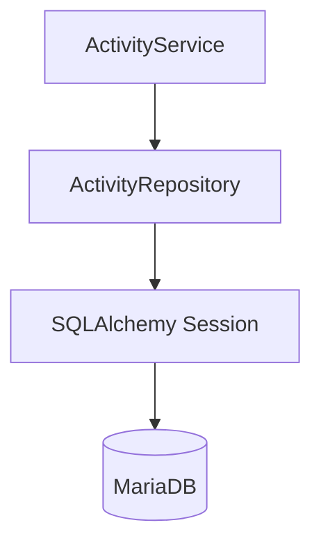

El Repository debe encapsular:

- consultas;
- creación;
- actualización;
- eliminación;
- paginación;
- filtros;
- ordenación;
- control de versión;
- estrategias de carga;
- agregaciones temporales;
- consultas de actividad reciente.

No debe contener:

- autorización;
- reglas de negocio;
- notificaciones;
- mensajes de interfaz;
- publicación WebSocket;
- commits aislados.

---

# 62. Estructura recomendada del Repository

```python
class ActivityRepository:
    def get_by_id(self, db, activity_id):
        ...

    def get_detail(self, db, activity_id):
        ...

    def list_by_task(self, db, task_id, filters):
        ...

    def list_by_project(self, db, project_id, filters):
        ...

    def list_recent(self, db, project_id, limit):
        ...

    def create(self, db, activity):
        ...

    def update(self, db, activity):
        ...

    def complete(
        self,
        db,
        activity_id,
        expected_version,
        completed_at,
    ):
        ...

    def delete(self, db, activity):
        ...

    def sum_duration_by_task(self, db, task_id):
        ...

    def sum_duration_by_project(self, db, project_id):
        ...
```

---

# 63. Consulta básica por identificador

La consulta básica recupera únicamente la entidad Activity.

```python
def get_by_id(
    self,
    db: Session,
    activity_id: int,
) -> Activity | None:
    return db.get(Activity, activity_id)
```

Debe utilizarse cuando no sean necesarias relaciones adicionales.

---

# 64. Consulta de detalle

El detalle puede necesitar:

- tarea;
- proyecto;
- autor;
- adjuntos;
- permisos;
- información temporal;
- versión.

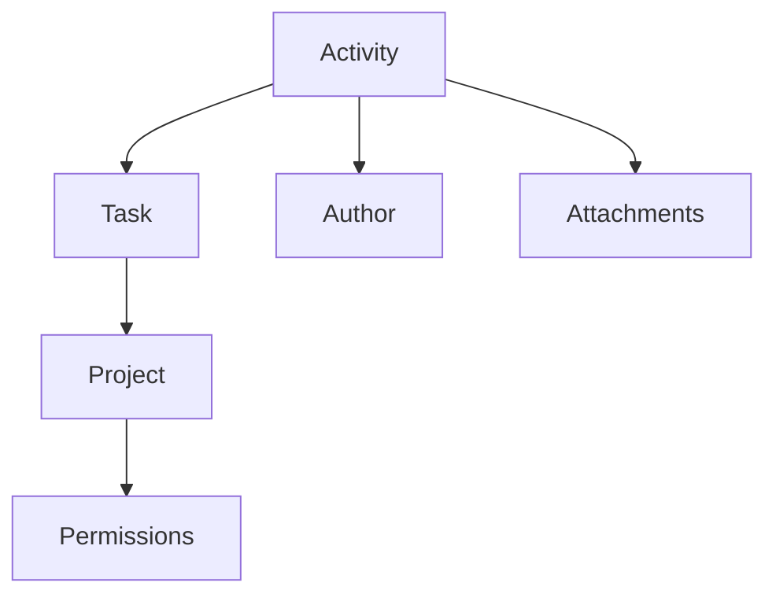

No debe resolverse mediante una consulta que cargue colecciones ilimitadas.

---

# 65. Estrategias de carga ORM

| Relación | Estrategia recomendada |
|---|---|
| `Activity.task` | `joinedload` |
| `Activity.user` | `joinedload` |
| `Task.project` | `joinedload` |
| `Activity.attachments` | `selectinload` o consulta específica |
| Auditoría | Consulta independiente |
| Feed | Consulta independiente |

Ejemplo:

```python
stmt = (
    select(Activity)
    .options(
        joinedload(Activity.task)
        .joinedload(Task.project),
        joinedload(Activity.user),
        selectinload(Activity.attachments),
    )
    .where(Activity.id_activity == activity_id)
)
```

---

# 66. Listado por tarea

Las actividades de una tarea deben ordenarse de forma estable.

Orden recomendado:

```text
created_at DESC

id_activity DESC
```

Consulta conceptual:

```sql
SELECT
    a.id_activity,
    a.task_id,
    a.user_id,
    a.title,
    a.description,
    a.status,
    a.duration_minutes,
    a.started_at,
    a.finished_at,
    a.created_at,
    a.updated_at,
    a.version,
    u.nombre,
    u.apellidos
FROM activities a
JOIN usuarios u
    ON u.id_usuario = a.user_id
WHERE a.task_id = :task_id
ORDER BY
    a.created_at DESC,
    a.id_activity DESC
LIMIT :limit
OFFSET :offset;
```

---

# 67. Paginación

Las actividades deben paginarse cuando puedan crecer de forma indefinida.

Entrada:

```text
page

size

sort

direction

filters
```

Salida:

```text
items

page

size

total

pages
```

Para activity feeds de gran volumen puede evolucionarse hacia paginación por cursor.

---

# 68. Cursor temporal

Un cursor puede construirse con:

```text
created_at

+

id_activity
```

Ejemplo conceptual:

```sql
WHERE
    created_at < :cursor_created_at
    OR (
        created_at = :cursor_created_at
        AND id_activity < :cursor_id
    )
ORDER BY created_at DESC, id_activity DESC
LIMIT :size;
```

---

# 69. Filtros de actividad

El Repository puede admitir:

```text
task_id

project_id

user_id

status

created_from

created_to

started_from

finished_to

has_attachments

text
```

Los filtros deben componerse explícitamente.

---

# 70. Búsqueda textual

La búsqueda inicial puede realizarse sobre:

```text
title

description
```

Mediante:

```text
LIKE
```

o búsqueda FULLTEXT futura cuando el volumen lo justifique.

No deben aplicarse patrones arbitrarios sin normalización.

---

# 71. Ordenación permitida

Campos válidos:

```text
created_at

updated_at

started_at

finished_at

duration_minutes

title
```

Debe utilizarse una lista blanca para impedir inyección mediante nombres de columna.

---

# 72. Agregaciones temporales

El Repository puede proporcionar:

```text
duración total por tarea

duración total por proyecto

duración por usuario

actividades por periodo

última actividad
```

Ejemplo:

```sql
SELECT COALESCE(SUM(duration_minutes), 0)
FROM activities
WHERE task_id = :task_id
  AND status = 'completed';
```

---

# 73. Actividad reciente

Consulta para Dashboard o detalle de proyecto:

```sql
SELECT a.*
FROM activities a
JOIN tasks t
    ON t.id_task = a.task_id
WHERE t.project_id = :project_id
ORDER BY a.created_at DESC
LIMIT :limit;
```

Índices recomendados:

```text
activities(task_id, created_at)

tasks(project_id)
```

---

# 74. Control de versión

Las actualizaciones deben utilizar optimistic locking.

```sql
UPDATE activities
SET
    title = :title,
    description = :description,
    duration_minutes = :duration_minutes,
    updated_at = :updated_at,
    version = version + 1
WHERE id_activity = :activity_id
  AND version = :expected_version;
```

Si no se actualiza ninguna fila:

```text
ActivityVersionConflictError
```

---

# 75. Repository y transacciones

El Repository puede utilizar:

```text
add

flush

refresh
```

No debe ejecutar `commit()` por defecto.

El Service Layer controla:

```text
commit

rollback
```

Esto permite persistir de forma atómica:

- Activity;
- AuditLog;
- ProjectActivityFeed;
- Notification;
- OutboxEvent.

---

# 76. Service Layer

El Service Layer concentra la lógica funcional.

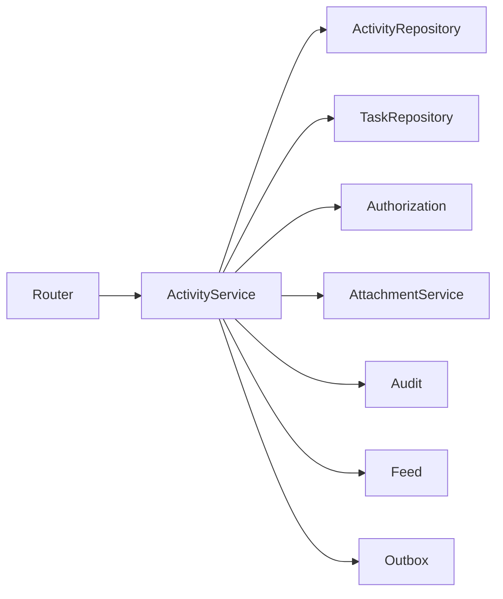

---

# 77. Responsabilidades del Service

Debe:

- validar tarea;
- resolver proyecto;
- validar actor;
- comprobar autorización;
- validar estado de tarea y proyecto;
- validar contenido;
- controlar transacciones;
- coordinar adjuntos;
- registrar auditoría;
- generar feed;
- crear eventos Outbox;
- devolver DTOs.

---

# 78. Casos de uso principales

```text
CreateActivity

UpdateActivity

CompleteActivity

ReopenActivity

DeleteActivity

GetActivityDetail

ListTaskActivities

ListProjectActivities

AddActivityAttachment

RemoveActivityAttachment
```

---

# 79. Command de creación

```python
@dataclass(frozen=True)
class CreateActivityCommand:
    task_id: int
    title: str
    description: str | None
    duration_minutes: int | None
    started_at: datetime | None
    finished_at: datetime | None
```

El actor se obtiene del contexto autenticado.

---

# 80. Flujo de creación

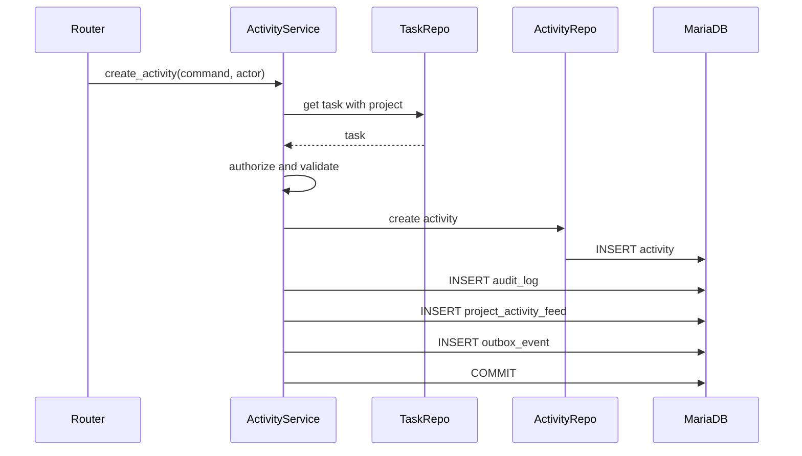

---

# 81. Validaciones de creación

Debe comprobarse:

- tarea existente;
- proyecto existente;
- proyecto modificable;
- actor con acceso;
- actor autorizado;
- título válido;
- descripción válida;
- duración no negativa;
- fechas coherentes;
- estado inicial permitido.

---

# 82. Estado inicial

Si el módulo utiliza borradores:

```text
draft
```

Si toda actividad representa un hecho ya realizado, puede crearse directamente como:

```text
completed
```

La política debe ser única y coherente.

---

# 83. Modelo recomendado

Para permitir edición antes de consolidar evidencias se recomienda:

```text
draft

↓

completed
```

Una actividad `draft` pertenece a su autor y puede modificarse.

Una actividad `completed` forma parte del histórico funcional.

---

# 84. Resultado de creación

```python
@dataclass(frozen=True)
class ActivityResult:
    id_activity: int
    task_id: int
    project_id: int
    title: str
    status: ActivityStatus
    duration_minutes: int | None
    created_by: int
    created_at: datetime
    version: int
```

---

# 85. Actualización de actividad

`UpdateActivity` puede modificar:

- título;
- descripción;
- duración;
- inicio;
- fin.

No debe modificar directamente:

- tarea;
- autor;
- created_at;
- version;
- estado completado sin command específico.

---

# 86. Esquema de actualización

```python
class ActivityUpdateRequest(BaseModel):
    title: str | None = None
    description: str | None = None
    duration_minutes: int | None = None
    started_at: datetime | None = None
    finished_at: datetime | None = None
    expected_version: int
```

---

# 87. Reglas de edición

Una actividad puede editarse cuando:

- está en `draft`;
- pertenece al actor, o el actor es coordinador;
- el proyecto permite cambios;
- la versión coincide.

Una actividad `completed` debe ser:

- inmutable, o
- editable únicamente mediante corrección auditada.

---

# 88. Corrección de actividad completada

Si se permite corregir una actividad completada:

- debe requerir permiso elevado;
- debe registrar motivo;
- debe conservar valores anteriores;
- debe generar auditoría específica;
- puede emitir evento de feed.

Evento:

```text
activity.corrected
```

---

# 89. Completar actividad

`CompleteActivity` debe:

- validar estado actual;
- validar contenido;
- validar fechas;
- validar adjuntos requeridos si procede;
- establecer estado `completed`;
- establecer `finished_at` si falta;
- incrementar versión;
- registrar auditoría;
- crear feed;
- publicar evento.

---

# 90. Flujo de finalización

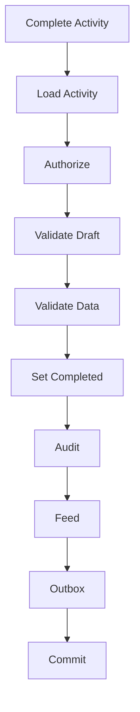

---

# 91. Fecha de finalización

Si `finished_at` no está informada:

```text
finished_at = current UTC timestamp
```

Debe utilizarse un reloj explícito o servicio temporal centralizado.

No debe utilizarse una llamada temporal dispersa sin zona horaria.

---

# 92. Cálculo de duración

Cuando existen:

```text
started_at

finished_at
```

puede calcularse:

```text
duration_minutes
```

Regla:

```text
duration_minutes =
finished_at - started_at
```

Debe decidirse si el valor:

- se calcula siempre;
- puede corregirse manualmente;
- se compara con duración declarada;
- conserva ambos conceptos.

---

# 93. Duración derivada frente a declarada

Puede distinguirse:

```text
calculated_duration_minutes

reported_duration_minutes
```

Esto resulta útil si una actividad registra trabajo no continuo.

Para la primera versión basta con un único `duration_minutes`, pero la semántica debe documentarse.

---

# 94. Reapertura

Si la política permite reabrir:

```text
completed

↓

draft
```

Debe:

- requerir permiso;
- registrar motivo;
- incrementar versión;
- conservar historial;
- emitir evento `activity.reopened`.

---

# 95. Eliminación

`DeleteActivity` debe validar:

- actividad existente;
- actor autorizado;
- estado;
- adjuntos;
- relevancia histórica;
- versión.

---

# 96. Estrategias de eliminación

## Eliminación física

Solo para:

- borradores;
- sin adjuntos;
- sin eventos relevantes;
- creados por error.

## Soft delete

Campos:

```text
deleted_at
deleted_by
```

Adecuado para conservar histórico.

## Anulación funcional

Puede incorporarse un estado:

```text
cancelled
```

si el dominio lo necesita.

---

# 97. Recomendación

Se recomienda:

- eliminación física de borradores sin evidencia;
- soft delete de actividades completadas;
- auditoría obligatoria;
- exclusión por defecto en consultas ordinarias.

---

# 98. Integración con Task

Toda operación debe resolver:

```text
Activity

↓

Task

↓

Project
```

Esto proporciona:

- contexto;
- permisos;
- estado;
- canal realtime;
- destinatarios;
- feed.

---

# 99. Tarea finalizada

La política recomendada es:

- permitir consulta;
- permitir evidencias finales durante una ventana controlada;
- restringir edición ordinaria;
- requerir reapertura de tarea para cambios sustanciales.

---

# 100. Tarea eliminada

Si Task utiliza soft delete:

- las actividades deben conservarse;
- no deben mostrarse en vistas ordinarias;
- pueden consultarse en auditoría o restauración.

Si Task se elimina físicamente con cascada, las actividades desaparecen.

Esta última opción debe reservarse a tareas sin valor histórico.

---

# 101. Integración con Attachments

El módulo Activities coordina el contexto funcional de los adjuntos.

El almacenamiento físico corresponde al módulo Attachments.

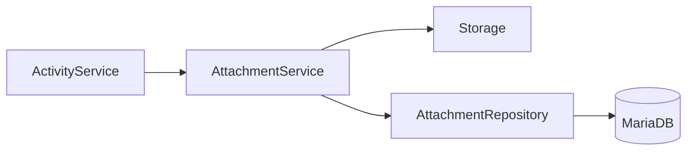

---

# 102. Añadir adjunto

El proceso debe comprobar:

- Activity existente;
- Task accesible;
- Project modificable;
- actor autorizado;
- estado de Activity compatible;
- tipo MIME;
- tamaño;
- nombre;
- cuota.

---

# 103. Flujo de subida

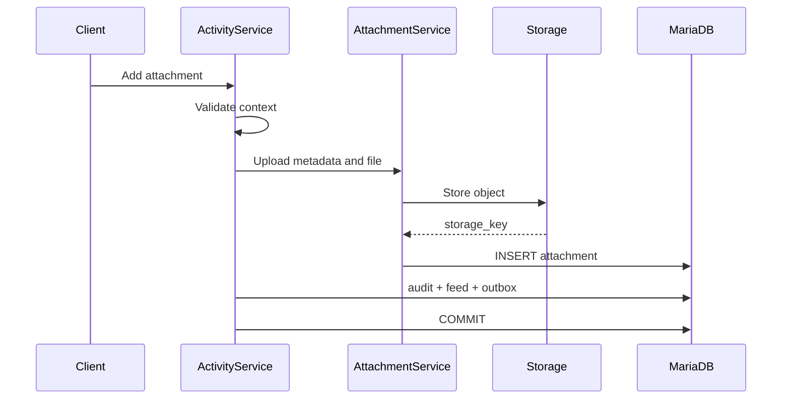

---

# 104. Consistencia archivo-base de datos

No existe una transacción distribuida entre MariaDB y el almacenamiento físico.

Debe utilizarse una estrategia compensatoria.

Opciones:

- guardar archivo y eliminarlo si falla DB;
- crear metadato `pending`;
- utilizar Outbox para completar;
- job de reconciliación.

---

# 105. Estado de adjunto

Estados recomendados:

```text
pending

active

delete_pending

deleted

failed
```

La Activity solo debe mostrar adjuntos `active`.

---

# 106. Eliminación de adjunto

Debe:

- comprobar autorización;
- marcar eliminación;
- registrar auditoría;
- eliminar almacenamiento;
- actualizar estado;
- emitir evento.

No debe confiar únicamente en cascada SQL para borrar el objeto físico.

---

# 107. Activity Feed

Eventos recomendados:

```text
activity_created

activity_updated

activity_completed

activity_reopened

activity_deleted

attachment_added

attachment_removed
```

---

# 108. Mensajes del feed

Ejemplos:

```text
Fran registró la actividad «Montaje del sensor».
```

```text
María completó una actividad en la tarea «Pruebas de navegación».
```

```text
Pablo añadió una evidencia.
```

---

# 109. Snapshot del feed

El evento debe conservar:

```text
activity_id

activity_title

task_id

task_title

actor_display_name
```

No debe depender completamente de consultas posteriores.

---

# 110. Auditoría

Acciones recomendadas:

```text
create_activity

update_activity

complete_activity

reopen_activity

delete_activity

add_attachment

remove_attachment
```

---

# 111. Contenido de auditoría

Debe incluir:

- actor;
- activity ID;
- task ID;
- project ID;
- acción;
- valores previos;
- valores nuevos;
- timestamp;
- correlation ID;
- motivo cuando proceda.

---

# 112. Diferencia entre Activity y AuditLog

Activity representa trabajo funcional.

AuditLog representa trazabilidad técnica.

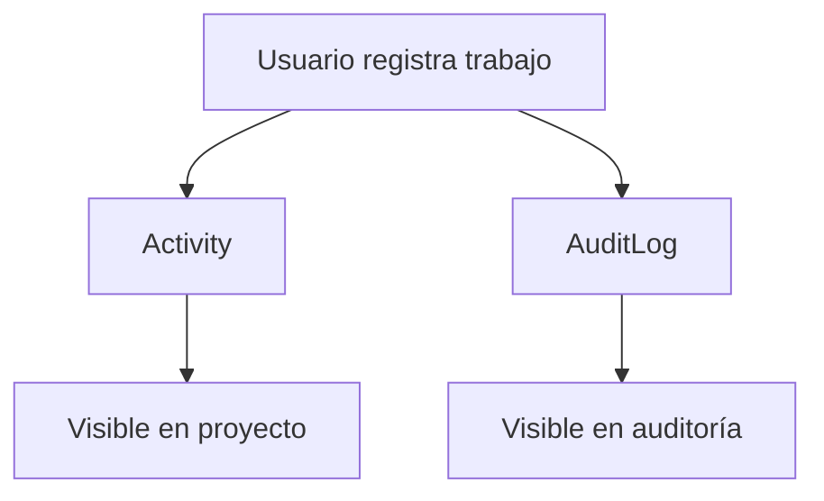

Una Activity no sustituye a la auditoría.

---

# 113. Notificaciones

El módulo puede generar notificaciones cuando:

- se crea una actividad relevante;
- se completa;
- se menciona a un usuario;
- se añade evidencia;
- se solicita revisión;
- se rechaza o valida en futuras versiones.

---

# 114. Destinatarios

Pueden incluir:

- responsable de la tarea;
- coordinadores;
- creador de la tarea;
- usuarios mencionados;
- revisores.

El actor suele excluirse.

---

# 115. Outbox

Eventos recomendados:

```text
activity.created

activity.updated

activity.completed

activity.reopened

activity.deleted

activity.attachment_added

activity.attachment_removed
```

---

# 116. Payload de evento

```json
{
  "event_id": "uuid",
  "event_type": "activity.completed",
  "aggregate_type": "activity",
  "aggregate_id": "255",
  "project_id": 12,
  "actor_id": 7,
  "occurred_at": "2026-07-26T17:00:00Z",
  "correlation_id": "uuid",
  "payload": {
    "task_id": 84,
    "title": "Montaje del sensor",
    "duration_minutes": 90,
    "version": 3
  }
}
```

---

# 117. Realtime

Los eventos se publican en la sala del proyecto.

```text
project:{project_id}
```

Los clientes pueden actualizar:

- timeline de tarea;
- Activity Feed;
- métricas;
- contador de adjuntos;
- última actividad.

---

# 118. Contrato realtime

Ejemplo:

```json
{
  "type": "activity.created",
  "event_id": "uuid",
  "project_id": 12,
  "entity_type": "activity",
  "entity_id": 255,
  "occurred_at": "2026-07-26T17:00:00Z",
  "payload": {
    "task_id": 84,
    "title": "Montaje del sensor",
    "author": {
      "id": 7,
      "display_name": "Fran"
    },
    "status": "draft",
    "version": 1
  }
}
```

---

# 119. Idempotencia

El cliente debe ignorar eventos ya procesados mediante:

```text
event_id
```

Si el evento corresponde a la acción local, debe reconciliarse sin duplicar el elemento.

---

# 120. Dashboard

El módulo proporciona:

```text
activity_count

activity_count_today

completed_activity_count

total_duration_minutes

last_activity_at

active_contributors
```

---

# 121. Métricas por tarea

```text
número de actividades

duración total

última actividad

usuarios participantes

adjuntos
```

---

# 122. Métricas por proyecto

```text
actividades por día

duración por usuario

actividad reciente

tareas con actividad

tareas sin actividad

tasa de finalización
```

---

# 123. Métricas por usuario

```text
actividades creadas

actividades completadas

duración registrada

adjuntos aportados

última contribución
```

Deben interpretarse con cuidado para no convertirlas en medidas simplistas de rendimiento.

---

# 124. Consultas agregadas

Ejemplo:

```sql
SELECT
    a.user_id,
    COUNT(*) AS activity_count,
    COALESCE(SUM(a.duration_minutes), 0) AS total_minutes
FROM activities a
JOIN tasks t
    ON t.id_task = a.task_id
WHERE t.project_id = :project_id
  AND a.status = 'completed'
GROUP BY a.user_id;
```

---

# 125. ViewModels

Modelos recomendados:

```text
ActivityListItemViewModel

ActivityDetailViewModel

ActivityFormViewModel

ActivityTimelineViewModel

ActivityAttachmentViewModel
```

---

# 126. `ActivityListItemViewModel`

Campos:

```text
id_activity

title

description_preview

status

status_label

author

created_at

duration_label

attachment_count

version

can_edit

can_delete
```

---

# 127. `ActivityDetailViewModel`

Puede incluir:

```text
activity

task

project

author

attachments

permissions

realtime_config
```

---

# 128. `ActivityFormViewModel`

Debe incluir:

```text
form_data

validation_errors

task_summary

submit_url

cancel_url

is_edit

expected_version

can_upload_attachments
```

---

# 129. Rutas SSR

Rutas orientativas:

```text
GET  /tasks/{task_id}/activities
GET  /tasks/{task_id}/activities/create
POST /tasks/{task_id}/activities/create

GET  /activities/{activity_id}
GET  /activities/{activity_id}/edit
POST /activities/{activity_id}/edit
```

---

# 130. Rutas operativas

```text
POST /activities/{activity_id}/complete
POST /activities/{activity_id}/reopen
POST /activities/{activity_id}/delete
POST /activities/{activity_id}/attachments
POST /activities/{activity_id}/attachments/{attachment_id}/delete
```

---

# 131. Prevención de IDOR

El backend debe resolver siempre:

```text
Activity

↓

Task

↓

Project

↓

User access
```

Nunca debe confiar solo en `activity_id`.

---

# 132. Request de finalización

```json
{
  "expected_version": 2,
  "finished_at": "2026-07-26T17:00:00Z"
}
```

---

# 133. Response de finalización

```json
{
  "ok": true,
  "activity": {
    "id": 255,
    "status": "completed",
    "finished_at": "2026-07-26T17:00:00Z",
    "duration_minutes": 90,
    "version": 3
  }
}
```

---

# 134. Errores esperados

| Situación | Estado |
|---|---:|
| No autenticado | 401 |
| Sin acceso al proyecto | 403 |
| Activity inexistente | 404 |
| Estado inválido | 422 |
| Fechas incoherentes | 422 |
| Conflicto de versión | 409 |
| Eliminación no permitida | 409 |

---

# 135. Excepciones de dominio

```text
ActivityNotFoundError

ActivityAccessDeniedError

ActivityNotEditableError

ActivityVersionConflictError

InvalidActivityTransitionError

InvalidActivityDurationError

InvalidActivityDateRangeError

ActivityDeletionNotAllowedError

TaskNotAvailableForActivitiesError
```

---

# 136. JavaScript modular

Estructura recomendada:

```text
static/js/activities/
├── activity_form.js
├── activity_detail.js
├── activity_list.js
├── activity_realtime.js
├── activity_attachments.js
└── activity_api.js
```

---

# 137. `activity_api.js`

Funciones orientativas:

```javascript
export async function createActivity(taskId, payload) {}
export async function updateActivity(activityId, payload) {}
export async function completeActivity(activityId, payload) {}
export async function deleteActivity(activityId, payload) {}
```

No debe manipular el DOM.

---

# 138. `activity_form.js`

Responsabilidades:

- validación auxiliar;
- control de duración;
- coherencia de fechas;
- contador de texto;
- estado de envío;
- prevención de doble submit.

---

# 139. `activity_attachments.js`

Responsabilidades:

- selección de archivos;
- validación preliminar;
- progreso;
- cancelación;
- actualización de lista;
- manejo de errores.

La validación definitiva corresponde al backend.

---

# 140. Diálogos

Operaciones críticas:

- completar;
- reabrir;
- eliminar;
- eliminar adjunto;
- corregir actividad completada.

---

# 141. Toasts

Mensajes orientativos:

```text
Actividad registrada correctamente.

Actividad actualizada.

Actividad completada.

La actividad fue modificada en otra sesión.

Evidencia añadida correctamente.
```

---

# 142. Optimistic UI

Puede utilizarse para:

- insertar una actividad nueva;
- actualizar estado;
- añadir adjunto.

Debe poder revertirse y reconciliarse con la respuesta del servidor.

---

# 143. Concurrencia

Toda actualización relevante debe incluir:

```text
expected_version
```

En conflicto:

```text
409 Conflict
```

La UI debe refrescar el elemento afectado.

---

# 144. Reloj y zona horaria

Las fechas deben:

- recibirse con zona horaria;
- normalizarse a UTC;
- persistirse en UTC;
- mostrarse en zona local.

El backend debe utilizar un `Clock` o servicio temporal centralizado para facilitar pruebas.

---

# 145. Seguridad de contenido

Los campos:

```text
title

description
```

deben escaparse en Jinja2.

Si se admite Markdown:

- sanitizar;
- bloquear scripts;
- restringir enlaces;
- eliminar atributos inseguros.

---

# 146. Mass assignment

No debe copiarse el payload completo sobre el modelo.

Solo se actualizan campos permitidos de forma explícita.

---

# 147. Campos protegidos

El cliente no puede modificar directamente:

```text
id_activity

task_id

user_id

created_at

updated_at

version

deleted_at
```

---

# 148. Continuación

La **Parte 3** completará `30_ACTIVITIES_MODULE.md` con:

- seguridad avanzada;
- permisos contextuales;
- comportamiento SSR;
- plantillas;
- timeline visual;
- integración realtime completa;
- accesibilidad;
- rendimiento;
- caché;
- observabilidad;
- pruebas unitarias, de integración, WebSocket y Selenium;
- fixtures;
- criterios de aceptación;
- checklist enterprise;
- evolución futura;
- conclusiones.

---

# 149. Seguridad avanzada

La seguridad del módulo Activities debe aplicarse en todas las operaciones de lectura, creación, edición, finalización, reapertura, eliminación y gestión de adjuntos.

La autorización no debe depender únicamente del identificador de la actividad.

Debe resolverse siempre el contexto completo:

```text
Activity

↓

Task

↓

Project

↓

ProjectMember

↓

Effective Permissions
```

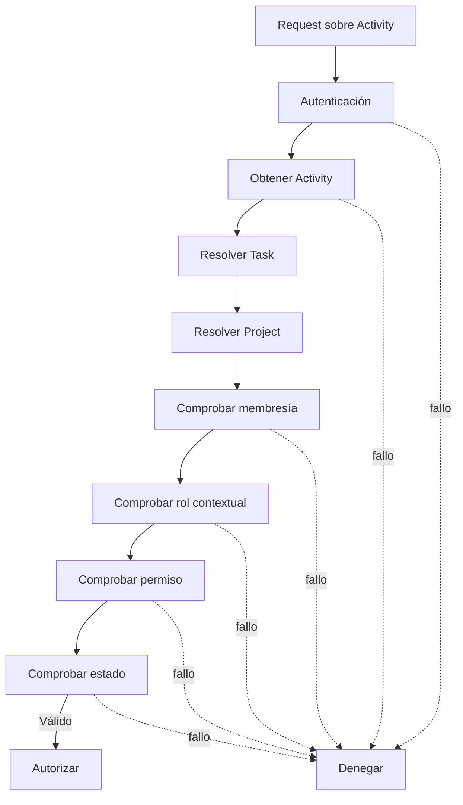

---

# 150. Modelo de permisos

Recursos orientativos:

```text
activities
attachments
tasks
projects
```

Acciones:

```text
read
create
update
delete
complete
reopen
validate
manage
```

Ejemplos:

```text
activities:read

activities:create

activities:update

activities:delete

activities:complete

activities:reopen

attachments:create

attachments:delete
```

---

# 151. Permisos globales y contextuales

La autorización efectiva combina:

- permisos globales;
- acceso al proyecto;
- rol contextual;
- autoría de la actividad;
- estado de la tarea;
- estado del proyecto;
- estado de la actividad.

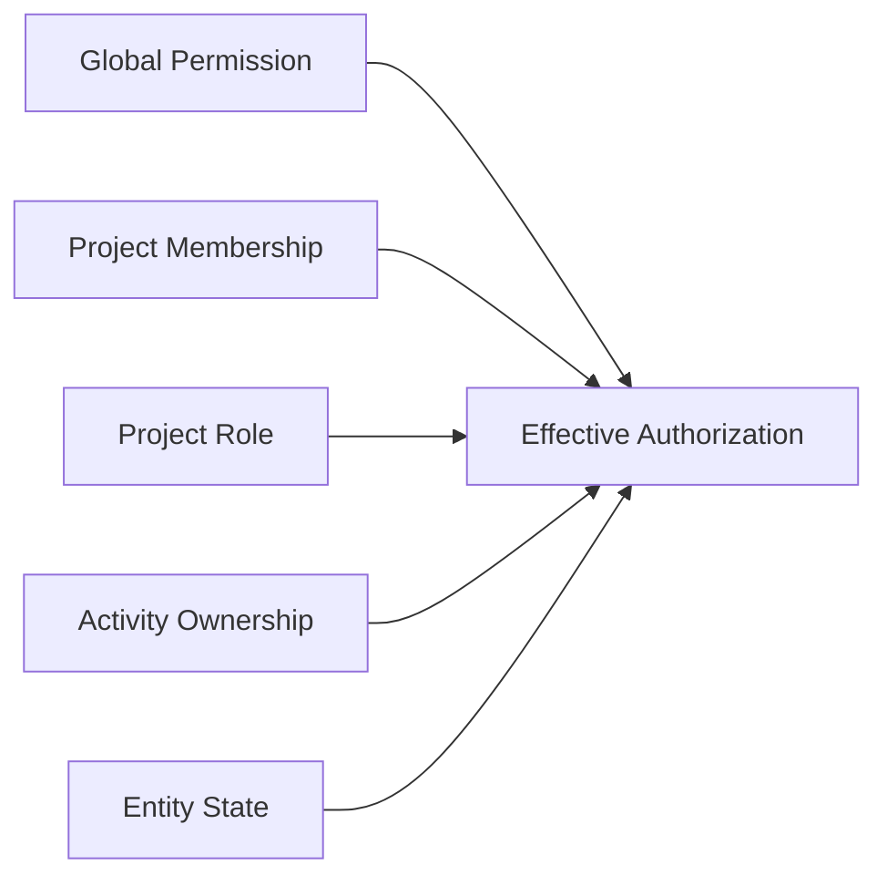

---

# 152. Matriz de permisos orientativa

| Operación | Administrador | Coordinador | Miembro autor | Miembro no autor |
|---|---:|---:|---:|---:|
| Consultar actividad | Sí | Sí | Sí | Sí, según proyecto |
| Crear actividad | Sí | Sí | Sí | Sí, según política |
| Editar borrador | Sí | Sí | Sí | No |
| Completar actividad | Sí | Sí | Sí | No |
| Reabrir actividad | Sí | Sí | Configurable | No |
| Corregir completada | Sí | Sí | Configurable | No |
| Eliminar borrador | Sí | Sí | Sí | No |
| Eliminar completada | Sí | Configurable | No | No |
| Añadir adjunto | Sí | Sí | Sí | Configurable |
| Eliminar adjunto propio | Sí | Sí | Sí | No |

La matriz debe parametrizarse mediante el sistema unificado de autorización.

---

# 153. Autoría de la actividad

La autoría debe conservarse mediante:

```text
created_by
```

El autor puede disponer de permisos adicionales sobre su propio borrador.

Sin embargo, ser autor no debe conceder automáticamente:

- acceso al proyecto;
- capacidad de modificar una actividad completada;
- permiso para eliminar evidencias históricas;
- capacidad de cambiar la tarea asociada.

---

# 154. Autorización por propiedad

La propiedad puede participar en la decisión:

```python
can_edit = (
    is_global_admin
    or is_project_coordinator
    or (
        activity.created_by == current_user.id_usuario
        and activity.status == ActivityStatus.DRAFT
    )
)
```

La regla real debe permanecer centralizada y no repetirse en routers o plantillas.

---

# 155. Prevención de IDOR

No debe utilizarse una consulta directa sin comprobación contextual:

```python
activity = db.get(Activity, activity_id)
```

seguida de una respuesta inmediata.

Debe comprobarse que el usuario puede acceder al proyecto derivado de la actividad.

Consulta contextual conceptual:

```sql
SELECT a.*
FROM activities a
JOIN tasks t
    ON t.id_task = a.task_id
JOIN project_members pm
    ON pm.project_id = t.project_id
WHERE a.id_activity = :activity_id
  AND pm.user_id = :user_id
  AND pm.active = TRUE;
```

Los administradores globales pueden resolverse mediante una vía explícita.

---

# 156. Protección CSRF

Todas las operaciones de modificación realizadas con cookies deben protegerse frente a CSRF.

Operaciones afectadas:

```text
create

update

complete

reopen

delete

upload attachment

remove attachment
```

El token puede enviarse mediante:

```text
form field

o

X-CSRF-Token
```

El backend debe comprobarlo antes de ejecutar el caso de uso.

---

# 157. Protección XSS

El contenido introducido por usuarios debe tratarse como no confiable.

Campos principales:

```text
title

description

original_filename
```

Las plantillas deben mantener el autoescape de Jinja2.

No debe utilizarse:

```jinja2
{{ activity.description | safe }}
```

salvo que el contenido haya sido sanitizado previamente mediante una política explícita.

---

# 158. Markdown seguro

Si se incorpora Markdown:


Debe aplicarse una lista blanca de:

- etiquetas;
- atributos;
- protocolos;
- estilos permitidos.

Deben bloquearse:

- `script`;
- manejadores `on*`;
- `javascript:`;
- iframes no autorizados;
- HTML embebido inseguro.

---

# 159. Validación de entrada

Pydantic debe validar:

- título;
- descripción;
- duración;
- fechas;
- estado solicitado;
- versión;
- identificadores;
- estructura de archivos cuando proceda.

El Service Layer debe validar:

- existencia;
- autorización;
- coherencia temporal;
- transición;
- pertenencia al proyecto;
- estado de Task y Project;
- política de edición.

---

# 160. Normalización de texto

Antes de persistir puede aplicarse:

```text
trim

normalización Unicode

normalización de saltos de línea
```

No debe alterarse de forma destructiva el contenido legítimo.

El título no debe quedar vacío después de `trim`.

---

# 161. Límites recomendados

Valores orientativos:

```text
title: 1..200 caracteres

description: límite configurable

duration_minutes: 0..máximo razonable por actividad
```

El máximo de duración debe definirse funcionalmente.

Ejemplo:

```text
0 <= duration_minutes <= 10080
```

si se admite hasta una semana continua, aunque el límite definitivo debe alinearse con el dominio.

---

# 162. Fechas futuras

Debe definirse si una actividad puede comenzar o finalizar en el futuro.

Política recomendada:

- permitir una pequeña tolerancia por desfase de reloj;
- rechazar fechas claramente futuras;
- permitir planificación únicamente si Activity funciona como entidad planificable;
- registrar overrides administrativos.

---

# 163. Coherencia temporal

Reglas:

```text
started_at <= finished_at
```

```text
created_at <= updated_at
```

```text
created_at <= finished_at
```

cuando la semántica lo requiera.

Si la actividad se registra de forma retrospectiva, `started_at` puede ser anterior a `created_at`.

---

# 164. Integridad de duración

Cuando se calcula duración a partir de fechas:

```text
duration_minutes =
floor((finished_at - started_at) / 60)
```

Debe definirse:

- redondeo;
- precisión;
- tolerancia;
- tratamiento de pausas;
- modificación manual.

La duración persistida y la derivada no deben contradecirse silenciosamente.

---

# 165. Protección frente a mass assignment

El payload no debe aplicarse automáticamente al modelo.

Incorrecto:

```python
for field, value in payload.model_dump().items():
    setattr(activity, field, value)
```

Correcto:

```python
activity.title = command.title
activity.description = command.description
activity.duration_minutes = command.duration_minutes
activity.started_at = command.started_at
activity.finished_at = command.finished_at
```

---

# 166. Campos inmutables

No deben modificarse mediante actualización ordinaria:

```text
id_activity

task_id

created_by

created_at
```

El traslado de una actividad a otra tarea no debe permitirse como edición genérica.

Si existe un caso excepcional, debe ser una operación específica, auditada y restringida.

---

# 167. Estado del proyecto

Las operaciones deben respetar el estado del proyecto.

| Estado del proyecto | Crear | Editar | Completar | Adjuntar | Consultar |
|---|---:|---:|---:|---:|---:|
| `draft` | Configurable | Sí | Configurable | Configurable | Sí |
| `active` | Sí | Sí | Sí | Sí | Sí |
| `completed` | No o limitado | Limitado | No | Limitado | Sí |
| `archived` | No | No | No | No | Sí |
| `cancelled` | No | No | No | No | Sí |

---

# 168. Estado de la tarea

| Estado de Task | Crear Activity | Editar borrador | Añadir evidencia |
|---|---:|---:|---:|
| `todo` | Configurable | Sí | Configurable |
| `doing` | Sí | Sí | Sí |
| `done` | Limitado | Limitado | Configurable |

La política debe ser coherente con la semántica del trabajo.

---

# 169. Concurrencia

El campo `version` debe utilizarse en:

- edición;
- finalización;
- reapertura;
- corrección;
- eliminación lógica.

El cliente envía:

```text
expected_version
```

El backend actualiza únicamente cuando coincide.

---

# 170. Conflicto de versión

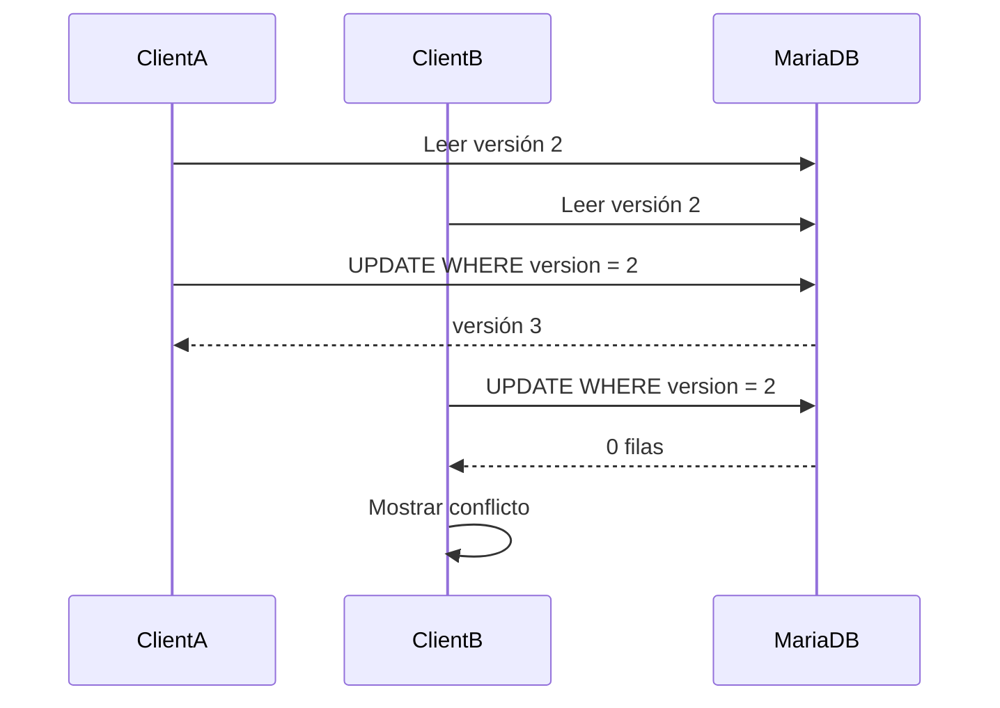

La respuesta debe ser:

```text
409 Conflict
```

---

# 171. Resolución de conflictos

La interfaz debe:

1. conservar el contenido local;
2. informar del cambio concurrente;
3. recuperar la versión actual;
4. permitir comparar;
5. ofrecer reintento manual cuando proceda.

No debe sobrescribir automáticamente el trabajo ajeno.

---

# 172. Rutas SSR

Rutas principales:

```text
GET  /tasks/{task_id}/activities
GET  /tasks/{task_id}/activities/new
POST /tasks/{task_id}/activities

GET  /activities/{activity_id}
GET  /activities/{activity_id}/edit
POST /activities/{activity_id}/edit
```

Operaciones específicas:

```text
POST /activities/{activity_id}/complete
POST /activities/{activity_id}/reopen
POST /activities/{activity_id}/delete
```

---

# 173. Contratos HTTP

## Crear actividad

```http
POST /tasks/{task_id}/activities
```

Campos:

```text
title
description
duration_minutes
started_at
finished_at
csrf_token
```

## Actualizar

```http
POST /activities/{activity_id}/edit
```

Incluye:

```text
expected_version
```

---

# 174. Respuestas SSR

En éxito:

```text
POST

↓

Redirect

↓

GET
```

Debe aplicarse el patrón Post/Redirect/Get.

Ejemplo:

```text
POST /tasks/84/activities

↓

303 See Other

↓

GET /activities/255
```

---

# 175. Validación fallida en SSR

Cuando el formulario es inválido:

- devolver `422`;
- conservar datos introducidos;
- mostrar errores por campo;
- mantener contexto de tarea;
- no crear cambios parciales;
- no perder archivos ya gestionados según la estrategia adoptada.

---

# 176. Rutas JSON

Las operaciones incrementales pueden devolver JSON.

Ejemplo:

```http
POST /activities/{activity_id}/complete
Content-Type: application/json
```

Response:

```json
{
  "ok": true,
  "activity": {
    "id": 255,
    "status": "completed",
    "finished_at": "2026-07-26T17:00:00Z",
    "duration_minutes": 90,
    "version": 3
  },
  "event_id": "uuid"
}
```

---

# 177. View Service

El `ActivityViewService` debe preparar:

- detalle;
- formulario;
- listado;
- permisos;
- etiquetas;
- URLs;
- configuración realtime;
- resumen de tarea.

No debe realizar escrituras.

---

# 178. Plantillas recomendadas

```text
templates/
└── activities/
    ├── activities_list.html
    ├── activity_detail.html
    ├── activity_form.html
    └── partials/
        ├── activity_item.html
        ├── activity_timeline_item.html
        ├── activity_status_badge.html
        ├── activity_actions.html
        ├── activity_attachments.html
        └── activity_empty_state.html
```

---

# 179. Vista de listado

Debe mostrar:

- título;
- autor;
- estado;
- duración;
- fecha;
- adjuntos;
- acciones disponibles.

Debe soportar:

- paginación;
- filtros;
- estado vacío;
- errores;
- carga incremental futura.

---

# 180. Timeline visual

Las actividades pueden representarse como timeline dentro del detalle de tarea.

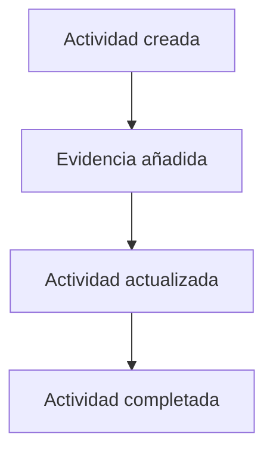

Cada elemento debe mostrar:

- actor;
- fecha;
- título;
- resumen;
- estado;
- duración;
- adjuntos;
- acciones.

---

# 181. Estructura accesible del timeline

Debe utilizarse HTML semántico.

Ejemplo conceptual:

```html
<ol class="activity-timeline">
    <li class="activity-timeline__item">
        <article>
            <header>...</header>
            <div>...</div>
            <footer>...</footer>
        </article>
    </li>
</ol>
```

No debe depender exclusivamente de iconos o colores.

---

# 182. Vista de detalle

Debe incluir:

- breadcrumb;
- proyecto;
- tarea;
- título;
- descripción;
- autor;
- estado;
- fechas;
- duración;
- adjuntos;
- acciones;
- metadatos de versión.

---

# 183. Breadcrumb

Ejemplo:

```text
Proyectos

>

Aula móvil

>

Tareas

>

Montaje del sensor

>

Actividad
```

Cada nivel debe respetar autorización.

---

# 184. Formulario

Campos:

```text
title

description

started_at

finished_at

duration_minutes
```

Puede ofrecer dos modos:

- duración manual;
- duración calculada.

Debe evitarse presentar ambos sin explicar cuál prevalece.

---

# 185. Errores de formulario

Ejemplos:

```text
El título es obligatorio.

La fecha de finalización no puede ser anterior al inicio.

La duración no puede ser negativa.

La actividad ha sido modificada por otro usuario.
```

---

# 186. Estado vacío

Cuando una tarea no tiene actividades:

```text
Todavía no se ha registrado actividad en esta tarea.
```

Si el usuario puede crear:

```text
Registrar actividad
```

Si no puede:

```text
No hay actividad disponible.
```

---

# 187. Acciones contextuales

Dependiendo del ViewModel:

```text
Editar

Completar

Reabrir

Añadir evidencia

Eliminar
```

La plantilla no debe reconstruir reglas de autorización.

Debe recibir:

```text
can_edit

can_complete

can_reopen

can_delete

can_add_attachment
```

---

# 188. JavaScript modular

Estructura:

```text
static/js/activities/
├── activity_api.js
├── activity_form.js
├── activity_list.js
├── activity_detail.js
├── activity_attachments.js
├── activity_timeline.js
└── activity_realtime.js
```

Cada módulo debe tener una responsabilidad clara.

---

# 189. `activity_form.js`

Responsabilidades:

- validación auxiliar;
- sincronización de duración;
- prevención de doble envío;
- feedback de guardado;
- preservación local opcional;
- accesibilidad de errores.

No sustituye a la validación backend.

---

# 190. Prevención de doble envío

Durante el submit:

```text
deshabilitar botón

↓

mostrar estado

↓

enviar

↓

restaurar si falla
```

El backend debe seguir siendo resistente a solicitudes repetidas.

---

# 191. Borrador local

Puede guardarse temporalmente en:

```text
sessionStorage
```

para evitar pérdida accidental.

Debe:

- asociarse a `task_id`;
- eliminarse tras guardado;
- no contener información sensible innecesaria;
- caducar.

---

# 192. `activity_timeline.js`

Responsabilidades:

- insertar nuevas actividades;
- actualizar elementos;
- mantener orden;
- procesar eventos realtime;
- evitar duplicados;
- conservar foco.

---

# 193. Inserción incremental

Al recibir `activity.created`:

1. comprobar `event_id`;
2. comprobar `task_id`;
3. construir elemento seguro;
4. insertar según fecha;
5. actualizar contador;
6. anunciar el cambio de forma accesible.

Es preferible recibir HTML parcial renderizado o datos estrictamente escapados.

---

# 194. Seguridad del DOM

No debe utilizarse:

```javascript
element.innerHTML = payload.description;
```

Debe utilizarse:

- `textContent`;
- plantillas seguras;
- HTML parcial generado por backend;
- sanitización verificada.

---

# 195. Integración realtime

Eventos principales:

```text
activity.created

activity.updated

activity.completed

activity.reopened

activity.deleted

activity.attachment_added

activity.attachment_removed
```

---

# 196. Flujo realtime

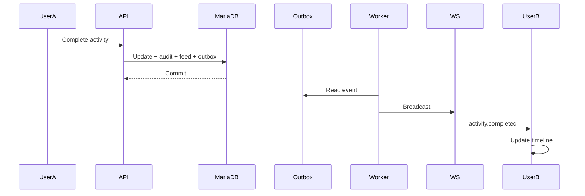

---

# 197. Publicación después del commit

Nunca debe emitirse un evento antes de confirmar la transacción.

Esto evita que los clientes observen:

- actividades inexistentes;
- estados revertidos;
- adjuntos no disponibles;
- versiones incorrectas.

---

# 198. Contrato realtime estable

Todo evento debe incluir:

```text
event_id

event_type

project_id

task_id

activity_id

actor

occurred_at

correlation_id

version

payload
```

---

# 199. Ejemplo `activity.updated`

```json
{
  "event_id": "uuid",
  "event_type": "activity.updated",
  "project_id": 12,
  "task_id": 84,
  "activity_id": 255,
  "actor_id": 7,
  "occurred_at": "2026-07-26T18:00:00Z",
  "correlation_id": "uuid",
  "version": 4,
  "payload": {
    "title": "Montaje y calibración del sensor",
    "duration_minutes": 105
  }
}
```

---

# 200. Idempotencia del cliente

Debe mantenerse una caché limitada de `event_id`.

```mermaid
flowchart TD
    A[Evento recibido]
    B{Procesado previamente}
    C[Ignorar]
    D[Aplicar]
    E[Registrar ID]

    A --> B
    B -->|Sí| C
    B -->|No| D
    D --> E
```

---

# 201. Eventos propios

El cliente que originó una operación puede recibir el mismo evento por WebSocket.

Debe evitar:

- insertar dos veces;
- repetir toast;
- duplicar adjuntos;
- sobrescribir una versión más reciente.

Puede correlacionar por:

```text
event_id

correlation_id

client_request_id
```

---

# 202. Reconexión

Tras reconectar:

1. recuperar actividades recientes;
2. comparar versión o cursor;
3. aplicar cambios faltantes;
4. continuar escucha;
5. eliminar estado provisional inconsistente.

---

# 203. Integración con Dashboard

El Dashboard no debe cargar actividades completas.

Debe consumir agregaciones.

```mermaid
flowchart LR
    A[Activities]
    B[Aggregation Queries]
    C[Activity Metrics DTO]
    D[Dashboard]

    A --> B
    B --> C
    C --> D
```

---

# 204. Métricas recomendadas

```text
activity_total

activity_completed_total

activity_created_today

total_duration_minutes

active_contributors

last_activity_at

attachments_total
```

---

# 205. Métricas temporales

Puede agruparse por:

```text
día

semana

mes
```

Ejemplo:

```sql
SELECT
    DATE(created_at) AS activity_date,
    COUNT(*) AS total
FROM activities
WHERE created_at >= :from_date
GROUP BY DATE(created_at)
ORDER BY activity_date;
```

---

# 206. Consideraciones sobre productividad

El número de actividades o minutos registrados no debe interpretarse automáticamente como productividad.

Estas métricas pueden verse afectadas por:

- granularidad distinta;
- complejidad;
- hábitos de registro;
- trabajo colaborativo;
- calidad de las evidencias.

Deben mostrarse como indicadores descriptivos, no como evaluación aislada.

---

# 207. Rendimiento

Rutas críticas:

- listado por tarea;
- timeline;
- detalle;
- actividad reciente;
- métricas;
- adjuntos.

Debe evitarse:

- cargar todos los adjuntos;
- cargar auditoría en listados;
- cargar descripciones completas en Dashboard;
- resolver usuario mediante una consulta por fila;
- contar en memoria.

---

# 208. Índices recomendados

```text
activities(task_id, created_at)

activities(user_id, created_at)

activities(status, created_at)

activities(created_at)

activities(finished_at)

activities(deleted_at)

activity_attachments(activity_id, created_at)
```

Para consultas por proyecto se utiliza el índice:

```text
tasks(project_id)
```

---

# 209. Consultas N+1

Debe evitarse:

```text
1 consulta de activities

+

N consultas de users

+

N consultas de attachment count
```

Puede resolverse mediante:

- JOIN con autor;
- subconsulta agregada;
- `selectinload`;
- DTO específico.

---

# 210. Conteo de adjuntos

Ejemplo:

```sql
SELECT
    a.id_activity,
    COUNT(aa.id_attachment) AS attachment_count
FROM activities a
LEFT JOIN activity_attachments aa
    ON aa.activity_id = a.id_activity
   AND aa.status = 'active'
WHERE a.task_id = :task_id
GROUP BY a.id_activity;
```

Debe analizarse el plan de ejecución.

---

# 211. Payload de listado

Debe limitarse a:

```text
id

title

status

author summary

created_at

duration

attachment_count

version

permissions
```

La descripción completa puede cargarse en el detalle.

---

# 212. Caché

Puede aplicarse a:

- métricas de proyecto;
- actividad reciente;
- catálogos;
- permisos contextuales.

No debe cachearse sin invalidación:

- versión;
- estado;
- adjuntos activos;
- contenido editable.

---

# 213. Invalidación de caché

Eventos relevantes:

```text
activity.created

activity.updated

activity.completed

activity.reopened

activity.deleted

activity.attachment_added

activity.attachment_removed
```

---

# 214. Logging estructurado

Ejemplo:

```json
{
  "event": "activity.complete",
  "activity_id": 255,
  "task_id": 84,
  "project_id": 12,
  "actor_id": 7,
  "expected_version": 2,
  "result": "success",
  "duration_ms": 34,
  "correlation_id": "uuid"
}
```

---

# 215. Datos excluidos del logging

No deben registrarse por defecto:

- descripción completa;
- contenido de archivos;
- JWT;
- cookies;
- datos personales innecesarios;
- nombres de archivo sensibles;
- payloads sin filtrar.

---

# 216. Métricas técnicas

```text
activity_create_duration_seconds

activity_update_duration_seconds

activity_complete_duration_seconds

activity_conflict_total

activity_forbidden_total

activity_not_found_total

activity_validation_failure_total

activity_outbox_failure_total
```

---

# 217. Métricas funcionales

```text
activities_created_total

activities_completed_total

activities_reopened_total

activity_duration_minutes_total

activity_attachments_added_total

active_activity_authors_total
```

---

# 218. Alertas operativas

Puede alertarse cuando:

- aumentan conflictos de versión;
- fallan finalizaciones;
- se acumulan adjuntos `pending`;
- aparecen duraciones inválidas;
- existen actividades sin tarea;
- falla Outbox;
- el timeline presenta latencia elevada;
- aumentan errores de autorización.

---

# 219. Health checks funcionales

Procesos de consistencia pueden detectar:

- actividades huérfanas;
- estados inválidos;
- fechas incoherentes;
- duración negativa;
- actividades completadas sin `finished_at`;
- borradores antiguos;
- adjuntos sin actividad;
- actividades activas en proyectos archivados.

---

# 220. Consulta de fechas incoherentes

```sql
SELECT id_activity
FROM activities
WHERE started_at IS NOT NULL
  AND finished_at IS NOT NULL
  AND started_at > finished_at;
```

---

# 221. Consulta de duración inválida

```sql
SELECT id_activity
FROM activities
WHERE duration_minutes < 0;
```

---

# 222. Consulta de estado incoherente

```sql
SELECT id_activity
FROM activities
WHERE
    (status = 'completed' AND finished_at IS NULL)
    OR
    (status = 'draft' AND finished_at IS NOT NULL);
```

La segunda condición depende de la política definitiva.

---

# 223. Borradores antiguos

```sql
SELECT id_activity
FROM activities
WHERE status = 'draft'
  AND created_at < :expiration_date;
```

Puede utilizarse para:

- recordatorios;
- limpieza;
- revisión;
- archivado automático futuro.

---

# 224. Pruebas unitarias

Deben cubrir:

- validación de título;
- validación de duración;
- coherencia temporal;
- transición de estado;
- permisos por autoría;
- finalización;
- reapertura;
- cálculo de duración;
- selección de destinatarios;
- construcción de eventos.

---

# 225. Pruebas de creación

Casos:

- actividad válida;
- tarea inexistente;
- proyecto archivado;
- usuario no miembro;
- título vacío;
- duración negativa;
- fechas incoherentes;
- tarea finalizada;
- usuario sin permiso.

---

# 226. Pruebas de actualización

Debe comprobarse:

- edición por autor;
- edición por coordinador;
- denegación a otro miembro;
- versión correcta;
- conflicto;
- actividad completada;
- campos inmutables;
- auditoría;
- Outbox.

---

# 227. Pruebas de finalización

Debe verificar:

- transición `draft → completed`;
- `finished_at`;
- duración;
- incremento de versión;
- auditoría;
- feed;
- Outbox;
- publicación posterior;
- rechazo de doble finalización.

---

# 228. Pruebas de reapertura

Casos:

- permiso válido;
- estado completado;
- motivo obligatorio si se define;
- incremento de versión;
- evento;
- auditoría;
- rechazo sin privilegios.

---

# 229. Pruebas de eliminación

Debe cubrir:

- borrador sin adjuntos;
- borrador con adjuntos;
- actividad completada;
- soft delete;
- cascada controlada;
- preservación de auditoría;
- limpieza física de adjuntos;
- rollback ante error.

---

# 230. Pruebas Repository

Deben cubrir:

- consulta por ID;
- detalle;
- listado por tarea;
- filtros;
- paginación;
- cursor;
- agregaciones;
- optimistic locking;
- soft delete;
- actividad reciente.

---

# 231. Pruebas de integración

Deben validar:

- Foreign Keys;
- `NOT NULL`;
- `CHECK`;
- índices;
- transacciones;
- rollback;
- cascadas;
- timestamps;
- comportamiento real en MariaDB.

---

# 232. Prueba transaccional

Forzar un fallo después de persistir Activity y antes de Outbox.

Resultado:

```text
Activity no persistida

Audit no persistido

Feed no persistido

Notification no persistida

Outbox no persistido
```

---

# 233. Pruebas de seguridad

Casos:

```text
sin autenticación

usuario externo al proyecto

IDOR

CSRF ausente

CSRF inválido

mass assignment

HTML malicioso

Markdown malicioso

archivo manipulado
```

---

# 234. Pruebas WebSocket

Debe comprobarse:

- evento `activity.created`;
- evento `activity.updated`;
- evento `activity.completed`;
- deduplicación;
- orden;
- reconexión;
- pérdida de eventos;
- autorización de sala;
- revocación de acceso.

---

# 235. Pruebas JavaScript

Deben cubrir:

- validación auxiliar;
- prevención de doble envío;
- actualización incremental;
- deduplicación;
- manejo de `409`;
- rollback visual;
- conservación de foco;
- anuncios accesibles.

---

# 236. Pruebas Selenium

Escenarios:

1. abrir una tarea;
2. registrar actividad;
3. editar borrador;
4. añadir evidencia;
5. completar actividad;
6. observar el timeline;
7. reabrir como coordinador;
8. comprobar restricciones como miembro;
9. recibir actualización desde otra sesión;
10. gestionar conflicto concurrente.

---

# 237. Fixtures

Fixtures recomendadas:

```text
administrator_user

project_coordinator

project_member

external_user

active_project

archived_project

todo_task

doing_task

done_task

draft_activity

completed_activity

activity_with_attachment

activity_without_attachment
```

---

# 238. Factories

Factories:

```text
UserFactory

ProjectFactory

ProjectMemberFactory

TaskFactory

ActivityFactory

AttachmentFactory
```

La Activity Factory debe permitir:

```text
status

created_by

duration_minutes

started_at

finished_at

version
```

---

# 239. Checklist de dominio

- [ ] Toda Activity pertenece a una Task.
- [ ] La Task pertenece a un Project.
- [ ] El autor existe y está autorizado.
- [ ] El título no está vacío.
- [ ] El estado pertenece al enum.
- [ ] La duración no es negativa.
- [ ] Las fechas son coherentes.
- [ ] La versión es positiva.
- [ ] Las transiciones están controladas.
- [ ] Las actividades completadas conservan histórico.

---

# 240. Checklist Repository

- [ ] Consultas encapsuladas.
- [ ] Sin autorización.
- [ ] Sin commits independientes.
- [ ] Listados paginados.
- [ ] Estrategias ORM explícitas.
- [ ] Agregaciones SQL.
- [ ] Optimistic locking.
- [ ] Filtros mediante lista blanca.
- [ ] Soft delete respetado.
- [ ] Sin N+1.

---

# 241. Checklist Service Layer

- [ ] Resuelve Task y Project.
- [ ] Comprueba autorización.
- [ ] Valida estado contextual.
- [ ] Valida fechas y duración.
- [ ] Controla transacción.
- [ ] Registra auditoría.
- [ ] Crea Activity Feed.
- [ ] Genera notificaciones.
- [ ] Registra Outbox.
- [ ] Devuelve DTOs.

---

# 242. Checklist HTTP

- [ ] Rutas coherentes.
- [ ] Pydantic valida entrada.
- [ ] CSRF activo.
- [ ] IDOR prevenido.
- [ ] PRG en formularios.
- [ ] Errores funcionales.
- [ ] `409` para conflictos.
- [ ] No existe mass assignment.
- [ ] No se exponen errores SQL.

---

# 243. Checklist UI

- [ ] SSR completo.
- [ ] Timeline semántico.
- [ ] Formularios accesibles.
- [ ] Errores por campo.
- [ ] Estados vacíos.
- [ ] Indicadores de carga.
- [ ] Toasts claros.
- [ ] Diálogos de confirmación.
- [ ] Responsive.
- [ ] Actualización incremental segura.

---

# 244. Checklist Attachments

- [ ] Contexto validado.
- [ ] MIME validado.
- [ ] Tamaño limitado.
- [ ] Storage key segura.
- [ ] Estado de archivo.
- [ ] Compensación ante fallo.
- [ ] Descarga autorizada.
- [ ] Eliminación física coordinada.
- [ ] Auditoría.
- [ ] Reconciliación periódica.

---

# 245. Checklist Realtime

- [ ] Eventos después del commit.
- [ ] `event_id` único.
- [ ] `correlation_id`.
- [ ] Payload versionado.
- [ ] Idempotencia cliente.
- [ ] Reconexión.
- [ ] Reconciliación HTTP.
- [ ] Autorización de sala.
- [ ] Eventos propios deduplicados.
- [ ] Compatibilidad hacia atrás.

---

# 246. Checklist Seguridad

- [ ] Permisos globales.
- [ ] Membresía contextual.
- [ ] Autoría.
- [ ] Estado del proyecto.
- [ ] Estado de la tarea.
- [ ] Estado de la actividad.
- [ ] CSRF.
- [ ] XSS.
- [ ] IDOR.
- [ ] Mass assignment.

---

# 247. Checklist Observabilidad

- [ ] Logging estructurado.
- [ ] Correlation ID.
- [ ] Métricas técnicas.
- [ ] Métricas funcionales.
- [ ] Alertas.
- [ ] Health checks.
- [ ] Datos sensibles excluidos.
- [ ] Errores categorizados.
- [ ] Latencia monitorizada.
- [ ] Outbox monitorizado.

---

# 248. Criterios de aceptación

El módulo Activities se considera correctamente implementado cuando:

- permite registrar actividades sobre tareas autorizadas;
- mantiene relación obligatoria con Task;
- conserva el autor;
- valida contenido, duración y fechas;
- soporta borradores y finalización;
- controla edición y reapertura;
- utiliza optimistic locking;
- integra adjuntos de forma segura;
- registra auditoría;
- alimenta el Activity Feed;
- genera notificaciones cuando procede;
- publica eventos realtime después del commit;
- proporciona métricas al Dashboard;
- previene IDOR, CSRF, XSS y mass assignment;
- evita consultas N+1;
- mantiene transacciones atómicas;
- supera pruebas unitarias, de integración, seguridad, WebSocket y Selenium.

---

# 249. Evolución futura

El módulo queda preparado para incorporar:

- revisiones;
- validación por profesor;
- rechazo;
- comentarios;
- menciones;
- firmas;
- temporizadores;
- pausas;
- geolocalización opcional;
- plantillas;
- rúbricas;
- evaluación;
- versionado de contenido;
- IA para resumen;
- extracción de evidencias;
- recomendaciones;
- análisis de progreso.

---

# 250. Validación académica

Puede añadirse un flujo:

```text
draft

↓

completed

↓

submitted

↓

validated
```

o:

```text
submitted

↓

rejected

↓

draft
```

```mermaid
stateDiagram-v2
    [*] --> DRAFT
    DRAFT --> COMPLETED
    COMPLETED --> SUBMITTED
    SUBMITTED --> VALIDATED
    SUBMITTED --> REJECTED
    REJECTED --> DRAFT
```

Debe diferenciarse:

- ejecución de trabajo;
- entrega;
- validación;
- evaluación.

---

# 251. Revisores

Posible relación futura:

```text
ActivityReview
```

Campos:

```text
activity_id

reviewer_id

status

comment

reviewed_at

score
```

No debe añadirse al modelo principal hasta que exista un caso funcional confirmado.

---

# 252. Comentarios

Los comentarios pueden modelarse como entidad independiente:

```text
ActivityComment
```

en lugar de reutilizar Activity.

Esto permite:

- conversaciones;
- menciones;
- edición limitada;
- moderación;
- notificaciones.

---

# 253. Temporizadores

Puede añadirse:

```text
ActivityTimer
```

con:

```text
started_at

stopped_at

duration_seconds

user_id
```

Debe impedir:

- varios temporizadores activos incompatibles;
- duraciones negativas;
- solapamientos no permitidos.

---

# 254. IA aplicada

Capacidades futuras:

- resumir actividad;
- clasificar evidencias;
- detectar duplicados;
- sugerir duración;
- identificar riesgos;
- extraer hitos;
- generar informes;
- relacionar actividad con competencias.

Toda sugerencia de IA debe registrar:

```text
model

prompt version

timestamp

actor

confidence

accepted/rejected
```

---

# 255. Principios definitivos

1. Activity representa trabajo funcional registrado.
2. Toda Activity pertenece a una Task.
3. La Task determina el contexto de Project.
4. La autorización debe recorrer toda la cadena.
5. El autor debe conservarse.
6. Los borradores pueden ser editables.
7. Las actividades completadas forman parte del histórico.
8. La duración y las fechas deben ser coherentes.
9. Los adjuntos se gestionan mediante un módulo especializado.
10. Auditoría y Activity Feed tienen responsabilidades distintas.
11. Los eventos realtime se publican después del commit.
12. La versión protege frente a sobrescrituras.
13. Las consultas deben paginarse.
14. Los datos introducidos deben escaparse y validarse.
15. Toda regla crítica debe estar cubierta por pruebas.

---

# 256. Conclusiones

El módulo Activities representa la evidencia funcional del trabajo desarrollado dentro de Aula Robótica Platform. Su papel consiste en transformar la planificación de las tareas en un historial estructurado de acciones, avances, resultados, tiempos y evidencias.

La arquitectura propuesta mantiene una separación estricta entre persistencia, lógica de negocio, presentación, almacenamiento de archivos y comunicaciones realtime. El Repository encapsula el acceso a MariaDB, mientras que el Service Layer coordina autorización, validación, auditoría, Activity Feed, notificaciones y eventos Outbox dentro de una única transacción.

La relación `Project → Task → Activity → Attachment` permite resolver de forma coherente la seguridad contextual. Ninguna actividad o evidencia puede consultarse únicamente por su identificador sin comprobar previamente el acceso al proyecto correspondiente.

El ciclo de vida basado en borrador y finalización permite combinar flexibilidad durante la edición con estabilidad histórica una vez consolidado el trabajo. El optimistic locking evita sobrescrituras silenciosas, mientras que los eventos realtime mantienen sincronizados los diferentes clientes conectados.

La integración con Dashboard, Activity Feed, Auditoría y Attachments convierte a Activities en un módulo transversal para la trazabilidad académica y técnica. Al mismo tiempo, su diseño queda preparado para futuras capacidades como validación docente, rúbricas, comentarios, temporizadores, evaluación e inteligencia artificial aplicada.

Con estas decisiones, el módulo proporciona una base segura, escalable, observable y mantenible para documentar el trabajo real desarrollado en los proyectos de Aula Robótica Platform.

