# 31_ATTACHMENTS_MODULE.md

# Módulo de Adjuntos (Attachments)

## Parte 1 — Arquitectura, dominio, almacenamiento y modelo de datos

---

# 1. Introducción

El módulo **Attachments** es responsable de la gestión completa de archivos asociados a las entidades funcionales de Aula Robótica Platform.

Su objetivo es proporcionar un mecanismo seguro, escalable y desacoplado para almacenar evidencias, documentos, imágenes y otros recursos digitales sin mezclar dicha responsabilidad con los módulos de negocio.

Actualmente el principal consumidor es:

```text
Activities
```

aunque la arquitectura queda preparada para futuras integraciones con:

- Projects
- Tasks
- Competitions
- Users
- Notifications
- Messages
- AI

---

# 2. Objetivos

El módulo debe permitir:

- almacenar archivos;
- recuperar archivos;
- descargar archivos;
- eliminar archivos;
- versionar metadatos;
- controlar permisos;
- registrar auditoría;
- generar eventos;
- desacoplar almacenamiento físico y lógico.

---

# 3. Responsabilidad del módulo

Attachments gestiona exclusivamente:

- metadatos;
- almacenamiento;
- validaciones técnicas;
- integridad;
- seguridad del acceso;
- ciclo de vida del archivo.

No debe contener:

- lógica de negocio de Activities;
- autorización de proyectos;
- renderizado HTML;
- reglas de tareas;
- reglas académicas.

---

# 4. Arquitectura

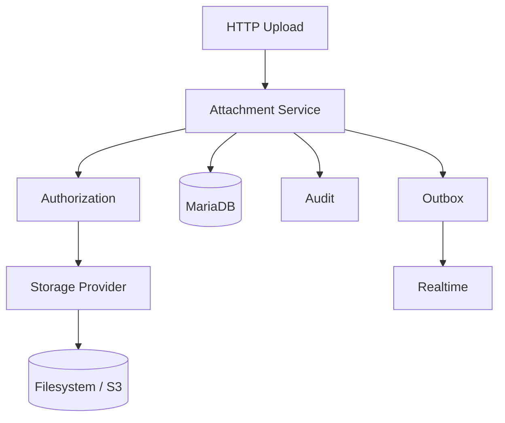

---

# 5. Principios de diseño

El módulo sigue:

- Repository Pattern;
- Service Layer;
- separación entre metadatos y contenido;
- almacenamiento abstracto;
- auditoría completa;
- autorización contextual;
- eventos Outbox;
- consistencia eventual.

---

# 6. Desacoplamiento

El módulo nunca debe conocer el dominio concreto del archivo.

Debe limitarse a almacenar:

```text
Entidad propietaria

+

Identificador

+

Metadatos

+

Storage Key
```

---

# 7. Organización recomendada

```text
modules/
└── attachments/
    ├── attachment_model.py
    ├── attachment_repository.py
    ├── attachment_service.py
    ├── attachment_storage.py
    ├── attachment_schemas.py
    ├── attachment_events.py
    ├── attachment_permissions.py
    ├── attachment_exceptions.py
    └── attachments_web.py
```

---

# 8. Arquitectura interna

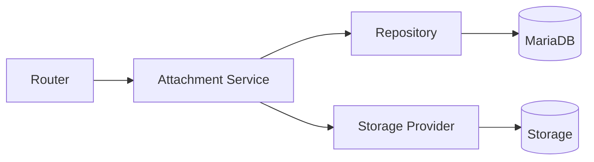

---

# 9. Principio de almacenamiento

El archivo físico nunca debe almacenarse dentro de MariaDB.

MariaDB únicamente conserva:

- nombre;
- tamaño;
- MIME;
- hash;
- propietario;
- storage_key;
- timestamps.

---

# 10. Contenido físico

Puede almacenarse en:

```text
Filesystem

Amazon S3

MinIO

Azure Blob

Google Cloud Storage
```

Gracias al patrón Storage Provider.

---

# 11. Storage Provider

Interfaz recomendada:

```python
class AttachmentStorage:

    def upload(...):
        ...

    def download(...):
        ...

    def delete(...):
        ...

    def exists(...):
        ...

    def generate_signed_url(...):
        ...
```

El resto del sistema nunca debe depender del proveedor concreto.

---

# 12. Modelo conceptual

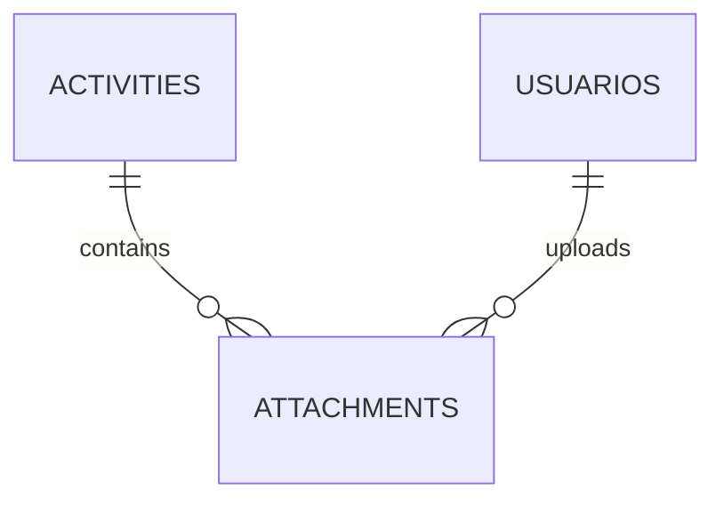

En el futuro:

```text
Projects

↓

Attachments
```

---

# 13. Entidad Attachment

Campos principales:

```text
id_attachment

entity_type

entity_id

storage_key

original_filename

stored_filename

mime_type

size_bytes

sha256

status

uploaded_by

created_at

deleted_at

version
```

---

# 14. Identificador

```text
id_attachment
```

Debe ser:

- único;
- técnico;
- sin significado funcional;
- inmutable.

---

# 15. Entity Type

Permite reutilizar el módulo.

Ejemplos:

```text
activity

task

project

competition

user
```

Actualmente:

```text
activity
```

---

# 16. Entity ID

Identifica el recurso propietario.

Ejemplo:

```text
entity_type = activity

entity_id = 245
```

---

# 17. Storage Key

No debe coincidir con el nombre original.

Ejemplo:

```text
attachments/

2026/

07/

5f/

5f48c19d9c...pdf
```

Debe ser:

- único;
- estable;
- opaco;
- independiente del usuario.

---

# 18. Original Filename

Representa:

```text
Informe Robot.pdf
```

Debe conservarse para descarga.

---

# 19. Stored Filename

Puede existir internamente.

Ejemplo:

```text
5f48c19d.pdf
```

No tiene por qué exponerse.

---

# 20. MIME Type

Ejemplos:

```text
image/png

image/jpeg

application/pdf

text/plain
```

Debe verificarse.

Nunca confiar únicamente en la extensión.

---

# 21. Tamaño

```text
size_bytes
```

Siempre en bytes.

Nunca en KB o MB.

---

# 22. Hash

Se recomienda:

```text
SHA-256
```

Permite:

- verificar integridad;
- detectar duplicados;
- auditoría;
- comprobaciones futuras.

---

# 23. Estado

Estados recomendados:

```text
pending

active

delete_pending

deleted

failed
```

---

# 24. Máquina de estados

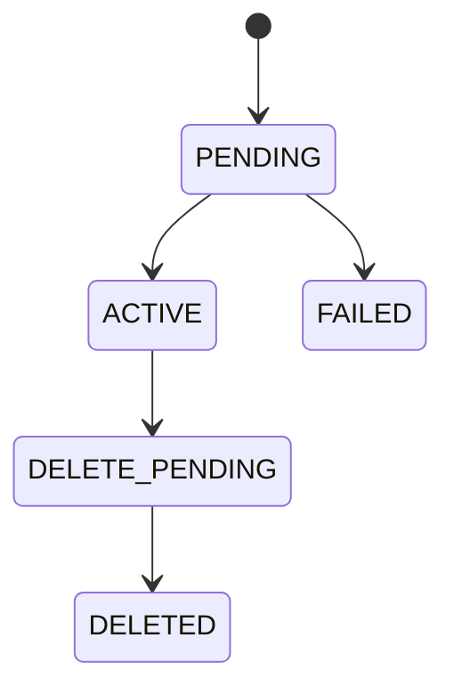

---

# 25. Pending

Archivo recibido.

Todavía no disponible.

---

# 26. Active

Archivo completamente operativo.

Puede:

- descargarse;
- visualizarse;
- utilizarse como evidencia.

---

# 27. Delete Pending

Marcado para eliminación.

Todavía puede existir físicamente.

---

# 28. Deleted

Eliminado.

Solo permanecen metadatos si la política lo requiere.

---

# 29. Failed

Error durante:

- subida;
- almacenamiento;
- validación;
- reconciliación.

---

# 30. Usuario propietario

```text
uploaded_by
```

Representa quién subió el archivo.

No quién lo descargó.

---

# 31. Fechas

```text
created_at

deleted_at
```

Siempre en UTC.

---

# 32. Versionado

```text
version
```

Preparado para optimistic locking.

---

# 33. Relaciones

```text
Attachment

↓

Activity

↓

Task

↓

Project
```

---

# 34. Integridad

Nunca deben existir adjuntos sin:

- entidad propietaria;
- usuario;
- storage_key válido.

---

# 35. Restricción MIME

Solo tipos autorizados.

Ejemplo:

```text
PDF

PNG

JPEG

TXT

CSV
```

---

# 36. Restricción tamaño

Debe existir un tamaño máximo configurable.

Ejemplo:

```text
25 MB
```

No codificado en el código fuente.

---

# 37. Restricción extensión

Las extensiones permitidas deben mantenerse mediante lista blanca.

Ejemplo:

```text
pdf

png

jpg

jpeg

txt

csv
```

---

# 38. Restricción hash

El hash debe calcularse tras recibir el archivo.

Nunca confiar en valores enviados por el cliente.

---

# 39. Restricción Storage Key

Debe ser único.

No reutilizable.

---

# 40. Restricción nombre

El nombre original puede conservar Unicode.

Debe sanearse antes de utilizarse en cabeceras HTTP.

---

# 41. Ciclo de vida

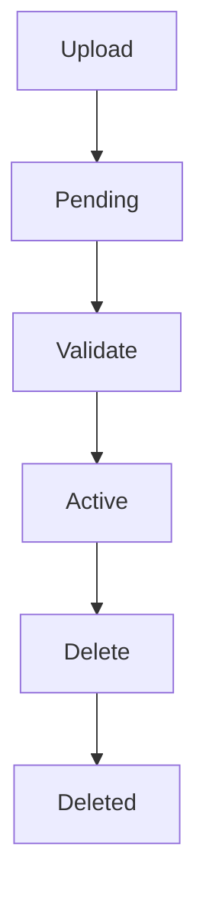

---

# 42. Flujo general

1. Usuario selecciona archivo.
2. Backend valida contexto.
3. Se calcula hash.
4. Se almacena físicamente.
5. Se crean metadatos.
6. Se registra auditoría.
7. Se genera Outbox.
8. Se publica evento.

---

# 43. Responsabilidad del Repository

Debe encargarse únicamente de:

- consultas;
- persistencia;
- filtros;
- paginación;
- optimistic locking.

Nunca del almacenamiento físico.

---

# 44. Responsabilidad del Storage

Debe encargarse únicamente de:

- guardar;
- leer;
- borrar;
- comprobar existencia;
- generar URLs firmadas.

---

# 45. Responsabilidad del Service

Coordina:

- autorización;
- Repository;
- Storage;
- auditoría;
- eventos;
- consistencia.

---

# 46. Integración con Activities

Actualmente:

```text
Activity

1

↓

N

Attachments
```

---

# 47. Integración futura

También podrá soportar:

```text
Projects

↓

Attachments
```

```text
Competitions

↓

Attachments
```

---

# 48. Principio fundamental

Los archivos son **evidencias** del dominio.

Nunca deben convertirse en el propio dominio.

---

# 49. Escalabilidad

El diseño soporta:

- millones de archivos;
- almacenamiento distribuido;
- CDN;
- múltiples proveedores.

---

# 50. Continuación

La **Parte 2** desarrollará:

- Repository Pattern;
- Storage Provider;
- Service Layer;
- flujo completo de subida;
- descarga;
- eliminación;
- auditoría;
- integración con Activities;
- Outbox;
- WebSocket;
- seguridad;
- validaciones técnicas.

---

# 51. Repository Pattern

El acceso a los metadatos de los archivos debe centralizarse mediante un `AttachmentRepository`.

El repositorio únicamente gestiona la persistencia de información en MariaDB.

Nunca manipula directamente el almacenamiento físico.

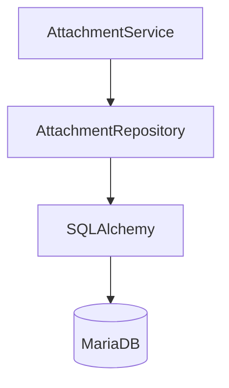

---

# 52. Responsabilidades del Repository

Debe encargarse de:

- crear registros;
- recuperar adjuntos;
- listar adjuntos;
- actualizar metadatos;
- marcar eliminación;
- realizar búsquedas;
- controlar optimistic locking;
- ejecutar agregaciones.

No debe encargarse de:

- subir archivos;
- descargar archivos;
- validar permisos;
- generar URLs;
- auditoría;
- WebSocket;
- Outbox.

---

# 53. Estructura recomendada

```python
class AttachmentRepository:

    def get_by_id(...):
        ...

    def list_by_entity(...):
        ...

    def create(...):
        ...

    def update(...):
        ...

    def soft_delete(...):
        ...

    def exists_hash(...):
        ...

    def count_by_entity(...):
        ...
```

---

# 54. Consulta por ID

Debe devolver únicamente los metadatos.

```python
def get_by_id(
    self,
    db,
    attachment_id: int
):
    ...
```

No debe descargar automáticamente el archivo.

---

# 55. Consulta por entidad

Ejemplo:

```text
entity_type

+

entity_id
```

Debe devolver:

- archivos activos;
- ordenados;
- paginados cuando proceda.

---

# 56. Orden recomendado

```text
created_at DESC

id_attachment DESC
```

---

# 57. Consulta SQL conceptual

```sql
SELECT
    id_attachment,
    entity_type,
    entity_id,
    original_filename,
    mime_type,
    size_bytes,
    status,
    uploaded_by,
    created_at
FROM attachments
WHERE
    entity_type = :entity_type
AND
    entity_id = :entity_id
AND
    status='active'
ORDER BY
    created_at DESC;
```

---

# 58. Consulta de detalle

Debe poder recuperar:

- usuario;
- hash;
- storage_key;
- timestamps;
- versión.

No debe cargar información innecesaria.

---

# 59. Búsqueda por hash

Permite detectar:

- duplicados;
- corrupción;
- integridad.

```python
exists_hash(hash)
```

---

# 60. Conteos

Ejemplo:

```sql
SELECT COUNT(*)
FROM attachments
WHERE
entity_type='activity'
AND
entity_id=:activity_id
AND
status='active';
```

---

# 61. Optimistic Locking

Todas las modificaciones relevantes deben comprobar:

```text
version
```

```sql
UPDATE attachments
SET
version = version + 1
WHERE
id_attachment=:id
AND
version=:expected_version;
```

---

# 62. Sin commits

El Repository nunca ejecuta:

```python
commit()
```

La transacción pertenece al Service Layer.

---

# 63. Storage Provider

El almacenamiento físico se abstrae mediante una interfaz.

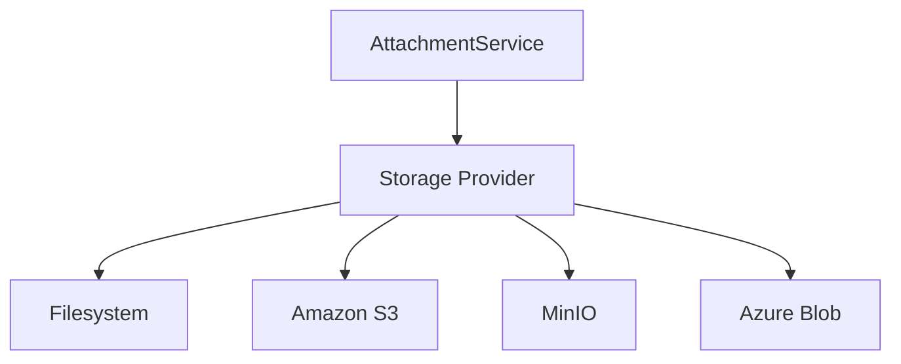

---

# 64. Interfaz

```python
class StorageProvider:

    upload()

    download()

    delete()

    exists()

    signed_url()
```

---

# 65. Upload

Entrada:

- stream;
- mime;
- filename;
- storage_key.

Salida:

```text
storage_key

size

hash
```

---

# 66. Download

Debe devolver un stream.

Nunca cargar el archivo completo en memoria cuando sea grande.

---

# 67. Delete

Debe eliminar físicamente el archivo.

Si falla:

- registrar error;
- reintentar posteriormente.

---

# 68. Exists

Permite verificar:

```text
storage_key
```

antes de operaciones críticas.

---

# 69. Signed URL

Preparado para S3.

Ejemplo:

```text
https://...

expires=600
```

El backend puede utilizar descarga directa en el futuro.

---

# 70. Implementaciones

Ejemplos:

```text
FilesystemStorage

S3Storage

MinioStorage

AzureBlobStorage
```

---

# 71. Filesystem

Adecuado para:

- desarrollo;
- laboratorio;
- despliegues pequeños.

---

# 72. Object Storage

Adecuado para:

- producción;
- CDN;
- alta disponibilidad;
- millones de archivos.

---

# 73. Storage Key

Debe generarse mediante UUID.

Ejemplo:

```text
attachments/

2026/

07/

uuid.pdf
```

Nunca utilizar:

```text
Informe.pdf
```

---

# 74. Directorios

Organización sugerida:

```text
attachments/

year/

month/

day/

uuid
```

Facilita mantenimiento.

---

# 75. Hash

El hash debe calcularse durante la subida.

Nunca confiar en hashes enviados por el navegador.

---

# 76. Flujo Upload

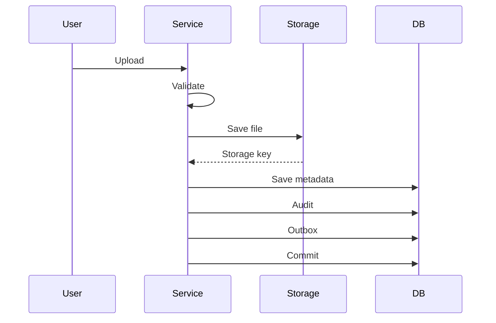

---

# 77. Validaciones

Antes de almacenar:

- usuario;
- permisos;
- contexto;
- tamaño;
- MIME;
- extensión;
- cuota.

---

# 78. MIME

Debe comprobarse mediante inspección.

No únicamente:

```text
Content-Type
```

---

# 79. Extensión

Debe validarse.

No confiar únicamente en:

```text
archivo.exe.pdf
```

---

# 80. Tamaño

Debe comprobarse:

```text
size_bytes
```

antes del almacenamiento definitivo.

---

# 81. Nombre

Debe sanearse.

Eliminar:

- rutas;
- caracteres de control;
- nombres reservados.

---

# 82. Cuotas

Puede existir límite por:

- usuario;
- proyecto;
- actividad.

---

# 83. Virus

Preparado para integrar:

```text
ClamAV
```

u otro antivirus.

El flujo:

```text
Upload

↓

Scan

↓

Active
```

---

# 84. Pending

Mientras el antivirus analiza:

```text
status = pending
```

---

# 85. Failed

Si el análisis falla:

```text
failed
```

No debe mostrarse al usuario.

---

# 86. Service Layer

Coordina:

- Repository;
- Storage;
- Audit;
- Outbox;
- Feed.

---

# 87. Responsabilidades

Debe:

- validar;
- almacenar;
- persistir;
- auditar;
- publicar eventos.

---

# 88. Upload Command

```python
class UploadAttachmentCommand:

    entity_type

    entity_id

    file
```

---

# 89. Resultado

```python
AttachmentResult

id

filename

mime

size

version
```

---

# 90. Flujo del Service

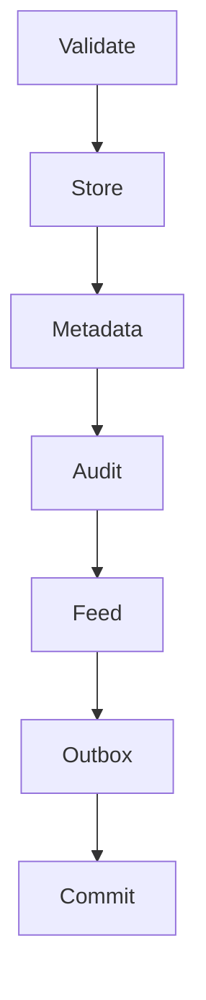

---

# 91. Descarga

Proceso:

1. resolver Attachment;
2. resolver entidad;
3. resolver permisos;
4. comprobar estado;
5. abrir stream;
6. responder.

---

# 92. Eliminación

Proceso:

```text
Validate

↓

Soft Delete

↓

Storage Delete

↓

Audit

↓

Outbox
```

---

# 93. Estrategia

Se recomienda:

- soft delete en BD;
- eliminación física;
- reconciliación posterior.

---

# 94. Reconciliación

Job periódico.

Detecta:

- registros sin archivo;
- archivos huérfanos;
- estados inconsistentes.

---

# 95. Auditoría

Acciones:

```text
upload_attachment

download_attachment

delete_attachment
```

---

# 96. Feed

Eventos:

```text
attachment_added

attachment_removed
```

---

# 97. Outbox

Eventos:

```text
attachment.created

attachment.deleted
```

---

# 98. Realtime

Actualiza:

- contador;
- lista;
- timeline.

---

# 99. Contrato

```json
{
  "event":"attachment.created",
  "attachment_id":81,
  "activity_id":42
}
```

---

# 100. Continuación

La **Parte 3** desarrollará:

- seguridad avanzada;
- autorización contextual;
- protección XSS/CSRF/IDOR;
- descarga segura;
- streaming;
- CDN;
- rendimiento;
- observabilidad;
- pruebas;
- checklist enterprise;
- evolución futura;
- conclusiones.

---

# 101. Seguridad avanzada

El módulo Attachments debe considerarse una superficie de riesgo elevada porque procesa contenido binario proporcionado por usuarios.

Las amenazas principales incluyen:

- subida de malware;
- ejecución de archivos;
- path traversal;
- exposición de documentos;
- suplantación de MIME;
- nombres maliciosos;
- denegación de servicio;
- acceso directo no autorizado;
- referencias IDOR;
- XSS mediante contenido activo;
- archivos huérfanos;
- eliminación incompleta.

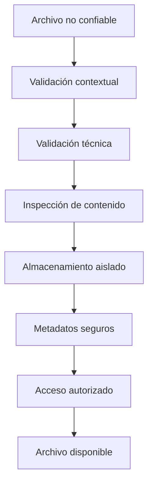

---

# 102. Principio de desconfianza

Todo archivo recibido debe considerarse no confiable, independientemente de:

- usuario autenticado;
- extensión;
- cabecera `Content-Type`;
- nombre;
- origen;
- navegador;
- módulo que inicia la subida.

La autenticación no convierte el contenido en seguro.

---

# 103. Defensa en profundidad

La seguridad debe aplicarse en varias capas:

```text
Autenticación

↓

Autorización contextual

↓

Límites de tamaño

↓

Validación de extensión

↓

Detección MIME

↓

Inspección de contenido

↓

Antivirus

↓

Storage aislado

↓

Descarga controlada
```

Ninguna validación individual resulta suficiente.

---

# 104. Autorización contextual

El módulo Attachments no puede autorizar únicamente con `attachment_id`.

Debe resolver la entidad propietaria.

Para una evidencia de actividad:

```text
Attachment

↓

Activity

↓

Task

↓

Project

↓

ProjectMember

↓

Effective Permission
```

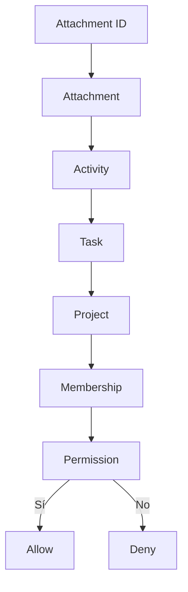

---

# 105. Resolución de propietario

Debe existir un componente que resuelva el contexto según `entity_type`.

Interfaz conceptual:

```python
class AttachmentOwnerResolver(Protocol):
    def resolve_context(
        self,
        db: Session,
        *,
        entity_type: AttachmentEntityType,
        entity_id: int,
    ) -> AttachmentOwnerContext:
        ...
```

---

# 106. `AttachmentOwnerContext`

Puede contener:

```python
@dataclass(frozen=True)
class AttachmentOwnerContext:
    entity_type: AttachmentEntityType
    entity_id: int
    project_id: int | None
    owner_user_id: int | None
    is_mutable: bool
    resource: Resource
```

Este contexto permite aplicar autorización sin acoplar el almacenamiento a cada módulo funcional.

---

# 107. Resolver para Activities

El resolver de actividades debe comprobar:

1. Activity existente;
2. Task existente;
3. Project existente;
4. Project no eliminado;
5. usuario con acceso;
6. estado compatible;
7. permiso de adjuntos.

---

# 108. Permisos recomendados

Recursos:

```text
attachments
activities
tasks
projects
```

Acciones:

```text
read
create
delete
download
manage
```

Ejemplos:

```text
attachments:read

attachments:create

attachments:delete

attachments:download

attachments:manage
```

---

# 109. Matriz orientativa de permisos

| Operación | Administrador | Coordinador | Autor de Activity | Miembro |
|---|---:|---:|---:|---:|
| Consultar metadatos | Sí | Sí | Sí | Sí, según proyecto |
| Descargar | Sí | Sí | Sí | Sí, según proyecto |
| Subir | Sí | Sí | Sí | Configurable |
| Eliminar propio | Sí | Sí | Sí, según estado | No |
| Eliminar ajeno | Sí | Sí | No | No |
| Ver eliminados | Sí | Configurable | No | No |
| Restaurar | Sí | Configurable | No | No |

---

# 110. Estado del propietario

La autorización también depende del estado funcional.

Ejemplo:

| Estado del proyecto | Subir | Descargar | Eliminar |
|---|---:|---:|---:|
| `draft` | Configurable | Sí | Sí |
| `active` | Sí | Sí | Sí |
| `completed` | Limitado | Sí | Limitado |
| `archived` | No | Sí | No |
| `cancelled` | No | Sí | No |

---

# 111. Estado de Activity

| Estado de Activity | Subir | Descargar | Eliminar |
|---|---:|---:|---:|
| `draft` | Sí | Sí | Sí |
| `completed` | Limitado | Sí | Restringido |
| `deleted` | No | Restringido | No |

La política debe mantenerse en Service Layer.

---

# 112. Prevención de IDOR

No debe bastar conocer:

```text
/attachments/81/download
```

Antes de entregar el archivo debe comprobarse:

```text
attachment existe

↓

status = active

↓

owner existe

↓

usuario puede acceder al owner

↓

usuario posee permiso de descarga
```

---

# 113. Ocultación de existencia

Cuando un usuario no puede acceder al adjunto puede devolverse:

```text
404 Not Found
```

en lugar de `403`, si se desea evitar revelar que el archivo existe.

La política debe ser uniforme.

---

# 114. Protección CSRF

Las operaciones de modificación realizadas mediante cookies requieren protección CSRF:

```text
upload

delete

restore

replace
```

La descarga mediante `GET` puede no requerir CSRF si no modifica estado, aunque debe mantener autorización.

---

# 115. Protección frente a path traversal

Nunca debe utilizarse directamente el nombre original para construir la ruta.

Incorrecto:

```python
path = upload_root / file.filename
```

Un nombre malicioso podría contener:

```text
../../config.env
```

Correcto:

```text
storage_key generado por servidor
```

El nombre original se conserva solo como metadato.

---

# 116. Generación de Storage Key

Ejemplo:

```python
def build_storage_key(
    *,
    attachment_id: UUID,
    extension: str | None,
    now: datetime,
) -> str:
    suffix = f".{extension}" if extension else ""
    return (
        f"attachments/"
        f"{now:%Y/%m/%d}/"
        f"{attachment_id.hex}{suffix}"
    )
```

Debe validarse que la extensión final procede de un catálogo permitido.

---

# 117. Normalización del nombre original

Debe:

- eliminar rutas;
- eliminar caracteres de control;
- normalizar Unicode;
- limitar longitud;
- sustituir separadores peligrosos;
- preservar una extensión segura;
- proporcionar nombre alternativo si queda vacío.

Ejemplo:

```text
../../Informe final.pdf

↓

Informe final.pdf
```

---

# 118. Cabecera `Content-Disposition`

La descarga debe utilizar una cabecera segura.

Ejemplo conceptual:

```http
Content-Disposition: attachment; filename="informe.pdf"; filename*=UTF-8''Informe%20final.pdf
```

Debe impedir:

- saltos de línea;
- inyección de cabeceras;
- comillas no escapadas;
- caracteres de control.

---

# 119. Detección MIME

No debe confiarse únicamente en:

```text
UploadFile.content_type
```

Debe inspeccionarse el contenido mediante:

- magic numbers;
- librería especializada;
- parser seguro;
- antivirus.

---

# 120. Extensión frente a contenido

Debe validarse la coherencia:

```text
extensión declarada

vs

MIME detectado
```

Ejemplo:

```text
archivo.pdf

MIME detectado = application/x-executable

↓

rechazar
```

---

# 121. Lista blanca de tipos

La política debe ser explícita.

Ejemplo inicial:

| Extensión | MIME permitido |
|---|---|
| `pdf` | `application/pdf` |
| `png` | `image/png` |
| `jpg`, `jpeg` | `image/jpeg` |
| `txt` | `text/plain` |
| `csv` | `text/csv`, `text/plain` |

No deben permitirse por defecto:

- ejecutables;
- scripts;
- macros;
- HTML;
- SVG no sanitizado;
- archivos comprimidos;
- binarios desconocidos.

---

# 122. Riesgo de SVG

SVG puede contener:

- scripts;
- enlaces externos;
- eventos;
- contenido activo.

Debe:

- rechazarse inicialmente;
- sanitizarse con una herramienta específica;
- servirse con descarga forzada;
- nunca incrustarse directamente sin tratamiento.

---

# 123. Riesgo de HTML

Los archivos HTML pueden ejecutar contenido en el contexto del navegador.

La recomendación es:

```text
no admitir HTML
```

o servirlo siempre mediante:

```text
Content-Disposition: attachment
```

y desde un dominio aislado.

---

# 124. Riesgo de PDF

Los PDF pueden incluir:

- JavaScript;
- formularios;
- enlaces;
- contenido embebido.

Deben:

- escanearse;
- descargarse de forma controlada;
- no confiarse por ser PDF;
- previsualizarse únicamente con componentes seguros.

---

# 125. Riesgo de imágenes

Las imágenes pueden:

- estar corruptas;
- explotar vulnerabilidades de parsers;
- contener metadatos sensibles;
- producir decompression bombs.

Puede aplicarse:

- validación de formato;
- límites de dimensiones;
- eliminación de EXIF;
- recodificación;
- antivirus.

---

# 126. Metadatos EXIF

Las fotografías pueden contener:

- ubicación;
- dispositivo;
- fecha;
- autor;
- miniaturas.

Debe decidirse si:

- se conservan;
- se eliminan;
- se informa al usuario.

Para evidencias educativas suele ser recomendable eliminar metadatos no necesarios.

---

# 127. Límite de tamaño

El límite debe aplicarse durante la recepción, no únicamente después.

Ejemplo configurable:

```text
ATTACHMENT_MAX_SIZE_BYTES
```

El servidor debe detener el stream cuando supera el límite.

---

# 128. Streaming de subida

No debe cargarse el archivo completo en memoria.

Flujo:

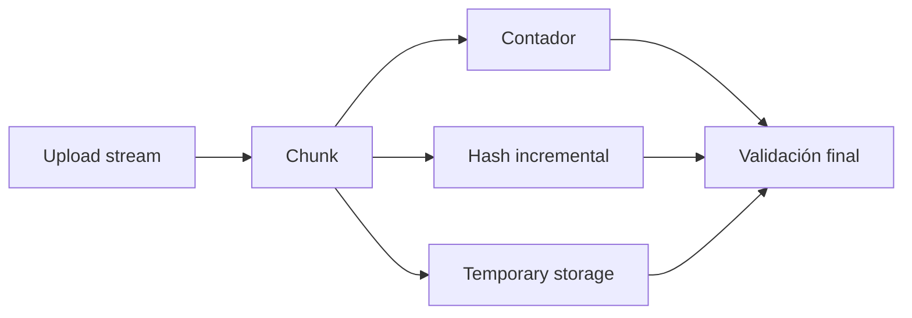

---

# 129. Hash incremental

Ejemplo conceptual:

```python
hasher = hashlib.sha256()
size = 0

while chunk := await file.read(CHUNK_SIZE):
    size += len(chunk)

    if size > max_size:
        raise AttachmentTooLargeError()

    hasher.update(chunk)
    storage.write(chunk)
```

---

# 130. Límites por petición

Además del límite por archivo deben definirse:

```text
máximo de archivos por petición

tamaño total por petición

tiempo máximo de subida

número de subidas simultáneas
```

---

# 131. Cuotas

Puede establecerse cuota por:

- usuario;
- actividad;
- tarea;
- proyecto;
- organización;
- periodo temporal.

Ejemplo:

```text
Project quota

=

SUM(size_bytes WHERE status = active)
```

---

# 132. Rate limiting

Las rutas de subida deben limitar:

- solicitudes por usuario;
- volumen por periodo;
- errores repetidos;
- concurrencia.

Esto reduce:

- abuso;
- denegación de servicio;
- consumo accidental;
- almacenamiento masivo.

---

# 133. Antivirus

La arquitectura debe permitir integrar un escáner.

Flujo recomendado:

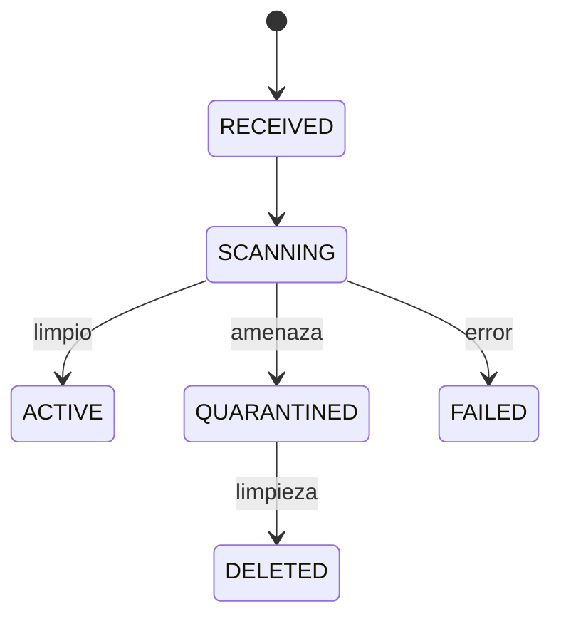

El catálogo puede mapearse al estado técnico del adjunto.

---

# 134. Cuarentena

Los archivos pendientes o sospechosos deben almacenarse en una ubicación separada.

No deben:

- ser descargables;
- exponerse mediante URL pública;
- incluirse en vistas normales;
- procesarse por otros módulos.

---

# 135. Fallo del antivirus

Debe distinguirse:

```text
archivo infectado

vs

escáner no disponible
```

La política más segura es:

```text
fail closed
```

El archivo permanece `pending` o `failed` y no se publica.

---

# 136. Protección contra archivos comprimidos

Si se admiten ZIP en el futuro, deben controlarse:

- tamaño comprimido;
- tamaño descomprimido;
- número de entradas;
- profundidad;
- rutas internas;
- enlaces simbólicos;
- ZIP bombs;
- tipos contenidos.

Inicialmente se recomienda no admitirlos.

---

# 137. Almacenamiento aislado

El almacenamiento local debe ubicarse:

- fuera de `static`;
- fuera de plantillas;
- fuera del repositorio;
- fuera del document root de Nginx;
- con permisos mínimos.

Ejemplo:

```text
/var/lib/aula-robotica/attachments
```

No:

```text
/app/static/uploads
```

---

# 138. Permisos del sistema de archivos

Recomendación:

- usuario dedicado;
- sin permisos de ejecución;
- lectura y escritura limitadas;
- directorios no listables;
- umask restrictiva;
- montaje independiente cuando sea posible.

---

# 139. Nombres opacos

La ruta no debe revelar:

- nombre del usuario;
- email;
- título de tarea;
- nombre del proyecto;
- nombre original;
- identificadores sensibles.

---

# 140. Cifrado en reposo

Puede aplicarse:

- cifrado del volumen;
- cifrado del proveedor;
- claves gestionadas;
- cifrado por objeto en casos sensibles.

La necesidad depende del nivel de confidencialidad.

---

# 141. Cifrado en tránsito

Toda subida y descarga debe utilizar:

```text
HTTPS
```

No deben entregarse archivos por HTTP sin cifrar.

---

# 142. Service Layer de subida

Firma conceptual:

```python
def upload_attachment(
    self,
    db: Session,
    *,
    command: UploadAttachmentCommand,
    actor: CurrentUser,
) -> AttachmentResult:
    ...
```

---

# 143. Flujo transaccional de subida

El almacenamiento físico y MariaDB no comparten transacción.

Se necesita coordinación explícita.

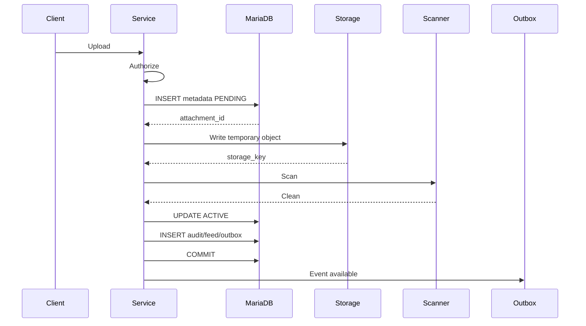

---

# 144. Estrategia de metadato previo

Ventajas:

- existe identificador desde el inicio;
- permite seguimiento;
- facilita reintentos;
- permite reconciliación;
- registra fallos.

Estados:

```text
pending

active

failed
```

---

# 145. Descarga segura

La descarga de un adjunto debe realizarse exclusivamente después de validar el contexto funcional completo del recurso.

El flujo de autorización debe recorrer:

```text
Attachment

↓

Entidad propietaria

↓

Task / Activity

↓

Project

↓

ProjectMember

↓

Effective Permissions
```

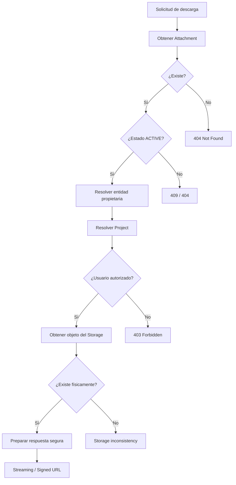

Antes de entregar el archivo debe comprobarse:

* existencia del registro;
* estado `active`;
* existencia de la entidad propietaria;
* acceso del usuario al proyecto;
* permiso efectivo de descarga;
* existencia física del objeto;
* coherencia básica de los metadatos;
* nombre de descarga seguro;
* MIME validado.

Nunca debe permitirse descargar directamente mediante:

```text
storage_key
```

una ruta del filesystem o una URL interna proporcionada por el cliente.

La aplicación debe resolver siempre el archivo a partir de:

```text
attachment_id
```

y comprobar nuevamente la autorización.

Una descarga autorizada puede resolverse mediante dos estrategias:

```text
Backend Streaming

o

Signed URL temporal
```

La elección depende del Storage Provider y de los requisitos de infraestructura, pero en ambos casos la autorización debe realizarse antes de exponer el contenido.

---

# 146. Streaming de archivos

La descarga de archivos grandes no debe cargar el contenido completo en memoria.

Debe utilizarse streaming.

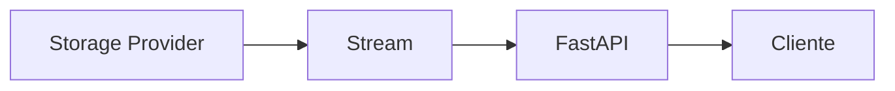

Esto permite:

* reducir consumo de RAM;
* mejorar escalabilidad;
* soportar archivos grandes;
* iniciar la descarga antes de leer el archivo completo.

---

# 147. StreamingResponse

Para almacenamiento local puede utilizarse conceptualmente:

```python
return StreamingResponse(
    file_stream,
    media_type=attachment.mime_type,
    headers=headers,
)
```

El stream debe cerrarse correctamente incluso cuando:

* el cliente interrumpe la conexión;
* se produce una excepción;
* existe un timeout.

---

# 148. Chunk Size

La lectura debe realizarse en bloques.

Ejemplo conceptual:

```text
64 KB

256 KB

1 MB
```

El tamaño óptimo debe determinarse mediante pruebas.

No debe fijarse arbitrariamente pensando que un bloque mayor siempre ofrece mejor rendimiento.

---

# 149. Content-Length

Cuando el tamaño sea conocido debe enviarse:

```http
Content-Length
```

utilizando:

```text
size_bytes
```

persistido en los metadatos.

Esto permite:

* mostrar progreso;
* optimizar clientes;
* detectar transferencias incompletas.

---

# 150. Range Requests

Para archivos multimedia o documentos grandes puede soportarse:

```http
Range
```

Ejemplo:

```http
Range: bytes=1000-2000
```

Esto facilita:

* reproducción parcial;
* reanudación;
* navegación multimedia.

No resulta imprescindible en la primera versión.

---

# 151. Descarga desde Object Storage

Cuando se utiliza S3-compatible storage existen dos estrategias.

## Proxy backend

```text
Cliente

↓

FastAPI

↓

Object Storage
```

## Signed URL

```text
Cliente

↓

FastAPI autoriza

↓

Signed URL

↓

Object Storage
```

---

# 152. Proxy backend

Ventajas:

* control total;
* auditoría sencilla;
* ocultación completa del proveedor;
* políticas centralizadas.

Inconvenientes:

* consume ancho de banda del backend;
* aumenta carga;
* limita escalabilidad.

---

# 153. Signed URL

El backend:

1. autentica al usuario;
2. autoriza el recurso;
3. genera URL temporal;
4. devuelve la URL.

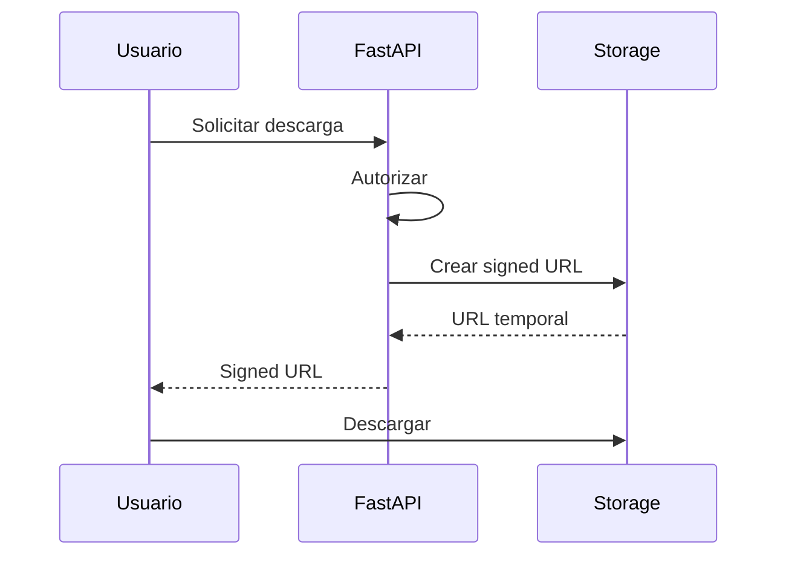

---

# 154. Expiración de Signed URL

La URL debe tener una duración corta.

Ejemplo orientativo:

```text
5 minutos

10 minutos
```

Nunca debe ser permanente.

La duración puede depender de:

* tamaño;
* sensibilidad;
* tipo de recurso.

---

# 155. Signed URL y autorización

Una Signed URL demuestra únicamente que el backend autorizó previamente la descarga.

Una vez generada puede ser utilizada por cualquiera que la posea hasta que expire.

Por ello debe evitarse:

* registrarla en logs;
* insertarla en HTML persistente;
* compartirla por WebSocket;
* almacenarla como metadata.

---

# 156. CDN

Cuando el volumen lo justifique puede utilizarse CDN para:

* imágenes;
* documentos públicos;
* recursos de gran tamaño.

Los archivos privados requieren:

* Signed URLs;
* Signed Cookies;
* autorización previa;
* expiración.

---

# 157. Archivos públicos y privados

El modelo debe diferenciar explícitamente:

```text
private

public
```

si en el futuro existen ambos tipos.

La configuración por defecto debe ser:

```text
private
```

---

# 158. Storage privado

Los buckets o directorios de evidencias no deben ser públicamente accesibles.

El acceso debe depender siempre de:

* aplicación;
* URL firmada;
* política autenticada.

---

# 159. Cache-Control

Los archivos privados pueden utilizar:

```http
Cache-Control: private
```

Cuando el contenido pueda cambiar o tenga sensibilidad elevada:

```http
Cache-Control: private, no-store
```

La política debe adaptarse al caso de uso.

---

# 160. ETag

El hash SHA-256 puede servir conceptualmente para generar un identificador estable de contenido.

Esto facilita:

* validación de caché;
* comprobación de integridad;
* detección de cambios.

No debe asumirse que el ETag generado por S3 representa siempre SHA-256.

---

# 161. Integridad durante descarga

Puede comprobarse:

```text
hash almacenado

vs

hash del contenido
```

de manera periódica.

No resulta necesario recalcularlo en cada descarga debido al coste de I/O.

---

# 162. Protección frente a Path Traversal

Nunca debe construirse una ruta utilizando directamente:

```text
original_filename
```

Incorrecto:

```python
path = uploads_dir / original_filename
```

Un nombre manipulado podría contener:

```text
../../
```

La ruta física debe derivarse exclusivamente de:

```text
storage_key
```

generada por el backend.

---

# 163. Resolución segura de rutas

En Filesystem Storage debe comprobarse que la ruta final permanece dentro del directorio configurado.

```text
BASE_STORAGE

↓

resolve(storage_key)

↓

¿Sigue dentro de BASE_STORAGE?

├── Sí → continuar
└── No → rechazar
```

---

# 164. Symbolic Links

El almacenamiento local debe protegerse frente a enlaces simbólicos que permitan escapar del directorio autorizado.

Debe evaluarse:

* `resolve()`;
* flags seguros de apertura;
* permisos del sistema;
* aislamiento del contenedor.

---

# 165. Nombres reservados

Los nombres proporcionados al usuario deben sanear caracteres que puedan provocar problemas en:

* Windows;
* Linux;
* navegadores;
* cabeceras HTTP.

Sin modificar innecesariamente el nombre visible original.

---

# 166. Content-Disposition

La descarga puede utilizar:

```http
Content-Disposition: attachment
```

o:

```http
Content-Disposition: inline
```

según el tipo de archivo y política.

---

# 167. `attachment`

Debe utilizarse para archivos que deban descargarse explícitamente.

Ejemplos:

```text
CSV

ZIP

documentos no visualizables
```

---

# 168. `inline`

Puede utilizarse para formatos seguros:

```text
PDF

PNG

JPEG
```

si se desea visualización en navegador.

Debe seguir aplicándose:

* autorización;
* MIME correcto;
* CSP;
* protección frente a contenido activo.

---

# 169. Content-Type seguro

Nunca debe derivarse únicamente de:

```text
extensión
```

o:

```text
Content-Type enviado por cliente
```

Debe utilizarse el MIME validado durante la subida.

---

# 170. `X-Content-Type-Options`

Las respuestas deben incluir:

```http
X-Content-Type-Options: nosniff
```

Esto reduce el riesgo de MIME sniffing.

---

# 171. Archivos HTML

No se recomienda permitir archivos:

```text
text/html
```

como evidencias ordinarias.

Podrían convertirse en vector de:

* XSS;
* phishing;
* ejecución de contenido activo.

Si existe una necesidad futura deben descargarse con políticas estrictas.

---

# 172. SVG

SVG puede contener:

* scripts;
* enlaces;
* contenido activo.

No debe permitirse como imagen ordinaria sin sanitización específica.

La opción más segura inicialmente es excluir:

```text
image/svg+xml
```

---

# 173. PDF

Los PDF deben validarse como archivos reales.

Pueden contener:

* JavaScript;
* formularios;
* enlaces;
* contenido malicioso.

Cuando el contexto requiera mayor seguridad puede incorporarse:

* antivirus;
* Content Disarm and Reconstruction;
* visualización aislada.

---

# 174. Office Documents

Formatos como:

```text
DOCX

XLSX

PPTX
```

pueden incorporarse en el futuro.

Deben diferenciarse de formatos con macros:

```text
DOCM

XLSM

PPTM
```

Los formatos con macros deberían rechazarse inicialmente.

---

# 175. Archivos comprimidos

ZIP y formatos similares incrementan riesgos:

* malware encapsulado;
* zip bombs;
* rutas internas maliciosas;
* contenido desconocido.

No deben habilitarse sin una necesidad clara.

---

# 176. Zip Bomb Protection

Si en el futuro se procesan ZIP debe limitarse:

* tamaño comprimido;
* tamaño descomprimido;
* número de entradas;
* profundidad;
* ratio de compresión.

Nunca deben extraerse de forma indiscriminada.

---

# 177. Antivirus

El pipeline puede incorporar un scanner.

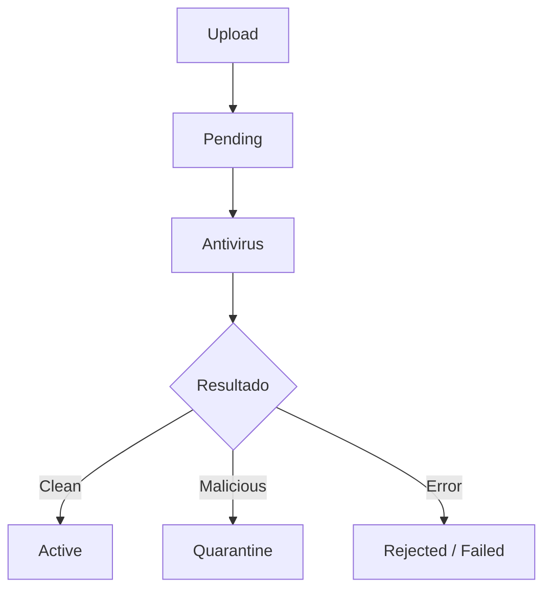

---

# 178. Cuarentena

Los archivos sospechosos deben permanecer:

* inaccesibles;
* separados;
* no descargables;
* auditados.

Nunca deben llegar al storage público o activo.

---

# 179. Estado `quarantined`

Puede incorporarse en el futuro:

```text
pending

scanning

active

quarantined

delete_pending

deleted

failed
```

Solo cuando exista integración antivirus real.

---

# 180. Antivirus asíncrono

Para archivos grandes resulta preferible:

```text
Upload

↓

Pending

↓

Queue

↓

Scanner Worker

↓

Active / Quarantined
```

Esto evita mantener la request abierta durante demasiado tiempo.

---

# 181. Feedback durante análisis

La interfaz puede mostrar:

```text
Analizando archivo...
```

y actualizar mediante:

* polling;
* WebSocket;
* Server-Sent Events.

---

# 182. Límites de tamaño

El tamaño máximo debe configurarse centralmente.

Ejemplo:

```env
ATTACHMENT_MAX_SIZE_MB=25
```

El backend debe convertir a bytes de forma segura.

---

# 183. Protección en Nginx

Nginx debe aplicar un límite coherente.

Ejemplo conceptual:

```nginx
client_max_body_size 25M;
```

El límite de proxy no debe ser menor accidentalmente que el esperado por la aplicación.

---

# 184. Coherencia de límites

Debe cumplirse:

```text
Nginx limit

>=

Application accepted size
```

o utilizar exactamente el mismo valor operacional.

De lo contrario, el usuario puede recibir un error del proxy antes de llegar a FastAPI.

---

# 185. Errores de tamaño

Respuesta recomendada:

```text
413 Payload Too Large
```

Mensaje:

```text
El archivo supera el tamaño máximo permitido.
```

---

# 186. Timeout de subida

Los uploads pueden requerir timeouts superiores a requests ordinarias.

Debe configurarse de forma coordinada en:

* navegador;
* Nginx;
* FastAPI server;
* object storage.

Sin establecer valores excesivos sin justificación.

---

# 187. Upload streaming

Idealmente, los archivos grandes deben procesarse como stream.

El pipeline debe evitar:

```text
leer archivo completo

↓

guardar en memoria

↓

procesar
```

---

# 188. Hash incremental

SHA-256 puede calcularse mientras se procesa el stream.

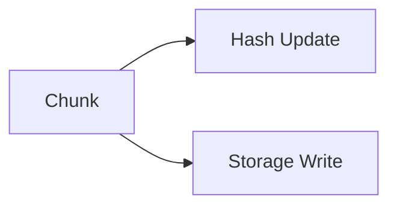

No es necesario leer el archivo dos veces.

---

# 189. Validación incremental de tamaño

Durante el stream debe mantenerse:

```text
bytes_received
```

Si supera el límite:

1. detener lectura;
2. cancelar almacenamiento;
3. limpiar temporal;
4. devolver `413`.

---

# 190. Archivos temporales

Cuando sea necesario utilizar disco temporal:

* directorio dedicado;
* permisos restrictivos;
* nombre aleatorio;
* eliminación garantizada;
* cuotas;
* limpieza periódica.

---

# 191. Storage temporal

Nunca utilizar directamente:

```text
/tmp
```

sin controlar:

* permisos;
* capacidad;
* limpieza;
* aislamiento.

En Docker puede utilizarse un volumen temporal dedicado.

---

# 192. Service Layer avanzado

El `AttachmentService` actúa como coordinador del ciclo de vida.

Métodos orientativos:

```python
class AttachmentService:

    def upload_attachment(...):
        ...

    def get_attachment(...):
        ...

    def download_attachment(...):
        ...

    def delete_attachment(...):
        ...

    def restore_attachment(...):
        ...

    def reconcile_attachment(...):
        ...
```

---

# 193. Command de subida

Ejemplo:

```python
@dataclass(frozen=True)
class UploadAttachmentCommand:
    entity_type: AttachmentEntityType
    entity_id: int
    original_filename: str
    content_type: str | None
```

El stream debe recibirse separadamente.

---

# 194. Flujo robusto de subida

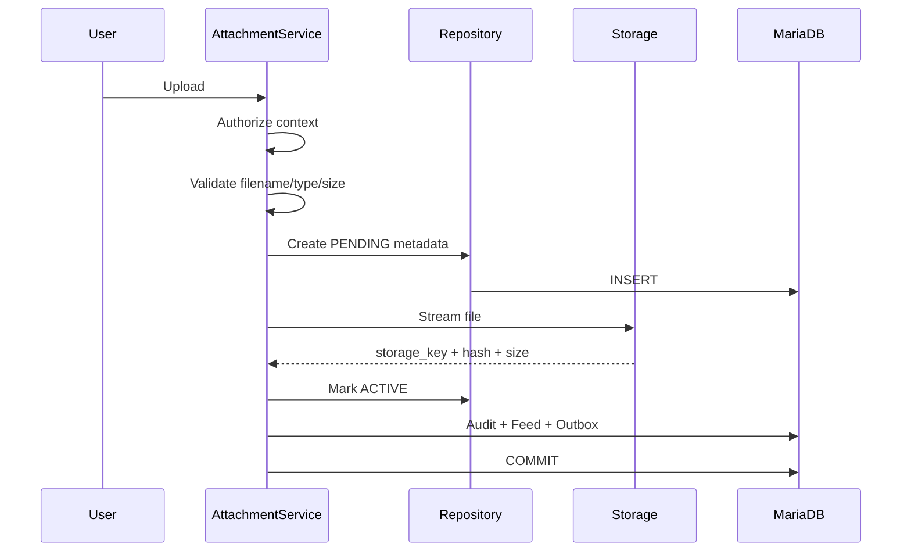

---

# 195. Limitación transaccional del storage

El almacenamiento físico no participa en la transacción MariaDB.

Por tanto:

```text
Storage write

≠

Database transaction
```

Debe existir compensación ante fallos.

---

# 196. Fallo de Storage

Si el storage falla antes de confirmar metadata:

```text
status = failed
```

o debe revertirse el registro provisional.

Debe registrarse:

* error;
* storage provider;
* correlation ID;
* número de intento.

---

# 197. Fallo de MariaDB después del upload

Si el archivo se guarda pero la transacción DB falla:

```text
archivo físico huérfano
```

El Service debe intentar una compensación:

```text
Storage.delete(storage_key)
```

Si la compensación falla:

* registrar orphan candidate;
* emitir métrica;
* permitir que reconciliación posterior lo elimine.

---

# 198. Upload con metadata previa

Una estrategia robusta consiste en:

```text
INSERT status=pending

↓

commit corto

↓

upload

↓

update status=active
```

Esto mejora la trazabilidad del proceso pero introduce consistencia eventual.

Debe analizarse frente al requisito de atomicidad funcional.

---

# 199. Upload con metadata posterior

Alternativa:

```text
upload storage

↓

insert metadata

↓

commit
```

Es más simple, pero puede dejar archivos huérfanos si falla MariaDB.

Ambas estrategias requieren reconciliación.

---

# 200. Estrategia recomendada

Para una arquitectura preparada para procesamiento asíncrono:

```text
metadata PENDING

↓

storage

↓

scan

↓

ACTIVE

↓

evento
```

Esto permite incorporar antivirus sin rediseñar el ciclo de vida.

---

# 201. Eliminación robusta

La eliminación debe tratarse como proceso.

```mermaid
flowchart TD
    A[Solicitud]
    B[Autorizar]
    C[Mark DELETE_PENDING]
    D[Commit]
    E[Delete Storage]
    F{Resultado}
    G[Mark DELETED]
    H[Retry]
    I[Audit/Event]

    A --> B
    B --> C
    C --> D
    D --> E
    E --> F
    F -->|Success| G
    F -->|Failure| H
    G --> I
```

---

# 202. Por qué `DELETE_PENDING`

Permite:

* reintentar;
* bloquear descargas;
* mantener trazabilidad;
* evitar metadatos perdidos;
* detectar fallos.

---

# 203. Eliminación física de metadata

No debe realizarse inmediatamente salvo archivos:

* temporales;
* fallidos;
* sin valor histórico.

Para evidencias funcionales se recomienda conservar metadata mínima.

---

# 204. Metadata histórica

Después de eliminar puede conservarse:

```text
id_attachment

entity_type

entity_id

original_filename

size_bytes

sha256

uploaded_by

created_at

deleted_at

deleted_by
```

Debe eliminarse:

```text
storage_key
```

o marcarse como inválido si ya no existe contenido.

---

# 205. Restauración

La restauración solo es posible mientras el objeto físico continúe existiendo.

Si se realiza eliminación inmediata del storage:

```text
deleted
```

es irreversible.

Una política futura puede incorporar:

```text
trash retention
```

---

# 206. Papelera temporal

Ejemplo:

```text
active

↓

trash

↓

30 días

↓

physical deletion
```

Debe justificarse por requisitos funcionales o de recuperación.

---

# 207. Reconciliación

Un job periódico debe comparar:

```text
MariaDB metadata

vs

Storage objects
```

---

# 208. Tipos de inconsistencia

```text
metadata ACTIVE sin objeto

objeto sin metadata

DELETE_PENDING demasiado antiguo

PENDING demasiado antiguo

FAILED abandonado

size incorrecto

hash incorrecto
```

---

# 209. Reconciliación automática

Algunas inconsistencias pueden resolverse automáticamente.

Ejemplos:

```text
PENDING + objeto válido

→ intentar activar
```

```text
DELETE_PENDING + objeto inexistente

→ marcar deleted
```

Otras requieren revisión.

---

# 210. Reconciliación destructiva

Nunca debe eliminarse automáticamente un archivo huérfano recién detectado.

Puede existir una ventana de seguridad:

```text
detected_at

+

grace period
```

antes de eliminar.

---

# 211. Job de limpieza

Puede ejecutarse mediante:

* scheduler;
* worker;
* cron;
* Celery/RQ futuro;
* task runner.

Debe impedir ejecuciones concurrentes incompatibles.

---

# 212. Lock del reconciliador

Puede utilizarse:

* advisory lock;
* Redis lock;
* singleton job;
* locking en DB.

El objetivo es evitar que varios workers eliminen o modifiquen el mismo objeto simultáneamente.

---

# 213. Integración con Outbox

Los eventos deben generarse cuando el cambio funcional se confirma.

Ejemplos:

```text
attachment.created

attachment.activated

attachment.deleted

attachment.failed
```

No todos deben ser visibles en UI.

---

# 214. Evento de archivo activo

Solo debe anunciarse:

```text
attachment.created
```

o:

```text
attachment.activated
```

cuando el archivo puede utilizarse realmente.

No debe anunciarse como disponible mientras está `pending`.

---

# 215. Activity Feed

El feed debe mostrar únicamente eventos funcionalmente relevantes.

Ejemplos:

```text
Fran añadió «evidencia.pdf».
```

```text
María eliminó una evidencia.
```

No debe mostrar:

```text
scanner worker changed pending → active
```

---

# 216. Auditoría

La auditoría sí puede registrar eventos técnicos relevantes:

```text
upload initiated

upload completed

download

delete requested

physical deletion

scan failed

reconciliation
```

La granularidad debe equilibrar utilidad y volumen.

---

# 217. Auditoría de descarga

Debe decidirse si toda descarga requiere auditoría.

Es recomendable para:

* documentos sensibles;
* evidencias evaluables;
* exportaciones;
* información administrativa.

Para imágenes ordinarias puede resultar excesivo.

---

# 218. WebSocket

Eventos realtime funcionales:

```text
attachment.created

attachment.deleted
```

Pueden actualizar:

* lista de evidencias;
* contador;
* Activity timeline;
* Dashboard.

---

# 219. Payload realtime

Ejemplo:

```json
{
  "event_id": "uuid",
  "event_type": "attachment.created",
  "project_id": 12,
  "entity_type": "activity",
  "entity_id": 255,
  "attachment_id": 81,
  "occurred_at": "2026-07-26T18:30:00Z",
  "payload": {
    "filename": "evidencia.pdf",
    "mime_type": "application/pdf",
    "size_bytes": 812544,
    "uploaded_by": {
      "id": 7,
      "display_name": "Fran"
    }
  }
}
```

No debe incluir:

* storage key;
* filesystem path;
* signed URL;
* hashes internos salvo necesidad.

---

# 220. Accesibilidad

La interfaz de adjuntos debe poder utilizarse con teclado.

Debe proporcionar:

* label para selector;
* descripción del tamaño máximo;
* tipos permitidos;
* progreso accesible;
* mensajes de error;
* botón de eliminar con nombre del archivo.

---

# 221. Input de archivo

Ejemplo conceptual:

```html
<label for="attachment-file">
    Añadir evidencia
</label>

<input
    id="attachment-file"
    name="file"
    type="file"
    aria-describedby="attachment-help"
>

<p id="attachment-help">
    PDF, PNG o JPEG. Tamaño máximo: 25 MB.
</p>
```

---

# 222. Drag & Drop

Puede añadirse como mejora progresiva.

No debe ser el único mecanismo de selección.

Debe mantenerse:

```text
<input type="file">
```

accesible.

---

# 223. Progreso de subida

Debe mostrar:

* porcentaje;
* estado;
* nombre;
* cancelación cuando sea posible.

Puede utilizarse:

```html
<progress>
```

con alternativa textual.

---

# 224. Cancelación de subida

Si el cliente cancela:

* abortar request;
* cerrar stream;
* eliminar temporal;
* limpiar metadata provisional cuando proceda.

Debe ser idempotente.

---

# 225. JavaScript modular

Estructura recomendada:

```text
static/js/attachments/
├── attachment_api.js
├── attachment_upload.js
├── attachment_list.js
├── attachment_download.js
└── attachment_realtime.js
```

---

# 226. `attachment_api.js`

Debe encapsular:

```javascript
uploadAttachment(...)
deleteAttachment(...)
getDownloadUrl(...)
```

No debe contener lógica DOM.

---

# 227. `attachment_upload.js`

Responsabilidades:

* selección;
* drag & drop;
* validación preliminar;
* progreso;
* cancelación;
* mensajes;
* actualización posterior.

---

# 228. Validación frontend

Puede comprobar:

* extensión;
* tamaño;
* número de archivos.

No debe intentar sustituir:

* MIME real;
* antivirus;
* autorización;
* cuota definitiva.

---

# 229. Multi-upload

Puede incorporarse:

```text
multiple
```

Cada archivo debe tratarse como una unidad independiente.

Esto permite:

* retry individual;
* progreso individual;
* fallo parcial;
* auditoría correcta.

---

# 230. Atomicidad de multi-upload

No debe asumirse que subir cinco archivos es una única transacción.

Resultado posible:

```text
3 activos

1 rechazado

1 fallido
```

La interfaz debe mostrar estado por archivo.

---

# 231. Cuotas

El sistema puede limitar almacenamiento por:

```text
usuario

actividad

proyecto

organización
```

Debe comprobarse antes y después de la subida cuando exista concurrencia.

---

# 232. Cuota concurrente

Dos uploads simultáneos pueden superar una cuota si ambos validan antes de persistir.

La solución puede requerir:

* reserva de cuota;
* contador transaccional;
* locking;
* tolerancia controlada.

Solo debe implementarse si existen cuotas estrictas.

---

# 233. Rendimiento

Las operaciones críticas son:

* upload;
* download;
* listado;
* generación de URLs;
* eliminación;
* reconciliación.

---

# 234. Índices recomendados

```text
attachments(entity_type, entity_id, status)

attachments(uploaded_by, created_at)

attachments(status, created_at)

attachments(sha256)

attachments(storage_key)

attachments(created_at)

attachments(deleted_at)
```

---

# 235. Unicidad de `storage_key`

Debe existir:

```text
UNIQUE(storage_key)
```

mientras el campo conserve una clave de objeto válida.

---

# 236. Índice por hash

Un índice sobre:

```text
sha256
```

permite encontrar contenido duplicado.

No implica necesariamente deduplicación física.

---

# 237. Deduplicación

No debe implementarse compartiendo automáticamente un único archivo entre múltiples evidencias sin analizar:

* permisos;
* eliminación;
* retención;
* privacidad;
* lifecycle.

Dos archivos iguales pueden tener significado funcional diferente.

---

# 238. Content-addressable Storage

Una evolución avanzada puede utilizar:

```text
sha256

↓

storage object
```

con referencias múltiples.

Requiere:

* reference counting;
* ownership;
* garbage collection;
* políticas de retención.

No es necesario inicialmente.

---

# 239. Paginación

Una entidad con muchos adjuntos debe soportar paginación.

Especialmente en:

* proyectos futuros;
* competiciones;
* repositorios de evidencias.

---

# 240. Thumbnails

Para imágenes puede generarse:

```text
thumbnail
```

de forma asíncrona.

```mermaid
flowchart LR
    A[Image Active]
    B[Thumbnail Job]
    C[Thumbnail Storage]
    D[Metadata]

    A --> B
    B --> C
    C --> D
```

---

# 241. Preview

Las previews pueden generarse para:

* imágenes;
* PDF;
* vídeo futuro.

No deben generarse durante la request principal si el procesamiento es costoso.

---

# 242. Metadata de derivados

Puede existir una tabla:

```text
attachment_variants
```

con:

```text
attachment_id

variant_type

storage_key

mime_type

size_bytes
```

Solo cuando exista necesidad real.

---

# 243. Object Storage Lifecycle

En producción pueden configurarse reglas para:

* eliminar temporales;
* mover históricos a almacenamiento frío;
* limpiar multipart uploads;
* mantener versiones.

Estas políticas deben coordinarse con MariaDB.

---

# 244. Multipart Upload

Para archivos grandes S3 permite multipart upload.

Ventajas:

* reintento parcial;
* paralelismo;
* archivos grandes.

Debe añadirse solo cuando el tamaño de archivos lo justifique.

---

# 245. Observabilidad

El módulo debe registrar:

* subidas;
* descargas;
* eliminaciones;
* fallos;
* tiempos;
* bytes transferidos;
* errores del storage;
* reconciliaciones.

---

# 246. Logging estructurado

Ejemplo:

```json
{
  "event": "attachment.upload",
  "attachment_id": 81,
  "entity_type": "activity",
  "entity_id": 255,
  "project_id": 12,
  "actor_id": 7,
  "mime_type": "application/pdf",
  "size_bytes": 812544,
  "storage_provider": "filesystem",
  "result": "success",
  "duration_ms": 174,
  "correlation_id": "uuid"
}
```

---

# 247. Datos que no deben registrarse

No deben aparecer en logs:

* contenido;
* signed URLs;
* JWT;
* cookies;
* credenciales;
* rutas internas completas;
* datos sensibles del documento.

El nombre original debe evitarse cuando pueda contener información sensible.

---

# 248. Métricas técnicas

```text
attachment_upload_total

attachment_upload_failure_total

attachment_download_total

attachment_delete_total

attachment_storage_failure_total

attachment_scan_failure_total

attachment_reconciliation_failure_total

attachment_bytes_uploaded_total

attachment_bytes_downloaded_total
```

---

# 249. Histogramas

Métricas:

```text
attachment_upload_duration_seconds

attachment_download_duration_seconds

attachment_size_bytes
```

Permiten conocer:

* percentiles;
* distribución;
* degradación.

---

# 250. Métricas de estado

```text
attachments_pending

attachments_active

attachments_delete_pending

attachments_failed

attachments_orphaned
```

---

# 251. Alertas

Debe alertarse cuando:

* aumenta `failed`;
* crece `pending`;
* existen `delete_pending` antiguos;
* falla almacenamiento;
* aumenta el tiempo de subida;
* se agota capacidad;
* la reconciliación encuentra muchos huérfanos.

---

# 252. Capacidad de almacenamiento

Debe monitorizarse:

```text
bytes used

bytes free

object count

growth rate
```

En Filesystem Storage es especialmente importante evitar llenar el volumen.

---

# 253. Health Check de Storage

Puede comprobar:

* conectividad;
* lectura;
* escritura controlada;
* permisos;
* espacio.

No debe escribir archivos permanentemente en cada health check.

---

# 254. Readiness

Si el storage es imprescindible para el funcionamiento del nodo, un fallo puede afectar:

```text
readiness
```

sin necesariamente indicar que todo FastAPI está muerto.

---

# 255. Backup

Los metadatos y objetos deben respaldarse de forma coherente.

Un backup únicamente de MariaDB no recupera los archivos.

Un backup únicamente del storage pierde:

* ownership;
* relaciones;
* estado;
* auditoría.

---

# 256. Estrategia de backup

Debe incluir:

```text
MariaDB

+

Storage
```

con puntos temporales compatibles.

---

# 257. Restore

Después de restaurar debe ejecutarse reconciliación para verificar:

```text
metadata

↔

objects
```

---

# 258. Disaster Recovery

Debe definirse:

```text
RPO

RTO
```

para:

* MariaDB;
* adjuntos;
* storage.

La criticidad de evidencias puede exigir una política más estricta que otros assets.

---

# 259. Cifrado en tránsito

Todo acceso debe utilizar:

```text
HTTPS
```

Para object storage:

```text
TLS
```

también dentro de infraestructura cuando sea viable.

---

# 260. Cifrado en reposo

Puede proporcionarlo:

* filesystem cifrado;
* volumen cifrado;
* S3 server-side encryption;
* KMS.

La aplicación no necesita implementar cifrado manual por archivo salvo requisito específico.

---

# 261. Gestión de claves

Si se utiliza KMS:

* claves fuera del código;
* rotación;
* mínimo privilegio;
* auditoría;
* separación por entorno.

---

# 262. Credenciales de Storage

Deben mantenerse en:

* variables protegidas;
* secrets;
* vault.

Nunca en:

* repositorio;
* JavaScript;
* plantillas;
* URLs públicas.

---

# 263. Principio de mínimo privilegio

La aplicación debe disponer únicamente de permisos necesarios.

Ejemplo S3:

```text
GetObject

PutObject

DeleteObject
```

solo sobre el bucket/prefix correspondiente.

---

# 264. Entornos

Debe separarse:

```text
development

testing

staging

production
```

Preferiblemente mediante:

* buckets diferentes;
* prefijos distintos;
* credenciales diferentes.

Nunca deben compartir evidencias reales de producción con tests.

---

# 265. Testing unitario

Debe cubrir:

* generación de storage key;
* validación MIME;
* validación extensión;
* límites;
* sanitización de nombre;
* transición de estados;
* autorización contextual;
* construcción de eventos.

---

# 266. Fake Storage

Los tests unitarios deben poder utilizar:

```python
FakeStorageProvider
```

o almacenamiento temporal.

Esto evita depender de S3.

---

# 267. Contract Tests del Storage Provider

Todas las implementaciones deben cumplir el mismo contrato.

Debe probarse:

```text
upload

exists

download

delete

delete nonexistent

streaming

error handling
```

---

# 268. Pruebas Repository

Deben cubrir:

* creación de metadata;
* consulta;
* listado por entidad;
* filtro por estado;
* hash;
* optimistic locking;
* soft delete;
* paginación.

---

# 269. Pruebas de subida

Casos:

* PDF válido;
* PNG válido;
* MIME no permitido;
* extensión no permitida;
* tamaño excesivo;
* nombre manipulado;
* archivo vacío;
* usuario sin acceso;
* entidad inexistente.

---

# 270. Archivo vacío

Debe decidirse si se permite:

```text
size_bytes = 0
```

La recomendación para evidencias es rechazar archivos vacíos.

Respuesta:

```text
422 Unprocessable Entity
```

---

# 271. Pruebas MIME Spoofing

Ejemplo:

```text
malware.exe

renombrado como

informe.pdf
```

Debe rechazarse si la firma real no coincide con el tipo permitido.

---

# 272. Pruebas de Path Traversal

Nombres de prueba:

```text
../../etc/passwd

..\..\secret.txt

/absolute/path.txt
```

Nunca deben afectar a la ruta física.

---

# 273. Pruebas de descarga

Casos:

* usuario autorizado;
* usuario externo;
* archivo inexistente;
* metadata sin objeto;
* archivo pending;
* archivo deleted;
* MIME;
* Content-Disposition;
* streaming.

---

# 274. Pruebas de eliminación

Debe verificar:

* transición a `delete_pending`;
* eliminación física;
* estado `deleted`;
* auditoría;
* Outbox;
* reintento;
* fallo del proveedor.

---

# 275. Prueba de compensación

Forzar:

```text
Storage upload exitoso

↓

DB failure
```

Debe comprobarse que:

* se intenta eliminar objeto;
* se registra fallo si no puede eliminarse;
* reconciliación puede detectarlo.

---

# 276. Pruebas de reconciliación

Casos:

```text
ACTIVE sin objeto

objeto huérfano

PENDING antiguo

DELETE_PENDING sin objeto

FAILED

hash incorrecto
```

---

# 277. Pruebas de seguridad

Deben cubrir:

* IDOR;
* CSRF;
* XSS en filename;
* header injection;
* MIME spoofing;
* traversal;
* archivo activo malicioso;
* acceso a storage key manipulada;
* Signed URL caducada.

---

# 278. Header Injection

Un filename puede intentar introducir:

```text
\r\n
```

en `Content-Disposition`.

Debe sanitizarse o utilizar una API segura para construir cabeceras.

---

# 279. Pruebas de carga

Escenarios:

* múltiples uploads;
* múltiples descargas;
* archivos de tamaño máximo;
* usuarios concurrentes;
* storage lento;
* miles de metadatos.

---

# 280. Pruebas WebSocket

Debe comprobarse:

* `attachment.created`;
* `attachment.deleted`;
* deduplicación;
* usuario autorizado;
* actualización de contador;
* actualización de timeline.

---

# 281. Pruebas Selenium

Escenarios:

1. abrir Activity;
2. seleccionar archivo;
3. subir;
4. observar progreso;
5. visualizar adjunto;
6. descargar;
7. abrir segunda sesión;
8. recibir actualización realtime;
9. eliminar;
10. comprobar desaparición en ambas sesiones.

---

# 282. Fixtures

Fixtures recomendadas:

```text
active_project

project_member

project_coordinator

task

activity

active_attachment

pending_attachment

deleted_attachment

pdf_attachment

image_attachment
```

---

# 283. Factories

Factories:

```text
AttachmentFactory

ActivityFactory

TaskFactory

ProjectFactory

UserFactory
```

Debe permitir configurar:

```text
status

mime_type

size_bytes

storage_key

uploaded_by

entity_type
```

---

# 284. Checklist de dominio

* [ ] Todo adjunto tiene propietario funcional.
* [ ] `entity_type` pertenece al catálogo.
* [ ] `entity_id` es válido.
* [ ] `storage_key` es opaca.
* [ ] El nombre original no determina la ruta.
* [ ] El MIME está validado.
* [ ] El tamaño es válido.
* [ ] SHA-256 se calcula en backend.
* [ ] El estado es coherente.
* [ ] El uploader se conserva.

---

# 285. Checklist Storage

* [ ] Interfaz desacoplada.
* [ ] Streaming.
* [ ] `exists()`.
* [ ] Eliminación idempotente.
* [ ] Errores traducidos.
* [ ] Credenciales seguras.
* [ ] TLS.
* [ ] Storage privado.
* [ ] Entornos separados.
* [ ] Reconciliación disponible.

---

# 286. Checklist Upload

* [ ] Autorización previa.
* [ ] CSRF.
* [ ] Tamaño máximo.
* [ ] MIME.
* [ ] Extensión.
* [ ] Filename.
* [ ] Hash.
* [ ] Storage key segura.
* [ ] Estado pending/active.
* [ ] Compensación ante errores.

---

# 287. Checklist Download

* [ ] Metadata existente.
* [ ] Estado active.
* [ ] Contexto autorizado.
* [ ] Storage object existente.
* [ ] Content-Type correcto.
* [ ] Content-Disposition seguro.
* [ ] `nosniff`.
* [ ] Streaming.
* [ ] Signed URL corta cuando proceda.
* [ ] Auditoría según política.

---

# 288. Checklist Delete

* [ ] Actor autorizado.
* [ ] Estado compatible.
* [ ] `delete_pending`.
* [ ] Eliminación física.
* [ ] Reintento.
* [ ] Estado `deleted`.
* [ ] Auditoría.
* [ ] Feed.
* [ ] Outbox.
* [ ] Reconciliación.

---

# 289. Checklist Seguridad

* [ ] IDOR protegido.
* [ ] CSRF protegido.
* [ ] XSS protegido.
* [ ] Path traversal protegido.
* [ ] MIME spoofing protegido.
* [ ] Header injection protegido.
* [ ] Storage privado.
* [ ] URLs firmadas expiran.
* [ ] Credenciales no expuestas.
* [ ] Archivos activos restringidos.

---

# 290. Checklist Rendimiento

* [ ] Sin cargas completas en memoria.
* [ ] Upload y download por stream.
* [ ] Índices adecuados.
* [ ] Paginación.
* [ ] CDN preparado.
* [ ] Signed URLs preparadas.
* [ ] Multipart futuro.
* [ ] Thumbnails asíncronos.
* [ ] Métricas de transferencia.
* [ ] Capacidad monitorizada.

---

# 291. Checklist Observabilidad

* [ ] Logs estructurados.
* [ ] Correlation ID.
* [ ] Upload metrics.
* [ ] Download metrics.
* [ ] Storage failures.
* [ ] Pending gauge.
* [ ] Failed gauge.
* [ ] Orphan detection.
* [ ] Alertas.
* [ ] Health checks.

---

# 292. Criterios de aceptación

El módulo Attachments se considera correctamente implementado cuando:

* almacena metadatos separados del contenido;
* soporta un Storage Provider desacoplado;
* permite subida y descarga por streaming;
* verifica tamaño, MIME y extensión;
* genera storage keys opacas;
* calcula hash en backend;
* controla autorización contextual;
* previene IDOR, CSRF, XSS y path traversal;
* mantiene estados de ciclo de vida;
* gestiona fallos entre MariaDB y storage;
* soporta reconciliación;
* registra auditoría;
* alimenta Activity Feed;
* emite eventos realtime después de la confirmación;
* permite eliminar archivos de forma segura;
* monitoriza capacidad y errores;
* supera pruebas unitarias, integración, seguridad y carga.

---

# 293. Evolución futura

El módulo queda preparado para:

* Amazon S3;
* MinIO;
* Azure Blob;
* CDN;
* antivirus;
* cuarentena;
* thumbnails;
* previews;
* multipart uploads;
* versionado;
* deduplicación;
* OCR;
* clasificación automática;
* procesamiento multimedia;
* extracción de metadata;
* IA multimodal.

---

# 294. OCR

Las evidencias de imagen o PDF pueden procesarse asíncronamente mediante OCR.

Flujo:

```mermaid
flowchart LR
    A[Attachment Active]
    B[OCR Job]
    C[Extracted Text]
    D[Search Index / AI]
    E[UI]

    A --> B
    B --> C
    C --> D
    C --> E
```

El texto extraído debe almacenarse separadamente del archivo original.

---

# 295. Metadata automática

Puede extraerse:

* dimensiones;
* páginas;
* duración;
* codec;
* EXIF;
* resolución.

Los metadatos potencialmente sensibles deben filtrarse.

---

# 296. EXIF

Las imágenes pueden contener:

* ubicación GPS;
* dispositivo;
* fecha;
* software;
* información personal.

Debe considerarse eliminar EXIF de previews o imágenes procesadas cuando exista riesgo de privacidad.

---

# 297. IA multimodal

Una futura capa IA puede:

* describir imágenes;
* clasificar evidencias;
* resumir PDF;
* detectar contenido;
* relacionar evidencia con tareas;
* extraer texto;
* sugerir etiquetas.

Nunca debe sustituir el archivo original.

---

# 298. Procesamiento asíncrono

Los procesos costosos deben ejecutarse mediante workers.

```text
Attachment Active

↓

Processing Queue

↓

OCR / Preview / AI / Antivirus

↓

Derived Metadata
```

---

# 299. Estado de procesamiento

Puede existir una entidad independiente:

```text
attachment_processing_jobs
```

en lugar de añadir numerosos estados al propio Attachment.

Campos posibles:

```text
job_type

status

attempts

started_at

completed_at

error
```

---

# 300. Retención

Puede definirse por:

* entidad;
* organización;
* categoría;
* regulación.

Ejemplo:

```text
proyectos archivados

↓

retención 5 años
```

No debe eliminarse información automáticamente sin una política documentada.

---

# 301. Legal Hold

Una evolución empresarial puede impedir eliminación cuando:

```text
legal_hold = TRUE
```

Debe bloquear incluso:

* cleanup;
* lifecycle del storage;
* borrado administrativo.

---

# 302. Versionado de archivos

En el futuro, reemplazar una evidencia podría crear:

```text
AttachmentVersion
```

en lugar de sobrescribir el contenido.

```mermaid
erDiagram
    ATTACHMENTS ||--o{ ATTACHMENT_VERSIONS : versions
```

Esto facilita:

* histórico;
* rollback;
* auditoría.

---

# 303. Principios definitivos

1. MariaDB almacena metadatos, no binarios.
2. El storage físico se abstrae mediante provider.
3. Todo archivo pertenece a un contexto funcional autorizado.
4. El nombre original nunca determina la ruta física.
5. El MIME proporcionado por el cliente no es confiable.
6. El contenido debe procesarse mediante streaming.
7. La storage key debe ser opaca y única.
8. El hash debe calcularse en backend.
9. Storage y MariaDB requieren estrategias compensatorias.
10. Los archivos privados no deben exponerse públicamente.
11. Las URLs firmadas deben ser temporales.
12. La eliminación debe ser recuperable o reintentable cuando sea posible.
13. La reconciliación es parte de la arquitectura.
14. Los eventos funcionales solo se publican cuando el archivo está disponible.
15. Toda operación crítica debe ser observable y auditable.

---

# 304. Conclusiones

El módulo Attachments proporciona una arquitectura especializada para gestionar evidencias y archivos de Aula Robótica Platform sin acoplar el dominio funcional al mecanismo físico de almacenamiento.

La separación entre `AttachmentRepository`, `AttachmentService` y `StorageProvider` permite mantener MariaDB como fuente de verdad de los metadatos mientras que el contenido puede residir en Filesystem, S3, MinIO u otros proveedores. Esta abstracción facilita evolucionar desde un despliegue sencillo hasta una infraestructura distribuida sin modificar los módulos consumidores.

El diseño presta especial atención a la seguridad. Los archivos se autorizan siguiendo el contexto `Attachment → Activity → Task → Project`, las rutas físicas se generan mediante claves opacas, las descargas utilizan tipos MIME controlados y se protegen frente a IDOR, path traversal, MIME spoofing, XSS y manipulación de cabeceras.

El ciclo `pending → active → delete_pending → deleted` permite gestionar de forma explícita la falta de atomicidad entre MariaDB y el almacenamiento externo. Junto con los mecanismos de compensación y reconciliación, esta estrategia evita que errores parciales produzcan silenciosamente archivos huérfanos o referencias rotas.

La utilización de streaming reduce el consumo de memoria durante subidas y descargas, mientras que la preparación para Signed URLs, CDN, multipart upload y object storage permite escalar el sistema cuando aumente el volumen de evidencias.

Finalmente, el módulo queda preparado para integrar antivirus, cuarentena, OCR, generación de previews, extracción de metadatos e inteligencia artificial multimodal. Estas capacidades podrán incorporarse mediante procesos asíncronos sin alterar el contrato principal del almacenamiento ni comprometer la trazabilidad del archivo original.

Con esta arquitectura, Attachments se convierte en un subsistema seguro, observable, escalable y reutilizable para la gestión de evidencias digitales en todos los módulos presentes y futuros de Aula Robótica Platform.

