# 32_NOTIFICATIONS_MODULE.md

# Módulo de Notificaciones

## Parte 1 — Arquitectura, dominio, modelo de datos y ciclo de vida

---

# 1. Introducción

El módulo **Notifications** centraliza la comunicación funcional dirigida a los usuarios de Aula Robótica Platform.

Su responsabilidad consiste en transformar eventos relevantes del dominio en información visible para los destinatarios adecuados, respetando:

* permisos;
* contexto;
* preferencias;
* severidad;
* deduplicación;
* estado de lectura;
* trazabilidad;
* canales disponibles.

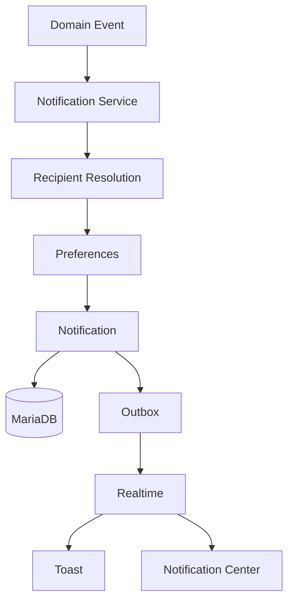

Las notificaciones no deben considerarse simples mensajes visuales. Constituyen un subsistema transversal que conecta eventos de negocio con usuarios concretos.

---

# 2. Objetivos

El módulo debe permitir:

* crear notificaciones;
* seleccionar destinatarios;
* almacenar mensajes;
* consultar notificaciones;
* marcar como leídas;
* marcar todas como leídas;
* mantener contador de no leídas;
* respetar preferencias;
* evitar duplicados;
* publicar actualizaciones realtime;
* alimentar toasts;
* soportar futuras extensiones multicanal.

---

# 3. Responsabilidad arquitectónica

Notifications es responsable de:

* persistencia de notificaciones;
* resolución de destinatarios;
* preferencias de usuario;
* estado de lectura;
* severidad;
* deduplicación;
* agrupación;
* integración realtime;
* API de consulta;
* generación de DTOs.

No debe asumir directamente:

* lógica principal de Projects;
* reglas de Tasks;
* reglas de Activities;
* autorización de los recursos originales;
* envío directo desde routers funcionales;
* construcción arbitraria de HTML.

---

# 4. Posición dentro de la arquitectura

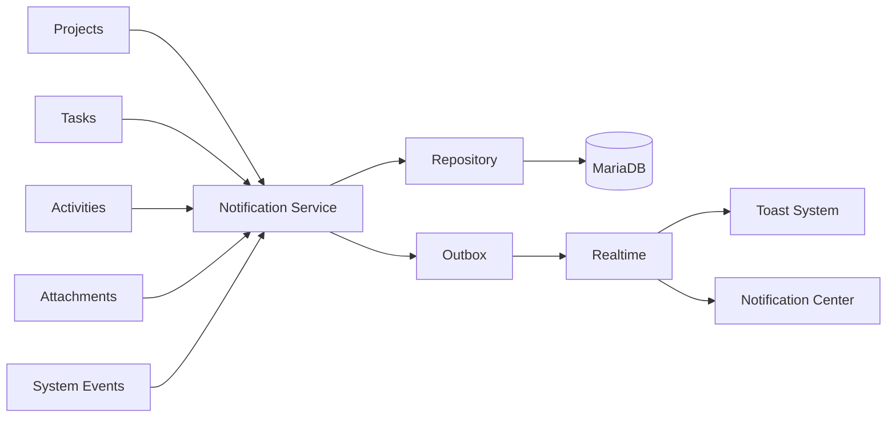

---

# 5. Principios de diseño

El módulo sigue los principios:

1. persistencia antes de entrega;
2. eventos de dominio como origen;
3. destinatarios explícitos;
4. deduplicación;
5. idempotencia;
6. separación entre tipo y severidad;
7. preferencias por usuario;
8. realtime después del commit;
9. payload mínimo;
10. independencia del canal.

---

# 6. Persistencia antes de entrega

Una notificación funcional debe almacenarse antes de publicarse.

```text
Evento

↓

Crear Notification

↓

Commit

↓

Outbox

↓

Realtime

↓

Cliente
```

Esto permite que el usuario pueda recuperarla aunque:

* no tenga WebSocket conectado;
* cierre el navegador;
* pierda conectividad;
* falle el envío realtime.

---

# 7. Notifications como subsistema transversal

El módulo puede recibir eventos desde:

```text
Projects

Tasks

Activities

Attachments

Competitions

IAM

System
```

No debe acoplarse fuertemente a sus modelos ORM.

La comunicación debe realizarse mediante:

* comandos;
* eventos;
* DTOs;
* identificadores.

---

# 8. Organización recomendada

```text
modules/
└── notifications/
    ├── notification_model.py
    ├── notification_repository.py
    ├── notification_service.py
    ├── notification_schemas.py
    ├── notification_preferences.py
    ├── notification_recipient_service.py
    ├── notification_events.py
    ├── notification_exceptions.py
    ├── notification_view_service.py
    └── notifications_web.py
```

JavaScript:

```text
static/js/notifications/
├── notification_api.js
├── notification_center.js
├── notification_badge.js
├── notification_realtime.js
└── notification_preferences.js
```

Plantillas:

```text
templates/
└── notifications/
    ├── notifications_list.html
    ├── notification_preferences.html
    └── partials/
        ├── notification_item.html
        ├── notification_badge.html
        ├── notification_empty_state.html
        └── notification_dropdown.html
```

---

# 9. Arquitectura interna

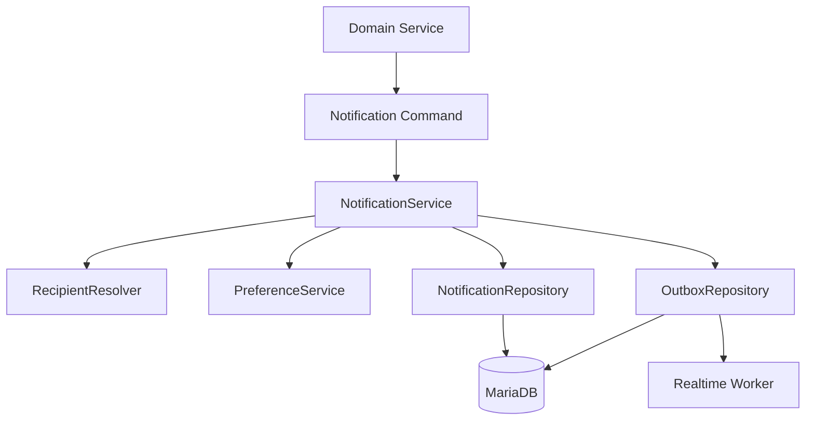

---

# 10. Entidad Notification

Una Notification representa una comunicación persistente destinada a un único usuario.

Campos conceptuales:

```text
id_notification

user_id

type

severity

title

message

entity_type

entity_id

action_url

is_read

read_at

event_id

correlation_id

created_at

expires_at
```

---

# 11. Modelo relacional

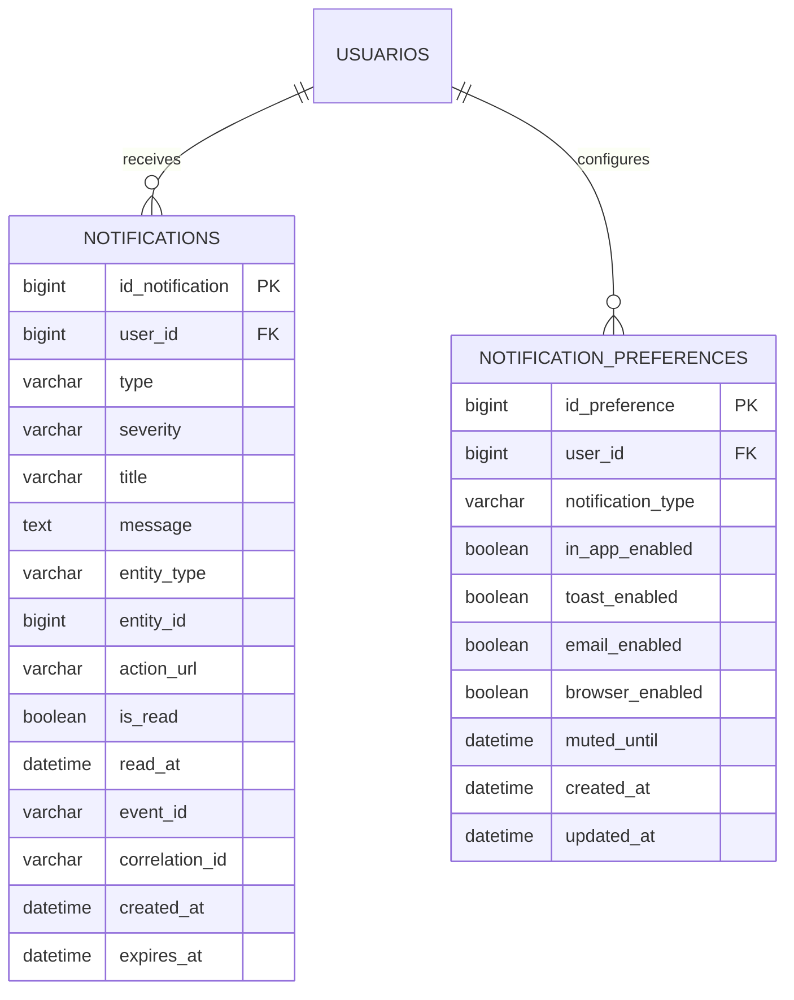

---

# 12. Campos principales

| Campo             | Responsabilidad             |
| ----------------- | --------------------------- |
| `id_notification` | Identificador técnico       |
| `user_id`         | Destinatario                |
| `type`            | Tipo funcional              |
| `severity`        | Importancia visual          |
| `title`           | Resumen                     |
| `message`         | Descripción                 |
| `entity_type`     | Tipo de recurso relacionado |
| `entity_id`       | Identificador del recurso   |
| `action_url`      | Navegación                  |
| `is_read`         | Estado de lectura           |
| `read_at`         | Fecha de lectura            |
| `event_id`        | Deduplicación               |
| `correlation_id`  | Trazabilidad                |
| `created_at`      | Creación                    |
| `expires_at`      | Expiración opcional         |

---

# 13. Identificador

`id_notification` debe ser:

* técnico;
* único;
* inmutable;
* sin significado funcional;
* generado por la persistencia.

---

# 14. Destinatario

Toda notificación debe pertenecer a un usuario.

```text
Notification.user_id

↓

User.id_usuario
```

Debe ser:

```text
NOT NULL
```

Una notificación sin destinatario no es válida.

---

# 15. Tipo de notificación

`type` identifica qué ocurrió.

Ejemplos:

```text
task_assigned

task_status_changed

task_updated

project_member_added

project_updated

activity_created

attachment_added

system
```

Debe utilizar `NotificationType`.

---

# 16. Tipo frente a severidad

No deben confundirse.

Ejemplo:

```text
type = task_assigned

severity = info
```

o:

```text
type = system

severity = warning
```

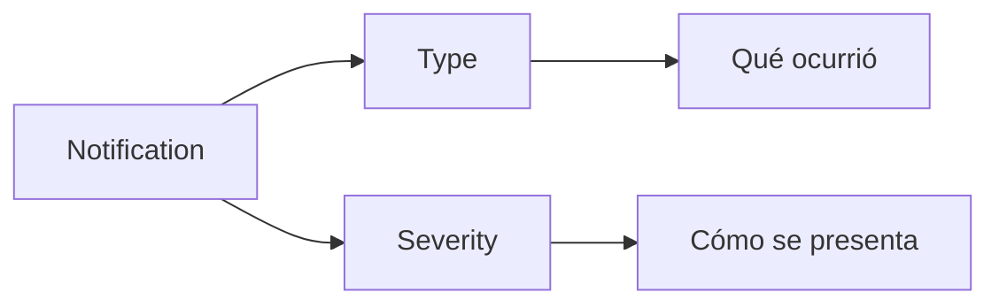

---

# 17. Severidad

Valores recomendados:

```text
info

success

warning

error
```

El backend debe determinar la severidad o aplicar una regla centralizada.

El frontend no debe deducirla de textos.

---

# 18. Título

El título debe:

* ser breve;
* ser comprensible;
* no contener HTML arbitrario;
* permitir internacionalización futura.

Ejemplos:

```text
Nueva tarea asignada

Proyecto actualizado

Actividad completada

Aviso del sistema
```

---

# 19. Mensaje

El mensaje aporta contexto.

Ejemplo:

```text
Se te ha asignado la tarea «Configurar el sensor» en el proyecto «Robot Explorer».
```

Debe evitar:

* información sensible;
* HTML arbitrario;
* payloads técnicos;
* mensajes excesivamente largos.

---

# 20. Mensajes persistidos

Existen dos estrategias.

## Texto renderizado

Persistir directamente:

```text
Se te ha asignado...
```

Ventajas:

* simple;
* estable históricamente.

## Template + parámetros

Persistir:

```text
template_key

payload
```

Ventajas:

* internacionalización;
* cambio de presentación;
* reutilización.

---

# 21. Estrategia recomendada

Para la primera versión puede persistirse:

```text
type

title

message
```

manteniendo además:

```text
entity_type

entity_id
```

La arquitectura debe permitir evolucionar hacia templates internacionalizables.

---

# 22. Referencia a entidad

Las notificaciones pueden apuntar a:

```text
task

project

activity

attachment

competition

system
```

mediante:

```text
entity_type

entity_id
```

---

# 23. Referencia polimórfica

Ejemplo:

```text
entity_type = task

entity_id = 84
```

No existe una FK directa porque el destino depende del tipo.

Esto aporta flexibilidad, pero requiere validación en Service Layer.

---

# 24. Catálogo de entidades

Debe existir un enum cerrado.

Ejemplo:

```python
class NotificationEntityType(StrEnum):
    TASK = "task"
    PROJECT = "project"
    ACTIVITY = "activity"
    ATTACHMENT = "attachment"
    COMPETITION = "competition"
    SYSTEM = "system"
```

No deben aceptarse valores arbitrarios.

---

# 25. Action URL

Permite navegar desde la notificación.

Ejemplos:

```text
/tasks/84

/projects/12

/activities/255
```

Debe ser:

* relativa o interna;
* validada;
* generada por backend;
* independiente del input del usuario.

---

# 26. Open Redirect

No debe aceptarse:

```text
https://evil.example
```

como `action_url` arbitraria.

La recomendación es almacenar únicamente rutas internas:

```text
/tasks/84
```

---

# 27. Estado de lectura

Campos:

```text
is_read

read_at
```

Estado inicial:

```text
is_read = false

read_at = null
```

---

# 28. Máquina de estado de lectura

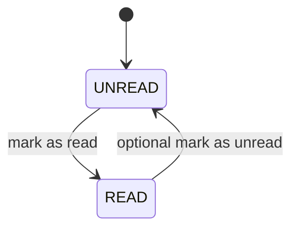

La operación inversa puede habilitarse o no según UX.

---

# 29. Marcar como leída

Al marcar:

```text
is_read = true

read_at = current UTC timestamp
```

Debe ser idempotente.

Una segunda petición no debe generar error.

---

# 30. Marcar como no leída

Si se soporta:

```text
is_read = false

read_at = null
```

No debe generar una nueva Notification.

---

# 31. Constraint de lectura

Puede utilizarse:

```sql
CHECK (
    (is_read = TRUE AND read_at IS NOT NULL)
    OR
    (is_read = FALSE AND read_at IS NULL)
)
```

si la política exige coherencia estricta.

---

# 32. Fecha de creación

`created_at`:

* obligatoria;
* UTC;
* inmutable;
* indexable.

Debe utilizarse para:

* ordenación;
* retención;
* paginación;
* agrupación temporal.

---

# 33. Expiración

`expires_at` es opcional.

Puede utilizarse para notificaciones temporales:

```text
mantenimiento

eventos puntuales

recordatorios
```

No debe eliminar automáticamente información histórica importante sin una política de retención.

---

# 34. Notificaciones expiradas

Una notificación expirada puede:

* ocultarse de vistas ordinarias;
* conservarse temporalmente;
* eliminarse mediante job;
* archivarse.

No debe confundirse:

```text
expired
```

con:

```text
read
```

---

# 35. Event ID

`event_id` identifica el evento que originó la notificación.

Permite:

* deduplicación;
* idempotencia;
* trazabilidad;
* correlación con realtime.

---

# 36. Deduplicación

Restricción recomendada:

```text
UNIQUE(event_id, user_id)
```

cuando un evento solo debe producir una notificación por usuario.

Ejemplo:

```text
event_id = evt-123

user_id = 8
```

no debe insertarse dos veces.

---

# 37. Correlation ID

`correlation_id` agrupa todos los efectos generados por una misma operación.

Ejemplo:

```text
Task status changed

↓

AuditLog

Activity Feed

Notification

Outbox

WebSocket
```

Todos pueden compartir:

```text
correlation_id
```

---

# 38. NotificationPreference

`NotificationPreference` representa la configuración individual del usuario.

Campos conceptuales:

```text
id_preference

user_id

notification_type

in_app_enabled

toast_enabled

email_enabled

browser_enabled

muted_until

created_at

updated_at
```

---

# 39. Preferencias por tipo

Cada usuario puede configurar diferentes comportamientos según `NotificationType`.

Ejemplo:

```text
task_assigned

in_app = true
toast = true
email = false
browser = false
```

---

# 40. Unicidad de preferencia

Restricción:

```text
UNIQUE(user_id, notification_type)
```

Debe existir como máximo una configuración específica por tipo.

---

# 41. Preferencias por defecto

Cuando no existe fila específica debe utilizarse una configuración central.

Ejemplo:

```text
in_app_enabled = true

toast_enabled = true

email_enabled = false

browser_enabled = false
```

Los valores reales deben definirse por tipo.

---

# 42. Default centralizado

No deben existir defaults diferentes entre:

* frontend;
* backend;
* base de datos.

Debe existir una única política.

Ejemplo conceptual:

```python
DEFAULT_NOTIFICATION_PREFERENCES = {
    NotificationType.TASK_ASSIGNED: NotificationChannelPolicy(
        in_app=True,
        toast=True,
        email=False,
        browser=False,
    ),
}
```

---

# 43. Silenciamiento

`muted_until` permite suspender temporalmente un tipo de notificación.

Regla:

```text
muted_until > now

↓

no enviar canales interruptivos
```

Debe decidirse si `in_app` continúa persistiendo durante el silencio.

---

# 44. Recomendación de silenciamiento

Se recomienda:

```text
persistir in-app

pero

suprimir toast/browser/email
```

Esto permite consultar posteriormente la información sin interrupciones.

---

# 45. Canales

Canales previstos:

```text
in_app

toast

email

browser
```

La persistencia principal es:

```text
in_app
```

Los demás son mecanismos de entrega.

---

# 46. In-App

Es el canal base.

Características:

* persistente;
* consultable;
* contador de no leídas;
* independiente de la conexión actual.

---

# 47. Toast

El toast es:

* temporal;
* visual;
* no persistente por sí mismo;
* derivado de una Notification o evento.

No debe sustituir el Notification Center.

---

# 48. Email

Puede incorporarse como canal adicional.

Debe utilizar:

* workers;
* plantillas;
* reintentos;
* rate limits;
* preferencias.

No debe enviarse dentro de la transacción principal.

---

# 49. Browser Notifications

Las notificaciones del navegador requieren:

* permiso del usuario;
* Service Worker futuro;
* Push API;
* claves VAPID si se utiliza Web Push.

Debe considerarse una extensión, no una dependencia del núcleo.

---

# 50. Separación persistencia-entrega

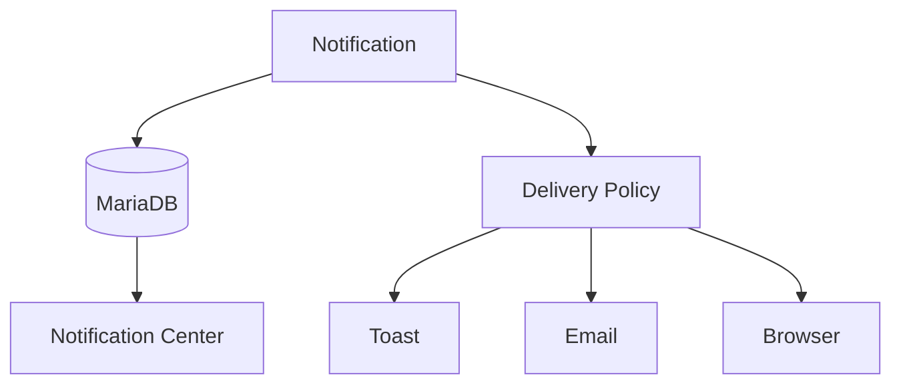

La creación de la Notification no debe depender del éxito de los canales secundarios.

---

# 51. Tipos de notificaciones

Catálogo inicial recomendado:

```text
task_assigned

task_unassigned

task_status_changed

task_updated

task_due_soon

task_overdue

project_member_added

project_member_removed

project_role_changed

project_updated

project_archived

project_restored

activity_created

activity_completed

attachment_added

system
```

---

# 52. Notificaciones de Tasks

Eventos principales:

```text
TASK_ASSIGNED

TASK_UNASSIGNED

TASK_STATUS_CHANGED

TASK_UPDATED

TASK_DUE_SOON

TASK_OVERDUE
```

---

# 53. `task_assigned`

Destinatario:

```text
nuevo assignee
```

Información:

* tarea;
* proyecto;
* actor;
* prioridad;
* fecha límite;
* URL.

---

# 54. `task_unassigned`

Puede notificarse:

* al responsable anterior;
* coordinadores;
* usuarios interesados.

No debe generar ruido cuando forma parte de una reasignación inmediata si existe un evento semántico más adecuado.

---

# 55. `task_status_changed`

Puede dirigirse a:

* assignee;
* coordinadores;
* creador;
* suscriptores futuros.

Debe excluirse normalmente al actor.

---

# 56. `task_due_soon`

Se genera mediante job temporal.

Debe disponer de deduplicación.

Ejemplo de clave conceptual:

```text
task_id

+

user_id

+

reminder_window
```

---

# 57. `task_overdue`

Debe evitar generar una nueva notificación idéntica en cada ejecución del scheduler.

Puede utilizar:

```text
event_id determinista
```

o registro de recordatorio.

---

# 58. Notificaciones de Projects

Tipos:

```text
project_member_added

project_member_removed

project_role_changed

project_updated

project_archived

project_restored
```

---

# 59. `project_member_added`

Destinatario principal:

```text
usuario añadido
```

Puede informar:

* proyecto;
* rol;
* actor;
* acceso directo.

---

# 60. `project_member_removed`

Debe decidirse si el usuario retirado puede acceder a la Notification después de perder acceso al proyecto.

La Notification puede permanecer, pero el `action_url` ya no debe proporcionar acceso al recurso.

---

# 61. Recursos cuyo acceso cambia

Una notificación no concede autorización.

Aunque exista:

```text
action_url = /projects/12
```

la ruta debe volver a comprobar permisos.

---

# 62. `project_role_changed`

Debe notificarse al miembro afectado.

Ejemplo:

```text
Tu rol en «Robot Explorer» ha cambiado a Coordinador.
```

Debe registrar:

```text
old_role

new_role
```

en el evento, aunque no necesariamente en el mensaje persistido.

---

# 63. Notificaciones de Activities

Tipos:

```text
activity_created

activity_completed
```

Futuro:

```text
activity_submitted

activity_validated

activity_rejected

activity_mentioned
```

---

# 64. `activity_created`

Puede dirigirse:

* assignee de Task;
* coordinadores;
* usuarios mencionados.

No debe notificarse a todos los miembros por defecto si genera ruido excesivo.

---

# 65. `activity_completed`

Puede utilizarse cuando completar una actividad requiere atención del responsable o coordinador.

La política puede variar según el flujo académico.

---

# 66. Notificaciones de Attachments

Tipo principal:

```text
attachment_added
```

Normalmente no requiere una notificación independiente si forma parte de:

```text
activity_created
```

Debe evitarse duplicar mensajes.

---

# 67. Notificaciones de sistema

`system` se reserva para:

* mantenimiento;
* seguridad;
* cambios administrativos;
* comunicaciones globales;
* errores operativos relevantes.

---

# 68. Severidad de sistema

Ejemplos:

```text
info
warning
error
```

`success` puede utilizarse para confirmaciones puntuales, aunque no debe saturarse el centro de notificaciones con operaciones rutinarias.

---

# 69. Selección de destinatarios

La resolución debe estar centralizada.

Servicio conceptual:

```python
class NotificationRecipientService:
    def resolve(
        self,
        event,
    ) -> set[int]:
        ...
```

No debe construirse la lista de destinatarios manualmente en cada router.

---

# 70. Recipient Resolver

Puede considerar:

* actor;
* assignee;
* creador;
* coordinadores;
* miembros;
* roles;
* preferencias;
* estado activo;
* contexto.

---

# 71. Exclusión del actor

Regla habitual:

```text
recipient_id != actor_id
```

Debe ser configurable por tipo.

Algunos eventos pueden requerir confirmación al propio actor.

---

# 72. Usuarios inactivos

No deben generarse nuevos canales interruptivos para usuarios inactivos.

Debe decidirse si se persiste la Notification in-app.

Recomendación:

```text
no crear nuevas notificaciones ordinarias
```

para cuentas desactivadas.

---

# 73. Membresía activa

Las notificaciones contextuales de proyecto deben comprobar:

```text
ProjectMember.active = true
```

salvo cuando el evento sea precisamente:

```text
project_member_removed
```

---

# 74. Destinatarios duplicados

Un usuario puede aparecer por varias reglas.

Ejemplo:

```text
assignee

y

coordinator
```

La colección debe deduplicarse antes de persistir.

```python
recipient_ids = set(recipient_ids)
```

---

# 75. Notificaciones masivas

Un evento global puede generar miles de destinatarios.

No debe insertarse fila por fila desde una request síncrona de larga duración.

Debe utilizarse:

* batch insert;
* job asíncrono;
* fan-out;
* Outbox;
* procesamiento por lotes.

---

# 76. Fan-Out on Write

Modelo actual recomendado:

```text
evento

↓

resolver destinatarios

↓

crear una Notification por usuario
```

Ventajas:

* consultas rápidas;
* estado de lectura individual;
* preferencias sencillas;
* contador eficiente.

---

# 77. Fan-Out on Read

Alternativa:

```text
evento global

↓

una sola fila

↓

resolver usuarios al leer
```

Reduce escrituras, pero complica:

* estado individual;
* permisos;
* preferencias;
* contadores.

No se recomienda para la primera arquitectura.

---

# 78. Creación de Notification

Command conceptual:

```python
@dataclass(frozen=True)
class CreateNotificationCommand:
    user_id: int
    type: NotificationType
    severity: NotificationSeverity
    title: str
    message: str
    entity_type: NotificationEntityType | None
    entity_id: int | None
    action_url: str | None
    event_id: str
    correlation_id: str
```

---

# 79. Resultado

DTO conceptual:

```python
@dataclass(frozen=True)
class NotificationResult:
    id_notification: int
    user_id: int
    type: NotificationType
    severity: NotificationSeverity
    title: str
    message: str
    is_read: bool
    created_at: datetime
```

---

# 80. Generación desde eventos

Ejemplo:

```text
TaskAssignedEvent

↓

NotificationPolicy

↓

Resolve recipient

↓

Build notification

↓

Persist
```

---

# 81. Notification Policy

Cada tipo debe definir:

* destinatarios;
* severidad;
* canales;
* template;
* deduplicación;
* autoexpiración;
* prioridad.

Ejemplo conceptual:

```python
TASK_ASSIGNED_POLICY = NotificationPolicy(
    severity=NotificationSeverity.INFO,
    default_in_app=True,
    default_toast=True,
    exclude_actor=True,
)
```

---

# 82. No generar desde routers

Incorrecto:

```python
@router.post(...)
def assign_task(...):
    ...
    create_notification(...)
```

Correcto:

```text
Router

↓

TaskService

↓

Domain Event / NotificationService
```

El router no debe conocer la política de notificación.

---

# 83. Transacción

La creación de Notifications relacionadas con una operación debe participar en la misma transacción cuando sea viable.

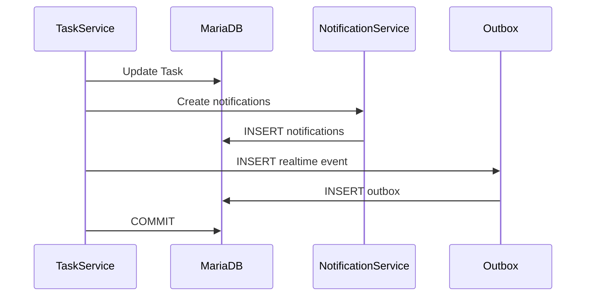

---

# 84. Entrega posterior

Después del commit:

```text
Outbox Worker

↓

Realtime Broker

↓

WebSocket

↓

Cliente
```

La Notification ya existe aunque la entrega falle.

---

# 85. Fallo de realtime

Si WebSocket falla:

* no se revierte Notification;
* no se revierte operación de dominio;
* el usuario podrá verla al volver;
* el worker puede registrar fallo o reintentar.

---

# 86. Idempotencia

Si el evento se procesa dos veces:

```text
UNIQUE(event_id, user_id)
```

debe evitar crear duplicados.

El Service debe tratar esta situación como un resultado idempotente cuando corresponda.

---

# 87. Índices recomendados

```text
notifications(user_id, is_read, created_at)

notifications(user_id, created_at)

notifications(event_id, user_id)

notifications(entity_type, entity_id)

notifications(created_at)

notifications(expires_at)
```

---

# 88. Índice principal del Notification Center

Consulta habitual:

```sql
SELECT *
FROM notifications
WHERE user_id = :user_id
ORDER BY created_at DESC
LIMIT :limit;
```

Índice:

```text
(user_id, created_at)
```

---

# 89. Índice de no leídas

Consulta:

```sql
SELECT COUNT(*)
FROM notifications
WHERE user_id = :user_id
  AND is_read = FALSE;
```

Índice recomendado:

```text
(user_id, is_read)
```

o:

```text
(user_id, is_read, created_at)
```

---

# 90. Contador de no leídas

El contador debe calcularse mediante SQL.

Incorrecto:

```python
len([
    notification
    for notification in user.notifications
    if not notification.is_read
])
```

Correcto:

```sql
SELECT COUNT(*)
FROM notifications
WHERE user_id = :user_id
  AND is_read = FALSE;
```

---

# 91. Alta frecuencia de lectura

La consulta de contador puede ejecutarse con frecuencia en:

* cabecera;
* navbar;
* Dashboard;
* reconexión realtime.

Debe mantenerse optimizada.

---

# 92. Contador cacheado

Puede incorporarse en el futuro mediante:

* Redis;
* contador materializado;
* caché local.

Debe existir estrategia de reconciliación con MariaDB.

MariaDB continúa siendo la fuente de verdad.

---

# 93. Agrupación visual

Notificaciones similares pueden agruparse en UI.

Ejemplo:

```text
3 tareas han cambiado de estado.
```

No implica necesariamente agruparlas físicamente en la base de datos.

---

# 94. Group Key

Puede añadirse en el futuro:

```text
group_key
```

Ejemplos:

```text
project:12:task_updates

task:84:activity
```

Debe incorporarse solo cuando exista un caso UX concreto.

---

# 95. Prioridad interna

Severity no equivale necesariamente a prioridad de entrega.

Puede existir en el futuro:

```text
delivery_priority
```

para distinguir:

```text
normal

high

critical
```

No es necesario inicialmente.

---

# 96. Retención

Las notificaciones no necesitan conservarse indefinidamente.

Puede definirse:

```text
90 días

180 días

1 año
```

según el tipo.

---

# 97. Política de retención

Debe distinguir:

* notificaciones ordinarias;
* avisos de seguridad;
* mensajes de sistema;
* información con relevancia administrativa.

No debe utilizarse una única retención sin analizar el dominio.

---

# 98. Eliminación de notificaciones antiguas

Puede ejecutarse mediante job:

```sql
DELETE FROM notifications
WHERE created_at < :cutoff
  AND is_read = TRUE;
```

Solo si la política de retención lo permite.

---

# 99. Notificaciones no leídas antiguas

Debe definirse si:

* se conservan más tiempo;
* se eliminan igualmente;
* se archivan;
* se marcan expiradas.

---

# 100. Soft delete

Normalmente no es necesario para Notifications ordinarias.

Puede utilizarse:

```text
deleted_at
```

si se permite al usuario ocultarlas sin eliminarlas físicamente de inmediato.

Debe evitarse complejidad innecesaria.

---

# 101. Eliminación por usuario

Si se permite:

```text
dismiss
```

puede representar:

* eliminación física;
* ocultación;
* archivado.

La semántica debe definirse antes de implementar.

---

# 102. Lifecycle conceptual

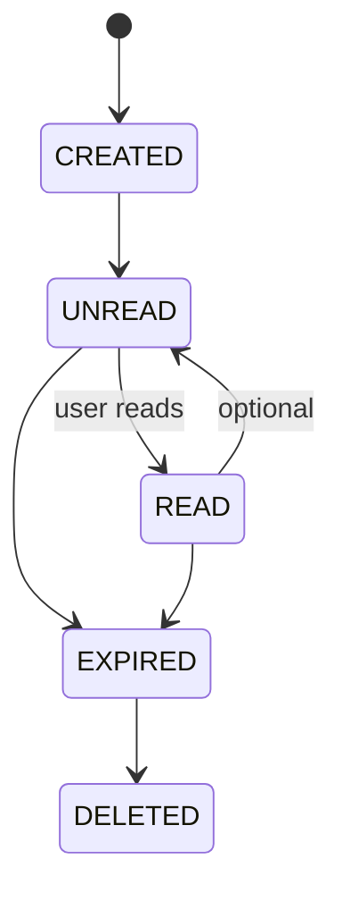

No es necesario persistir todos estos estados como enum.

Pueden derivarse de:

```text
is_read
read_at
expires_at
```

---

# 103. Invariantes

Una Notification válida debe cumplir:

* destinatario existente;
* tipo válido;
* severidad válida;
* título no vacío;
* mensaje válido;
* `event_id` definido cuando proceda;
* estado de lectura coherente;
* `action_url` segura;
* referencia de entidad coherente;
* timestamps válidos.

---

# 104. Constraint de título

Debe impedir:

```text
NULL
```

y, cuando sea viable:

```text
TRIM(title) = ''
```

---

# 105. Constraint de event ID

Si toda Notification deriva de un evento:

```text
event_id NOT NULL
```

Si existen notificaciones administrativas creadas directamente, puede ser nullable o generarse igualmente un UUID propio.

La recomendación es generar siempre un `event_id`.

---

# 106. UUID de evento

Debe ser:

* globalmente único;
* generado por backend;
* independiente del ID de Notification;
* reutilizado por todos los efectos del mismo evento cuando corresponda.

---

# 107. Integridad de referencia

Para:

```text
entity_type != system
```

normalmente debe existir:

```text
entity_id
```

Puede utilizarse una validación:

```text
system → entity_id opcional

otros → entity_id obligatorio
```

---

# 108. Eliminación de entidad origen

Una Notification puede sobrevivir a la eliminación del recurso original.

Ejemplo:

```text
La tarea fue eliminada.
```

Por ello, la referencia polimórfica no debe depender de FK rígida.

---

# 109. Navegación a recurso eliminado

Cuando `action_url` apunta a un recurso ya no accesible:

* la ruta puede devolver 404/403;
* la Notification sigue siendo válida;
* la UI puede ocultar el enlace si detecta expiración;
* no debe producir error de seguridad.

---

# 110. Seguridad de datos

La Notification no debe contener información que el destinatario no esté autorizado a conocer.

La autorización debe comprobarse **antes de construir el mensaje**.

No basta con proteger el `action_url`.

---

# 111. Filtración indirecta

Ejemplo inseguro:

```text
Proyecto confidencial «X» fue actualizado.
```

enviado a un usuario que ya no tiene acceso.

Aunque no pueda abrir el enlace, el mensaje ya ha filtrado información.

---

# 112. Snapshot mínimo

Cuando se persisten nombres o títulos dentro del mensaje se conserva un snapshot histórico.

Debe utilizarse únicamente información apropiada para el destinatario en el momento del evento.

---

# 113. Mensajes y datos personales

Debe evitarse incluir innecesariamente:

* email;
* teléfono;
* identificadores internos;
* información privada;
* datos de autenticación.

Preferir:

```text
display_name
```

cuando sea suficiente.

---

# 114. Auditoría

El sistema de Notifications no necesita auditar cada consulta ordinaria.

Sí pueden auditarse operaciones administrativas:

```text
send_system_notification

change_notification_preferences

bulk_notification

delete_notification_policy
```

---

# 115. Lecturas y auditoría

Marcar como leída normalmente no requiere `AuditLog` técnico completo.

El propio:

```text
read_at
```

proporciona trazabilidad suficiente.

Puede existir excepción para avisos legales o de seguridad.

---

# 116. Eventos del módulo

Eventos propios recomendados:

```text
notification.created

notification.read

notification.read_all

notification.preference_updated
```

No todos necesitan difundirse globalmente.

---

# 117. `notification.created`

Debe emitirse al destinatario conectado para actualizar:

* contador;
* dropdown;
* Notification Center;
* toast.

---

# 118. `notification.read`

Puede utilizarse para sincronizar múltiples pestañas o dispositivos.

Ejemplo:

```text
usuario marca como leída en pestaña A

↓

pestaña B actualiza contador
```

---

# 119. `notification.read_all`

Permite sincronizar la acción:

```text
Marcar todas como leídas
```

sin emitir un evento por cada registro individual.

---

# 120. Preparación para múltiples dispositivos

El estado de lectura reside en servidor.

Por tanto:

```text
dispositivo A

↓

marca como leída

↓

MariaDB

↓

evento realtime

↓

dispositivo B
```

Esto mantiene consistencia.

---

# 121. Realtime y persistencia

El evento realtime debe transportar información suficiente para actualizar UI, pero la Notification persistida continúa siendo la fuente de verdad.

Ante discrepancia:

```text
HTTP / MariaDB

>

estado local del navegador
```

---

# 122. Contrato conceptual realtime

```json
{
  "event_id": "uuid",
  "event_type": "notification.created",
  "user_id": 8,
  "occurred_at": "2026-08-13T18:20:00Z",
  "payload": {
    "notification": {
      "id": 982,
      "type": "task_assigned",
      "severity": "info",
      "title": "Nueva tarea asignada",
      "message": "Se te ha asignado una nueva tarea.",
      "action_url": "/tasks/84",
      "is_read": false,
      "created_at": "2026-08-13T18:20:00Z"
    }
  }
}
```

---

# 123. Información excluida del evento

No debe incluir:

* permisos completos;
* tokens;
* cookies;
* información interna de Outbox;
* datos de otros destinatarios;
* consultas SQL;
* secretos.

---

# 124. Canal de usuario

Las notificaciones privadas deben publicarse en un canal específico de usuario.

Ejemplo conceptual:

```text
user:{user_id}
```

No en una sala global.

---

# 125. Autorización del canal

Para unirse a:

```text
user:8
```

el socket debe pertenecer al usuario 8.

Un administrador tampoco debe suscribirse arbitrariamente a canales personales salvo una capacidad administrativa explícita y auditada.

---

# 126. Diferencia con canales de proyecto

Eventos de proyecto:

```text
project:{project_id}
```

Eventos personales:

```text
user:{user_id}
```

Una Notification privada debe usar el segundo.

---

# 127. Notification Center

Debe permitir:

* listar;
* filtrar;
* paginar;
* marcar leída;
* marcar todas;
* navegar al recurso;
* consultar preferencias.

---

# 128. Dropdown de cabecera

Puede mostrar únicamente:

```text
últimas 5-10

+

contador
```

No debe cargar todo el historial.

---

# 129. Página completa

La página de Notifications debe soportar:

```text
paginación

filtro leído/no leído

tipo

fecha
```

---

# 130. Orden

Por defecto:

```text
created_at DESC
```

Con desempate:

```text
id_notification DESC
```

para mantener orden estable.

---

# 131. Paginación por cursor

Para gran volumen se recomienda cursor:

```text
created_at

+

id_notification
```

Ejemplo:

```text
before=2026-08-13T18:20:00Z,982
```

---

# 132. Empty State

Cuando no existen notificaciones:

```text
No tienes notificaciones.
```

Cuando no existen no leídas:

```text
Estás al día.
```

---

# 133. Badge de no leídas

El badge debe mostrar:

```text
1

2

...

99

99+
```

según diseño.

Debe mantenerse sincronizado entre:

* SSR;
* fetch;
* realtime.

---

# 134. SSR inicial

La cabecera puede recibir:

```text
unread_notification_count
```

desde Context Injection.

Debe obtenerse mediante una consulta eficiente.

---

# 135. Context Injection

Puede inyectarse:

```python
request.scope["notification_count"]
```

o dentro de un contexto común de UI.

Debe evitarse ejecutar la misma consulta desde múltiples templates.

---

# 136. Progressive Enhancement

Sin JavaScript:

* el Notification Center debe funcionar;
* marcar como leída puede usar POST;
* navegación funciona;
* preferencias pueden editarse.

JavaScript mejora:

* dropdown;
* realtime;
* toasts;
* actualización del badge;
* acciones incrementales.

---

# 137. Integración con Toast System

Una Notification nueva puede convertirse en toast si:

```text
toast_enabled = true

AND

usuario conectado

AND

no está silenciado
```

No toda Notification debe mostrar toast.

---

# 138. Persistencia frente a toast

Ejemplo:

```text
Notification persistida

Sí
```

```text
Toast mostrado

No
```

si el usuario deshabilitó toasts.

No existe inconsistencia.

---

# 139. Toast no persistente

El Toast System puede mostrar también mensajes locales derivados de operaciones:

```text
Proyecto guardado correctamente.
```

Estos mensajes no tienen por qué convertirse en Notification persistente.

Debe distinguirse:

```text
feedback de operación

vs

notificación funcional
```

---

# 140. Regla de ruido

Una de las responsabilidades principales del módulo es evitar sobre-notificación.

No debe generarse Notification persistente para:

* cada autosave;
* cada reorder irrelevante;
* cambios puramente técnicos;
* eventos que no afectan al usuario.

---

# 141. Política de relevancia

Una Notification debe responder al menos a una de estas condiciones:

* requiere acción;
* afecta responsabilidad;
* modifica acceso;
* cambia significativamente un recurso relevante;
* comunica una incidencia;
* aporta información que el usuario puede necesitar después.

---

# 142. Rate Limiting funcional

Un usuario no debe recibir cientos de notificaciones por una operación masiva.

Puede aplicarse:

* agrupación;
* digest;
* debounce;
* resumen.

Ejemplo:

```text
25 tareas actualizadas en el proyecto.
```

en lugar de 25 notificaciones cuando el caso lo permita.

---

# 143. Batch Events

Operaciones masivas pueden generar un evento:

```text
tasks.bulk_updated
```

que produzca una única Notification resumida.

---

# 144. Preparación para Digest

En el futuro pueden generarse resúmenes:

```text
Daily Digest

Weekly Digest
```

mediante:

* preferencias;
* scheduler;
* agregación;
* email.

No debe mezclarse con la entrega realtime inmediata.

---

# 145. Inmutabilidad

Después de crear una Notification ordinaria, sus campos funcionales deberían considerarse esencialmente inmutables.

Se modifican únicamente:

```text
is_read

read_at

posible estado de ocultación
```

No debe cambiarse retrospectivamente:

* mensaje;
* tipo;
* destinatario;
* recurso;

salvo corrección administrativa excepcional.

---

# 146. Continuación

La **Parte 2** desarrollará:

* Repository Pattern;
* Service Layer;
* Recipient Resolver;
* Preference Service;
* creación individual y masiva;
* consultas;
* paginación;
* marcado de lectura;
* mark-all-read;
* deduplicación;
* transacciones;
* Outbox;
* contratos realtime;
* rutas SSR y JSON;
* Notification Center;
* dropdown;
* integración completa con Toast System.

---

# 147. Repository Pattern

El acceso a datos del módulo Notifications debe centralizarse mediante un repositorio especializado.

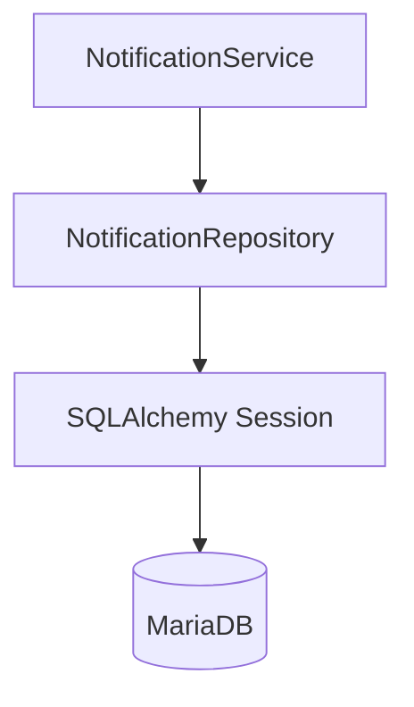

El Repository debe encapsular:

* inserción;
* consulta;
* filtros;
* paginación;
* conteos;
* marcado como leído;
* marcado masivo;
* eliminación por retención;
* deduplicación;
* carga de preferencias.

No debe contener:

* reglas de destinatarios;
* autorización de recursos;
* entrega WebSocket;
* generación de toasts;
* plantillas de mensajes;
* lógica de dominio de Projects, Tasks o Activities.

---

# 148. Estructura recomendada del Repository

```python
class NotificationRepository:

    def get_by_id(...):
        ...

    def get_for_user(...):
        ...

    def list_for_user(...):
        ...

    def count_unread(...):
        ...

    def create(...):
        ...

    def create_many(...):
        ...

    def mark_as_read(...):
        ...

    def mark_as_unread(...):
        ...

    def mark_all_as_read(...):
        ...

    def exists_event_for_user(...):
        ...

    def delete_expired(...):
        ...
```

---

# 149. Consulta segura por ID

La consulta debe incorporar siempre el destinatario.

Incorrecto:

```python
notification = db.get(Notification, notification_id)
```

Correcto conceptualmente:

```sql
SELECT *
FROM notifications
WHERE id_notification = :notification_id
  AND user_id = :current_user_id;
```

Esto evita IDOR entre notificaciones privadas.

---

# 150. `get_for_user`

Firma recomendada:

```python
def get_for_user(
    self,
    db: Session,
    *,
    notification_id: int,
    user_id: int,
) -> Notification | None:
    ...
```

Una Notification nunca debe devolverse a otro usuario únicamente porque conozca su ID.

---

# 151. Listado del usuario

Consulta conceptual:

```sql
SELECT *
FROM notifications
WHERE user_id = :user_id
ORDER BY
    created_at DESC,
    id_notification DESC
LIMIT :limit
OFFSET :offset;
```

Debe soportar filtros sin cargar relaciones innecesarias.

---

# 152. Filtros

Filtros recomendados:

```text
is_read

type

severity

created_from

created_to

entity_type

expired
```

No deben aceptarse nombres arbitrarios de columnas.

---

# 153. Ordenación

Orden por defecto:

```text
created_at DESC

id_notification DESC
```

Otros campos pueden habilitarse mediante lista blanca.

No debe permitirse al cliente construir SQL dinámico libremente.

---

# 154. Paginación

Puede utilizarse inicialmente:

```text
page

size
```

Para grandes volúmenes se recomienda cursor.

```text
created_at

+

id_notification
```

---

# 155. Cursor estable

Consulta conceptual:

```sql
SELECT *
FROM notifications
WHERE user_id = :user_id
  AND (
      created_at < :cursor_created_at
      OR (
          created_at = :cursor_created_at
          AND id_notification < :cursor_id
      )
  )
ORDER BY created_at DESC, id_notification DESC
LIMIT :size;
```

---

# 156. Conteo de no leídas

Método:

```python
def count_unread(
    self,
    db: Session,
    user_id: int,
) -> int:
    ...
```

Consulta:

```sql
SELECT COUNT(*)
FROM notifications
WHERE user_id = :user_id
  AND is_read = FALSE;
```

---

# 157. Conteo eficiente

No debe realizarse:

```text
SELECT todas las notifications

↓

filtrar en Python

↓

len(...)
```

Debe delegarse en MariaDB.

---

# 158. Creación individual

El Repository recibe una entidad ya validada.

```python
def create(
    self,
    db: Session,
    notification: Notification,
) -> Notification:
    db.add(notification)
    db.flush()
    return notification
```

No debe ejecutar `commit()`.

---

# 159. Creación masiva

Para varios destinatarios:

```python
def create_many(
    self,
    db: Session,
    notifications: list[Notification],
) -> list[Notification]:
    ...
```

Debe utilizar batch cuando el volumen lo justifique.

---

# 160. Deduplicación en persistencia

La restricción:

```text
UNIQUE(event_id, user_id)
```

es la última protección frente a duplicados.

La validación previa mejora el flujo, pero no sustituye la constraint.

---

# 161. `exists_event_for_user`

Puede utilizarse para evitar intentos innecesarios:

```python
def exists_event_for_user(
    self,
    db,
    *,
    event_id: str,
    user_id: int,
) -> bool:
    ...
```

Aun así, la inserción debe manejar posibles conflictos concurrentes.

---

# 162. Mark as Read

La operación debe ser idempotente.

```sql
UPDATE notifications
SET
    is_read = TRUE,
    read_at = :now
WHERE id_notification = :id
  AND user_id = :user_id
  AND is_read = FALSE;
```

Si ya estaba leída, la operación sigue considerándose satisfactoria.

---

# 163. Preservación de `read_at`

Una segunda llamada no debería actualizar nuevamente:

```text
read_at
```

si se desea conservar el momento de primera lectura.

Por ello conviene actualizar solo cuando:

```text
is_read = FALSE
```

---

# 164. Mark as Unread

Si se soporta:

```sql
UPDATE notifications
SET
    is_read = FALSE,
    read_at = NULL
WHERE id_notification = :id
  AND user_id = :user_id;
```

Debe ser igualmente idempotente.

---

# 165. Mark All as Read

Debe ejecutarse con una única actualización.

```sql
UPDATE notifications
SET
    is_read = TRUE,
    read_at = :now
WHERE user_id = :user_id
  AND is_read = FALSE;
```

No debe iterarse notificación por notificación.

---

# 166. Resultado de `mark_all_as_read`

Puede devolver:

```text
updated_count
```

Ejemplo:

```json
{
  "ok": true,
  "updated_count": 14,
  "unread_count": 0
}
```

---

# 167. Repository y expiración

Consulta ordinaria puede excluir:

```text
expires_at <= now
```

si la política indica ocultarlas.

No debe mezclarse esta lógica con el estado `is_read`.

---

# 168. Limpieza por retención

Método conceptual:

```python
def delete_expired(
    self,
    db,
    *,
    cutoff: datetime,
    batch_size: int,
) -> int:
    ...
```

Debe ejecutarse por lotes para evitar transacciones enormes.

---

# 169. Repository de preferencias

Puede existir:

```text
NotificationPreferenceRepository
```

separado del Repository principal.

Responsabilidades:

* obtener preferencia específica;
* listar preferencias;
* crear;
* actualizar;
* resolver overrides.

---

# 170. Consulta de preferencia

```sql
SELECT *
FROM notification_preferences
WHERE user_id = :user_id
  AND notification_type = :notification_type;
```

Constraint:

```text
UNIQUE(user_id, notification_type)
```

---

# 171. Service Layer

El `NotificationService` coordina la lógica funcional.

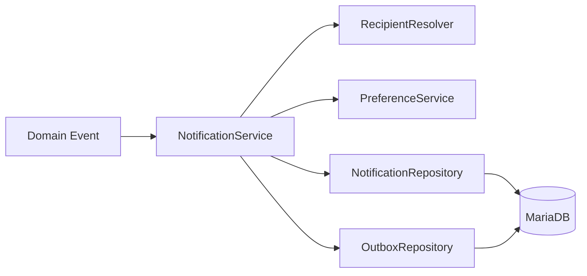

---

# 172. Responsabilidades del Service

Debe:

* recibir eventos o comandos;
* resolver destinatarios;
* aplicar preferencias;
* construir Notifications;
* deduplicar;
* persistir;
* crear Outbox;
* gestionar operaciones de lectura;
* generar DTOs;
* traducir errores.

---

# 173. Casos de uso principales

```text
CreateNotification

CreateNotificationsForEvent

GetNotification

ListNotifications

CountUnreadNotifications

MarkNotificationAsRead

MarkNotificationAsUnread

MarkAllNotificationsAsRead

UpdateNotificationPreference

GetNotificationPreferences
```

---

# 174. `CreateNotification`

Se utiliza para un destinatario explícito.

Debe validar:

* usuario;
* tipo;
* severidad;
* mensaje;
* referencia;
* action URL;
* event ID.

---

# 175. `CreateNotificationsForEvent`

Es el caso de uso principal para eventos de dominio.

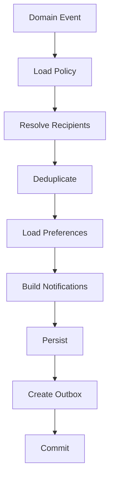

---

# 176. Notification Policy Registry

Debe existir un catálogo central.

Ejemplo conceptual:

```python
NOTIFICATION_POLICIES = {
    NotificationType.TASK_ASSIGNED: TaskAssignedNotificationPolicy(),
    NotificationType.TASK_STATUS_CHANGED: TaskStatusChangedNotificationPolicy(),
    NotificationType.PROJECT_MEMBER_ADDED: ProjectMemberAddedNotificationPolicy(),
}
```

Cada policy define la semántica de un tipo.

---

# 177. Responsabilidad de una Policy

Puede definir:

* severidad;
* destinatarios;
* exclusión del actor;
* mensaje;
* action URL;
* canales;
* expiración;
* agrupación;
* deduplicación.

---

# 178. Policy y dominio

La Policy puede recibir un DTO de evento, no una entidad ORM mutable.

Ejemplo:

```python
@dataclass(frozen=True)
class TaskAssignedEvent:
    event_id: str
    correlation_id: str
    task_id: int
    project_id: int
    task_title: str
    assignee_id: int
    actor_id: int
    occurred_at: datetime
```

---

# 179. Recipient Resolver

El `NotificationRecipientService` centraliza la selección.

```python
class NotificationRecipientService:

    def resolve_task_assigned(...):
        ...

    def resolve_task_status_changed(...):
        ...

    def resolve_project_updated(...):
        ...
```

También puede utilizar estrategias por tipo.

---

# 180. Entrada del Recipient Resolver

Debe trabajar con información mínima:

```text
event

context

policy
```

No debe depender del router.

---

# 181. Filtrado de destinatarios

Pipeline recomendado:

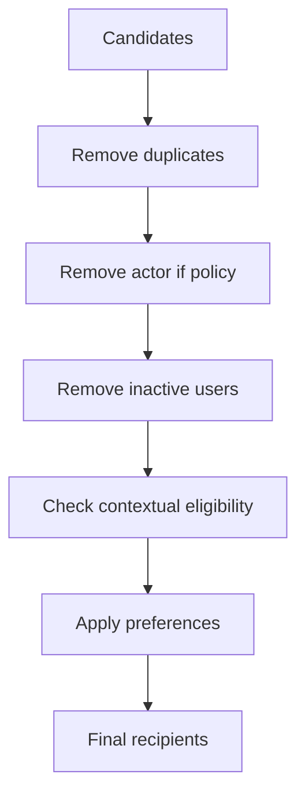

---

# 182. Preferencias

El `NotificationPreferenceService` debe resolver la configuración efectiva.

```python
class NotificationPreferenceService:

    def get_effective_preferences(
        self,
        db,
        user_id,
        notification_type,
    ):
        ...
```

---

# 183. Resolución efectiva

Orden recomendado:

```text
Preferencia específica del usuario

↓

Default del tipo

↓

Default global
```

---

# 184. Modelo de preferencia efectiva

```python
@dataclass(frozen=True)
class EffectiveNotificationPreferences:
    in_app_enabled: bool
    toast_enabled: bool
    email_enabled: bool
    browser_enabled: bool
    muted: bool
```

---

# 185. Canal In-App obligatorio

Algunas notificaciones críticas pueden ignorar la preferencia:

```text
in_app_enabled = false
```

si existe una razón de seguridad o cumplimiento.

Ejemplos futuros:

* acceso revocado;
* cambio de contraseña;
* incidente de seguridad.

Debe quedar explícito en la Policy.

---

# 186. Preferencias y silenciamiento

Si:

```text
muted_until > now
```

la política recomendada es:

```text
in_app → mantener

toast → suprimir

browser → suprimir

email → suprimir o posponer
```

---

# 187. Persistencia de Notification

La creación debe suceder cuando:

```text
effective_preferences.in_app_enabled = TRUE
```

o la Policy la marque como obligatoria.

No debe crearse una Notification persistente únicamente porque exista un canal email si el diseño futuro decide separar ambos.

---

# 188. Delivery Plan

El Service puede construir un plan:

```python
@dataclass(frozen=True)
class NotificationDeliveryPlan:
    persist_in_app: bool
    send_toast: bool
    send_email: bool
    send_browser: bool
```

---

# 189. Separación creación-entrega

El Service persiste la Notification.

Los canales secundarios se representan mediante eventos o jobs.

```text
Notification persisted

↓

Delivery Plan

↓

Outbox

↓

Workers
```

---

# 190. Creación individual

Flujo:

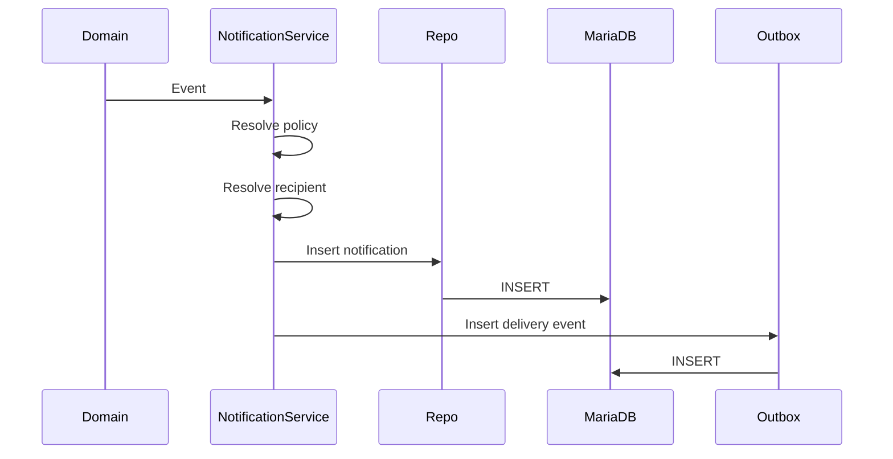

El commit pertenece a la transacción superior cuando la Notification forma parte de otro caso de uso.

---

# 191. Transacción compartida

Ejemplo:

```text
TaskService

↓

UPDATE task

↓

NotificationService

↓

INSERT notification

↓

INSERT audit

↓

INSERT feed

↓

INSERT outbox

↓

COMMIT
```

Si falla cualquier operación crítica antes del commit:

```text
ROLLBACK
```

---

# 192. Service sin commit autónomo

Cuando se invoca dentro de otro Service, Notifications no debe ejecutar su propio `commit()`.

Puede utilizar:

```text
flush
```

cuando necesite IDs.

---

# 193. Operación independiente

Acciones como:

```text
mark notification as read
```

sí pueden constituir su propia transacción del caso de uso.

El ownership transaccional continúa perteneciendo al Service Layer.

---

# 194. Bulk Notifications

Eventos masivos deben evitar:

```text
N queries para N usuarios
```

Debe utilizarse:

* batch insert;
* precarga de preferencias;
* procesamiento por bloques.

---

# 195. Batch Size

Valor orientativo:

```text
100

500

1000
```

Debe determinarse mediante pruebas y límites de MariaDB.

---

# 196. Fan-Out asíncrono

Para miles de destinatarios:

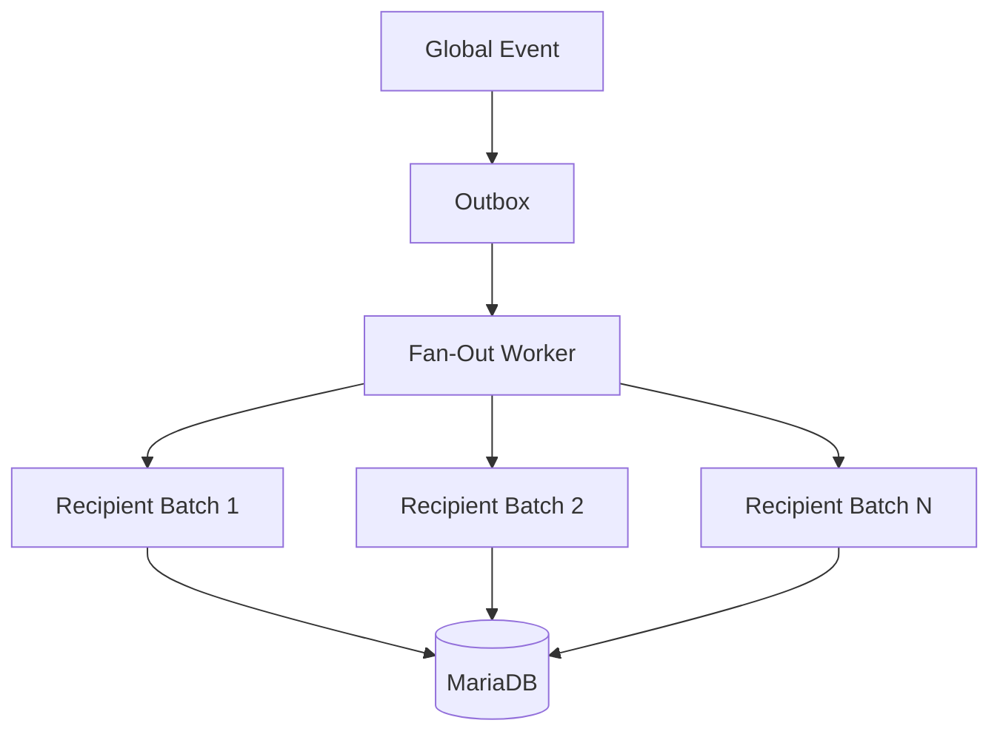

La request original no debe permanecer abierta durante todo el fan-out.

---

# 197. Deduplicación masiva

Cada lote sigue protegido mediante:

```text
UNIQUE(event_id, user_id)
```

Si un worker reintenta, los destinatarios ya procesados no generan duplicados.

---

# 198. Tratamiento de Unique Violation

Durante procesamiento idempotente:

```text
duplicate event/user
```

puede tratarse como:

```text
already processed
```

No debe considerarse necesariamente un fallo operacional.

---

# 199. Construcción del mensaje

El mensaje debe generarse mediante builders o templates centralizados.

Ejemplo:

```python
class TaskAssignedNotificationBuilder:
    def build(self, event, recipient) -> NotificationDraft:
        ...
```

---

# 200. NotificationDraft

Objeto conceptual:

```python
@dataclass(frozen=True)
class NotificationDraft:
    user_id: int
    type: NotificationType
    severity: NotificationSeverity
    title: str
    message: str
    entity_type: NotificationEntityType | None
    entity_id: int | None
    action_url: str | None
    event_id: str
    correlation_id: str
    expires_at: datetime | None
```

---

# 201. Templates de mensaje

Una evolución preparada para i18n puede utilizar:

```text
notification.task_assigned.title

notification.task_assigned.message
```

con parámetros:

```json
{
  "task_title": "Configurar sensor",
  "project_name": "Robot Explorer"
}
```

---

# 202. Persistencia localizada

Si se persiste texto ya traducido, la Notification conserva el idioma del momento de creación.

Si se persiste `template_key + params`, puede renderizarse según el idioma actual.

Ambas opciones tienen trade-offs.

---

# 203. Estrategia inicial recomendada

Persistir:

```text
type

title

message

entity reference
```

y centralizar builders.

Esto mantiene simplicidad sin impedir una migración futura.

---

# 204. Action URL Builder

Las rutas deben generarse mediante funciones conocidas.

Ejemplo:

```python
def task_url(task_id: int) -> str:
    return f"/tasks/{task_id}"
```

No deben concatenarse URLs arbitrarias recibidas del evento.

---

# 205. Notificación hacia recurso sin acceso

Antes de crear debe comprobarse que el destinatario puede legítimamente recibir la información.

No es suficiente que el recurso exista.

---

# 206. Pérdida posterior de acceso

Si el usuario pierde acceso después:

* Notification puede conservarse;
* action URL puede fallar con 403/404;
* backend nunca debe considerar la Notification como autorización.

---

# 207. Mark as Read Service

Firma conceptual:

```python
def mark_as_read(
    self,
    db,
    *,
    notification_id: int,
    user_id: int,
) -> NotificationReadResult:
    ...
```

Debe recuperar siempre la Notification dentro del contexto del usuario.

---

# 208. Resultado de lectura

```python
@dataclass(frozen=True)
class NotificationReadResult:
    notification_id: int
    is_read: bool
    read_at: datetime
    unread_count: int
```

---

# 209. Contador tras lectura

Puede calcularse en la misma operación.

Para alto volumen, puede optimizarse posteriormente.

Respuesta:

```json
{
  "ok": true,
  "notification_id": 982,
  "is_read": true,
  "unread_count": 6
}
```

---

# 210. Mark All Read Service

Proceso:

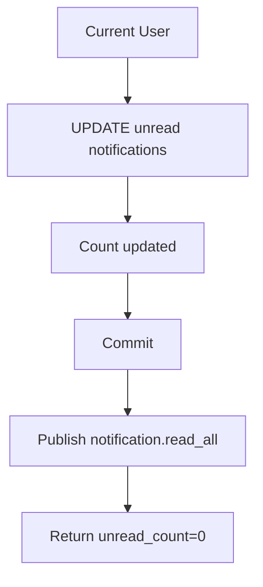

---

# 211. Realtime de lectura

Después del commit puede emitirse:

```text
notification.read
```

o:

```text
notification.read_all
```

al canal personal.

---

# 212. Outbox para lectura

Para sincronización multi-dispositivo fiable puede persistirse un evento Outbox.

No es estrictamente imprescindible si la pérdida ocasional del evento puede corregirse mediante HTTP.

Debe decidirse según el nivel de garantía requerido.

---

# 213. Recomendación

Usar Outbox obligatoriamente para:

```text
notification.created
```

y opcionalmente para:

```text
notification.read

notification.read_all
```

si la sincronización multi-dispositivo se considera crítica.

---

# 214. Eventos de creación

Outbox conceptual:

```json
{
  "event_type": "notification.created",
  "aggregate_type": "notification",
  "aggregate_id": "982",
  "user_id": 8,
  "payload": {
    "notification_id": 982
  }
}
```

El worker puede cargar el DTO completo o utilizar un snapshot incluido.

---

# 215. Snapshot vs Reload

## Snapshot

Outbox contiene todos los datos necesarios.

Ventajas:

* no requiere consulta posterior;
* representa estado exacto del momento.

## Reload

Outbox contiene ID y el worker consulta Notification.

Ventajas:

* payload pequeño.

Riesgo:

* Notification puede haber cambiado.

Para `notification.created`, un snapshot mínimo es apropiado.

---

# 216. Contrato realtime `notification.created`

```json
{
  "event_id": "uuid",
  "event_type": "notification.created",
  "user_id": 8,
  "occurred_at": "2026-08-13T18:20:00Z",
  "payload": {
    "notification": {
      "id_notification": 982,
      "type": "task_assigned",
      "severity": "info",
      "title": "Nueva tarea asignada",
      "message": "Se te ha asignado una nueva tarea.",
      "entity_type": "task",
      "entity_id": 84,
      "action_url": "/tasks/84",
      "is_read": false,
      "created_at": "2026-08-13T18:20:00Z"
    },
    "unread_count": 7,
    "show_toast": true
  }
}
```

---

# 217. `show_toast`

Puede calcularse en backend a partir de la política efectiva.

Esto evita que el cliente tenga que reconstruir preferencias complejas.

No sustituye las preferencias almacenadas.

---

# 218. Contrato `notification.read`

```json
{
  "event_id": "uuid",
  "event_type": "notification.read",
  "user_id": 8,
  "payload": {
    "notification_id": 982,
    "read_at": "2026-08-13T18:24:00Z",
    "unread_count": 6
  }
}
```

---

# 219. Contrato `notification.read_all`

```json
{
  "event_id": "uuid",
  "event_type": "notification.read_all",
  "user_id": 8,
  "payload": {
    "updated_count": 6,
    "read_at": "2026-08-13T18:25:00Z",
    "unread_count": 0
  }
}
```

---

# 220. Canal WebSocket personal

El servidor debe emitir exclusivamente a:

```text
user:{user_id}
```

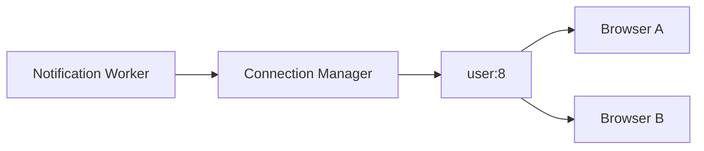

---

# 221. Múltiples pestañas

Todas las conexiones activas del usuario deben recibir el evento.

Esto permite sincronizar:

* badge;
* dropdown;
* centro de notificaciones;
* lectura.

---

# 222. Reconexion

Tras reconectar, el cliente debe solicitar:

```text
unread_count

latest notifications
```

No debe asumir que recibió todos los eventos durante la desconexión.

---

# 223. HTTP como reconciliación

Flujo:

```text
Reconnect

↓

GET unread count

↓

GET recent notifications

↓

Reconcile DOM

↓

Continue WebSocket
```

---

# 224. Rutas SSR

Rutas recomendadas:

```text
GET /notifications

GET /notifications/preferences

POST /notifications/preferences
```

Puede existir:

```text
POST /notifications/{id}/read

POST /notifications/read-all
```

para funcionamiento sin JavaScript.

---

# 225. Rutas JSON

Para mejora progresiva:

```text
GET  /api/notifications

GET  /api/notifications/unread-count

POST /api/notifications/{id}/read

POST /api/notifications/{id}/unread

POST /api/notifications/read-all

GET  /api/notifications/preferences

PUT  /api/notifications/preferences
```

La convención final debe alinearse con la arquitectura real del proyecto.

---

# 226. `GET /notifications`

Debe:

* autenticar;
* recuperar filtros;
* consultar página;
* preparar ViewModel;
* renderizar SSR.

No necesita cargar preferencias completas salvo que la vista las requiera.

---

# 227. `GET /api/notifications`

Parámetros orientativos:

```text
cursor

size

is_read

type
```

Respuesta:

```json
{
  "items": [],
  "next_cursor": null,
  "unread_count": 4
}
```

---

# 228. Seguridad de rutas

Toda ruta debe utilizar:

```text
current_user.id
```

del contexto autenticado.

Nunca aceptar:

```text
user_id
```

del cliente para decidir de quién son las Notifications.

---

# 229. Mark as Read HTTP

Request:

```http
POST /api/notifications/982/read
```

No necesita `user_id`.

El backend deriva el usuario autenticado.

---

# 230. CSRF

Si la autenticación utiliza cookies, las rutas POST/PUT/DELETE deben validar CSRF.

Incluye:

* read;
* unread;
* read-all;
* preferencias.

Aunque marcar como leído no sea destructivo, modifica estado servidor.

---

# 231. Notification Center ViewModel

Objeto conceptual:

```python
NotificationCenterViewModel(
    notifications=items,
    unread_count=unread_count,
    filters=filters,
    pagination=pagination,
    permissions=permissions,
)
```

---

# 232. NotificationItemViewModel

Campos:

```text
id

type

severity

title

message

action_url

is_read

created_at

relative_time

icon

can_mark_unread
```

---

# 233. Presentación visual

Cada Notification debe diferenciar:

* leída/no leída;
* severidad;
* tipo;
* fecha;
* acción.

No debe depender únicamente del color.

---

# 234. HTML semántico

Ejemplo conceptual:

```html
<article
    class="notification-item"
    data-notification-id="{{ notification.id }}"
    data-read="{{ notification.is_read | lower }}"
>
    <header>...</header>
    <p>...</p>
    <footer>...</footer>
</article>
```

---

# 235. Dropdown de cabecera

Debe limitarse a las últimas:

```text
5

o

10
```

notificaciones.

Debe incluir:

```text
Ver todas
```

y opcionalmente:

```text
Marcar todas como leídas
```

---

# 236. Apertura del dropdown

Puede marcar como leídas:

* ninguna;
* individualmente al hacer click;
* todas al abrir.

La recomendación es **no marcar automáticamente todas al abrir**.

Leer el listado no implica haber procesado cada Notification.

---

# 237. Regla de lectura recomendada

Marcar como leída cuando:

* el usuario hace click;
* abre el recurso;
* pulsa acción específica;
* selecciona “marcar como leída”.

Esto ofrece semántica más clara.

---

# 238. Click en Notification

Flujo:

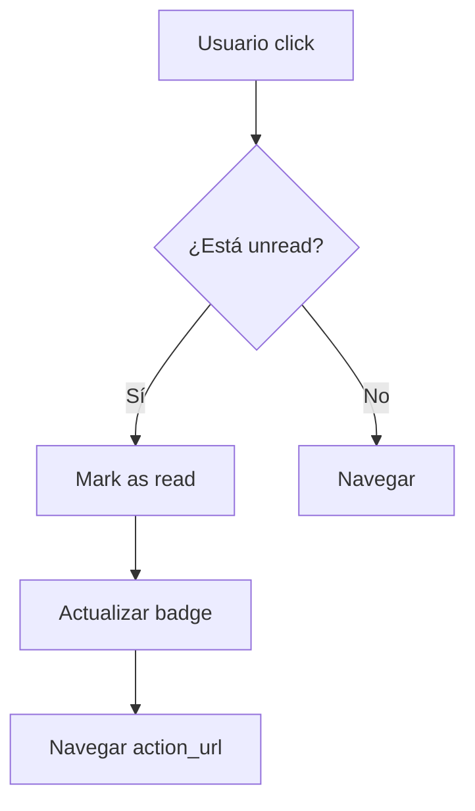

La navegación no debe quedar bloqueada indefinidamente si falla la actualización de lectura.

---

# 239. Estrategia de navegación

Puede utilizarse:

1. marcar optimistamente;
2. enviar request;
3. navegar;
4. reconciliar posteriormente.

O:

1. enviar request;
2. esperar;
3. navegar.

Debe elegirse buscando equilibrio entre UX y consistencia.

---

# 240. Notification Center y acciones

Acciones:

```text
Abrir

Marcar como leída

Marcar como no leída

Marcar todas como leídas
```

Puede añadirse en el futuro:

```text
Ocultar

Eliminar
```

---

# 241. JavaScript modular

Estructura:

```text
notification_api.js

notification_center.js

notification_dropdown.js

notification_badge.js

notification_realtime.js

notification_preferences.js
```

Cada módulo debe mantenerse desacoplado.

---

# 242. `notification_api.js`

Funciones orientativas:

```javascript
export async function listNotifications(params) {}
export async function markAsRead(notificationId) {}
export async function markAsUnread(notificationId) {}
export async function markAllAsRead() {}
export async function getUnreadCount() {}
export async function updatePreferences(payload) {}
```

No debe manipular DOM.

---

# 243. `notification_badge.js`

Responsabilidades:

* actualizar número;
* ocultar badge en cero;
* aplicar `99+`;
* anunciar cambios accesibles;
* reconciliar estado.

---

# 244. `notification_center.js`

Responsabilidades:

* filtros;
* paginación;
* acciones;
* actualización local;
* empty state;
* manejo de errores.

---

# 245. `notification_dropdown.js`

Responsabilidades:

* abrir/cerrar;
* insertar nuevas Notifications;
* actualizar lectura;
* limitar número de elementos;
* mantener foco;
* enlazar con Notification Center.

---

# 246. `notification_realtime.js`

Debe procesar:

```text
notification.created

notification.read

notification.read_all
```

y actualizar los componentes correspondientes.

---

# 247. Integración con Toast System

Cuando llega:

```text
notification.created
```

y:

```text
show_toast = true
```

el cliente puede invocar:

```javascript
Toast.show(...)
```

utilizando:

* severity;
* title;
* message;
* action.

---

# 248. Toast y Notification ID

El toast puede conservar:

```text
notification_id
```

para marcar la Notification como leída si el usuario interactúa.

---

# 249. Toast action

Ejemplo:

```text
Nueva tarea asignada

[Ver tarea]
```

Al pulsar:

1. marcar Notification como leída;
2. navegar a `action_url`.

---

# 250. Toast timeout

La duración depende de severidad.

Ejemplo orientativo:

```text
info → 5 s

success → 4 s

warning → 8 s

error → persistente o largo
```

Debe mantenerse coherente con `18_TOAST_SYSTEM.md`.

---

# 251. No repetir Toast

Un evento realtime duplicado no debe mostrar dos toasts.

Debe deduplicarse mediante:

```text
event_id
```

antes de cualquier efecto visual.

---

# 252. Evento propio

Si el mismo navegador provoca una operación y recibe posteriormente la Notification por realtime, puede mostrar:

* el toast funcional;
* el toast local de éxito;
* ambos.

Debe evitarse duplicar feedback.

---

# 253. Regla de UX

Ejemplo:

```text
Usuario asigna una tarea a otra persona.
```

Actor:

```text
Toast local: Tarea asignada.
```

Destinatario:

```text
Notification + Toast: Nueva tarea asignada.
```

El actor no recibe la Notification funcional.

---

# 254. Notification Preference Service

Debe permitir actualizar preferencias explícitas.

Request conceptual:

```json
{
  "notification_type": "task_status_changed",
  "in_app_enabled": true,
  "toast_enabled": false,
  "email_enabled": false,
  "browser_enabled": false
}
```

---

# 255. Bulk Preferences

La pantalla puede enviar varias preferencias de una vez.

Debe validarse cada tipo.

No deben aceptarse tipos desconocidos.

---

# 256. Restablecer defaults

Debe poder eliminarse el override específico.

Resultado:

```text
usuario vuelve a utilizar la política por defecto
```

No es necesario copiar todos los defaults a la tabla.

---

# 257. Formulario SSR de preferencias

Debe funcionar sin JavaScript.

Puede utilizar:

```text
checkboxes

selects

botón Guardar
```

El ViewModel debe distinguir:

```text
valor efectivo

valor personalizado

default
```

---

# 258. Preferencia obligatoria

Algunos tipos pueden bloquear la desactivación de in-app.

Ejemplo:

```text
security_notification
```

La UI debe mostrar:

```text
Obligatoria
```

y el backend debe rechazar intentos manipulados.

---

# 259. Errores de dominio

Excepciones recomendadas:

```text
NotificationNotFoundError

NotificationAccessDeniedError

InvalidNotificationTypeError

InvalidNotificationSeverityError

InvalidNotificationEntityError

InvalidNotificationActionUrlError

DuplicateNotificationError

NotificationPreferenceNotAllowedError
```

---

# 260. Traducción HTTP

| Excepción                               |            Estado |
| --------------------------------------- | ----------------: |
| `NotificationNotFoundError`             |               404 |
| `NotificationAccessDeniedError`         |               403 |
| `InvalidNotificationTypeError`          |               422 |
| `InvalidNotificationEntityError`        |               422 |
| `InvalidNotificationActionUrlError`     |               422 |
| `DuplicateNotificationError`            | Idempotente o 409 |
| `NotificationPreferenceNotAllowedError` |               422 |

---

# 261. Logging

Cada operación relevante puede registrar:

```text
operation

notification_id

user_id

type

result

correlation_id

duration
```

No debe registrar el mensaje completo salvo necesidad diagnóstica controlada.

---

# 262. Logging de fan-out

Debe incluir:

```text
event_id

notification_type

candidate_recipients

created_count

skipped_count

duplicate_count

failed_count
```

Sin incluir listas completas de usuarios en logs ordinarios.

---

# 263. Observabilidad

Métricas recomendadas:

```text
notifications_created_total

notifications_duplicate_total

notifications_read_total

notifications_read_all_total

notifications_unread_current

notification_fanout_duration_seconds

notification_delivery_failure_total

notification_realtime_publish_total
```

---

# 264. Métricas por tipo

Puede etiquetarse:

```text
type=task_assigned

type=project_updated
```

Debe limitarse la cardinalidad de labels.

No utilizar:

```text
user_id

notification_id

task_id
```

como labels de Prometheus.

---

# 265. Métricas de preferencias

Puede analizarse de forma agregada:

```text
toast_enabled_percentage

email_enabled_percentage
```

solo si existe una necesidad funcional y respetando privacidad.

---

# 266. Health funcional

Procesos periódicos pueden detectar:

* Notifications sin usuario;
* event IDs duplicados;
* `is_read` incoherente;
* action URLs externas;
* tipos desconocidos;
* preferencias inválidas;
* Notifications expiradas sin limpiar.

---

# 267. Consulta de lectura incoherente

```sql
SELECT id_notification
FROM notifications
WHERE
    (is_read = TRUE AND read_at IS NULL)
    OR
    (is_read = FALSE AND read_at IS NOT NULL);
```

---

# 268. Consulta de duplicados

```sql
SELECT
    event_id,
    user_id,
    COUNT(*)
FROM notifications
GROUP BY event_id, user_id
HAVING COUNT(*) > 1;
```

Debe devolver cero filas cuando exista la constraint.

---

# 269. Consulta de action URL sospechosa

Si las URLs deben ser internas:

```sql
SELECT id_notification, action_url
FROM notifications
WHERE action_url IS NOT NULL
  AND action_url NOT LIKE '/%';
```

Debe devolver cero filas.

---

# 270. Continuación

La **Parte 3** completará `32_NOTIFICATIONS_MODULE.md` con:

* seguridad avanzada;
* autorización;
* XSS y open redirect;
* realtime multi-dispositivo;
* reconexión e idempotencia;
* retención;
* limpieza;
* rendimiento;
* caché;
* rate limiting;
* testing unitario;
* testing de integración;
* pruebas WebSocket;
* Selenium;
* fixtures;
* criterios de aceptación;
* checklist enterprise;
* evolución hacia email, Web Push y digest;
* conclusiones.

---

# 271. Seguridad avanzada

El módulo Notifications gestiona información privada dirigida a usuarios concretos.

Por ello, todas las operaciones deben aplicar controles específicos de:

* autenticación;
* autorización;
* aislamiento entre usuarios;
* CSRF;
* XSS;
* open redirect;
* exposición de datos;
* manipulación de identificadores;
* preferencias;
* canales realtime.

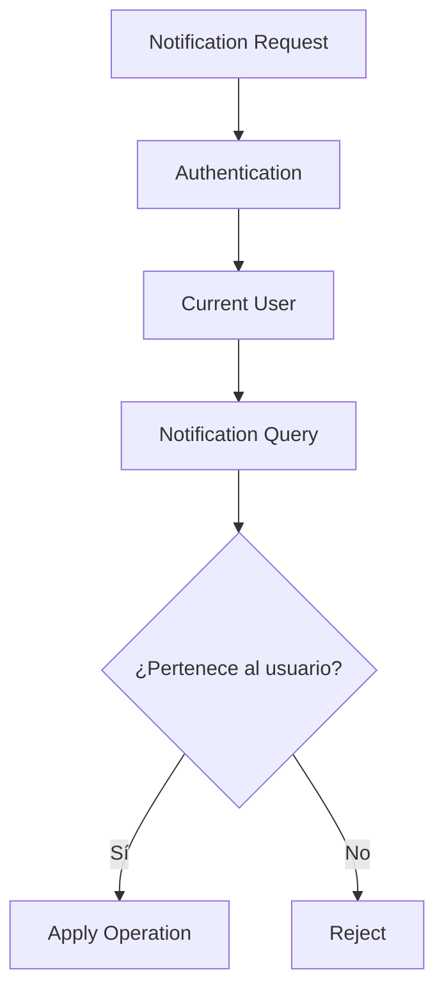

---

# 272. Aislamiento por usuario

Toda consulta de Notification debe incluir:

```text
user_id = current_user.id
```

Nunca debe recuperarse una Notification por ID y comprobar después únicamente en frontend a quién pertenece.

La restricción debe aplicarse en Repository o Service Layer.

---

# 273. Prevención de IDOR

Ejemplo inseguro:

```text
GET /notifications/982
```

si el backend ejecuta:

```python
db.get(Notification, 982)
```

sin comprobar destinatario.

Un usuario podría enumerar IDs y consultar Notifications de terceros.

---

# 274. Consulta segura

Debe utilizarse:

```sql
SELECT *
FROM notifications
WHERE id_notification = :notification_id
  AND user_id = :current_user_id;
```

Si no existe resultado:

```text
404 Not Found
```

puede ser preferible a revelar que la Notification pertenece a otro usuario.

---

# 275. No aceptar `user_id`

Las operaciones ordinarias no deben aceptar:

```json
{
  "user_id": 8
}
```

para decidir el usuario afectado.

El destinatario se obtiene exclusivamente del contexto autenticado.

Aplicable a:

* listado;
* lectura;
* contador;
* mark-as-read;
* mark-all-read;
* preferencias.

---

# 276. Excepciones administrativas

Las operaciones administrativas sobre Notifications de terceros deben:

* utilizar rutas específicas;
* requerir permisos elevados;
* registrar auditoría;
* tener un caso de uso explícito.

No deben reutilizar rutas personales aceptando un `user_id` adicional.

---

# 277. CSRF

Si la autenticación usa cookies, deben protegerse todas las operaciones que modifican estado.

Incluye:

```text
mark as read

mark as unread

mark all as read

update preferences

dismiss

delete
```

---

# 278. GET sin efectos secundarios

Las rutas:

```text
GET /notifications
GET /api/notifications
```

nunca deben modificar el estado de lectura.

Abrir una página no debe marcar automáticamente todas las Notifications como leídas desde el servidor.

---

# 279. XSS

Los campos:

```text
title

message
```

deben tratarse como texto no confiable, incluso si normalmente son generados por backend.

Pueden contener datos derivados de:

* títulos de tareas;
* nombres de proyectos;
* display names;
* contenido introducido por usuarios.

---

# 280. Escape en SSR

Jinja2 debe mantener autoescape.

Correcto:

```jinja2
{{ notification.title }}
{{ notification.message }}
```

Debe evitarse:

```jinja2
{{ notification.message | safe }}
```

salvo contenido sanitizado mediante una política estricta.

---

# 281. Seguridad en JavaScript

Incorrecto:

```javascript
item.innerHTML = notification.message;
```

Correcto:

```javascript
item.textContent = notification.message;
```

Cuando sea necesario renderizar estructuras más complejas deben utilizarse:

* nodos DOM;
* templates internos seguros;
* HTML parcial generado por backend;
* sanitización explícita.

---

# 282. Open Redirect

`action_url` debe ser interna.

Valores válidos:

```text
/tasks/84

/projects/12

/activities/255
```

Valores inválidos:

```text
https://evil.example

//evil.example

javascript:alert(1)
```

---

# 283. Validación de `action_url`

Regla recomendada:

```text
empieza por "/"

AND

no empieza por "//"

AND

no contiene scheme externo
```

Puede ser aún más seguro generar las URLs únicamente mediante builders backend.

---

# 284. Navegación no autorizante

Una `action_url` nunca constituye autorización.

El recurso destino debe ejecutar nuevamente:

* autenticación;
* autorización;
* contexto;
* estado.

---

# 285. Datos sensibles

Las Notifications no deben incluir:

* JWT;
* passwords;
* secrets;
* session IDs;
* tokens de recuperación;
* rutas de storage;
* signed URLs permanentes;
* información privada innecesaria.

---

# 286. Payload mínimo

Debe persistirse únicamente la información necesaria para comunicar el evento.

Ejemplo:

```text
Nueva tarea asignada

Configurar sensor

Robot Explorer
```

No es necesario incluir:

* DTO completo de Task;
* permisos;
* miembros;
* descripción extensa;
* metadatos internos.

---

# 287. Privacidad entre proyectos

Antes de crear una Notification debe comprobarse que el destinatario puede legítimamente conocer los datos incluidos.

Especialmente en eventos:

```text
project_updated

task_status_changed

activity_created
```

---

# 288. Cambios de autorización posteriores

El usuario puede perder acceso después de recibir la Notification.

Debe mantenerse la separación:

```text
Notification histórica

≠

permiso actual
```

La Notification puede seguir visible, pero la ruta destino puede devolver:

```text
403

o

404
```

---

# 289. Eliminar información obsoleta

Para eventos especialmente sensibles puede existir una política futura que:

* elimine;
* anonimice;
* o reduzca el mensaje

cuando el usuario pierda acceso.

No debe implementarse sin un requisito concreto.

---

# 290. Seguridad realtime

Las Notifications privadas deben publicarse exclusivamente en conexiones autenticadas del destinatario.

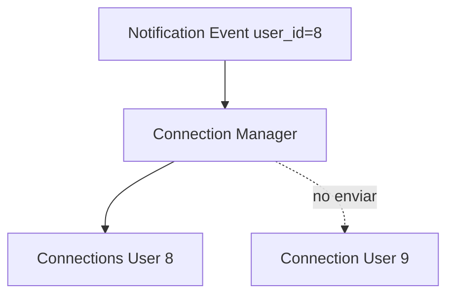

---

# 291. Channel Isolation

Nunca debe utilizarse un canal global como:

```text
notifications
```

y permitir que cada cliente filtre por `user_id`.

El filtrado debe realizarse en servidor.

---

# 292. Autenticación WebSocket

Durante el handshake debe:

1. validar JWT;
2. cargar usuario;
3. comprobar estado;
4. registrar conexión bajo `user_id`;
5. rechazar conexiones inválidas.

---

# 293. Cambio de sesión

Si la sesión queda invalidada:

* cerrar conexión;
* impedir nuevos eventos;
* eliminar socket del registro.

---

# 294. Múltiples conexiones

Un usuario puede mantener:

* varias pestañas;
* varios navegadores;
* varios dispositivos.

Todas las conexiones autorizadas pueden pertenecer al mismo canal lógico:

```text
user:{user_id}
```

---

# 295. Multi-device synchronization

Eventos relevantes:

```text
notification.created

notification.read

notification.read_all

notification.preference_updated
```

pueden sincronizar diferentes clientes.

---

# 296. Orden de eventos

WebSocket puede entregar eventos muy próximos temporalmente.

Ejemplo:

```text
notification.created

notification.read
```

El cliente debe procesar estado considerando:

* `occurred_at`;
* notification ID;
* event ID;
* estado actual.

---

# 297. Versionado de protocolo

El contrato realtime puede incorporar:

```text
schema_version
```

Ejemplo:

```json
{
  "schema_version": 1,
  "event_type": "notification.created"
}
```

Esto facilita cambios futuros.

---

# 298. Compatibilidad hacia atrás

Los clientes deben ignorar campos desconocidos.

Cuando reciban un `event_type` desconocido:

* no deben romper la conexión;
* pueden registrar warning;
* pueden reconciliar mediante HTTP.

---

# 299. Event ID

Todo evento realtime debe incluir:

```text
event_id
```

El cliente mantiene una caché limitada de IDs procesados.

---

# 300. Deduplicación realtime

```mermaid
flowchart TD
    A[Event]
    B{¿event_id procesado?}
    C[Ignore]
    D[Apply]
    E[Store event_id]

    A --> B
    B -->|Sí| C
    B -->|No| D
    D --> E
```

---

# 301. Tamaño de caché local

Puede mantenerse:

```text
últimos 100

últimos 500
```

event IDs.

No es necesario conservarlos indefinidamente.

---

# 302. Reconexión

WebSocket no debe considerarse un historial fiable.

Tras reconectar:

```text
GET unread count

+

GET latest notifications
```

Debe reconciliarse el estado.

---

# 303. Backoff

Estrategia orientativa:

```text
1 s

2 s

4 s

8 s

16 s

máximo configurable
```

Debe incorporar jitter cuando existan muchos clientes para evitar reconnect storms.

---

# 304. Reconnect Storm

Tras una caída del servidor, miles de navegadores pueden reconectar simultáneamente.

El jitter distribuye las reconexiones.

Ejemplo conceptual:

```text
delay = base + random_jitter
```

---

# 305. Estado offline

Cuando el cliente está desconectado:

* no recibe toasts realtime;
* las Notifications continúan persistiendo;
* el badge se reconciliará al volver.

Esto es una propiedad fundamental de la arquitectura.

---

# 306. Notification Center como fuente persistente

El centro de notificaciones debe reconstruirse siempre desde MariaDB.

El DOM o el estado JavaScript son únicamente una representación temporal.

---

# 307. Read State multi-device

Cuando un dispositivo marca como leída:

```text
MariaDB

↓

Realtime

↓

resto de dispositivos
```

Si alguno pierde el evento, la siguiente consulta HTTP corrige el estado.

---

# 308. Optimistic UI en lectura

Puede marcarse visualmente una Notification como leída antes de recibir respuesta.

Si la request falla:

* restaurar estado;
* mostrar feedback si procede;
* reconciliar contador.

---

# 309. Error al marcar como leída

No debe impedir necesariamente la navegación al recurso.

Puede registrarse:

```text
warning
```

y reconciliar más adelante.

---

# 310. Mark All optimistic

Al pulsar:

```text
Marcar todas como leídas
```

la UI puede:

* poner contador en cero;
* actualizar elementos;
* ejecutar request.

Si falla:

* recargar estado;
* restaurar contador.

---

# 311. Notification Center y accesibilidad

Debe cumplir:

* navegación por teclado;
* foco visible;
* estructura semántica;
* iconos acompañados de texto;
* anuncios accesibles;
* timestamps comprensibles.

---

# 312. `aria-live`

Las nuevas Notifications pueden anunciarse mediante una región:

```html
<div
    class="sr-only"
    aria-live="polite"
    id="notification-live-region"
></div>
```

No deben anunciarse continuamente todos los cambios si genera ruido para lectores de pantalla.

---

# 313. Badge accesible

Un badge:

```text
7
```

debe tener contexto accesible.

Ejemplo:

```text
7 notificaciones sin leer
```

No basta el número aislado.

---

# 314. Timestamps

La UI puede mostrar:

```text
Hace 5 minutos
```

pero debe conservar una representación accesible de fecha completa.

Ejemplo:

```html
<time datetime="2026-08-13T18:20:00Z">
    Hace 5 minutos
</time>
```

---

# 315. Severidad accesible

No debe expresarse solo por color.

Puede acompañarse de:

* icono;
* texto;
* etiqueta;
* `aria-label`.

---

# 316. Notification Preferences UI

La pantalla debe agrupar preferencias de forma comprensible.

Ejemplo:

```text
Tareas

Proyectos

Actividades

Sistema
```

Dentro de cada categoría:

```text
In-app

Toast

Email

Browser
```

---

# 317. Dependencias entre canales

No todas las combinaciones son necesariamente válidas.

Ejemplo:

```text
toast = true

in_app = false
```

puede permitirse técnicamente, pero debe definirse la semántica.

---

# 318. Recomendación de canales

Para la arquitectura inicial:

```text
in_app
```

es la persistencia base.

```text
toast
```

es una presentación derivada.

Email y Browser se incorporan posteriormente.

---

# 319. Preferencias obligatorias

Algunas Notifications pueden ignorar opt-out.

Ejemplos futuros:

```text
security

account

critical_system
```

La política debe mostrar claramente al usuario que son obligatorias.

---

# 320. Muting global

Puede incorporarse:

```text
notification_muted_until
```

a nivel de usuario.

Debe diferenciarse de muting por tipo.

---

# 321. Quiet Hours

Evolución futura:

```text
22:00 - 08:00
```

Durante ese periodo:

* in-app persiste;
* toast puede suprimirse;
* browser puede posponerse;
* email puede agruparse.

---

# 322. Zona horaria y Quiet Hours

Las horas silenciosas deben interpretarse en la zona horaria del usuario.

No en UTC directamente.

El almacenamiento puede mantener:

```text
timezone
```

y reglas locales.

---

# 323. Digest

Los canales diferidos pueden agrupar Notifications.

```mermaid
flowchart TD
    A[Notifications]
    B[Digest Scheduler]
    C[Group by User]
    D[Daily Digest]
    E[Email Worker]

    A --> B
    B --> C
    C --> D
    D --> E
```

---

# 324. Digest no sustituye In-App

Aunque un usuario reciba digest semanal:

```text
Notification in-app
```

puede persistirse inmediatamente.

El digest es únicamente otro canal.

---

# 325. Email Delivery

Futura arquitectura:

```text
Notification

↓

Delivery Event

↓

Email Outbox

↓

Email Worker

↓

SMTP / Provider
```

Nunca debe enviarse SMTP directamente desde TaskService o ProjectService.

---

# 326. Email Delivery Status

Puede existir una entidad:

```text
notification_deliveries
```

Campos:

```text
notification_id

channel

status

attempts

last_error

sent_at
```

---

# 327. Estados de Delivery

```text
pending

processing

sent

failed

dead
```

No deben confundirse con el estado de lectura in-app.

---

# 328. Web Push

Una futura integración requiere:

```text
PushSubscription
```

por dispositivo.

Campos conceptuales:

```text
user_id

endpoint

p256dh

auth

created_at

last_used_at

active
```

Las claves deben protegerse correctamente.

---

# 329. Permiso de navegador

El permiso de notificaciones debe solicitarse únicamente después de una acción explícita del usuario.

No debe pedirse automáticamente al cargar la aplicación.

---

# 330. Push y acceso revocado

Una Notification push puede llegar aunque el usuario ya no pueda acceder al recurso.

El contenido push debe minimizar información sensible.

Ejemplo seguro:

```text
Tienes una nueva notificación.
```

en contextos sensibles.

---

# 331. Rate Limiting

Debe prevenirse abuso de operaciones como:

* marcar read/unread repetidamente;
* actualización masiva de preferencias;
* creación administrativa de Notifications;
* fan-out global.

---

# 332. Rate Limit de lectura

Las operaciones personales de lectura son de bajo riesgo, pero pueden generar carga artificial.

Puede aplicarse una política generosa si fuese necesario.

---

# 333. Rate Limit administrativo

Las notificaciones globales deben estar fuertemente restringidas.

Puede requerirse:

* permiso específico;
* confirmación;
* límite de frecuencia;
* auditoría;
* preview de destinatarios.

---

# 334. Sistema de Broadcast

Una futura Notification global no debe implicar necesariamente insertar millones de filas dentro de una request.

Debe utilizar fan-out asíncrono.

---

# 335. Cancelación de Broadcast

Una campaña masiva puede requerir:

```text
scheduled

processing

cancelled

completed
```

Debe modelarse como entidad independiente si aparece el caso de uso.

---

# 336. Retención

La retención debe ser configurable.

Ejemplo orientativo:

```text
Notifications ordinarias: 180 días

Sistema: 365 días

Seguridad: política específica
```

Los valores definitivos dependen de requisitos funcionales y legales.

---

# 337. Job de limpieza

Debe procesar en batches.

```mermaid
flowchart TD
    A[Scheduler]
    B[Select expired batch]
    C[Delete]
    D[Commit]
    E{¿Quedan más?}
    F[Finish]

    A --> B
    B --> C
    C --> D
    D --> E
    E -->|Sí| B
    E -->|No| F
```

---

# 338. Batch de limpieza

Ejemplo:

```text
500

1000

5000
```

Debe ajustarse con pruebas para no generar:

* locks prolongados;
* crecimiento del transaction log;
* impacto sobre consultas.

---

# 339. Retención y no leídas

Puede aplicarse una política distinta:

```text
read → limpiar antes

unread → conservar más tiempo
```

pero no deben conservarse indefinidamente sin necesidad.

---

# 340. Archivado

Si existiera necesidad histórica, las Notifications antiguas pueden migrarse a almacenamiento frío.

No es necesario inicialmente.

---

# 341. Índices y limpieza

El job de retención debe disponer de índice sobre:

```text
created_at

expires_at
```

según la condición utilizada.

---

# 342. Rendimiento del Notification Center

Consultas críticas:

```text
list latest

count unread

filter unread

mark read

mark all read
```

Deben mantenerse simples e indexadas.

---

# 343. Índice compuesto principal

Recomendado:

```text
(user_id, is_read, created_at)
```

Debe comprobarse mediante `EXPLAIN` con datos realistas.

---

# 344. Over-indexing

No deben añadirse índices para todas las columnas.

Cada índice aumenta:

* almacenamiento;
* coste de INSERT;
* coste de UPDATE;
* mantenimiento.

---

# 345. `message` no indexado

El texto completo no necesita un índice tradicional.

Si en el futuro se requiere búsqueda:

* FULLTEXT;
* motor externo;
* índice específico.

---

# 346. Caching del unread count

El contador puede convertirse en una consulta muy frecuente.

Opciones futuras:

```text
Redis

materialized counter

in-memory cache
```

---

# 347. MariaDB como verdad

Aunque exista caché:

```text
MariaDB
```

sigue siendo la fuente de verdad.

Debe existir:

* invalidación;
* recuperación;
* reconciliación.

---

# 348. Materialized Unread Counter

Puede almacenarse:

```text
users.unread_notification_count
```

pero introduce consistencia adicional.

No se recomienda mientras la consulta COUNT sea suficientemente rápida.

---

# 349. Redis Counter

Una futura estrategia:

```text
notification created → INCR

notification read → DECR

read all → SET 0
```

Debe manejar:

* reintentos;
* duplicados;
* pérdida de Redis;
* reconstrucción desde DB.

---

# 350. Evitar complejidad prematura

La arquitectura inicial debe preferir:

```text
COUNT indexado en MariaDB
```

hasta que exista evidencia de cuello de botella.

---

# 351. Fan-Out Performance

Para notificaciones masivas debe monitorizarse:

```text
recipients/sec

insert duration

batch size

duplicate rate

failure rate
```

---

# 352. Backpressure

Si se generan eventos más rápido de lo que los workers pueden procesar:

```text
Outbox backlog
```

crece.

Debe monitorizarse y escalar workers cuando sea necesario.

---

# 353. Prioridades de Delivery

En el futuro pueden procesarse antes:

```text
security

critical
```

que:

```text
digest

low priority
```

No debe introducirse sin una necesidad operativa.

---

# 354. Logging estructurado

Ejemplo de creación:

```json
{
  "event": "notification.create",
  "notification_type": "task_assigned",
  "recipient_count": 1,
  "created_count": 1,
  "duplicate_count": 0,
  "result": "success",
  "correlation_id": "uuid",
  "duration_ms": 12
}
```

---

# 355. Logging de lectura

Puede registrar:

```text
operation

notification_id

user_id

result

duration
```

No es necesario registrar el mensaje.

---

# 356. Privacidad de logs

Debe evitarse incluir:

* contenido completo;
* nombres de proyectos sensibles;
* nombres de tareas;
* emails;
* action URLs con parámetros sensibles.

---

# 357. Métricas técnicas

```text
notification_create_duration_seconds

notification_list_duration_seconds

notification_unread_count_duration_seconds

notification_mark_read_duration_seconds

notification_fanout_duration_seconds

notification_realtime_publish_failure_total

notification_outbox_backlog
```

---

# 358. Métricas funcionales

```text
notifications_created_total

notifications_read_total

notifications_unread_total

notifications_expired_total

notifications_by_type_total
```

---

# 359. Métricas de entrega

Cuando existan canales adicionales:

```text
notification_email_sent_total

notification_email_failed_total

notification_push_sent_total

notification_push_failed_total
```

---

# 360. Cardinalidad de métricas

No deben utilizarse labels como:

```text
user_id

notification_id

event_id
```

porque generarían alta cardinalidad.

---

# 361. Alertas

Alertas posibles:

* Outbox backlog elevado;
* aumento de delivery failures;
* latencia elevada;
* duplicados inesperados;
* fallos de fan-out;
* crecimiento anómalo de no leídas;
* job de limpieza fallido.

---

# 362. Health Checks funcionales

Puede revisarse:

* Notifications con usuario inexistente;
* tipos desconocidos;
* severidad inválida;
* action URLs externas;
* estados de lectura incoherentes;
* duplicados event/user;
* preferencias duplicadas.

---

# 363. Notificaciones huérfanas

Con FK correcta:

```text
Notification.user_id
```

no debe apuntar a un usuario inexistente.

Si el usuario se elimina físicamente y la FK usa CASCADE, sus Notifications desaparecen.

---

# 364. Usuario anonimizado

Si el usuario se conserva anonimizado:

* Notifications pueden mantenerse;
* podrían eliminarse posteriormente por privacidad;
* depende de política de retención.

---

# 365. Testing unitario

Debe cubrir:

* políticas;
* destinatarios;
* exclusión del actor;
* preferencias;
* muting;
* severidad;
* builders;
* action URLs;
* deduplicación;
* estado de lectura.

---

# 366. Test de `task_assigned`

Debe verificar:

* assignee es destinatario;
* actor excluido;
* tipo correcto;
* severidad correcta;
* URL correcta;
* event ID;
* preferencias.

---

# 367. Test de `project_member_added`

Debe verificar:

* nuevo miembro recibe Notification;
* usuarios no relacionados no reciben;
* action URL apunta al proyecto;
* mensaje no contiene información prohibida.

---

# 368. Test de preferencias

Casos:

```text
sin override

override toast false

mute activo

mute expirado

in_app obligatorio

tipo desconocido
```

---

# 369. Test de deduplicación

Procesar dos veces:

```text
event_id = X

user_id = 8
```

Debe producir una sola fila.

---

# 370. Test de lectura

Debe verificar:

* unread → read;
* `read_at`;
* idempotencia;
* aislamiento por usuario;
* unread count.

---

# 371. Test Mark All

Debe verificar:

* solo usuario actual;
* solo unread;
* timestamp;
* updated count;
* contador cero;
* otras cuentas intactas.

---

# 372. Repository Tests

Deben cubrir:

* get-for-user;
* filtros;
* paginación;
* cursor;
* conteos;
* batch insert;
* deduplicación;
* retención;
* preferencias.

---

# 373. Integration Tests

Deben validar:

* Foreign Keys;
* Unique constraints;
* CHECK;
* transacciones;
* rollback;
* índices;
* concurrencia.

---

# 374. Prueba transaccional

Forzar un fallo después de crear Notification pero antes de finalizar el caso de uso original.

Resultado esperado:

```text
operación original revertida

Notification revertida

Outbox revertido
```

si todo pertenece a la misma transacción.

---

# 375. Prueba de Outbox

Debe comprobarse:

```text
Notification persistida

+

Outbox persistido

↓

commit

↓

worker publica
```

Nunca debe publicar antes del commit.

---

# 376. Pruebas de seguridad

Casos:

```text
Notification de otro usuario

ID manipulado

user_id manipulado

CSRF ausente

CSRF inválido

action_url externa

message con HTML

title con script

acceso WebSocket a canal ajeno
```

---

# 377. Test de Open Redirect

Inputs:

```text
https://example.org

//example.org

javascript:alert(1)
```

deben rechazarse.

Ruta válida:

```text
/tasks/84
```

debe aceptarse.

---

# 378. Pruebas WebSocket

Debe comprobarse:

* `notification.created`;
* `notification.read`;
* `notification.read_all`;
* aislamiento por usuario;
* varias pestañas;
* deduplicación;
* reconexión;
* cliente offline.

---

# 379. Prueba multiusuario

Usuarios:

```text
A

B
```

Cuando se crea Notification para A:

```text
A recibe

B no recibe
```

Debe verificarse tanto:

* WebSocket;
* HTTP.

---

# 380. Prueba multi-device

Dos conexiones del mismo usuario:

```text
A1

A2
```

Cuando A1 marca como leída:

```text
A2 actualiza
```

o se reconcilia correctamente mediante HTTP si el evento se pierde.

---

# 381. JavaScript Tests

Deben cubrir:

* badge;
* dropdown;
* mark-as-read;
* read-all;
* realtime;
* deduplicación;
* reconexión;
* toast;
* error handling;
* accesibilidad.

---

# 382. Selenium

Escenarios:

1. iniciar sesión;
2. recibir una Notification;
3. comprobar badge;
4. abrir dropdown;
5. acceder al recurso;
6. marcar como leída;
7. abrir segunda pestaña;
8. comprobar sincronización;
9. marcar todas como leídas;
10. modificar preferencias.

---

# 383. Fixtures

Fixtures recomendadas:

```text
user_a

user_b

project_member

project_coordinator

unread_notification

read_notification

expired_notification

task_assigned_notification

system_notification

notification_preferences
```

---

# 384. Factories

Factories:

```text
NotificationFactory

NotificationPreferenceFactory

UserFactory

ProjectFactory

TaskFactory
```

Debe permitirse configurar:

```text
type

severity

user_id

is_read

event_id

entity_type

entity_id

created_at

expires_at
```

---

# 385. Datos de prueba

No deben depender de:

```text
id_notification = 1
```

Los tests deben trabajar con instancias creadas dinámicamente.

---

# 386. Checklist de dominio

* [ ] Toda Notification tiene destinatario.
* [ ] Type pertenece al enum.
* [ ] Severity pertenece al enum.
* [ ] Title no está vacío.
* [ ] Message es válido.
* [ ] Event ID existe.
* [ ] Estado de lectura es coherente.
* [ ] Action URL es segura.
* [ ] Entity reference es coherente.
* [ ] Correlation ID está disponible cuando procede.

---

# 387. Checklist Repository

* [ ] Consulta siempre por `user_id`.
* [ ] No contiene lógica de dominio externo.
* [ ] Listados paginados.
* [ ] Cursor estable.
* [ ] COUNT mediante SQL.
* [ ] Batch insert.
* [ ] Deduplicación.
* [ ] Retención por lotes.
* [ ] Preferencias indexadas.
* [ ] Sin commits autónomos dentro de casos compartidos.

---

# 388. Checklist Service Layer

* [ ] Notification Policy centralizada.
* [ ] Recipient Resolver centralizado.
* [ ] Preferencias efectivas.
* [ ] Actor excluido cuando corresponde.
* [ ] Usuarios inactivos filtrados.
* [ ] Contexto validado.
* [ ] Mensajes construidos centralmente.
* [ ] Action URLs generadas por backend.
* [ ] Outbox.
* [ ] DTOs estables.

---

# 389. Checklist Seguridad

* [ ] IDOR protegido.
* [ ] `user_id` no controlado por cliente.
* [ ] CSRF.
* [ ] XSS.
* [ ] Open Redirect.
* [ ] WebSocket aislado.
* [ ] Datos mínimos.
* [ ] Recursos reautorizados.
* [ ] Mensajes sin secretos.
* [ ] Logs sin contenido sensible.

---

# 390. Checklist UI

* [ ] Notification Center SSR.
* [ ] Dropdown limitado.
* [ ] Badge sincronizado.
* [ ] Mark read.
* [ ] Mark all read.
* [ ] Empty State.
* [ ] Paginación.
* [ ] Accesibilidad.
* [ ] Severity no solo por color.
* [ ] Progressive Enhancement.

---

# 391. Checklist Realtime

* [ ] Canal personal.
* [ ] JWT validado.
* [ ] Event ID.
* [ ] Deduplicación.
* [ ] Multi-tab.
* [ ] Multi-device.
* [ ] Reconexión.
* [ ] Reconciliación HTTP.
* [ ] Publicación posterior al commit.
* [ ] Payload mínimo.

---

# 392. Checklist Preferences

* [ ] Defaults centralizados.
* [ ] Overrides por tipo.
* [ ] UNIQUE user/type.
* [ ] Muting.
* [ ] In-app obligatorio cuando procede.
* [ ] Toast opcional.
* [ ] Reset a defaults.
* [ ] Validación backend.
* [ ] UI comprensible.
* [ ] Preparado para nuevos canales.

---

# 393. Checklist Rendimiento

* [ ] Índices adecuados.
* [ ] COUNT indexado.
* [ ] Sin N+1.
* [ ] Paginación.
* [ ] Batch inserts.
* [ ] Fan-out asíncrono para gran volumen.
* [ ] Limpieza por lotes.
* [ ] No over-indexing.
* [ ] Caché solo si es necesaria.
* [ ] Outbox monitorizado.

---

# 394. Checklist Observabilidad

* [ ] Logs estructurados.
* [ ] Correlation ID.
* [ ] Métricas de creación.
* [ ] Métricas de lectura.
* [ ] Métricas de fan-out.
* [ ] Delivery failures.
* [ ] Outbox backlog.
* [ ] Retention job.
* [ ] Alertas.
* [ ] Baja cardinalidad.

---

# 395. Criterios de aceptación

El módulo Notifications se considera correctamente implementado cuando:

* crea Notifications persistentes para destinatarios válidos;
* utiliza tipos y severidades centralizados;
* resuelve destinatarios mediante políticas;
* respeta preferencias;
* evita duplicados mediante `event_id`;
* mantiene estado de lectura;
* proporciona contador de no leídas;
* soporta marcado individual y masivo;
* protege completamente las Notifications entre usuarios;
* evita XSS y open redirects;
* publica eventos realtime en canales personales;
* sincroniza múltiples pestañas y dispositivos;
* se reconcilia después de desconexiones;
* integra Toast System;
* utiliza Outbox para entrega fiable;
* soporta retención y limpieza;
* mantiene consultas eficientes;
* supera pruebas de dominio, persistencia, seguridad, realtime y UI.

---

# 396. Evolución futura

El módulo queda preparado para incorporar:

* email;
* Web Push;
* digest;
* quiet hours;
* canales móviles;
* preferencias globales;
* agrupación inteligente;
* prioridades de entrega;
* notificaciones programadas;
* campañas administrativas;
* internacionalización dinámica;
* IA para relevancia;
* resúmenes automáticos.

---

# 397. Email

La incorporación de email debe mantener el principio:

```text
Domain Event

↓

Notification

↓

Delivery Job

↓

Email Provider
```

Nunca:

```text
Domain Service

↓

SMTP directo
```

---

# 398. Proveedores de email

Puede abstraerse mediante:

```python
class EmailProvider:
    def send(...):
        ...
```

Implementaciones futuras:

```text
SMTP

Amazon SES

SendGrid

Mailgun

Microsoft Graph
```

---

# 399. Web Push

El canal Web Push puede permitir Notifications cuando la aplicación no está abierta.

Debe incorporar:

* Service Worker;
* PushSubscription;
* VAPID;
* expiración;
* revocación;
* protección de payload.

---

# 400. Digest

Un Digest puede reunir:

```text
tareas asignadas

cambios de proyecto

actividades

vencimientos
```

por usuario y periodo.

Debe evitar incluir Events que ya no son visibles para el destinatario sin revalidación adecuada.

---

# 401. Quiet Hours

Puede permitir:

```text
No interrumpir de 22:00 a 08:00
```

Los eventos:

* se persisten;
* pueden mostrarse in-app;
* los canales interruptivos se posponen.

---

# 402. Scheduled Notifications

Posibles casos:

```text
task due soon

competition starts tomorrow

project deadline approaching
```

Debe utilizarse scheduler y deduplicación.

---

# 403. Campaign Notifications

Las comunicaciones administrativas masivas deberían modelarse mediante una entidad específica.

Ejemplo:

```text
NotificationCampaign
```

con:

```text
status

audience

template

scheduled_at

created_by

created_at
```

---

# 404. Estados de Campaign

```text
draft

scheduled

processing

completed

cancelled

failed
```

Debe existir preview antes de envío masivo.

---

# 405. IA aplicada

Capacidades futuras:

* resumir múltiples Notifications;
* agrupar eventos similares;
* clasificar relevancia;
* priorizar;
* generar digest;
* detectar ruido;
* sugerir preferencias.

La IA no debe ocultar silenciosamente Notifications críticas.

---

# 406. Notification Ranking

Puede calcularse en el futuro un score usando:

* tipo;
* severidad;
* antigüedad;
* relación con usuario;
* fecha límite;
* contexto.

Debe mantenerse separada la prioridad calculada del registro histórico original.

---

# 407. Resumen inteligente

Ejemplo:

```text
Desde tu última conexión:
- 3 tareas cambiaron de estado.
- 1 tarea vence mañana.
- Te añadieron a un nuevo proyecto.
```

Debe coexistir con las Notifications individuales persistidas.

---

# 408. Internationalization

Una evolución completa puede persistir:

```text
template_key

template_params
```

y renderizar según:

```text
user.locale
```

---

# 409. Cambio de idioma

Con templates dinámicos, una Notification antigua puede mostrarse en el idioma actual.

Con texto persistido, conserva el idioma original.

La decisión debe tomarse en función de requisitos históricos y UX.

---

# 410. Principios definitivos

1. Una Notification pertenece a un solo usuario.
2. El usuario autenticado determina siempre el ámbito de consulta.
3. Las Notifications se persisten antes de entregarse.
4. El realtime es un canal, no la fuente de verdad.
5. Los eventos de dominio originan Notifications.
6. Los routers no deciden destinatarios.
7. Recipient Resolver y Policies centralizan reglas.
8. Las preferencias afectan entrega, no necesariamente persistencia.
9. El actor se excluye cuando el evento no requiere auto-notificación.
10. `event_id` garantiza idempotencia.
11. `correlation_id` garantiza trazabilidad.
12. `action_url` nunca concede autorización.
13. El contenido debe ser seguro frente a XSS.
14. Los canales personales deben aislarse en servidor.
15. Todo canal adicional debe ser asíncrono y desacoplado.

---

# 411. Conclusiones

El módulo Notifications constituye la capa de comunicación personalizada de Aula Robótica Platform. Su arquitectura permite transformar eventos de Projects, Tasks, Activities, Attachments y otros dominios en información persistente, relevante y dirigida exclusivamente a los usuarios que deben recibirla.

El diseño separa claramente la generación de Notifications de sus mecanismos de entrega. MariaDB mantiene el historial y el estado de lectura, mientras que Outbox y WebSocket proporcionan actualización realtime. De esta forma, una pérdida de conexión no implica perder información: el Notification Center puede reconstruirse siempre desde la persistencia.

La combinación de `NotificationPolicy`, `RecipientResolver` y `NotificationPreferenceService` evita dispersar reglas entre módulos funcionales. Los servicios de dominio únicamente generan hechos; el módulo Notifications decide quién debe recibirlos, cómo deben representarse y qué canales deben utilizarse.

La seguridad se fundamenta en el aislamiento por `user_id`, la prevención de IDOR, el escape de contenido, la validación estricta de `action_url` y la utilización de canales WebSocket privados. Una Notification nunca debe interpretarse como permiso para acceder al recurso original.

El uso de `event_id` y constraints de unicidad proporciona idempotencia incluso ante reintentos de workers o procesamiento duplicado. El `correlation_id` permite relacionar Notification, auditoría, Activity Feed, Outbox y operación funcional dentro de una misma trazabilidad.

Finalmente, la arquitectura queda preparada para evolucionar hacia email, Web Push, digests, quiet hours, campañas, internacionalización e inteligencia artificial, sin acoplar estas capacidades al núcleo de los módulos de negocio.

Con este diseño, Notifications se convierte en un subsistema persistente, seguro, escalable, observable y extensible para mantener informados a los usuarios de Aula Robótica Platform sin sacrificar consistencia ni control sobre el ruido informativo.
