# 33_DASHBOARD_MODULE.md

# Módulo Dashboard

## Parte 1 — Arquitectura, dominio, agregación de datos y modelo funcional

---

# 1. Introducción

El módulo **Dashboard** proporciona una visión resumida, contextual y accionable del estado de Aula Robótica Platform.

Su función no consiste en replicar las pantallas detalladas de Projects, Tasks o Activities, sino en transformar información distribuida entre distintos módulos en indicadores útiles para cada usuario.

El Dashboard debe responder rápidamente a preguntas como:

```text
¿En qué proyectos participo?

¿Qué tareas requieren mi atención?

¿Qué está vencido?

¿Qué actividad reciente existe?

¿Cómo progresa cada proyecto?

¿Qué debería revisar ahora?
```

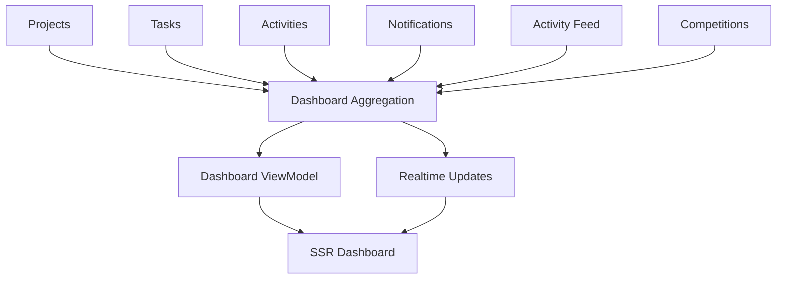

---

# 2. Objetivos

El módulo debe permitir:

* visualizar proyectos relevantes;
* mostrar tareas prioritarias;
* identificar tareas vencidas;
* mostrar trabajo en curso;
* resumir progreso;
* mostrar actividad reciente;
* exponer indicadores personales;
* adaptar contenido por rol;
* integrar notificaciones;
* actualizar datos mediante realtime;
* mantener tiempos de respuesta bajos.

---

# 3. Responsabilidad arquitectónica

Dashboard es responsable de:

* agregación;
* composición;
* presentación resumida;
* métricas;
* ViewModels;
* filtros temporales;
* contextualización por usuario;
* integración realtime.

No debe encargarse de:

* modificar Projects;
* modificar Tasks;
* crear Activities;
* almacenar archivos;
* decidir permisos de dominio;
* replicar repositorios completos de otros módulos;
* convertirse en fuente de verdad.

---

# 4. Principio fundamental

El Dashboard es una **vista derivada**.

```text
Dashboard

≠

fuente de verdad
```

La información original permanece en:

```text
Projects

Tasks

Activities

Notifications

Activity Feed
```

El Dashboard únicamente agrega y presenta.

---

# 5. Posición dentro de la arquitectura

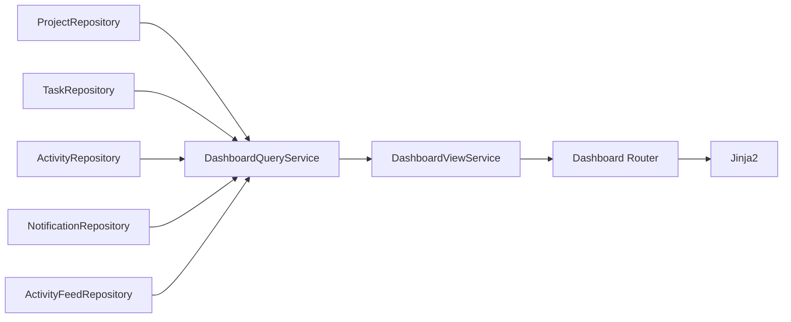

---

# 6. Arquitectura recomendada

El Dashboard debe utilizar una arquitectura orientada principalmente a lectura.

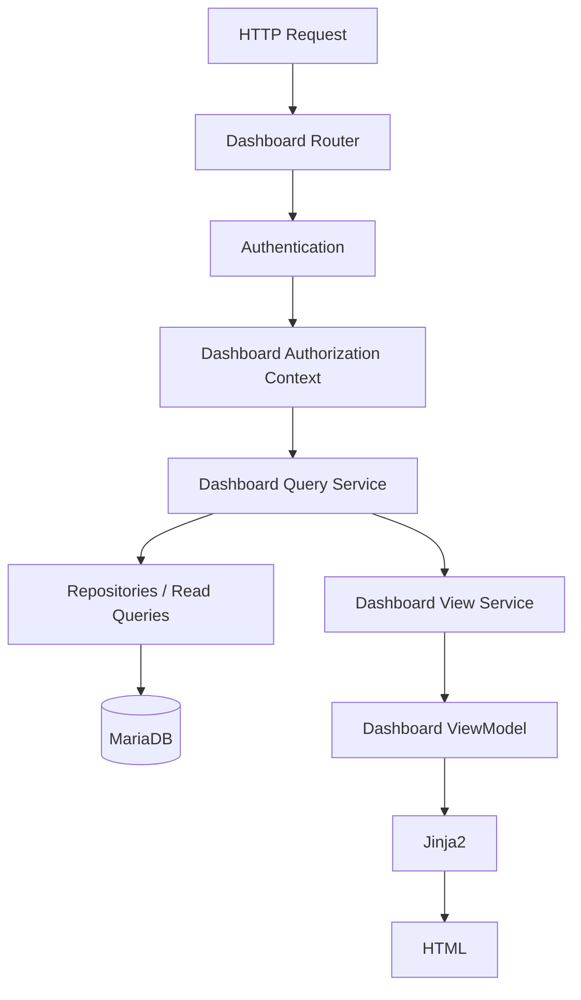

---

# 7. CQRS ligero

El módulo se beneficia de una separación conceptual entre:

```text
Commands
```

y:

```text
Queries
```

Dashboard no ejecuta Commands.

Únicamente consume Queries.

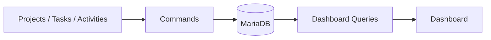

No es necesario implementar una infraestructura CQRS completa para aplicar esta separación.

---

# 8. Organización recomendada

```text
modules/
└── dashboard/
    ├── dashboard_queries.py
    ├── dashboard_service.py
    ├── dashboard_view_service.py
    ├── dashboard_schemas.py
    ├── dashboard_permissions.py
    ├── dashboard_metrics.py
    ├── dashboard_exceptions.py
    └── dashboard_web.py
```

Plantillas:

```text
templates/
└── dashboard/
    ├── dashboard.html
    └── partials/
        ├── dashboard_summary.html
        ├── metric_card.html
        ├── project_summary_card.html
        ├── task_summary_list.html
        ├── activity_summary.html
        ├── notification_summary.html
        └── dashboard_empty_state.html
```

JavaScript:

```text
static/js/dashboard/
├── dashboard.js
├── dashboard_api.js
├── dashboard_realtime.js
├── dashboard_metrics.js
└── dashboard_filters.js
```

---

# 9. Tipos de Dashboard

Puede existir más de una perspectiva.

```text
Personal Dashboard

Project Dashboard

Coordinator Dashboard

Administrator Dashboard
```

No todas necesitan rutas independientes desde la primera versión.

---

# 10. Dashboard personal

Es la vista principal del usuario.

Debe responder:

* proyectos relevantes;
* tareas asignadas;
* tareas vencidas;
* actividad reciente;
* notificaciones;
* próximos hitos.

---

# 11. Dashboard de proyecto

Resume un proyecto concreto.

Puede incluir:

* progreso;
* miembros;
* Kanban summary;
* actividad;
* tareas vencidas;
* métricas.

Debe complementar el detalle de Project, no duplicarlo completamente.

---

# 12. Dashboard de coordinador

Puede priorizar:

* proyectos coordinados;
* miembros;
* tareas sin asignar;
* tareas vencidas;
* carga de trabajo;
* actividad reciente;
* proyectos con riesgo.

---

# 13. Dashboard administrativo

Puede ofrecer indicadores globales:

* usuarios activos;
* proyectos activos;
* tareas;
* actividad;
* incidencias;
* uso de almacenamiento;
* estado operativo.

Debe estar protegido mediante permisos administrativos.

---

# 14. Contexto del usuario

El Dashboard depende del usuario autenticado.

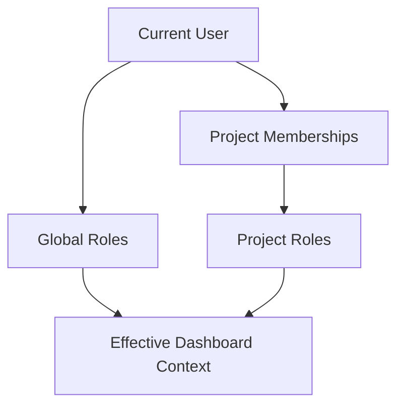

---

# 15. DashboardContext

Objeto conceptual:

```python
@dataclass(frozen=True)
class DashboardContext:
    user_id: int
    global_roles: tuple[str, ...]
    project_ids: tuple[int, ...]
    coordinated_project_ids: tuple[int, ...]
    timezone: str
    locale: str
```

Este contexto puede reutilizarse en las queries.

---

# 16. Autorización

El Dashboard no debe mostrar información que el usuario no podría consultar en sus módulos originales.

Regla:

```text
Dashboard visibility

<=

Domain visibility
```

Nunca puede ampliar permisos.

---

# 17. Prevención de filtraciones

Ejemplo incorrecto:

```text
Proyecto privado X

3 tareas vencidas
```

mostrado a un usuario sin acceso.

Aunque no se expongan detalles, la propia existencia del proyecto ya constituye información.

---

# 18. Resolución de visibilidad

Las queries deben limitarse desde el origen.

Ejemplo:

```sql
WHERE project_id IN (:authorized_project_ids)
```

o mediante joins de membresía.

No debe recuperarse todo y filtrar posteriormente en Python.

---

# 19. Dashboard Query Service

Es la pieza central de lectura.

Responsabilidades:

* ejecutar agregaciones;
* coordinar consultas;
* limitar contexto;
* evitar N+1;
* devolver DTOs;
* aplicar filtros temporales;
* mantener consultas eficientes.

---

# 20. Estructura conceptual

```python
class DashboardQueryService:

    def get_personal_dashboard(...):
        ...

    def get_project_dashboard(...):
        ...

    def get_coordinator_dashboard(...):
        ...

    def get_admin_dashboard(...):
        ...
```

---

# 21. Dashboard Service

Puede actuar como capa de composición.

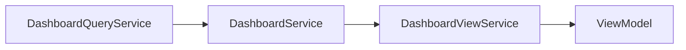

El Query Service obtiene datos.

El Dashboard Service aplica reglas de composición.

El View Service prepara presentación.

---

# 22. No usar entidades ORM completas

El Dashboard debe preferir:

```text
DTOs

projections

aggregates
```

frente a entidades ORM completas.

Ejemplo:

```python
ProjectDashboardSummary(
    project_id=12,
    name="Robot Explorer",
    todo_count=4,
    doing_count=3,
    done_count=8,
)
```

---

# 23. Razones para usar DTOs

Permiten:

* menos columnas;
* menos relaciones;
* menor memoria;
* serialización controlada;
* consultas optimizadas;
* desacoplamiento.

---

# 24. Composición principal

Un Dashboard personal puede contener:

```text
summary

projects

assigned_tasks

overdue_tasks

recent_activity

notifications

upcoming_deadlines
```

---

# 25. PersonalDashboardDTO

Ejemplo conceptual:

```python
@dataclass(frozen=True)
class PersonalDashboardDTO:
    summary: DashboardSummaryDTO
    projects: list[ProjectSummaryDTO]
    assigned_tasks: list[TaskSummaryDTO]
    overdue_tasks: list[TaskSummaryDTO]
    recent_activity: list[ActivitySummaryDTO]
    notifications: list[NotificationSummaryDTO]
```

---

# 26. DashboardSummaryDTO

Campos orientativos:

```text
active_projects

assigned_tasks

doing_tasks

overdue_tasks

unread_notifications
```

Puede ampliarse según rol.

---

# 27. ProjectSummaryDTO

Campos:

```text
project_id

name

status

role

task_count

done_count

completion_percentage

overdue_count

last_activity_at
```

---

# 28. TaskSummaryDTO

Campos:

```text
task_id

project_id

project_name

title

status

priority

due_date

is_overdue

version
```

No necesita:

* descripción completa;
* todas las Activities;
* Attachments.

---

# 29. ActivitySummaryDTO

Campos:

```text
activity_id

task_id

project_id

title

author_display_name

status

created_at

duration_minutes
```

---

# 30. NotificationSummaryDTO

Campos:

```text
id_notification

type

severity

title

is_read

created_at

action_url
```

El Dashboard no necesita cargar todo el mensaje si la UI solo muestra un resumen.

---

# 31. Métricas personales

Indicadores básicos:

```text
Active Projects

Assigned Tasks

Doing Tasks

Overdue Tasks

Unread Notifications
```

---

# 32. Métricas de proyecto

```text
Member Count

Task Count

Todo Count

Doing Count

Done Count

Overdue Count

Completion %

Activity Count
```

---

# 33. Métricas de coordinador

Puede incorporar:

```text
Unassigned Tasks

Overdue Tasks

Inactive Projects

Members Without Tasks

Recent Project Activity
```

Deben considerarse indicadores, no juicios sobre rendimiento individual.

---

# 34. Métricas administrativas

Ejemplos:

```text
Active Users

Active Projects

Tasks Created

Activities Created

Attachments Stored

Storage Used
```

Las métricas operativas de infraestructura pueden mantenerse en herramientas de observabilidad en lugar del Dashboard funcional.

---

# 35. Progreso del proyecto

Fórmula básica:

```text
done_count / total_task_count * 100
```

Cuando:

```text
total_task_count = 0
```

debe evitarse división por cero.

Valor recomendado:

```text
0 %
```

con etiqueta:

```text
Sin tareas
```

---

# 36. No utilizar progreso simplista como rendimiento

Un proyecto con:

```text
90 % completado
```

no es necesariamente mejor que otro con:

```text
60 %
```

si:

* complejidad distinta;
* fechas distintas;
* alcance distinto;
* tareas de diferente tamaño.

La métrica debe mostrarse como estado de ejecución.

---

# 37. Tareas vencidas

Definición:

```text
due_date < today

AND

status != done
```

Debe calcularse usando la zona temporal funcional definida para el usuario o proyecto.

---

# 38. `today` y zona horaria

Los timestamps se almacenan en UTC.

Las fechas límite pueden ser:

* `DATE`;
* `DATETIME`.

La comparación debe respetar la semántica exacta del campo.

No debe mezclarse UTC con fecha local sin conversión.

---

# 39. Próximos vencimientos

Puede definirse:

```text
due_date >= today

AND

due_date <= today + 7 days

AND

status != done
```

El número de días debe ser configurable.

---

# 40. Trabajo en curso

```text
status = doing
```

Puede mostrarse como:

```text
Trabajo en curso
```

No debe confundirse con Activities abiertas.

---

# 41. Tareas asignadas

Consulta personal:

```sql
SELECT ...
FROM tasks
WHERE assigned_to = :user_id
  AND status <> 'done'
ORDER BY
    due_date,
    priority;
```

Debe respetar proyectos accesibles y activos.

---

# 42. Orden funcional de tareas

Puede priorizar:

1. vencidas;
2. próximas a vencer;
3. prioridad alta;
4. en curso;
5. resto.

No debe ordenarse únicamente alfabéticamente.

---

# 43. Ranking funcional

Ejemplo conceptual:

```sql
ORDER BY
    CASE
        WHEN due_date < CURRENT_DATE
             AND status <> 'done'
            THEN 1
        ELSE 2
    END,
    due_date ASC,
    CASE priority
        WHEN 'high' THEN 1
        WHEN 'medium' THEN 2
        WHEN 'low' THEN 3
        ELSE 4
    END;
```

---

# 44. Proyectos relevantes

El Dashboard personal puede mostrar:

* proyectos activos;
* proyectos coordinados;
* proyectos con tareas asignadas;
* proyectos con actividad reciente.

Debe limitar el número.

Ejemplo:

```text
5 proyectos principales
```

con enlace:

```text
Ver todos
```

---

# 45. Ranking de proyectos

Puede priorizar:

* proyectos con tareas del usuario;
* proyectos coordinados;
* actividad reciente;
* vencimientos próximos.

Debe mantenerse simple y explicable.

---

# 46. Actividad reciente

Puede utilizar datos de:

```text
ProjectActivityFeed
```

en lugar de consultar directamente todas las tablas operativas.

Esto reduce complejidad y ofrece un timeline ya preparado funcionalmente.

---

# 47. Fuente del resumen de actividad

Preferencia recomendada:

```text
Activity Feed

>

reconstruir eventos desde Tasks y Activities
```

porque el Feed ya contiene:

* actor;
* evento;
* proyecto;
* timestamp;
* snapshot.

---

# 48. Activity vs Activity Feed

El Dashboard puede necesitar ambos conceptos.

```text
Activity
```

para métricas de trabajo real.

```text
Activity Feed
```

para eventos recientes visibles.

No deben confundirse.

---

# 49. Notifications

El Dashboard puede mostrar:

```text
unread count

últimas notifications
```

No debe replicar el Notification Center completo.

---

# 50. Límite de Notifications

Ejemplo:

```text
5 últimas
```

con:

```text
Ver todas las notificaciones
```

---

# 51. Agregación de proyectos

Consulta conceptual:

```sql
SELECT
    p.id_project,
    p.name,
    p.status,
    pm.project_role,
    COUNT(t.id_task) AS task_count,
    SUM(CASE WHEN t.status = 'done' THEN 1 ELSE 0 END) AS done_count
FROM projects p
JOIN project_members pm
    ON pm.project_id = p.id_project
LEFT JOIN tasks t
    ON t.project_id = p.id_project
WHERE pm.user_id = :user_id
  AND pm.active = TRUE
GROUP BY
    p.id_project,
    p.name,
    p.status,
    pm.project_role;
```

Debe analizarse con `EXPLAIN`.

---

# 52. Riesgo de agregaciones múltiples

Un JOIN que combine simultáneamente:

```text
Projects

Tasks

Activities

Members
```

puede multiplicar filas y producir conteos incorrectos.

Ejemplo:

```text
3 Tasks

×

4 Members

=

12 rows
```

Debe evitarse.

---

# 53. Estrategia de agregación correcta

Utilizar:

* subconsultas;
* CTE;
* consultas separadas;
* agregaciones precomputadas;
* joins sobre resultados ya agregados.

---

# 54. Subconsulta de Tasks

Ejemplo conceptual:

```sql
SELECT
    project_id,
    COUNT(*) AS task_count,
    SUM(status = 'done') AS done_count
FROM tasks
GROUP BY project_id;
```

Después:

```text
Project

LEFT JOIN

Task Aggregates
```

Esto evita multiplicaciones.

---

# 55. Consultas separadas

No es un error ejecutar varias queries pequeñas y optimizadas.

Ejemplo:

```text
1 query summary

1 query projects

1 query assigned tasks

1 query overdue

1 query recent feed

1 query notifications
```

Puede ser preferible a una consulta gigantesca.

---

# 56. Evitar JOIN universal

No debe construirse:

```text
User

JOIN Projects

JOIN Members

JOIN Tasks

JOIN Activities

JOIN Feed

JOIN Notifications
```

en una sola consulta.

Problemas:

* duplicación;
* memoria;
* mantenimiento;
* planes de ejecución complejos;
* resultados incorrectos.

---

# 57. Paralelización

En arquitecturas async futuras, consultas independientes pueden ejecutarse concurrentemente cuando:

* el driver lo permite;
* existen sesiones independientes adecuadas;
* no genera presión excesiva.

No es necesario inicialmente.

---

# 58. Consistencia del snapshot

El Dashboard puede reflejar datos ligeramente distintos entre consultas ejecutadas con milisegundos de diferencia.

Para una pantalla informativa esto suele ser aceptable.

No requiere una transacción serializable.

---

# 59. Consistencia eventual

Ejemplo:

```text
Task completada

↓

Dashboard SSR todavía antiguo

↓

WebSocket recibe evento

↓

métrica actualizada
```

Este comportamiento es aceptable si la reconciliación funciona.

---

# 60. Dashboard realtime

El Dashboard puede reaccionar a:

```text
project.created

project.updated

project.archived

task.created

task.updated

task.moved

task.completed

task.reopened

activity.created

notification.created
```

No necesita procesar necesariamente todos los eventos del sistema.

---

# 61. Principio de actualización realtime

No debe replicarse la lógica de agregación completa en JavaScript.

El cliente puede:

* ajustar valores simples;
* solicitar parcial actualizado;
* ejecutar endpoint de métricas;
* invalidar widget.

---

# 62. Actualización incremental simple

Ejemplo:

```text
task.completed
```

puede modificar:

```text
doing_count - 1

done_count + 1
```

pero solo si el cliente conoce con certeza el estado anterior.

---

# 63. Reconciliación preferente

Para métricas complejas resulta más seguro:

```text
evento

↓

invalidar widget

↓

GET /dashboard/widgets/project-summary

↓

reemplazar parcial
```

Esto reduce lógica duplicada.

---

# 64. Widget Architecture

El Dashboard puede organizarse en widgets independientes.

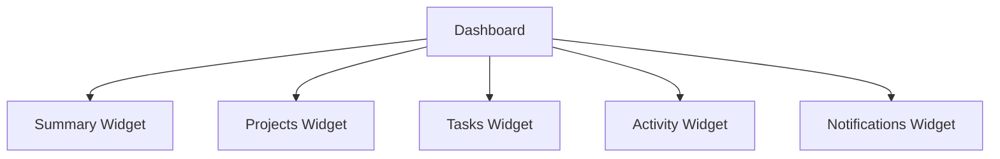

---

# 65. Ventajas de widgets

* consultas separadas;
* actualización parcial;
* permisos específicos;
* caché granular;
* testing aislado;
* responsive más sencillo.

---

# 66. Widgets iniciales

Recomendados:

```text
Summary Metrics

My Projects

My Tasks

Overdue Tasks

Recent Activity

Notifications
```

---

# 67. Summary Widget

Puede mostrar:

```text
Proyectos activos

Tareas asignadas

En curso

Vencidas

Notificaciones
```

---

# 68. My Projects Widget

Cada tarjeta:

```text
Nombre

Rol

Estado

Progreso

Tareas pendientes

Última actividad
```

---

# 69. My Tasks Widget

Debe centrarse en tareas accionables:

```text
doing

todo prioritarias

próximas a vencer
```

No necesita mostrar todas.

---

# 70. Overdue Widget

Debe destacar únicamente tareas vencidas accesibles.

Cuando no existen:

```text
No tienes tareas vencidas.
```

Este es un estado positivo.

---

# 71. Recent Activity Widget

Debe mostrar eventos recientes de los proyectos accesibles.

Ejemplo:

```text
María completó una tarea.

Pablo añadió una actividad.

El proyecto fue actualizado.
```

---

# 72. Notifications Widget

Debe mostrar:

* no leídas recientes;
* severity;
* enlace;
* fecha.

No necesita cargar mensajes antiguos.

---

# 73. Estado vacío global

Un usuario nuevo puede no tener:

* proyectos;
* tareas;
* actividad;
* notifications.

El Dashboard debe ofrecer orientación.

Ejemplo:

```text
Todavía no participas en ningún proyecto.
```

Según permisos:

```text
Crear proyecto
```

o:

```text
Cuando te añadan a un proyecto aparecerá aquí.
```

---

# 74. Personalización por rol

El Dashboard no debe mostrar todos los widgets a todos los usuarios.

```mermaid
flowchart TD
    A[Dashboard Context]
    B{Role / Permissions}
    C[Member Widgets]
    D[Coordinator Widgets]
    E[Admin Widgets]

    A --> B
    B --> C
    B --> D
    B --> E
```

---

# 75. Miembro

Prioridades:

* tareas;
* vencimientos;
* actividad;
* proyectos;
* notificaciones.

---

# 76. Coordinador

Añade:

* tareas sin asignar;
* progreso de proyectos;
* miembros;
* riesgos;
* carga operativa.

---

# 77. Administrador

Puede añadir:

* estado global;
* usuarios;
* proyectos;
* uso;
* incidencias.

Debe evitarse convertir la página en una herramienta de monitorización técnica si ya existen herramientas especializadas.

---

# 78. Configuración de widgets

En el futuro puede almacenarse:

```text
dashboard_preferences
```

con:

```text
widget

position

visible

size
```

No es necesario inicialmente.

---

# 79. Orden de widgets

La primera versión debe usar una disposición estable y diseñada por producto.

Esto reduce complejidad y facilita:

* soporte;
* pruebas;
* responsive;
* documentación.

---

# 80. Filtros temporales

Puede existir:

```text
7 días

30 días

90 días
```

para métricas temporales.

No debe aplicarse a datos cuyo significado no sea temporal.

---

# 81. Rango personalizado

Una evolución puede permitir:

```text
from

to
```

Debe limitarse a rangos razonables para evitar consultas pesadas.

---

# 82. Defaults temporales

Ejemplo:

```text
actividad reciente → últimos 7 días

progreso → estado actual

notifications → últimas 5
```

Los defaults deben centralizarse.

---

# 83. Dashboard y datos históricos

Las métricas actuales no deben confundirse con series históricas.

Ejemplo:

```text
10 tareas done
```

es un snapshot.

Para responder:

```text
¿Cuántas se completaron cada semana?
```

se necesita información temporal o analítica.

---

# 84. Analytics vs Dashboard operativo

```text
Operational Dashboard
```

responde:

```text
¿Qué ocurre ahora?
```

```text
Analytics
```

responde:

```text
¿Qué ha ocurrido a lo largo del tiempo?
```

No deben mezclarse indiscriminadamente.

---

# 85. Fuente para analítica futura

Puede utilizarse:

* AuditLog;
* Activity Feed;
* eventos;
* tablas analíticas;
* CDC.

No debe reconstruirse toda la historia exclusivamente desde el estado actual de Tasks.

---

# 86. View Service

El `DashboardViewService` transforma DTOs en información lista para presentación.

Responsabilidades:

* labels;
* badges;
* URLs;
* iconos;
* empty states;
* permisos;
* formato temporal;
* organización visual.

---

# 87. DashboardViewModel

Ejemplo:

```python
@dataclass(frozen=True)
class DashboardViewModel:
    summary: DashboardSummaryViewModel
    projects: tuple[ProjectCardViewModel, ...]
    tasks: tuple[TaskCardViewModel, ...]
    overdue_tasks: tuple[TaskCardViewModel, ...]
    activity: tuple[ActivityFeedItemViewModel, ...]
    notifications: tuple[NotificationItemViewModel, ...]
```

---

# 88. No realizar queries en View Service

El View Service debe recibir DTOs ya obtenidos.

No debe ejecutar consultas desde:

* helpers;
* Jinja2;
* propiedades lazy.

---

# 89. No acceder a ORM desde Jinja2

Debe evitarse:

```jinja2
{{ project.tasks | length }}
```

si `tasks` es una relación lazy.

El ViewModel debe incluir:

```text
task_count
```

---

# 90. Templates

Plantilla principal:

```text
dashboard/dashboard.html
```

debe componer partials.

Ejemplo:

```jinja2


```

---

# 91. Layout

Estructura conceptual:

```text
Header

Summary Metrics

Main Grid
├── My Tasks
├── My Projects
├── Recent Activity
└── Notifications
```

---

# 92. Responsive

Desktop:

```text
multi-column grid
```

Tablet:

```text
2 columns
```

Mobile:

```text
single column
```

El orden debe priorizar información accionable.

---

# 93. Orden móvil

Recomendación:

```text
1. Summary

2. Overdue / Tasks

3. Projects

4. Notifications

5. Activity
```

Puede ajustarse según investigación UX.

---

# 94. Accesibilidad

Cada widget debe:

* tener heading;
* orden semántico;
* navegación por teclado;
* estado vacío comprensible;
* enlaces con nombres claros.

---

# 95. Cards clicables

No debe envolverse toda una tarjeta en un enlace si contiene otras acciones incompatibles.

Debe utilizarse una estructura accesible con:

* enlace principal;
* acciones secundarias.

---

# 96. Métricas accesibles

No basta mostrar:

```text
4
```

Debe existir contexto:

```text
4 tareas vencidas
```

---

# 97. Colores

Estados como:

```text
overdue

warning

success
```

no deben expresarse únicamente mediante color.

Añadir:

* icono;
* label;
* texto.

---

# 98. Progressive Enhancement

Sin JavaScript, Dashboard debe:

* renderizar;
* mostrar todos los widgets esenciales;
* navegar correctamente;
* mostrar datos actuales al refrescar.

JavaScript añade:

* realtime;
* filtros incrementales;
* actualización parcial;
* animaciones moderadas.

---

# 99. JavaScript

Módulos:

```text
dashboard.js

dashboard_api.js

dashboard_realtime.js

dashboard_filters.js

dashboard_metrics.js
```

---

# 100. `dashboard.js`

Responsabilidades:

* inicialización;
* coordinación de widgets;
* eventos UI;
* manejo general de estado.

No debe contener consultas de negocio.

---

# 101. `dashboard_api.js`

Funciones orientativas:

```javascript
export async function loadSummary() {}
export async function loadProjects() {}
export async function loadTasks() {}
export async function loadRecentActivity() {}
```

---

# 102. `dashboard_realtime.js`

Debe escuchar eventos relevantes y decidir qué widget invalidar.

Ejemplo:

```text
task.moved

↓

invalidate summary

invalidate my tasks

invalidate project card
```

---

# 103. Widget invalidation

Puede utilizar un patrón:

```javascript
dashboard.invalidate("summary");
dashboard.invalidate("tasks");
```

Esto evita acoplar el manejador realtime al DOM interno de cada widget.

---

# 104. Debounce

Una ráfaga de eventos no debe provocar decenas de refetch inmediatos.

Ejemplo:

```text
10 task events en 500 ms

↓

1 actualización del widget
```

Debe utilizarse debounce o batching.

---

# 105. Realtime storms

Eventos masivos pueden actualizar múltiples widgets.

El cliente debe evitar:

* recargar toda la página;
* lanzar múltiples requests idénticas;
* animaciones excesivas.

---

# 106. Snapshot SSR

Al cargar:

```text
GET /dashboard
```

el usuario recibe un snapshot completo.

Después WebSocket mantiene la pantalla actualizada.

---

# 107. Reconciliación

Si se pierde la conexión:

```text
Reconnect

↓

Refresh summary

↓

Refresh actionable widgets

↓

Continue
```

No es necesario reconstruir cada evento perdido.

---

# 108. Fuentes de eventos

El Dashboard puede escuchar:

```text
user:{user_id}
```

para Notifications personales.

Y:

```text
project:{project_id}
```

para proyectos visibles.

Debe evaluarse el coste de suscribirse a muchos proyectos.

---

# 109. Estrategia de subscriptions

Opciones:

## Una sala por proyecto

Adecuada cuando el usuario participa en pocos proyectos.

## Canal personal agregado

Backend envía al usuario eventos relevantes de sus proyectos.

Reduce suscripciones, pero aumenta lógica del servidor.

---

# 110. Primera estrategia recomendada

Mantener:

```text
user channel
```

para datos personales y Notifications.

Usar salas de proyecto únicamente cuando el usuario abre un contexto de proyecto específico.

Para Dashboard global puede utilizarse:

* refresh parcial periódico;
* eventos personales derivados;
* invalidaciones relevantes.

Esto evita suscribirse a decenas de salas.

---

# 111. Dashboard Event

Puede introducirse un evento ligero:

```text
dashboard.invalidate
```

con:

```json
{
  "widgets": [
    "summary",
    "tasks"
  ]
}
```

No es obligatorio, pero reduce acoplamiento del frontend con eventos de cada dominio.

---

# 112. Invalidación en servidor

Los Services pueden producir eventos de dominio.

Un consumidor puede convertirlos en:

```text
DashboardInvalidationEvent
```

para usuarios afectados.

Esto es una evolución, no un requisito inicial.

---

# 113. Refresh periódico

Como mecanismo de respaldo puede ejecutarse un refresh ligero:

```text
cada 60-120 segundos
```

si el Dashboard permanece abierto.

Debe evitarse polling excesivo si WebSocket funciona correctamente.

---

# 114. Datos stale

El Dashboard debe tolerar datos ligeramente desactualizados.

No debe utilizarse para decisiones transaccionales críticas sin abrir el recurso original.

Ejemplo:

```text
badge indica 3 tareas

↓

usuario abre Tasks

↓

servidor devuelve estado actual
```

---

# 115. Error parcial

Si falla una query de Notifications no debe necesariamente fallar todo el Dashboard.

Puede existir degradación controlada por widget.

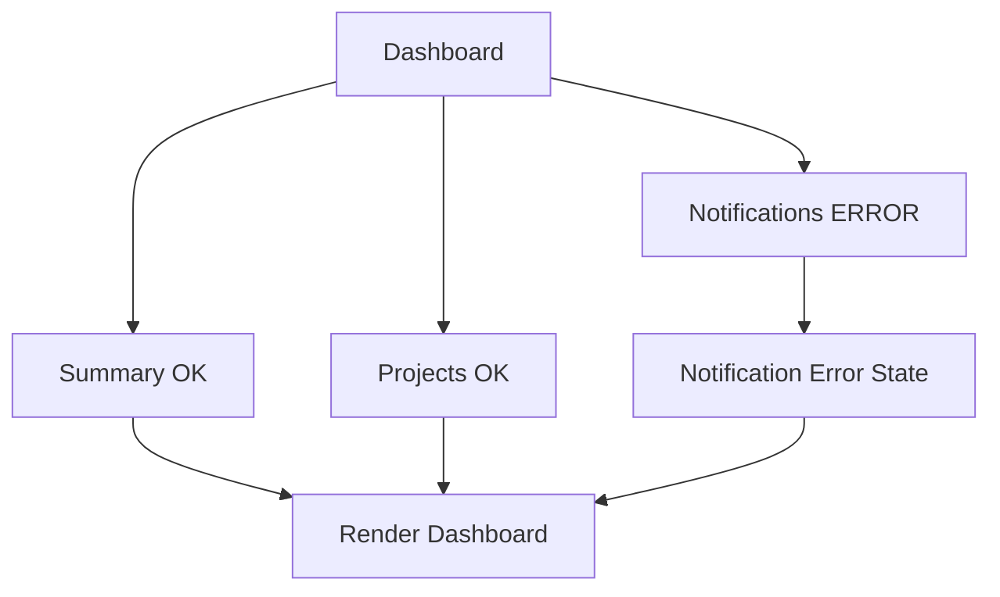

---

# 116. Estrategia de error

Debe distinguirse:

## Error crítico

No puede resolverse usuario o autorización.

```text
fallar request
```

## Error de widget

Una agregación secundaria falla.

```text
renderizar resto
```

---

# 117. Timeouts

Las queries del Dashboard deben tener límites razonables.

Una única métrica lenta no debería bloquear indefinidamente toda la página.

---

# 118. Observación de latencia

Debe medirse:

```text
total dashboard duration

query duration per widget
```

Esto permite identificar el componente lento.

---

# 119. Índices principales

El Dashboard depende especialmente de índices ya definidos en módulos funcionales.

Ejemplos:

```text
project_members(user_id, active)

project_members(project_id, user_id)

tasks(assigned_to, status)

tasks(project_id, status)

tasks(project_id, due_date, status)

activities(task_id, created_at)

project_activity_feed(project_id, created_at)

notifications(user_id, is_read, created_at)
```

---

# 120. No crear índices exclusivos sin análisis

Un índice nuevo debe responder a una query real del Dashboard.

No debe duplicarse otro índice con el mismo prefijo sin necesidad.

---

# 121. Uso de `EXPLAIN`

Toda query agregada relevante debe validarse con:

```sql
EXPLAIN
```

y datos representativos.

Especialmente:

* proyectos personales;
* tareas vencidas;
* resumen por estado;
* actividad reciente.

---

# 122. Límites

Cada widget debe limitar resultados.

Ejemplo:

```text
Projects → 5

Tasks → 8

Overdue → 5

Activity → 8

Notifications → 5
```

Los números deben configurarse centralmente.

---

# 123. No cargar listas completas

El Dashboard no debe convertirse en una alternativa a:

```text
/projects

/tasks

/notifications
```

Los widgets son resúmenes y deben enlazar con las páginas completas.

---

# 124. Configuración

Valores posibles:

```text
DASHBOARD_PROJECT_LIMIT

DASHBOARD_TASK_LIMIT

DASHBOARD_ACTIVITY_LIMIT

DASHBOARD_NOTIFICATION_LIMIT

DASHBOARD_UPCOMING_DAYS
```

---

# 125. Invariantes del Dashboard

Un Dashboard válido debe cumplir:

* solo datos autorizados;
* métricas coherentes;
* límites aplicados;
* URLs internas;
* timestamps normalizados;
* ViewModels sin lazy loading;
* errores parciales controlados.

---

# 126. Sin persistencia propia inicial

La primera versión del Dashboard no necesita una tabla:

```text
dashboard
```

Los datos se derivan de los módulos existentes.

---

# 127. Persistencia futura

Puede ser necesaria para:

* preferencias de widgets;
* snapshots;
* métricas materializadas;
* personalización.

Debe introducirse únicamente cuando exista necesidad.

---

# 128. Materialized Metrics

Si las agregaciones se vuelven costosas puede crearse:

```text
project_metrics
```

con campos como:

```text
project_id

task_count

done_count

overdue_count

activity_count

updated_at
```

---

# 129. Riesgo de materialización

Introduce:

* duplicación;
* invalidación;
* consistencia eventual;
* jobs de reconstrucción.

Debe evitarse mientras las queries directas sean suficientemente rápidas.

---

# 130. Estrategia inicial

Preferir:

```text
queries SQL eficientes

+

índices

+

límites
```

antes de:

```text
caché

materialización

Redis
```

---

# 131. Cache

Puede incorporarse para:

* summaries;
* project metrics;
* admin metrics.

No debe cachearse indiscriminadamente información personalizada sensible.

---

# 132. Cache Key

Ejemplo:

```text
dashboard:user:{user_id}:summary
```

Debe considerar:

* permisos;
* filtros;
* contexto.

---

# 133. Invalidación de cache

Puede invalidarse ante:

```text
project updated

task changed

activity created

membership changed
```

La complejidad de invalidación puede superar el beneficio inicialmente.

---

# 134. Cache TTL

Para métricas no críticas puede existir:

```text
30 s

60 s
```

pero debe medirse primero la necesidad.

---

# 135. Datos personales

El Dashboard puede exponer información personal como:

* nombres;
* tareas;
* actividad;
* proyectos.

Debe aplicar las mismas reglas de privacidad que los módulos originales.

---

# 136. No usar Dashboard como API de extracción masiva

Las respuestas deben estar limitadas.

No debe existir:

```text
GET /dashboard?include_all=true
```

que permita extraer grandes volúmenes.

---

# 137. Logging estructurado

Ejemplo:

```json
{
  "event": "dashboard.load",
  "user_id": 8,
  "dashboard_type": "personal",
  "project_count": 5,
  "task_count": 8,
  "result": "success",
  "duration_ms": 72,
  "correlation_id": "uuid"
}
```

---

# 138. Logs por widget

Puede registrarse en debug o métricas:

```text
summary_query_ms

projects_query_ms

tasks_query_ms

activity_query_ms

notifications_query_ms
```

No es necesario generar un log independiente por cada consulta en producción salvo diagnóstico.

---

# 139. Datos que no deben loguearse

Evitar:

* títulos completos;
* descripciones;
* mensajes de Notification;
* emails;
* datos personales innecesarios;
* listas de IDs completas.

---

# 140. Métricas técnicas

```text
dashboard_request_duration_seconds

dashboard_query_duration_seconds

dashboard_error_total

dashboard_widget_error_total

dashboard_refresh_total

dashboard_realtime_invalidation_total
```

---

# 141. Métricas por widget

Label permitido:

```text
widget=summary

widget=projects

widget=tasks

widget=activity
```

Es un conjunto cerrado y de baja cardinalidad.

---

# 142. Métricas funcionales

Las métricas mostradas en Dashboard no necesariamente deben exportarse como métricas Prometheus.

Debe diferenciarse:

```text
business data

vs

system telemetry
```

---

# 143. Health funcional

Pueden detectarse problemas que afectan al Dashboard:

* proyectos sin coordinador;
* tasks con assignee inválido;
* métricas incoherentes;
* feed atrasado;
* Notifications inconsistentes.

La corrección corresponde a los módulos fuente.

---

# 144. Principio de responsabilidad

Dashboard puede **detectar o mostrar** una anomalía.

No debe reparar datos de otros agregados durante una lectura.

---

# 145. Testing del Query Service

Debe verificarse:

* aislamiento por usuario;
* agregaciones;
* filtros;
* límites;
* ordenación;
* cálculo de progreso;
* vencimientos;
* proyectos coordinados;
* actividad reciente.

---

# 146. Continuación

La **Parte 2** desarrollará:

* queries detalladas por widget;
* Personal Dashboard;
* Project Dashboard;
* Coordinator Dashboard;
* rutas SSR y JSON;
* ViewModels completos;
* integración con templates;
* widgets;
* filtros;
* partial refresh;
* realtime;
* invalidación;
* caché;
* manejo de errores;
* optimización y rendimiento.

---

# 147. Queries por widget

Cada widget del Dashboard debe disponer de una consulta o conjunto de consultas claramente definido.

La arquitectura debe evitar que un único método:

```text
get_dashboard()
```

ejecute lógica monolítica difícil de optimizar.

Se recomienda descomponer:

```text
get_summary()

get_projects_widget()

get_tasks_widget()

get_overdue_widget()

get_recent_activity_widget()

get_notifications_widget()
```

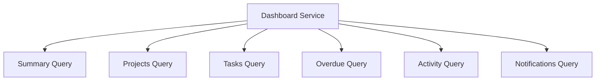

---

# 148. Ventajas de queries independientes

Permiten:

* optimización individual;
* métricas por widget;
* fallos parciales;
* caché granular;
* actualización realtime selectiva;
* testing aislado;
* reutilización.

---

# 149. Summary Query

Debe devolver indicadores compactos.

Ejemplo conceptual:

```python
@dataclass(frozen=True)
class DashboardSummaryDTO:
    active_projects: int
    assigned_tasks: int
    doing_tasks: int
    overdue_tasks: int
    unread_notifications: int
```

---

# 150. Consulta de proyectos activos

Consulta conceptual:

```sql
SELECT COUNT(DISTINCT p.id_project)
FROM projects p
JOIN project_members pm
    ON pm.project_id = p.id_project
WHERE pm.user_id = :user_id
  AND pm.active = TRUE
  AND p.status = 'active';
```

---

# 151. Consulta de tareas asignadas

```sql
SELECT COUNT(*)
FROM tasks t
JOIN projects p
    ON p.id_project = t.project_id
JOIN project_members pm
    ON pm.project_id = p.id_project
WHERE t.assigned_to = :user_id
  AND pm.user_id = :user_id
  AND pm.active = TRUE
  AND p.status = 'active'
  AND t.status <> 'done';
```

---

# 152. Consulta de Doing

```sql
SELECT COUNT(*)
FROM tasks t
WHERE t.assigned_to = :user_id
  AND t.status = 'doing';
```

Debe añadirse contexto de proyecto si existe posibilidad de asignaciones históricas o proyectos archivados.

---

# 153. Consulta de vencidas

```sql
SELECT COUNT(*)
FROM tasks t
JOIN projects p
    ON p.id_project = t.project_id
WHERE t.assigned_to = :user_id
  AND t.due_date < :today
  AND t.status <> 'done'
  AND p.status = 'active';
```

---

# 154. Consulta de Notifications

Debe reutilizar:

```text
NotificationRepository.count_unread()
```

No debe duplicarse SQL innecesariamente dentro del módulo Dashboard.

---

# 155. Reutilización de repositorios

El Dashboard puede reutilizar consultas especializadas ya existentes en:

```text
ProjectRepository

TaskRepository

ActivityFeedRepository

NotificationRepository
```

si su contrato es suficientemente eficiente.

No debe reutilizar métodos que carguen entidades completas cuando solo necesita agregados.

---

# 156. Read Queries específicas

Cuando los repositorios de dominio no ofrecen una consulta adecuada, el Dashboard puede disponer de queries propias de lectura.

Ejemplo:

```python
class DashboardTaskQueries:
    def count_personal_tasks(...):
        ...

    def list_actionable_tasks(...):
        ...
```

Esto evita contaminar repositorios de dominio con consultas exclusivamente de presentación.

---

# 157. Query Objects

Una estructura posible:

```text
dashboard/
├── queries/
│   ├── summary_queries.py
│   ├── project_queries.py
│   ├── task_queries.py
│   ├── activity_queries.py
│   └── notification_queries.py
```

Debe utilizarse solo si el número de consultas lo justifica.

---

# 158. Personal Dashboard

El Personal Dashboard constituye la vista principal tras iniciar sesión.

Debe priorizar:

1. trabajo que requiere acción;
2. vencimientos;
3. proyectos activos;
4. notificaciones;
5. actividad reciente.

---

# 159. Composición recomendada

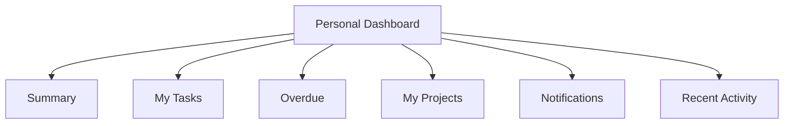

---

# 160. PersonalDashboardDTO

Ejemplo completo:

```python
@dataclass(frozen=True)
class PersonalDashboardDTO:
    summary: DashboardSummaryDTO
    actionable_tasks: tuple[TaskSummaryDTO, ...]
    overdue_tasks: tuple[TaskSummaryDTO, ...]
    projects: tuple[ProjectSummaryDTO, ...]
    notifications: tuple[NotificationSummaryDTO, ...]
    recent_activity: tuple[ActivityFeedSummaryDTO, ...]
```

---

# 161. Actionable Tasks

Una tarea es accionable cuando:

* está asignada al usuario;
* no está completada;
* pertenece a proyecto disponible;
* requiere atención.

Puede priorizar:

```text
overdue

doing

high priority

due soon

todo
```

---

# 162. Ranking de tareas accionables

Score conceptual:

```text
Overdue        +100

Doing          +40

High priority  +30

Due soon       +20

Medium         +10
```

No es necesario persistir este score.

Puede implementarse mediante `CASE`.

---

# 163. Orden SQL funcional

Ejemplo:

```sql
ORDER BY
    CASE
        WHEN due_date < :today
             AND status <> 'done'
        THEN 1
        ELSE 2
    END,
    CASE status
        WHEN 'doing' THEN 1
        WHEN 'todo' THEN 2
        ELSE 3
    END,
    CASE priority
        WHEN 'high' THEN 1
        WHEN 'medium' THEN 2
        WHEN 'low' THEN 3
        ELSE 4
    END,
    due_date ASC;
```

---

# 164. Límite de tareas

El Dashboard debe mostrar un subconjunto.

Ejemplo:

```text
8 tareas
```

con enlace:

```text
Ver todas mis tareas
```

---

# 165. Overdue Widget

Debe mostrar las tareas vencidas más relevantes.

Puede ordenar por:

```text
mayor retraso

prioridad

estado
```

---

# 166. Días de retraso

Puede calcularse:

```text
today - due_date
```

y mostrar:

```text
3 días de retraso
```

Debe utilizar la zona horaria funcional.

---

# 167. Empty State de vencidas

Cuando no existen:

```text
No tienes tareas vencidas.
```

Puede utilizarse una señal visual positiva, evitando mensajes innecesariamente celebratorios.

---

# 168. My Projects Query

Debe devolver proyectos donde el usuario tiene membresía activa.

Campos:

```text
project_id

name

status

project_role

task_count

done_count

overdue_count

last_activity_at
```

---

# 169. Progreso

Puede calcularse en SQL o Service Layer.

Si la query devuelve:

```text
task_count

done_count
```

el Service puede calcular:

```text
completion_percentage
```

sin coste relevante.

---

# 170. Last Activity

Puede obtenerse mediante:

```sql
MAX(project_activity_feed.created_at)
```

por proyecto.

Debe evitarse unir directamente Feed con Tasks si genera multiplicación de filas.

---

# 171. Subconsulta de última actividad

Ejemplo conceptual:

```sql
SELECT
    project_id,
    MAX(created_at) AS last_activity_at
FROM project_activity_feed
GROUP BY project_id;
```

Después se une con Projects.

---

# 172. Proyectos coordinados

El Dashboard puede marcar:

```text
project_role = coordinator
```

para priorizar visualmente esos proyectos.

No es necesario crear una lista completamente separada salvo que UX lo requiera.

---

# 173. Project Dashboard

El Dashboard contextual de Project debe recibir:

```text
project_id
```

pero la autorización debe resolverse antes de ejecutar agregaciones.

---

# 174. ProjectDashboardDTO

Ejemplo:

```python
@dataclass(frozen=True)
class ProjectDashboardDTO:
    project: ProjectDashboardHeaderDTO
    metrics: ProjectMetricsDTO
    task_distribution: TaskDistributionDTO
    overdue_tasks: tuple[TaskSummaryDTO, ...]
    recent_activity: tuple[ActivityFeedSummaryDTO, ...]
    members: tuple[MemberSummaryDTO, ...]
```

---

# 175. Project Metrics

Campos:

```text
member_count

task_count

todo_count

doing_count

done_count

overdue_count

activity_count

attachment_count

completion_percentage
```

---

# 176. Task Distribution

DTO:

```python
@dataclass(frozen=True)
class TaskDistributionDTO:
    todo: int
    doing: int
    done: int
```

Puede alimentar:

* barras;
* donut futuro;
* métricas.

---

# 177. Evitar gráficos innecesarios

Para tres estados simples:

```text
Todo

Doing

Done
```

una barra segmentada o tres métricas puede ser más útil que una visualización compleja.

El Dashboard debe priorizar comprensión sobre decoración.

---

# 178. Project Dashboard y miembros

Puede mostrar resumen:

```text
member_count

coordinator_count

members_with_open_tasks

members_without_open_tasks
```

Estas métricas deben interpretarse con cuidado.

---

# 179. Workload

Puede calcularse:

```text
open_tasks per user
```

pero no debe presentarse automáticamente como:

```text
productividad
```

Representa carga asignada, no esfuerzo real.

---

# 180. Coordinator Dashboard

El Dashboard de coordinador debe centrarse en excepciones y riesgos.

```text
Overdue Tasks

Unassigned Tasks

Projects with No Recent Activity

Projects Near Deadline

Members with High Assigned Load
```

---

# 181. Unassigned Tasks Query

```sql
SELECT ...
FROM tasks t
JOIN projects p
    ON p.id_project = t.project_id
JOIN project_members pm
    ON pm.project_id = p.id_project
WHERE pm.user_id = :user_id
  AND pm.project_role = 'coordinator'
  AND pm.active = TRUE
  AND t.assigned_to IS NULL
  AND t.status <> 'done';
```

---

# 182. Proyectos sin actividad reciente

Definición configurable:

```text
last_activity_at < today - N days
```

Ejemplo:

```text
N = 7
```

Debe tratarse como indicador, no como error automático.

---

# 183. Proyectos próximos a fecha final

Condición:

```text
end_date >= today

AND

end_date <= today + threshold

AND

status = active
```

Puede combinarse con progreso.

---

# 184. Indicador de riesgo simple

Una evolución puede definir reglas transparentes.

Ejemplo:

```text
project due within 7 days

AND

completion < 50 %

↓

risk = warning
```

Debe mantenerse explicable.

---

# 185. No usar scoring opaco inicialmente

No debe introducirse un algoritmo complejo de riesgo antes de tener suficientes datos y necesidades reales.

La primera versión debe utilizar reglas claras.

---

# 186. Admin Dashboard

Debe mantenerse separado de la experiencia de usuario ordinaria.

Puede incluir:

```text
users

projects

tasks

activities

attachments

system notifications
```

---

# 187. Admin Metrics Query

Las consultas globales pueden ser más costosas.

Deben:

* paginar;
* agregar;
* utilizar índices;
* evitar cálculos innecesarios en cada request.

Puede aplicarse cache con TTL corto más adelante.

---

# 188. Dashboard Router

Ruta principal:

```text
GET /dashboard
```

Debe resolver qué perspectiva mostrar.

---

# 189. Ruta personal

```text
GET /dashboard
```

debe ser la opción por defecto.

Puede detectar capacidades adicionales y mostrar widgets extendidos.

---

# 190. Project Dashboard Route

Ejemplo:

```text
GET /projects/{project_id}/dashboard
```

Debe comprobar:

* Project existe;
* usuario puede leerlo;
* estado permite consulta.

---

# 191. Admin Dashboard Route

Ejemplo:

```text
GET /admin/dashboard
```

Requiere:

```text
dashboard:admin
```

o permiso equivalente.

---

# 192. API de widgets

Para actualización parcial pueden existir endpoints:

```text
GET /api/dashboard/summary

GET /api/dashboard/tasks

GET /api/dashboard/projects

GET /api/dashboard/activity

GET /api/dashboard/notifications
```

---

# 193. Endpoints de Project Dashboard

Ejemplos:

```text
GET /api/projects/{project_id}/dashboard/summary

GET /api/projects/{project_id}/dashboard/activity

GET /api/projects/{project_id}/dashboard/tasks
```

Solo si la actualización incremental lo requiere.

---

# 194. No sobrefragmentar

No es necesario un endpoint por métrica individual.

Debe encontrarse equilibrio entre:

* tamaño;
* caché;
* número de requests;
* independencia.

---

# 195. Widget Endpoint

Una estrategia adecuada es:

```text
1 endpoint por widget
```

cuando el widget tiene ciclo de actualización independiente.

---

# 196. Partial HTML vs JSON

Dos estrategias:

## JSON

Frontend renderiza.

## Partial HTML

Backend renderiza el widget y frontend sustituye HTML.

---

# 197. Partial HTML

Ventajas:

* lógica de presentación centralizada;
* menos duplicación;
* coherencia SSR;
* menor JavaScript.

Para una plataforma SSR con Jinja2 es una opción especialmente adecuada.

---

# 198. Endpoint partial

Ejemplo:

```text
GET /dashboard/widgets/tasks
```

Response:

```text
text/html
```

con:

```text
dashboard/partials/task_summary_list.html
```

---

# 199. JSON

Es apropiado cuando:

* el widget es altamente interactivo;
* varios clientes consumen datos;
* necesita visualización JS.

La elección puede variar por widget.

---

# 200. ViewModel Summary

Ejemplo:

```python
@dataclass(frozen=True)
class DashboardSummaryViewModel:
    active_projects: MetricCardViewModel
    assigned_tasks: MetricCardViewModel
    doing_tasks: MetricCardViewModel
    overdue_tasks: MetricCardViewModel
    unread_notifications: MetricCardViewModel
```

---

# 201. MetricCardViewModel

Campos:

```text
label

value

icon

severity

url

assistive_text
```

---

# 202. Severity de métricas

Ejemplo:

```text
Overdue Tasks > 0

→ warning
```

No debe convertir automáticamente cualquier número elevado en error.

---

# 203. ProjectCardViewModel

Campos:

```text
project_id

name

status_label

role_label

completion_percentage

task_count

overdue_count

last_activity_label

detail_url

dashboard_url
```

---

# 204. TaskCardViewModel

Puede reutilizar la estructura del módulo Tasks.

Campos Dashboard:

```text
id

title

project_name

status

priority

due_date

is_overdue

detail_url
```

---

# 205. ActivityFeedSummaryViewModel

Debe reutilizar la semántica definida en Activity Feed.

No debe volver a construir textos manualmente en Dashboard.

---

# 206. NotificationSummaryViewModel

Debe reutilizar:

```text
NotificationItemViewModel
```

o una versión reducida.

No debe introducir otro sistema visual de severidades.

---

# 207. Reutilización de componentes

Dashboard debe reutilizar:

```text
Status Badge

Priority Badge

Metric Card

Notification Item

Activity Feed Item
```

cuando el design system lo permita.

---

# 208. Template principal

Ejemplo estructural:

```jinja2




<section class="dashboard">

    

    <div class="dashboard-grid">

        

        

        

        

    </div>

</section>


```

---

# 209. Widgets con heading

Cada widget debe utilizar:

```html
<section aria-labelledby="dashboard-tasks-title">
```

y heading propio.

Esto mejora:

* accesibilidad;
* navegación;
* semántica.

---

# 210. Links de profundidad

Cada widget debe proporcionar un enlace claro:

```text
Ver todas las tareas

Ver todos los proyectos

Ver toda la actividad

Ver todas las notificaciones
```

---

# 211. Filtros del Dashboard

Filtros posibles:

```text
All Projects

Coordinated Projects

My Assigned Tasks

Last 7 Days
```

Debe evitarse una gran cantidad de filtros en la vista inicial.

---

# 212. Filtros personales

Puede soportarse:

```text
project_id
```

para limitar temporalmente el Dashboard a un proyecto accesible.

Ejemplo:

```text
/dashboard?project=12
```

El backend debe validar acceso.

---

# 213. No confiar en filtro de Project

Si el usuario envía:

```text
project=999
```

y no tiene acceso:

```text
403 / 404
```

o ignorar el filtro según política.

Nunca debe mostrar datos parciales del proyecto.

---

# 214. Filtro temporal

Ejemplo:

```text
period=7d

period=30d
```

Debe mapearse a un catálogo.

No aceptar:

```text
period=999999d
```

sin límites.

---

# 215. Filter DTO

Ejemplo:

```python
@dataclass(frozen=True)
class DashboardFilters:
    project_id: int | None
    period: DashboardPeriod
```

---

# 216. DashboardPeriod

Enum:

```text
7d

30d

90d
```

Puede representarse:

```python
class DashboardPeriod(StrEnum):
    SEVEN_DAYS = "7d"
    THIRTY_DAYS = "30d"
    NINETY_DAYS = "90d"
```

---

# 217. Filtros y cache

Si se incorpora cache, la key debe incluir filtros.

Ejemplo:

```text
dashboard:user:8:summary:project:12:period:7d
```

---

# 218. Partial Refresh

El frontend debe poder refrescar un widget sin reconstruir toda la página.

Flujo:

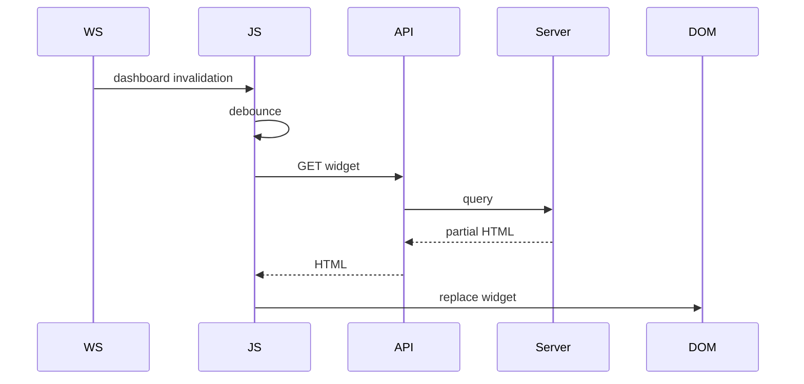

---

# 219. Reemplazo de partial

El contenedor debe tener identificador estable.

Ejemplo:

```html
<section
    id="dashboard-task-widget"
    data-dashboard-widget="tasks"
>
```

---

# 220. Conservación de foco

Si el usuario está interactuando con un widget, el refresh automático no debe eliminar abruptamente el foco.

Opciones:

* posponer refresh;
* actualizar solo contenido no enfocado;
* restaurar foco;
* mostrar indicador de actualización disponible.

---

# 221. Actualizaciones discretas

El Dashboard no debe moverse continuamente ante eventos realtime.

Cambios frecuentes pueden provocar:

* distracción;
* layout shifts;
* problemas de accesibilidad.

Debe utilizarse batching.

---

# 222. Debounce de invalidaciones

Ejemplo:

```text
500 ms - 2 s
```

según el widget.

Una ráfaga de eventos debe producir un único refresh.

---

# 223. Coalescing

Si llegan:

```text
task.updated

task.moved

task.completed
```

para el mismo widget antes del refresh:

```text
1 invalidación
```

es suficiente.

---

# 224. Invalidation Registry

Ejemplo conceptual:

```javascript
const EVENT_WIDGET_MAP = {
    "task.created": ["summary", "tasks", "projects"],
    "task.completed": ["summary", "tasks", "projects"],
    "activity.created": ["activity", "projects"],
    "notification.created": ["summary", "notifications"],
};
```

Puede centralizarse para evitar lógica dispersa.

---

# 225. Acoplamiento de eventos

El registro frontend debe mantenerse pequeño.

Si crece demasiado, es mejor que backend produzca:

```text
dashboard.invalidate
```

con widgets afectados.

---

# 226. Dashboard Invalidation Event

Ejemplo:

```json
{
  "event_type": "dashboard.invalidate",
  "user_id": 8,
  "payload": {
    "widgets": [
      "summary",
      "tasks"
    ]
  }
}
```

---

# 227. Invalidación basada en usuario

El backend puede calcular qué usuarios están afectados por un evento.

Ejemplo:

```text
Task assigned to user 8

↓

invalidate user 8 summary/tasks
```

Esto reduce lógica del cliente.

---

# 228. Realtime mínimo inicial

La primera implementación puede limitarse a:

```text
notification badge realtime
```

y:

```text
manual/page refresh
```

para otras métricas.

La arquitectura queda preparada para ampliar progresivamente.

---

# 229. Polling de respaldo

Puede utilizarse cada:

```text
60-120 s
```

para Summary si WebSocket no está disponible.

Debe detenerse cuando:

* pestaña está oculta;
* usuario desconectado;
* Dashboard no visible.

---

# 230. Page Visibility API

El cliente puede comprobar:

```javascript
document.hidden
```

para evitar refresh innecesario en pestañas en segundo plano.

---

# 231. Refresh al volver

Cuando:

```text
hidden → visible
```

después de un periodo significativo:

```text
refresh summary
```

puede ser más útil que mantener polling continuo.

---

# 232. Errores de widget

Cada widget debe tener estado de error independiente.

Ejemplo:

```text
No se pudieron cargar las tareas.

[Reintentar]
```

El resto del Dashboard continúa visible.

---

# 233. Error global

Debe reservarse para:

* usuario no autenticado;
* contexto inválido;
* fallo crítico de DB;
* imposibilidad de cargar el Dashboard básico.

---

# 234. Retry de widget

La UI puede ofrecer:

```text
Reintentar
```

que ejecuta únicamente la query de ese widget.

---

# 235. Loading State

Durante refresh:

* no borrar datos actuales;
* mostrar indicador discreto;
* evitar skeleton completo salvo carga inicial.

Esto reduce parpadeo.

---

# 236. Stale-While-Revalidate visual

Patrón:

```text
mostrar datos actuales

↓

indicar actualización

↓

recibir nuevos datos

↓

reemplazar
```

Es apropiado para Dashboard.

---

# 237. Cache del Dashboard

No debe incorporarse automáticamente.

Primero:

1. medir;
2. optimizar SQL;
3. añadir índices;
4. limitar resultados;
5. medir de nuevo.

---

# 238. Cache candidata

Widgets candidatos:

```text
Admin Summary

Project Summary

Coordinator Project Metrics
```

menos adecuados:

```text
Unread Notifications

My Tasks
```

por su alta variabilidad.

---

# 239. Cache por usuario

La caché personal debe estar estrictamente aislada.

Nunca utilizar una key insuficiente como:

```text
dashboard:summary
```

Debe incluir al menos:

```text
user_id
```

y contexto.

---

# 240. Cache Stampede

Si una key muy utilizada expira simultáneamente para muchos usuarios, puede provocar múltiples reconstrucciones.

Técnicas futuras:

* jitter;
* locking;
* stale-while-revalidate.

No es necesario inicialmente.

---

# 241. Rendimiento esperado

Objetivo orientativo para Dashboard personal:

```text
p95 < 500 ms
```

en condiciones normales y dataset esperado.

No debe tratarse como garantía contractual hasta medir infraestructura real.

---

# 242. Budget de queries

Un objetivo razonable inicial:

```text
5-8 consultas optimizadas
```

para el Dashboard completo.

El número exacto importa menos que:

* coste;
* índices;
* estabilidad;
* ausencia de N+1.

---

# 243. Query Budget por widget

Ejemplo:

```text
Summary         1-2

Projects        1-2

Tasks           1

Activity        1

Notifications   1
```

Debe evitarse una consulta por elemento.

---

# 244. SQL Profiling

Durante desarrollo debe revisarse:

* número de queries;
* duración;
* filas leídas;
* índices utilizados.

Especialmente después de añadir un widget nuevo.

---

# 245. Slow Query Detection

Las consultas lentas pueden registrarse cuando superan un umbral.

Ejemplo:

```text
> 200 ms
```

El umbral depende del entorno.

---

# 246. EXPLAIN ANALYZE

Cuando sea compatible y apropiado, debe analizarse:

```text
EXPLAIN

EXPLAIN ANALYZE
```

sobre queries críticas.

---

# 247. Test de volumen

Debe probarse con:

```text
100 proyectos

10 000 tareas

50 000 actividades

100 000 feed events

100 000 notifications
```

o datasets acordes a la escala prevista.

El objetivo es detectar degradación antes de producción.

---

# 248. ViewModel inmutable

Se recomienda:

```text
frozen dataclasses
```

o modelos equivalentes para evitar mutación accidental durante render.

---

# 249. Serialización

Si un widget devuelve JSON, debe utilizar DTOs explícitos.

No serializar:

```text
SQLAlchemy model.__dict__
```

---

# 250. Timestamps

Los DTOs deben transportar fechas en UTC.

El View Service o frontend las convierte a zona local.

---

# 251. URLs

Todas las URLs deben generarse en backend o mediante helpers conocidos.

No construir rutas desde valores arbitrarios recibidos por eventos.

---

# 252. Dashboard y Context Injection

El contexto común puede incluir:

```text
current_user

navigation

unread_notifications

locale

timezone
```

Pero las métricas completas del Dashboard deben cargarse solo en la ruta Dashboard.

---

# 253. Evitar trabajo global innecesario

No debe calcularse:

```text
task_count

project metrics

recent activity
```

en middleware o Context Injection para todas las páginas.

---

# 254. Inyección mínima

Context Injection global debe limitarse a elementos comunes como:

```text
current_user

permissions

notification_count
```

cuando realmente aparezcan en el layout global.

---

# 255. Dashboard Service orchestration

Ejemplo conceptual:

```python
def get_personal_dashboard(
    self,
    db,
    *,
    context: DashboardContext,
    filters: DashboardFilters,
) -> PersonalDashboardDTO:

    summary = self.queries.get_summary(...)
    projects = self.queries.get_projects(...)
    tasks = self.queries.get_actionable_tasks(...)
    overdue = self.queries.get_overdue_tasks(...)
    activity = self.queries.get_recent_activity(...)
    notifications = self.queries.get_notifications(...)

    return PersonalDashboardDTO(...)
```

---

# 256. Error Isolation en Service

Las queries esenciales pueden ejecutarse directamente.

Las secundarias pueden envolverse en una estrategia controlada de fallback.

Debe evitarse:

```python
try:
    everything()
except Exception:
    return empty_dashboard
```

porque ocultaría fallos importantes.

---

# 257. DashboardError

Excepciones recomendadas:

```text
DashboardAccessDeniedError

DashboardProjectNotFoundError

InvalidDashboardFilterError

DashboardQueryError

DashboardWidgetUnavailableError
```

---

# 258. Traducción HTTP

| Excepción                         |                   Estado |
| --------------------------------- | -----------------------: |
| `DashboardAccessDeniedError`      |                      403 |
| `DashboardProjectNotFoundError`   |                      404 |
| `InvalidDashboardFilterError`     |                      422 |
| `DashboardQueryError`             |                      500 |
| `DashboardWidgetUnavailableError` | 503 o parcial controlado |

---

# 259. Widget Partial Error

En SSR parcial puede responder:

```text
200
```

con estado visual de error, o:

```text
503
```

y frontend mostrar fallback.

Debe elegirse una convención única.

---

# 260. Recomendación

Para endpoints AJAX de widgets:

```text
5xx
```

en fallo real.

Frontend:

```text
mantiene datos antiguos

+

muestra estado de actualización fallida
```

---

# 261. Logging de carga

Debe registrar:

```text
dashboard_type

user_id

filters

duration

result

correlation_id
```

Los filtros deben mantenerse libres de datos sensibles.

---

# 262. Logging por widget

Para errores:

```text
widget

query

duration

exception_type
```

No registrar SQL completo con valores sensibles en logs ordinarios.

---

# 263. Métricas de widget

```text
dashboard_widget_duration_seconds

dashboard_widget_error_total

dashboard_widget_refresh_total
```

Label:

```text
widget
```

con catálogo cerrado.

---

# 264. Dashboards con información sensible

Un Admin Dashboard puede contener datos más sensibles.

Debe:

* requerir permiso explícito;
* evitar caching compartido;
* restringir logs;
* aplicar expiración de sesión normal;
* mantener auditoría de acciones administrativas cuando proceda.

---

# 265. Dashboard y exportación

No debe añadirse exportación de datos desde Dashboard por defecto.

Si se necesita:

```text
export
```

debe ser un caso de uso separado con autorización específica.

---

# 266. Responsive de widgets

En pantallas pequeñas los widgets deben apilarse.

No debe existir:

* scroll horizontal obligatorio;
* tablas anchas sin adaptación;
* tarjetas con acciones inaccesibles.

---

# 267. Tablas

Si un widget utiliza tabla, debe tener:

* headers;
* caption cuando proceda;
* versión responsive;
* filas limitadas.

Para pocas tareas suele ser preferible una lista.

---

# 268. Skeleton Loading

Puede utilizarse únicamente durante carga asíncrona inicial.

No debe mostrarse si ya existen datos SSR.

---

# 269. Animaciones

Cambios de métrica pueden animarse ligeramente.

Debe respetarse:

```text
prefers-reduced-motion
```

---

# 270. Continuación

La **Parte 3** completará `33_DASHBOARD_MODULE.md` con:

* seguridad avanzada;
* privacidad;
* autorización por perspectiva;
* realtime avanzado;
* multi-tab;
* manejo de stale data;
* observabilidad;
* pruebas unitarias;
* pruebas de integración;
* pruebas de rendimiento;
* Selenium;
* fixtures;
* checklist enterprise;
* criterios de aceptación;
* evolución hacia analítica, materialized views e IA;
* conclusiones.

---

# 271. Seguridad avanzada

El módulo Dashboard concentra información procedente de múltiples dominios y, por tanto, puede convertirse en un punto de exposición accidental de datos si las consultas no respetan estrictamente el contexto del usuario.

La seguridad debe aplicarse antes de cualquier agregación.

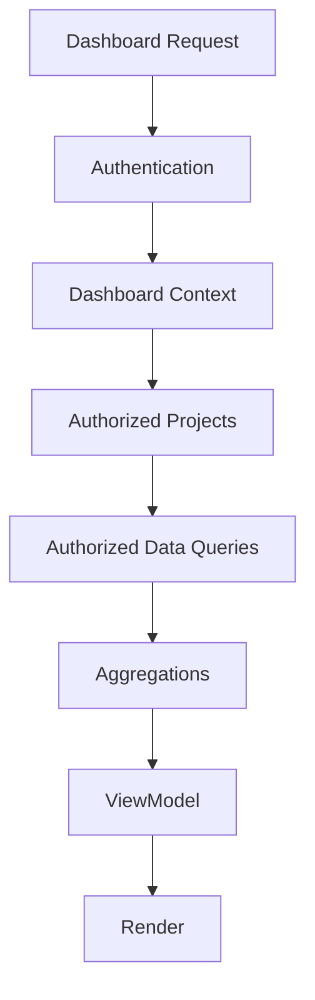

---

# 272. Principio de visibilidad

Toda información mostrada debe cumplir:

```text
Dashboard visibility

<=

Domain visibility
```

El Dashboard nunca amplía permisos.

Si un usuario no puede consultar una Task directamente, tampoco debe:

* verla en un widget;
* contabilizarla en una métrica;
* inferir su existencia mediante un contador;
* verla reflejada en actividad reciente.

---

# 273. Autorización antes de agregación

Debe evitarse:

```text
SELECT global data

↓

aggregate

↓

filter by user
```

La estrategia correcta es:

```text
resolve authorized scope

↓

query only authorized data

↓

aggregate
```

Esto evita filtraciones indirectas.

---

# 274. Filtración mediante métricas

Incluso un número puede revelar información.

Ejemplo inseguro:

```text
Proyecto confidencial

7 tareas abiertas
```

aunque no se muestren los nombres.

Por ello, toda métrica debe construirse únicamente con recursos autorizados.

---

# 275. Project Scope

El contexto puede contener:

```text
authorized_project_ids
```

pero no debe construirse cargando miles de IDs en memoria cuando una query mediante JOIN de membresía sea más eficiente.

---

# 276. Estrategias de scope

## Lista de IDs

Adecuada cuando el usuario participa en pocos proyectos.

```sql
WHERE project_id IN (...)
```

## JOIN de membresía

Adecuada para scopes dinámicos.

```sql
JOIN project_members pm
    ON pm.project_id = t.project_id
WHERE pm.user_id = :user_id
  AND pm.active = TRUE
```

La elección debe basarse en volumen y plan de ejecución.

---

# 277. Roles contextuales

Un usuario puede actuar como:

```text
member

coordinator
```

en proyectos distintos.

Por tanto, el Dashboard no debe asumir un único rol contextual global.

---

# 278. Perspectiva personal

La ruta:

```text
/dashboard
```

debe utilizar únicamente recursos visibles para el usuario autenticado.

No debe aceptar:

```text
user_id
```

como parámetro para consultar el Dashboard de otra persona.

---

# 279. Perspectiva de coordinador

Los widgets adicionales se habilitan únicamente para proyectos donde:

```text
ProjectMember.project_role = coordinator
```

o exista un permiso global equivalente.

No basta con que el usuario sea Profesor global.

---

# 280. Perspectiva administrativa

El Admin Dashboard requiere permiso explícito.

Ejemplo:

```text
dashboard:admin
```

Debe diferenciarse de:

```text
projects:read
```

porque la visibilidad agregada global puede ser más sensible.

---

# 281. IDOR en Project Dashboard

Ruta:

```text
/projects/{project_id}/dashboard
```

debe comprobar acceso antes de ejecutar cualquier query.

Nunca:

```text
load metrics

↓

discover forbidden

↓

return 403
```

porque el propio procesamiento podría filtrar datos vía logs, cache o timing.

---

# 282. Filtros manipulados

Parámetros como:

```text
project_id

period

role

status
```

deben validarse.

Un usuario no debe poder ampliar el scope mediante query parameters.

---

# 283. Open Redirect

Los enlaces generados desde widgets deben utilizar rutas internas conocidas.

No debe aceptarse una URL arbitraria desde:

* query params;
* eventos;
* DTOs externos.

---

# 284. XSS

Dashboard puede mostrar texto derivado de:

* Project.name;
* Task.title;
* Activity title;
* Notification title;
* Activity Feed.

Todo contenido debe escaparse.

---

# 285. SSR seguro

Debe mantenerse el autoescape de Jinja2.

Incorrecto:

```jinja2
{{ task.title | safe }}
```

Correcto:

```jinja2
{{ task.title }}
```

---

# 286. Seguridad en partial refresh

Cuando un widget se actualiza mediante HTML parcial:

* backend sigue escapando;
* frontend inserta únicamente HTML generado por backend;
* no concatena contenido del evento sin sanitizar.

---

# 287. JSON y DOM

Si el endpoint devuelve JSON, debe evitarse:

```javascript
container.innerHTML = task.title;
```

Debe utilizarse:

```javascript
element.textContent = task.title;
```

o componentes seguros.

---

# 288. CSRF

Las rutas GET del Dashboard son de lectura y no requieren CSRF por sí mismas.

Las acciones iniciadas desde widgets que modifiquen estado pertenecen a otros módulos y deben mantener sus propias protecciones.

Dashboard no debe introducir endpoints GET con efectos secundarios.

---

# 289. Datos personales

El Dashboard puede mostrar nombres, tareas y participación de usuarios.

Debe aplicarse minimización.

Ejemplo:

```text
Fran — 4 tareas abiertas
```

puede ser adecuado para un coordinador autorizado.

No debe mostrarse a otros miembros si la política no lo requiere.

---

# 290. Métricas de personas

Métricas individuales deben tratarse con especial cuidado.

Ejemplos:

```text
tareas asignadas

actividades registradas

tiempo declarado
```

No representan automáticamente:

* productividad;
* calidad;
* rendimiento;
* compromiso.

La interfaz debe evitar etiquetas interpretativas no justificadas.

---

# 291. Ranking de usuarios

No se recomienda mostrar rankings como:

```text
Top contributors
```

sin un caso funcional explícito.

Pueden incentivar interpretaciones incorrectas y comportamientos de gaming.

---

# 292. Privacidad por diseño

El Dashboard debe mostrar únicamente lo necesario para:

* orientar al usuario;
* coordinar trabajo;
* detectar incidencias;
* acceder a recursos.

No debe convertirse en un panel de vigilancia.

---

# 293. Realtime avanzado

La sincronización realtime debe mantener el Dashboard actualizado sin convertir JavaScript en una segunda implementación del dominio.

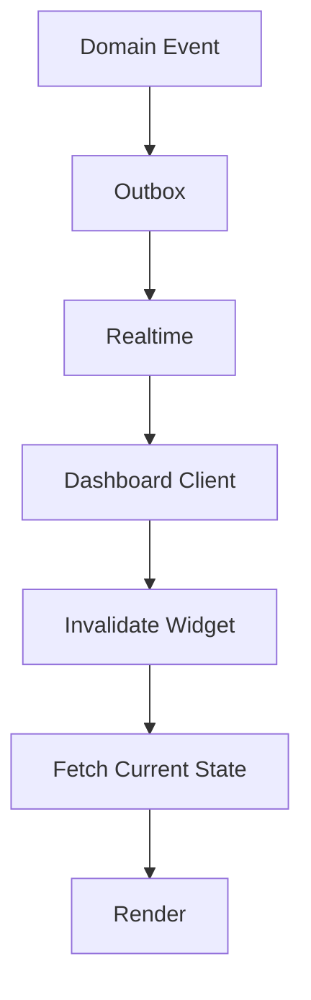

---

# 294. Fuente de verdad

Ante discrepancia:

```text
server state

>

browser state
```

El Dashboard debe reconciliar mediante HTTP.

---

# 295. Tipos de actualización

Pueden utilizarse tres estrategias:

1. actualización directa;
2. invalidación de widget;
3. refresh global.

La estrategia debe elegirse según complejidad.

---

# 296. Actualización directa

Adecuada para cambios triviales.

Ejemplo:

```text
notification.created
```

puede incrementar:

```text
unread_notifications
```

si el evento incluye el nuevo contador.

---

# 297. Invalidación

Preferida para métricas derivadas.

Ejemplo:

```text
task.completed
```

puede afectar:

* summary;
* tasks;
* projects;
* overdue.

En lugar de recalcular en JS:

```text
invalidate widgets
```

---

# 298. Refresh global

Debe reservarse para:

* reconexión tras pérdida prolongada;
* cambio masivo;
* inconsistencia detectada;
* cambio importante de permisos.

---

# 299. Invalidation Event

Contrato conceptual:

```json
{
  "event_id": "uuid",
  "event_type": "dashboard.invalidate",
  "user_id": 8,
  "occurred_at": "2026-08-13T19:00:00Z",
  "payload": {
    "widgets": [
      "summary",
      "tasks",
      "projects"
    ]
  }
}
```

---

# 300. Dedupe de invalidaciones

El cliente debe ignorar:

```text
event_id
```

duplicados.

Además, varias invalidaciones del mismo widget pueden fusionarse.

---

# 301. Widget State Machine

Cada widget puede mantener:

```text
idle

stale

loading

ready

error
```

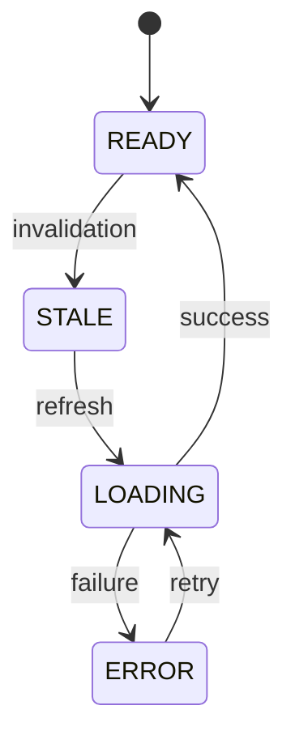

---

# 302. Estado `stale`

`stale` significa:

```text
datos visibles pero potencialmente antiguos
```

No debe borrarse inmediatamente el contenido.

---

# 303. Batching de refresh

Cuando varios eventos llegan seguidos:

```text
TaskUpdated

TaskMoved

ActivityCreated
```

el Dashboard puede esperar un pequeño intervalo y refrescar una sola vez.

---

# 304. Debounce recomendado

Intervalo orientativo:

```text
500 ms - 1500 ms
```

Debe ajustarse según UX.

---

# 305. Multi-tab

Varias pestañas pueden tener el Dashboard abierto.

Todas reciben eventos del canal personal.

Debe evitarse que cada pestaña realice trabajo innecesario cuando está oculta.

---

# 306. Page Visibility

Si:

```javascript
document.hidden === true
```

puede marcarse el widget como stale sin refrescar inmediatamente.

Cuando la pestaña vuelva:

```text
refresh affected widgets
```

---

# 307. BroadcastChannel

Una evolución puede usar:

```text
BroadcastChannel
```

para coordinar pestañas del mismo navegador.

Una pestaña puede comunicar:

* refresh realizado;
* notification count;
* invalidaciones.

No es imprescindible inicialmente.

---

# 308. Reconexión

Flujo:

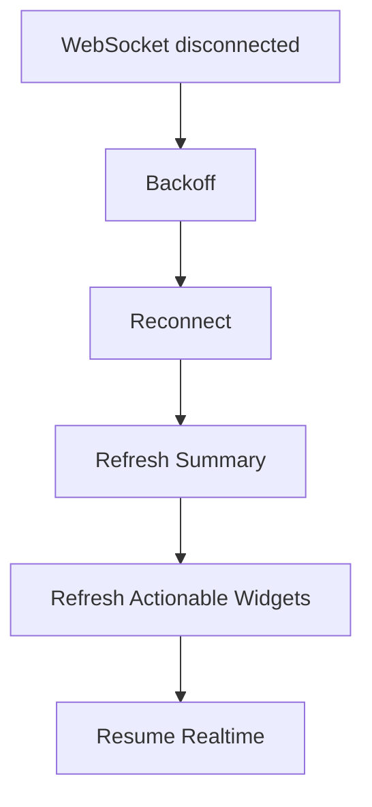

---

# 309. Jitter

Los reintentos deben incorporar variación aleatoria para evitar reconnect storms.

---

# 310. Stale Data

Los datos del Dashboard son informativos y pueden tolerar pequeños desfases.

La UI puede mostrar:

```text
Actualizado hace 2 min
```

cuando sea útil.

---

# 311. Last Refreshed

Cada widget puede almacenar:

```text
last_refreshed_at
```

solo en cliente o ViewModel.

No es necesario persistirlo.

---

# 312. Botón Refresh

Puede existir una acción:

```text
Actualizar
```

para usuarios que quieran reconciliar manualmente.

Debe refrescar datos, no realizar writes.

---

# 313. Error parcial y stale data

Si falla el refresh:

```text
mantener datos anteriores
```

y mostrar:

```text
No se pudo actualizar.
```

Es preferible a reemplazar contenido útil por un error vacío.

---

# 314. Widget Error ViewModel

Ejemplo:

```python
@dataclass(frozen=True)
class DashboardWidgetError:
    widget: str
    message: str
    retryable: bool
```

---

# 315. Error boundaries

Cada widget debe poder fallar de forma independiente cuando sea razonable.

---

# 316. Timeout por widget

Las consultas secundarias pueden tener un timeout lógico o infraestructura equivalente.

El objetivo es evitar que una query degradada bloquee toda la vista.

---

# 317. Degradación

Ejemplo:

```text
Summary       OK

Tasks         OK

Projects      OK

Activity      unavailable

Notifications OK
```

El Dashboard continúa siendo útil.

---

# 318. Caché avanzada

La caché debe introducirse únicamente a partir de evidencia de rendimiento.

Candidatos:

```text
project metrics

coordinator summaries

admin aggregates
```

---

# 319. Caché personalizada

Toda key personalizada debe incluir:

```text
user_id

perspective

filters
```

cuando corresponda.

---

# 320. Cache Poisoning

No debe utilizarse input no normalizado directamente en keys.

Los filtros deben parsearse primero a tipos válidos.

---

# 321. Cache Isolation

Nunca compartir entre usuarios una respuesta que contenga:

* proyectos;
* tareas;
* nombres;
* Notifications;
* permisos.

---

# 322. Métricas públicas o globales

Una métrica global administrativa puede compartir cache únicamente si:

* es igual para todos los administradores;
* no contiene scope personalizado;
* la autorización se ejecuta antes de servirla.

---

# 323. TTL

TTL orientativo:

```text
30-120 segundos
```

para agregados poco críticos.

El valor debe medirse.

---

# 324. Invalidación

Puede utilizar:

* eventos;
* TTL;
* ambos.

Una invalidación perfecta para todos los widgets puede resultar demasiado compleja.

---

# 325. Preferencia inicial

```text
no cache
```

hasta demostrar necesidad.

---

# 326. Materialized Views

Una evolución puede utilizar materialización para queries administrativas pesadas.

Ejemplos:

```text
daily_project_metrics

user_task_summary

project_activity_summary
```

MariaDB no dispone de materialized views nativas equivalentes a otros motores, por lo que podrían modelarse mediante tablas agregadas y jobs.

---

# 327. Tabla agregada

Ejemplo:

```text
project_metrics
```

Campos:

```text
project_id

task_count

todo_count

doing_count

done_count

overdue_count

activity_count

last_activity_at

updated_at
```

---

# 328. Consistencia eventual de agregados

Las tablas derivadas pueden ir unos segundos por detrás.

El sistema debe documentarlo.

---

# 329. Rebuild

Toda tabla derivada debe poder reconstruirse desde las fuentes originales.

```text
derived data

must be rebuildable
```

---

# 330. No usar tabla agregada como verdad

Nunca debe modificarse un Task porque:

```text
project_metrics.done_count
```

indique un valor.

La tabla es únicamente lectura derivada.

---

# 331. Observabilidad

El Dashboard necesita observabilidad específica porque combina múltiples fuentes.

Métricas:

```text
dashboard_request_duration_seconds

dashboard_widget_duration_seconds

dashboard_query_duration_seconds

dashboard_widget_error_total

dashboard_refresh_total

dashboard_partial_refresh_total

dashboard_cache_hit_total

dashboard_cache_miss_total
```

---

# 332. Correlation ID

Toda carga debe compartir:

```text
correlation_id
```

entre:

* router;
* Dashboard Service;
* queries;
* logs.

---

# 333. Logging estructurado

Ejemplo:

```json
{
  "event": "dashboard.load",
  "dashboard_type": "personal",
  "user_id": 8,
  "widgets_requested": 6,
  "widgets_failed": 0,
  "duration_ms": 93,
  "result": "success",
  "correlation_id": "uuid"
}
```

---

# 334. Logging de widget lento

Ejemplo:

```json
{
  "event": "dashboard.widget.slow",
  "widget": "projects",
  "duration_ms": 420,
  "threshold_ms": 200,
  "correlation_id": "uuid"
}
```

---

# 335. Datos excluidos de logs

No incluir:

* títulos;
* mensajes;
* nombres personales;
* descripción de tareas;
* listas de proyectos;
* filtros sensibles.

---

# 336. Tracing

Una futura integración OpenTelemetry puede crear spans:

```text
dashboard.load

dashboard.summary

dashboard.projects

dashboard.tasks

dashboard.activity
```

Esto facilita localizar latencia.

---

# 337. Alertas

Puede alertarse cuando:

* p95 aumenta;
* widget error rate aumenta;
* query supera umbral;
* cache falla;
* demasiadas invalidaciones;
* Dashboard carga más queries de lo esperado.

---

# 338. Query Count Monitoring

Durante tests puede medirse el número de queries.

Ejemplo:

```text
dashboard personal <= 8 queries
```

Debe tratarse como objetivo técnico, no dogma absoluto.

---

# 339. Performance Budgets

Objetivos orientativos:

```text
SSR p95 < 500 ms

partial widget p95 < 250 ms

summary p95 < 150 ms
```

Deben validarse en infraestructura real.

---

# 340. Pruebas unitarias

Deben cubrir:

* cálculo de progreso;
* overdue;
* upcoming;
* ranking;
* filtros;
* composición;
* perspectiva por rol;
* ViewModels.

---

# 341. Test de progreso

Casos:

```text
0/0 → 0 %

0/10 → 0 %

5/10 → 50 %

10/10 → 100 %
```

---

# 342. Test de overdue

Casos:

```text
due yesterday + todo → overdue

due today + todo → not overdue

due yesterday + done → not overdue

due null → not overdue
```

---

# 343. Test de ranking

Debe comprobarse que:

```text
overdue high
```

aparece antes que:

```text
future low
```

según la política establecida.

---

# 344. Test de scope

Usuario A participa en Project 1.

Usuario B participa en Project 2.

Dashboard de A:

```text
no contiene datos de Project 2
```

ni siquiera en contadores.

---

# 345. Test de coordinador

Un usuario coordinador solo debe ver widgets de coordinación relativos a proyectos donde dispone de ese rol.

---

# 346. Test de administrador

Debe verificar:

* permiso válido;
* denegación sin permiso;
* métricas globales correctas;
* aislamiento respecto a rutas personales.

---

# 347. Repository / Query Tests

Deben cubrir:

* summary;
* projects;
* actionable tasks;
* overdue;
* recent activity;
* notifications;
* filtros;
* límites;
* orden.

---

# 348. Test contra multiplicación de JOIN

Dataset:

```text
Project
2 Tasks
3 Members
4 Feed Events
```

Las métricas deben devolver:

```text
tasks = 2
members = 3
feed = 4
```

no productos cartesianos.

---

# 349. Test de N+1

Debe verificarse que aumentar:

```text
5 → 50 proyectos
```

no incrementa linealmente el número de queries.

---

# 350. Integration Tests

Deben ejecutarse con MariaDB o entorno compatible para validar:

* índices;
* agregaciones;
* GROUP BY;
* DATE comparisons;
* joins;
* rendimiento básico.

---

# 351. Test de zona horaria

Debe cubrir:

* fecha UTC;
* timezone de usuario;
* cambio de día;
* DST cuando proceda;
* due dates.

---

# 352. Test de partial endpoint

Debe comprobar:

```text
GET widget

↓

HTML correcto

↓

solo datos autorizados
```

---

# 353. Test JSON Endpoint

Debe validar:

* DTO;
* tipos;
* timestamps;
* límites;
* ausencia de campos internos.

---

# 354. Pruebas de seguridad

Casos:

```text
usuario sin login

project filter ajeno

project dashboard ajeno

admin dashboard sin permiso

XSS en Project name

XSS en Task title

manipulación de parámetros
```

---

# 355. Test de información indirecta

Debe comprobarse que un proyecto no autorizado no aparece en:

* task count;
* overdue count;
* activity count;
* recent activity;
* project count.

---

# 356. Pruebas Realtime

Debe cubrir:

* invalidación;
* dedupe;
* debounce;
* reconexión;
* pestaña oculta;
* refresh al volver;
* stale state;
* error parcial.

---

# 357. Test de eventos múltiples

Enviar:

```text
10 task events
```

en un intervalo corto.

Resultado esperado:

```text
1 refresh por widget
```

o número limitado según política.

---

# 358. Test multi-tab

Dos pestañas:

```text
Dashboard A

Dashboard B
```

deben converger al mismo estado tras eventos y reconciliación.

---

# 359. Pruebas de rendimiento

Dataset realista.

Debe medirse:

* p50;
* p95;
* número de queries;
* filas examinadas;
* uso de índices.

---

# 360. Dataset de rendimiento

Ejemplo:

```text
1 000 users

500 projects

50 000 tasks

200 000 activities

500 000 feed events

500 000 notifications
```

El dataset final debe basarse en expectativas reales.

---

# 361. EXPLAIN Tests

Las queries críticas pueden revisarse automáticamente o mediante pipeline de rendimiento.

No es necesario bloquear CI por planes exactos dependientes del entorno, pero sí detectar regresiones graves.

---

# 362. Selenium

Escenarios:

1. login;
2. abrir Dashboard;
3. comprobar Summary;
4. abrir Task desde widget;
5. volver;
6. aplicar filtro;
7. recibir Notification realtime;
8. observar badge;
9. completar Task desde otra sesión;
10. verificar actualización.

---

# 363. Selenium Coordinator

Escenario:

1. abrir Dashboard como coordinador;
2. visualizar unassigned tasks;
3. abrir proyecto;
4. asignar tarea;
5. volver;
6. comprobar desaparición o actualización.

---

# 364. Accessibility Tests

Debe comprobarse:

* headings;
* landmarks;
* orden de foco;
* links;
* labels;
* contraste;
* `aria-live`;
* `prefers-reduced-motion`.

---

# 365. Fixtures

Fixtures recomendadas:

```text
member_user

coordinator_user

admin_user

external_user

active_project

archived_project

project_membership

todo_task

doing_task

done_task

overdue_task

future_task

feed_events

notifications
```

---

# 366. Factories

Factories:

```text
UserFactory

ProjectFactory

ProjectMemberFactory

TaskFactory

ActivityFactory

ActivityFeedFactory

NotificationFactory
```

---

# 367. Test Clock

Los tests temporales deben utilizar un reloj controlado.

No deben depender de:

```text
datetime.now()
```

directamente.

Esto permite pruebas deterministas de:

* overdue;
* upcoming;
* relative time;
* filtros temporales.

---

# 368. Checklist de arquitectura

* [ ] Dashboard es read-only.
* [ ] No contiene Commands.
* [ ] Usa DTOs.
* [ ] No expone entidades ORM.
* [ ] Queries separadas por responsabilidad.
* [ ] No existe JOIN universal.
* [ ] No existe persistencia propia innecesaria.
* [ ] Los datos derivados son reconstruibles.
* [ ] Los widgets están desacoplados.
* [ ] La lógica de presentación está en View Service.

---

# 369. Checklist de seguridad

* [ ] Autenticación.
* [ ] Scope autorizado antes de agregar.
* [ ] IDOR protegido.
* [ ] Filtros validados.
* [ ] Admin protegido.
* [ ] XSS protegido.
* [ ] URLs internas.
* [ ] Métricas sin filtración.
* [ ] Datos personales minimizados.
* [ ] Cache aislada.

---

# 370. Checklist Personal Dashboard

* [ ] Summary.
* [ ] My Tasks.
* [ ] Overdue Tasks.
* [ ] My Projects.
* [ ] Recent Activity.
* [ ] Notifications.
* [ ] Límites.
* [ ] Enlaces a páginas completas.
* [ ] Empty states.
* [ ] Responsive.

---

# 371. Checklist Project Dashboard

* [ ] Project autorizado.
* [ ] Métricas.
* [ ] Task distribution.
* [ ] Overdue.
* [ ] Activity.
* [ ] Members.
* [ ] Progreso.
* [ ] Sin duplicación de datos.
* [ ] Consultas agregadas.
* [ ] Realtime preparado.

---

# 372. Checklist Coordinator Dashboard

* [ ] Solo proyectos coordinados.
* [ ] Tareas sin asignar.
* [ ] Vencimientos.
* [ ] Riesgos explicables.
* [ ] Actividad reciente.
* [ ] Carga de trabajo no interpretada como productividad.
* [ ] Acciones enlazadas a módulos reales.
* [ ] Scope contextual.
* [ ] Consultas optimizadas.
* [ ] Sin filtración entre proyectos.

---

# 373. Checklist UI

* [ ] SSR funcional.
* [ ] Progressive Enhancement.
* [ ] Widgets semánticos.
* [ ] Headings.
* [ ] Navegación teclado.
* [ ] Estados vacíos.
* [ ] Errores parciales.
* [ ] Loading discreto.
* [ ] Reduced motion.
* [ ] Mobile first.

---

# 374. Checklist Realtime

* [ ] Fuente de verdad servidor.
* [ ] Invalidación por widget.
* [ ] Event ID.
* [ ] Deduplicación.
* [ ] Debounce.
* [ ] Multi-tab.
* [ ] Reconexión.
* [ ] HTTP reconciliation.
* [ ] Stale state.
* [ ] Error handling.

---

# 375. Checklist Rendimiento

* [ ] Queries limitadas.
* [ ] Índices.
* [ ] EXPLAIN.
* [ ] Sin N+1.
* [ ] Sin JOIN multiplicativo.
* [ ] Resultados limitados.
* [ ] Query budget.
* [ ] Métricas p95.
* [ ] Cache solo con necesidad.
* [ ] Test de volumen.

---

# 376. Checklist Observabilidad

* [ ] Correlation ID.
* [ ] Request duration.
* [ ] Widget duration.
* [ ] Query duration.
* [ ] Error count.
* [ ] Slow widget logs.
* [ ] Trace preparado.
* [ ] Labels de baja cardinalidad.
* [ ] Alertas.
* [ ] Sin datos sensibles en logs.

---

# 377. Criterios de aceptación

El módulo Dashboard se considera correctamente implementado cuando:

* proporciona una vista personal contextual;
* muestra únicamente información autorizada;
* agrega Projects, Tasks, Activity Feed y Notifications;
* identifica tareas accionables;
* identifica vencimientos;
* muestra progreso de proyectos;
* adapta widgets según rol;
* utiliza queries optimizadas;
* evita N+1 y joins multiplicativos;
* funciona mediante SSR sin JavaScript;
* admite actualización incremental;
* tolera errores parciales;
* reconcilia tras desconexiones;
* mantiene privacidad;
* dispone de observabilidad;
* supera pruebas funcionales, de seguridad y rendimiento.

---

# 378. Evolución futura

El módulo queda preparado para incorporar:

* analytics;
* series temporales;
* dashboards personalizables;
* materialización;
* comparación entre periodos;
* tendencias;
* forecasting;
* alertas predictivas;
* IA generativa;
* resúmenes automáticos;
* recomendaciones.

---

# 379. Analytics

Una futura capa Analytics debe mantenerse separada del Dashboard operativo.

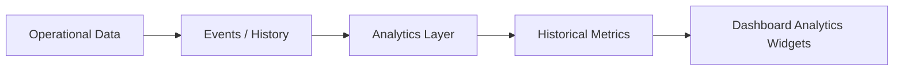

---

# 380. Series temporales

Ejemplos:

```text
tasks completed per week

activities per day

project progress over time

overdue trend
```

No pueden reconstruirse de forma fiable únicamente desde el estado actual.

---

# 381. Event History

Puede utilizarse:

```text
Activity Feed

AuditLog

Domain Events
```

como fuente histórica.

Debe evaluarse si su semántica es suficiente para analítica.

---

# 382. Data Mart

Una evolución puede incorporar tablas analíticas:

```text
fact_tasks

fact_activities

dim_projects

dim_users

dim_dates
```

solo si el volumen y las necesidades justifican una arquitectura BI.

---

# 383. Comparación temporal

Ejemplo:

```text
Tareas completadas

esta semana: 12

semana anterior: 8
```

Debe evitarse interpretar automáticamente un incremento como mejora.

---

# 384. Tendencias

Puede mostrarse:

```text
+15 %
```

únicamente cuando:

* periodo comparable;
* métrica significativa;
* cálculo claro.

---

# 385. Forecasting

Una futura capa puede estimar:

```text
probabilidad de terminar a tiempo

expected completion date

task backlog trend
```

Debe presentarse como estimación, no como hecho.

---

# 386. Risk Detection

Reglas inicialmente transparentes:

```text
deadline near

+

many overdue tasks

↓

risk warning
```

Puede evolucionar a modelos predictivos únicamente con datos suficientes.

---

# 387. IA generativa

Un futuro widget puede producir:

```text
Resumen de tu situación
```

Ejemplo:

```text
Tienes dos tareas vencidas y una tarea de prioridad alta que vence mañana.
```

El resumen debe generarse exclusivamente a partir de datos que el usuario ya puede ver.

---

# 388. Seguridad de IA

El contexto enviado al modelo debe respetar:

* permisos;
* minimización;
* privacidad;
* retención;
* políticas del proveedor.

No debe enviar todo el proyecto si basta con métricas agregadas.

---

# 389. Recomendaciones

La IA puede sugerir:

```text
priorizar tarea X

revisar proyecto Y

reasignar trabajo

comprobar tarea vencida
```

Nunca debe modificar automáticamente el dominio sin una operación explícita y autorizada.

---

# 390. Explicabilidad

Toda recomendación debe poder justificar:

```text
por qué
```

Ejemplo:

```text
Esta tarea aparece primero porque está vencida, tiene prioridad alta y continúa en curso.
```

---

# 391. Personalización de widgets

Una evolución puede permitir:

* mostrar/ocultar;
* reordenar;
* elegir tamaño;
* guardar filtros.

---

# 392. DashboardPreference

Modelo conceptual:

```text
user_id

widget_type

position

visible

size

configuration
```

Debe validarse para evitar configuración arbitraria insegura.

---

# 393. Layout configurable

El backend puede persistir configuración, pero el frontend debe mantener una lista cerrada de widgets soportados.

No debe permitirse insertar HTML personalizado.

---

# 394. Nuevos widgets

Ejemplos futuros:

```text
Calendar

Competition Deadlines

Storage Usage

My Recent Attachments

Project Risk

Weekly Summary
```

Cada widget debe disponer de:

* query;
* DTO;
* ViewModel;
* permisos;
* límites;
* tests.

---

# 395. Plugin-like Architecture

A largo plazo puede existir un registro:

```python
DASHBOARD_WIDGETS = {
    "summary": SummaryWidget(),
    "tasks": TasksWidget(),
    "projects": ProjectsWidget(),
}
```

Debe evitarse si introduce complejidad antes de tiempo.

---

# 396. Principios definitivos

1. Dashboard es una vista derivada.
2. Nunca modifica el dominio.
3. La autorización se aplica antes de agregar.
4. Una métrica también puede filtrar información.
5. Las queries deben trabajar sobre el scope autorizado.
6. Los widgets deben ser limitados y accionables.
7. El Dashboard no sustituye a las vistas completas.
8. DTOs y projections son preferibles a ORM completo.
9. No debe existir un JOIN universal.
10. Realtime invalida; el servidor recalcula.
11. HTTP mantiene la fuente de verdad.
12. Los errores secundarios no deben destruir toda la página.
13. El rendimiento debe medirse antes de cachear.
14. Las métricas humanas deben interpretarse con cautela.
15. Toda evolución analítica debe mantenerse separada del estado operativo.

---

# 397. Conclusiones

El módulo Dashboard proporciona la capa de síntesis operativa de Aula Robótica Platform. Su función consiste en transformar datos procedentes de Projects, Tasks, Activities, Activity Feed y Notifications en una visión breve, contextual y útil para cada usuario.

La arquitectura se orienta exclusivamente a lectura. Las consultas trabajan sobre DTOs, projections y agregaciones optimizadas, evitando cargar entidades completas o construir joins universales que compliquen rendimiento e integridad de los conteos. El Dashboard nunca se convierte en fuente de verdad ni ejecuta modificaciones sobre los módulos funcionales.

La seguridad constituye una propiedad estructural del diseño. El scope autorizado se resuelve antes de ejecutar agregaciones, de forma que ni los elementos individuales ni los propios contadores puedan revelar información de proyectos no accesibles. Las perspectivas personal, de coordinador y administrativa mantienen permisos claramente diferenciados.

La organización mediante widgets permite aislar consultas, errores, caché y actualizaciones realtime. El render inicial SSR mantiene la aplicación funcional sin JavaScript, mientras que las invalidaciones y partial refresh permiten actualizar progresivamente la información sin duplicar lógica de dominio en el navegador.

El diseño prioriza consultas SQL eficientes, límites estrictos, índices adecuados y observabilidad antes de introducir caché o materialización. Si el volumen futuro lo exige, podrán incorporarse tablas agregadas, Redis o procesos analíticos sin alterar los contratos funcionales del Dashboard.

Finalmente, el módulo queda preparado para evolucionar hacia series temporales, analítica, predicción, personalización e inteligencia artificial. Estas capacidades deberán construirse sobre datos autorizados, explicables y derivados, manteniendo siempre la separación entre información operativa, analítica y decisiones reales del dominio.

Con esta arquitectura, Dashboard se convierte en una capa segura, eficiente, accesible y extensible para ayudar a los usuarios de Aula Robótica Platform a comprender qué ocurre, qué requiere su atención y hacia dónde deben dirigir su trabajo.
