# 34_ACTIVITY_FEED_MODULE.md

# Módulo Activity Feed

## Parte 1 — Arquitectura, dominio, modelo de datos y generación de eventos

---

# 1. Introducción

El módulo **Activity Feed** proporciona el historial colaborativo visible de Aula Robótica Platform.

Su función consiste en registrar y presentar eventos relevantes ocurridos dentro de un proyecto de forma comprensible para sus miembros.

Mientras que:

```text
AuditLog
```

representa trazabilidad técnica,

y:

```text
Activity
```

representa trabajo realizado sobre una tarea,

el:

```text
Activity Feed
```

representa la narración funcional de lo que ha ocurrido dentro del proyecto.

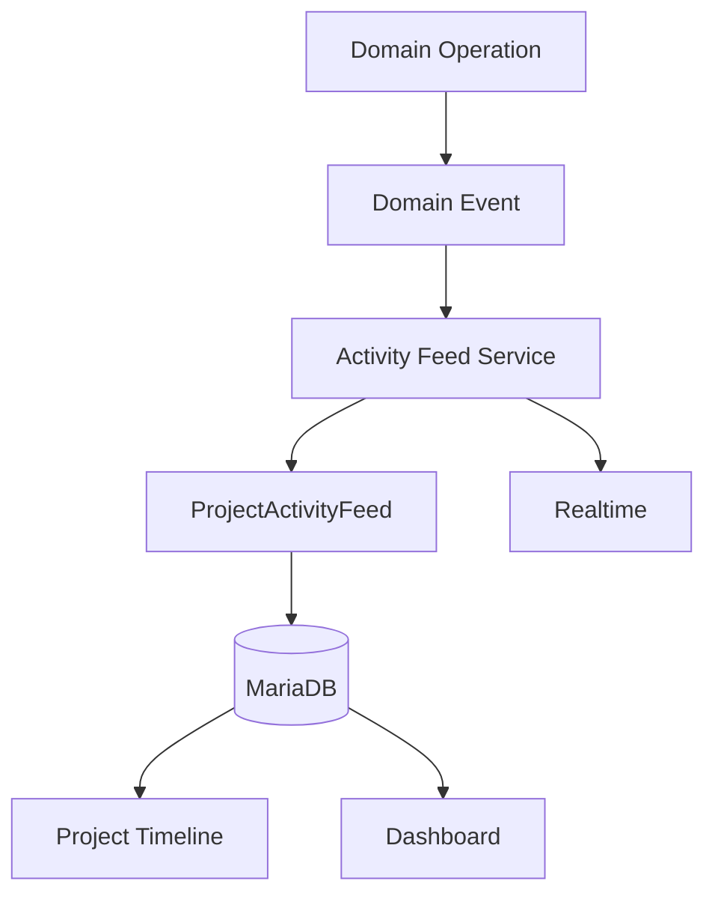

---

# 2. Objetivos

El módulo debe permitir:

* registrar eventos relevantes;
* mantener un timeline por proyecto;
* identificar actor y recurso;
* mostrar mensajes funcionales;
* conservar snapshots mínimos;
* ordenar cronológicamente;
* paginar;
* filtrar;
* sincronizar realtime;
* alimentar Dashboard;
* mantener trazabilidad visible.

---

# 3. Responsabilidad arquitectónica

Activity Feed es responsable de:

* persistencia de eventos visibles;
* clasificación del evento;
* asociación al proyecto;
* actor;
* recurso afectado;
* snapshot funcional;
* consulta temporal;
* paginación;
* ViewModels;
* integración realtime.

No debe asumir:

* auditoría técnica completa;
* autorización principal del dominio;
* lógica de Tasks;
* lógica de Activities;
* lógica de Notifications;
* almacenamiento de archivos;
* ejecución de Commands.

---

# 4. Activity Feed frente a Audit Log

Son subsistemas distintos.

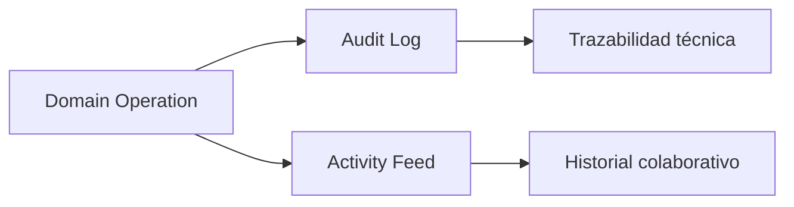

---

# 5. Audit Log

Responde:

```text
¿Qué operación técnica ocurrió?

¿Quién la ejecutó?

¿Qué valores cambiaron?

¿Cuál era la request?

¿Cuál fue el resultado?
```

Puede contener:

* acción técnica;
* before/after;
* IP;
* user agent;
* correlation ID;
* metadata interna.

---

# 6. Activity Feed

Responde:

```text
¿Qué ocurrió en el proyecto?

¿Quién lo hizo?

¿Qué recurso cambió?

¿Cuándo ocurrió?
```

Debe ser comprensible para usuarios funcionales.

Ejemplo:

```text
Fran completó la tarea «Configurar el sensor».
```

---

# 7. Activity frente a Activity Feed

También son conceptos diferentes.

```text
Activity
```

representa una unidad de trabajo registrada.

Ejemplo:

```text
Montaje y calibración del sensor
```

El Feed puede registrar:

```text
Fran completó la actividad «Montaje y calibración del sensor».
```

---

# 8. Principio fundamental

El Activity Feed es una **proyección funcional de eventos del dominio**.

```text
Domain Event

↓

Feed Event
```

No debe utilizarse como fuente de verdad para reconstruir directamente el estado actual del dominio.

---

# 9. Posición dentro de la arquitectura

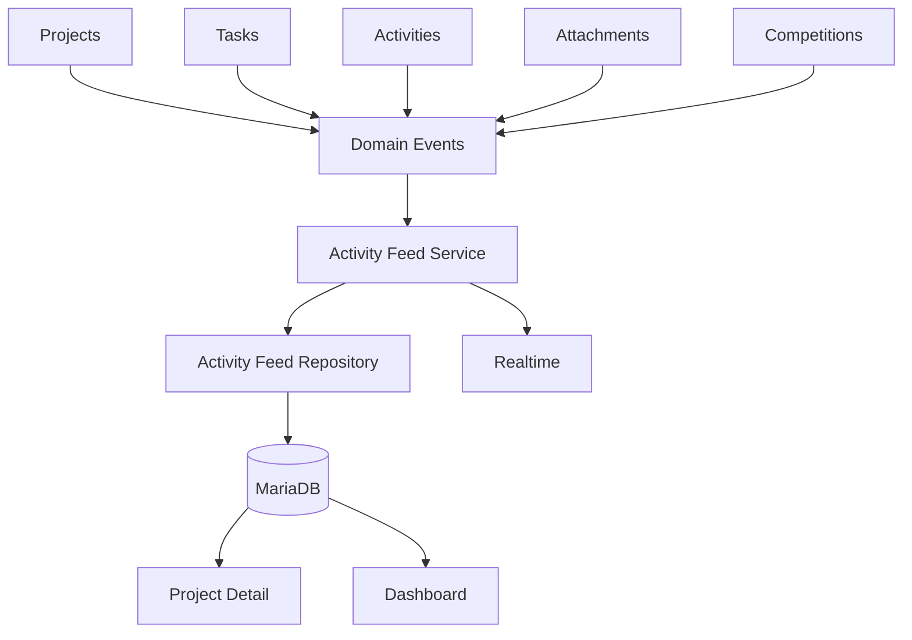

---

# 10. Arquitectura interna

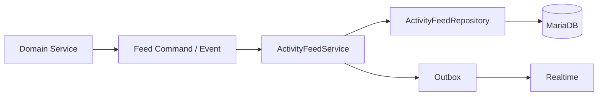

---

# 11. Organización recomendada

```text
modules/
└── activity_feed/
    ├── activity_feed_model.py
    ├── activity_feed_repository.py
    ├── activity_feed_service.py
    ├── activity_feed_schemas.py
    ├── activity_feed_events.py
    ├── activity_feed_builders.py
    ├── activity_feed_view_service.py
    ├── activity_feed_exceptions.py
    └── activity_feed_web.py
```

Plantillas:

```text
templates/
└── activity_feed/
    └── partials/
        ├── activity_feed_list.html
        ├── activity_feed_item.html
        ├── activity_feed_empty_state.html
        └── activity_feed_load_more.html
```

JavaScript:

```text
static/js/activity-feed/
├── activity_feed_api.js
├── activity_feed_list.js
└── activity_feed_realtime.js
```

---

# 12. Entidad `ProjectActivityFeed`

La entidad representa un evento funcional visible dentro de un proyecto.

Campos conceptuales:

```text
id_feed_event

project_id

event_type

actor_id

entity_type

entity_id

message

snapshot

event_id

correlation_id

created_at
```

---

# 13. Modelo relacional

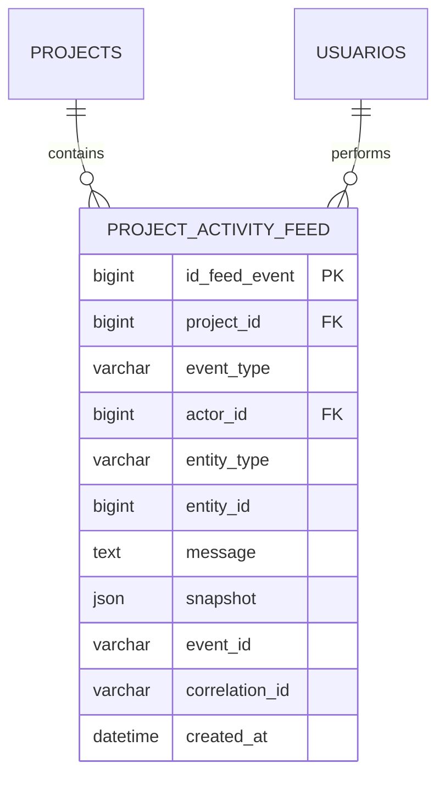

---

# 14. Campos principales

| Campo            | Responsabilidad           |
| ---------------- | ------------------------- |
| `id_feed_event`  | Identificador técnico     |
| `project_id`     | Proyecto                  |
| `event_type`     | Tipo funcional            |
| `actor_id`       | Usuario actor             |
| `entity_type`    | Tipo de recurso           |
| `entity_id`      | ID del recurso            |
| `message`        | Texto funcional           |
| `snapshot`       | Contexto histórico mínimo |
| `event_id`       | Deduplicación             |
| `correlation_id` | Trazabilidad              |
| `created_at`     | Fecha del evento          |

---

# 15. Identificador

`id_feed_event` debe ser:

* técnico;
* único;
* inmutable;
* sin significado funcional.

Puede utilizarse como desempate para paginación.

---

# 16. Project ID

Todo evento ordinario del Feed pertenece exactamente a un proyecto.

```text
ProjectActivityFeed.project_id

↓

Project.id_project
```

Debe ser:

```text
NOT NULL
```

salvo que en el futuro exista un Feed global separado.

---

# 17. Actor

`actor_id` identifica quién provocó el evento.

Puede ser:

```text
User
```

o `NULL` cuando el evento proviene del sistema.

Ejemplos:

```text
actor_id = 7
```

```text
actor_id = NULL
actor_type = system
```

Si se necesita distinguir actores técnicos, puede añadirse:

```text
actor_type
```

---

# 18. Actor eliminado

El Feed debe conservar significado aunque el usuario deje de existir.

Opciones:

* `actor_id ON DELETE SET NULL`;
* usuario anonimizado;
* snapshot de display name.

La recomendación es preservar un snapshot mínimo.

---

# 19. Actor Snapshot

Puede almacenarse dentro de:

```text
snapshot
```

Ejemplo:

```json
{
  "actor_display_name": "Fran"
}
```

Esto mantiene el mensaje histórico comprensible.

---

# 20. Event Type

`event_type` identifica qué ocurrió.

Debe utilizar un enum cerrado.

Ejemplos:

```text
project_created

project_updated

project_archived

project_restored

member_added

member_removed

member_role_changed

task_created

task_updated

task_assigned

task_unassigned

task_status_changed

task_completed

task_reopened

activity_created

activity_completed

attachment_added

attachment_removed
```

---

# 21. FeedEventType

Ejemplo conceptual:

```python
class FeedEventType(StrEnum):
    PROJECT_CREATED = "project_created"
    PROJECT_UPDATED = "project_updated"
    PROJECT_ARCHIVED = "project_archived"

    MEMBER_ADDED = "member_added"
    MEMBER_REMOVED = "member_removed"

    TASK_CREATED = "task_created"
    TASK_ASSIGNED = "task_assigned"
    TASK_STATUS_CHANGED = "task_status_changed"
    TASK_COMPLETED = "task_completed"

    ACTIVITY_CREATED = "activity_created"
    ACTIVITY_COMPLETED = "activity_completed"

    ATTACHMENT_ADDED = "attachment_added"
```

---

# 22. Entity Type

El recurso relacionado puede ser:

```text
project

project_member

task

activity

attachment

competition
```

Debe utilizar un catálogo cerrado.

---

# 23. Entity ID

Identifica el recurso.

Ejemplo:

```text
entity_type = task

entity_id = 84
```

La referencia es polimórfica y no dispone de FK directa.

---

# 24. Referencia polimórfica

Ventajas:

* arquitectura flexible;
* una sola tabla;
* timeline unificado.

Limitaciones:

* integridad manual;
* recursos eliminados;
* validación en Service Layer.

---

# 25. Message

`message` representa el texto visible.

Ejemplo:

```text
Fran completó la tarea «Configurar el sensor».
```

Debe ser:

* breve;
* comprensible;
* seguro;
* sin HTML arbitrario;
* estable históricamente.

---

# 26. Persistir mensaje o template

Existen dos estrategias.

## Mensaje persistido

```text
Fran completó la tarea...
```

## Template

```text
feed.task_completed
```

con parámetros.

---

# 27. Estrategia inicial recomendada

Persistir:

```text
event_type

message

snapshot
```

El mensaje conserva el contexto histórico.

El snapshot permite futuras mejoras o re-render.

---

# 28. Snapshot

Debe contener exclusivamente información necesaria para entender el evento.

Ejemplo:

```json
{
  "task_id": 84,
  "task_title": "Configurar el sensor",
  "old_status": "doing",
  "new_status": "done",
  "actor_display_name": "Fran"
}
```

---

# 29. Snapshot no es backup

No debe contener una copia completa de:

* Task;
* Project;
* Activity;
* User.

Debe seguir el principio:

```text
minimum useful historical context
```

---

# 30. Datos recomendados en snapshot

Pueden incluir:

* nombre/título visible;
* estado anterior;
* estado nuevo;
* responsable;
* rol anterior/nuevo;
* filename;
* display name.

No deben incluir:

* secrets;
* tokens;
* payloads completos;
* descripciones extensas.

---

# 31. Event ID

`event_id` identifica el evento original.

Debe permitir deduplicación.

Restricción recomendada:

```text
UNIQUE(event_id)
```

cuando un evento de dominio produce exactamente una fila de Feed.

---

# 32. Eventos con varias filas

Si un mismo evento puede generar varios Feed Events, la unicidad puede ser:

```text
event_id

+

feed_variant
```

Sin embargo, la arquitectura inicial debe preferir:

```text
1 domain event

→

1 feed event
```

cuando sea posible.

---

# 33. Correlation ID

Relaciona el Feed con:

* operación original;
* AuditLog;
* Notification;
* Outbox;
* realtime.

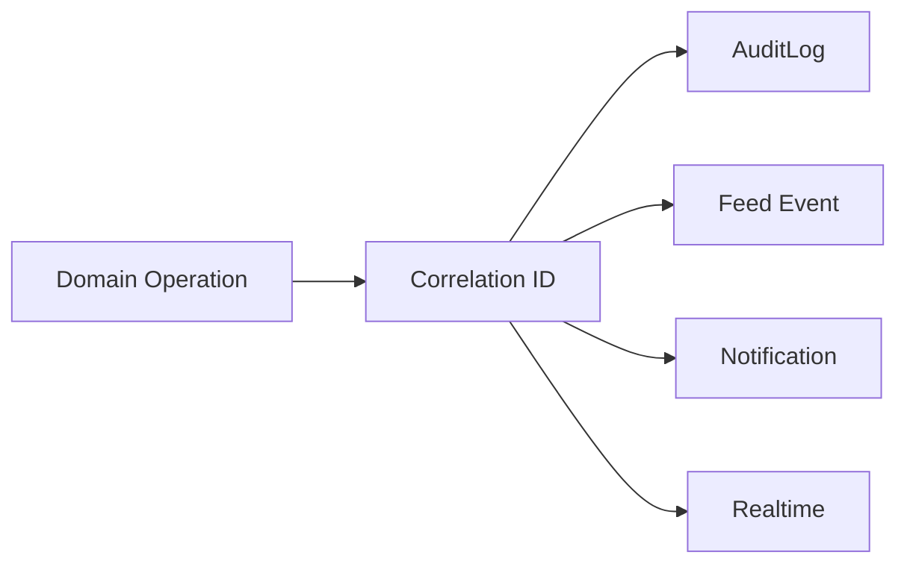

---

# 34. Created At

Debe representar cuándo ocurrió el evento funcional.

Debe almacenarse:

```text
UTC
```

y ser inmutable.

---

# 35. Orden temporal

Orden por defecto:

```text
created_at DESC

id_feed_event DESC
```

El ID actúa como desempate cuando varios eventos tienen el mismo timestamp.

---

# 36. Inmutabilidad

Los Feed Events deben considerarse esencialmente inmutables.

Después de creados no deberían modificarse:

* event type;
* actor;
* entity;
* message;
* snapshot;
* timestamp.

---

# 37. Correcciones

Si un evento se registró incorrectamente, opciones:

* nueva fila correctiva;
* acción administrativa excepcional;
* reconstrucción controlada.

No debe editarse silenciosamente el historial.

---

# 38. Eliminación

El Feed debe conservarse como histórico.

La eliminación ordinaria de un recurso no debe borrar necesariamente su Feed Event.

Ejemplo:

```text
Fran eliminó la tarea «Prueba temporal».
```

debe seguir siendo comprensible después.

---

# 39. FK a Project

Puede utilizar:

```text
ON DELETE CASCADE
```

a nivel técnico si la eliminación física del Project es excepcional.

Sin embargo, un Project con historia relevante debería archivarse en lugar de eliminarse físicamente.

---

# 40. FK a Actor

Recomendación:

```text
ON DELETE SET NULL
```

para conservar historial.

---

# 41. Message Builder

El mensaje debe construirse mediante builders centralizados.

Ejemplo:

```python
class TaskCompletedFeedBuilder:
    def build(self, event) -> FeedDraft:
        ...
```

No debe generarse manualmente desde cada Service.

---

# 42. FeedDraft

Objeto conceptual:

```python
@dataclass(frozen=True)
class FeedDraft:
    project_id: int
    event_type: FeedEventType
    actor_id: int | None
    entity_type: FeedEntityType
    entity_id: int | None
    message: str
    snapshot: dict[str, Any]
    event_id: str
    correlation_id: str
    created_at: datetime
```

---

# 43. Feed Builder Registry

Puede existir:

```python
FEED_BUILDERS = {
    DomainEventType.TASK_CREATED: TaskCreatedFeedBuilder(),
    DomainEventType.TASK_COMPLETED: TaskCompletedFeedBuilder(),
    DomainEventType.MEMBER_ADDED: MemberAddedFeedBuilder(),
}
```

Esto centraliza la traducción:

```text
Domain Event

→

Feed Event
```

---

# 44. Eventos de Project

Catálogo inicial:

```text
project_created

project_updated

project_activated

project_completed

project_archived

project_restored

project_cancelled
```

---

# 45. `project_created`

Mensaje:

```text
Fran creó el proyecto «Robot Explorer».
```

Snapshot:

```json
{
  "project_name": "Robot Explorer",
  "actor_display_name": "Fran"
}
```

---

# 46. `project_updated`

No toda modificación debe crear Feed.

Debe limitarse a cambios relevantes.

Ejemplos:

* nombre;
* fechas;
* estado;
* información visible importante.

No debe registrar:

* actualización interna de `updated_at`;
* versión;
* cambios técnicos.

---

# 47. Resumen de campos modificados

El snapshot puede incluir:

```json
{
  "changed_fields": [
    "name",
    "end_date"
  ]
}
```

El mensaje visible puede mantenerse simple:

```text
Fran actualizó el proyecto.
```

---

# 48. `project_archived`

Mensaje:

```text
Fran archivó el proyecto.
```

Debe mantenerse visible al consultar el histórico.

---

# 49. `project_restored`

Mensaje:

```text
Fran restauró el proyecto.
```

---

# 50. Eventos de Members

```text
member_added

member_removed

member_role_changed
```

---

# 51. `member_added`

Mensaje:

```text
Fran añadió a Marta al proyecto.
```

Snapshot:

```json
{
  "member_id": 19,
  "member_display_name": "Marta",
  "project_role": "member",
  "actor_display_name": "Fran"
}
```

---

# 52. `member_removed`

Mensaje:

```text
Fran retiró a Marta del proyecto.
```

Debe conservar el display name aunque Marta ya no pertenezca al proyecto.

---

# 53. `member_role_changed`

Mensaje:

```text
Fran cambió el rol de Marta a Coordinadora.
```

Snapshot:

```json
{
  "member_display_name": "Marta",
  "old_role": "member",
  "new_role": "coordinator"
}
```

---

# 54. Eventos de Task

Catálogo:

```text
task_created

task_updated

task_assigned

task_unassigned

task_priority_changed

task_status_changed

task_completed

task_reopened

task_deleted
```

---

# 55. `task_created`

Mensaje:

```text
Fran creó la tarea «Configurar el sensor».
```

Snapshot:

```json
{
  "task_id": 84,
  "task_title": "Configurar el sensor",
  "priority": "high"
}
```

---

# 56. `task_updated`

Debe generarse solo para cambios visibles relevantes.

Puede evitarse si se modifica únicamente:

```text
position
```

durante un reorder dentro de la misma columna.

---

# 57. Reorder y Feed

Mover una tarea dentro de:

```text
todo position 3

→

todo position 1
```

normalmente no necesita Feed Event.

Cambiar:

```text
todo

→

doing
```

sí representa un evento funcional.

---

# 58. `task_assigned`

Mensaje:

```text
Fran asignó la tarea «Configurar el sensor» a Marta.
```

Snapshot:

```json
{
  "task_id": 84,
  "task_title": "Configurar el sensor",
  "assignee_id": 19,
  "assignee_display_name": "Marta"
}
```

---

# 59. `task_unassigned`

Mensaje:

```text
Fran dejó sin asignar la tarea «Configurar el sensor».
```

Puede conservar:

```text
previous_assignee_display_name
```

en snapshot.

---

# 60. Reasignación

En lugar de generar:

```text
task_unassigned

+

task_assigned
```

puede resultar más comprensible un evento:

```text
task_reassigned
```

Ejemplo:

```text
Fran reasignó la tarea de Marta a Pablo.
```

La elección debe mantenerse consistente.

---

# 61. Recomendación de reasignación

Utilizar un único evento semántico:

```text
task_reassigned
```

cuando el cambio se produce atómicamente de un usuario a otro.

Esto reduce ruido.

---

# 62. `task_priority_changed`

Puede mostrarse cuando el cambio sea relevante.

Ejemplo:

```text
Fran cambió la prioridad de «Configurar el sensor» a Alta.
```

---

# 63. `task_status_changed`

Mensaje genérico:

```text
Fran movió «Configurar el sensor» a En curso.
```

Si el estado destino es:

```text
done
```

se recomienda utilizar:

```text
task_completed
```

como evento semántico específico.

---

# 64. `task_completed`

Mensaje:

```text
Marta completó la tarea «Configurar el sensor».
```

Es un evento relevante para:

* Feed;
* Dashboard;
* realtime;
* posibles Notifications.

---

# 65. `task_reopened`

Mensaje:

```text
Fran reabrió la tarea «Configurar el sensor».
```

---

# 66. `task_deleted`

Debe utilizarse solo cuando la eliminación tenga relevancia funcional.

Mensaje:

```text
Fran eliminó la tarea «Prueba temporal».
```

No debe desaparecer el Feed Event cuando la Task ya no exista.

---

# 67. Eventos de Activity

```text
activity_created

activity_updated

activity_completed

activity_reopened

activity_deleted
```

---

# 68. `activity_created`

Mensaje:

```text
Marta registró la actividad «Montaje del sensor».
```

Snapshot:

```json
{
  "activity_id": 255,
  "activity_title": "Montaje del sensor",
  "task_id": 84,
  "task_title": "Configurar el sensor"
}
```

---

# 69. `activity_updated`

No toda edición de borrador necesita Feed.

Puede generar ruido si el usuario realiza varias correcciones.

Recomendación:

```text
no generar feed por cada autosave o edición menor
```

---

# 70. `activity_completed`

Mensaje:

```text
Marta completó la actividad «Montaje del sensor».
```

Puede incluir duración en snapshot, pero no necesariamente en el mensaje.

---

# 71. `activity_reopened`

Mensaje:

```text
Fran reabrió la actividad «Montaje del sensor».
```

---

# 72. Eventos de Attachment

```text
attachment_added

attachment_removed
```

Solo deben mostrarse si tienen relevancia funcional.

---

# 73. `attachment_added`

Mensaje:

```text
Marta añadió la evidencia «pruebas.pdf».
```

Snapshot:

```json
{
  "attachment_id": 81,
  "filename": "pruebas.pdf",
  "activity_id": 255
}
```

---

# 74. `attachment_removed`

Mensaje:

```text
Fran eliminó la evidencia «pruebas.pdf».
```

No debe incluir:

* storage key;
* ruta física;
* hash;
* información interna.

---

# 75. Prevención de ruido

El Feed debe representar eventos relevantes.

No debe incluir:

* health checks;
* login;
* lectura de Notification;
* refresh de Dashboard;
* autosaves;
* WebSocket reconnect;
* reorder visual sin cambio funcional;
* cambios técnicos de versión.

---

# 76. Regla de relevancia

Un evento debe entrar en Feed cuando:

* modifica el estado colaborativo;
* afecta responsabilidad;
* altera membresía;
* representa trabajo realizado;
* añade o elimina evidencia;
* cambia el ciclo de vida de un recurso.

---

# 77. Feed Policy

Puede existir un catálogo:

```python
FEED_POLICIES = {
    DomainEventType.TASK_COMPLETED: FeedPolicy(enabled=True),
    DomainEventType.TASK_REORDERED: FeedPolicy(enabled=False),
}
```

Esto evita decisiones dispersas.

---

# 78. Eventos técnicos

Eventos como:

```text
outbox.retry

websocket.connected

attachment.scan.completed
```

pertenecen a:

* logs;
* métricas;
* auditoría técnica.

No al Activity Feed.

---

# 79. Service Layer

`ActivityFeedService` debe coordinar la creación del Feed Event.

Responsabilidades:

* recibir evento de dominio;
* comprobar policy;
* obtener builder;
* construir draft;
* validar;
* deduplicar;
* persistir;
* registrar Outbox realtime cuando proceda.

---

# 80. API conceptual del Service

```python
class ActivityFeedService:

    def create_from_event(
        self,
        db,
        event: DomainEvent,
    ) -> ProjectActivityFeed | None:
        ...
```

Puede devolver `None` cuando la policy determine que el evento no debe aparecer.

---

# 81. Creación dentro de la transacción

La fila de Feed debe persistirse dentro de la misma transacción que el cambio funcional cuando sea posible.

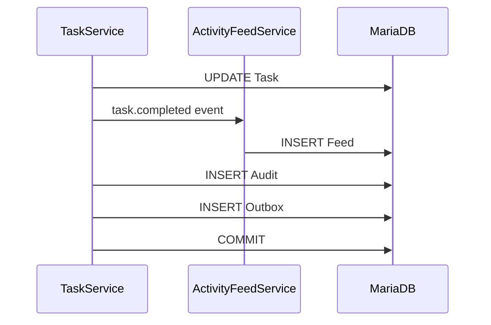

---

# 82. Consistencia

Si falla la operación principal:

```text
Feed Event

no debe permanecer
```

si formaba parte de la misma transacción.

---

# 83. No emitir antes del commit

Realtime no debe anunciar el Feed Event antes de que la transacción confirme.

```text
INSERT Feed

↓

INSERT Outbox

↓

COMMIT

↓

Realtime
```

---

# 84. Eventos asíncronos

Algunos Feed Events pueden construirse desde un consumer de eventos después del commit.

Esto introduce consistencia eventual.

Puede ser válido, pero debe existir:

* idempotencia;
* retry;
* deduplicación;
* monitorización.

---

# 85. Estrategia inicial recomendada

Para eventos del mismo monolito:

```text
persistir Feed en transacción principal
```

y utilizar Outbox únicamente para:

```text
realtime
```

Esto simplifica consistencia.

---

# 86. Deduplicación

La creación debe comprobar:

```text
event_id
```

y apoyarse en:

```text
UNIQUE(event_id)
```

para evitar duplicados concurrentes.

---

# 87. Reintento

Si el Service recibe nuevamente el mismo evento:

```text
same event_id
```

debe tratarlo como ya procesado.

No debe crear un segundo Feed Event.

---

# 88. Repository Pattern

`ActivityFeedRepository` gestiona exclusivamente acceso a MariaDB.

Métodos:

```python
class ActivityFeedRepository:

    def get_by_id(...):
        ...

    def get_by_event_id(...):
        ...

    def create(...):
        ...

    def list_by_project(...):
        ...

    def list_recent_for_projects(...):
        ...

    def exists_event(...):
        ...

    def delete_before(...):
        ...
```

---

# 89. Repository sin reglas de mensajes

El Repository no debe decidir:

```text
qué texto mostrar

qué eventos son relevantes

quién es actor
```

Estas responsabilidades pertenecen al Service/Builders.

---

# 90. Consulta por Project

Consulta principal:

```sql
SELECT *
FROM project_activity_feed
WHERE project_id = :project_id
ORDER BY
    created_at DESC,
    id_feed_event DESC
LIMIT :limit;
```

---

# 91. Índice principal

Recomendado:

```text
(project_id, created_at, id_feed_event)
```

El orden exacto debe validarse con MariaDB y las queries reales.

---

# 92. Activity Feed del Dashboard

El Dashboard personal puede necesitar eventos de múltiples proyectos.

Consulta conceptual:

```sql
SELECT paf.*
FROM project_activity_feed paf
JOIN project_members pm
    ON pm.project_id = paf.project_id
WHERE pm.user_id = :user_id
  AND pm.active = TRUE
ORDER BY
    paf.created_at DESC,
    paf.id_feed_event DESC
LIMIT :limit;
```

---

# 93. Índices para Dashboard

Necesarios:

```text
project_activity_feed(project_id, created_at)

project_members(user_id, active, project_id)
```

---

# 94. Duplicados por memberships

Debe garantizarse que:

```text
ProjectMember
```

no tenga membresías activas duplicadas para el mismo usuario/proyecto.

La constraint definida en Projects evita duplicar Feed rows en la query.

---

# 95. Paginación

El Feed puede crecer indefinidamente.

Debe utilizar:

* paginación;
* cursor;
* límites.

No debe cargar todo el historial en la primera vista.

---

# 96. Cursor recomendado

Utilizar:

```text
created_at

+

id_feed_event
```

Ejemplo:

```text
before=2026-08-13T18:00:00Z,1234
```

---

# 97. Consulta con cursor

```sql
SELECT *
FROM project_activity_feed
WHERE project_id = :project_id
  AND (
      created_at < :cursor_created_at
      OR (
          created_at = :cursor_created_at
          AND id_feed_event < :cursor_id
      )
  )
ORDER BY
    created_at DESC,
    id_feed_event DESC
LIMIT :size;
```

---

# 98. Ventajas del cursor

Frente a `OFFSET`:

* mejor rendimiento;
* estabilidad ante inserciones;
* evita saltos;
* apropiado para timeline.

---

# 99. Tamaño de página

Valor orientativo:

```text
20

25

50
```

La primera versión puede utilizar:

```text
20
```

Debe centralizarse en configuración.

---

# 100. Feed reciente

El Project Detail puede cargar:

```text
5-10 eventos recientes
```

y ofrecer:

```text
Ver toda la actividad
```

---

# 101. Feed completo

Puede existir:

```text
GET /projects/{project_id}/activity
```

o:

```text
GET /projects/{project_id}/feed
```

La convención definitiva debe ser coherente con las rutas del proyecto.

---

# 102. Filtros

Filtros futuros:

```text
event_type

actor_id

entity_type

date_from

date_to
```

No deben sobrecargar la interfaz inicial.

---

# 103. Filtro por tipo

Puede permitir categorías:

```text
Projects

Tasks

Activities

Files

Members
```

La UI puede mapear varias `event_type` a una categoría.

---

# 104. FeedCategory

Ejemplo conceptual:

```text
project

member

task

activity

attachment
```

Puede derivarse de `entity_type`.

No necesita persistirse inicialmente.

---

# 105. Filtrado por actor

Puede resultar útil para:

* búsqueda;
* coordinación;
* investigación de histórico.

Debe respetar siempre el scope del proyecto.

---

# 106. Búsqueda textual

No se recomienda inicialmente buscar sobre `message` mediante:

```text
LIKE %term%
```

en feeds muy grandes.

Puede incorporarse FULLTEXT cuando exista un caso real.

---

# 107. View Models

Modelos recomendados:

```text
ActivityFeedItemViewModel

ActivityFeedListViewModel

ActivityFeedActorViewModel

ActivityFeedEntityViewModel
```

---

# 108. `ActivityFeedItemViewModel`

Campos:

```text
id

event_type

message

actor_display_name

actor_avatar

entity_type

entity_id

entity_url

created_at

relative_time

icon
```

---

# 109. Entity URL

Debe generarse solo cuando el recurso continúa navegable y el usuario dispone de acceso.

Ejemplos:

```text
/tasks/84

/activities/255
```

Si el recurso fue eliminado:

```text
entity_url = null
```

---

# 110. Feed histórico y recursos eliminados

El Feed Event sigue existiendo.

Debe mostrarse como texto sin enlace.

Ejemplo:

```text
Fran eliminó la tarea «Prueba temporal».
```

---

# 111. Snapshot para navegación

No debe confiarse en `snapshot` como autorización.

Aunque contenga:

```text
task_id
```

la ruta destino debe volver a comprobar permisos.

---

# 112. View Service

`ActivityFeedViewService` transforma registros en ViewModels.

Responsabilidades:

* timestamps;
* iconos;
* URL;
* labels;
* actor;
* estados de enlace;
* agrupación visual.

No debe ejecutar Commands.

---

# 113. Mensaje persistido frente a ViewModel

Si `message` ya está persistido, el View Service puede utilizarlo directamente.

Debe escaparlo.

No debe aplicar:

```text
safe HTML
```

sin sanitización.

---

# 114. Iconos

Puede derivarse de `event_type`.

Ejemplos:

```text
task_completed → check

member_added → user-plus

attachment_added → paperclip
```

El icono es presentación y no debe persistirse.

---

# 115. Severidad visual

Activity Feed normalmente no necesita:

```text
success / warning / error
```

como Notifications.

Puede utilizar categorías visuales moderadas.

No debe convertir un historial en una colección de alertas.

---

# 116. Agrupación temporal

La UI puede agrupar:

```text
Hoy

Ayer

Esta semana

Anterior
```

sin cambiar la persistencia.

---

# 117. Agrupación de eventos similares

Una evolución puede agrupar eventos como:

```text
Fran añadió 4 archivos.
```

en lugar de cuatro filas.

Debe mantenerse trazabilidad interna si se realiza.

---

# 118. Agrupación visual

La primera versión puede mantener eventos individuales.

Es más simple y más clara para auditoría funcional.

---

# 119. Empty State

Cuando no existe actividad:

```text
Todavía no hay actividad en este proyecto.
```

Puede añadirse contexto:

```text
Los cambios relevantes aparecerán aquí.
```

---

# 120. Timeline semántico

HTML conceptual:

```html
<ol class="activity-feed">
    <li class="activity-feed__item">
        <article>
            <header>...</header>
            <p>...</p>
            <footer>...</footer>
        </article>
    </li>
</ol>
```

---

# 121. Accesibilidad

Cada evento debe poder comprenderse sin:

* color;
* icono;
* posición visual.

El mensaje textual debe contener la información principal.

---

# 122. Timestamp accesible

Ejemplo:

```html
<time datetime="2026-08-13T18:00:00Z">
    Hace 5 minutos
</time>
```

---

# 123. Progressive Enhancement

Sin JavaScript:

* timeline renderiza;
* paginación funciona;
* filtros funcionan;
* enlaces funcionan.

JavaScript añade:

* load more;
* realtime;
* inserción incremental;
* filtros dinámicos.

---

# 124. Realtime

Eventos nuevos pueden insertarse en la parte superior del Feed.

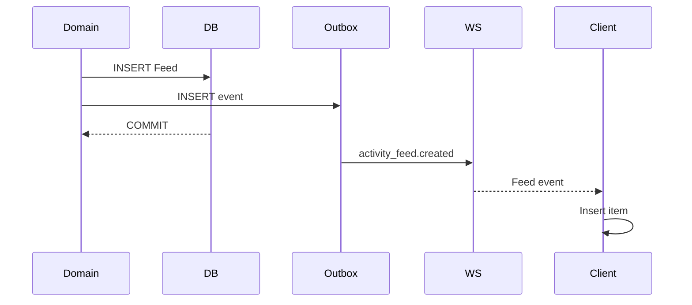

---

# 125. Evento realtime específico

Puede emitirse:

```text
activity_feed.created
```

en lugar de obligar al cliente a traducir todos los eventos de dominio.

Esto desacopla la UI del Feed de Projects, Tasks y Activities.

---

# 126. Contrato realtime

Ejemplo:

```json
{
  "event_id": "uuid",
  "event_type": "activity_feed.created",
  "project_id": 12,
  "occurred_at": "2026-08-13T18:00:00Z",
  "payload": {
    "feed_event": {
      "id": 1234,
      "type": "task_completed",
      "message": "Marta completó la tarea «Configurar el sensor».",
      "entity_type": "task",
      "entity_id": 84,
      "created_at": "2026-08-13T18:00:00Z"
    }
  }
}
```

---

# 127. Evento listo para UI

El payload puede incluir:

```text
message

icon_key

relative metadata
```

pero no debe incluir HTML arbitrario.

---

# 128. Event ID del dominio vs Feed realtime

Conviene distinguir:

```text
source_event_id
```

del:

```text
realtime_event_id
```

si el sistema genera un nuevo evento de transporte.

En la arquitectura inicial puede reutilizarse el `event_id` si mantiene semántica clara.

---

# 129. Idempotencia del cliente

Debe deduplicar por:

```text
feed_event.id
```

o:

```text
event_id
```

antes de insertar.

---

# 130. Eventos locales

El cliente que originó una operación puede:

1. recibir respuesta HTTP;
2. actualizar UI;
3. recibir Feed Event por WebSocket.

Debe evitar duplicar la fila.

---

# 131. Estrategia recomendada

La UI puede esperar el evento realtime para insertar Feed, o:

* insertar optimistamente;
* reconciliar mediante ID.

Para simplicidad:

```text
operación HTTP actualiza recurso

Feed se actualiza mediante realtime / refresh
```

es una estrategia robusta.

---

# 132. Reconexión

Tras desconexión:

```text
GET recent feed
```

debe reconciliar los eventos perdidos.

No debe intentarse reproducir necesariamente cada mensaje WebSocket faltante.

---

# 133. Dashboard

Dashboard puede consumir:

```text
recent feed across authorized projects
```

No necesita suscribirse a todos los Feed Events en realtime desde la primera versión.

Puede utilizar:

* refresh;
* invalidación;
* endpoint propio.

---

# 134. Activity Feed y Notifications

Un mismo evento puede generar:

```text
Feed

+

Notification
```

pero sus destinatarios y objetivos son distintos.

Ejemplo:

```text
Marta completó una tarea.
```

Feed:

```text
visible a miembros del proyecto
```

Notification:

```text
solo a coordinador/usuarios relevantes
```

---

# 135. Activity Feed y Audit

Un mismo evento también puede generar AuditLog.

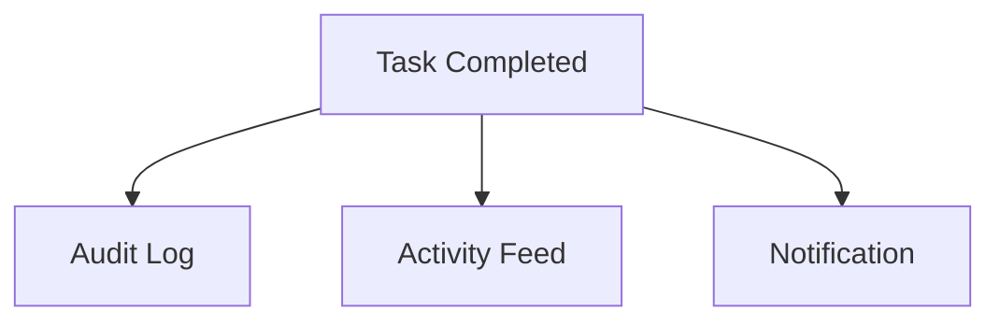

Cada salida tiene un propósito distinto.

---

# 136. Transacción transversal

Idealmente:

```text
Task Update

Feed

Audit

Notifications

Outbox
```

se coordinan dentro de una única transacción MariaDB cuando forman parte del mismo caso de uso.

---

# 137. Orden lógico

Ejemplo conceptual:

```text
validate

↓

mutate domain

↓

create audit

↓

create feed

↓

create notifications

↓

create outbox

↓

commit
```

El orden físico puede variar si el resultado transaccional es consistente.

---

# 138. Fallo de Feed

Debe decidirse si no poder crear el Feed bloquea la operación principal.

Para eventos funcionalmente relevantes, la recomendación es:

```text
sí
```

si Feed forma parte del compromiso de trazabilidad de la plataforma.

---

# 139. Feed opcional

Para eventos secundarios o no críticos puede tolerarse creación asíncrona.

Debe existir una policy explícita.

---

# 140. Eventual Consistency

Si el Feed se genera asíncronamente:

```text
Domain Commit

↓

Feed aparece milisegundos después
```

es aceptable siempre que:

* el evento no se pierda;
* exista retry;
* exista Outbox;
* exista idempotencia.

---

# 141. Retención

El Feed representa histórico colaborativo y probablemente debe conservarse durante toda la vida del proyecto.

Debe distinguirse de Notifications, que pueden tener una retención menor.

---

# 142. Proyecto archivado

El Feed de un Project archivado debe mantenerse consultable.

Esto permite comprender su historia.

---

# 143. Proyecto eliminado

La eliminación física de un Project puede cascadar el Feed si se trata de un borrador sin valor histórico.

Para proyectos con historia:

```text
archive

>

delete
```

---

# 144. Retención futura

Puede definirse según:

* regulación;
* organización;
* tipo de proyecto;
* antigüedad.

No debe aplicarse eliminación automática sin política.

---

# 145. Invariantes

Un Feed Event válido debe cumplir:

* Project válido;
* event type válido;
* actor válido o `NULL`;
* entity type válido;
* message no vacío;
* `event_id` único;
* timestamp válido;
* snapshot serializable;
* ausencia de secretos.

---

# 146. Continuación

La **Parte 2** desarrollará:

* Repository Pattern completo;
* queries de proyecto y Dashboard;
* Service Layer;
* builders;
* policies;
* DTOs;
* filtros;
* paginación por cursor;
* rutas SSR y JSON;
* timeline;
* integración realtime;
* load-more;
* agrupación visual;
* manejo de recursos eliminados;
* rendimiento y caché.

---

# 147. Repository Pattern completo

El acceso a los eventos persistidos del Activity Feed debe centralizarse mediante `ActivityFeedRepository`.

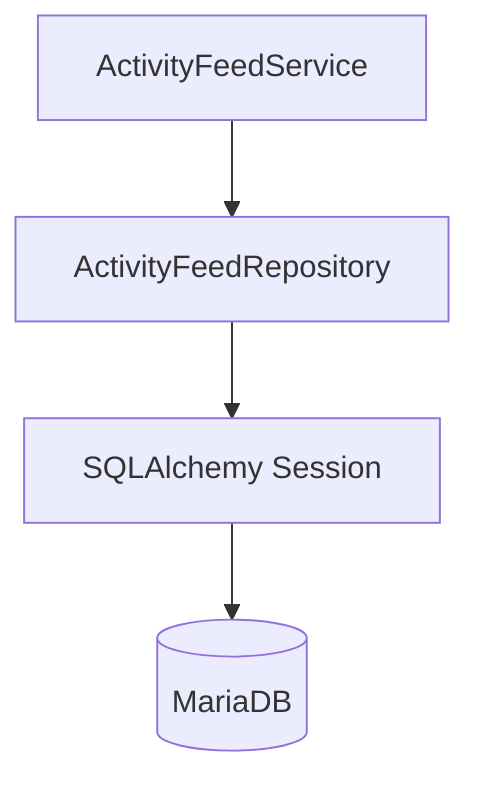

El Repository encapsula:

* inserción;
* consulta;
* deduplicación;
* paginación;
* filtros;
* búsqueda temporal;
* listados por proyecto;
* listados multiproyecto;
* retención.

No debe contener:

* reglas de relevancia;
* generación de mensajes;
* autorización;
* publicación realtime;
* lógica de Projects;
* lógica de Tasks;
* lógica de Activities.

---

# 148. Interfaz recomendada

```python
class ActivityFeedRepository:

    def get_by_id(...):
        ...

    def get_by_event_id(...):
        ...

    def exists_event(...):
        ...

    def create(...):
        ...

    def list_by_project(...):
        ...

    def list_for_projects(...):
        ...

    def list_for_user(...):
        ...

    def count_by_project(...):
        ...

    def delete_before(...):
        ...
```

---

# 149. Consulta por ID

Una consulta básica puede ser:

```python
def get_by_id(
    self,
    db: Session,
    feed_event_id: int,
) -> ProjectActivityFeed | None:
    return db.get(ProjectActivityFeed, feed_event_id)
```

Esta operación no implica por sí misma autorización.

El Service debe resolver posteriormente el contexto del proyecto.

---

# 150. Consulta por Event ID

El Repository debe permitir:

```python
def get_by_event_id(
    self,
    db: Session,
    event_id: str,
) -> ProjectActivityFeed | None:
    ...
```

Se utiliza principalmente para:

* idempotencia;
* diagnóstico;
* reintentos;
* consumers.

---

# 151. `exists_event`

Puede optimizar la comprobación:

```sql
SELECT 1
FROM project_activity_feed
WHERE event_id = :event_id
LIMIT 1;
```

Sin embargo, la constraint:

```text
UNIQUE(event_id)
```

continúa siendo la garantía definitiva frente a concurrencia.

---

# 152. Creación

El Repository recibe un Feed Event ya validado.

```python
def create(
    self,
    db: Session,
    feed_event: ProjectActivityFeed,
) -> ProjectActivityFeed:

    db.add(feed_event)
    db.flush()

    return feed_event
```

No debe ejecutar `commit()`.

---

# 153. Listado por proyecto

Firma orientativa:

```python
def list_by_project(
    self,
    db: Session,
    *,
    project_id: int,
    cursor: FeedCursor | None,
    limit: int,
    filters: FeedFilters | None = None,
) -> list[ProjectActivityFeed]:
    ...
```

---

# 154. Orden estable

Debe aplicarse:

```text
created_at DESC

id_feed_event DESC
```

en todas las consultas temporales.

Esto proporciona:

* consistencia;
* paginación estable;
* desempate.

---

# 155. Cursor DTO

Modelo conceptual:

```python
@dataclass(frozen=True)
class FeedCursor:
    created_at: datetime
    feed_event_id: int
```

No debe utilizarse únicamente `created_at`, ya que varios eventos pueden compartir timestamp.

---

# 156. Codificación de cursor

La interfaz puede exponer un cursor opaco.

Ejemplo:

```text
eyJjcmVhdGVkX2F0IjoiMjAyNi0wOC0xM1QxODowMDowMFoiLCJpZCI6MTIzNH0=
```

El cliente no necesita conocer su estructura interna.

---

# 157. Cursor opaco

Ventajas:

* contrato más estable;
* evita manipulación accidental;
* permite cambiar internamente;
* simplifica APIs.

No debe interpretarse como mecanismo de seguridad.

---

# 158. Validación del cursor

El backend debe comprobar:

* formato;
* campos;
* timestamp;
* ID;
* tamaño.

Un cursor inválido debe devolver:

```text
422 Unprocessable Entity
```

o reiniciar la paginación según la convención general de API.

---

# 159. Query con cursor

```sql
SELECT *
FROM project_activity_feed
WHERE project_id = :project_id
  AND (
      created_at < :cursor_created_at
      OR (
          created_at = :cursor_created_at
          AND id_feed_event < :cursor_id
      )
  )
ORDER BY
    created_at DESC,
    id_feed_event DESC
LIMIT :limit;
```

---

# 160. Límite máximo

Aunque el cliente solicite:

```text
limit = 10000
```

debe existir un máximo.

Ejemplo:

```text
DEFAULT = 20

MAX = 100
```

---

# 161. Filtros del Feed

Modelo conceptual:

```python
@dataclass(frozen=True)
class FeedFilters:
    categories: tuple[FeedCategory, ...] = ()
    actor_id: int | None = None
    date_from: datetime | None = None
    date_to: datetime | None = None
```

---

# 162. Filtro por categoría

La categoría puede mapear varios eventos.

Ejemplo:

```text
TASK
```

incluye:

```text
task_created

task_assigned

task_reassigned

task_priority_changed

task_status_changed

task_completed

task_reopened

task_deleted
```

---

# 163. Category Registry

Ejemplo conceptual:

```python
FEED_CATEGORY_EVENTS = {
    FeedCategory.PROJECT: {...},
    FeedCategory.MEMBER: {...},
    FeedCategory.TASK: {...},
    FeedCategory.ACTIVITY: {...},
    FeedCategory.ATTACHMENT: {...},
}
```

Debe centralizarse.

---

# 164. Filtro por actor

El `actor_id` debe validarse como entero positivo.

No necesita comprobarse que siga siendo miembro del proyecto para consultar eventos históricos.

Sí debe comprobarse que el Feed pertenece a un proyecto accesible para el usuario actual.

---

# 165. Filtro temporal

Debe cumplirse:

```text
date_from <= date_to
```

y aplicarse un rango máximo razonable cuando la consulta pueda ser costosa.

---

# 166. Listado multiproyecto

El Dashboard personal puede necesitar eventos de varios proyectos.

Firma conceptual:

```python
def list_for_projects(
    self,
    db,
    *,
    project_ids: Sequence[int],
    limit: int,
) -> list[ProjectActivityFeed]:
    ...
```

---

# 167. Listado directo por usuario

Puede evitarse construir una lista de IDs mediante JOIN:

```sql
SELECT paf.*
FROM project_activity_feed paf
JOIN project_members pm
    ON pm.project_id = paf.project_id
WHERE pm.user_id = :user_id
  AND pm.active = TRUE
ORDER BY
    paf.created_at DESC,
    paf.id_feed_event DESC
LIMIT :limit;
```

---

# 168. Scope histórico

Debe decidirse si el Dashboard muestra Feed Events de proyectos:

```text
archived
```

Recomendación:

```text
Dashboard general → activos prioritariamente

Project Detail → histórico completo
```

---

# 169. Proyectos cancelados

Pueden excluirse del Feed global ordinario y mantenerse accesibles dentro del proyecto.

Esto evita llenar el Dashboard con actividad histórica no accionable.

---

# 170. Count

Puede ser útil:

```python
count_by_project(project_id)
```

para:

* métricas;
* administración;
* pruebas.

No debe ejecutarse en cada render si la UI no muestra el total.

---

# 171. Repository y JSON Snapshot

El campo `snapshot` debe mapearse correctamente como JSON.

Debe validarse antes de persistir.

No debe contener objetos:

* ORM;
* datetime sin serializar;
* bytes;
* clases Python arbitrarias.

---

# 172. Snapshot serializable

Valores permitidos:

```text
string

number

boolean

null

array

object
```

Los timestamps deben serializarse como ISO 8601.

---

# 173. Tamaño del Snapshot

Debe mantenerse pequeño.

Puede establecerse un límite lógico.

Ejemplo:

```text
8 KB

16 KB
```

No debe convertirse en un almacén de documentos completos.

---

# 174. Message Length

El mensaje también debe tener límite.

Valor orientativo:

```text
500

1000 caracteres
```

Debe ser suficiente para una frase funcional.

---

# 175. Índices recomendados

```text
project_activity_feed(project_id, created_at, id_feed_event)

project_activity_feed(event_id)

project_activity_feed(actor_id, created_at)

project_activity_feed(entity_type, entity_id)

project_activity_feed(created_at)
```

Debe evitarse indexar indiscriminadamente.

---

# 176. Índice por tipo

Puede añadirse:

```text
(project_id, event_type, created_at)
```

si los filtros por categoría son frecuentes.

Debe validarse mediante carga real.

---

# 177. Índice por entity

Útil para responder:

```text
¿Qué eventos existen sobre esta Task?
```

Consulta:

```sql
WHERE entity_type = 'task'
  AND entity_id = :task_id
```

Puede ser necesario para timelines contextuales.

---

# 178. Feed de una entidad

Puede existir una consulta interna:

```python
list_for_entity(
    entity_type,
    entity_id,
)
```

No implica una ruta pública necesariamente.

---

# 179. Service Layer completo

El `ActivityFeedService` debe funcionar como frontera funcional del módulo.

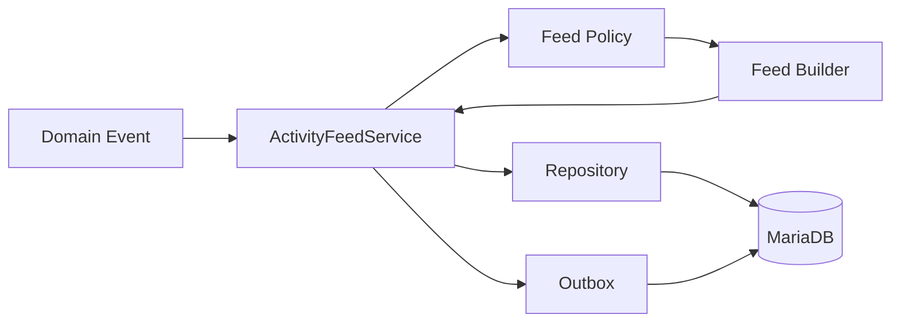

---

# 180. Responsabilidades del Service

Debe:

* identificar event type;
* consultar policy;
* seleccionar builder;
* construir FeedDraft;
* validar proyecto;
* deduplicar;
* persistir;
* registrar Outbox realtime;
* devolver DTO estable.

---

# 181. Casos de uso

Principales:

```text
CreateFeedEventFromDomainEvent

ListProjectFeed

ListUserRecentFeed

GetFeedEvent

DeleteFeedByRetention
```

El módulo no necesita operaciones de edición ordinaria.

---

# 182. `CreateFeedEventFromDomainEvent`

Firma conceptual:

```python
def create_from_domain_event(
    self,
    db: Session,
    *,
    event: DomainEvent,
) -> FeedEventResult | None:
    ...
```

---

# 183. Flujo de creación

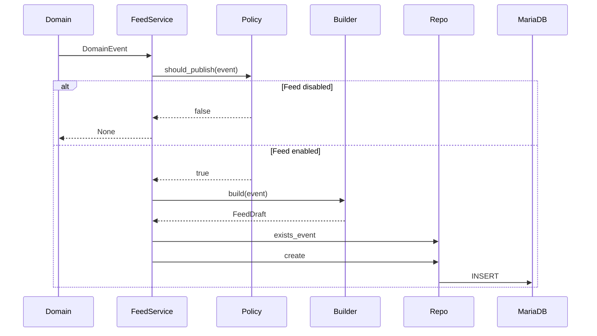

---

# 184. Validación de Project ID

El `project_id` debe obtenerse del evento de dominio o resolverse mediante la entidad afectada.

No debe confiarse en información procedente del navegador.

---

# 185. Domain Event Contract

Todo evento destinado al Feed debe incluir suficiente contexto.

Ejemplo:

```python
@dataclass(frozen=True)
class TaskCompletedEvent:
    event_id: str
    correlation_id: str
    task_id: int
    task_title: str
    project_id: int
    actor_id: int
    actor_display_name: str
    occurred_at: datetime
```

---

# 186. Snapshot desde evento

El Feed Builder debe poder construir el snapshot sin ejecutar consultas adicionales siempre que sea razonable.

Esto reduce:

* latencia;
* acoplamiento;
* inconsistencias.

---

# 187. Evitar eventos pobres

Un evento como:

```json
{
  "task_id": 84
}
```

obliga al Feed Builder a consultar:

* Task;
* actor;
* Project;
* estado.

Debe preferirse un evento suficientemente descriptivo.

---

# 188. Evitar eventos gigantes

El evento tampoco debe contener:

* entidad completa;
* relaciones;
* adjuntos;
* permisos;
* descripciones extensas.

Debe transportar un snapshot funcional mínimo.

---

# 189. Feed Policy Registry

Ejemplo:

```python
FEED_POLICIES = {
    DomainEventType.PROJECT_UPDATED:
        FeedPolicy(enabled=True),

    DomainEventType.TASK_REORDERED:
        FeedPolicy(enabled=False),

    DomainEventType.TASK_COMPLETED:
        FeedPolicy(enabled=True),

    DomainEventType.ACTIVITY_DRAFT_SAVED:
        FeedPolicy(enabled=False),
}
```

---

# 190. FeedPolicy

Puede incluir:

```python
@dataclass(frozen=True)
class FeedPolicy:
    enabled: bool
    realtime: bool = True
    dashboard_visible: bool = True
```

Puede ampliarse con:

* retention;
* importance;
* category.

---

# 191. Dashboard Visibility

Algunos eventos pueden ser válidos en Project Feed pero no en Dashboard global.

Ejemplo:

```text
minor_project_update
```

Puede tener:

```text
dashboard_visible = false
```

sin dejar de persistirse.

---

# 192. Persistir `dashboard_visible`

No es necesario inicialmente.

Puede derivarse mediante:

```text
event_type policy
```

al consultar.

Solo debería persistirse si las queries lo necesitan por rendimiento.

---

# 193. Feed Builder

Cada builder debe ser determinista.

Mismo Domain Event:

```text
→ mismo FeedDraft funcional
```

Esto facilita pruebas e idempotencia.

---

# 194. Builder de Task Created

```python
class TaskCreatedFeedBuilder:

    def build(
        self,
        event: TaskCreatedEvent,
    ) -> FeedDraft:

        return FeedDraft(
            project_id=event.project_id,
            event_type=FeedEventType.TASK_CREATED,
            actor_id=event.actor_id,
            entity_type=FeedEntityType.TASK,
            entity_id=event.task_id,
            message=(
                f"{event.actor_display_name} creó la tarea "
                f"«{event.task_title}»."
            ),
            snapshot={
                "task_title": event.task_title,
                "actor_display_name": event.actor_display_name,
            },
            event_id=event.event_id,
            correlation_id=event.correlation_id,
            created_at=event.occurred_at,
        )
```

---

# 195. Seguridad del Builder

Aunque el builder construya texto mediante f-string, el resultado continúa tratándose como texto.

La plantilla debe escapar:

```text
message
```

Nunca se considera HTML seguro.

---

# 196. Builder de Reassigned

Ejemplo:

```text
Fran reasignó «Configurar el sensor» de Marta a Pablo.
```

Snapshot:

```json
{
  "task_title": "Configurar el sensor",
  "old_assignee": "Marta",
  "new_assignee": "Pablo"
}
```

---

# 197. Builder de Status Changed

Para:

```text
todo → doing
```

mensaje:

```text
Marta movió «Configurar el sensor» a En curso.
```

Para:

```text
doing → done
```

debe delegarse al builder específico:

```text
task_completed
```

---

# 198. Builder y localización

Los mensajes actuales pueden construirse en español.

Una evolución i18n puede persistir:

```text
template_key

snapshot
```

Además del mensaje renderizado.

No debe mezclarse prematuramente si la aplicación todavía tiene un único idioma funcional.

---

# 199. Actor del sistema

Eventos automáticos pueden producir:

```text
El sistema archivó el proyecto automáticamente.
```

En ese caso:

```text
actor_id = NULL
```

Snapshot:

```json
{
  "actor_type": "system"
}
```

---

# 200. Actor Display Name

El nombre mostrado debe proceder de una propiedad estable de presentación.

No debe utilizarse:

```text
email
```

salvo que sea el identificador visible definido por producto.

---

# 201. Cambios de nombre de usuario

Si el usuario cambia posteriormente su display name, existen dos estrategias:

## Histórica

Mostrar snapshot original.

## Actual

Resolver nombre actual.

La recomendación para Feed histórico es conservar snapshot original en el mensaje.

---

# 202. FeedEventResult

DTO:

```python
@dataclass(frozen=True)
class FeedEventResult:
    id_feed_event: int
    project_id: int
    event_type: FeedEventType
    entity_type: FeedEntityType
    entity_id: int | None
    message: str
    created_at: datetime
```

---

# 203. Outbox Realtime

Después de persistir el Feed Event debe añadirse un evento Outbox.

Tipo:

```text
activity_feed.created
```

---

# 204. Payload Outbox

Puede contener un snapshot listo para realtime.

```json
{
  "event_type": "activity_feed.created",
  "project_id": 12,
  "payload": {
    "feed_event_id": 1234,
    "feed_event_type": "task_completed",
    "message": "Marta completó la tarea «Configurar el sensor».",
    "entity_type": "task",
    "entity_id": 84,
    "created_at": "2026-08-13T18:00:00Z"
  }
}
```

---

# 205. Publicación

El worker publica en:

```text
project:{project_id}
```

Los clientes que estén viendo ese proyecto pueden insertar el elemento.

---

# 206. No publicar Feed global

No debe existir un canal:

```text
activity-feed:all
```

para todos los usuarios.

El Feed respeta aislamiento por proyecto.

---

# 207. Feed del Dashboard

Para Dashboard global puede utilizarse:

```text
dashboard.invalidate
```

en el canal personal.

No es necesario publicar todos los Feed Events de todos los proyectos al navegador.

---

# 208. ListProjectFeed Service

Firma:

```python
def list_project_feed(
    self,
    db,
    *,
    project_id: int,
    current_user: UserContext,
    cursor: FeedCursor | None,
    filters: FeedFilters,
    limit: int,
) -> FeedPageDTO:
    ...
```

---

# 209. Flujo de lectura

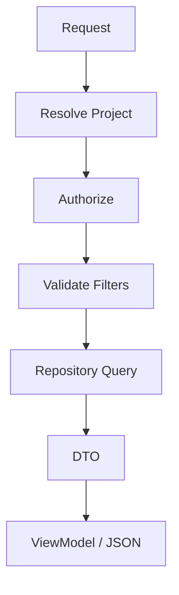

---

# 210. FeedPageDTO

Ejemplo:

```python
@dataclass(frozen=True)
class FeedPageDTO:
    items: tuple[FeedItemDTO, ...]
    next_cursor: str | None
    has_more: bool
```

---

# 211. FeedItemDTO

Campos:

```text
id_feed_event

project_id

event_type

actor_id

entity_type

entity_id

message

snapshot

created_at
```

El View Service puede reducir `snapshot` para presentación.

---

# 212. Autorización de lectura

Debe comprobarse:

* Project existe;
* usuario puede acceder;
* estado permite consulta.

Los proyectos archivados normalmente permiten leer Feed.

---

# 213. Proyecto eliminado

Si la eliminación física ya ocurrió:

```text
404
```

No debe mantenerse una ruta de Feed sin Project salvo arquitectura histórica específica.

---

# 214. Rutas SSR

Ruta recomendada:

```text
GET /projects/{project_id}/activity
```

Alternativa:

```text
GET /projects/{project_id}/feed
```

Debe elegirse una convención y mantenerla.

---

# 215. Recomendación de naming

Dado que ya existe el dominio:

```text
Activities
```

la ruta:

```text
/projects/{project_id}/activity
```

puede resultar ambigua.

Se recomienda:

```text
/projects/{project_id}/feed
```

para diferenciar claramente:

```text
Activity

vs

Activity Feed
```

---

# 216. Ruta SSR principal

```text
GET /projects/{project_id}/feed
```

Debe renderizar:

* encabezado;
* filtros;
* timeline;
* paginación;
* empty state.

---

# 217. Endpoint JSON

```text
GET /api/projects/{project_id}/feed
```

Parámetros:

```text
cursor

limit

category

actor

date_from

date_to
```

---

# 218. Respuesta JSON

```json
{
  "items": [
    {
      "id": 1234,
      "event_type": "task_completed",
      "message": "Marta completó la tarea «Configurar el sensor».",
      "entity_type": "task",
      "entity_id": 84,
      "entity_url": "/tasks/84",
      "created_at": "2026-08-13T18:00:00Z"
    }
  ],
  "next_cursor": "opaque-cursor",
  "has_more": true
}
```

---

# 219. Endpoint partial

Para SSR progresivo puede ser más conveniente:

```text
GET /projects/{project_id}/feed/items
```

Response:

```text
text/html
```

con los siguientes eventos.

---

# 220. Partial HTML

Ventajas:

* reutiliza Jinja2;
* evita duplicar render;
* mantiene escape;
* reduce lógica JS.

Especialmente adecuado para:

```text
Load more
```

---

# 221. Load More

La primera versión puede utilizar un botón:

```text
Cargar más
```

en lugar de infinite scroll.

Ventajas:

* accesibilidad;
* control;
* menos requests;
* posición estable;
* comportamiento predecible.

---

# 222. Infinite Scroll

Puede añadirse en el futuro.

Debe mantener una alternativa accesible mediante botón o paginación.

---

# 223. `activity_feed_api.js`

Funciones:

```javascript
export async function loadMoreFeed({
    projectId,
    cursor,
    filters,
}) {
    ...
}
```

No debe manipular DOM.

---

# 224. `activity_feed_list.js`

Responsabilidades:

* botón Load More;
* filtros;
* inserción;
* estado loading;
* errores;
* next cursor.

---

# 225. Prevención de doble Load More

Mientras existe una request:

```text
disable button
```

Debe evitarse solicitar dos veces el mismo cursor.

---

# 226. Cursor actual

El cliente puede mantenerlo en:

```text
data-next-cursor
```

del contenedor o en estado JS.

No debe modificarse hasta que la request tenga éxito.

---

# 227. Error Load More

Ante fallo:

* mantener eventos existentes;
* reactivar botón;
* mostrar mensaje;
* conservar cursor;
* permitir retry.

---

# 228. Feed Realtime JS

`activity_feed_realtime.js` debe escuchar:

```text
activity_feed.created
```

y comprobar:

```text
project_id
```

actual.

---

# 229. Inserción realtime

Flujo:

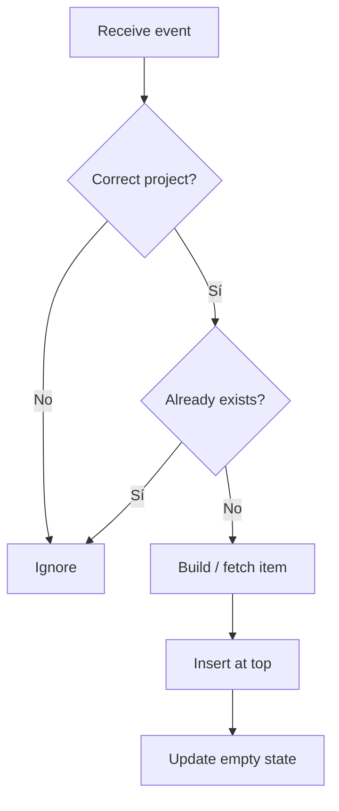

---

# 230. Render realtime

Dos estrategias:

## Render cliente

Construir DOM desde payload.

## Fetch partial

Recibir `feed_event_id` y solicitar:

```text
GET /feed/events/{id}/partial
```

---

# 231. Recomendación SSR

Para mantener una única lógica de presentación:

```text
realtime event

↓

request partial

↓

insert HTML
```

es una estrategia segura y coherente.

Sin embargo, añade una request adicional por evento.

---

# 232. Payload suficientemente rico

Si el volumen es bajo, el payload puede incluir campos suficientes para construir DOM de forma segura mediante `textContent`.

Debe evitarse transportar HTML generado por usuarios.

---

# 233. Event Deduplication

La UI debe comprobar:

```text
data-feed-event-id
```

antes de insertar.

Esto evita duplicación si:

* el evento ya llegó por respuesta parcial;
* WebSocket reintenta;
* el usuario refrescó.

---

# 234. Filtros activos y realtime

Si el usuario está filtrando:

```text
category = task
```

y llega:

```text
attachment_added
```

no debe insertarse en el timeline visible.

Puede:

* ignorarse;
* incrementar un indicador de nuevos eventos;
* aparecer cuando se retire el filtro.

---

# 235. Evento compatible con filtro

La función debe evaluar:

```text
event category

actor

date
```

contra filtros activos.

---

# 236. Banner de nuevos eventos

En timelines extensos puede mostrarse:

```text
3 eventos nuevos
```

con botón:

```text
Mostrar
```

en lugar de insertar automáticamente y desplazar contenido.

---

# 237. Cuándo insertar automáticamente

Si el usuario está:

```text
at top of feed
```

puede insertarse.

Si ha hecho scroll hacia abajo:

```text
show new events indicator
```

Mejora la estabilidad visual.

---

# 238. Agrupación visual por fecha

El View Service puede agrupar:

```text
Today

Yesterday

Previous
```

sin alterar el orden original.

---

# 239. FeedDateGroupViewModel

Ejemplo:

```python
@dataclass(frozen=True)
class FeedDateGroupViewModel:
    label: str
    items: tuple[ActivityFeedItemViewModel, ...]
```

---

# 240. Agrupación y paginación

Debe evitarse duplicar headings cuando una nueva página comienza en la misma fecha que la anterior.

El frontend puede fusionar grupos contiguos.

---

# 241. Agrupación de eventos similares

Una futura política puede combinar eventos cercanos.

Ejemplo:

```text
Fran añadió 5 evidencias.
```

Requiere definir:

* ventana temporal;
* mismo actor;
* mismo resource;
* mismo event type.

---

# 242. No agrupar historial en persistencia

La recomendación inicial es persistir cada evento individual y agrupar solo en presentación.

Esto conserva granularidad.

---

# 243. Recursos eliminados

El View Service debe resolver `entity_url`.

Puede utilizar:

```text
entity_exists

AND

current_user_can_access
```

para decidir enlace.

---

# 244. Coste de comprobar entidad por fila

No debe ejecutarse una consulta por Feed Event.

Eso produciría N+1.

---

# 245. Estrategia para enlaces

Opciones:

1. construir URL por ID y permitir 404 posterior;
2. snapshot incluye `entity_deleted`;
3. consulta batch de recursos relevantes;
4. event type determina si existe recurso.

---

# 246. Estrategia inicial recomendada

Generar URL para recursos normalmente persistentes.

Para eventos explícitos:

```text
task_deleted

attachment_removed
```

no generar enlace.

Esto evita consultas extra.

---

# 247. Entity URL Builder

Ejemplo:

```python
def build_feed_entity_url(
    event_type,
    entity_type,
    entity_id,
):
    ...
```

Debe usar catálogo cerrado.

---

# 248. Feed de Task

En un detalle de Task puede mostrarse un subconjunto de Feed Events relacionados con esa Task.

Consulta:

```text
entity_type = task

AND

entity_id = task_id
```

Pero eventos de Activity ligados a la Task no aparecerían directamente.

---

# 249. Timeline de Task

Si se necesita una historia completa de Task, puede requerir:

* Feed events de Task;
* Activity events cuyos snapshot incluyan `task_id`;
* attachment events.

Eso debe modelarse como query especializada, no reutilizar ciegamente `entity_type/entity_id`.

---

# 250. Snapshot indexado

MariaDB puede consultar JSON, pero indexar campos internos aumenta complejidad.

No debe utilizarse `snapshot.task_id` como base de queries críticas inicialmente.

---

# 251. Campo `task_id` opcional

Si aparecen consultas frecuentes por Task podría añadirse una columna:

```text
task_id
```

denormalizada al Feed.

Debe justificarse por necesidad real.

---

# 252. Denormalización controlada

El Feed ya es una proyección derivada, por lo que cierta denormalización puede ser aceptable.

Debe:

* tener semántica clara;
* mantenerse desde builders;
* disponer de tests;
* poder reconstruirse.

---

# 253. Rendimiento

Las operaciones críticas son:

* insertar Feed Event;
* listar Feed de Project;
* listar recent feed multiproyecto;
* paginar por cursor.

---

# 254. Objetivos orientativos

Insert:

```text
p95 < 50 ms
```

sin considerar el resto de la transacción.

List:

```text
p95 < 200 ms
```

para una página limitada e indexada.

Los valores deben medirse en infraestructura real.

---

# 255. N+1 de actores

Si la UI necesita avatar o nombre actual, no debe consultar User por fila.

Puede:

* utilizar snapshot;
* JOIN actor;
* batch load.

La primera versión puede usar:

```text
actor_display_name
```

del snapshot.

---

# 256. Avatar

El snapshot no necesita almacenar la URL del avatar.

Puede resolverse únicamente si la UI realmente la requiere.

Si el usuario cambia avatar, normalmente se desea mostrar el actual.

---

# 257. JOIN Actor

Consulta:

```sql
LEFT JOIN usuarios u
    ON u.id_usuario = paf.actor_id
```

puede proporcionar avatar actual sin N+1.

Si `actor_id` es NULL, se utiliza actor snapshot.

---

# 258. Snapshot y actor actual

El ViewModel puede incluir:

```text
display_name = snapshot actor_display_name

avatar = current user avatar if available
```

Esto mantiene texto histórico y presentación moderna.

---

# 259. Caché

Activity Feed suele ser append-heavy.

No necesita cache inicialmente si:

* índice adecuado;
* cursor;
* límites.

---

# 260. Cache de primera página

Puede ser candidata en proyectos con mucho tráfico.

Sin embargo, cada nuevo evento invalida la primera página.

Por eso el beneficio puede ser limitado.

---

# 261. Feed histórico

Páginas antiguas son prácticamente inmutables y podrían cachearse más fácilmente.

No debe añadirse hasta tener evidencia.

---

# 262. Dashboard Cache

`recent activity` puede cachearse brevemente en Dashboard.

La invalidación puede producirse ante:

```text
activity_feed.created
```

---

# 263. Retención

El Repository puede ofrecer:

```python
delete_before(
    project_id,
    cutoff,
    batch_size,
)
```

solo si existe política de retención.

No debe ejecutarse limpieza automática en la primera versión sin requisito.

---

# 264. Eliminación por lotes

Si se aplica:

```sql
DELETE
FROM project_activity_feed
WHERE project_id = :project_id
  AND created_at < :cutoff
LIMIT :batch_size;
```

La sintaxis y estrategia deben adaptarse a MariaDB real.

---

# 265. Archive Storage

Una evolución puede mover Feed Events antiguos a almacenamiento histórico.

No es necesario si la escala permanece moderada.

---

# 266. Logging

Creación:

```json
{
  "event": "activity_feed.create",
  "project_id": 12,
  "feed_event_type": "task_completed",
  "source_event_id": "uuid",
  "result": "success",
  "duration_ms": 5,
  "correlation_id": "uuid"
}
```

---

# 267. Logging de consultas

Puede registrar:

```text
project_id

filters

limit

duration

result
```

No debe registrar todos los mensajes.

---

# 268. Métricas técnicas

```text
activity_feed_created_total

activity_feed_duplicate_total

activity_feed_query_duration_seconds

activity_feed_query_error_total

activity_feed_realtime_publish_total

activity_feed_realtime_failure_total
```

---

# 269. Métricas por Event Type

Puede etiquetarse:

```text
event_type=task_completed
```

si el catálogo es cerrado.

No utilizar:

```text
project_id

actor_id

entity_id
```

como labels.

---

# 270. Continuación

La **Parte 3** completará `34_ACTIVITY_FEED_MODULE.md` con:

* seguridad avanzada;
* privacidad;
* XSS;
* autorización;
* consistencia e idempotencia;
* realtime avanzado;
* multi-tab y reconexión;
* retención;
* observabilidad;
* pruebas unitarias;
* pruebas de integración;
* pruebas de seguridad;
* WebSocket;
* Selenium;
* fixtures;
* checklist enterprise;
* criterios de aceptación;
* evolución futura;
* conclusiones.

---

# 271. Seguridad avanzada

El Activity Feed contiene información derivada del dominio.

Por ello, la autorización debe resolverse **antes de consultar cualquier evento**.

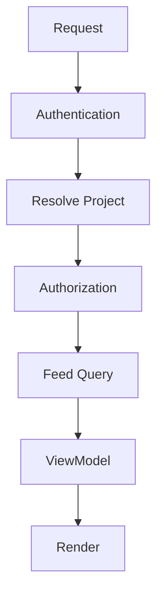

---

# 272. Principio de aislamiento

Un usuario únicamente puede visualizar eventos pertenecientes a proyectos donde posee acceso.

Nunca debe construirse un Feed global para posteriormente filtrar resultados.

Debe cumplirse:

```text
authorized scope

↓

feed query

↓

render
```

---

# 273. Scope autorizado

Las consultas deben limitarse mediante:

```sql
JOIN project_members pm
    ON pm.project_id = paf.project_id
WHERE pm.user_id = :user_id
```

No mediante filtrado posterior en memoria.

---

# 274. Proyecto ajeno

Una petición:

```text
GET /projects/87/feed
```

debe devolver:

```text
403
```

si el usuario no pertenece al proyecto.

La consulta SQL no debería ejecutarse sobre el Feed completo.

---

# 275. Feed del Dashboard

El Feed resumido del Dashboard también debe respetar el scope autorizado.

No puede mostrar:

* nombres de proyectos privados;
* tareas;
* actividades;
* miembros;
* mensajes.

---

# 276. Eventos históricos

El hecho de que un usuario haya pertenecido anteriormente al proyecto no implica necesariamente acceso al Feed histórico.

La política debe definirse explícitamente.

Recomendación:

```text
solo miembros actuales
```

salvo requisitos funcionales distintos.

---

# 277. Archivos eliminados

Un evento:

```text
Fran eliminó «manual.pdf».
```

puede seguir mostrándose.

Sin embargo:

```text
entity_url = null
```

evita enlaces rotos o accesos inválidos.

---

# 278. Recursos privados

Si el recurso continúa existiendo pero el usuario ya no dispone de permiso para verlo:

* el Feed puede mantenerse;
* el enlace debe desaparecer;
* nunca debe revelar información adicional.

---

# 279. Protección frente a IDOR

No debe aceptarse:

```text
entity_id
```

como prueba suficiente de autorización.

Siempre debe verificarse:

```text
current user

↓

authorized project

↓

entity access
```

---

# 280. Feed y proyectos archivados

Si el usuario puede abrir el proyecto archivado, puede consultar igualmente su Feed.

El estado archivado no implica ocultación.

---

# 281. Feed administrativo

Un posible Feed global administrativo requiere un permiso independiente.

Ejemplo:

```text
activity_feed:global
```

No debe reutilizar permisos ordinarios de lectura.

---

# 282. Información sensible

No deben aparecer mensajes como:

```text
Contraseña modificada

Token regenerado

Clave API actualizada
```

Estos pertenecen a:

* Audit Log;
* logs internos;
* eventos técnicos.

---

# 283. Snapshot seguro

El snapshot nunca debe almacenar:

* contraseñas;
* hashes;
* tokens;
* rutas físicas;
* claves cloud;
* secretos;
* payloads completos.

---

# 284. XSS

El mensaje puede contener títulos escritos por usuarios.

Ejemplo:

```text
Task.title
```

Debe escaparse siempre.

Incorrecto:

```jinja2
{{ feed.message | safe }}
```

Correcto:

```jinja2
{{ feed.message }}
```

---

# 285. Snapshot y XSS

Los datos procedentes del snapshot también deben tratarse como texto no confiable.

---

# 286. JSON seguro

Si la UI construye DOM desde JSON:

Incorrecto:

```javascript
item.innerHTML = feed.message;
```

Correcto:

```javascript
item.textContent = feed.message;
```

---

# 287. HTML parcial

Cuando se utilicen partials SSR:

* backend escapa;
* frontend únicamente inserta HTML generado por Jinja2.

---

# 288. Open Redirect

Los enlaces derivados de `entity_url` deben construirse mediante rutas conocidas.

Nunca a partir de URLs almacenadas por usuarios.

---

# 289. Privacidad

El Feed representa colaboración.

No debe convertirse en una herramienta de vigilancia.

Ejemplos no recomendables:

```text
Marta estuvo conectada 7 horas.

Fran abrió esta página.

Pablo hizo scroll.
```

---

# 290. Relevancia

Solo deben aparecer eventos que aporten valor colaborativo.

---

# 291. Frecuencia

No toda modificación requiere Feed.

Eventos excesivos producen:

```text
feed fatigue
```

---

# 292. Ruido

Debe evitarse registrar:

* autosaves;
* cambios cosméticos;
* orden interno;
* refrescos;
* operaciones automáticas sin impacto funcional.

---

# 293. Consistencia

El Feed es una proyección derivada.

Nunca modifica el dominio.

---

# 294. Fuente de verdad

Siempre:

```text
Projects

Tasks

Activities

Attachments

↓

Feed
```

Nunca:

```text
Feed

↓

Task
```

---

# 295. Idempotencia

Procesar dos veces el mismo Domain Event no debe producir dos Feed Events.

---

# 296. Constraint

La protección definitiva continúa siendo:

```text
UNIQUE(event_id)
```

---

# 297. Retry

Los consumers pueden reintentar.

El resultado funcional debe permanecer idéntico.

---

# 298. Reconstrucción

Todo Feed debe poder reconstruirse desde:

* Domain Events;
* Audit;
* entidades originales;

según la arquitectura elegida.

---

# 299. Outbox

El Feed no debe publicar directamente por WebSocket.

Debe utilizar:

```text
Feed

↓

Outbox

↓

Worker

↓

Realtime
```

---

# 300. Evento realtime

Tipo recomendado:

```text
activity_feed.created
```

---

# 301. Payload

Debe incluir únicamente información necesaria para actualizar la UI.

No debe transportar entidades completas.

---

# 302. Reconexión

Tras perder conexión:

```text
refresh recent feed
```

es preferible a intentar reproducir todos los mensajes perdidos.

---

# 303. Multi-tab

Varias pestañas pueden mostrar el mismo proyecto.

Todas deben converger al mismo estado.

---

# 304. BroadcastChannel

Una evolución puede utilizar:

```text
BroadcastChannel
```

para compartir:

* nuevos eventos;
* cursores;
* invalidaciones.

---

# 305. Debounce

Si llegan varios eventos muy seguidos:

```text
insert

↓

batch render
```

puede mejorar el rendimiento.

---

# 306. Orden

La llegada realtime nunca debe alterar el orden cronológico.

---

# 307. Evento atrasado

Si un evento llega con timestamp anterior:

* debe insertarse en la posición correcta;
* o provocar refresh.

La política debe ser consistente.

---

# 308. Dedupe cliente

Debe comprobarse:

```text
feed_event_id
```

antes de insertar.

---

# 309. Feed y Dashboard

El Dashboard puede invalidarse cuando aparece un nuevo Feed Event relevante.

No necesita consumir todos los mensajes.

---

# 310. Performance

Objetivos orientativos:

```text
insert p95 < 50 ms

project feed p95 < 200 ms

dashboard feed p95 < 150 ms
```

---

# 311. Query Budget

El listado de un proyecto no debería generar N+1.

---

# 312. Índices

Debe verificarse mediante:

```text
EXPLAIN
```

que la consulta utiliza índices previstos.

---

# 313. Caché

No debe introducirse sin evidencia.

El Feed suele beneficiarse más de:

* índices;
* cursor;
* límites.

---

# 314. Primera página

Puede cachearse únicamente si la invalidación resulta sencilla.

---

# 315. Observabilidad

Métricas:

```text
activity_feed_created_total

activity_feed_query_duration

activity_feed_query_errors

activity_feed_realtime_sent

activity_feed_duplicates
```

---

# 316. Correlation ID

Debe mantenerse entre:

* Domain Event;
* Feed;
* Audit;
* Notification;
* Outbox.

---

# 317. Logging

Ejemplo:

```json
{
  "event": "activity_feed.created",
  "project_id": 12,
  "feed_type": "task_completed",
  "duration_ms": 7,
  "correlation_id": "uuid"
}
```

---

# 318. Datos excluidos

No registrar:

* mensajes completos;
* snapshots íntegros;
* nombres sensibles;
* payloads.

---

# 319. Tracing

Una integración OpenTelemetry puede crear spans:

```text
feed.create

feed.query

feed.partial

feed.realtime
```

---

# 320. Alertas

Alertar cuando:

* aumente la latencia;
* fallen publicaciones realtime;
* aumenten duplicados;
* fallen builders.

---

# 321. Pruebas unitarias

Cubrir:

* builders;
* policies;
* snapshots;
* deduplicación;
* filtros;
* cursor;
* ViewModels.

---

# 322. Builder Tests

Mismo evento:

```text
↓

mismo FeedDraft
```

---

# 323. Policy Tests

Verificar:

```text
TASK_COMPLETED

↓

enabled
```

```text
TASK_REORDERED

↓

disabled
```

---

# 324. Repository Tests

Casos:

* create;
* exists;
* cursor;
* filtros;
* orden.

---

# 325. Cursor Tests

Comprobar:

* sin duplicados;
* sin saltos;
* orden estable.

---

# 326. Snapshot Tests

Debe verificarse:

* serialización;
* tamaño;
* ausencia de secretos.

---

# 327. Integration Tests

MariaDB:

* índices;
* joins;
* JSON;
* cursor;
* limits.

---

# 328. Seguridad

Casos:

* proyecto ajeno;
* actor eliminado;
* recurso eliminado;
* XSS;
* snapshot inválido.

---

# 329. Realtime Tests

Debe comprobar:

* publicación;
* dedupe;
* reconnect;
* multi-tab.

---

# 330. Selenium

Escenario:

1. abrir proyecto;
2. visualizar Feed;
3. completar Task en otra sesión;
4. recibir Feed Event;
5. comprobar inserción.

---

# 331. Empty State

Proyecto nuevo:

```text
Todavía no hay actividad.
```

---

# 332. Load More

Debe comprobar:

* cursor correcto;
* orden;
* ausencia de duplicados.

---

# 333. Recursos eliminados

Un Task eliminado:

* mantiene mensaje;
* elimina enlace;
* no rompe render.

---

# 334. Fixtures

Recomendadas:

```text
project

member

task

activity

attachment

feed events
```

---

# 335. Factories

```text
FeedEventFactory

TaskCompletedEventFactory

MemberAddedEventFactory
```

---

# 336. Test Clock

Todos los timestamps deben utilizar reloj controlado.

---

# 337. Checklist Arquitectura

* [ ] Feed derivado.
* [ ] Sin Commands.
* [ ] Builders separados.
* [ ] Policies centralizadas.
* [ ] Repository desacoplado.
* [ ] Outbox.
* [ ] DTOs.
* [ ] Cursor.
* [ ] SSR.
* [ ] Realtime preparado.

---

# 338. Checklist Seguridad

* [ ] Scope autorizado.
* [ ] Sin IDOR.
* [ ] XSS protegido.
* [ ] Snapshot seguro.
* [ ] Entity URL validada.
* [ ] Secretos excluidos.
* [ ] Feed aislado por proyecto.
* [ ] Admin separado.
* [ ] Dedupe.
* [ ] Correlation ID.

---

# 339. Checklist UI

* [ ] Timeline.
* [ ] Iconos.
* [ ] Relative time.
* [ ] Empty state.
* [ ] Load More.
* [ ] Responsive.
* [ ] Keyboard.
* [ ] Screen readers.
* [ ] Progressive Enhancement.
* [ ] Realtime.

---

# 340. Checklist Rendimiento

* [ ] Índices.
* [ ] Cursor.
* [ ] Sin OFFSET masivo.
* [ ] Sin N+1.
* [ ] Query budget.
* [ ] EXPLAIN.
* [ ] Límites.
* [ ] Batch.
* [ ] Caché solo cuando aporte valor.
* [ ] Observabilidad.

---

# 341. Checklist Realtime

* [ ] Outbox.
* [ ] Publicación.
* [ ] Reconnect.
* [ ] Dedupe.
* [ ] Multi-tab.
* [ ] Debounce.
* [ ] Refresh.
* [ ] Eventos filtrados.
* [ ] Banner de nuevos eventos.
* [ ] Consistencia.

---

# 342. Criterios de aceptación

El módulo Activity Feed se considera correctamente implementado cuando:

* registra eventos relevantes;
* mantiene timeline por proyecto;
* respeta autorización;
* utiliza Builders;
* utiliza Policies;
* persiste snapshots mínimos;
* mantiene orden estable;
* soporta cursor;
* integra Dashboard;
* publica realtime mediante Outbox;
* evita duplicados;
* soporta Progressive Enhancement;
* supera pruebas funcionales y de seguridad.

---

# 343. Evolución futura

El módulo queda preparado para incorporar:

* reacciones;
* comentarios sobre eventos;
* filtros avanzados;
* búsqueda FullText;
* exportación;
* analytics;
* IA generativa;
* resúmenes automáticos;
* timeline global;
* integración con sistemas externos.

---

# 344. Reacciones

Una evolución puede permitir:

```text
👍

🎉

❤️
```

sobre eventos del Feed.

Las reacciones deben almacenarse separadamente.

---

# 345. Comentarios

Los Feed Events podrían admitir comentarios.

No deben mezclarse con el mensaje original.

---

# 346. Timeline global

Una futura vista administrativa podría combinar múltiples proyectos.

Debe mantener permisos independientes.

---

# 347. Analytics

El Feed constituye una excelente fuente para:

* actividad por proyecto;
* frecuencia de eventos;
* evolución temporal.

Debe mantenerse separado del Dashboard operativo.

---

# 348. IA Generativa

Un resumen podría producir:

```text
Durante esta semana el equipo completó 24 tareas, añadió 12 evidencias y cerró dos proyectos.
```

Siempre basado únicamente en datos autorizados.

---

# 349. Explicabilidad

Toda recomendación derivada del Feed debe poder justificar:

```text
por qué
```

---

# 350. Principios definitivos

1. El Feed es una proyección funcional.
2. Nunca modifica el dominio.
3. Los Builders generan eventos consistentes.
4. Las Policies controlan relevancia.
5. El Repository no contiene reglas de negocio.
6. Los snapshots son mínimos.
7. El mensaje es texto seguro.
8. La autorización precede a cualquier consulta.
9. Realtime publica después del commit.
10. El Feed debe seguir siendo comprensible incluso cuando cambien las entidades originales.

---

# 351. Conclusiones

El módulo **Activity Feed** constituye la memoria funcional colaborativa de Aula Robótica Platform. Frente al Audit Log, orientado a trazabilidad técnica, el Feed ofrece una narrativa comprensible de la evolución de proyectos, tareas, actividades y evidencias para todos los miembros autorizados.

La arquitectura propuesta separa claramente Builders, Policies, Service Layer, Repository, ViewModels y publicación realtime, permitiendo una evolución independiente de cada responsabilidad. Los eventos se generan a partir de Domain Events, mantienen snapshots mínimos y utilizan un modelo append-only que favorece la trazabilidad, la idempotencia y la consistencia transaccional.

El diseño prioriza la simplicidad operativa mediante consultas paginadas por cursor, renderizado SSR, Progressive Enhancement y sincronización mediante Outbox y WebSockets, evitando duplicaciones de lógica entre backend y frontend. Asimismo, incorpora mecanismos de seguridad, privacidad, observabilidad y rendimiento propios de una plataforma enterprise.

Finalmente, el módulo queda preparado para futuras capacidades como reacciones, comentarios, búsqueda avanzada, analítica, IA generativa y resúmenes automáticos, manteniendo siempre el principio fundamental: el Activity Feed refleja la historia funcional del sistema, pero nunca sustituye al dominio como fuente de verdad.
