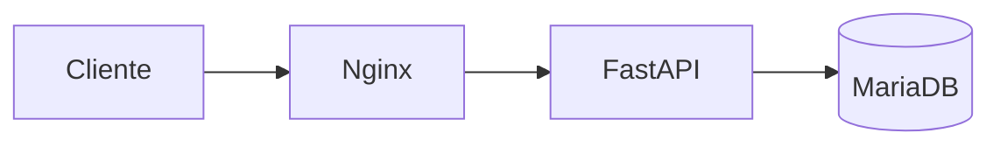

# 35_DEPLOYMENT.md

# ☁️ Aula Robótica Platform — Despliegue Cloud e Infraestructura

---

# 📌 Introducción

Aula Robótica Platform evolucionó desde un entorno local de desarrollo hacia una infraestructura cloud desplegada sobre Linux real mediante contenedores Docker y arquitectura multicontenedor.

El despliegue fue realizado sobre un VPS de Hetzner Cloud con el objetivo de aproximarse a un entorno productivo real, incorporando prácticas habituales de infraestructura moderna:

* VPS Linux cloud.
* Docker Compose.
* Reverse Proxy Nginx.
* Persistencia mediante volúmenes.
* Comunicación realtime mediante WebSockets.
* Hardening básico de infraestructura.
* Despliegue reproducible.
* Arquitectura desacoplada por servicios.

La infraestructura permite ejecutar la plataforma de forma estable, persistente y mantenible sobre un entorno Linux moderno.

---

# 🎯 Objetivos del Despliegue

## Objetivos funcionales

* acceso remoto a la plataforma,
* ejecución persistente,
* colaboración multiusuario,
* comunicación realtime,
* operación estable.

---

## Objetivos arquitectónicos

* infraestructura multicontenedor,
* separación de responsabilidades,
* persistencia de datos,
* reverse proxy desacoplado,
* soporte WebSockets,
* despliegue reproducible,
* aproximación DevOps.

---

## Objetivos formativos

* administración Linux,
* Docker,
* networking,
* reverse proxy,
* despliegue cloud,
* troubleshooting,
* infraestructura backend real.

---

# ☁️ Infraestructura Cloud

## Proveedor Cloud

### Hetzner Cloud

La plataforma se desplegó sobre un VPS cloud de Hetzner.

### Motivos de selección

* excelente relación coste/rendimiento,
* snapshots integrados,
* acceso root completo,
* simplicidad de despliegue,
* entorno adecuado para Docker.

---

## Características del VPS

| Elemento          | Valor                              |
| ----------------- | ---------------------------------- |
| Proveedor         | Hetzner Cloud                      |
| Tipo VPS          | CX22                               |
| Sistema Operativo | Ubuntu Server 24.04 LTS            |
| Arquitectura      | Linux VPS                          |
| Acceso            | SSH mediante clave ED25519         |
| Firewall          | Hetzner Cloud Firewall             |
| Snapshot          | Snapshot funcional de recuperación |
| Tipo despliegue   | Cloud                              |

---

# 🚀 Proceso de Despliegue

El despliegue se realizó de forma incremental y controlada.

## Fases ejecutadas

1. Creación del VPS en Hetzner Cloud.
2. Configuración de acceso SSH mediante clave pública.
3. Creación de usuario administrativo dedicado.
4. Hardening básico SSH.
5. Configuración de firewall.
6. Instalación Docker Engine.
7. Instalación Docker Compose.
8. Clonado del repositorio GitHub.
9. Construcción de imágenes Docker.
10. Configuración de variables de entorno.
11. Inicialización de MariaDB.
12. Ejecución de scripts de seed.
13. Configuración de Nginx Reverse Proxy.
14. Verificación de WebSockets.
15. Validación funcional completa.
16. Creación de snapshot de recuperación.

---

# 🐧 Sistema Operativo

## Ubuntu Server 24.04 LTS

El servidor utiliza Ubuntu Server como base de infraestructura.

### Responsabilidades del sistema operativo

* ejecución Docker,
* networking,
* firewall,
* persistencia,
* administración SSH,
* gestión procesos,
* logs,
* reverse proxy.

### Ventajas

* soporte LTS,
* estabilidad,
* compatibilidad Docker,
* documentación extensa,
* uso habitual en entornos cloud.

---

# 🐳 Arquitectura Docker

La plataforma se desplegó utilizando Docker y Docker Compose.

## Objetivos de Docker

* aislamiento servicios,
* despliegue reproducible,
* separación responsabilidades,
* portabilidad,
* mantenibilidad.

---

## Servicios desplegados

| Servicio | Función              |
| -------- | -------------------- |
| api      | Backend FastAPI      |
| db       | Persistencia MariaDB |
| nginx    | Reverse Proxy        |

---

## Arquitectura general

```mermaid
flowchart LR

A[Cliente Web]
--> B[Nginx Reverse Proxy]

B --> C[FastAPI + Uvicorn]

C --> D[(MariaDB)]

subgraph Docker Network
B
C
D
end

subgraph VPS Ubuntu 24.04
Docker Network
end
```

---

# Docker Compose

Docker Compose permite orquestar toda la infraestructura mediante un único archivo declarativo.

## Responsabilidades

* creación contenedores,
* networking interno,
* persistencia,
* variables entorno,
* restart policies,
* despliegue completo.

---

## Ventajas obtenidas

* despliegue consistente,
* reconstrucción sencilla,
* administración simplificada,
* infraestructura reproducible.

---

# 🌐 Redes Docker

Todos los servicios se comunican mediante una red bridge privada gestionada por Docker Compose.

## Servicios conectados

* nginx
* api
* db

La API y la base de datos no están expuestas directamente a Internet.

Únicamente Nginx publica puertos externos.

---

# 🌐 Reverse Proxy — Nginx

Nginx actúa como punto único de entrada a la plataforma.

## Funciones principales

* reverse proxy HTTP,
* forwarding al backend,
* proxy WebSocket,
* ocultación del backend,
* gestión cabeceras,
* preparación HTTPS futura.

---

## Arquitectura Reverse Proxy



---

# ⚡ WebSockets y Realtime

La plataforma incorpora comunicación realtime mediante WebSockets persistentes.

## Funcionalidades realtime

* dashboard en tiempo real,
* notificaciones,
* actividad reciente,
* sincronización colaborativa,
* actualización instantánea.

---

## Endpoints WebSocket

* /ws/dashboard
* /ws/notifications
* /ws/projects/{id}

---

## Validación realizada

La infraestructura fue validada mediante:

* múltiples clientes simultáneos,
* DevTools navegador,
* HTTP 101 Switching Protocols,
* logs Docker,
* sincronización realtime funcional.

---

# 🗄️ Persistencia

La persistencia se implementa mediante Docker Volumes y bind mounts.

## Persistencia actual

| Elemento      | Persistencia  |
| ------------- | ------------- |
| MariaDB       | Docker Volume |
| Storage       | Bind Mount    |
| Uploads       | Persistentes  |
| Configuración | Reproducible  |

---

## Beneficios

* reconstrucción sin pérdida de datos,
* mantenimiento simplificado,
* backups,
* separación datos/contenedores.

---

# 🔐 Seguridad Infraestructura

La infraestructura incorpora medidas básicas de hardening.

---

## SSH Hardening

### Medidas implementadas

* acceso mediante clave SSH,
* root deshabilitado,
* usuario administrativo dedicado.

---

## Firewall

Puertos permitidos:

| Puerto | Uso          |
| ------ | ------------ |
| 22     | SSH          |
| 80     | HTTP         |
| 443    | HTTPS futuro |

El puerto interno de FastAPI no se encuentra expuesto públicamente.

---

## Aislamiento

Docker proporciona:

* separación servicios,
* red privada interna,
* backend protegido,
* desacoplamiento contenedores.

---

# 📂 Persistencia y Backups

La infraestructura permite generación de snapshots completos del VPS.

## Snapshots

Beneficios:

* recuperación rápida,
* restauración completa,
* protección frente a errores críticos,
* copia exacta del entorno funcional.

---

# 📊 Logs y Monitorización

La plataforma utiliza actualmente:

* logs Docker,
* logs FastAPI,
* logs Nginx,
* logs WebSocket.

---

## Herramientas utilizadas

| Tipo         | Herramienta    |
| ------------ | -------------- |
| Contenedores | Docker Logs    |
| Backend      | FastAPI Logs   |
| Proxy        | Nginx Logs     |
| Realtime     | WebSocket Logs |

---

# 🧪 Validación del Despliegue

## Validaciones realizadas

✅ Acceso remoto funcional

✅ Docker Compose operativo

✅ Persistencia MariaDB validada

✅ Reverse Proxy operativo

✅ Login JWT funcional

✅ Cookies HTTPOnly funcionales

✅ WebSockets operativos

✅ Reconstrucción contenedores validada

✅ Snapshot operativo

---

## Validación Realtime

Se verificó:

* conexiones simultáneas,
* dashboard realtime,
* notificaciones,
* actualización instantánea,
* HTTP 101 Upgrade.

---

## Validación Persistencia

Se comprobó mediante:

* reinicio contenedores,
* reconstrucción Docker,
* validación datos MariaDB.

---

# ⚠️ Incidencias Resueltas

## SSH

Problema:
Fingerprint no coincidente.

Solución:
Actualización de known_hosts y reconexión segura.

---

## JWT

Problema:
Cookies Secure bloqueadas bajo HTTP.

Solución:
Configuración temporal para entorno sin HTTPS.

---

## SQLAlchemy

Problema:
Registro incompleto de modelos ORM.

Solución:
Importación explícita de modelos en el registro central.

---

## WebSockets

Problema:
Uso incorrecto de await sobre función síncrona.

Solución:
Corrección del endpoint WebSocket dashboard.

---

# 🚀 Estado Actual Infraestructura

Actualmente la plataforma dispone de:

✅ VPS Linux desplegado

✅ Docker Engine

✅ Docker Compose

✅ Arquitectura multicontenedor

✅ Reverse Proxy Nginx

✅ MariaDB persistente

✅ JWT HTTPOnly

✅ WebSockets operativos

✅ Firewall configurado

✅ Hardening SSH básico

✅ Snapshot funcional

---

# 🔮 Evolución Futura

La infraestructura deja preparada la evolución hacia:

* HTTPS completo,
* certificados SSL,
* dominio propio,
* CI/CD automático,
* monitorización avanzada,
* observabilidad,
* balanceo de carga,
* Kubernetes.

---

# 📌 Conclusión

Aula Robótica Platform ha sido desplegada satisfactoriamente sobre una infraestructura cloud Linux real utilizando Docker Compose, Nginx, FastAPI y MariaDB.

La solución implementada incorpora autenticación JWT, persistencia de datos, comunicación realtime mediante WebSockets y aislamiento de servicios mediante contenedores Docker, reproduciendo una arquitectura similar a la utilizada en numerosos entornos profesionales modernos.

Además de validar la arquitectura técnica del proyecto, este despliegue ha permitido adquirir experiencia práctica en administración Linux, Docker, networking, reverse proxy y aproximación DevOps.
