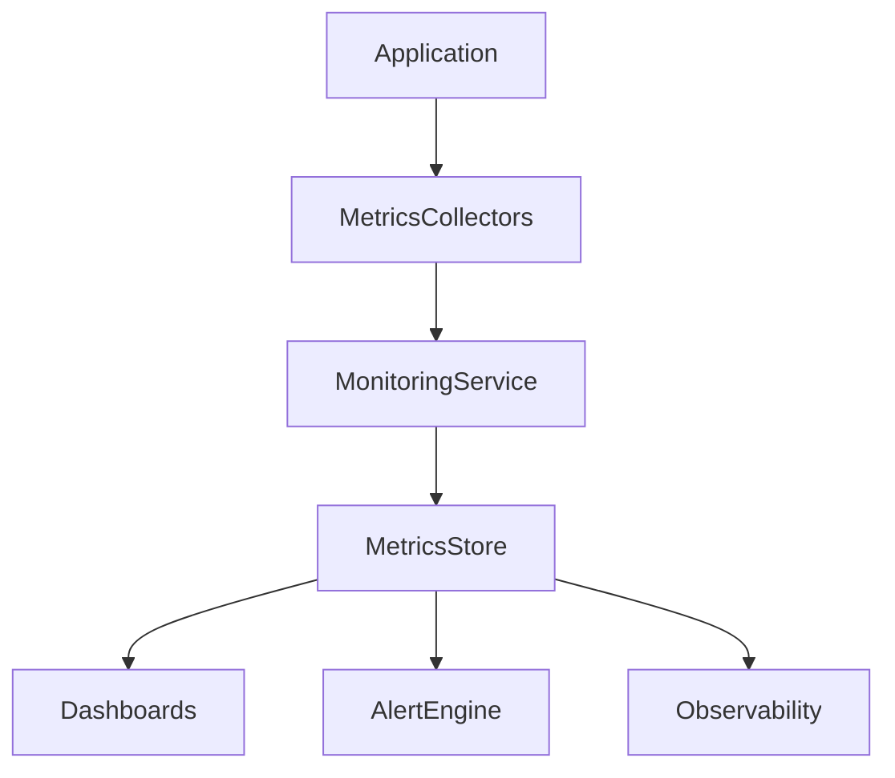
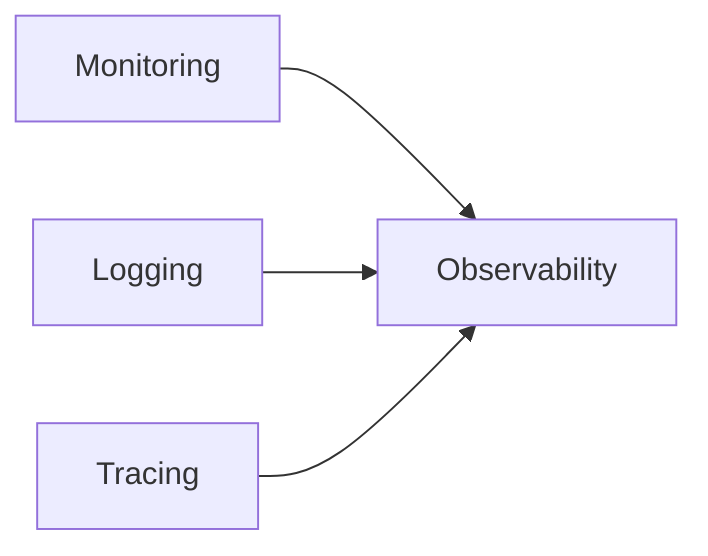
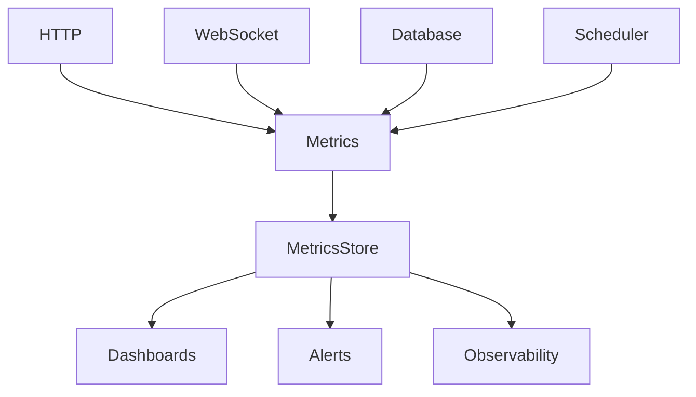
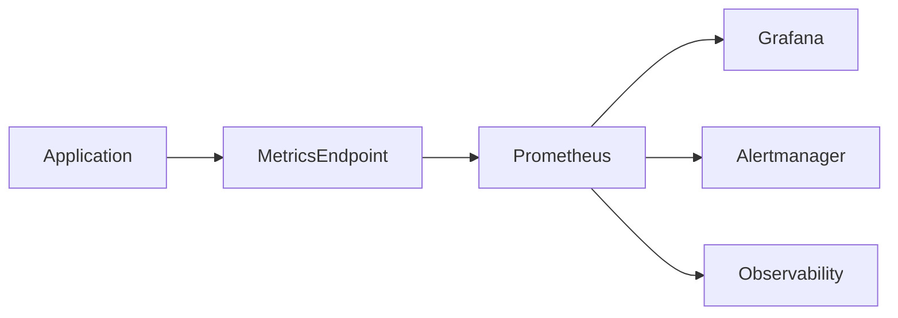

# 36_MONITORING.md

# Monitoring Architecture

## Parte 1 — Arquitectura, estrategia, métricas y monitorización operativa

---

# 1. Introducción

El módulo **Monitoring** define la estrategia de supervisión operacional de Aula Robótica Platform.

Su objetivo consiste en proporcionar una visión continua del estado de salud de la plataforma mediante métricas, indicadores, eventos operativos y señales de comportamiento del sistema.

A diferencia de otros módulos de soporte:

- Logging
- Audit
- Activity Feed

Monitoring trabaja principalmente con mediciones agregadas.

```text
mediciones
        ↓
agregaciones
        ↓
indicadores
        ↓
alertas
```

Monitoring constituye la primera línea de detección temprana de incidencias y degradaciones operativas.

---

# 2. Objetivos

El sistema de Monitoring debe permitir:

- supervisar continuamente la plataforma;
- detectar degradaciones de rendimiento;
- medir disponibilidad;
- monitorizar procesos críticos;
- medir uso funcional;
- detectar anomalías;
- alimentar sistemas de alertas;
- proporcionar información para dashboards operativos;
- servir como base para Observability.

---

# 3. Responsabilidad arquitectónica

Monitoring responde principalmente a la pregunta:

> ¿Cómo está funcionando el sistema?

No responde a:

- ¿Qué hizo un usuario?
- ¿Qué cambió exactamente?
- ¿Quién modificó un recurso?

Esas responsabilidades pertenecen respectivamente a:

- Activity Feed
- Audit Log
- Logging

---

# 4. Posición dentro de la arquitectura



---

# 5. Integración con otros módulos

Monitoring consume información procedente de:

- Users
- RBAC
- Projects
- Tasks
- Activities
- Attachments
- Notifications
- Dashboard
- Activity Feed
- Audit
- WebSockets

sin sustituir a ninguno de ellos.

---

# 6. Filosofía

El sistema debe seguir una filosofía **backend-first**, donde todas las métricas relevantes son generadas por el servidor y posteriormente consumidas por herramientas de visualización y alertado.

---

# 7. Monitoring vs Logging

Logging registra eventos.

Ejemplo:

```text
Task created
```

Monitoring mide indicadores.

Ejemplo:

```text
tasks_created_total = 1521
```

---

# 8. Monitoring vs Audit

Audit responde:

```text
¿Quién hizo qué?
```

Monitoring responde:

```text
¿Cuántas veces ocurre?
```

---

# 9. Monitoring vs Activity Feed

Activity Feed:

```text
Fran completó la tarea.
```

Monitoring:

```text
task_completed_total = 341
```

---

# 10. Monitoring vs Observability

Monitoring constituye únicamente uno de los pilares de Observability.



---

# 11. Principios

La arquitectura de Monitoring debe cumplir:

1. Backend First
2. Bajo impacto
3. Alta disponibilidad
4. Métricas objetivas
5. Tiempo real cuando sea necesario
6. Baja cardinalidad
7. Escalabilidad
8. Independencia funcional

---

# 12. Arquitectura conceptual



---

# 13. Categorías de métricas

Las métricas deben clasificarse como:

- Runtime
- Infrastructure
- Database
- HTTP
- Realtime
- Business
- Security
- User Experience

---

# 14. Runtime Monitoring

Debe supervisar:

- CPU
- Memoria
- Uptime
- Workers
- Threads
- Consumo de recursos

---

# 15. HTTP Monitoring

Debe medir:

- número de peticiones;
- códigos HTTP;
- latencia;
- throughput;
- errores.

---

# 16. Database Monitoring

Debe supervisar:

- conexiones;
- pool;
- consultas;
- duración;
- bloqueos;
- transacciones.

---

# 17. Realtime Monitoring

Debe monitorizar:

- conexiones WebSocket;
- usuarios conectados;
- broadcasts;
- reconexiones;
- desconexiones;
- mensajes enviados;
- mensajes recibidos.

---

# 18. Business Monitoring

Debe medir indicadores funcionales:

- proyectos creados;
- tareas creadas;
- tareas completadas;
- actividades realizadas;
- adjuntos;
- notificaciones;
- usuarios activos.

---

# 19. Security Monitoring

Debe proporcionar métricas sobre:

- logins;
- intentos fallidos;
- accesos denegados;
- errores de autenticación;
- actividad sospechosa.

---

# 20. UX Monitoring

Debe supervisar:

- tiempos de respuesta;
- errores de frontend;
- tiempo de carga;
- experiencia realtime.

---

# 21. Principio de instrumentación

Todo componente importante debe generar métricas.

No únicamente cuando ocurre un error.

---

# 22. Componentes instrumentados

Inicialmente:

- Auth
- Users
- Projects
- Tasks
- Activities
- Notifications
- Dashboard

---

# 23. Instrumentación WebSocket

Eventos mínimos:

- connect
- disconnect
- reconnect
- broadcast
- send
- receive

---

# 24. Instrumentación Scheduler

Cada tarea programada debe medir:

- duración;
- éxito;
- fallo;
- frecuencia.

---

# 25. Instrumentación SQL

Las consultas relevantes deben registrar:

- duración;
- filas afectadas;
- éxito;
- timeout.

---

# 26. Instrumentación Storage

Debe medir:

- uploads;
- downloads;
- errores;
- almacenamiento utilizado.

---

# 27. Tipos de métricas

El sistema utilizará principalmente:

- Counter
- Gauge
- Histogram
- Summary

---

# 28. Counter

Representa valores crecientes.

Ejemplo:

```text
http_requests_total
```

---

# 29. Gauge

Representa valores instantáneos.

Ejemplo:

```text
active_users
```

---

# 30. Histogram

Representa distribuciones.

Ejemplo:

```text
request_duration_seconds
```

---

# 31. Summary

Permite calcular:

- media;
- percentiles;
- suma;
- número de observaciones.

---

# 32. Métricas de negocio

Ejemplos:

```text
projects_created_total

tasks_completed_total

activities_completed_total

attachments_uploaded_total
```

---

# 33. Métricas Dashboard

El Dashboard debe consumir únicamente métricas agregadas, nunca entidades completas.

---

# 34. Métricas Activity Feed

El Feed proporciona eventos.

Monitoring proporciona indicadores derivados.

---

# 35. Métricas Audit

Audit puede alimentar:

```text
failed_logins_total

permission_denied_total
```

---

# 36. Métricas Users

```text
users_total

active_users

disabled_users

online_users
```

---

# 37. Métricas Projects

```text
projects_total

active_projects

archived_projects

completed_projects
```

---

# 38. Métricas Tasks

```text
tasks_total

todo_tasks

doing_tasks

done_tasks

overdue_tasks
```

---

# 39. Métricas Activities

```text
activities_total

completed_activities

hours_logged
```

---

# 40. Métricas Attachments

```text
attachments_total

storage_used_bytes

uploads_total
```

---

# 41. Métricas Notifications

```text
notifications_sent_total

notifications_read_total

notifications_pending
```

---

# 42. Métricas WebSocket

```text
ws_connections

ws_messages_total

ws_reconnects_total

ws_disconnects_total
```

---

# 43. Métricas HTTP

```text
http_requests_total

http_errors_total

http_request_duration_seconds
```

---

# 44. Métricas Database

```text
db_connections

db_query_duration_seconds

db_queries_total
```

---

# 45. Métricas Runtime

```text
process_cpu_usage

process_memory_bytes

process_uptime_seconds
```

---

# 46. Disponibilidad

Debe medirse continuamente:

```text
uptime
```

---

# 47. Error Rate

Debe calcularse como:

```text
errors / requests
```

---

# 48. Throughput

Debe medirse:

```text
requests / second
```

---

# 49. Latencia

Se recomienda monitorizar:

- p50
- p90
- p95
- p99

---

# 50. Saturación

Debe supervisarse:

- CPU;
- memoria;
- pool de conexiones;
- disco;
- red.

---

# 51. Golden Signals

La arquitectura debe prepararse para monitorizar:

- Latency
- Traffic
- Errors
- Saturation

---

# 52. RED Method

Para APIs:

- Rate
- Errors
- Duration

---

# 53. USE Method

Para recursos:

- Utilization
- Saturation
- Errors

---

# 54. SLI

Monitoring debe permitir definir indicadores de nivel de servicio (Service Level Indicators).

---

# 55. SLO

Ejemplo:

```text
99.5 % de disponibilidad mensual
```

---

# 56. SLA

Los SLA dependen del servicio ofrecido y quedan fuera del alcance del software.

---

# 57. Health Checks

El sistema deberá proporcionar endpoints estándar:

```text
/health

/live

/ready

/metrics
```

---

# 58. Health Endpoint

Ejemplo:

```json
{
  "status": "UP"
}
```

---

# 59. Readiness

Debe comprobar:

- base de datos;
- configuración;
- dependencias;
- servicios externos.

---

# 60. Liveness

Debe responder únicamente:

```text
¿El proceso sigue vivo?
```

---

# 61. Metrics Endpoint

Debe exponer métricas en formato compatible con Prometheus.

---

# 62. Prometheus

Prometheus será el sistema recomendado para la recolección periódica de métricas.

---

# 63. Grafana

Grafana constituirá la plataforma principal para la construcción de dashboards operativos.

---

# 64. OpenTelemetry

La instrumentación debe diseñarse para integrarse con OpenTelemetry desde el inicio.

---

# 65. Principio de evolución

La plataforma debe poder evolucionar progresivamente desde un monitoring básico hacia una arquitectura completa de observabilidad sin modificar la lógica funcional de la aplicación.

---

# 66. Compatibilidad futura

La arquitectura deberá ser compatible con:

- Prometheus
- Grafana
- Alertmanager
- OpenTelemetry
- Jaeger
- Tempo
- Loki

sin introducir dependencias fuertes en el dominio.

---

# 67. Alcance de esta documentación

Este documento define exclusivamente la arquitectura de **Monitoring**.

Los aspectos relativos a:

- Logging
- Tracing
- Correlation IDs
- Observability

se desarrollan en los documentos posteriores.

---

# 68. Parte siguiente

La **Parte 2** desarrollará la arquitectura enterprise de:

- Prometheus;
- Grafana;
- Alertmanager;
- métricas avanzadas;
- dashboards operativos;
- monitorización de infraestructura;
- monitorización de base de datos;
- monitorización WebSocket;
- métricas de negocio;
- diseño de alertas;
- integración con Observability.

---

# 36_MONITORING.md

# Monitoring Architecture

## Parte 2 — Prometheus, Grafana, Alerting, métricas avanzadas e infraestructura

---

# 69. Arquitectura Enterprise

Una plataforma de monitorización enterprise debe desacoplar completamente la generación de métricas de su almacenamiento y visualización.



---

# 70. Flujo de monitorización

El flujo recomendado es:

```text
Aplicación

↓

Instrumentación

↓

/metrics

↓

Prometheus

↓

Alertmanager

↓

Grafana
```

---

# 71. Separación de responsabilidades

Cada componente debe tener una responsabilidad única.

| Componente | Responsabilidad |
|------------|----------------|
| Aplicación | Generar métricas |
| Prometheus | Recopilar |
| Alertmanager | Alertar |
| Grafana | Visualizar |

---

# 72. Instrumentación

La aplicación nunca debe preocuparse de:

- almacenar métricas;
- generar gráficos;
- enviar alertas.

Únicamente debe exponer métricas.

---

# 73. Exporters

La arquitectura debe admitir exporters adicionales.

Ejemplos:

- Node Exporter
- MySQL Exporter
- Redis Exporter
- Blackbox Exporter

---

# 74. Prometheus

Prometheus actúa como recolector de métricas.

No genera gráficos.

No almacena logs.

---

# 75. Scraping

Prometheus obtiene periódicamente:

```text
GET /metrics
```

---

# 76. Intervalo de Scraping

Valores orientativos:

```text
15 segundos

30 segundos

60 segundos
```

Dependerá del entorno.

---

# 77. Etiquetas

Toda métrica puede contener labels.

Ejemplo:

```text
http_requests_total

method="GET"

status="200"
```

---

# 78. Cardinalidad

Debe mantenerse baja.

No utilizar:

- user_id
- email
- task_id
- uuid

como labels.

---

# 79. Labels adecuados

Ejemplos:

```text
method

status

module

endpoint

event_type
```

---

# 80. Métricas HTTP

Ejemplos:

```text
http_requests_total

http_request_duration_seconds

http_errors_total
```

---

# 81. Endpoint

Es preferible agrupar:

```text
/projects

/tasks

/dashboard
```

que incluir IDs.

Incorrecto:

```text
/projects/18
```

---

# 82. Métodos HTTP

Labels:

```text
GET

POST

PUT

DELETE
```

---

# 83. Status Codes

Labels:

```text
200

201

400

401

403

404

500
```

---

# 84. Histogramas

La latencia debe exponerse mediante histogramas.

Ejemplo:

```text
request_duration_seconds
```

---

# 85. Buckets

Ejemplo:

```text
50 ms

100 ms

250 ms

500 ms

1 s

2 s

5 s
```

---

# 86. Percentiles

El Dashboard técnico debería mostrar:

- p50
- p90
- p95
- p99

---

# 87. Throughput

Debe medirse:

```text
requests / second
```

---

# 88. Error Rate

Debe mostrarse:

```text
errores

/

peticiones
```

---

# 89. Disponibilidad

Debe calcularse:

```text
UP

↓

Available
```

---

# 90. Runtime

Debe monitorizar:

- CPU
- memoria
- uptime
- threads
- workers

---

# 91. CPU

Métrica:

```text
process_cpu_seconds_total
```

---

# 92. Memoria

Ejemplo:

```text
process_resident_memory_bytes
```

---

# 93. GC

Si el runtime lo permite:

- número de GC;
- duración;
- pausas.

---

# 94. Database

Debe medir:

- conexiones;
- pool;
- consultas;
- duración.

---

# 95. Pool

Ejemplo:

```text
db_pool_active

db_pool_idle
```

---

# 96. Queries

```text
db_queries_total
```

---

# 97. Duración SQL

```text
db_query_duration_seconds
```

---

# 98. Timeouts

```text
db_query_timeout_total
```

---

# 99. Deadlocks

```text
db_deadlocks_total
```

---

# 100. Storage

Debe monitorizar:

- espacio;
- ficheros;
- uploads.

---

# 101. Uploads

```text
attachments_uploaded_total
```

---

# 102. Downloads

```text
attachments_downloaded_total
```

---

# 103. Espacio

```text
attachments_storage_bytes
```

---

# 104. WebSocket

Debe medir:

- conexiones;
- mensajes;
- reconexiones.

---

# 105. Usuarios online

```text
online_users
```

---

# 106. Conexiones

```text
ws_connections
```

---

# 107. Broadcast

```text
ws_broadcast_total
```

---

# 108. Reconexiones

```text
ws_reconnect_total
```

---

# 109. Dashboard

Debe mostrar:

- usuarios;
- tareas;
- proyectos;
- actividad.

---

# 110. Projects

```text
projects_total
```

---

# 111. Tasks

```text
tasks_total
```

---

# 112. Activities

```text
activities_total
```

---

# 113. Notifications

```text
notifications_sent_total
```

---

# 114. Activity Feed

```text
feed_events_total
```

---

# 115. Audit

```text
audit_events_total
```

---

# 116. Login

```text
login_success_total

login_failed_total
```

---

# 117. RBAC

```text
permission_denied_total
```

---

# 118. Usuarios activos

```text
active_users
```

---

# 119. Proyectos activos

```text
active_projects
```

---

# 120. Tareas vencidas

```text
overdue_tasks
```

---

# 121. Tareas completadas

```text
tasks_completed_total
```

---

# 122. Actividades completadas

```text
activities_completed_total
```

---

# 123. Horas registradas

```text
hours_logged_total
```

---

# 124. Dashboards

La plataforma debe definir dashboards específicos.

---

# 125. Dashboard General

Debe incluir:

- disponibilidad;
- errores;
- tráfico;
- CPU;
- memoria.

---

# 126. Dashboard HTTP

Debe mostrar:

- requests;
- errores;
- latencia.

---

# 127. Dashboard Database

Debe mostrar:

- conexiones;
- queries;
- duración.

---

# 128. Dashboard WebSocket

Debe mostrar:

- conexiones;
- usuarios;
- broadcasts.

---

# 129. Dashboard Business

Debe mostrar:

- proyectos;
- tareas;
- actividades;
- notificaciones.

---

# 130. Dashboard Seguridad

Debe mostrar:

- logins;
- errores;
- permisos.

---

# 131. Alerting

El objetivo de Monitoring no es únicamente medir.

Debe detectar anomalías automáticamente.

---

# 132. Alertmanager

Alertmanager recibe alertas desde Prometheus.

---

# 133. Destinos

Puede enviar:

- Email
- Slack
- Teams
- Discord
- Webhook

---

# 134. Severidad

Recomendado:

```text
INFO

WARNING

CRITICAL
```

---

# 135. Alerta CPU

Ejemplo:

```text
CPU > 90 %

durante 10 minutos
```

---

# 136. Memoria

```text
Memoria > 85 %
```

---

# 137. Disco

```text
Disco > 90 %
```

---

# 138. Base de datos

```text
Pool agotado
```

---

# 139. HTTP

```text
5xx > umbral
```

---

# 140. Error Rate

```text
> 5 %
```

---

# 141. Latencia

```text
p95 > 500 ms
```

---

# 142. WebSocket

```text
Desconexiones anómalas
```

---

# 143. Usuarios

```text
Conexiones simultáneas
```

---

# 144. Scheduler

```text
Job fallido
```

---

# 145. Runtime

```text
Proceso detenido
```

---

# 146. Disponibilidad

```text
Servicio DOWN
```

---

# 147. Alert Fatigue

Debe evitarse generar alertas excesivas.

---

# 148. Alertas duplicadas

Alertmanager debe agruparlas.

---

# 149. Silencing

Debe poder silenciar alertas durante mantenimiento.

---

# 150. Escalado

Las alertas críticas deben poder escalar automáticamente.

---

# 151. Dashboards Operativos

Cada equipo puede disponer de dashboards específicos.

---

# 152. Dashboard Backend

- HTTP
- SQL
- Runtime

---

# 153. Dashboard DevOps

- Infraestructura
- Contenedores
- Red

---

# 154. Dashboard Soporte

- Usuarios
- Incidencias
- Errores

---

# 155. Dashboard Dirección

Debe contener únicamente indicadores de negocio.

---

# 156. Actualización

Los dashboards deben refrescar automáticamente.

---

# 157. Intervalos

Ejemplos:

```text
5 s

15 s

30 s

1 min
```

---

# 158. Histórico

Las métricas deben mantenerse durante un periodo configurable.

---

# 159. Tendencias

Debe poder visualizarse:

- hora;
- día;
- semana;
- mes.

---

# 160. Comparativas

Debe permitir:

```text
Hoy

vs

Ayer
```

---

# 161. Correlación

Monitoring debe integrarse posteriormente con:

- Logging;
- Tracing;
- Observability.

---

# 162. Integración futura

La arquitectura debe ser compatible con:

- Prometheus
- Grafana
- Alertmanager
- Loki
- Tempo
- Jaeger
- OpenTelemetry

---

# 163. Escalabilidad

La instrumentación debe mantenerse ligera incluso con cientos de miles de métricas.

---

# 164. Bajo impacto

La recogida de métricas nunca debe degradar perceptiblemente el rendimiento de la aplicación.

---

# 165. Buenas prácticas

- métricas simples;
- nombres consistentes;
- labels limitados;
- baja cardinalidad;
- instrumentación uniforme.

---

# 166. Preparación para producción

Toda nueva funcionalidad relevante deberá incorporar métricas desde su diseño inicial.

---

# 167. Documentación

Cada métrica debe estar documentada indicando:

- nombre;
- tipo;
- unidad;
- labels;
- significado.

---

# 168. Parte siguiente

La **Parte 3** completará el documento con:

- testing del sistema de monitoring;
- observabilidad operacional;
- runbooks;
- troubleshooting;
- monitorización distribuida;
- checklists enterprise;
- criterios de aceptación;
- roadmap;
- conclusiones.

---

# 36_MONITORING.md

# Monitoring Architecture

## Parte 3 — Testing, observabilidad operacional, runbooks, checklists y evolución

---

# 169. Testing del sistema de Monitoring

El propio sistema de Monitoring debe verificarse mediante pruebas automáticas.

No basta con comprobar que la aplicación funciona.

Debe comprobarse que:

- las métricas existen;
- los valores son correctos;
- los labels son consistentes;
- los endpoints responden;
- las alertas se disparan correctamente.

---

# 170. Pruebas unitarias

Las pruebas unitarias deben cubrir:

- Counters
- Gauges
- Histograms
- Summary
- Builders
- Instrumentación

---

# 171. Counter Tests

Debe verificarse:

```text
valor inicial = 0

↓

incremento

↓

valor esperado
```

---

# 172. Gauge Tests

Casos:

- incremento;
- decremento;
- actualización;
- reinicio.

---

# 173. Histogram Tests

Debe comprobarse:

- buckets;
- count;
- sum;
- percentiles.

---

# 174. Summary Tests

Debe verificar:

- media;
- número de muestras;
- percentiles.

---

# 175. Endpoint Tests

El endpoint:

```text
/metrics
```

debe responder correctamente.

---

# 176. Health Tests

Endpoints:

```text
/health

/live

/ready
```

deben verificarse automáticamente.

---

# 177. Readiness Tests

Debe comprobar:

- Base de datos;
- Configuración;
- Dependencias.

---

# 178. Liveness Tests

Debe comprobar únicamente:

```text
el proceso sigue vivo
```

---

# 179. Integration Tests

Debe verificarse la integración con:

- Prometheus;
- Grafana;
- Alertmanager.

---

# 180. Contract Tests

Toda nueva métrica debe mantener:

- nombre;
- labels;
- tipo;
- unidad.

---

# 181. Performance Tests

La instrumentación no debe degradar la aplicación.

Debe medirse:

- CPU;
- memoria;
- latencia.

---

# 182. Stress Tests

Debe verificarse:

- miles de requests;
- miles de métricas;
- múltiples conexiones.

---

# 183. Load Tests

Monitoring debe seguir funcionando durante pruebas de carga.

---

# 184. Chaos Tests

Escenarios:

- caída de base de datos;
- pérdida de red;
- caída de Redis;
- reinicio de procesos.

---

# 185. Fallo de Prometheus

La aplicación debe continuar funcionando aunque Prometheus no pueda recoger métricas.

---

# 186. Fallo de Grafana

Los dashboards pueden dejar de visualizar datos.

La aplicación no debe verse afectada.

---

# 187. Fallo de Alertmanager

Las alertas pueden retrasarse.

Las métricas continúan generándose.

---

# 188. Degradación

Monitoring nunca debe bloquear:

- peticiones;
- transacciones;
- WebSockets.

---

# 189. Observabilidad operacional

Monitoring constituye el primer nivel de observabilidad.

Debe permitir responder rápidamente:

- ¿Está funcionando?
- ¿Es rápido?
- ¿Hay errores?
- ¿Hay saturación?

---

# 190. Dashboards Operativos

Debe existir un dashboard para:

- Operación diaria;
- Desarrollo;
- Infraestructura;
- Seguridad;
- Negocio.

---

# 191. Dashboard de Operación

Debe mostrar:

- Estado general;
- Alertas activas;
- Servicios;
- Disponibilidad.

---

# 192. Dashboard Backend

Debe mostrar:

- Requests;
- SQL;
- Runtime;
- WebSockets.

---

# 193. Dashboard Base de Datos

Debe incluir:

- conexiones;
- consultas;
- bloqueos;
- tiempos.

---

# 194. Dashboard Infraestructura

Debe supervisar:

- CPU;
- Memoria;
- Disco;
- Red.

---

# 195. Dashboard Seguridad

Debe incluir:

- logins;
- errores;
- permisos;
- intentos fallidos.

---

# 196. Dashboard Negocio

Debe mostrar:

- usuarios;
- proyectos;
- tareas;
- actividades;
- adjuntos.

---

# 197. Golden Signals

Todos los dashboards técnicos deben incluir:

- Latency
- Traffic
- Errors
- Saturation

---

# 198. RED

Los servicios HTTP deben monitorizar:

- Rate
- Errors
- Duration

---

# 199. USE

Los recursos físicos deben mostrar:

- Utilization
- Saturation
- Errors

---

# 200. Tendencias

Debe ser posible consultar:

- última hora;
- últimas 24 horas;
- última semana;
- último mes.

---

# 201. Correlación temporal

Los dashboards deben permitir detectar:

- picos;
- degradaciones;
- anomalías.

---

# 202. Runbooks

Cada alerta crítica debe disponer de un Runbook asociado.

---

# 203. Contenido del Runbook

Debe incluir:

- descripción;
- impacto;
- diagnóstico;
- pasos;
- escalado.

---

# 204. Ejemplo

```text
CPU > 90 %

↓

Runbook CPU
```

---

# 205. Troubleshooting

Debe documentarse:

- síntomas;
- causas;
- acciones.

---

# 206. Incidentes

Monitoring debe facilitar la gestión de incidentes.

No sustituirla.

---

# 207. Tiempo de detección

Debe minimizarse:

```text
MTTD
```

---

# 208. Tiempo de resolución

Debe facilitarse:

```text
MTTR
```

---

# 209. KPIs Operacionales

Ejemplos:

- uptime;
- error rate;
- disponibilidad;
- throughput.

---

# 210. KPIs Negocio

Ejemplos:

- proyectos activos;
- tareas completadas;
- actividades.

---

# 211. KPIs Técnicos

Ejemplos:

- CPU;
- memoria;
- latencia.

---

# 212. SLI

Los Service Level Indicators deben obtenerse directamente desde Monitoring.

---

# 213. SLO

Ejemplo:

```text
99.9 %

availability
```

---

# 214. Alertas Inteligentes

Debe evitarse:

- alert fatigue;
- falsos positivos.

---

# 215. Agrupación

Alertmanager debe agrupar alertas relacionadas.

---

# 216. Escalado

Las alertas críticas deben poder escalar automáticamente.

---

# 217. Mantenimiento

Debe existir modo mantenimiento para evitar alertas innecesarias.

---

# 218. Silencing

Alertmanager debe permitir silenciar temporalmente.

---

# 219. Observabilidad Distribuida

Monitoring deberá integrarse posteriormente con:

- Logging;
- Tracing;
- Correlation IDs.

---

# 220. OpenTelemetry

Toda la instrumentación debe ser compatible con OpenTelemetry.

---

# 221. Microservicios

La arquitectura debe poder ampliarse a múltiples servicios.

---

# 222. Kubernetes

Debe ser compatible con despliegues sobre Kubernetes.

---

# 223. Docker

Debe funcionar igualmente sobre Docker Compose.

---

# 224. Alta Disponibilidad

Monitoring no debe convertirse en un punto único de fallo.

---

# 225. Escalabilidad

Debe admitir crecimiento horizontal.

---

# 226. Seguridad

El endpoint:

```text
/metrics
```

no debe exponerse públicamente.

---

# 227. Acceso

Debe protegerse mediante:

- red privada;
- autenticación;
- proxy.

---

# 228. Datos sensibles

Nunca deben aparecer:

- emails;
- contraseñas;
- tokens;
- claves;
- identificadores personales.

---

# 229. Baja Cardinalidad

Las labels deben permanecer limitadas.

---

# 230. Naming

Todas las métricas deben seguir una convención consistente.

---

# 231. Documentación

Cada métrica debe indicar:

- nombre;
- descripción;
- unidad;
- labels.

---

# 232. Versionado

Las métricas públicas deben versionarse cuidadosamente.

---

# 233. Compatibilidad

Eliminar una métrica puede romper dashboards.

Debe planificarse.

---

# 234. Deprecación

Las métricas antiguas deben mantenerse durante un periodo de transición.

---

# 235. Auditoría

Las modificaciones del sistema de Monitoring deben documentarse.

---

# 236. Checklist Arquitectura

- [ ] Backend First
- [ ] Bajo impacto
- [ ] Instrumentación uniforme
- [ ] Métricas agregadas
- [ ] Labels controlados
- [ ] Compatible con Prometheus

---

# 237. Checklist Runtime

- [ ] CPU
- [ ] Memoria
- [ ] Uptime
- [ ] Threads
- [ ] Workers

---

# 238. Checklist HTTP

- [ ] Requests
- [ ] Latencia
- [ ] Errores
- [ ] Throughput

---

# 239. Checklist Database

- [ ] Pool
- [ ] Consultas
- [ ] Deadlocks
- [ ] Timeouts

---

# 240. Checklist WebSocket

- [ ] Conexiones
- [ ] Broadcast
- [ ] Reconexiones
- [ ] Usuarios online

---

# 241. Checklist Business

- [ ] Users
- [ ] Projects
- [ ] Tasks
- [ ] Activities
- [ ] Attachments
- [ ] Notifications

---

# 242. Checklist Alerting

- [ ] Alertmanager
- [ ] Severidad
- [ ] Escalado
- [ ] Silencing

---

# 243. Checklist Dashboards

- [ ] General
- [ ] Backend
- [ ] Database
- [ ] Seguridad
- [ ] Negocio

---

# 244. Checklist Seguridad

- [ ] Endpoint protegido
- [ ] Sin datos sensibles
- [ ] Baja cardinalidad
- [ ] Acceso restringido

---

# 245. Checklist Testing

- [ ] Unit Tests
- [ ] Integration Tests
- [ ] Performance Tests
- [ ] Chaos Tests
- [ ] Health Tests

---

# 246. Checklist Producción

- [ ] Dashboards
- [ ] Alertas
- [ ] Runbooks
- [ ] SLO
- [ ] Observabilidad

---

# 247. Criterios de aceptación

El sistema de Monitoring se considera correctamente implementado cuando:

- expone métricas consistentes;
- monitoriza todos los módulos relevantes;
- integra Prometheus;
- soporta Grafana;
- dispone de alertas;
- mantiene baja cardinalidad;
- soporta crecimiento horizontal;
- supera pruebas de rendimiento;
- dispone de dashboards operativos.

---

# 248. Evolución futura

La arquitectura queda preparada para incorporar:

- Auto Scaling;
- IA para detección de anomalías;
- Capacity Planning;
- Predicción de carga;
- Machine Learning;
- Cost Monitoring.

---

# 249. Capacity Planning

El histórico de métricas permitirá estimar:

- crecimiento;
- almacenamiento;
- CPU;
- memoria.

---

# 250. Detección de anomalías

Una futura capa podrá detectar automáticamente:

- picos;
- caídas;
- comportamiento anómalo.

---

# 251. Forecasting

Ejemplos:

- crecimiento de usuarios;
- almacenamiento;
- tráfico.

---

# 252. Inteligencia Artificial

La IA podrá generar resúmenes como:

> "La latencia ha aumentado un 23 % respecto a la semana anterior."

---

# 253. Integración completa

Monitoring quedará completamente integrado con:

- Logging;
- Tracing;
- Observability;
- Dashboard;
- Activity Feed.

---

# 254. Principios definitivos

1. Monitoring mide.
2. Logging registra.
3. Audit documenta.
4. Activity Feed comunica.
5. Tracing conecta.
6. Observability integra.
7. Las métricas deben ser simples.
8. Las labels deben mantenerse de baja cardinalidad.
9. El sistema debe degradarse de forma segura.
10. Monitoring nunca debe afectar al rendimiento funcional.

---

# 255. Conclusiones

El módulo **Monitoring** constituye la base de supervisión operacional de Aula Robótica Platform. Su función principal consiste en transformar el comportamiento interno de la aplicación en indicadores cuantificables que permitan conocer, en tiempo real, el estado de salud del sistema.

La arquitectura propuesta desacopla completamente la generación de métricas de su almacenamiento, visualización y alertado, facilitando la integración con herramientas estándar del ecosistema cloud como Prometheus, Grafana y Alertmanager. Este enfoque permite evolucionar progresivamente desde una monitorización básica hacia una plataforma enterprise sin introducir dependencias innecesarias en el dominio funcional.

El diseño prioriza métricas objetivas, baja cardinalidad, instrumentación uniforme, bajo impacto en rendimiento y compatibilidad con futuros entornos distribuidos basados en contenedores o microservicios. Asimismo, incorpora principios de SRE, Golden Signals, RED y USE para garantizar una supervisión consistente tanto de la infraestructura como de la lógica de negocio.

Finalmente, el módulo queda preparado para integrarse con Logging, Tracing y Observability, constituyendo el primer pilar de una plataforma completa de observabilidad capaz de detectar incidencias, anticipar degradaciones y proporcionar información fiable para la toma de decisiones técnicas y operativas.
