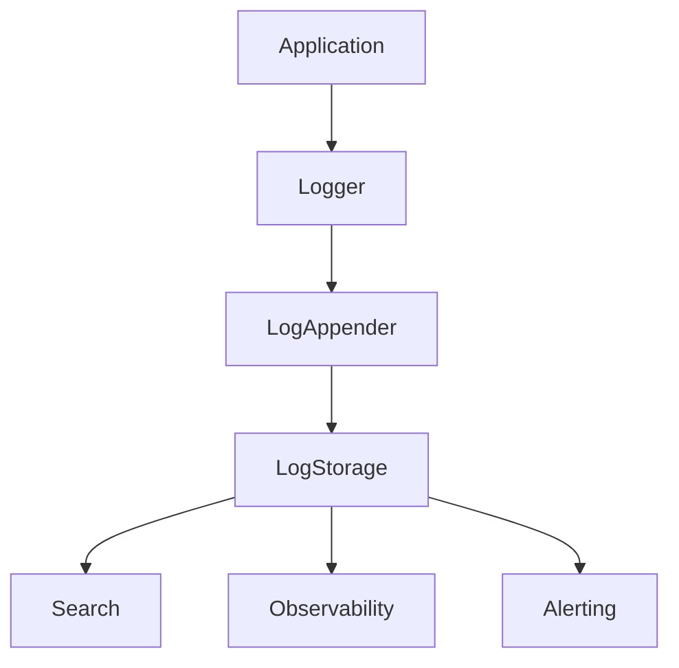
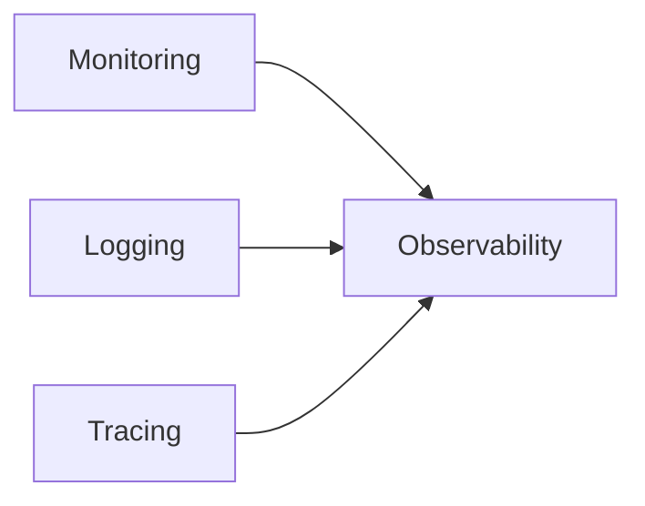
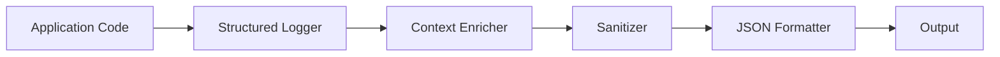
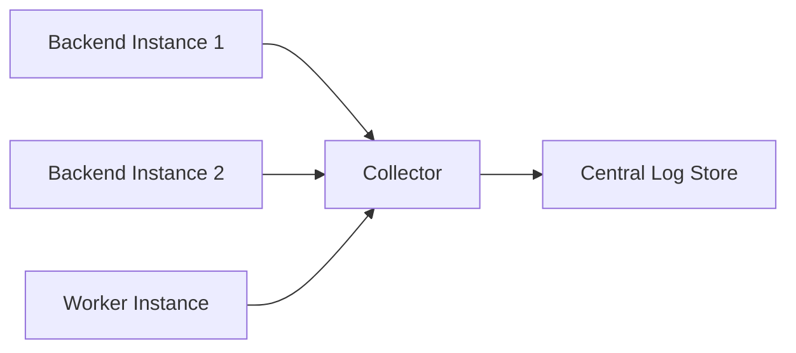
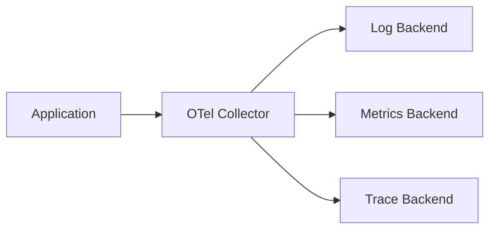
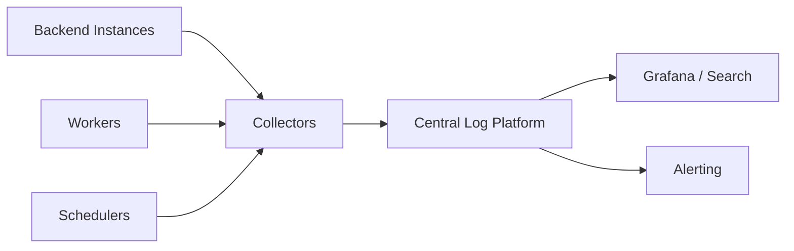
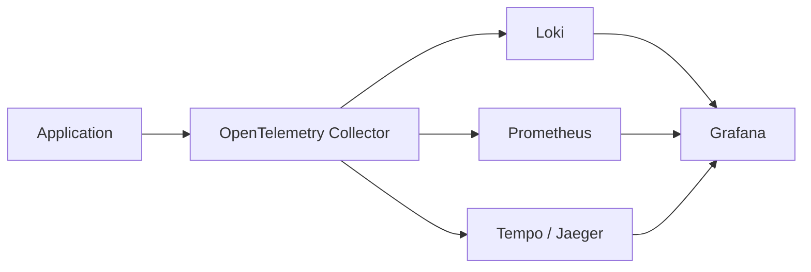
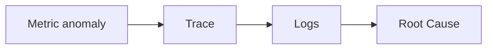

# 37_LOGGING.md

# Logging Architecture

## Parte 1 — Arquitectura, filosofía, Structured Logging y diseño Enterprise

---

# 1. Introducción

El módulo **Logging** define la estrategia de registro técnico de Aula Robótica Platform.

Su finalidad consiste en capturar información relevante sobre el comportamiento interno del sistema para facilitar:

- diagnóstico;
- depuración;
- soporte;
- mantenimiento;
- observabilidad;
- análisis de incidencias.

A diferencia de:

- Monitoring
- Audit Log
- Activity Feed

Logging registra información técnica generada por la propia aplicación.

---

# 2. Objetivos

El sistema de Logging debe permitir:

- registrar eventos técnicos;
- diagnosticar errores;
- reconstruir ejecuciones;
- facilitar el soporte;
- alimentar plataformas de observabilidad;
- correlacionar operaciones distribuidas;
- ayudar durante el desarrollo;
- proporcionar trazabilidad técnica.

---

# 3. Responsabilidad

Logging responde principalmente a la pregunta:

> ¿Qué ocurrió dentro del sistema?

No responde:

- ¿Quién modificó un recurso?
- ¿Cómo evoluciona un proyecto?
- ¿Cuál es el rendimiento global?

---

# 4. Posición dentro de la arquitectura



---

# 5. Logging vs Monitoring

Monitoring mide.

Ejemplo:

```text
http_requests_total
```

Logging registra.

Ejemplo:

```text
GET /projects/18 completed in 41 ms
```

---

# 6. Logging vs Audit

Audit registra acciones funcionales realizadas por usuarios.

Logging registra comportamiento técnico.

---

# 7. Logging vs Activity Feed

Activity Feed:

```text
Fran creó la tarea.
```

Logging:

```text
TaskService.create() completed successfully.
```

---

# 8. Logging vs Observability

Logging constituye uno de los pilares fundamentales de Observability.



---

# 9. Filosofía

Todo log debe aportar valor.

Registrar información innecesaria incrementa:

- coste;
- almacenamiento;
- ruido;
- dificultad de diagnóstico.

---

# 10. Principios

El sistema debe cumplir:

1. Structured Logging
2. Consistencia
3. Bajo impacto
4. Seguridad
5. Legibilidad
6. Correlación
7. Escalabilidad

---

# 11. Arquitectura

```mermaid
flowchart LR

Application

↓

Logger

↓

Appender

↓

Log Storage

↓

Search Engine

↓

Dashboards
```

---

# 12. Structured Logging

Todos los logs deben generarse mediante estructuras de datos.

No mediante texto libre.

---

# 13. JSON Logging

Formato recomendado:

```json
{
  "timestamp":"2026-08-14T12:30:10Z",
  "level":"INFO",
  "service":"backend",
  "message":"Task created"
}
```

---

# 14. Ventajas

Structured Logging permite:

- búsquedas;
- filtros;
- agregaciones;
- dashboards;
- correlación.

---

# 15. Logs legibles

Aunque sean JSON, deben continuar siendo fácilmente interpretables.

---

# 16. Timestamp

Todo log debe incluir timestamp UTC.

Formato recomendado:

```text
ISO-8601
```

---

# 17. Timezone

Siempre UTC.

La conversión horaria corresponde a la interfaz.

---

# 18. Nivel

Todo log debe incluir:

```text
level
```

---

# 19. Logger Name

Debe indicar el componente origen.

Ejemplo:

```text
TaskService
```

---

# 20. Service

Debe identificar:

```text
backend
```

o futuros microservicios.

---

# 21. Environment

Ejemplos:

```text
development

testing

staging

production
```

---

# 22. Version

Debe registrar:

```text
application_version
```

---

# 23. Host

Puede incluir:

```text
hostname
```

---

# 24. Instance

En despliegues distribuidos:

```text
instance_id
```

---

# 25. Process

Puede incluir:

```text
process_id
```

---

# 26. Thread

Especialmente útil en aplicaciones concurrentes.

---

# 27. Request ID

Cada petición HTTP debe generar:

```text
request_id
```

---

# 28. Correlation ID

Todas las operaciones relacionadas deben compartir:

```text
correlation_id
```

---

# 29. Trace ID

Cuando exista tracing distribuido.

---

# 30. Span ID

Compatible con OpenTelemetry.

---

# 31. User ID

Puede registrarse.

Nunca datos personales innecesarios.

---

# 32. Session ID

Debe anonimizarse cuando sea necesario.

---

# 33. IP

Solo cuando exista justificación funcional.

---

# 34. Endpoint

Ejemplo:

```text
POST /api/tasks
```

---

# 35. HTTP Method

```text
GET

POST

PUT

DELETE
```

---

# 36. Status Code

```text
200

201

404

500
```

---

# 37. Duración

Debe registrarse:

```text
duration_ms
```

---

# 38. Database

Puede incluir:

```text
query_duration_ms
```

---

# 39. WebSocket

Debe registrar:

- connect;
- disconnect;
- broadcast.

---

# 40. Scheduler

Debe registrar:

- inicio;
- fin;
- duración.

---

# 41. Jobs

Ejemplo:

```text
notification_scheduler
```

---

# 42. Startup

Debe registrar:

- versión;
- entorno;
- configuración principal.

---

# 43. Shutdown

Debe registrarse siempre.

---

# 44. Configuración

Nunca registrar:

- contraseñas;
- tokens;
- secretos.

---

# 45. Seguridad

Los logs nunca deben contener:

- passwords;
- JWT;
- API Keys;
- secretos cloud.

---

# 46. Datos personales

Debe minimizarse el registro de información personal.

---

# 47. GDPR

Los logs deben cumplir la normativa aplicable de protección de datos.

---

# 48. Logging sensible

Si un dato no resulta imprescindible para el diagnóstico, no debe registrarse.

---

# 49. Logging de excepciones

Toda excepción inesperada debe registrarse.

---

# 50. Stack Trace

Debe registrarse únicamente cuando aporte valor.

---

# 51. Error Message

Debe ser claro.

Ejemplo:

```text
Database connection timeout
```

---

# 52. Exception Type

Ejemplo:

```text
SQLAlchemyError
```

---

# 53. Root Cause

Siempre que sea posible.

---

# 54. Logging contextual

Debe incluir suficiente contexto para reproducir el problema.

---

# 55. Contexto

Ejemplos:

- módulo;
- operación;
- proyecto;
- recurso.

---

# 56. Contexto mínimo

Todo log debe permitir responder:

- qué;
- cuándo;
- dónde;
- resultado.

---

# 57. Naming

Los nombres de campos deben mantenerse consistentes.

---

# 58. Convenciones

Ejemplos:

```text
snake_case
```

---

# 59. Mensajes

Los mensajes deben escribirse en inglés técnico.

---

# 60. Verbos

Ejemplos:

```text
created

updated

deleted

started

completed

failed
```

---

# 61. Logs estructurados

Incorrecto:

```text
Algo salió mal
```

Correcto:

```json
{
  "operation":"task_create",
  "status":"failed",
  "error":"validation_error"
}
```

---

# 62. Logging de éxito

No todos los éxitos requieren log.

Debe evitarse ruido innecesario.

---

# 63. Logging de depuración

Reservado para:

```text
DEBUG
```

---

# 64. Logging funcional

No sustituye:

- Audit;
- Activity Feed.

---

# 65. Arquitectura preparada

La plataforma debe ser compatible con:

- ELK
- OpenSearch
- Loki
- OpenTelemetry

---

# 66. Bajo impacto

La escritura de logs no debe bloquear peticiones.

---

# 67. Escalabilidad

El sistema debe admitir múltiples instancias.

---

# 68. Parte siguiente

La **Parte 2** desarrollará:

- niveles de logging;
- appenders;
- rotación;
- retención;
- centralización;
- ELK;
- Loki;
- OpenSearch;
- seguridad;
- rendimiento;
- integración con Monitoring y Observability.

---

# 69. Niveles de Logging

El sistema debe utilizar niveles de logging con significado consistente.

Niveles recomendados:

```text
TRACE

DEBUG

INFO

WARNING

ERROR

CRITICAL
```

No todos los entornos necesitan habilitar todos los niveles.

---

# 70. TRACE

`TRACE` representa información extremadamente detallada sobre la ejecución interna.

Ejemplos:

* entrada y salida de funciones;
* pasos intermedios;
* decisiones internas;
* iteraciones.

Debe mantenerse desactivado normalmente en producción.

---

# 71. DEBUG

`DEBUG` se utiliza para información útil durante:

* desarrollo;
* diagnóstico;
* troubleshooting.

Ejemplo:

```json
{
  "level": "DEBUG",
  "event": "task.repository.query",
  "filters": {
    "status": "doing"
  }
}
```

No debe incluir información sensible.

---

# 72. INFO

`INFO` representa eventos operativos normales y relevantes.

Ejemplos:

```text
application.started

application.stopped

scheduler.completed

database.connected
```

Debe evitarse registrar cada operación rutinaria si genera volumen innecesario.

---

# 73. WARNING

`WARNING` representa una situación anómala que no impide continuar.

Ejemplos:

```text
retry performed

deprecated configuration

slow query

realtime reconnect
```

---

# 74. ERROR

`ERROR` representa una operación que no pudo completarse correctamente.

Ejemplos:

```text
database query failed

storage upload failed

notification delivery failed
```

---

# 75. CRITICAL

`CRITICAL` se reserva para situaciones que comprometen gravemente el servicio.

Ejemplos:

```text
database unavailable

configuration invalid

critical dependency unavailable
```

Debe utilizarse con moderación.

---

# 76. Selección del nivel

La elección debe basarse en impacto operativo.

```text
TRACE
    ↓
detalle extremo

DEBUG
    ↓
diagnóstico

INFO
    ↓
operación normal

WARNING
    ↓
degradación

ERROR
    ↓
operación fallida

CRITICAL
    ↓
servicio comprometido
```

---

# 77. Nivel por entorno

Configuración orientativa:

```text
development → DEBUG

testing     → WARNING / DEBUG

staging     → INFO

production  → INFO
```

`TRACE` debe activarse únicamente de forma temporal.

---

# 78. Configuración dinámica

Una evolución puede permitir modificar temporalmente el nivel de logging sin reiniciar toda la plataforma.

Debe:

* estar restringido;
* tener expiración;
* quedar auditado;
* evitar habilitar DEBUG global indefinidamente.

---

# 79. Logger hierarchy

Los loggers deben organizarse jerárquicamente.

Ejemplo:

```text
aula_robotica

aula_robotica.auth

aula_robotica.projects

aula_robotica.tasks

aula_robotica.notifications
```

Esto permite configurar niveles por módulo.

---

# 80. Logger por módulo

Cada módulo debe utilizar su propio logger.

Ejemplo conceptual:

```python
logger = logging.getLogger(
    "aula_robotica.tasks"
)
```

---

# 81. No crear loggers por entidad

Debe evitarse generar loggers dinámicos como:

```text
task.123

project.57

user.842
```

porque complican:

* configuración;
* almacenamiento;
* cardinalidad;
* análisis.

---

# 82. Event Name

Además del mensaje debe utilizarse:

```text
event
```

como identificador estable.

Ejemplo:

```json
{
  "event": "task.create.completed"
}
```

---

# 83. Convención de Event Name

Recomendación:

```text
domain.operation.result
```

Ejemplos:

```text
task.create.completed

task.update.failed

auth.login.failed

attachment.upload.completed
```

---

# 84. Mensaje humano

Puede mantenerse:

```text
message
```

para lectura rápida.

Ejemplo:

```json
{
  "event": "task.create.completed",
  "message": "Task created successfully"
}
```

Las consultas automáticas deben basarse preferentemente en `event`.

---

# 85. Result

Campo recomendado:

```text
result
```

Valores:

```text
success

failure

partial

retry
```

---

# 86. Operation

Puede utilizarse:

```text
operation
```

Ejemplo:

```text
task_create
```

Debe evitarse redundancia innecesaria si `event` ya contiene suficiente semántica.

---

# 87. Error Code

Los errores funcionales o técnicos conocidos pueden disponer de:

```text
error_code
```

Ejemplo:

```text
TASK_VERSION_CONFLICT
```

---

# 88. Exception Type

Las excepciones inesperadas deben incluir:

```text
exception_type
```

Ejemplo:

```text
IntegrityError
```

---

# 89. Exception Message

Debe sanitizarse.

No debe exponerse automáticamente el mensaje completo de librerías externas si puede contener:

* SQL;
* credenciales;
* rutas;
* datos personales.

---

# 90. Stack Trace

Debe incluirse para:

* excepciones inesperadas;
* errores críticos;
* diagnóstico necesario.

No debe duplicarse en múltiples capas.

---

# 91. Log Once Principle

Una excepción debe registrarse idealmente en el punto donde:

* se conoce el contexto;
* se decide que no puede manejarse;
* se evita duplicarla.

---

# 92. Logging duplicado

Patrón incorrecto:

```text
Repository logs ERROR

↓

Service logs ERROR

↓

Router logs ERROR
```

para la misma excepción.

Esto genera tres registros del mismo problema.

---

# 93. Excepciones esperadas

Errores de dominio esperados como:

```text
404

409

422
```

no deben registrarse automáticamente como `ERROR`.

Pueden ser:

```text
INFO

WARNING
```

o no generar log, dependiendo del caso.

---

# 94. Errores 4xx

Los códigos 4xx representan normalmente errores del cliente o reglas funcionales.

Ejemplos:

```text
400 → WARNING opcional

401 → INFO / WARNING

403 → WARNING

404 → DEBUG / INFO

409 → INFO

422 → DEBUG / INFO
```

La política debe ser centralizada.

---

# 95. Errores 5xx

Los errores 5xx normalmente requieren:

```text
ERROR
```

o:

```text
CRITICAL
```

si comprometen el servicio.

---

# 96. Middleware HTTP

La instrumentación HTTP debe centralizarse mediante middleware.

Debe registrar:

* request ID;
* correlation ID;
* método;
* ruta normalizada;
* status;
* duración.

---

# 97. Request Start

No es obligatorio registrar cada inicio de request en producción.

Puede generar el doble de volumen.

La estrategia preferida es registrar una única entrada al finalizar.

---

# 98. Request Completion

Ejemplo:

```json
{
  "event": "http.request.completed",
  "method": "GET",
  "route": "/projects/{project_id}",
  "status_code": 200,
  "duration_ms": 34
}
```

---

# 99. Ruta normalizada

Debe utilizarse:

```text
/projects/{project_id}
```

en lugar de:

```text
/projects/123
```

Esto:

* reduce cardinalidad;
* mejora agregación;
* evita filtrar IDs.

---

# 100. Query Parameters

No deben registrarse automáticamente.

Pueden contener:

* búsquedas;
* emails;
* tokens;
* filtros sensibles.

Solo deben incluirse parámetros específicamente permitidos.

---

# 101. Request Body

No debe registrarse por defecto.

Especialmente en:

* login;
* usuarios;
* archivos;
* mensajes;
* formularios.

---

# 102. Response Body

Tampoco debe registrarse por defecto.

Puede contener información sensible o grandes volúmenes.

---

# 103. Headers

No deben almacenarse completos.

Deben excluirse siempre:

```text
Authorization

Cookie

Set-Cookie

X-CSRF-Token
```

---

# 104. Allowlist

Si se necesita registrar cabeceras, debe utilizarse una lista blanca.

Ejemplo:

```text
Content-Type

User-Agent
```

cuando exista una necesidad real.

---

# 105. User-Agent

Puede ayudar a diagnosticar:

* errores de navegador;
* incompatibilidades;
* clientes.

Debe evaluarse su impacto de privacidad y volumen.

---

# 106. IP Address

Puede ser útil para:

* seguridad;
* abuse detection;
* troubleshooting.

Debe tratarse como dato personal.

Su almacenamiento requiere:

* finalidad;
* retención;
* acceso restringido.

---

# 107. IP anonimizada

Una estrategia puede:

* truncar;
* hashear con política segura;
* registrar únicamente en Audit/Security logs.

No debe aplicarse una transformación improvisada sin una política definida.

---

# 108. Correlation ID

Cada operación debe disponer de:

```text
correlation_id
```

para relacionar todos los logs producidos dentro de una misma operación funcional.

---

# 109. Request ID vs Correlation ID

```text
request_id
```

identifica una request HTTP concreta.

```text
correlation_id
```

puede abarcar varias operaciones relacionadas.

---

# 110. Ejemplo

```text
POST /tasks

request_id = req-123

correlation_id = corr-987
```

Posteriormente:

```text
Outbox Worker

correlation_id = corr-987
```

permite conectar ambas operaciones.

---

# 111. Propagación

El `correlation_id` debe propagarse hacia:

* Service Layer;
* Repository;
* Audit;
* Notifications;
* Outbox;
* workers;
* realtime.

---

# 112. Correlation ID entrante

Si un proxy o servicio confiable proporciona uno:

```text
X-Correlation-ID
```

puede reutilizarse tras validarlo.

De lo contrario, debe generarse uno nuevo.

---

# 113. Validación

Nunca debe confiarse ciegamente en un identificador arbitrariamente largo enviado por cliente.

Debe aplicarse:

* tamaño máximo;
* formato;
* sanitización.

---

# 114. Context Variables

En Python puede utilizarse contexto de ejecución para evitar pasar IDs manualmente por todas las funciones.

Ejemplo conceptual:

```text
contextvars
```

Puede mantener:

```text
request_id

correlation_id

user_id
```

---

# 115. Context propagation

Debe funcionar correctamente con:

* async;
* background tasks;
* workers.

No debe reutilizar accidentalmente contexto de otra request.

---

# 116. LoggingAdapter

Puede utilizarse:

```text
LoggerAdapter
```

o una solución de structured logging para incluir automáticamente el contexto común.

---

# 117. Campos comunes

Todo registro debería poder incluir:

```text
timestamp

level

event

service

environment

version

logger

correlation_id
```

Según contexto:

```text
request_id

trace_id

span_id

user_id
```

---

# 118. Structured Logger

Arquitectura conceptual:



---

# 119. Sanitizer

Antes de emitir logs debe eliminar o enmascarar información sensible.

---

# 120. Campos prohibidos

Debe existir una política explícita para:

```text
password

password_hash

access_token

refresh_token

authorization

cookie

secret

api_key

private_key
```

---

# 121. Redaction

Si un valor sensible aparece accidentalmente en un campo conocido puede sustituirse por:

```text
[REDACTED]
```

---

# 122. Redaction no suficiente

La redaction es una última defensa.

La estrategia principal sigue siendo:

```text
no registrar el dato
```

---

# 123. Free-text risk

Los campos de texto libre son especialmente peligrosos porque pueden incluir información sensible.

Ejemplo:

```text
exception.message
```

Debe controlarse.

---

# 124. SQL Logging

No debe habilitarse el logging completo de SQL con parámetros en producción de forma permanente.

Puede exponer:

* datos personales;
* tokens;
* contenido funcional.

---

# 125. SQL seguro

Para diagnóstico pueden registrarse:

```text
query_name

duration_ms

row_count

result
```

en lugar de SQL completo.

---

# 126. Query Name

Ejemplos:

```text
task.list_by_project

dashboard.summary

notification.count_unread
```

---

# 127. Slow Query Logging

Puede registrarse cuando:

```text
duration > threshold
```

Ejemplo:

```text
200 ms
```

El threshold debe configurarse por entorno.

---

# 128. Slow Query Event

```json
{
  "event": "database.query.slow",
  "query_name": "dashboard.summary",
  "duration_ms": 437,
  "threshold_ms": 200
}
```

---

# 129. Database Error

Ejemplo:

```json
{
  "event": "database.query.failed",
  "query_name": "task.list_by_project",
  "exception_type": "OperationalError",
  "result": "failure"
}
```

---

# 130. Transaction Logging

Puede registrarse:

```text
transaction.rollback
```

cuando el rollback deriva de un error inesperado.

No es necesario registrar cada commit exitoso.

---

# 131. Deadlocks

Deben generar un evento específico.

```text
database.deadlock.detected
```

con:

* operación;
* intento;
* retry;
* correlation ID.

---

# 132. Pool Exhaustion

Evento:

```text
database.pool.exhausted
```

Debe tener nivel:

```text
WARNING
```

o superior según impacto.

---

# 133. WebSocket Logging

Debe registrar únicamente eventos relevantes.

Ejemplos:

```text
websocket.connected

websocket.disconnected

websocket.authentication_failed

websocket.broadcast_failed
```

---

# 134. Conexión WebSocket

Ejemplo:

```json
{
  "event": "websocket.connected",
  "user_id": 8,
  "connection_id": "opaque-id"
}
```

No debe incluir tokens.

---

# 135. Connection ID

Puede generarse internamente para correlacionar eventos de una conexión.

Debe ser:

* opaco;
* no sensible;
* de duración limitada.

---

# 136. Broadcast Logging

No debe registrarse cada mensaje realtime en `INFO` si el volumen es elevado.

Puede utilizar:

```text
DEBUG
```

y métricas para volumen.

---

# 137. Broadcast Error

Sí debe registrarse:

```text
websocket.broadcast.failed
```

con:

* channel type;
* event type;
* connection count;
* error.

---

# 138. No registrar payload realtime completo

El payload puede contener:

* nombres;
* mensajes;
* datos funcionales.

Debe utilizarse metadata mínima.

---

# 139. Scheduler Logging

Cada job debe disponer de:

```text
job_name

execution_id

started_at

duration_ms

result
```

---

# 140. Job Started

Puede registrarse en `DEBUG` o `INFO` dependiendo de frecuencia.

---

# 141. Job Completed

Ejemplo:

```json
{
  "event": "scheduler.job.completed",
  "job_name": "task_due_reminder",
  "processed_count": 37,
  "duration_ms": 241,
  "result": "success"
}
```

---

# 142. Job Failed

Debe registrarse en `ERROR`.

Incluye:

* job;
* execution ID;
* exception type;
* attempt.

---

# 143. Worker Logging

Los workers deben propagar:

* event ID;
* correlation ID;
* attempt;
* worker ID.

---

# 144. Outbox Worker

Eventos:

```text
outbox.event.processing

outbox.event.processed

outbox.event.retry

outbox.event.failed
```

---

# 145. Logging de retries

Los reintentos deben registrar:

```text
attempt

max_attempts

delay
```

sin producir un `ERROR` crítico en cada intento recuperable.

---

# 146. Último intento

Cuando se agotan reintentos:

```text
ERROR
```

o:

```text
CRITICAL
```

según impacto.

---

# 147. Attachments Logging

Eventos importantes:

```text
attachment.upload.failed

attachment.storage.failed

attachment.scan.failed

attachment.reconciliation.failed
```

---

# 148. Upload exitoso

Puede registrarse metadata mínima:

```text
mime_type

size_bytes

storage_provider
```

No:

```text
contenido

storage_key completo

signed URL
```

---

# 149. Auth Logging

Autenticación requiere especial cuidado.

Eventos:

```text
auth.login.success

auth.login.failed

auth.logout

auth.token.validation_failed
```

---

# 150. Login Failed

Debe evitar registrar:

* password;
* token;
* credencial completa.

Puede registrar:

* reason code;
* client context permitido;
* correlation ID.

---

# 151. User Enumeration

Los logs internos pueden distinguir razones de fallo si el acceso está restringido.

Las respuestas al cliente no deben revelar necesariamente:

```text
user exists
```

---

# 152. RBAC Logging

Los accesos denegados pueden registrar:

```text
authorization.denied
```

con:

* resource type;
* action;
* user ID;
* reason code.

---

# 153. No registrar permisos completos

Debe evitarse volcar estructuras completas de roles y permisos en cada log.

---

# 154. Security Logger

Puede existir un logger especializado:

```text
aula_robotica.security
```

para eventos relevantes de seguridad.

---

# 155. Separación lógica de Security Logs

Aunque utilicen la misma infraestructura, pueden:

* almacenarse más tiempo;
* tener acceso restringido;
* alimentar alertas diferentes.

---

# 156. Audit vs Security Log

Un evento puede aparecer en ambos si cumple finalidades distintas.

Ejemplo:

```text
permission denied
```

Security Log:

```text
detección
```

Audit:

```text
trazabilidad administrativa
```

Debe evitarse duplicar información innecesaria.

---

# 157. Appenders

Los logs pueden enviarse a distintos destinos.

Ejemplos:

```text
stdout

file

remote collector
```

---

# 158. Stdout

En entornos Docker/Kubernetes, la estrategia recomendada es:

```text
application

↓

stdout/stderr

↓

container runtime

↓

log collector
```

---

# 159. File Appender

Puede utilizarse en:

* desarrollo;
* despliegues tradicionales;
* soporte local.

Debe disponer de:

* rotación;
* límites;
* retención.

---

# 160. Remote Appender

No se recomienda que la aplicación envíe directamente todos los logs a un servicio remoto de forma síncrona.

Puede generar:

* latencia;
* fallos;
* dependencia.

---

# 161. Collector

Es preferible:

```text
application → stdout

collector → backend de logs
```

---

# 162. Centralización

En producción los logs de todas las instancias deben centralizarse.



---

# 163. Centralized Logging

Permite:

* búsqueda;
* agregación;
* correlación;
* retención;
* dashboards;
* alertas.

---

# 164. Loki

Loki es una opción adecuada para centralizar logs en un stack basado en Grafana.

Arquitectura:

```text
Application

↓

Promtail / Alloy / Collector

↓

Loki

↓

Grafana
```

---

# 165. OpenSearch

Puede utilizarse cuando se requiera:

* búsqueda avanzada;
* índices complejos;
* análisis textual.

---

# 166. ELK

Stack tradicional:

```text
Elasticsearch

Logstash

Kibana
```

Puede resultar más pesado operacionalmente.

---

# 167. Elección tecnológica

La arquitectura de la aplicación no debe depender de:

```text
Loki

OpenSearch

ELK
```

Los logs JSON estándar permiten cambiar de backend.

---

# 168. OpenTelemetry Logs

La arquitectura debe quedar preparada para utilizar:

```text
OpenTelemetry Collector
```

como capa de transporte.

---

# 169. Pipeline OpenTelemetry



---

# 170. Ventaja del Collector

Permite desacoplar la aplicación de los proveedores finales.

Puede gestionar:

* batching;
* retries;
* enrichment;
* redaction;
* routing.

---

# 171. Logging síncrono

Debe minimizarse en rutas críticas.

La serialización y escritura excesiva pueden aumentar la latencia.

---

# 172. Queue-based Logging

En algunos despliegues puede utilizarse una cola interna.

```text
application thread

↓

logging queue

↓

logging worker

↓

output
```

Reduce bloqueo.

---

# 173. Riesgo de logging asíncrono

Ante caída abrupta pueden perderse los últimos registros aún no vaciados.

La política debe equilibrar:

* rendimiento;
* durabilidad.

---

# 174. Logs críticos

Los eventos `CRITICAL` pueden requerir flush inmediato.

---

# 175. Backpressure

Si el sistema genera logs más rápido de lo que pueden escribirse:

```text
logging backlog
```

puede aumentar.

Debe existir:

* límite;
* drop policy;
* monitorización.

---

# 176. Drop Policy

Nunca deberían descartarse primero:

```text
ERROR

CRITICAL
```

Los niveles más detallados pueden ser candidatos a reducción bajo presión.

---

# 177. Sampling

Puede utilizarse sampling para eventos de volumen alto.

Ejemplo:

```text
1 de cada 100 requests exitosas
```

pero nunca para errores importantes sin una estrategia adecuada.

---

# 178. Dynamic Sampling

Puede adaptarse según:

* error;
* endpoint;
* latencia;
* entorno.

Debe mantenerse comprensible.

---

# 179. Logging de requests exitosas

Si el volumen crece mucho puede:

* mantenerse mediante access logs;
* muestrearse;
* sustituirse parcialmente por métricas.

---

# 180. Metrics vs Logs

Para preguntas como:

```text
¿Cuántas requests hubo?
```

deben utilizarse métricas.

No contar millones de logs si Prometheus ya dispone del dato.

---

# 181. Logs para diagnóstico

Logging debe responder:

```text
¿Qué ocurrió con esta operación concreta?
```

Monitoring responde:

```text
¿Cuánto está ocurriendo?
```

---

# 182. Rotación

Cuando se utilizan archivos locales debe existir rotación.

Puede basarse en:

* tamaño;
* tiempo;
* ambos.

---

# 183. Rotación por tamaño

Ejemplo:

```text
100 MB
```

Al alcanzar el límite:

```text
application.log

↓

application.log.1
```

---

# 184. Rotación temporal

Ejemplo:

```text
daily
```

Puede facilitar mantenimiento y retención.

---

# 185. Compresión

Los logs rotados pueden comprimirse.

Ejemplo:

```text
application-2026-08-14.log.gz
```

---

# 186. Retención

Debe definirse según:

* entorno;
* nivel;
* sensibilidad;
* coste;
* requisitos legales.

---

# 187. Retención orientativa

Ejemplo:

```text
development → 7 días

staging → 30 días

production general → 30-90 días

security → política específica
```

Son valores orientativos y deben ajustarse a requisitos reales.

---

# 188. Retención diferenciada

No todos los logs necesitan conservarse igual.

```text
DEBUG

<

INFO

<

Security / Critical
```

pueden disponer de periodos distintos.

---

# 189. Logs y GDPR

La retención debe seguir el principio:

```text
no conservar datos personales más tiempo del necesario
```

---

# 190. Right to Erasure

Los logs técnicos pueden complicar solicitudes de eliminación de datos personales.

La mejor estrategia consiste en:

```text
minimizar datos personales desde el origen
```

en lugar de depender de eliminación posterior.

---

# 191. Pseudonimización

Cuando sea necesario correlacionar usuarios sin exponer directamente su identidad puede evaluarse pseudonimización.

Debe ser consistente con la política de privacidad.

---

# 192. Encriptación en tránsito

El envío de logs a collectors remotos debe utilizar:

```text
TLS
```

---

# 193. Encriptación en reposo

El backend de logs debe utilizar cifrado cuando la infraestructura lo requiera.

---

# 194. Access Control

No todos los usuarios técnicos deben poder consultar todos los logs.

Debe aplicarse:

* RBAC;
* segregación;
* acceso restringido.

---

# 195. Production Logs

El acceso a producción debe ser especialmente limitado.

---

# 196. Security Logs

Pueden requerir un grupo de acceso distinto del logging general.

---

# 197. Log Injection

Los valores proporcionados por usuarios pueden intentar insertar saltos o estructuras falsas.

Structured Logging reduce este riesgo.

---

# 198. Newline Injection

No deben construirse manualmente líneas de log concatenando input no controlado.

Ejemplo inseguro:

```python
logger.info(
    "User input: " + user_text
)
```

si el backend genera logs planos.

---

# 199. JSON Formatter

El formatter debe serializar correctamente strings y caracteres de control.

---

# 200. Log Forging

Los usuarios nunca deben controlar campos estructurales como:

```text
level

timestamp

event

correlation_id
```

sin validación.

---

# 201. Cardinalidad en Logging

Los backends de logs toleran mayor cardinalidad que Prometheus, pero sigue siendo importante controlar campos indexados.

No todo campo debe indexarse.

---

# 202. Campos indexables

Ejemplos útiles:

```text
service

environment

level

event

correlation_id

trace_id
```

---

# 203. Campos no necesariamente indexados

Ejemplos:

```text
message

stack_trace
```

pueden almacenarse pero no ser índices primarios.

---

# 204. Coste de indexación

Cada campo indexado aumenta:

* almacenamiento;
* CPU;
* coste;
* latencia de ingestión.

---

# 205. Búsquedas frecuentes

El sistema debe optimizar consultas como:

```text
correlation_id = X

level = ERROR

service = backend

event = database.query.failed
```

---

# 206. Dashboard de Logging

Puede mostrar:

* logs por nivel;
* errores recientes;
* módulos;
* top event types;
* evolución temporal.

---

# 207. Error Dashboard

Debe priorizar:

```text
ERROR

CRITICAL
```

y permitir saltar hacia:

* correlation ID;
* trace ID;
* instancia.

---

# 208. Logging y Monitoring

Los logs pueden producir métricas derivadas.

Ejemplo:

```text
database.deadlock.detected
```

puede incrementar:

```text
db_deadlocks_total
```

Sin embargo, cuando sea posible, la aplicación debe emitir directamente la métrica correspondiente.

---

# 209. Logging y Alerting

No debe alertarse automáticamente por cada `ERROR`.

Puede existir:

```text
ERROR aislado

→ log

ERROR rate elevado

→ alerta
```

---

# 210. Alertas basadas en logs

Son útiles para eventos discretos difíciles de expresar como métrica.

Ejemplos:

```text
security breach detected

migration failed

critical configuration error
```

---

# 211. Error Fingerprinting

Una evolución puede agrupar excepciones por:

* tipo;
* stack;
* event;
* módulo.

Esto ayuda a evitar miles de errores idénticos.

---

# 212. Exception Aggregation

Puede integrarse con plataformas como:

```text
Sentry
```

u otras herramientas especializadas.

No debe reemplazar el logging general.

---

# 213. Sentry-like Integration

El evento puede incorporar:

```text
trace_id

correlation_id

release

environment
```

para facilitar diagnóstico.

---

# 214. Release Correlation

Todo log debe poder indicar la versión desplegada.

Ejemplo:

```text
app_version = 1.4.2
```

Esto permite detectar:

```text
errores aparecidos tras release
```

---

# 215. Deployment ID

Puede incorporarse:

```text
deployment_id
```

en infraestructuras con despliegues frecuentes.

---

# 216. Git Commit

Puede incluirse:

```text
git_commit
```

como metadata del servicio.

No debe calcularse dinámicamente en cada log.

---

# 217. Startup Logging

Al iniciar, debe registrarse una entrada estructurada:

```json
{
  "event": "application.started",
  "service": "backend",
  "environment": "production",
  "version": "1.4.2"
}
```

---

# 218. Configuración segura al arrancar

Puede registrarse:

```text
database configured = true

storage provider = s3

realtime enabled = true
```

Nunca:

```text
database password

S3 secret
```

---

# 219. Shutdown Logging

Debe diferenciar:

```text
graceful shutdown
```

de:

```text
unexpected termination
```

cuando sea posible.

---

# 220. Graceful Shutdown

Evento:

```text
application.shutdown.started
```

seguido de:

```text
application.shutdown.completed
```

solo cuando aporte valor.

---

# 221. Container Logging

En Docker:

```text
stdout
```

es el mecanismo recomendado.

No debe mantenerse un sistema complejo de archivos internos si el runtime ya captura logs.

---

# 222. Docker Log Driver

Puede utilizarse la infraestructura del host para:

* rotación;
* envío;
* almacenamiento.

La aplicación no debe depender del driver concreto.

---

# 223. Kubernetes Logging

Patrón:

```text
Pod stdout

↓

Node Collector

↓

Central Backend
```

---

# 224. Sidecar vs DaemonSet

La recolección puede utilizar:

* sidecar;
* DaemonSet;
* OpenTelemetry Collector.

La aplicación permanece independiente.

---

# 225. Multi-instance Logging

En múltiples instancias debe ser posible distinguir:

```text
service

instance_id

pod_name

node
```

sin utilizar estos campos como parte del mensaje humano.

---

# 226. Clock Synchronization

Todos los nodos deben tener relojes sincronizados.

Es esencial para:

* orden temporal;
* correlación;
* tracing.

---

# 227. Timestamp de aplicación

Debe utilizarse UTC.

---

# 228. Timestamp de collector

El collector puede añadir:

```text
ingested_at
```

independiente de:

```text
timestamp
```

generado por la aplicación.

---

# 229. Diferencia temporal

Una diferencia significativa entre ambos puede indicar:

* buffering;
* congestión;
* clock skew.

---

# 230. Logging de Background Tasks

Toda tarea asíncrona debe generar contexto propio.

Nunca debe heredar accidentalmente el `request_id` de una request ya terminada salvo que forme parte de la misma operación.

---

# 231. Background Correlation

Puede conservar:

```text
correlation_id
```

del evento origen y crear:

```text
execution_id
```

propio.

---

# 232. Execution ID

Permite distinguir dos reintentos del mismo job.

---

# 233. Batch Operations

Las operaciones masivas no deben generar obligatoriamente un log INFO por cada elemento.

Ejemplo:

```json
{
  "event": "notification.bulk.completed",
  "processed": 1000,
  "failed": 3
}
```

---

# 234. Elementos fallidos

Los fallos individuales pueden registrarse separadamente si necesitan diagnóstico.

---

# 235. Sampling de batch

Si existen miles de fallos idénticos puede limitarse su detalle y mantener:

```text
failure_count
```

más muestras representativas.

---

# 236. Logging por módulo

Módulos mínimos:

```text
auth

users

projects

tasks

activities

attachments

notifications

dashboard

activity_feed

realtime

database

scheduler
```

---

# 237. Auth

Eventos relevantes:

```text
auth.login.failed

auth.token.invalid

auth.authorization.denied
```

---

# 238. Projects

Eventos técnicos:

```text
project.repository.failed

project.service.failed
```

Los cambios funcionales pertenecen principalmente a Audit/Feed.

---

# 239. Tasks

Debe registrar principalmente:

* excepciones;
* conflictos técnicos;
* queries lentas;
* fallos transaccionales.

---

# 240. Activities

Mismo principio:

```text
logging técnico

≠

historial funcional
```

---

# 241. Attachments

Especial atención a:

* storage;
* scanner;
* reconciliación;
* streaming.

---

# 242. Notifications

Debe registrar:

* fan-out failures;
* Outbox;
* delivery;
* retries.

---

# 243. Dashboard

Debe registrar:

* widgets lentos;
* query failures;
* partial refresh failures.

---

# 244. Activity Feed

Debe registrar:

* builder failure;
* duplicate event;
* query failure;
* realtime publish failure.

---

# 245. Realtime

Debe registrar:

* authentication errors;
* transport errors;
* broadcast failures;
* abnormal disconnects.

---

# 246. Error Context

Un error debe incluir suficiente contexto para investigarlo sin incluir datos sensibles.

Ejemplo:

```json
{
  "event": "task.update.failed",
  "task_id": 84,
  "project_id": 12,
  "exception_type": "OperationalError",
  "correlation_id": "uuid"
}
```

---

# 247. IDs internos

IDs técnicos pueden registrarse cuando son necesarios para diagnóstico.

Debe evitarse convertirlos automáticamente en campos indexados de alta cardinalidad.

---

# 248. UUIDs

Pueden utilizarse para búsquedas específicas.

No deben utilizarse como labels Prometheus.

Logging y Monitoring tienen requisitos de cardinalidad distintos.

---

# 249. Logging Policy

Debe existir una política central documentada que defina:

* niveles;
* campos;
* datos prohibidos;
* retención;
* eventos relevantes;
* seguridad.

---

# 250. Logging Standards

Todo nuevo módulo debe respetar las mismas convenciones.

No debe inventar:

* niveles propios;
* nombres diferentes;
* formatos incompatibles.

---

# 251. Review de logs

La revisión de código debe comprobar:

* nivel adecuado;
* mensaje útil;
* ausencia de secretos;
* contexto suficiente;
* no duplicación.

---

# 252. Anti-pattern: `print()`

No debe utilizarse:

```python
print(...)
```

para diagnóstico permanente.

Debe utilizarse el logger estructurado.

---

# 253. Anti-pattern: catch-all silencioso

Incorrecto:

```python
try:
    ...
except Exception:
    pass
```

Un error inesperado no debe desaparecer sin trazabilidad.

---

# 254. Anti-pattern: log and swallow

También es incorrecto:

```python
except Exception:
    logger.error(...)
    return None
```

si la excepción debería propagarse.

Logging no sustituye la gestión de errores.

---

# 255. Anti-pattern: log and rethrow everywhere

Registrar y relanzar en cada capa produce duplicados.

Debe decidirse qué capa posee el error.

---

# 256. Anti-pattern: secretos

Nunca:

```python
logger.debug(token)
```

aunque DEBUG esté desactivado normalmente.

El código puede activarse posteriormente.

---

# 257. Anti-pattern: objetos completos

No registrar:

```python
logger.info(user.__dict__)
```

o:

```python
logger.debug(request.json())
```

sin un filtrado explícito.

---

# 258. Anti-pattern: mensajes no estructurados

Evitar:

```text
Task 84 failed for user 8 because DB
```

cuando puede expresarse:

```json
{
  "event": "task.update.failed",
  "task_id": 84,
  "user_id": 8,
  "reason": "database_error"
}
```

---

# 259. Testing de redaction

La redaction debe ser testeable.

Inputs de prueba:

```text
password

Authorization

cookie

JWT

api_key
```

No deben aparecer en el output.

---

# 260. Performance Budget

El coste del logging debe formar parte de los tests de rendimiento.

Debe medirse:

```text
logging enabled

vs

minimal logging
```

para detectar degradaciones.

---

# 261. Disk Exhaustion

Si se utilizan archivos locales, una mala política de logging puede llenar el disco.

Debe existir:

* rotación;
* retención;
* monitorización.

---

# 262. Collector Failure

Si el collector remoto falla:

* la aplicación debe seguir funcionando;
* no debe bloquear requests;
* puede acumular temporalmente según infraestructura.

---

# 263. Log Loss

La arquitectura debe reconocer que algunos escenarios extremos pueden provocar pérdida limitada de logs.

No debe comprometerse la operación funcional para garantizar durabilidad absoluta de logs ordinarios.

---

# 264. Logs críticos y Audit

Si una información necesita garantías fuertes de persistencia por motivos funcionales o regulatorios:

```text
Audit
```

es el mecanismo adecuado.

No debe confiarse exclusivamente en Logging.

---

# 265. Correlación con Monitoring

Un spike en:

```text
http_errors_total
```

debe permitir buscar:

```text
level = ERROR
```

en el mismo intervalo temporal.

---

# 266. Correlación con Tracing

Cuando exista:

```text
trace_id
```

Grafana u otra plataforma debe poder saltar:

```text
Metric

↓

Trace

↓

Logs
```

---

# 267. Exemplars

Una futura integración Prometheus/OpenTelemetry puede utilizar exemplars para conectar histogramas con traces específicos.

---

# 268. Preparación Enterprise

El sistema queda preparado para:

```text
Application

↓

Structured JSON Logs

↓

Collector

↓

Loki / OpenSearch

↓

Grafana

↓

Tracing / Monitoring
```

---

# 269. Principio de independencia

Cambiar:

```text
Loki → OpenSearch
```

no debe requerir modificar la lógica funcional.

---

# 270. Continuación

La **Parte 3** completará `37_LOGGING.md` con:

* arquitectura centralizada de producción;
* búsqueda y dashboards;
* seguridad avanzada;
* privacidad y cumplimiento;
* incident response;
* testing completo;
* pruebas de carga;
* health y observabilidad;
* checklists enterprise;
* criterios de aceptación;
* evolución hacia OpenTelemetry;
* correlación logs-metrics-traces;
* conclusiones.

---

# 37_LOGGING.md

# Logging Architecture

## Parte 3 — Producción, seguridad avanzada, testing, observabilidad y checklist enterprise

---

# 271. Arquitectura centralizada de producción

En producción, todas las instancias deben enviar logs hacia una plataforma centralizada.



La aplicación no debe depender directamente del backend concreto de almacenamiento.

---

# 272. Flujo recomendado

```text
Application

↓

stdout / structured logs

↓

Collector

↓

Central Log Store

↓

Search / Dashboards / Alerts
```

---

# 273. Separación de responsabilidades

La aplicación:

- genera logs;
- añade contexto;
- sanitiza datos.

El collector:

- recoge;
- transforma;
- agrupa;
- enruta;
- reintenta.

El backend:

- almacena;
- indexa;
- permite búsqueda.

---

# 274. Producción containerizada

En Docker o Kubernetes se recomienda:

```text
application

↓

stdout / stderr

↓

container runtime

↓

collector

↓

central storage
```

---

# 275. Logs locales

Los archivos locales no deben constituir la única fuente de logs de producción.

Pueden desaparecer cuando:

- se reinicia un contenedor;
- se recrea una instancia;
- se reemplaza un nodo.

---

# 276. Collector recomendado

Una arquitectura moderna puede utilizar:

```text
OpenTelemetry Collector
```

como capa común para:

- logs;
- métricas;
- traces.

---

# 277. Arquitectura OpenTelemetry



---

# 278. Vendor Neutral

La aplicación debe producir telemetría estándar.

No debe acoplarse directamente a:

- Loki;
- Elasticsearch;
- OpenSearch;
- Datadog;
- Splunk.

---

# 279. Backend de logs

Opciones posibles:

```text
Grafana Loki

OpenSearch

Elasticsearch

Cloud Logging

otros backends compatibles
```

La elección pertenece a infraestructura.

---

# 280. Loki

Loki resulta especialmente adecuado cuando la plataforma ya utiliza Grafana.

Ventajas:

- integración con Grafana;
- menor coste de indexación que soluciones full-text;
- labels controladas;
- correlación con Prometheus y Tempo.

---

# 281. Labels en Loki

Labels adecuados:

```text
service

environment

level

instance
```

No deben utilizarse campos de alta cardinalidad como:

```text
user_id

request_id

correlation_id

task_id
```

como labels principales.

Estos valores pueden permanecer dentro del contenido estructurado.

---

# 282. OpenSearch

OpenSearch puede resultar apropiado cuando se requiere:

- búsqueda full-text intensiva;
- índices complejos;
- análisis avanzado;
- consultas flexibles.

---

# 283. Coste de indexación

Debe evitarse indexar todos los campos indiscriminadamente.

Campos candidatos:

```text
timestamp

service

environment

level

event

correlation_id

trace_id
```

Otros pueden almacenarse sin indexación completa.

---

# 284. Búsqueda operacional

El sistema debe permitir búsquedas por:

```text
correlation_id

request_id

trace_id

event

level

service

time range
```

---

# 285. Búsqueda por Correlation ID

Debe ser una de las operaciones fundamentales.

Ejemplo conceptual:

```text
correlation_id = 4f10...
```

debe mostrar todos los registros de una misma operación.

---

# 286. Búsqueda por Trace ID

Cuando exista distributed tracing:

```text
trace_id = ...
```

debe permitir navegar entre:

- logs;
- trace;
- métricas relacionadas.

---

# 287. Búsqueda temporal

Todo backend debe permitir seleccionar:

```text
últimos 5 minutos

última hora

últimas 24 horas

rango personalizado
```

---

# 288. Orden temporal

Los eventos deben ordenarse principalmente por:

```text
timestamp
```

Debe tenerse en cuenta que en arquitecturas distribuidas pueden existir ligeros desfases de reloj.

---

# 289. Ingestion Timestamp

El collector puede añadir:

```text
ingested_at
```

para identificar retrasos entre generación e ingestión.

---

# 290. Log Lag

Puede medirse:

```text
ingested_at - timestamp
```

Un incremento puede indicar:

- backlog;
- red lenta;
- collector saturado;
- storage degradado.

---

# 291. Dashboard de Logging

Debe existir un dashboard técnico para visualizar:

- volumen;
- errores;
- warnings;
- servicios;
- módulos;
- excepciones;
- ingestión.

---

# 292. Panel de niveles

Debe mostrar distribución:

```text
DEBUG

INFO

WARNING

ERROR

CRITICAL
```

---

# 293. Panel de errores

Debe mostrar:

- errores recientes;
- tasa;
- event types;
- módulos afectados;
- releases afectadas.

---

# 294. Panel de excepciones

Puede agrupar por:

```text
exception_type
```

Ejemplo:

```text
OperationalError

TimeoutError

IntegrityError
```

---

# 295. Panel por módulos

Puede mostrar:

```text
auth

tasks

attachments

notifications

database

realtime
```

---

# 296. Panel por release

Debe permitir comparar errores antes y después de:

```text
app_version
```

o:

```text
deployment_id
```

---

# 297. Panel de seguridad

Puede incluir:

```text
auth.login.failed

authorization.denied

token.validation.failed
```

sin mostrar datos sensibles.

---

# 298. Alertas basadas en logs

No todas las alertas deben proceder de métricas.

Algunos eventos discretos pueden resultar críticos.

Ejemplos:

```text
application.configuration.invalid

database.migration.failed

security.attack_detected
```

---

# 299. Regla de alerting

Debe evitarse:

```text
cada ERROR → alerta
```

La alerta debe responder a:

- volumen;
- frecuencia;
- impacto;
- tipo concreto;
- duración.

---

# 300. Error Burst

Ejemplo:

```text
más de 20 errores

en 5 minutos
```

puede activar una alerta.

---

# 301. Error Ratio

Cuando exista Monitoring, es preferible utilizar la métrica:

```text
error rate
```

en lugar de calcular el porcentaje exclusivamente desde logs.

---

# 302. Evento crítico único

Algunos eventos justifican una alerta inmediata.

Ejemplo:

```text
database.migration.failed
```

aunque solo ocurra una vez.

---

# 303. Alert Fatigue

Debe evitarse generar múltiples alertas por una misma causa raíz.

---

# 304. Agrupación de errores

Los errores pueden agruparse mediante:

- event;
- exception type;
- stack fingerprint;
- service;
- release.

---

# 305. Fingerprint

Una futura estrategia puede calcular un fingerprint a partir de:

```text
exception_type

top stack frames

event
```

para identificar errores equivalentes.

---

# 306. Error Tracking

Puede integrarse una solución especializada como:

```text
Sentry
```

sin sustituir el backend general de logs.

---

# 307. Sentry

Resulta útil para:

- stack traces;
- grouping;
- releases;
- breadcrumbs;
- frontend errors.

Debe configurarse con las mismas reglas de privacidad.

---

# 308. Frontend Logging

El navegador puede generar eventos técnicos importantes.

Ejemplos:

```text
javascript.exception

api.request.failed

websocket.connection.failed
```

No debe enviarse cada interacción del usuario.

---

# 309. Frontend Error Endpoint

Puede existir un mecanismo controlado para enviar errores frontend.

Debe:

- autenticarse cuando proceda;
- limitar tamaño;
- validar payload;
- aplicar rate limiting.

---

# 310. Datos frontend

No deben enviarse automáticamente:

- DOM completo;
- formularios;
- campos de texto;
- tokens;
- localStorage;
- cookies.

---

# 311. Source Maps

En producción pueden conservarse source maps de forma privada para traducir errores JavaScript minificados.

No deben exponerse públicamente si contienen información sensible del código fuente.

---

# 312. Security Logging

Los eventos de seguridad deben tratarse como una categoría especializada.

---

# 313. Eventos de seguridad

Ejemplos:

```text
auth.login.failed

auth.token.invalid

authorization.denied

csrf.validation.failed

rate_limit.exceeded

suspicious.request.detected
```

---

# 314. CSRF Failure

Debe registrar:

- endpoint normalizado;
- user ID cuando exista;
- correlation ID;
- result.

Nunca el token CSRF recibido.

---

# 315. Rate Limit

Evento:

```text
security.rate_limit.exceeded
```

Puede incluir:

```text
operation

limit_policy
```

No debe registrar payloads completos.

---

# 316. Path Traversal

Si Attachments detecta un intento:

```text
security.path_traversal.detected
```

puede registrarse como `WARNING` o superior.

---

# 317. Invalid Upload

Intentos de MIME spoofing pueden producir:

```text
security.attachment.invalid_type
```

si se considera relevante para seguridad.

---

# 318. SQL Injection

La aplicación debe prevenir SQL Injection mediante queries parametrizadas.

Los intentos sospechosos pueden registrarse solo si existe un detector fiable.

No deben implementarse heurísticas improvisadas sobre texto de usuario.

---

# 319. Brute Force

El sistema puede detectar:

```text
repeated login failures
```

mediante métricas o mecanismos de seguridad especializados.

Logging proporciona evidencia; no debe ser el único mecanismo de protección.

---

# 320. Datos personales y cumplimiento

Los logs deben respetar:

- minimización;
- propósito;
- acceso restringido;
- retención;
- seguridad.

---

# 321. Clasificación de datos

Puede establecerse una clasificación:

```text
Public

Internal

Confidential

Restricted
```

Los logs deberían contener principalmente:

```text
Internal
```

y datos mínimos de mayor sensibilidad cuando sea imprescindible.

---

# 322. Datos prohibidos

No deben aparecer bajo ninguna circunstancia:

```text
password

password_hash

JWT completo

refresh token

API key

private key

database password

session cookie
```

---

# 323. Datos restringidos

Deben minimizarse:

```text
email

IP

full name

user-generated content

file names
```

---

# 324. IDs técnicos

Es preferible registrar:

```text
user_id
```

que:

```text
email
```

cuando el diagnóstico lo permita.

---

# 325. Retención por categoría

Puede diferenciarse:

```text
application logs

security logs

audit logs
```

Audit dispone de su propia política y no debe confundirse con Logging.

---

# 326. Ejemplo de retención

Valores orientativos:

```text
DEBUG        → pocos días

INFO         → 30 días

ERROR        → 60-90 días

Security     → política específica
```

Los valores definitivos dependen de requisitos operativos y legales.

---

# 327. Retención en desarrollo

El entorno local puede utilizar periodos cortos.

No debe acumular logs indefinidamente.

---

# 328. Retención en staging

Debe ser suficiente para investigar:

- pruebas;
- despliegues;
- incidencias de integración.

---

# 329. Retención en producción

Debe equilibrar:

- diagnóstico;
- privacidad;
- almacenamiento;
- coste.

---

# 330. Eliminación automática

La plataforma de logs debe disponer de políticas automáticas de lifecycle.

No depender de limpieza manual.

---

# 331. Backups

Los logs ordinarios no siempre necesitan backup tradicional si el backend ya dispone de replicación o retención adecuada.

Los Audit Logs tienen requisitos diferentes.

---

# 332. Inmutabilidad

Los logs centralizados no deberían poder modificarse por usuarios ordinarios.

---

# 333. Acceso administrativo

Debe protegerse mediante:

- autenticación;
- autorización;
- roles;
- acceso limitado por entorno.

---

# 334. Segregación

Puede existir separación:

```text
development logs

staging logs

production logs
```

con permisos distintos.

---

# 335. Producción

El acceso a logs de producción debe concederse únicamente a quienes lo necesiten.

---

# 336. Auditoría del acceso

En entornos de alta sensibilidad puede auditarse:

- quién consulta logs;
- exportaciones;
- cambios de retención.

---

# 337. Exportación

La descarga masiva de logs debe restringirse.

Puede contener información operacional sensible.

---

# 338. Log Integrity

Puede utilizarse almacenamiento inmutable o WORM si existen requisitos regulatorios.

No es necesario para logging ordinario de la primera versión.

---

# 339. Transporte seguro

Todo envío remoto debe utilizar:

```text
TLS
```

---

# 340. Collector Authentication

El collector debe autenticarse contra el backend de logs mediante:

- certificados;
- tokens;
- credenciales gestionadas como secrets.

---

# 341. Secrets Management

Las credenciales deben almacenarse en:

- secret manager;
- variables protegidas;
- Kubernetes Secrets;
- Vault.

Nunca en configuración versionada.

---

# 342. Resiliencia

El sistema de logging debe degradarse sin bloquear el dominio.

---

# 343. Collector indisponible

Si el collector cae:

- la aplicación continúa;
- stdout sigue funcionando;
- el runtime puede mantener buffering limitado.

---

# 344. Backend indisponible

Si Loki/OpenSearch falla:

```text
collector

↓

buffer/retry
```

hasta los límites configurados.

---

# 345. Buffer

Debe existir un límite.

No debe crecer indefinidamente hasta llenar el disco.

---

# 346. Retry

Debe utilizar:

- backoff;
- límite;
- jitter.

---

# 347. Dead-letter telemetry

Si ciertos lotes no pueden enviarse después de múltiples reintentos, debe existir una señal operativa.

---

# 348. Monitoring del propio Logging

El pipeline de logs también debe monitorizarse.

Métricas:

```text
logs_generated_total

logs_dropped_total

log_ingestion_errors_total

log_buffer_size

log_ingestion_latency
```

---

# 349. Logs Dropped

Debe alertarse cuando:

```text
logs_dropped_total
```

aumente significativamente.

---

# 350. Ingestion Latency

Debe monitorizar:

```text
application timestamp

↓

searchable timestamp
```

---

# 351. Storage Usage

Debe supervisarse el volumen ocupado por logs.

---

# 352. Growth Rate

Debe poder calcularse:

```text
GB/day
```

para capacity planning.

---

# 353. Cost Control

Los mayores factores de coste suelen ser:

- volumen;
- retención;
- indexación;
- cardinalidad.

---

# 354. Reducción de volumen

Antes de aumentar infraestructura debe revisarse:

- logs redundantes;
- DEBUG accidental;
- request bodies;
- eventos excesivos;
- stack traces duplicados.

---

# 355. Sampling

Puede reducir volumen en eventos repetitivos.

Nunca debe aplicarse indiscriminadamente a:

- ERROR;
- CRITICAL;
- security events.

---

# 356. Testing

El sistema de Logging debe disponer de pruebas automatizadas.

---

# 357. Unit Tests

Deben cubrir:

- formatter;
- enrichment;
- correlation;
- redaction;
- niveles;
- campos.

---

# 358. JSON Formatter Test

Debe comprobarse que una entrada genera JSON válido.

---

# 359. Common Fields Test

Todo registro debe contener:

```text
timestamp

level

event

service

environment
```

cuando corresponda.

---

# 360. UTC Test

Los timestamps deben contener zona horaria o representación inequívoca UTC.

---

# 361. Redaction Tests

Debe verificarse que los siguientes valores no aparecen:

```text
password

Authorization

Cookie

JWT

API key
```

---

# 362. Nested Redaction

La protección debe cubrir estructuras anidadas cuando se utilicen payloads estructurados.

Ejemplo:

```json
{
  "credentials": {
    "token": "..."
  }
}
```

---

# 363. Exception Test

Debe comprobar:

- exception type;
- event;
- correlation ID;
- stack trace cuando corresponde.

---

# 364. Duplicate Logging Test

Un error propagado a través de varias capas no debería producir múltiples logs equivalentes si la política establece log único.

---

# 365. HTTP Middleware Test

Debe comprobar:

- método;
- ruta normalizada;
- status;
- duración;
- request ID;
- correlation ID.

---

# 366. Query String Test

Debe verificar que query parameters sensibles no se registran automáticamente.

---

# 367. Header Test

Debe confirmar que no aparecen:

```text
Authorization

Cookie

Set-Cookie
```

---

# 368. Auth Test

Una petición de login fallida nunca debe registrar la contraseña.

---

# 369. Attachments Test

Una subida debe evitar registrar contenido binario, storage key sensible o signed URL.

---

# 370. WebSocket Test

Debe comprobar:

- connection ID;
- user context permitido;
- ausencia de token.

---

# 371. Scheduler Test

Debe verificar:

- execution ID;
- job name;
- result;
- duration.

---

# 372. Correlation Test

Una request que produce:

```text
Service

Repository

Outbox
```

debe mantener el mismo:

```text
correlation_id
```

---

# 373. Background Test

Una background task debe conservar correlation ID cuando procede y generar su propio execution ID.

---

# 374. Concurrent Requests

Dos requests simultáneas no deben mezclar:

- request IDs;
- correlation IDs;
- user IDs.

---

# 375. ContextVar Test

Debe verificarse especialmente en ejecución async.

---

# 376. Integration Tests

Pueden comprobar:

```text
application

↓

stdout

↓

collector

↓

log backend
```

en un entorno de integración.

---

# 377. Collector Integration Test

Debe verificar:

- recepción;
- parsing;
- labels;
- almacenamiento.

---

# 378. Search Test

Un log generado con:

```text
correlation_id = X
```

debe poder recuperarse posteriormente.

---

# 379. Retention Test

En entornos controlados debe verificarse que logs antiguos expiran conforme a la política.

---

# 380. Load Testing

Debe medirse el impacto del logging bajo carga.

---

# 381. Logging Overhead

Debe comparar:

```text
baseline

vs

structured logging enabled
```

para medir:

- CPU;
- memoria;
- latencia.

---

# 382. Volumen de carga

Debe probarse con escenarios de alta frecuencia:

- requests;
- WebSocket;
- scheduler;
- workers.

---

# 383. Backpressure Test

Simular un collector lento.

Debe comprobarse que:

- la aplicación continúa;
- el buffer permanece limitado;
- existe telemetría de degradación.

---

# 384. Backend Failure Test

Simular backend de logs indisponible.

Debe comprobarse retry y recuperación.

---

# 385. Disk Full Test

Cuando exista buffering en disco debe verificarse comportamiento ante poco espacio.

Nunca debe provocar silenciosamente que el volumen del sistema alcance 100 %.

---

# 386. Security Tests

Deben incluir:

- log injection;
- newline injection;
- secret leakage;
- oversized fields;
- malformed JSON;
- user-controlled event names.

---

# 387. Oversized Log

Debe existir un límite razonable por evento.

Un payload accidentalmente enorme no debe producir entradas de varios megabytes.

---

# 388. Truncation

Campos libres pueden truncarse de forma controlada.

Debe indicarse:

```text
truncated = true
```

si la información se corta.

---

# 389. Stack Trace Size

También puede limitarse para evitar logs gigantescos.

---

# 390. Observability Integration

Logging debe integrarse con:

- Monitoring;
- Tracing;
- OpenTelemetry.

---

# 391. Logs + Metrics

Un dashboard puede mostrar:

```text
HTTP error rate
```

y permitir abrir directamente los logs del mismo intervalo.

---

# 392. Logs + Traces

Un registro con:

```text
trace_id
```

debe permitir abrir el trace.

---

# 393. Metrics + Traces + Logs

Flujo ideal:



---

# 394. Exemplars

Los histogramas de latencia pueden enlazar a traces representativos mediante exemplars.

---

# 395. OpenTelemetry Context

Campos principales:

```text
trace_id

span_id

service.name

service.version

deployment.environment
```

---

# 396. Semantic Conventions

La instrumentación debe alinearse progresivamente con las convenciones semánticas de OpenTelemetry.

Esto facilita interoperabilidad.

---

# 397. Logging y Audit

Debe mantenerse una frontera clara.

Si una acción necesita:

- historial legal;
- trazabilidad funcional;
- garantía fuerte de persistencia;

debe utilizar Audit.

Logging puede acompañarla para diagnóstico, pero no sustituirla.

---

# 398. Logging y Activity Feed

Feed muestra:

```text
qué ocurrió funcionalmente
```

Logging muestra:

```text
qué ocurrió técnicamente
```

No debe duplicarse el mismo contenido completo.

---

# 399. Logging y Monitoring

Monitoring debe medir volumen y comportamiento agregado.

Logging debe utilizarse para investigar casos concretos.

---

# 400. Logging y Notifications

El envío de una Notification puede generar:

```text
notification.delivery.failed
```

pero el contenido de la Notification no debe copiarse al log.

---

# 401. Incident Response

Los logs son una herramienta central durante incidencias.

---

# 402. Flujo de investigación

```text
Alerta

↓

Identificar ventana temporal

↓

Consultar métricas

↓

Buscar correlation / trace

↓

Analizar logs

↓

Determinar causa
```

---

# 403. Incident ID

Durante una incidencia importante puede utilizarse:

```text
incident_id
```

en herramientas externas.

No es necesario modificar cada log retrospectivamente.

---

# 404. Timeline

Los logs ayudan a reconstruir:

- inicio;
- degradación;
- fallo;
- recuperación.

---

# 405. Root Cause Analysis

Después de una incidencia deben identificarse:

- causa raíz;
- señales previas;
- logs útiles;
- logs ausentes;
- mejoras de instrumentación.

---

# 406. Postmortem

El postmortem puede producir cambios como:

- nueva métrica;
- nuevo evento;
- mejor contexto;
- nueva alerta.

---

# 407. Runbooks

Los errores frecuentes deben disponer de documentación operacional.

Ejemplos:

```text
database.connection.failed

storage.unavailable

outbox.backlog

websocket.broadcast.failed
```

---

# 408. Runbook Link

Una plataforma de observabilidad puede asociar un enlace al evento o alerta correspondiente.

---

# 409. Checklist Arquitectura

- [ ] Structured Logging.
- [ ] JSON.
- [ ] UTC.
- [ ] Logger hierarchy.
- [ ] Event names estables.
- [ ] Correlation ID.
- [ ] Request ID.
- [ ] Trace ID preparado.
- [ ] Collector desacoplado.
- [ ] Backend intercambiable.

---

# 410. Checklist Niveles

- [ ] TRACE restringido.
- [ ] DEBUG fuera de producción ordinaria.
- [ ] INFO relevante.
- [ ] WARNING para degradación.
- [ ] ERROR para operaciones fallidas.
- [ ] CRITICAL excepcional.
- [ ] 4xx no tratados automáticamente como ERROR.
- [ ] 5xx registrados.
- [ ] Sin niveles personalizados arbitrarios.
- [ ] Política documentada.

---

# 411. Checklist Contexto

- [ ] `service`.
- [ ] `environment`.
- [ ] `version`.
- [ ] `event`.
- [ ] `correlation_id`.
- [ ] `request_id` cuando corresponde.
- [ ] `trace_id` futuro.
- [ ] Operation/result.
- [ ] Duration cuando aporta valor.
- [ ] IDs mínimos necesarios.

---

# 412. Checklist Seguridad

- [ ] Sin passwords.
- [ ] Sin JWT.
- [ ] Sin cookies.
- [ ] Sin API keys.
- [ ] Sin secrets.
- [ ] Headers filtrados.
- [ ] Bodies no registrados por defecto.
- [ ] Redaction.
- [ ] Log injection protegida.
- [ ] Acceso a producción restringido.

---

# 413. Checklist Privacidad

- [ ] Minimización.
- [ ] Retención.
- [ ] IP controlada.
- [ ] Emails evitados.
- [ ] User-generated content limitado.
- [ ] Propósito definido.
- [ ] Acceso restringido.
- [ ] Entornos separados.
- [ ] Exportaciones restringidas.
- [ ] Lifecycle automático.

---

# 414. Checklist HTTP

- [ ] Middleware central.
- [ ] Route normalizada.
- [ ] Method.
- [ ] Status.
- [ ] Duration.
- [ ] Request ID.
- [ ] Correlation ID.
- [ ] Sin query strings completas.
- [ ] Sin request bodies.
- [ ] Sin response bodies.

---

# 415. Checklist Database

- [ ] Query names.
- [ ] Slow query logging.
- [ ] Timeouts.
- [ ] Pool errors.
- [ ] Deadlocks.
- [ ] Rollbacks inesperados.
- [ ] Sin SQL con parámetros sensibles.
- [ ] Sin duplicación por capas.
- [ ] Duration.
- [ ] Correlation ID.

---

# 416. Checklist Realtime

- [ ] Connect.
- [ ] Disconnect relevante.
- [ ] Authentication failures.
- [ ] Broadcast errors.
- [ ] Connection ID.
- [ ] Sin token.
- [ ] Sin payload completo.
- [ ] Correlation ID.
- [ ] Sampling de alto volumen.
- [ ] Métricas complementarias.

---

# 417. Checklist Workers

- [ ] Job name.
- [ ] Execution ID.
- [ ] Event ID.
- [ ] Correlation ID.
- [ ] Attempt.
- [ ] Duration.
- [ ] Result.
- [ ] Retry.
- [ ] Exhausted retry.
- [ ] Sin payload completo.

---

# 418. Checklist Centralización

- [ ] stdout en containers.
- [ ] Collector.
- [ ] Backend central.
- [ ] TLS.
- [ ] Buffer limitado.
- [ ] Retry.
- [ ] Retención.
- [ ] Índices controlados.
- [ ] Dashboards.
- [ ] Alertas.

---

# 419. Checklist Testing

- [ ] Formatter tests.
- [ ] Context tests.
- [ ] Redaction tests.
- [ ] HTTP tests.
- [ ] Auth tests.
- [ ] Correlation tests.
- [ ] Async isolation tests.
- [ ] Integration tests.
- [ ] Load tests.
- [ ] Security tests.

---

# 420. Checklist Producción

- [ ] INFO como nivel base.
- [ ] DEBUG desactivado por defecto.
- [ ] Rotación o collector.
- [ ] Retención.
- [ ] Centralización.
- [ ] Dashboards.
- [ ] Error search.
- [ ] Release metadata.
- [ ] Monitoring del pipeline.
- [ ] Runbooks.

---

# 421. Criterios de aceptación

El sistema de Logging se considera correctamente implementado cuando:

- produce logs estructurados;
- utiliza JSON;
- mantiene UTC;
- dispone de event names estables;
- propaga correlation IDs;
- diferencia request y trace context;
- no registra secretos;
- centraliza logs de producción;
- soporta búsqueda por operación;
- integra release metadata;
- permite correlación con métricas;
- queda preparado para tracing;
- dispone de políticas de retención;
- controla volumen;
- soporta fallos del collector;
- supera pruebas de seguridad y rendimiento.

---

# 422. Evolución futura

La arquitectura queda preparada para:

- OpenTelemetry Logs;
- distributed tracing;
- automatic instrumentation;
- anomaly detection;
- error clustering;
- AI-assisted troubleshooting;
- log summarization;
- adaptive sampling.

---

# 423. Automatic Instrumentation

OpenTelemetry puede instrumentar automáticamente:

- HTTP;
- SQLAlchemy;
- requests;
- frameworks;
- servicios externos.

Debe combinarse con instrumentación manual para eventos de dominio técnico relevantes.

---

# 424. Distributed Tracing

Cuando la aplicación evolucione a múltiples servicios:

```text
Frontend

↓

Backend

↓

Worker

↓

External Service
```

el contexto debe mantenerse mediante:

```text
trace_id
```

---

# 425. Logs enriquecidos con Trace

Cada log dentro de un span debe incorporar automáticamente:

```text
trace_id

span_id
```

---

# 426. AI-assisted Troubleshooting

Una futura herramienta de IA puede analizar:

- logs;
- métricas;
- traces;
- despliegues;

para sugerir posibles causas.

---

# 427. Seguridad de IA

No debe enviarse indiscriminadamente el almacén completo de logs a modelos externos.

Debe aplicarse:

- minimización;
- redaction;
- autorización;
- límites;
- política de datos.

---

# 428. Resumen de incidentes

Una IA puede generar:

```text
Entre las 12:03 y las 12:07 aumentaron los errores de base de datos coincidiendo con el agotamiento del pool de conexiones.
```

Debe presentar claramente las evidencias utilizadas.

---

# 429. Detección de patrones

Puede identificar:

- excepciones repetidas;
- errores tras despliegues;
- módulos problemáticos;
- secuencias anómalas.

---

# 430. Adaptive Logging

Una evolución avanzada podría incrementar temporalmente el detalle cuando se detecta una anomalía.

Ejemplo:

```text
INFO

↓

error detected

↓

DEBUG temporal para módulo concreto

↓

expiración automática
```

Debe estar estrictamente controlado.

---

# 431. Logging Contract

Los campos estructurales principales constituyen un contrato operacional.

Cambios como:

```text
event

→

event_name
```

pueden romper:

- dashboards;
- alertas;
- búsquedas;
- pipelines.

Deben versionarse cuidadosamente.

---

# 432. Deprecación

Cuando se cambie un campo:

1. introducir nuevo campo;
2. mantener compatibilidad;
3. actualizar dashboards;
4. actualizar alertas;
5. retirar el anterior.

---

# 433. Schema Version

Puede añadirse:

```text
log_schema_version
```

si la evolución del formato lo justifica.

No resulta imprescindible en la primera versión.

---

# 434. Documentación de eventos

Los eventos principales deberían documentarse mediante catálogo.

Ejemplo:

| Event | Level | Descripción |
|---|---|---|
| `application.started` | INFO | Aplicación iniciada |
| `http.request.completed` | INFO/DEBUG | Request procesada |
| `database.query.slow` | WARNING | Query lenta |
| `database.query.failed` | ERROR | Query fallida |
| `auth.login.failed` | WARNING | Login fallido |
| `outbox.event.failed` | ERROR | Evento agotó reintentos |

---

# 435. Catálogo de campos

También debe existir documentación de campos comunes.

| Campo | Significado |
|---|---|
| `timestamp` | Momento UTC |
| `level` | Severidad |
| `event` | Evento estable |
| `service` | Servicio origen |
| `environment` | Entorno |
| `correlation_id` | Operación funcional |
| `request_id` | Request HTTP |
| `trace_id` | Trace distribuido |
| `version` | Release |

---

# 436. Principios definitivos

1. Logging registra hechos técnicos.
2. Los logs deben ser estructurados.
3. JSON es el formato estándar.
4. UTC es obligatorio.
5. Todo evento importante necesita un nombre estable.
6. Correlation ID conecta operaciones relacionadas.
7. Trace ID permitirá correlación distribuida.
8. Los logs no son Audit.
9. Los logs no sustituyen métricas.
10. Ningún secreto debe llegar al pipeline.
11. Los payloads completos no deben registrarse.
12. Los errores deben registrarse una vez y en la capa adecuada.
13. La aplicación no debe depender del backend de logs.
14. El pipeline debe degradarse sin bloquear el dominio.
15. Logs, métricas y traces deben poder correlacionarse.

---

# 437. Conclusiones

El sistema de **Logging** constituye la memoria técnica operacional de Aula Robótica Platform y proporciona la información necesaria para investigar errores, comprender ejecuciones y diagnosticar comportamientos internos.

La arquitectura propuesta abandona el logging basado en texto libre y adopta Structured Logging como contrato principal. Los registros se generan en JSON, utilizan nombres de eventos estables y se enriquecen con información contextual como `correlation_id`, `request_id`, versión, entorno y, en el futuro, `trace_id` y `span_id`.

La estrategia diferencia claramente Logging de Audit, Activity Feed y Monitoring. Audit proporciona trazabilidad funcional y administrativa, Activity Feed narra el trabajo colaborativo y Monitoring representa indicadores agregados. Logging se concentra exclusivamente en explicar el comportamiento técnico de operaciones concretas.

En producción, la aplicación escribe preferentemente en `stdout`, mientras que collectors externos se encargan de transportar, transformar, almacenar y enrutar los registros hacia plataformas como Loki, OpenSearch o soluciones equivalentes. Esta separación evita acoplar el dominio a una tecnología específica y facilita despliegues Docker, Kubernetes o arquitecturas distribuidas.

La seguridad y privacidad forman parte estructural del diseño. Passwords, tokens, cookies, claves y secretos están explícitamente prohibidos, mientras que los datos personales se minimizan y las políticas de retención y acceso se adaptan al entorno y sensibilidad de la información.

La incorporación de correlation IDs permite reconstruir operaciones que atraviesan routers, servicios, repositories, workers, Outbox y WebSockets. Con OpenTelemetry, esta correlación se extenderá mediante `trace_id` y `span_id`, conectando métricas, traces y logs dentro de una única experiencia de observabilidad.

Finalmente, el diseño queda preparado para error tracking, detección automática de patrones, adaptive logging e inteligencia artificial aplicada al troubleshooting, manteniendo siempre el principio fundamental de que la telemetría debe ayudar a operar la plataforma sin introducir riesgo, ruido o dependencia sobre la lógica funcional.

Con esta arquitectura, Logging proporciona una base segura, consistente, escalable y vendor-neutral para diagnosticar Aula Robótica Platform desde el desarrollo local hasta futuros despliegues distribuidos de producción.
