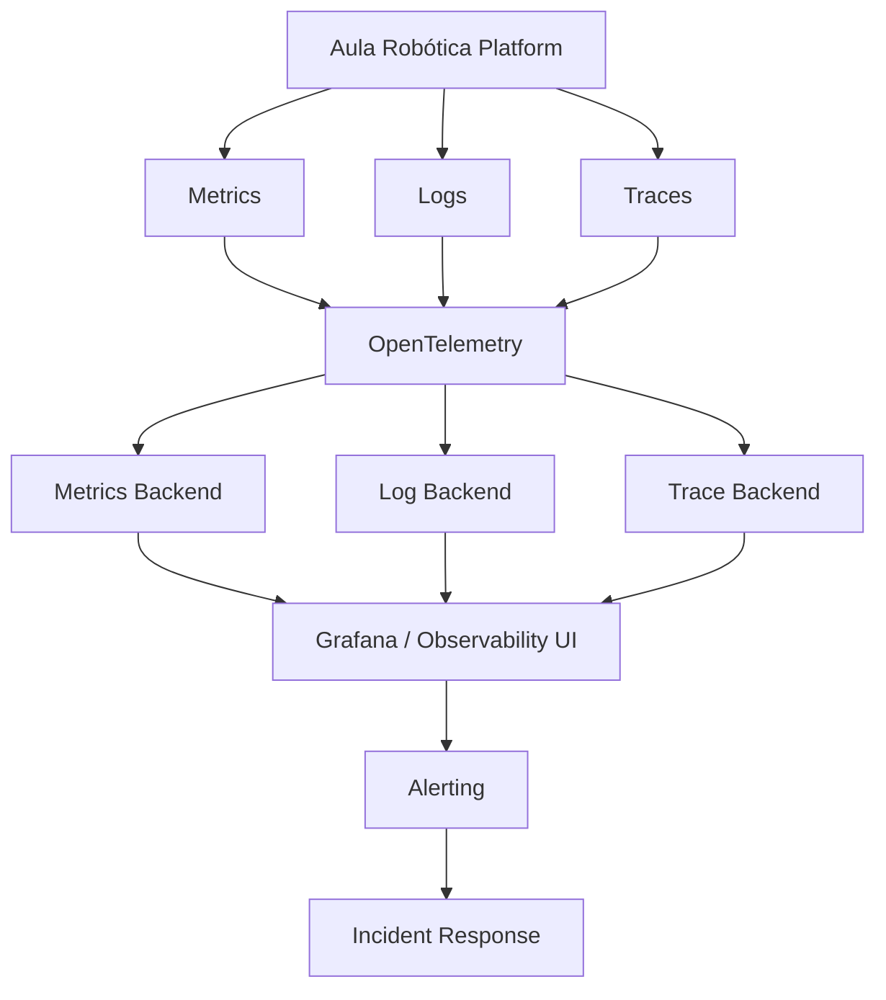
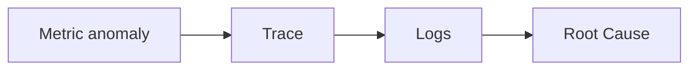
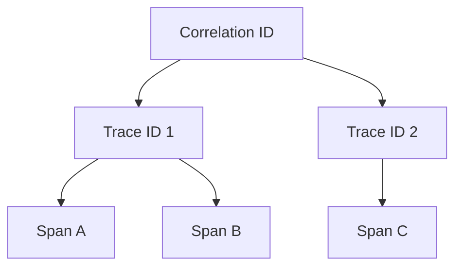
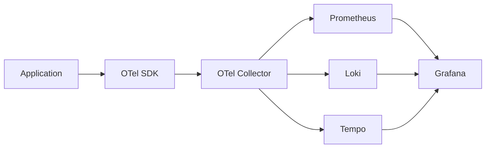
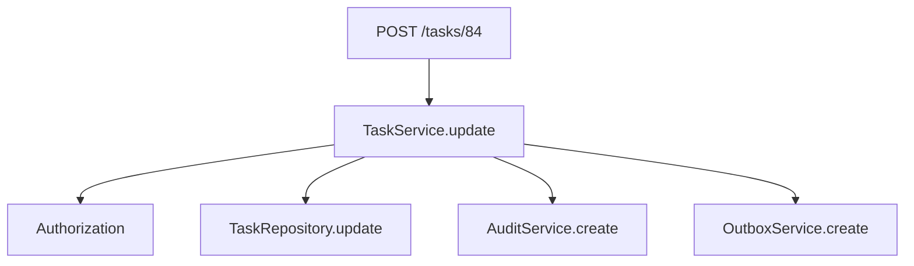
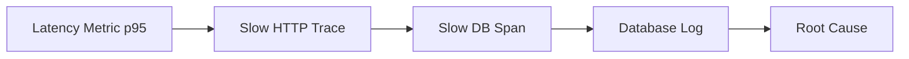
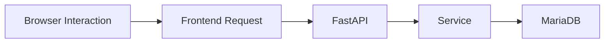
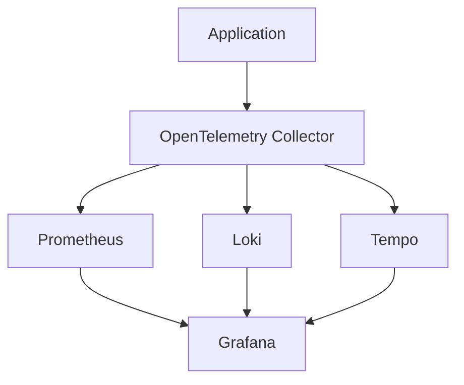
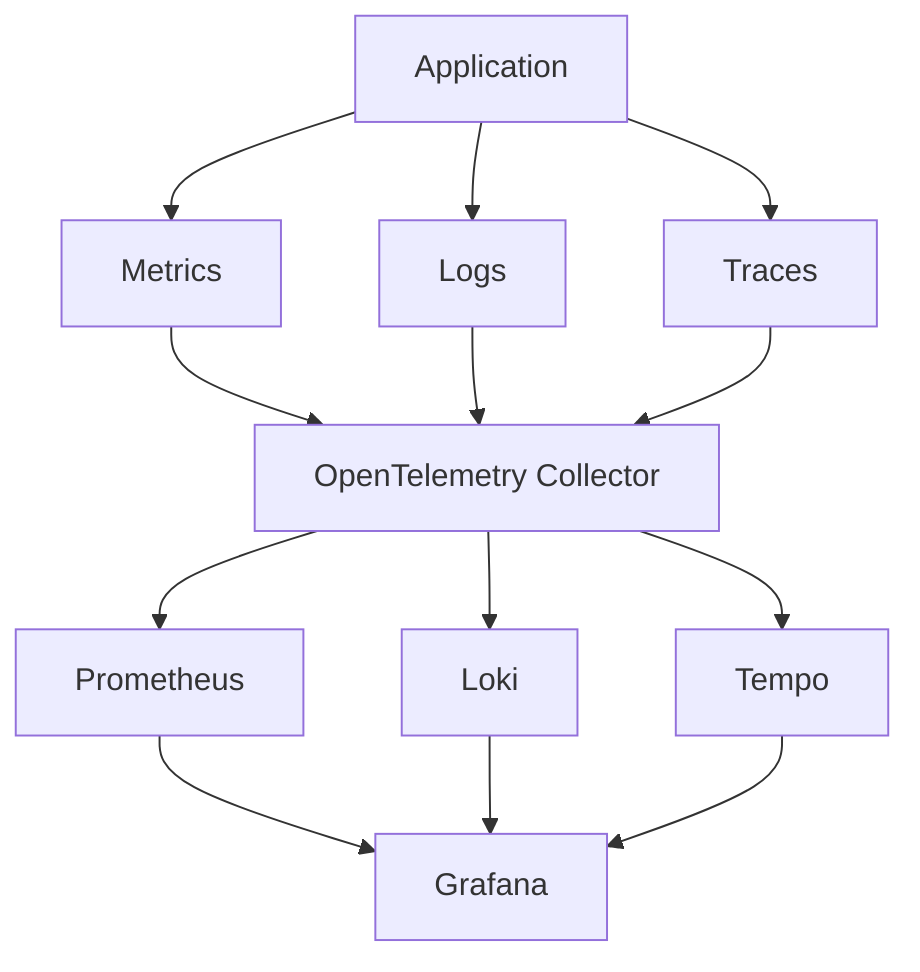
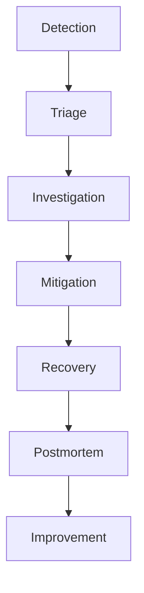

# 38_OBSERVABILITY.md

# Observability Architecture

## Parte 1 — Arquitectura, pilares, OpenTelemetry, contexto distribuido y estrategia Enterprise

---

# 1. Introducción

**Observability** define la capacidad de Aula Robótica Platform para comprender su estado interno a partir de las señales que produce durante su ejecución.

No consiste únicamente en disponer de:

- métricas;
- logs;
- traces;
- dashboards;
- alertas.

La observabilidad aparece cuando estas señales pueden relacionarse para responder preguntas sobre el comportamiento del sistema, incluso cuando el problema concreto no había sido previsto previamente.

```text
Metrics
   +
Logs
   +
Traces
   +
Context
   ↓
Observability
```

---

# 2. Objetivo

La arquitectura de Observability debe permitir responder preguntas como:

```text
¿Está funcionando la plataforma?

¿Qué componente está degradado?

¿Por qué una request concreta fue lenta?

¿Qué ocurrió antes de un error?

¿Dónde se originó una excepción?

¿Qué dependencias participaron?

¿Qué usuarios o flujos funcionales están afectados?

¿El problema comenzó después de un despliegue?
```

---

# 3. Principio fundamental

Monitoring responde principalmente:

```text
¿Qué está ocurriendo?
```

Logging ayuda a responder:

```text
¿Qué ocurrió técnicamente?
```

Tracing responde:

```text
¿Por dónde pasó la operación?
```

Observability debe permitir combinar las tres respuestas.

---

# 4. Arquitectura conceptual



---

# 5. Los tres pilares

La arquitectura utiliza tres señales principales:

```text
Metrics

Logs

Traces
```

Cada una responde a necesidades diferentes.

---

# 6. Metrics

Las métricas representan información agregada.

Ejemplos:

```text
http_requests_total

http_request_duration_seconds

db_connections_active

websocket_connections

notifications_created_total
```

Son especialmente útiles para:

- tendencias;
- dashboards;
- alertas;
- SLI;
- SLO.

---

# 7. Logs

Los logs representan eventos técnicos discretos.

Ejemplo:

```json
{
  "event": "database.query.failed",
  "query_name": "dashboard.summary",
  "correlation_id": "uuid"
}
```

Son útiles para:

- diagnóstico;
- errores;
- contexto;
- troubleshooting.

---

# 8. Traces

Los traces representan el recorrido de una operación a través del sistema.

Ejemplo:

```text
HTTP Request
    ↓
Router
    ↓
Service
    ↓
Repository
    ↓
MariaDB
    ↓
Outbox
```

---

# 9. Correlación

La observabilidad aparece cuando las señales pueden relacionarse.



---

# 10. Cuarta dimensión: contexto

Metrics, Logs y Traces necesitan contexto común.

Ejemplos:

```text
service

environment

version

trace_id

span_id

correlation_id

request_id
```

Sin contexto común, las señales permanecen aisladas.

---

# 11. Observability Context

Modelo conceptual:

```python
@dataclass(frozen=True)
class ObservabilityContext:
    service_name: str
    service_version: str
    environment: str
    correlation_id: str | None
    request_id: str | None
    trace_id: str | None
    span_id: str | None
```

No todos los campos existen en todos los escenarios.

---

# 12. Diferencia entre identificadores

Debe distinguirse:

```text
request_id
```

de:

```text
correlation_id
```

de:

```text
trace_id
```

---

# 13. Request ID

Identifica una única request HTTP.

Ejemplo:

```text
req_8d42...
```

Debe ser único.

---

# 14. Correlation ID

Relaciona operaciones pertenecientes al mismo flujo funcional.

Puede sobrevivir a:

- request original;
- Outbox;
- worker;
- Notification;
- WebSocket.

---

# 15. Trace ID

Identifica una ejecución distribuida completa dentro del sistema de tracing.

Puede abarcar:

```text
HTTP

↓

Database

↓

Worker

↓

External Service
```

---

# 16. Span ID

Identifica una operación individual dentro de un trace.

Ejemplo:

```text
TaskService.update
```

---

# 17. Relación conceptual



Un correlation ID puede abarcar más de un trace si existe procesamiento diferido.

---

# 18. Arquitectura vendor-neutral

La instrumentación no debe depender de una plataforma propietaria concreta.

Debe utilizar estándares.

La opción principal es:

```text
OpenTelemetry
```

---

# 19. OpenTelemetry

OpenTelemetry proporciona estándares y herramientas para:

- metrics;
- logs;
- traces;
- context propagation;
- instrumentation.

---

# 20. Objetivo de OpenTelemetry

Permite instrumentar una vez y elegir posteriormente distintos backends.

```text
Application

↓

OpenTelemetry

↓

Prometheus / Loki / Tempo

o

otros proveedores
```

---

# 21. Arquitectura OpenTelemetry



---

# 22. OpenTelemetry SDK

La aplicación puede utilizar SDK para producir:

- spans;
- metrics;
- logs contextuales.

---

# 23. OpenTelemetry Collector

El Collector actúa como capa intermedia.

Responsabilidades:

- recepción;
- procesamiento;
- batching;
- filtering;
- enrichment;
- redaction;
- exportación.

---

# 24. Beneficio del Collector

La aplicación no necesita conocer:

```text
Loki

Tempo

Jaeger

Datadog

OpenSearch
```

El Collector decide el destino.

---

# 25. Pipeline del Collector

```text
Receivers
    ↓
Processors
    ↓
Exporters
```

---

# 26. Receivers

Reciben telemetría.

Ejemplos:

```text
OTLP

Prometheus
```

---

# 27. Processors

Pueden:

- batch;
- redactar;
- filtrar;
- añadir metadata;
- aplicar sampling.

---

# 28. Exporters

Envían telemetría a:

- Prometheus;
- Loki;
- Tempo;
- Jaeger;
- plataformas cloud.

---

# 29. OTLP

OpenTelemetry Protocol debe ser el protocolo preferente cuando exista instrumentación OTel completa.

Puede utilizar:

```text
gRPC

HTTP
```

---

# 30. Resource Attributes

Cada servicio debe identificarse mediante atributos estándar.

Ejemplos:

```text
service.name

service.version

deployment.environment.name

service.instance.id
```

---

# 31. `service.name`

Para el monolito inicial:

```text
aula-robotica-backend
```

---

# 32. `service.version`

Debe corresponder a la versión desplegada.

Ejemplo:

```text
1.4.2
```

---

# 33. Environment

Ejemplos:

```text
development

testing

staging

production
```

---

# 34. Instance ID

En despliegues horizontales permite diferenciar:

```text
backend-1

backend-2
```

o IDs de pod.

---

# 35. Deployment Metadata

Puede incluir:

```text
git_commit

deployment_id
```

cuando resulte útil.

No necesita repetirse manualmente en cada llamada de aplicación.

---

# 36. Instrumentación automática

OpenTelemetry puede instrumentar automáticamente componentes estándar.

Ejemplos:

- FastAPI;
- ASGI;
- HTTP clients;
- SQLAlchemy;
- requests/httpx.

---

# 37. Instrumentación manual

La instrumentación automática no conoce la semántica funcional de Aula Robótica Platform.

Por ello deben añadirse spans manuales en operaciones relevantes.

---

# 38. Ejemplo funcional

```text
HTTP span

↓

task.update

↓

task.repository.update

↓

outbox.create
```

---

# 39. Span

Un span representa una unidad de trabajo.

Debe contener:

- name;
- start;
- end;
- attributes;
- status;
- events.

---

# 40. Trace

Un trace contiene múltiples spans conectados.



---

# 41. Nombre del Span

Debe ser estable.

Ejemplos:

```text
HTTP POST /tasks/{task_id}

task.update

task.repository.update

notification.create
```

No debe incluir IDs concretos en el nombre.

---

# 42. Span Attributes

Pueden contener contexto adicional.

Ejemplo:

```text
task.status

project.role

operation.result
```

Debe mantenerse baja la cantidad y proteger datos sensibles.

---

# 43. IDs de dominio en spans

Puede existir:

```text
task.id
```

cuando resulta necesario para diagnóstico.

Debe evitarse usar estos valores como dimensiones de métricas.

---

# 44. Datos sensibles

Nunca añadir a spans:

- passwords;
- tokens;
- cookies;
- JWT;
- payloads completos;
- contenido de archivos.

---

# 45. Span Events

Permiten registrar hitos dentro de un span.

Ejemplo:

```text
optimistic_lock_conflict
```

---

# 46. Span Status

Estados principales:

```text
UNSET

OK

ERROR
```

No toda respuesta HTTP 4xx necesita marcar el trace como error técnico.

---

# 47. Errores funcionales

Ejemplos:

```text
ValidationError

NotFound

Conflict
```

pueden ser resultados esperados del dominio.

No deben contaminar automáticamente las tasas de errores técnicos.

---

# 48. Excepciones inesperadas

Deben registrarse en el span.

Incluyen:

```text
exception.type

exception.message

stack
```

respetando las políticas de seguridad.

---

# 49. Parent-Child

Los spans deben mantener relación padre-hijo.

```text
HTTP Request
    ↓
Task Service
        ↓
Repository
```

---

# 50. Context Propagation

El contexto debe propagarse automáticamente entre capas.

No debe pasarse manualmente:

```text
trace_id
```

como parámetro funcional de todos los métodos.

---

# 51. Context local

En ejecución síncrona o async se utiliza el contexto de OpenTelemetry.

---

# 52. Contexto HTTP distribuido

Entre servicios debe propagarse mediante headers estándar.

Principal:

```text
traceparent
```

---

# 53. W3C Trace Context

Formato estándar recomendado.

Incluye:

```text
trace_id

parent_span_id

flags
```

---

# 54. `tracestate`

Puede complementar:

```text
traceparent
```

cuando existen proveedores específicos.

Debe mantenerse compatible con W3C.

---

# 55. Correlation ID HTTP

Puede mantenerse además:

```text
X-Correlation-ID
```

porque tiene una semántica funcional distinta del trace.

---

# 56. Headers externos

Un cliente no confiable puede proporcionar:

```text
traceparent

X-Correlation-ID
```

La aplicación debe aplicar políticas de validación y trust boundary.

---

# 57. Trust Boundary

La plataforma debe decidir:

- qué contexto acepta;
- qué contexto reemplaza;
- qué contexto propaga.

No debe permitir campos arbitrariamente grandes.

---

# 58. Context Propagation en Outbox

Una operación puede generar:

```text
HTTP Trace

↓

Outbox Event

↓

Worker Trace
```

El evento debe conservar suficiente contexto para relacionarlos.

---

# 59. Trace Context en Outbox

Puede almacenar:

```text
traceparent

correlation_id
```

como metadata técnica.

No como parte del payload funcional.

---

# 60. Async Trace

Existen dos opciones:

## Continuar trace

Worker crea un span conectado al contexto original.

## Crear nuevo trace enlazado

Más adecuado cuando existe un retraso significativo.

---

# 61. Span Links

OpenTelemetry permite relacionar procesamiento asíncrono mediante:

```text
Span Links
```

Esto evita representar artificialmente una operación diferida como un único árbol temporal continuo.

---

# 62. Estrategia recomendada para Outbox

Para procesamiento diferido:

```text
original trace

↓

Outbox context

↓

new consumer trace

↓

Span Link
```

manteniendo además:

```text
correlation_id
```

---

# 63. Workers

Cada worker debe instrumentar:

- event consumption;
- processing;
- external calls;
- retries;
- result.

---

# 64. Worker Span

Ejemplo:

```text
outbox.process notification.created
```

---

# 65. Retry Attributes

Puede incluir:

```text
messaging.message.id

retry.attempt

operation.result
```

---

# 66. Scheduled Jobs

Cada ejecución programada debe producir un trace o span raíz cuando resulte útil.

Ejemplo:

```text
scheduler.task_due_reminders
```

---

# 67. Scheduler Attributes

```text
job.name

job.execution_id

processed_count

result
```

---

# 68. Database Tracing

Las operaciones SQL pueden instrumentarse automáticamente.

Debe conocerse:

- sistema;
- operación;
- duración;
- errores.

---

# 69. Database Attributes

Ejemplos estándar:

```text
db.system

db.namespace

db.operation.name
```

La instrumentación exacta debe seguir las convenciones semánticas de OpenTelemetry adoptadas.

---

# 70. SQL Statement

No debe almacenarse indiscriminadamente SQL completo con valores.

Puede contener información sensible.

---

# 71. Query Name

La instrumentación manual puede añadir:

```text
app.db.query_name
```

Ejemplo:

```text
dashboard.summary
```

para facilitar diagnóstico.

---

# 72. Slow Query

Una query lenta puede observarse simultáneamente mediante:

```text
Metric

+

Trace Span

+

Log
```

---

# 73. Correlación SQL

Flujo ideal:



---

# 74. External HTTP Calls

Toda llamada externa debe instrumentarse.

Ejemplos futuros:

- email provider;
- object storage;
- AI provider;
- external APIs.

---

# 75. Client Span

Debe medir:

- destino lógico;
- operación;
- status;
- duración;
- retry.

---

# 76. URLs externas

No debe almacenarse la URL completa si contiene:

- IDs sensibles;
- query params;
- tokens.

Debe utilizarse ruta normalizada o atributos seguros.

---

# 77. Object Storage

Operations:

```text
attachment.upload

attachment.download

attachment.delete
```

pueden tener spans propios.

---

# 78. Attachment Upload Trace

Ejemplo:

```text
HTTP upload

↓

attachment.validate

↓

storage.put

↓

attachment.repository.create

↓

outbox.create
```

---

# 79. WebSocket Tracing

No debe crear necesariamente un trace completo para cada mensaje realtime si el volumen es alto.

Debe instrumentarse de manera selectiva.

---

# 80. WebSocket Connect

Puede generar:

```text
websocket.connect
```

con:

- result;
- authentication status;
- duration.

---

# 81. Broadcast

Para eventos importantes puede trazarse:

```text
realtime.broadcast
```

especialmente cuando cruza:

```text
Outbox

↓

Worker

↓

WebSocket
```

---

# 82. High-volume Events

Eventos realtime muy frecuentes deben utilizar:

- metrics;
- sampling;
- spans seleccionados.

No generar trazas exhaustivas indiscriminadamente.

---

# 83. Frontend Observability

Una evolución puede incorporar señales del navegador.

Ejemplos:

- page load;
- API latency;
- JS errors;
- WebSocket failures;
- Core Web Vitals.

---

# 84. Browser Tracing

El frontend puede crear un trace que continúe en el backend mediante:

```text
traceparent
```

---

# 85. End-to-End Trace



Esto permite medir la operación desde la perspectiva del usuario.

---

# 86. RUM

Real User Monitoring puede incorporarse posteriormente.

Debe respetar:

- privacidad;
- consentimiento cuando proceda;
- minimización;
- sampling.

---

# 87. Core Web Vitals

Una futura monitorización frontend puede incluir:

```text
LCP

INP

CLS
```

cuando resulte relevante para la experiencia.

---

# 88. Tracing Sampling

No todos los traces necesitan almacenarse.

Debe existir una política de sampling.

---

# 89. Head Sampling

La decisión se toma al comenzar el trace.

Ejemplo:

```text
10 %
```

Ventaja:

- bajo coste.

Problema:

- puede descartar traces con errores posteriores.

---

# 90. Tail Sampling

La decisión se toma cuando el trace ya terminó.

Permite conservar:

- errores;
- traces lentos;
- casos anómalos.

Requiere infraestructura adicional.

---

# 91. Política futura recomendada

En producción avanzada:

```text
sample normal traffic

keep errors

keep slow traces

keep critical operations
```

---

# 92. Development Sampling

En desarrollo puede utilizarse:

```text
100 %
```

si el volumen es bajo.

---

# 93. Production Sampling

Debe basarse en:

- tráfico;
- almacenamiento;
- coste;
- necesidades operativas.

---

# 94. Error Sampling

Los traces con errores inesperados deberían conservarse con una tasa mayor.

---

# 95. Critical Path

Operaciones críticas pueden tener una política especial.

Ejemplos:

```text
authentication

project permissions

attachment upload

outbox processing
```

---

# 96. Sampling y correlación

Aunque un trace no se almacene, los logs y métricas deben continuar funcionando.

---

# 97. Exemplars

Los histogramas de Prometheus pueden incluir exemplars asociados a:

```text
trace_id
```

---

# 98. Utilidad de Exemplars

Permiten:

```text
p95 latency spike

↓

abrir trace representativo
```

directamente desde Grafana.

---

# 99. Arquitectura Grafana

Una plataforma integrada puede utilizar:

```text
Prometheus → Metrics

Loki → Logs

Tempo → Traces

Grafana → Unified UI
```

---

# 100. Grafana Stack



---

# 101. Prometheus

Responsable de métricas.

---

# 102. Loki

Responsable de logs.

---

# 103. Tempo

Responsable de traces.

---

# 104. Grafana

Proporciona:

- dashboards;
- exploración;
- correlación;
- alertas;
- enlaces entre señales.

---

# 105. Jaeger

Puede utilizarse como backend o interfaz de tracing alternativa.

La aplicación no debe depender de Tempo o Jaeger directamente.

---

# 106. Service Map

Los traces permiten generar un mapa de dependencias.

En el monolito inicial será simple.

En el futuro puede representar:

```text
Frontend

↓

Backend

↓

Worker

↓

Database

↓

External APIs
```

---

# 107. Dependency Map

Debe permitir detectar:

- latencia;
- errores;
- dependencias críticas.

---

# 108. Monolito modular

Aunque Aula Robótica Platform sea inicialmente un monolito modular, tracing sigue siendo útil.

Permite identificar:

- Services lentos;
- SQL lento;
- Outbox;
- storage;
- integrations.

---

# 109. Microservicios futuros

Si algunos módulos se separan:

```text
Notifications Service

Attachment Service

AI Service
```

la instrumentación existente podrá continuar sin rediseño conceptual.

---

# 110. Service Boundary

Cada servicio futuro debe mantener:

```text
service.name
```

diferente.

---

# 111. Propagación entre servicios

Toda llamada debe propagar:

```text
traceparent
```

y, cuando corresponda:

```text
correlation_id
```

---

# 112. Messaging

Si se incorpora:

- Kafka;
- RabbitMQ;
- Redis Streams;

el tracing debe seguir las convenciones de messaging de OpenTelemetry.

---

# 113. Producer Span

Representa:

```text
publish message
```

---

# 114. Consumer Span

Representa:

```text
process message
```

---

# 115. Message ID

Puede utilizarse como atributo técnico.

No sustituye:

```text
trace_id
```

ni:

```text
event_id
```

---

# 116. Event ID

Debe mantenerse para idempotencia de dominio o integración.

---

# 117. Diferencia Event ID / Trace ID

```text
event_id
```

identifica un evento funcional/técnico concreto.

```text
trace_id
```

identifica una ejecución observada.

El mismo evento puede procesarse varias veces y producir varios traces de retry.

---

# 118. Correlation Matrix

| Identificador | Responsabilidad |
|---|---|
| `request_id` | Request HTTP |
| `correlation_id` | Flujo funcional |
| `trace_id` | Ejecución distribuida |
| `span_id` | Operación dentro del trace |
| `event_id` | Evento |
| `execution_id` | Ejecución de job/worker |

---

# 119. No reutilizar identificadores

Debe evitarse utilizar:

```text
event_id
```

como:

```text
correlation_id
```

solo para ahorrar campos.

Cada identificador tiene semántica propia.

---

# 120. Trace Attributes de negocio

Pueden añadirse atributos de baja sensibilidad que ayuden a comprender operaciones.

Ejemplos:

```text
app.module = tasks

app.operation = update

app.result = success
```

---

# 121. Cardinalidad y traces

Los traces admiten mayor cardinalidad que las métricas.

Aun así, debe evitarse añadir información innecesaria.

---

# 122. User ID en traces

Puede incluirse un identificador técnico cuando esté justificado para troubleshooting.

Debe:

- evitar PII directa;
- respetar retención;
- restringir acceso.

---

# 123. Project ID

Puede resultar útil para investigar operaciones concretas.

No debe utilizarse como dimensión de métricas Prometheus.

---

# 124. Sensitive Attributes

Nunca:

```text
user.email

authorization.token

task.description

attachment.content
```

como atributos ordinarios del trace.

---

# 125. Baggage

OpenTelemetry permite propagar:

```text
baggage
```

entre servicios.

Debe utilizarse con extrema cautela.

---

# 126. Baggage Risk

El baggage:

- se propaga;
- puede aumentar headers;
- puede alcanzar servicios externos;
- puede contener información sensible accidentalmente.

---

# 127. Uso recomendado de Baggage

Solo valores:

- pequeños;
- no sensibles;
- verdaderamente necesarios.

No utilizarlo como almacenamiento de contexto de usuario.

---

# 128. Correlation ID como Baggage

Puede propagarse como baggage si la arquitectura lo requiere.

También puede utilizar un header explícito.

Debe mantenerse una sola estrategia consistente.

---

# 129. Instrumentación por capas

Las capas relevantes:

```text
Router

Service

Repository

Integration

Worker
```

pueden producir spans.

No todas las funciones necesitan uno.

---

# 130. Evitar span explosion

No crear spans para:

- getters;
- validaciones triviales;
- helpers pequeños;
- loops internos.

Los spans deben representar unidades operativas relevantes.

---

# 131. Router Span

La instrumentación HTTP automática ya genera normalmente el span raíz.

No es necesario duplicarlo manualmente.

---

# 132. Service Span

Puede resultar útil para operaciones complejas.

Ejemplo:

```text
task.complete
```

---

# 133. Repository Span

Puede utilizarse para queries de dominio significativas cuando la instrumentación SQL automática no aporta suficiente semántica.

---

# 134. Nested SQL Spans

Debe evitarse una jerarquía redundante:

```text
repository.query

↓

sql.execute

↓

driver.execute
```

si no aporta valor.

---

# 135. Custom Events

Dentro de un span pueden registrarse hitos específicos.

Ejemplo:

```text
authorization.completed

optimistic_lock.detected

outbox.created
```

---

# 136. Span Duration

La duración se calcula automáticamente.

No necesita además un atributo:

```text
duration_ms
```

salvo integraciones específicas.

---

# 137. Metrics from Traces

Algunos backends pueden generar métricas a partir de traces.

Ejemplos:

- request rate;
- error rate;
- latency.

---

# 138. Span Metrics

Una futura arquitectura puede generar métricas RED automáticamente desde spans.

---

# 139. Metrics explícitas

Aun así, las métricas funcionales como:

```text
tasks_completed_total
```

deben emitirse explícitamente.

No deben inferirse exclusivamente de traces.

---

# 140. Observability como sistema

La arquitectura completa puede representarse:



---

# 141. Source of Truth

Observability no debe convertirse en fuente de verdad funcional.

Nunca debe reconstruirse:

```text
Task.status
```

desde logs o traces para operaciones del dominio.

---

# 142. Telemetry Loss

Las señales de observabilidad pueden perderse parcialmente sin corromper el dominio.

El sistema funcional debe permanecer independiente.

---

# 143. Telemetry Failure

Si OpenTelemetry falla:

```text
domain operation

continues
```

salvo situaciones excepcionales expresamente diseñadas.

---

# 144. Fail-Open

La telemetría ordinaria debe utilizar una estrategia:

```text
fail-open
```

respecto al dominio.

Un fallo de exportación no debe impedir crear una Task.

---

# 145. Exceptions

Audit Log tiene requisitos de persistencia distintos.

No debe confundirse:

```text
telemetry
```

con:

```text
auditability
```

---

# 146. Batching

El Collector debe agrupar telemetría antes de enviarla.

Esto reduce:

- conexiones;
- overhead;
- coste.

---

# 147. Queue

Puede utilizarse buffering limitado entre aplicación y backend.

---

# 148. Backpressure

Debe monitorizarse si:

```text
telemetry production

>

export capacity
```

---

# 149. Telemetry Drop

Si se descartan señales por saturación debe existir una métrica interna.

Ejemplo:

```text
otel_dropped_spans_total
```

---

# 150. Observability of Observability

El propio stack debe supervisarse.

Debe conocerse:

- collector availability;
- queue size;
- dropped telemetry;
- exporter errors;
- storage usage.

---

# 151. Collector Metrics

Ejemplos conceptuales:

```text
otelcol_receiver_accepted_spans

otelcol_exporter_send_failed_spans

otelcol_processor_dropped_spans
```

Los nombres exactos dependerán de la versión y configuración desplegada.

---

# 152. Backend Health

Debe monitorizarse:

- Prometheus;
- Loki;
- Tempo;
- Grafana;
- Collector.

---

# 153. Stack Dependency

La aplicación no debe depender funcionalmente de Grafana.

Grafana puede estar caída y Aula Robótica Platform continuar operativa.

---

# 154. Observability Environment Separation

Cada entorno debe identificarse claramente.

Nunca mezclar visualmente:

```text
production

staging
```

sin filtros evidentes.

---

# 155. Data Isolation

Puede utilizarse:

- tenants;
- labels;
- datasources;
- namespaces.

Depende de infraestructura.

---

# 156. Producción

Debe ser imposible confundir fácilmente eventos de producción con desarrollo.

---

# 157. Naming Convention

Los nombres de spans, métricas y eventos deben ser consistentes.

Ejemplos:

```text
task.create

task.update

task.complete

attachment.upload

notification.create
```

---

# 158. Semantic Conventions

Cuando exista una convención estándar OpenTelemetry debe preferirse sobre un atributo inventado.

Los atributos específicos de aplicación deben utilizar un namespace propio.

Ejemplo:

```text
app.project.id

app.operation.result
```

---

# 159. Namespace propio

Una opción:

```text
aula.*
```

Ejemplo:

```text
aula.module

aula.project.role
```

Debe documentarse antes de extenderlo ampliamente.

---

# 160. Observability Contract

La telemetría constituye un contrato operacional.

Cambiar:

```text
task.complete
```

a:

```text
task.finish
```

puede romper:

- dashboards;
- queries;
- alertas;
- runbooks.

---

# 161. Versionado

Los cambios relevantes deben tratarse con cuidado y documentarse.

---

# 162. Catálogo de telemetría

Debe mantenerse un catálogo de:

- métricas;
- eventos de log;
- spans;
- atributos;
- alertas.

---

# 163. Documentación mínima de Span

Cada span manual relevante debería indicar:

```text
name

purpose

attributes

errors

parent
```

---

# 164. Documentación mínima de Metric

Como se definió en Monitoring:

```text
name

type

unit

labels

description
```

---

# 165. Documentación mínima de Log Event

Como se definió en Logging:

```text
event

level

fields

purpose
```

---

# 166. Observability Governance

Toda nueva funcionalidad importante debe considerar desde diseño:

```text
¿Cómo sabremos que funciona?

¿Cómo detectaremos que falla?

¿Cómo investigaremos el fallo?
```

---

# 167. Definition of Done

Una feature crítica no debería considerarse completamente terminada si carece de señales mínimas de operación.

---

# 168. Telemetry by Design

Para cada caso de uso relevante deben identificarse:

- métricas;
- errores;
- logs;
- spans;
- alertas cuando proceda.

---

# 169. Ejemplo: Task Complete

Monitoring:

```text
tasks_completed_total
```

Logging:

```text
task.complete.failed
```

Tracing:

```text
task.complete
```

Audit:

```text
TASK_COMPLETED
```

Activity Feed:

```text
Fran completó la tarea...
```

Son señales distintas y complementarias.

---

# 170. Ejemplo: Attachment Upload

Metrics:

```text
attachment_upload_total

attachment_upload_duration_seconds
```

Logs:

```text
attachment.upload.failed
```

Trace:

```text
attachment.upload
    ↓
storage.put
```

---

# 171. Ejemplo: Notification

Metrics:

```text
notifications_created_total
```

Logs:

```text
notification.delivery.failed
```

Trace:

```text
notification.create

↓

outbox.publish

↓

realtime.broadcast
```

---

# 172. Ejemplo: Dashboard

Metrics:

```text
dashboard_request_duration_seconds
```

Logs:

```text
dashboard.widget.slow
```

Trace:

```text
dashboard.load

↓

dashboard.tasks

↓

database query
```

---

# 173. SLI

La observabilidad debe permitir construir Service Level Indicators.

Ejemplos:

```text
availability

latency

error rate
```

---

# 174. SLO

Los SLO establecen objetivos.

Ejemplo:

```text
99.9 % de requests correctas
```

durante un periodo determinado.

---

# 175. Error Budget

A partir del SLO puede calcularse un presupuesto de error.

Ejemplo:

```text
SLO = 99.9 %

Error Budget = 0.1 %
```

---

# 176. Error Budget Purpose

Permite equilibrar:

- velocidad de entrega;
- fiabilidad;
- riesgo.

No debe introducirse burocráticamente sin un objetivo operativo real.

---

# 177. Observability Dashboard

Debe existir una visión global del sistema con:

- availability;
- latency;
- traffic;
- errors;
- saturation.

---

# 178. Service Dashboard

Cada servicio futuro puede disponer de:

- RED;
- dependencies;
- errors;
- traces.

---

# 179. Domain Dashboard

Puede existir una vista operacional sobre módulos importantes:

- Tasks;
- Attachments;
- Notifications;
- Realtime.

---

# 180. No mezclar business Dashboard

El Dashboard funcional de usuarios es diferente de Grafana.

```text
Application Dashboard
```

sirve a usuarios funcionales.

```text
Observability Dashboard
```

sirve a operación técnica.

---

# 181. Acceso

Los dashboards de observabilidad deben estar protegidos.

No deben ser públicos.

---

# 182. Roles técnicos

Puede distinguirse:

- developer;
- operations;
- administrator;
- security.

---

# 183. Sensitive Telemetry

Algunos traces o logs pueden contener IDs técnicos o contexto de seguridad.

El acceso debe restringirse.

---

# 184. Parte siguiente

La **Parte 2** desarrollará:

- tracing distribuido avanzado;
- correlación Logs–Metrics–Traces;
- Grafana;
- Tempo/Jaeger;
- service maps;
- exemplars;
- dashboards;
- SLI/SLO;
- alerting;
- error budgets;
- incident detection;
- observabilidad de módulos críticos.

---

# 38_OBSERVABILITY.md

# Observability Architecture

## Parte 1 — Arquitectura, pilares, OpenTelemetry, contexto distribuido y estrategia Enterprise

---

# 1. Introducción

**Observability** define la capacidad de Aula Robótica Platform para comprender su estado interno a partir de las señales que produce durante su ejecución.

No consiste únicamente en disponer de:

- métricas;
- logs;
- traces;
- dashboards;
- alertas.

La observabilidad aparece cuando estas señales pueden relacionarse para responder preguntas sobre el comportamiento del sistema, incluso cuando el problema concreto no había sido previsto previamente.

```text
Metrics
   +
Logs
   +
Traces
   +
Context
   ↓
Observability
```

---

# 2. Objetivo

La arquitectura de Observability debe permitir responder preguntas como:

```text
¿Está funcionando la plataforma?

¿Qué componente está degradado?

¿Por qué una request concreta fue lenta?

¿Qué ocurrió antes de un error?

¿Dónde se originó una excepción?

¿Qué dependencias participaron?

¿Qué usuarios o flujos funcionales están afectados?

¿El problema comenzó después de un despliegue?
```

---

# 3. Principio fundamental

Monitoring responde principalmente:

```text
¿Qué está ocurriendo?
```

Logging ayuda a responder:

```text
¿Qué ocurrió técnicamente?
```

Tracing responde:

```text
¿Por dónde pasó la operación?
```

Observability debe permitir combinar las tres respuestas.

---

# 4. Arquitectura conceptual


---

# 5. Los tres pilares

La arquitectura utiliza tres señales principales:

```text
Metrics

Logs

Traces
```

Cada una responde a necesidades diferentes.

---

# 6. Metrics

Las métricas representan información agregada.

Ejemplos:

```text
http_requests_total

http_request_duration_seconds

db_connections_active

websocket_connections

notifications_created_total
```

Son especialmente útiles para:

- tendencias;
- dashboards;
- alertas;
- SLI;
- SLO.

---

# 7. Logs

Los logs representan eventos técnicos discretos.

Ejemplo:

```json
{
  "event": "database.query.failed",
  "query_name": "dashboard.summary",
  "correlation_id": "uuid"
}
```

Son útiles para:

- diagnóstico;
- errores;
- contexto;
- troubleshooting.

---

# 8. Traces

Los traces representan el recorrido de una operación a través del sistema.

Ejemplo:

```text
HTTP Request
    ↓
Router
    ↓
Service
    ↓
Repository
    ↓
MariaDB
    ↓
Outbox
```

---

# 9. Correlación

La observabilidad aparece cuando las señales pueden relacionarse.


---

# 10. Cuarta dimensión: contexto

Metrics, Logs y Traces necesitan contexto común.

Ejemplos:

```text
service

environment

version

trace_id

span_id

correlation_id

request_id
```

Sin contexto común, las señales permanecen aisladas.

---

# 11. Observability Context

Modelo conceptual:

```python
@dataclass(frozen=True)
class ObservabilityContext:
    service_name: str
    service_version: str
    environment: str
    correlation_id: str | None
    request_id: str | None
    trace_id: str | None
    span_id: str | None
```

No todos los campos existen en todos los escenarios.

---

# 12. Diferencia entre identificadores

Debe distinguirse:

```text
request_id
```

de:

```text
correlation_id
```

de:

```text
trace_id
```

---

# 13. Request ID

Identifica una única request HTTP.

Ejemplo:

```text
req_8d42...
```

Debe ser único.

---

# 14. Correlation ID

Relaciona operaciones pertenecientes al mismo flujo funcional.

Puede sobrevivir a:

- request original;
- Outbox;
- worker;
- Notification;
- WebSocket.

---

# 15. Trace ID

Identifica una ejecución distribuida completa dentro del sistema de tracing.

Puede abarcar:

```text
HTTP

↓

Database

↓

Worker

↓

External Service
```

---

# 16. Span ID

Identifica una operación individual dentro de un trace.

Ejemplo:

```text
TaskService.update
```

---

# 17. Relación conceptual


Un correlation ID puede abarcar más de un trace si existe procesamiento diferido.

---

# 18. Arquitectura vendor-neutral

La instrumentación no debe depender de una plataforma propietaria concreta.

Debe utilizar estándares.

La opción principal es:

```text
OpenTelemetry
```

---

# 19. OpenTelemetry

OpenTelemetry proporciona estándares y herramientas para:

- metrics;
- logs;
- traces;
- context propagation;
- instrumentation.

---

# 20. Objetivo de OpenTelemetry

Permite instrumentar una vez y elegir posteriormente distintos backends.

```text
Application

↓

OpenTelemetry

↓

Prometheus / Loki / Tempo

o

otros proveedores
```

---

# 21. Arquitectura OpenTelemetry


---

# 22. OpenTelemetry SDK

La aplicación puede utilizar SDK para producir:

- spans;
- metrics;
- logs contextuales.

---

# 23. OpenTelemetry Collector

El Collector actúa como capa intermedia.

Responsabilidades:

- recepción;
- procesamiento;
- batching;
- filtering;
- enrichment;
- redaction;
- exportación.

---

# 24. Beneficio del Collector

La aplicación no necesita conocer:

```text
Loki

Tempo

Jaeger

Datadog

OpenSearch
```

El Collector decide el destino.

---

# 25. Pipeline del Collector

```text
Receivers
    ↓
Processors
    ↓
Exporters
```

---

# 26. Receivers

Reciben telemetría.

Ejemplos:

```text
OTLP

Prometheus
```

---

# 27. Processors

Pueden:

- batch;
- redactar;
- filtrar;
- añadir metadata;
- aplicar sampling.

---

# 28. Exporters

Envían telemetría a:

- Prometheus;
- Loki;
- Tempo;
- Jaeger;
- plataformas cloud.

---

# 29. OTLP

OpenTelemetry Protocol debe ser el protocolo preferente cuando exista instrumentación OTel completa.

Puede utilizar:

```text
gRPC

HTTP
```

---

# 30. Resource Attributes

Cada servicio debe identificarse mediante atributos estándar.

Ejemplos:

```text
service.name

service.version

deployment.environment.name

service.instance.id
```

---

# 31. `service.name`

Para el monolito inicial:

```text
aula-robotica-backend
```

---

# 32. `service.version`

Debe corresponder a la versión desplegada.

Ejemplo:

```text
1.4.2
```

---

# 33. Environment

Ejemplos:

```text
development

testing

staging

production
```

---

# 34. Instance ID

En despliegues horizontales permite diferenciar:

```text
backend-1

backend-2
```

o IDs de pod.

---

# 35. Deployment Metadata

Puede incluir:

```text
git_commit

deployment_id
```

cuando resulte útil.

No necesita repetirse manualmente en cada llamada de aplicación.

---

# 36. Instrumentación automática

OpenTelemetry puede instrumentar automáticamente componentes estándar.

Ejemplos:

- FastAPI;
- ASGI;
- HTTP clients;
- SQLAlchemy;
- requests/httpx.

---

# 37. Instrumentación manual

La instrumentación automática no conoce la semántica funcional de Aula Robótica Platform.

Por ello deben añadirse spans manuales en operaciones relevantes.

---

# 38. Ejemplo funcional

```text
HTTP span

↓

task.update

↓

task.repository.update

↓

outbox.create
```

---

# 39. Span

Un span representa una unidad de trabajo.

Debe contener:

- name;
- start;
- end;
- attributes;
- status;
- events.

---

# 40. Trace

Un trace contiene múltiples spans conectados.


---

# 41. Nombre del Span

Debe ser estable.

Ejemplos:

```text
HTTP POST /tasks/{task_id}

task.update

task.repository.update

notification.create
```

No debe incluir IDs concretos en el nombre.

---

# 42. Span Attributes

Pueden contener contexto adicional.

Ejemplo:

```text
task.status

project.role

operation.result
```

Debe mantenerse baja la cantidad y proteger datos sensibles.

---

# 43. IDs de dominio en spans

Puede existir:

```text
task.id
```

cuando resulta necesario para diagnóstico.

Debe evitarse usar estos valores como dimensiones de métricas.

---

# 44. Datos sensibles

Nunca añadir a spans:

- passwords;
- tokens;
- cookies;
- JWT;
- payloads completos;
- contenido de archivos.

---

# 45. Span Events

Permiten registrar hitos dentro de un span.

Ejemplo:

```text
optimistic_lock_conflict
```

---

# 46. Span Status

Estados principales:

```text
UNSET

OK

ERROR
```

No toda respuesta HTTP 4xx necesita marcar el trace como error técnico.

---

# 47. Errores funcionales

Ejemplos:

```text
ValidationError

NotFound

Conflict
```

pueden ser resultados esperados del dominio.

No deben contaminar automáticamente las tasas de errores técnicos.

---

# 48. Excepciones inesperadas

Deben registrarse en el span.

Incluyen:

```text
exception.type

exception.message

stack
```

respetando las políticas de seguridad.

---

# 49. Parent-Child

Los spans deben mantener relación padre-hijo.

```text
HTTP Request
    ↓
Task Service
        ↓
Repository
```

---

# 50. Context Propagation

El contexto debe propagarse automáticamente entre capas.

No debe pasarse manualmente:

```text
trace_id
```

como parámetro funcional de todos los métodos.

---

# 51. Context local

En ejecución síncrona o async se utiliza el contexto de OpenTelemetry.

---

# 52. Contexto HTTP distribuido

Entre servicios debe propagarse mediante headers estándar.

Principal:

```text
traceparent
```

---

# 53. W3C Trace Context

Formato estándar recomendado.

Incluye:

```text
trace_id

parent_span_id

flags
```

---

# 54. `tracestate`

Puede complementar:

```text
traceparent
```

cuando existen proveedores específicos.

Debe mantenerse compatible con W3C.

---

# 55. Correlation ID HTTP

Puede mantenerse además:

```text
X-Correlation-ID
```

porque tiene una semántica funcional distinta del trace.

---

# 56. Headers externos

Un cliente no confiable puede proporcionar:

```text
traceparent

X-Correlation-ID
```

La aplicación debe aplicar políticas de validación y trust boundary.

---

# 57. Trust Boundary

La plataforma debe decidir:

- qué contexto acepta;
- qué contexto reemplaza;
- qué contexto propaga.

No debe permitir campos arbitrariamente grandes.

---

# 58. Context Propagation en Outbox

Una operación puede generar:

```text
HTTP Trace

↓

Outbox Event

↓

Worker Trace
```

El evento debe conservar suficiente contexto para relacionarlos.

---

# 59. Trace Context en Outbox

Puede almacenar:

```text
traceparent

correlation_id
```

como metadata técnica.

No como parte del payload funcional.

---

# 60. Async Trace

Existen dos opciones:

## Continuar trace

Worker crea un span conectado al contexto original.

## Crear nuevo trace enlazado

Más adecuado cuando existe un retraso significativo.

---

# 61. Span Links

OpenTelemetry permite relacionar procesamiento asíncrono mediante:

```text
Span Links
```

Esto evita representar artificialmente una operación diferida como un único árbol temporal continuo.

---

# 62. Estrategia recomendada para Outbox

Para procesamiento diferido:

```text
original trace

↓

Outbox context

↓

new consumer trace

↓

Span Link
```

manteniendo además:

```text
correlation_id
```

---

# 63. Workers

Cada worker debe instrumentar:

- event consumption;
- processing;
- external calls;
- retries;
- result.

---

# 64. Worker Span

Ejemplo:

```text
outbox.process notification.created
```

---

# 65. Retry Attributes

Puede incluir:

```text
messaging.message.id

retry.attempt

operation.result
```

---

# 66. Scheduled Jobs

Cada ejecución programada debe producir un trace o span raíz cuando resulte útil.

Ejemplo:

```text
scheduler.task_due_reminders
```

---

# 67. Scheduler Attributes

```text
job.name

job.execution_id

processed_count

result
```

---

# 68. Database Tracing

Las operaciones SQL pueden instrumentarse automáticamente.

Debe conocerse:

- sistema;
- operación;
- duración;
- errores.

---

# 69. Database Attributes

Ejemplos estándar:

```text
db.system

db.namespace

db.operation.name
```

La instrumentación exacta debe seguir las convenciones semánticas de OpenTelemetry adoptadas.

---

# 70. SQL Statement

No debe almacenarse indiscriminadamente SQL completo con valores.

Puede contener información sensible.

---

# 71. Query Name

La instrumentación manual puede añadir:

```text
app.db.query_name
```

Ejemplo:

```text
dashboard.summary
```

para facilitar diagnóstico.

---

# 72. Slow Query

Una query lenta puede observarse simultáneamente mediante:

```text
Metric

+

Trace Span

+

Log
```

---

# 73. Correlación SQL

Flujo ideal:


---

# 74. External HTTP Calls

Toda llamada externa debe instrumentarse.

Ejemplos futuros:

- email provider;
- object storage;
- AI provider;
- external APIs.

---

# 75. Client Span

Debe medir:

- destino lógico;
- operación;
- status;
- duración;
- retry.

---

# 76. URLs externas

No debe almacenarse la URL completa si contiene:

- IDs sensibles;
- query params;
- tokens.

Debe utilizarse ruta normalizada o atributos seguros.

---

# 77. Object Storage

Operations:

```text
attachment.upload

attachment.download

attachment.delete
```

pueden tener spans propios.

---

# 78. Attachment Upload Trace

Ejemplo:

```text
HTTP upload

↓

attachment.validate

↓

storage.put

↓

attachment.repository.create

↓

outbox.create
```

---

# 79. WebSocket Tracing

No debe crear necesariamente un trace completo para cada mensaje realtime si el volumen es alto.

Debe instrumentarse de manera selectiva.

---

# 80. WebSocket Connect

Puede generar:

```text
websocket.connect
```

con:

- result;
- authentication status;
- duration.

---

# 81. Broadcast

Para eventos importantes puede trazarse:

```text
realtime.broadcast
```

especialmente cuando cruza:

```text
Outbox

↓

Worker

↓

WebSocket
```

---

# 82. High-volume Events

Eventos realtime muy frecuentes deben utilizar:

- metrics;
- sampling;
- spans seleccionados.

No generar trazas exhaustivas indiscriminadamente.

---

# 83. Frontend Observability

Una evolución puede incorporar señales del navegador.

Ejemplos:

- page load;
- API latency;
- JS errors;
- WebSocket failures;
- Core Web Vitals.

---

# 84. Browser Tracing

El frontend puede crear un trace que continúe en el backend mediante:

```text
traceparent
```

---

# 85. End-to-End Trace


Esto permite medir la operación desde la perspectiva del usuario.

---

# 86. RUM

Real User Monitoring puede incorporarse posteriormente.

Debe respetar:

- privacidad;
- consentimiento cuando proceda;
- minimización;
- sampling.

---

# 87. Core Web Vitals

Una futura monitorización frontend puede incluir:

```text
LCP

INP

CLS
```

cuando resulte relevante para la experiencia.

---

# 88. Tracing Sampling

No todos los traces necesitan almacenarse.

Debe existir una política de sampling.

---

# 89. Head Sampling

La decisión se toma al comenzar el trace.

Ejemplo:

```text
10 %
```

Ventaja:

- bajo coste.

Problema:

- puede descartar traces con errores posteriores.

---

# 90. Tail Sampling

La decisión se toma cuando el trace ya terminó.

Permite conservar:

- errores;
- traces lentos;
- casos anómalos.

Requiere infraestructura adicional.

---

# 91. Política futura recomendada

En producción avanzada:

```text
sample normal traffic

keep errors

keep slow traces

keep critical operations
```

---

# 92. Development Sampling

En desarrollo puede utilizarse:

```text
100 %
```

si el volumen es bajo.

---

# 93. Production Sampling

Debe basarse en:

- tráfico;
- almacenamiento;
- coste;
- necesidades operativas.

---

# 94. Error Sampling

Los traces con errores inesperados deberían conservarse con una tasa mayor.

---

# 95. Critical Path

Operaciones críticas pueden tener una política especial.

Ejemplos:

```text
authentication

project permissions

attachment upload

outbox processing
```

---

# 96. Sampling y correlación

Aunque un trace no se almacene, los logs y métricas deben continuar funcionando.

---

# 97. Exemplars

Los histogramas de Prometheus pueden incluir exemplars asociados a:

```text
trace_id
```

---

# 98. Utilidad de Exemplars

Permiten:

```text
p95 latency spike

↓

abrir trace representativo
```

directamente desde Grafana.

---

# 99. Arquitectura Grafana

Una plataforma integrada puede utilizar:

```text
Prometheus → Metrics

Loki → Logs

Tempo → Traces

Grafana → Unified UI
```

---

# 100. Grafana Stack


---

# 101. Prometheus

Responsable de métricas.

---

# 102. Loki

Responsable de logs.

---

# 103. Tempo

Responsable de traces.

---

# 104. Grafana

Proporciona:

- dashboards;
- exploración;
- correlación;
- alertas;
- enlaces entre señales.

---

# 105. Jaeger

Puede utilizarse como backend o interfaz de tracing alternativa.

La aplicación no debe depender de Tempo o Jaeger directamente.

---

# 106. Service Map

Los traces permiten generar un mapa de dependencias.

En el monolito inicial será simple.

En el futuro puede representar:

```text
Frontend

↓

Backend

↓

Worker

↓

Database

↓

External APIs
```

---

# 107. Dependency Map

Debe permitir detectar:

- latencia;
- errores;
- dependencias críticas.

---

# 108. Monolito modular

Aunque Aula Robótica Platform sea inicialmente un monolito modular, tracing sigue siendo útil.

Permite identificar:

- Services lentos;
- SQL lento;
- Outbox;
- storage;
- integrations.

---

# 109. Microservicios futuros

Si algunos módulos se separan:

```text
Notifications Service

Attachment Service

AI Service
```

la instrumentación existente podrá continuar sin rediseño conceptual.

---

# 110. Service Boundary

Cada servicio futuro debe mantener:

```text
service.name
```

diferente.

---

# 111. Propagación entre servicios

Toda llamada debe propagar:

```text
traceparent
```

y, cuando corresponda:

```text
correlation_id
```

---

# 112. Messaging

Si se incorpora:

- Kafka;
- RabbitMQ;
- Redis Streams;

el tracing debe seguir las convenciones de messaging de OpenTelemetry.

---

# 113. Producer Span

Representa:

```text
publish message
```

---

# 114. Consumer Span

Representa:

```text
process message
```

---

# 115. Message ID

Puede utilizarse como atributo técnico.

No sustituye:

```text
trace_id
```

ni:

```text
event_id
```

---

# 116. Event ID

Debe mantenerse para idempotencia de dominio o integración.

---

# 117. Diferencia Event ID / Trace ID

```text
event_id
```

identifica un evento funcional/técnico concreto.

```text
trace_id
```

identifica una ejecución observada.

El mismo evento puede procesarse varias veces y producir varios traces de retry.

---

# 118. Correlation Matrix

| Identificador | Responsabilidad |
|---|---|
| `request_id` | Request HTTP |
| `correlation_id` | Flujo funcional |
| `trace_id` | Ejecución distribuida |
| `span_id` | Operación dentro del trace |
| `event_id` | Evento |
| `execution_id` | Ejecución de job/worker |

---

# 119. No reutilizar identificadores

Debe evitarse utilizar:

```text
event_id
```

como:

```text
correlation_id
```

solo para ahorrar campos.

Cada identificador tiene semántica propia.

---

# 120. Trace Attributes de negocio

Pueden añadirse atributos de baja sensibilidad que ayuden a comprender operaciones.

Ejemplos:

```text
app.module = tasks

app.operation = update

app.result = success
```

---

# 121. Cardinalidad y traces

Los traces admiten mayor cardinalidad que las métricas.

Aun así, debe evitarse añadir información innecesaria.

---

# 122. User ID en traces

Puede incluirse un identificador técnico cuando esté justificado para troubleshooting.

Debe:

- evitar PII directa;
- respetar retención;
- restringir acceso.

---

# 123. Project ID

Puede resultar útil para investigar operaciones concretas.

No debe utilizarse como dimensión de métricas Prometheus.

---

# 124. Sensitive Attributes

Nunca:

```text
user.email

authorization.token

task.description

attachment.content
```

como atributos ordinarios del trace.

---

# 125. Baggage

OpenTelemetry permite propagar:

```text
baggage
```

entre servicios.

Debe utilizarse con extrema cautela.

---

# 126. Baggage Risk

El baggage:

- se propaga;
- puede aumentar headers;
- puede alcanzar servicios externos;
- puede contener información sensible accidentalmente.

---

# 127. Uso recomendado de Baggage

Solo valores:

- pequeños;
- no sensibles;
- verdaderamente necesarios.

No utilizarlo como almacenamiento de contexto de usuario.

---

# 128. Correlation ID como Baggage

Puede propagarse como baggage si la arquitectura lo requiere.

También puede utilizar un header explícito.

Debe mantenerse una sola estrategia consistente.

---

# 129. Instrumentación por capas

Las capas relevantes:

```text
Router

Service

Repository

Integration

Worker
```

pueden producir spans.

No todas las funciones necesitan uno.

---

# 130. Evitar span explosion

No crear spans para:

- getters;
- validaciones triviales;
- helpers pequeños;
- loops internos.

Los spans deben representar unidades operativas relevantes.

---

# 131. Router Span

La instrumentación HTTP automática ya genera normalmente el span raíz.

No es necesario duplicarlo manualmente.

---

# 132. Service Span

Puede resultar útil para operaciones complejas.

Ejemplo:

```text
task.complete
```

---

# 133. Repository Span

Puede utilizarse para queries de dominio significativas cuando la instrumentación SQL automática no aporta suficiente semántica.

---

# 134. Nested SQL Spans

Debe evitarse una jerarquía redundante:

```text
repository.query

↓

sql.execute

↓

driver.execute
```

si no aporta valor.

---

# 135. Custom Events

Dentro de un span pueden registrarse hitos específicos.

Ejemplo:

```text
authorization.completed

optimistic_lock.detected

outbox.created
```

---

# 136. Span Duration

La duración se calcula automáticamente.

No necesita además un atributo:

```text
duration_ms
```

salvo integraciones específicas.

---

# 137. Metrics from Traces

Algunos backends pueden generar métricas a partir de traces.

Ejemplos:

- request rate;
- error rate;
- latency.

---

# 138. Span Metrics

Una futura arquitectura puede generar métricas RED automáticamente desde spans.

---

# 139. Metrics explícitas

Aun así, las métricas funcionales como:

```text
tasks_completed_total
```

deben emitirse explícitamente.

No deben inferirse exclusivamente de traces.

---

# 140. Observability como sistema

La arquitectura completa puede representarse:


---

# 141. Source of Truth

Observability no debe convertirse en fuente de verdad funcional.

Nunca debe reconstruirse:

```text
Task.status
```

desde logs o traces para operaciones del dominio.

---

# 142. Telemetry Loss

Las señales de observabilidad pueden perderse parcialmente sin corromper el dominio.

El sistema funcional debe permanecer independiente.

---

# 143. Telemetry Failure

Si OpenTelemetry falla:

```text
domain operation

continues
```

salvo situaciones excepcionales expresamente diseñadas.

---

# 144. Fail-Open

La telemetría ordinaria debe utilizar una estrategia:

```text
fail-open
```

respecto al dominio.

Un fallo de exportación no debe impedir crear una Task.

---

# 145. Exceptions

Audit Log tiene requisitos de persistencia distintos.

No debe confundirse:

```text
telemetry
```

con:

```text
auditability
```

---

# 146. Batching

El Collector debe agrupar telemetría antes de enviarla.

Esto reduce:

- conexiones;
- overhead;
- coste.

---

# 147. Queue

Puede utilizarse buffering limitado entre aplicación y backend.

---

# 148. Backpressure

Debe monitorizarse si:

```text
telemetry production

>

export capacity
```

---

# 149. Telemetry Drop

Si se descartan señales por saturación debe existir una métrica interna.

Ejemplo:

```text
otel_dropped_spans_total
```

---

# 150. Observability of Observability

El propio stack debe supervisarse.

Debe conocerse:

- collector availability;
- queue size;
- dropped telemetry;
- exporter errors;
- storage usage.

---

# 151. Collector Metrics

Ejemplos conceptuales:

```text
otelcol_receiver_accepted_spans

otelcol_exporter_send_failed_spans

otelcol_processor_dropped_spans
```

Los nombres exactos dependerán de la versión y configuración desplegada.

---

# 152. Backend Health

Debe monitorizarse:

- Prometheus;
- Loki;
- Tempo;
- Grafana;
- Collector.

---

# 153. Stack Dependency

La aplicación no debe depender funcionalmente de Grafana.

Grafana puede estar caída y Aula Robótica Platform continuar operativa.

---

# 154. Observability Environment Separation

Cada entorno debe identificarse claramente.

Nunca mezclar visualmente:

```text
production

staging
```

sin filtros evidentes.

---

# 155. Data Isolation

Puede utilizarse:

- tenants;
- labels;
- datasources;
- namespaces.

Depende de infraestructura.

---

# 156. Producción

Debe ser imposible confundir fácilmente eventos de producción con desarrollo.

---

# 157. Naming Convention

Los nombres de spans, métricas y eventos deben ser consistentes.

Ejemplos:

```text
task.create

task.update

task.complete

attachment.upload

notification.create
```

---

# 158. Semantic Conventions

Cuando exista una convención estándar OpenTelemetry debe preferirse sobre un atributo inventado.

Los atributos específicos de aplicación deben utilizar un namespace propio.

Ejemplo:

```text
app.project.id

app.operation.result
```

---

# 159. Namespace propio

Una opción:

```text
aula.*
```

Ejemplo:

```text
aula.module

aula.project.role
```

Debe documentarse antes de extenderlo ampliamente.

---

# 160. Observability Contract

La telemetría constituye un contrato operacional.

Cambiar:

```text
task.complete
```

a:

```text
task.finish
```

puede romper:

- dashboards;
- queries;
- alertas;
- runbooks.

---

# 161. Versionado

Los cambios relevantes deben tratarse con cuidado y documentarse.

---

# 162. Catálogo de telemetría

Debe mantenerse un catálogo de:

- métricas;
- eventos de log;
- spans;
- atributos;
- alertas.

---

# 163. Documentación mínima de Span

Cada span manual relevante debería indicar:

```text
name

purpose

attributes

errors

parent
```

---

# 164. Documentación mínima de Metric

Como se definió en Monitoring:

```text
name

type

unit

labels

description
```

---

# 165. Documentación mínima de Log Event

Como se definió en Logging:

```text
event

level

fields

purpose
```

---

# 166. Observability Governance

Toda nueva funcionalidad importante debe considerar desde diseño:

```text
¿Cómo sabremos que funciona?

¿Cómo detectaremos que falla?

¿Cómo investigaremos el fallo?
```

---

# 167. Definition of Done

Una feature crítica no debería considerarse completamente terminada si carece de señales mínimas de operación.

---

# 168. Telemetry by Design

Para cada caso de uso relevante deben identificarse:

- métricas;
- errores;
- logs;
- spans;
- alertas cuando proceda.

---

# 169. Ejemplo: Task Complete

Monitoring:

```text
tasks_completed_total
```

Logging:

```text
task.complete.failed
```

Tracing:

```text
task.complete
```

Audit:

```text
TASK_COMPLETED
```

Activity Feed:

```text
Fran completó la tarea...
```

Son señales distintas y complementarias.

---

# 170. Ejemplo: Attachment Upload

Metrics:

```text
attachment_upload_total

attachment_upload_duration_seconds
```

Logs:

```text
attachment.upload.failed
```

Trace:

```text
attachment.upload
    ↓
storage.put
```

---

# 171. Ejemplo: Notification

Metrics:

```text
notifications_created_total
```

Logs:

```text
notification.delivery.failed
```

Trace:

```text
notification.create

↓

outbox.publish

↓

realtime.broadcast
```

---

# 172. Ejemplo: Dashboard

Metrics:

```text
dashboard_request_duration_seconds
```

Logs:

```text
dashboard.widget.slow
```

Trace:

```text
dashboard.load

↓

dashboard.tasks

↓

database query
```

---

# 173. SLI

La observabilidad debe permitir construir Service Level Indicators.

Ejemplos:

```text
availability

latency

error rate
```

---

# 174. SLO

Los SLO establecen objetivos.

Ejemplo:

```text
99.9 % de requests correctas
```

durante un periodo determinado.

---

# 175. Error Budget

A partir del SLO puede calcularse un presupuesto de error.

Ejemplo:

```text
SLO = 99.9 %

Error Budget = 0.1 %
```

---

# 176. Error Budget Purpose

Permite equilibrar:

- velocidad de entrega;
- fiabilidad;
- riesgo.

No debe introducirse burocráticamente sin un objetivo operativo real.

---

# 177. Observability Dashboard

Debe existir una visión global del sistema con:

- availability;
- latency;
- traffic;
- errors;
- saturation.

---

# 178. Service Dashboard

Cada servicio futuro puede disponer de:

- RED;
- dependencies;
- errors;
- traces.

---

# 179. Domain Dashboard

Puede existir una vista operacional sobre módulos importantes:

- Tasks;
- Attachments;
- Notifications;
- Realtime.

---

# 180. No mezclar business Dashboard

El Dashboard funcional de usuarios es diferente de Grafana.

```text
Application Dashboard
```

sirve a usuarios funcionales.

```text
Observability Dashboard
```

sirve a operación técnica.

---

# 181. Acceso

Los dashboards de observabilidad deben estar protegidos.

No deben ser públicos.

---

# 182. Roles técnicos

Puede distinguirse:

- developer;
- operations;
- administrator;
- security.

---

# 183. Sensitive Telemetry

Algunos traces o logs pueden contener IDs técnicos o contexto de seguridad.

El acceso debe restringirse.

---

# 184. Parte siguiente

La **Parte 2** desarrollará:

- tracing distribuido avanzado;
- correlación Logs–Metrics–Traces;
- Grafana;
- Tempo/Jaeger;
- service maps;
- exemplars;
- dashboards;
- SLI/SLO;
- alerting;
- error budgets;
- incident detection;
- observabilidad de módulos críticos.

---

# 38_OBSERVABILITY.md

# Observability Architecture

## Parte 3 — Incident Response, SRE, testing, seguridad, gobernanza, roadmap y conclusiones

---

# 381. Incident Response

Observability debe integrarse con un proceso explícito de gestión de incidentes.

El objetivo no es únicamente detectar problemas.

Debe facilitar:

```text
detección

↓

diagnóstico

↓

mitigación

↓

recuperación

↓

aprendizaje
```

---

# 382. Ciclo del incidente



---

# 383. Detection

Un incidente puede detectarse mediante:

- alertas;
- synthetic monitoring;
- métricas;
- logs;
- traces;
- reports de usuarios;
- health checks.

---

# 384. Triage

El triage debe responder rápidamente:

```text
¿Existe impacto real?

¿Qué servicio está afectado?

¿Qué severidad tiene?

¿Desde cuándo ocurre?

¿Está empeorando?

¿Existe workaround?
```

---

# 385. Severidad del incidente

Clasificación orientativa:

```text
SEV-1

SEV-2

SEV-3

SEV-4
```

Debe adaptarse al contexto operacional real.

---

# 386. SEV-1

Incidente crítico.

Ejemplos:

- plataforma completamente inaccesible;
- pérdida o corrupción de datos;
- incidente de seguridad grave;
- autenticación completamente caída.

Requiere respuesta inmediata.

---

# 387. SEV-2

Impacto significativo.

Ejemplos:

- módulo principal indisponible;
- porcentaje elevado de errores;
- fuerte degradación;
- realtime no operativo para gran parte de usuarios.

---

# 388. SEV-3

Impacto limitado.

Ejemplos:

- una funcionalidad secundaria falla;
- degradación parcial;
- workaround disponible.

---

# 389. SEV-4

Problema menor sin impacto inmediato significativo.

Puede tratarse dentro del flujo ordinario de mantenimiento.

---

# 390. Severidad basada en impacto

La severidad no debe depender únicamente de:

```text
exception type
```

Debe considerar:

- usuarios afectados;
- duración;
- criticidad funcional;
- pérdida de capacidad;
- riesgo.

---

# 391. Incident Commander

En incidentes importantes debe existir un responsable de coordinación.

Responsabilidades:

- mantener visión global;
- asignar tareas;
- evitar investigaciones duplicadas;
- coordinar comunicación;
- decidir escalado.

---

# 392. Roles durante el incidente

Pueden existir:

```text
Incident Commander

Technical Lead

Communications

Operations
```

En equipos pequeños una misma persona puede asumir varios roles.

---

# 393. Incident Channel

Debe existir un canal dedicado para incidencias importantes.

Puede ser:

- Slack;
- Teams;
- herramienta de incident management.

Debe evitarse dispersar información entre múltiples conversaciones.

---

# 394. Incident ID

Cada incidente relevante debe disponer de un identificador.

Ejemplo:

```text
INC-2026-0042
```

---

# 395. Timeline del incidente

Debe documentarse:

```text
17:32 alert fired

17:35 investigation started

17:41 DB pool identified

17:48 configuration changed

17:52 service recovered
```

---

# 396. Datos automáticos del incidente

El sistema puede recopilar automáticamente:

- alertas;
- deployment version;
- dashboards;
- traces;
- logs;
- timestamps.

---

# 397. Correlation ID durante incidentes

Para casos específicos debe utilizarse:

```text
correlation_id
```

para seguir operaciones afectadas.

---

# 398. Trace ID durante incidentes

Un trace lento o fallido puede convertirse en evidencia central para root cause analysis.

---

# 399. Primer objetivo

Durante un incidente:

```text
restore service
```

tiene prioridad sobre:

```text
understand every detail
```

La investigación profunda puede continuar después de estabilizar el sistema.

---

# 400. Mitigation

Una mitigación puede incluir:

- rollback;
- restart;
- disable feature;
- increase capacity;
- change configuration;
- failover.

---

# 401. Rollback

Los dashboards deben mostrar claramente:

```text
deployment version
```

para facilitar rollback cuando una regresión coincide con un release.

---

# 402. Feature Disable

Una futura arquitectura con feature flags puede permitir deshabilitar rápidamente una función problemática.

---

# 403. Recovery

No basta con que la alerta deje de dispararse.

Debe confirmarse:

- tráfico normal;
- error rate normal;
- latency normal;
- backlog recuperado;
- dependencias estables.

---

# 404. Backlog Recovery

Después de recuperar un worker puede continuar existiendo:

```text
Outbox backlog
```

o:

```text
notification backlog
```

El incidente no debe cerrarse prematuramente.

---

# 405. Recovery Criteria

Debe definirse qué métricas indican recuperación completa.

---

# 406. Incident Closure

Antes de cerrar:

- impacto terminado;
- métricas normales;
- backlog controlado;
- workaround documentado;
- acciones pendientes registradas.

---

# 407. Runbooks

Toda alerta accionable de importancia debe disponer de un Runbook.

---

# 408. Objetivo del Runbook

Reducir tiempo de diagnóstico y dependencia de conocimiento tribal.

---

# 409. Estructura recomendada

```text
Alert

Description

Impact

Possible Causes

Investigation Steps

Mitigation

Escalation

Related Dashboards

Related Logs

Related Traces
```

---

# 410. Runbook DatabaseUnavailable

Ejemplo conceptual:

```text
Alert:
DatabaseUnavailable

Check:
- MariaDB health
- connection pool
- network
- credentials
- recent deployments

Mitigation:
- restore database
- restart failed connections
- failover if available
```

---

# 411. Runbook HighErrorRate

Debe orientar a:

1. identificar endpoint;
2. identificar versión;
3. abrir traces;
4. consultar logs;
5. identificar dependencia;
6. decidir mitigación.

---

# 412. Runbook OutboxBacklog

Debe comprobar:

- worker activo;
- processing rate;
- oldest pending event;
- retries;
- database;
- broker/realtime.

---

# 413. Runbook AttachmentStorageFailure

Debe revisar:

- storage health;
- credentials;
- connectivity;
- quota;
- provider status;
- recent config changes.

---

# 414. Runbook WebSocketFailure

Debe revisar:

- connection manager;
- reverse proxy;
- authentication;
- connection count;
- deployment;
- browser reconnect rate.

---

# 415. Runbooks como código

Pueden almacenarse en:

```text
docs/runbooks/
```

dentro del repositorio.

Ventajas:

- versionado;
- review;
- historial;
- proximidad al código.

---

# 416. Runbook Link

Las alertas deben enlazar directamente al Runbook correspondiente cuando sea posible.

---

# 417. Runbook Review

Los runbooks deben actualizarse después de incidentes reales.

---

# 418. Postmortem

Los incidentes relevantes deben producir un postmortem.

---

# 419. Objetivo del Postmortem

No busca asignar culpa.

Busca comprender:

- qué ocurrió;
- por qué;
- qué señales existían;
- qué funcionó;
- qué debe mejorar.

---

# 420. Estructura del Postmortem

```text
Summary

Impact

Timeline

Detection

Root Cause

Contributing Factors

Resolution

What Went Well

What Went Poorly

Action Items
```

---

# 421. Root Cause

Debe distinguirse de:

```text
trigger
```

Ejemplo:

```text
Trigger:
traffic spike

Root Cause:
connection pool configured too small
```

---

# 422. Contributing Factors

Pueden existir múltiples factores:

- falta de alertas;
- retry agresivo;
- ausencia de capacity planning;
- rollout demasiado rápido.

---

# 423. Action Items

Deben ser:

- concretos;
- asignables;
- verificables.

Ejemplo:

```text
Añadir alerta de pool saturation.
```

---

# 424. Acción de observabilidad

Los postmortems frecuentemente deben producir mejoras como:

- nueva métrica;
- nuevo trace;
- nueva alerta;
- nuevo dashboard;
- nuevo runbook.

---

# 425. Blameless Culture

La observabilidad debe apoyar aprendizaje técnico y mejora sistémica.

El análisis debe centrarse en:

```text
system conditions
```

no únicamente en:

```text
human error
```

---

# 426. SRE

La arquitectura queda preparada para incorporar prácticas de Site Reliability Engineering.

---

# 427. Principios SRE aplicables

- SLI;
- SLO;
- error budgets;
- automation;
- incident response;
- capacity planning;
- toil reduction.

---

# 428. Toil

Trabajo repetitivo manual que puede automatizarse.

Ejemplos:

```text
revisar dashboards manualmente cada hora

reiniciar workers manualmente

limpiar backlog manualmente
```

---

# 429. Reducción de Toil

Observability debe ayudar a identificar tareas repetitivas y automatizarlas.

---

# 430. Error Budgets

Los error budgets pueden utilizarse para equilibrar:

```text
feature velocity

vs

reliability
```

---

# 431. Presupuesto agotado

Si el error budget se consume rápidamente, puede ser razonable priorizar:

- estabilidad;
- fixes;
- capacity;
- observability.

---

# 432. Error Budget no punitivo

No debe utilizarse como métrica de rendimiento individual.

---

# 433. Reliability Review

Puede revisarse periódicamente:

- SLO compliance;
- incident count;
- MTTR;
- alert quality;
- technical debt.

---

# 434. MTTD

Mean Time To Detect.

Debe reducirse mediante:

- alerting;
- synthetic monitoring;
- buenos SLI.

---

# 435. MTTR

Mean Time To Recover/Repair.

Debe reducirse mediante:

- observability;
- runbooks;
- automation;
- rollback rápido.

---

# 436. MTBF

Mean Time Between Failures.

Puede utilizarse para ciertos componentes, aunque no siempre es la métrica más relevante en software moderno.

---

# 437. Incident Frequency

Debe analizarse por:

- servicio;
- severidad;
- causa.

No por desarrollador individual.

---

# 438. Availability

Debe calcularse desde una perspectiva significativa para usuarios.

---

# 439. Reliability Targets

Los objetivos deben depender de la criticidad real de Aula Robótica Platform.

No todas las funciones necesitan:

```text
99.999 %
```

---

# 440. Coste de fiabilidad

Mayor disponibilidad implica normalmente:

- más infraestructura;
- redundancia;
- complejidad;
- coste.

Debe buscarse equilibrio.

---

# 441. Testing de Observability

La observabilidad también debe probarse.

No basta con confiar en que la instrumentación funciona.

---

# 442. Unit Tests

Debe verificarse:

- spans manuales;
- attributes;
- context propagation;
- correlation IDs;
- error status.

---

# 443. Span Test

Una operación:

```text
task.complete
```

debe generar el span esperado.

---

# 444. Attribute Test

Debe comprobar:

```text
aula.module = tasks
```

sin incluir atributos prohibidos.

---

# 445. Error Trace Test

Una excepción inesperada debe:

- marcar span;
- registrar exception;
- conservar context.

---

# 446. Functional Error Test

Un:

```text
422
```

esperado no debe marcarse automáticamente como error técnico si la política indica lo contrario.

---

# 447. Context Propagation Test

Debe comprobarse:

```text
HTTP span

↓

Service span

↓

Repository span
```

dentro del mismo trace.

---

# 448. Correlation Propagation Test

La operación debe mantener:

```text
correlation_id
```

entre:

- request;
- Audit;
- Outbox;
- worker.

---

# 449. Async Context Test

El contexto de una request no debe filtrarse a otra ejecución async independiente.

---

# 450. Outbox Trace Test

Debe comprobarse que:

```text
producer trace
```

puede relacionarse con:

```text
consumer trace
```

mediante la estrategia adoptada.

---

# 451. Integration Tests

Debe verificarse:

```text
Application

↓

OpenTelemetry Collector

↓

Backend
```

---

# 452. OTLP Integration

El Collector debe recibir correctamente:

- traces;
- metrics;
- logs.

---

# 453. Export Test

Debe comprobarse que la telemetría llega a:

- Prometheus;
- Loki;
- Tempo;

según el entorno de integración.

---

# 454. Grafana Correlation Test

Debe poder:

```text
Log

↓

Trace
```

y:

```text
Trace

↓

Logs
```

cuando esté configurado.

---

# 455. Exemplar Test

Una métrica con exemplar debe enlazar al trace esperado cuando la integración esté disponible.

---

# 456. Sampling Tests

Debe comprobarse:

- sampled traces;
- unsampled traces;
- error preservation;
- policy.

---

# 457. Collector Failure Test

Simular Collector indisponible.

Resultado esperado:

```text
application remains operational
```

---

# 458. Exporter Failure Test

El Collector debe:

- retry;
- buffer dentro de límites;
- generar métricas internas.

---

# 459. Telemetry Drop Test

Debe ser posible detectar pérdida de telemetría.

---

# 460. Performance Testing

La instrumentación añade overhead.

Debe medirse explícitamente.

---

# 461. Baseline

Comparar:

```text
application without tracing

vs

application with tracing
```

---

# 462. Overhead objetivo

La telemetría debe mantenerse suficientemente ligera para no degradar significativamente la experiencia.

El valor concreto debe medirse.

---

# 463. Métricas de overhead

Debe analizarse:

- CPU;
- memoria;
- latency;
- network;
- collector load.

---

# 464. Trace Volume

Debe estimarse:

```text
requests/sec

×

spans/request

×

sampling rate
```

para capacity planning.

---

# 465. Log Volume

Debe estimarse:

```text
events/sec

×

average event size
```

---

# 466. Metric Cardinality

Debe analizarse:

```text
metric names

×

label combinations
```

---

# 467. Cardinality Explosion

Es uno de los mayores riesgos de una arquitectura de observabilidad.

Ejemplo incorrecto:

```text
http_requests_total{
    user_id="..."
}
```

---

# 468. Cost Guardrails

La plataforma debe establecer límites y revisiones para:

- cardinalidad;
- sampling;
- retention;
- log volume.

---

# 469. Load Test

Durante una prueba de carga debe observarse también:

- Collector;
- Prometheus;
- Loki;
- Tempo.

---

# 470. Observability Stack Saturation

La propia infraestructura puede saturarse antes que la aplicación.

Debe dimensionarse adecuadamente.

---

# 471. Chaos Engineering

Una evolución puede introducir fallos controlados para validar resiliencia.

---

# 472. Objetivo

Comprobar que:

- el fallo se detecta;
- las señales son útiles;
- las alertas funcionan;
- los runbooks son correctos.

---

# 473. Chaos Database

Simular:

```text
MariaDB unavailable
```

Debe observarse:

- readiness;
- DB errors;
- traces;
- alerts.

---

# 474. Chaos Storage

Simular object storage indisponible.

Debe afectar principalmente Attachments.

---

# 475. Chaos Worker

Detener Outbox Worker.

Debe crecer:

```text
outbox backlog
```

y dispararse la alerta correspondiente.

---

# 476. Chaos Realtime

Desactivar temporalmente WebSocket broadcasting.

Debe detectarse mediante:

- failures;
- delivery latency;
- reconnect signals.

---

# 477. Chaos Collector

Detener OpenTelemetry Collector.

La aplicación debe continuar funcionando.

---

# 478. Chaos no destructivo

Las pruebas deben realizarse:

- en entornos controlados;
- con límites;
- con procedimientos de recuperación.

---

# 479. Game Days

Una evolución madura puede realizar ejercicios periódicos.

Ejemplo:

```text
What happens if MariaDB becomes unavailable?
```

---

# 480. Validación de Runbooks

Los Game Days permiten comprobar si los runbooks funcionan realmente.

---

# 481. Security Observability

La observabilidad debe incluir señales de seguridad sin convertirse en un SIEM completo desde la primera versión.

---

# 482. Señales principales

```text
login failures

authorization denied

CSRF failures

rate limit exceeded

suspicious attachment attempts
```

---

# 483. Security Metrics

Ejemplos:

```text
auth_login_failure_total

authorization_denied_total

csrf_failure_total

rate_limit_exceeded_total
```

---

# 484. Security Logs

Deben utilizar campos estructurados y acceso restringido.

---

# 485. Security Traces

Normalmente deben limitarse al contexto técnico.

No almacenar credenciales.

---

# 486. SIEM futuro

Los eventos relevantes podrían exportarse a:

```text
SIEM
```

en una evolución enterprise.

---

# 487. Detección de anomalías de seguridad

Puede analizar:

- incremento de logins fallidos;
- patrones de acceso;
- errores de autorización.

Debe evitarse inferir comportamiento malicioso únicamente por una señal aislada.

---

# 488. Privacidad

Observability puede concentrar gran cantidad de información contextual.

Debe aplicar privacidad por diseño.

---

# 489. Data Minimization

Toda señal debe responder:

```text
¿Necesitamos realmente este dato?
```

Si no, debe excluirse.

---

# 490. PII

Debe evitarse en:

- metrics;
- labels;
- span attributes;
- logs.

---

# 491. Métricas y PII

Las métricas no deben contener:

```text
email

full_name

user_id
```

como labels.

---

# 492. Traces y PII

Los traces pueden contener IDs técnicos limitados cuando sean necesarios, pero deben evitar datos personales directos.

---

# 493. Logs y PII

La política definida en Logging continúa aplicándose.

---

# 494. Telemetry Redaction

Puede realizarse en:

```text
application

+

collector
```

como defensa en profundidad.

---

# 495. Collector Redaction

El Collector puede eliminar atributos prohibidos antes de exportarlos.

No sustituye la sanitización en origen.

---

# 496. Data Residency

Si se utilizan proveedores cloud de observabilidad debe evaluarse dónde se almacenan los datos.

---

# 497. Retention

Cada señal puede disponer de retención diferente.

Ejemplo:

```text
Metrics → larga agregación

Logs → media

Traces → más corta
```

según volumen y necesidad.

---

# 498. Retención orientativa

Ejemplo conceptual:

```text
Metrics → 90 días o más

Logs → 30-90 días

Traces → 7-30 días
```

Debe ajustarse al entorno real.

---

# 499. Downsampling

Las métricas históricas pueden reducir resolución con el tiempo.

Ejemplo:

```text
15 s raw data

↓

5 min aggregates

↓

1 h aggregates
```

---

# 500. Trace Retention

Los traces consumen almacenamiento rápidamente.

Sampling y retention deben diseñarse conjuntamente.

---

# 501. Access Control

El stack debe aplicar RBAC.

---

# 502. Roles

Ejemplos:

```text
Viewer

Developer

Operations

Administrator

Security
```

---

# 503. Production Access

Debe limitarse especialmente.

---

# 504. Dashboard Permissions

No todos los dashboards necesitan ser visibles para todos los perfiles técnicos.

---

# 505. Sensitive Logs

Los security logs pueden requerir permisos adicionales.

---

# 506. Trace Attributes sensibles

La búsqueda por ciertos IDs puede estar restringida.

---

# 507. Exportación

La exportación masiva de telemetría debe controlarse.

---

# 508. Secrets

Las credenciales del stack deben almacenarse mediante mecanismos seguros.

---

# 509. TLS

Todo transporte de telemetría debe utilizar TLS cuando atraviese redes no confiables.

---

# 510. OTLP Security

El Collector puede requerir:

- TLS;
- mTLS;
- authentication.

---

# 511. Public Exposure

Prometheus, Loki, Tempo y Collector no deben exponerse públicamente sin controles adecuados.

---

# 512. Grafana

Debe protegerse mediante autenticación y autorización.

---

# 513. Dashboard Sharing

Los enlaces compartidos no deben convertir dashboards técnicos en recursos públicos.

---

# 514. Governance

Observability necesita reglas de gobierno para evitar degradación progresiva del sistema de telemetría.

---

# 515. Observability Standards

Deben definir:

- naming;
- attributes;
- metrics;
- span policy;
- logs;
- privacy;
- sampling.

---

# 516. Telemetry Review

Las Pull Requests de funcionalidades críticas deberían revisar:

```text
metrics

logs

traces

alerts
```

cuando proceda.

---

# 517. Observability Definition of Done

Para una funcionalidad crítica:

- métrica principal;
- error logging;
- tracing significativo;
- alerting si es necesario.

---

# 518. No instrumentar todo

La gobernanza también debe evitar:

```text
telemetry everywhere
```

sin utilidad.

---

# 519. Telemetry Debt

Puede existir deuda de observabilidad.

Ejemplos:

- módulo sin métricas;
- errores sin contexto;
- spans demasiado genéricos;
- alerts sin owner.

---

# 520. Observability Backlog

Estas mejoras deben gestionarse como deuda técnica visible.

---

# 521. Ownership

Cada módulo debe ser responsable de sus señales funcionales/técnicas.

El equipo de plataforma puede mantener estándares comunes.

---

# 522. Metric Ownership

Toda métrica importante debe tener:

- owner;
- definición;
- propósito.

---

# 523. Alert Ownership

Toda alerta necesita owner.

---

# 524. Dashboard Ownership

Los dashboards críticos deben tener responsable de mantenimiento.

---

# 525. Runbook Ownership

Los runbooks deben revisarse por el equipo que opera el componente.

---

# 526. Deprecación

La telemetría obsoleta debe retirarse controladamente.

---

# 527. Metric Deprecation

Proceso:

```text
introducir nueva

↓

actualizar dashboards

↓

actualizar alertas

↓

esperar transición

↓

eliminar antigua
```

---

# 528. Span Naming Changes

También pueden romper consultas y dashboards.

Deben tratarse como contratos operativos.

---

# 529. Dashboard as Code

Una evolución recomendada consiste en versionar dashboards.

Ejemplo:

```text
observability/
└── grafana/
    └── dashboards/
```

---

# 530. Alert Rules as Code

También:

```text
observability/
└── alerts/
```

---

# 531. Collector Config as Code

Configuración:

```text
observability/
└── otel/
```

---

# 532. Runbooks as Code

```text
docs/
└── runbooks/
```

---

# 533. Infraestructura reproducible

Idealmente el stack debe poder desplegarse mediante:

- Docker Compose;
- Terraform futuro;
- Helm/Kubernetes futuro.

---

# 534. Environment Parity

Staging debería parecerse lo suficiente a producción para validar:

- exporters;
- tracing;
- alert rules;
- dashboards.

---

# 535. Desarrollo local

No necesita desplegar todo el stack siempre.

Puede utilizar:

- console exporter;
- local Collector;
- perfiles opcionales de Docker Compose.

---

# 536. Dev Observability

En desarrollo puede habilitarse:

```text
100 % tracing

DEBUG logs

local Grafana stack
```

cuando sea útil.

---

# 537. Testing Environment

Debe evitarse contaminar los dashboards de staging con telemetría de tests automáticos si no se distingue claramente.

---

# 538. Environment Attribute

Debe acompañar a todas las señales.

---

# 539. Cost Governance

Debe medirse el coste operacional del stack.

---

# 540. Factores principales

- metric cardinality;
- log volume;
- trace sampling;
- retention;
- storage;
- query volume.

---

# 541. Cost Dashboard

Una evolución puede mostrar:

```text
GB logs/day

spans/day

metric series

storage growth
```

---

# 542. Capacity Planning

Debe prever crecimiento de:

- usuarios;
- projects;
- tasks;
- realtime;
- telemetry.

---

# 543. Telemetry Growth

El crecimiento funcional puede multiplicar también el volumen de observabilidad.

---

# 544. Scale Test

Debe probarse antes de grandes despliegues.

---

# 545. Checklist Arquitectura

- [ ] Metrics.
- [ ] Logs.
- [ ] Traces.
- [ ] OpenTelemetry.
- [ ] Collector.
- [ ] Vendor neutral.
- [ ] Context propagation.
- [ ] Correlation ID.
- [ ] Trace ID.
- [ ] Fail-open.

---

# 546. Checklist OpenTelemetry

- [ ] Resource attributes.
- [ ] Service name.
- [ ] Service version.
- [ ] Environment.
- [ ] OTLP.
- [ ] Automatic instrumentation.
- [ ] Manual spans.
- [ ] W3C Trace Context.
- [ ] Sampling.
- [ ] Collector.

---

# 547. Checklist Tracing

- [ ] HTTP spans.
- [ ] Service spans relevantes.
- [ ] SQL tracing.
- [ ] External calls.
- [ ] Worker tracing.
- [ ] Async links.
- [ ] Exceptions.
- [ ] Stable names.
- [ ] No span explosion.
- [ ] Sensitive data excluded.

---

# 548. Checklist Correlación

- [ ] `request_id`.
- [ ] `correlation_id`.
- [ ] `trace_id`.
- [ ] `span_id`.
- [ ] `event_id`.
- [ ] `execution_id`.
- [ ] Logs enriched.
- [ ] Outbox context.
- [ ] Grafana links.
- [ ] Exemplars.

---

# 549. Checklist Grafana

- [ ] Prometheus datasource.
- [ ] Loki datasource.
- [ ] Tempo datasource.
- [ ] Home dashboard.
- [ ] HTTP dashboard.
- [ ] Database dashboard.
- [ ] Realtime dashboard.
- [ ] Outbox dashboard.
- [ ] Deployment annotations.
- [ ] Environment filter.

---

# 550. Checklist SLI/SLO

- [ ] Availability SLI.
- [ ] Latency SLI.
- [ ] Good events definidos.
- [ ] Valid events definidos.
- [ ] SLO window.
- [ ] Error budget.
- [ ] Burn rate.
- [ ] Freshness SLO cuando proceda.
- [ ] Alert rules.
- [ ] Revisión periódica.

---

# 551. Checklist Alerting

- [ ] Alertas accionables.
- [ ] Severidad.
- [ ] Owner.
- [ ] Runbook.
- [ ] Dashboard link.
- [ ] Grouping.
- [ ] Inhibition.
- [ ] Silence.
- [ ] Maintenance windows.
- [ ] Alert fatigue review.

---

# 552. Checklist Incident Response

- [ ] Severidad definida.
- [ ] Incident Commander.
- [ ] Canal.
- [ ] Incident ID.
- [ ] Timeline.
- [ ] Mitigation.
- [ ] Recovery criteria.
- [ ] Closure.
- [ ] Postmortem.
- [ ] Action items.

---

# 553. Checklist Testing

- [ ] Span unit tests.
- [ ] Attribute tests.
- [ ] Context propagation.
- [ ] Async context.
- [ ] Collector integration.
- [ ] Backend export.
- [ ] Sampling.
- [ ] Collector failure.
- [ ] Performance.
- [ ] Chaos tests.

---

# 554. Checklist Seguridad

- [ ] Sin passwords.
- [ ] Sin tokens.
- [ ] Sin cookies.
- [ ] PII minimizada.
- [ ] Redaction.
- [ ] TLS.
- [ ] RBAC.
- [ ] Producción restringida.
- [ ] Backends no públicos.
- [ ] Export control.

---

# 555. Checklist Privacidad

- [ ] Data minimization.
- [ ] Purpose limitation.
- [ ] Retention.
- [ ] Environment isolation.
- [ ] PII evitada en labels.
- [ ] IDs técnicos controlados.
- [ ] Collector sanitization.
- [ ] Cloud residency evaluada.
- [ ] Access review.
- [ ] Lifecycle.

---

# 556. Checklist Gobernanza

- [ ] Naming standards.
- [ ] Metric catalog.
- [ ] Log event catalog.
- [ ] Span catalog.
- [ ] Owners.
- [ ] Dashboards as code.
- [ ] Alerts as code.
- [ ] Runbooks as code.
- [ ] Deprecation process.
- [ ] Observability backlog.

---

# 557. Criterios de aceptación

La arquitectura de Observability se considera correctamente definida cuando:

- integra métricas, logs y traces;
- utiliza contexto común;
- diferencia correctamente los identificadores;
- queda preparada para OpenTelemetry;
- soporta Collector;
- mantiene instrumentación vendor-neutral;
- correlaciona logs y traces;
- permite métricas con exemplars;
- dispone de dashboards técnicos;
- permite definir SLI y SLO;
- dispone de alertas accionables;
- integra incident response;
- soporta runbooks y postmortems;
- protege datos sensibles;
- monitoriza el propio stack;
- dispone de testing;
- soporta evolución hacia sistemas distribuidos.

---

# 558. Roadmap de Observability

La evolución recomendada debe realizarse progresivamente.

---

# 559. Fase 1 — Foundation

Incorporar:

```text
Structured Logging

Correlation ID

HTTP Metrics

Health Checks
```

---

# 560. Fase 2 — Metrics Platform

Añadir:

```text
Prometheus

Grafana

Alertmanager
```

---

# 561. Fase 3 — OpenTelemetry

Añadir:

```text
OTel SDK

OTel Collector

automatic instrumentation
```

---

# 562. Fase 4 — Distributed Tracing

Añadir:

```text
Tempo / Jaeger

trace_id

span_id

trace correlation
```

---

# 563. Fase 5 — Unified Observability

Integrar:

```text
Prometheus

Loki

Tempo

Grafana
```

con navegación cruzada.

---

# 564. Fase 6 — SRE

Añadir:

```text
SLI

SLO

Error Budgets

Burn Rate Alerts

Runbooks
```

---

# 565. Fase 7 — Advanced Reliability

Incorporar:

- synthetic monitoring;
- chaos engineering;
- capacity planning;
- advanced sampling.

---

# 566. Fase 8 — Intelligent Observability

Incorporar:

- anomaly detection;
- AI-assisted troubleshooting;
- automatic summaries;
- intelligent correlation.

---

# 567. IA aplicada

La IA puede ayudar a navegar grandes volúmenes de telemetría.

---

# 568. Caso de uso: resumen de incidente

Puede sintetizar:

```text
Entre las 10:42 y las 10:51 aumentó la latencia HTTP.
Los traces afectados muestran espera elevada en el pool de MariaDB.
El despliegue v1.5.3 comenzó siete minutos antes.
```

---

# 569. Correlación asistida

Puede sugerir:

```text
latency spike

↓

database pool saturation

↓

slow dashboard queries
```

Debe presentarse como hipótesis cuando no exista causalidad demostrada.

---

# 570. Query Assistant

Puede convertir lenguaje natural en consultas operativas.

Ejemplo:

```text
Muéstrame los errores de Attachments de los últimos 30 minutos.
```

---

# 571. Trace Summarization

Un trace con cientos de spans puede resumirse en:

```text
La request tardó 1.8 s.
1.5 s correspondieron a storage.put.
Hubo dos reintentos antes del éxito.
```

---

# 572. Log Clustering

La IA puede agrupar errores similares.

---

# 573. Anomaly Detection

Puede detectar desviaciones en:

- latency;
- error rate;
- volume;
- backlog.

---

# 574. Forecasting

Puede estimar:

- storage growth;
- telemetry cost;
- traffic;
- capacity.

---

# 575. Guardrails de IA

La IA no debe:

- modificar producción automáticamente;
- silenciar alertas sin control;
- ejecutar rollback sin autorización;
- asumir root cause sin evidencia.

---

# 576. Human-in-the-loop

Las acciones operativas importantes deben permanecer bajo control humano.

---

# 577. Evidencia

Toda explicación automática debería enlazar a:

- métricas;
- logs;
- traces;
- deployments.

---

# 578. Observability Data Access

Los modelos de IA deben recibir únicamente los datos necesarios.

---

# 579. Private Telemetry

Antes de enviar datos a proveedores externos deben aplicarse las políticas de privacidad y seguridad correspondientes.

---

# 580. Local Models

Una evolución puede utilizar modelos locales para análisis de telemetría sensible.

---

# 581. MCP / Agentic Operations

Una futura arquitectura podría permitir agentes con acceso controlado a:

- Grafana;
- Prometheus;
- logs;
- traces;
- runbooks.

Debe aplicarse autorización estricta.

---

# 582. Read-Only First

Los agentes operacionales deben comenzar con capacidades:

```text
read-only
```

antes de cualquier automatización de cambios.

---

# 583. Automated Remediation

Solo debería introducirse para casos:

- muy conocidos;
- reversibles;
- acotados;
- monitorizados.

---

# 584. Ejemplo futuro

```text
worker unhealthy

↓

automation restarts worker

↓

verify recovery

↓

alert only if recovery fails
```

Debe existir guardrail y trazabilidad.

---

# 585. Observability Maturity Model

Puede considerarse la evolución:

```text
Level 0
Manual debugging

Level 1
Structured logging

Level 2
Metrics + dashboards

Level 3
Alerting

Level 4
Distributed tracing

Level 5
SLO-driven operations

Level 6
Intelligent observability
```

---

# 586. Objetivo inicial realista

Aula Robótica Platform no necesita comenzar en el nivel más avanzado.

La prioridad debe ser:

```text
simple

reliable

useful
```

---

# 587. Anti-pattern: Telemetry Without Questions

No deben añadirse señales simplemente porque la herramienta permite hacerlo.

Cada señal debería responder a una pregunta operacional concreta.

---

# 588. Anti-pattern: Dashboard Explosion

No deben existir decenas de dashboards sin owner ni propósito.

---

# 589. Anti-pattern: Alert Everything

No toda anomalía necesita despertar a una persona.

---

# 590. Anti-pattern: Trace Everything

Un tracing del 100 % en producción de alto volumen puede ser innecesariamente costoso.

---

# 591. Anti-pattern: PII Everywhere

La telemetría no debe convertirse en una copia paralela de los datos funcionales.

---

# 592. Anti-pattern: Observability as Dependency

Una caída de Grafana o Collector no debe romper la plataforma.

---

# 593. Anti-pattern: Metrics from Logs Only

Las métricas principales deben emitirse explícitamente cuando sea razonable.

---

# 594. Anti-pattern: Logs as Database

No debe utilizarse Logging como almacén funcional.

---

# 595. Anti-pattern: Trace as Audit

Tracing no proporciona las garantías de Audit.

---

# 596. Anti-pattern: Vanity Metrics

No deben recopilarse métricas que:

- no tienen interpretación;
- no producen acciones;
- no ayudan a entender el sistema.

---

# 597. Principios definitivos

1. Observability integra señales, no sustituye el dominio.
2. Metrics, Logs y Traces tienen responsabilidades diferentes.
3. El contexto común permite correlacionarlas.
4. OpenTelemetry debe proporcionar una base vendor-neutral.
5. La telemetría no debe bloquear operaciones funcionales.
6. La instrumentación debe ser útil y limitada.
7. La autorización y privacidad se aplican también a la telemetría.
8. Los identificadores deben mantener semánticas diferentes.
9. Los traces deben representar operaciones, no cada función.
10. Los SLO deben reflejar experiencia real.
11. Las alertas deben ser accionables.
12. Cada alerta crítica necesita contexto y Runbook.
13. Los incidentes deben producir aprendizaje.
14. El propio stack de observabilidad debe monitorizarse.
15. La evolución debe ser gradual y basada en necesidades reales.

---

# 598. Conclusiones

La arquitectura de **Observability** proporciona a Aula Robótica Platform una estrategia integral para comprender el comportamiento del sistema desde el desarrollo local hasta futuros despliegues distribuidos.

Monitoring, Logging y Tracing se mantienen como señales diferenciadas pero correlacionables. Las métricas permiten detectar tendencias y degradaciones, los logs proporcionan contexto técnico y los traces reconstruyen el recorrido de operaciones concretas. `request_id`, `correlation_id`, `trace_id`, `span_id`, `event_id` y `execution_id` mantienen responsabilidades explícitas y evitan convertir un único identificador en una solución ambigua para todos los problemas de trazabilidad.

OpenTelemetry actúa como núcleo tecnológico de evolución. Su SDK y Collector permiten instrumentar FastAPI, SQLAlchemy, workers, llamadas externas y futuros servicios sin acoplar la plataforma a un proveedor específico. Prometheus, Loki y Tempo pueden proporcionar respectivamente almacenamiento de métricas, logs y traces, mientras Grafana ofrece una experiencia unificada para navegar entre las diferentes señales.

El diseño incorpora desde el principio resiliencia operacional. La pérdida temporal de telemetría no debe comprometer las operaciones del dominio, el propio pipeline de observabilidad debe disponer de métricas internas y el volumen se controla mediante sampling, retención, cardinalidad y políticas de almacenamiento.

La observabilidad también se conecta con prácticas SRE. SLI, SLO, error budgets, burn rates, alertas accionables, Runbooks, Incident Response y Postmortems permiten evolucionar desde una supervisión reactiva hacia una gestión sistemática de la fiabilidad. Esta evolución debe realizarse progresivamente y únicamente cuando la escala y criticidad de Aula Robótica Platform lo justifiquen.

Seguridad y privacidad forman parte estructural del modelo. Passwords, tokens, cookies y secretos quedan excluidos de todas las señales, los datos personales se minimizan y el acceso al stack técnico se controla mediante roles, aislamiento de entornos y políticas de retención.

Finalmente, la arquitectura queda preparada para una futura capa de observabilidad inteligente. Modelos de IA podrán resumir traces, correlacionar anomalías, agrupar errores, asistir durante incidentes y ayudar en capacity planning, siempre manteniendo evidencia verificable, minimización de datos y control humano sobre cualquier acción operacional.

Con este diseño, Aula Robótica Platform dispone de una arquitectura de observabilidad segura, escalable, vendor-neutral y preparada para crecer desde un monolito modular hasta una plataforma distribuida, manteniendo siempre un objetivo central: poder comprender rápidamente qué está ocurriendo, por qué está ocurriendo y cuál es la acción adecuada para restaurar y mejorar el sistema.

