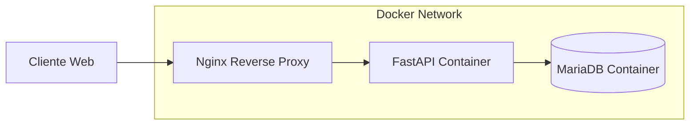
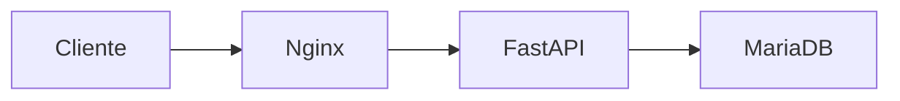

# 40_DOCKER.md

# 🐳 Aula Robótica Platform — Arquitectura Docker

---

# 📌 Introducción

Docker constituye la base de la estrategia de despliegue de Aula Robótica Platform.

La plataforma ha sido containerizada y desplegada exitosamente sobre una infraestructura Linux cloud utilizando Docker Compose como mecanismo de orquestación.

La adopción de Docker permite disponer de una infraestructura:

* reproducible,
* portable,
* desacoplada,
* mantenible,
* preparada para entornos cloud.

Docker no se utiliza únicamente como mecanismo de despliegue, sino también como herramienta para garantizar consistencia entre desarrollo, pruebas y producción.

---

# 🎯 Objetivos de Docker

La incorporación de Docker persigue varios objetivos técnicos.

---

## Reproducibilidad

Garantizar que la aplicación se ejecuta de forma idéntica independientemente del entorno.

Beneficios:

* eliminación de diferencias entre equipos,
* despliegues consistentes,
* reducción de errores de configuración.

---

## Aislamiento

Cada servicio se ejecuta dentro de su propio contenedor.

Beneficios:

* separación de responsabilidades,
* independencia de dependencias,
* simplificación del mantenimiento.

---

## Portabilidad

La infraestructura puede trasladarse fácilmente entre:

* entornos locales,
* VPS Linux,
* cloud providers,
* servidores dedicados.

---

## Aproximación DevOps

Docker permite aproximar el proyecto a prácticas habituales en entornos profesionales:

* Infrastructure as Code,
* despliegues repetibles,
* automatización,
* CI/CD.

---

# 🏗️ Arquitectura Docker Implementada

La plataforma utiliza una arquitectura multicontenedor basada en Docker Compose.

---

## Servicios desplegados

| Servicio | Función         |
| -------- | --------------- |
| nginx    | Reverse Proxy   |
| api      | Backend FastAPI |
| db       | MariaDB         |
| volume   | Persistencia    |

---

## Arquitectura general



---

# Docker Compose

Docker Compose permite gestionar toda la infraestructura mediante un único archivo declarativo.

---

## Responsabilidades

* construcción imágenes,
* creación contenedores,
* gestión networking,
* configuración variables entorno,
* persistencia,
* restart policies.

---

## Ventajas obtenidas

* despliegue simplificado,
* reconstrucción rápida,
* administración centralizada,
* consistencia entre entornos.

---

# 🐍 Contenedor FastAPI

El backend se ejecuta dentro de un contenedor dedicado.

---

## Componentes incluidos

* Python 3.13
* FastAPI
* Uvicorn
* SQLAlchemy
* PyMySQL
* Jinja2
* WebSockets
* uv

---

## Funciones principales

* SSR mediante Jinja2,
* autenticación JWT,
* lógica de negocio,
* endpoints REST,
* WebSockets realtime.

---

## Exposición de servicio

El contenedor FastAPI no se expone directamente a Internet.

La comunicación externa se realiza exclusivamente a través de Nginx.

---

# 🗄️ Contenedor MariaDB

La persistencia de datos se implementa mediante MariaDB ejecutándose en un contenedor independiente.

---

## Ventajas

* aislamiento de base de datos,
* actualización independiente,
* persistencia desacoplada.

---

## Funciones

* almacenamiento relacional,
* gestión usuarios,
* proyectos,
* tareas,
* auditoría,
* notificaciones.

---

# 🌐 Contenedor Nginx

Nginx constituye el punto único de entrada al sistema.

---

## Responsabilidades

* reverse proxy,
* forwarding HTTP,
* soporte WebSocket,
* ocultación backend,
* preparación HTTPS futura.

---

## Arquitectura



---

# 🔗 Docker Networking

Docker Compose crea automáticamente una red privada interna.

---

## Servicios conectados

* nginx
* api
* db

---

## Beneficios

* aislamiento de tráfico interno,
* comunicación segura entre servicios,
* reducción de superficie de exposición.

---

## Comunicación interna

```text
nginx → api:8000

api → db:3306
```

Los servicios se comunican mediante nombres internos Docker.

---

# 💾 Persistencia

La persistencia se implementa mediante Docker Volumes y bind mounts.

---

## MariaDB

Persistencia:

```text
Docker Volume
```

---

## Storage

Persistencia:

```text
Bind Mount
```

---

## Beneficios

* reconstrucción sin pérdida de datos,
* mantenimiento simplificado,
* backups,
* separación datos/contenedores.

---

# ⚡ WebSockets y Docker

La plataforma incorpora funcionalidades realtime mediante WebSockets.

---

## Funcionalidades soportadas

* dashboard realtime,
* notificaciones,
* sincronización colaborativa,
* actividad reciente.

---

## Endpoints WebSocket

```text
/ws/dashboard

/ws/notifications

/ws/projects/{id}
```

---

## Validación realizada

La infraestructura fue validada mediante:

* DevTools navegador,
* HTTP 101 Switching Protocols,
* logs Docker,
* múltiples clientes simultáneos.

---

# 🔐 Seguridad

Docker contribuye a la seguridad mediante aislamiento de servicios.

---

## Medidas implementadas

* backend no expuesto directamente,
* MariaDB inaccesible desde Internet,
* Nginx como punto único de entrada,
* redes privadas Docker.

---

## Arquitectura protegida

```text
Internet
   ↓
Nginx
   ↓
FastAPI
   ↓
MariaDB
```

---

# 🚀 Proceso de Despliegue

La infraestructura puede desplegarse mediante Docker Compose.

---

## Flujo general

```bash
cp .env.example .env

docker compose up -d --build
```

---

## Resultado

Se construye automáticamente:

* imagen backend,
* contenedor FastAPI,
* contenedor MariaDB,
* contenedor Nginx,
* red Docker,
* volúmenes persistentes.

---

# 📊 Ventajas Obtenidas

La adopción de Docker aporta:

---

## Desarrollo

* onboarding sencillo,
* entorno homogéneo,
* menor configuración manual.

---

## DevOps

* despliegues repetibles,
* automatización,
* integración futura con CI/CD.

---

## Producción

* aislamiento,
* mantenibilidad,
* portabilidad,
* facilidad de recuperación.

---

# 🔮 Evolución Futura

La arquitectura Docker actual deja preparada la evolución hacia:

* HTTPS completo,
* certificados SSL,
* GitHub Actions Deployment,
* monitorización,
* observabilidad,
* Redis,
* Kubernetes,
* escalabilidad horizontal.

---

# 📌 Conclusión

Docker constituye uno de los pilares fundamentales de la infraestructura de Aula Robótica Platform.

La utilización de Docker Compose, contenedores desacoplados, networking privado, persistencia y reverse proxy permite disponer de una arquitectura moderna, mantenible y alineada con prácticas habituales utilizadas en proyectos profesionales actuales.

La plataforma ha validado con éxito la ejecución containerizada de FastAPI, MariaDB, Nginx y WebSockets sobre una infraestructura Linux cloud real.
