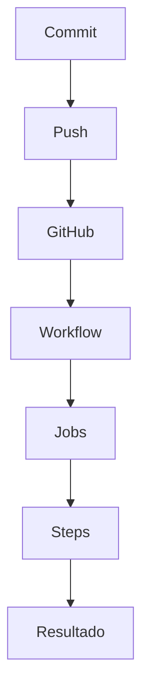

# 41_GITHUB_ACTIONS.md

# ⚙️ GitHub Actions

---

# 📌 Introducción

GitHub Actions constituye el motor de automatización utilizado por Aula Robótica Platform para implementar la estrategia de **Integración Continua (CI)**.

Permite ejecutar automáticamente diferentes procesos de validación cada vez que se produce un cambio en el repositorio, garantizando que todas las modificaciones cumplen los estándares de calidad definidos antes de incorporarse al proyecto.

Gracias a GitHub Actions, el proyecto automatiza tareas que anteriormente debían realizarse manualmente, mejorando la productividad del desarrollo y reduciendo la posibilidad de introducir errores.

---

# 🎯 Objetivos

La incorporación de GitHub Actions persigue varios objetivos.

## Objetivos funcionales

- automatizar tareas repetitivas;
- validar el proyecto tras cada modificación;
- ejecutar pruebas automáticamente;
- detectar errores tempranamente;
- mejorar la calidad del software.

---

## Objetivos técnicos

- automatizar pipelines;
- ejecutar workflows reproducibles;
- integrar herramientas de calidad;
- facilitar despliegues futuros;
- versionar la configuración del pipeline;
- favorecer el desarrollo colaborativo.

---

# ¿Qué es GitHub Actions?

GitHub Actions es la plataforma de automatización integrada en GitHub que permite ejecutar flujos de trabajo (workflows) como respuesta a distintos eventos producidos dentro del repositorio.

Cada workflow se define mediante archivos YAML almacenados dentro del propio proyecto.

Esto convierte la automatización en parte del código fuente, siguiendo el principio de **Pipeline as Code**.

---

# Pipeline as Code

Toda la configuración de automatización forma parte del repositorio.

Esto proporciona importantes ventajas:

- versionado;
- trazabilidad;
- revisión mediante Pull Requests;
- colaboración;
- reproducibilidad;
- mantenimiento simplificado.

La configuración evoluciona conjuntamente con el resto del proyecto.

---

# Arquitectura General

```mermaid
flowchart LR

Developer

--> GitHub Repository

GitHub Repository

--> GitHub Actions

GitHub Actions

--> Workflow

Workflow

--> Jobs

Jobs

--> Steps

Steps

--> Resultado
```

---

# Arquitectura de un Workflow

Cada workflow se encuentra formado por varios niveles.

```text
Workflow

↓

Jobs

↓

Steps

↓

Actions

↓

Resultado
```

Cada nivel aporta un mayor grado de especialización dentro del proceso de automatización.

---

# Workflows

Un **workflow** representa un proceso completo de automatización.

Cada workflow puede contener uno o varios trabajos (jobs) que se ejecutan de forma secuencial o paralela.

Ejemplos habituales:

- validación del código;
- testing;
- análisis de calidad;
- construcción de imágenes;
- despliegue.

---

# Jobs

Cada workflow puede dividirse en varios jobs independientes.

Un job representa una unidad lógica de trabajo.

Ejemplos:

- instalar dependencias;
- ejecutar Ruff;
- ejecutar Pytest;
- calcular cobertura;
- ejecutar SonarCloud.

La separación en jobs mejora la organización y facilita futuras ampliaciones del pipeline.

---

# Steps

Cada job está formado por varios steps.

Un step representa una acción concreta.

Ejemplos:

- checkout del repositorio;
- instalación de Python;
- instalación de dependencias;
- ejecución de comandos;
- subida de artefactos.

Los steps se ejecutan de forma secuencial dentro del mismo job.

---

# Eventos de Ejecución

Los workflows pueden ejecutarse automáticamente cuando ocurre un determinado evento dentro del repositorio.

Entre los eventos más habituales destacan:

| Evento | Descripción |
|---------|-------------|
| push | envío de cambios |
| pull_request | creación o actualización de PR |
| workflow_dispatch | ejecución manual |
| schedule | ejecución programada |

Esta flexibilidad permite adaptar el pipeline a distintos escenarios de desarrollo.

---

# Flujo General



---

# GitHub Hosted Runners

Los workflows se ejecutan sobre máquinas virtuales temporales proporcionadas por GitHub.

Estas máquinas reciben el nombre de **GitHub Hosted Runners**.

Cada ejecución dispone de un entorno limpio e independiente.

Entre sus ventajas destacan:

- aislamiento;
- reproducibilidad;
- ausencia de configuración manual;
- disponibilidad inmediata.

---

# Sistema Operativo

El proyecto utiliza runners Linux basados en Ubuntu.

Esta elección proporciona:

- rapidez;
- compatibilidad con Python;
- integración con Docker;
- entorno similar al VPS desplegado.

La homogeneidad entre los entornos reduce la aparición de diferencias entre desarrollo y producción.

---

# Ciclo de Vida de una Ejecución

Cada ejecución sigue una secuencia claramente definida.

```mermaid
flowchart TD

Crear Runner

↓

Checkout

↓

Instalar Dependencias

↓

Ejecutar Jobs

↓

Generar Resultados

↓

Eliminar Runner
```

Una vez finalizada la ejecución, el runner es destruido automáticamente.

Esto garantiza que todas las ejecuciones parten siempre desde un entorno limpio.

---

# Checkout del Repositorio

El primer paso habitual consiste en descargar el contenido del repositorio.

Este proceso permite que el runner disponga del código necesario para ejecutar las distintas validaciones.

A partir de este momento comienzan el resto de tareas automatizadas.

---

# Instalación del Entorno

Antes de ejecutar cualquier herramienta es necesario preparar el entorno.

Las tareas habituales incluyen:

- instalación de Python;
- actualización de pip;
- instalación de dependencias;
- restauración de cachés;
- preparación del proyecto.

Esta fase garantiza que todas las herramientas se ejecuten sobre un entorno consistente.

---

# Organización del Pipeline

La estrategia seguida en Aula Robótica Platform divide las validaciones en varias fases consecutivas.

De forma simplificada:

1. Preparación del entorno.
2. Instalación de dependencias.
3. Linting.
4. Testing.
5. Coverage.
6. SonarCloud.
7. Resultado final.

Esta organización facilita la localización de errores cuando alguna etapa falla.

---

# Beneficios de GitHub Actions

La utilización de GitHub Actions proporciona numerosas ventajas.

Entre ellas destacan:

- automatización;
- repetibilidad;
- integración con GitHub;
- facilidad de mantenimiento;
- ejecución bajo demanda;
- escalabilidad;
- integración con herramientas externas;
- preparación para despliegues automáticos.

---

# Integración con la Estrategia DevOps

GitHub Actions constituye el núcleo operativo de la estrategia CI/CD implementada en Aula Robótica Platform.

Su integración con:

- Ruff;
- Pytest;
- Coverage;
- SonarCloud;
- Docker;

permite construir pipelines completamente automatizados preparados para evolucionar hacia un proceso DevOps mucho más avanzado.

---

# 🔄 Ejecución del Workflow

Una vez activado un evento del repositorio, GitHub Actions inicia automáticamente el workflow correspondiente.

Cada ejecución se desarrolla siguiendo una secuencia perfectamente definida que garantiza que todas las validaciones se realicen en el orden adecuado.

---

# Flujo de Ejecución

```mermaid
flowchart TD

Evento

--> Workflow

Workflow

--> Preparación Runner

Preparación Runner

--> Checkout

Checkout

--> Instalación Dependencias

Instalación Dependencias

--> Validaciones

Validaciones

--> Resultados

Resultados

--> Finalización
```

---

# Preparación del Runner

Cada ejecución comienza creando un runner completamente limpio.

Durante esta fase se prepara:

- sistema operativo;
- variables de entorno;
- espacio de trabajo;
- herramientas base;
- conectividad con GitHub.

La utilización de runners efímeros garantiza que cada ejecución sea independiente de las anteriores.

---

# Variables de Entorno

GitHub Actions permite definir variables reutilizables durante la ejecución.

Estas variables pueden emplearse para:

- rutas;
- versiones de Python;
- configuración de herramientas;
- parámetros del pipeline;
- opciones de ejecución.

La utilización de variables simplifica el mantenimiento de los workflows.

---

# Secrets

Las credenciales sensibles nunca deben almacenarse directamente dentro del repositorio.

GitHub Actions incorpora un sistema de **Secrets** que permite gestionar información confidencial de forma segura.

Ejemplos:

- tokens de SonarCloud;
- claves API;
- credenciales de despliegue;
- variables privadas.

Los secrets únicamente están disponibles durante la ejecución del workflow.

---

# Instalación de Dependencias

Tras preparar el entorno, el pipeline instala todas las dependencias necesarias para ejecutar el proyecto.

Esta fase incluye:

- instalación de Python;
- actualización de pip;
- instalación mediante requirements;
- preparación de librerías adicionales.

Con ello se garantiza que todas las herramientas trabajen sobre un entorno consistente.

---

# Caché de Dependencias

GitHub Actions permite reutilizar determinadas dependencias entre ejecuciones mediante mecanismos de caché.

Entre los elementos que pueden almacenarse destacan:

- paquetes Python;
- dependencias;
- herramientas auxiliares.

El uso de caché reduce significativamente el tiempo necesario para ejecutar el pipeline.

---

# Linting Automático

Una vez preparado el entorno comienza la validación estática del código.

En Aula Robótica Platform esta tarea se realiza mediante **Ruff**.

Su objetivo consiste en detectar:

- errores de estilo;
- problemas sintácticos;
- código redundante;
- importaciones innecesarias;
- incumplimiento de buenas prácticas.

El pipeline se detiene automáticamente si Ruff detecta errores que requieren corrección.

---

# Testing Automatizado

Superada la fase de linting, GitHub Actions ejecuta la batería completa de pruebas automatizadas.

Las pruebas permiten verificar:

- servicios;
- modelos;
- autenticación;
- autorización;
- endpoints;
- lógica de negocio.

Cada cambio queda validado automáticamente antes de integrarse en el repositorio principal.

---

# Cobertura de Código

Tras finalizar los tests, el pipeline calcula la cobertura alcanzada.

La cobertura mide qué porcentaje del código ha sido ejecutado por las pruebas automáticas.

Este indicador resulta especialmente útil para identificar zonas insuficientemente verificadas.

---

# Integración con SonarCloud

Una vez obtenidos los resultados del testing, GitHub Actions envía la información a SonarCloud.

SonarCloud analiza aspectos como:

- bugs;
- vulnerabilidades;
- duplicación;
- mantenibilidad;
- cobertura;
- deuda técnica.

El análisis complementa las validaciones realizadas previamente durante el pipeline.

---

# Flujo de Calidad

```mermaid
flowchart LR

Código

--> Ruff

Ruff

--> Pytest

Pytest

--> Coverage

Coverage

--> SonarCloud

SonarCloud

--> Quality Gate
```

---

# Gestión de Errores

Cuando alguna fase produce un error, GitHub Actions finaliza inmediatamente la ejecución.

Esto evita:

- continuar con información inválida;
- desperdiciar recursos;
- generar resultados inconsistentes.

Cada error queda registrado en el informe del workflow.

---

# Registro de Ejecución

GitHub Actions mantiene un historial completo de todas las ejecuciones realizadas.

Para cada ejecución puede consultarse:

- fecha;
- duración;
- commit asociado;
- autor;
- estado;
- logs completos.

Este historial facilita enormemente la depuración de incidencias.

---

# Logs

Cada step genera información detallada sobre su ejecución.

Los logs permiten identificar:

- comandos ejecutados;
- errores;
- tiempos;
- advertencias;
- resultados parciales.

Disponer de esta información resulta esencial para resolver fallos en el pipeline.

---

# Artefactos

GitHub Actions permite generar artefactos durante la ejecución.

Entre los más habituales se encuentran:

- informes de cobertura;
- resultados de testing;
- informes HTML;
- ficheros temporales;
- paquetes generados.

Los artefactos permanecen disponibles para su descarga una vez finalizado el workflow.

---

# Ejecuciones Paralelas

GitHub Actions permite ejecutar distintos jobs de forma simultánea.

La paralelización mejora considerablemente el tiempo total del pipeline cuando existen tareas independientes.

En proyectos de mayor tamaño esta característica resulta especialmente útil para:

- testing en distintas versiones;
- múltiples sistemas operativos;
- validaciones independientes.

---

# Matrices de Ejecución

GitHub Actions incorpora estrategias basadas en matrices.

Una matriz permite ejecutar automáticamente el mismo workflow sobre múltiples configuraciones.

Ejemplos:

- diferentes versiones de Python;
- distintos sistemas operativos;
- múltiples configuraciones del proyecto.

Aunque Aula Robótica Platform utiliza actualmente una configuración única, la arquitectura queda preparada para incorporar esta funcionalidad en el futuro.

---

# Cancelación Inteligente

Cuando un desarrollador realiza varios commits consecutivos sobre la misma rama, GitHub Actions puede cancelar automáticamente ejecuciones anteriores.

Esta optimización evita consumir recursos innecesarios y acelera el ciclo de integración.

---

# Beneficios de la Automatización

La automatización mediante GitHub Actions aporta ventajas significativas:

- reducción del trabajo manual;
- mayor repetibilidad;
- validación homogénea;
- menor probabilidad de error humano;
- mejor trazabilidad;
- mayor rapidez en la detección de incidencias.

---

# Estado Actual

Actualmente GitHub Actions automatiza:

✅ Preparación del entorno.

✅ Instalación de dependencias.

✅ Linting con Ruff.

✅ Testing con Pytest.

✅ Cobertura.

✅ Integración con SonarCloud.

✅ Quality Gates.

✅ Historial de ejecuciones.

✅ Logs detallados.

La arquitectura deja preparada la incorporación de nuevos workflows y fases de automatización conforme evolucione la plataforma.

---

# 🐳 Integración con Docker

La estrategia de automatización implementada mediante GitHub Actions ha sido diseñada para integrarse de forma natural con la infraestructura Docker utilizada durante el despliegue del proyecto.

Aunque la versión actual mantiene un despliegue supervisado, la arquitectura permite incorporar posteriormente la construcción y publicación automática de imágenes Docker.

Esta evolución no requiere modificar el diseño general del pipeline.

---

# Pipeline Orientado a Contenedores

La separación entre integración continua y despliegue facilita incorporar nuevas fases al workflow.

```mermaid
flowchart TD

Código Fuente

--> GitHub

GitHub

--> GitHub Actions

GitHub Actions

--> Build Docker

Build Docker

--> Docker Image

Docker Image

--> Docker Registry

Docker Registry

--> Docker Compose

Docker Compose

--> VPS Ubuntu
```

---

# Construcción de Imágenes

Una evolución natural del pipeline consiste en automatizar la generación de imágenes Docker.

Este proceso permitiría:

- construir imágenes reproducibles;
- etiquetar versiones automáticamente;
- validar la construcción;
- publicar imágenes en un registro.

La contenerización garantiza que el entorno validado durante el pipeline sea idéntico al utilizado posteriormente durante el despliegue.

---

# Integración con Docker Compose

Docker Compose constituye el mecanismo de orquestación utilizado por Aula Robótica Platform.

GitHub Actions puede evolucionar para automatizar tareas como:

- actualización de imágenes;
- recreación de contenedores;
- reinicio controlado de servicios;
- verificación posterior al despliegue.

Esta integración simplifica considerablemente el mantenimiento operativo de la plataforma.

---

# Integración con la Infraestructura Cloud

El proyecto se encuentra desplegado actualmente sobre una infraestructura cloud compuesta por:

- Hetzner Cloud;
- Ubuntu Server;
- Docker;
- Docker Compose;
- Nginx;
- MariaDB.

GitHub Actions constituye el punto de partida para automatizar progresivamente la actualización de esta infraestructura.

---

# Integración con Nginx

Aunque Nginx no forma parte directamente del pipeline, la automatización puede incorporar comprobaciones relacionadas con el servidor de entrada.

Entre ellas:

- validación de configuración;
- comprobación de disponibilidad;
- verificación de respuesta HTTP;
- comprobación del proxy WebSocket.

Estas verificaciones ayudan a garantizar que la infraestructura desplegada continúa funcionando correctamente.

---

# Estrategia de Versionado

GitHub Actions facilita mantener una correspondencia clara entre:

- commits;
- versiones;
- artefactos;
- imágenes Docker;
- despliegues.

Este versionado mejora la trazabilidad y simplifica posibles tareas de recuperación.

---

# Observabilidad del Pipeline

Cada ejecución genera información detallada que puede utilizarse para supervisar el comportamiento del proceso de integración.

Entre los indicadores disponibles destacan:

- duración del pipeline;
- tiempo por job;
- porcentaje de éxito;
- frecuencia de ejecución;
- histórico de fallos.

Estos datos permiten identificar oportunidades de mejora y optimización.

---

# Optimización del Pipeline

La arquitectura de GitHub Actions permite reducir progresivamente los tiempos de ejecución mediante distintas técnicas.

Entre ellas:

- reutilización de cachés;
- paralelización de jobs;
- matrices de ejecución;
- reutilización de acciones;
- reducción de dependencias innecesarias.

Estas optimizaciones mejoran la productividad del equipo y reducen el tiempo necesario para validar cada cambio.

---

# Reutilización de Actions

GitHub Marketplace proporciona un amplio catálogo de acciones reutilizables.

Entre las utilizadas o previstas para el proyecto destacan:

- checkout del repositorio;
- configuración de Python;
- gestión de caché;
- ejecución de SonarCloud;
- carga de artefactos.

La reutilización de acciones ampliamente utilizadas reduce el mantenimiento del pipeline.

---

# Buenas Prácticas Aplicadas

La implementación de GitHub Actions sigue diversas recomendaciones habituales en proyectos profesionales.

Entre ellas:

- workflows pequeños y especializados;
- separación entre jobs;
- reutilización de acciones;
- uso de secrets;
- pipelines reproducibles;
- validaciones automáticas;
- logs detallados;
- configuración versionada.

Estas prácticas mejoran tanto la mantenibilidad como la escalabilidad del sistema de automatización.

---

# Roadmap de Automatización

La arquitectura deja preparada la incorporación de nuevas capacidades conforme evolucione la plataforma.

Entre las principales líneas de evolución se encuentran:

- construcción automática de imágenes Docker;
- publicación en Docker Registry;
- despliegues automáticos;
- múltiples entornos;
- validaciones posteriores al despliegue;
- monitorización automática;
- rollback controlado;
- despliegues blue-green.

---

# Integración con la Estrategia DevOps

GitHub Actions constituye el elemento que conecta el desarrollo del software con la infraestructura desplegada.

Su integración con:

- GitHub;
- Docker;
- Docker Compose;
- SonarCloud;
- VPS Ubuntu;
- Nginx;

permite construir una estrategia DevOps progresiva, escalable y alineada con las buenas prácticas actuales.

---

# Estado Actual

Actualmente Aula Robótica Platform dispone de una automatización basada en GitHub Actions que incorpora:

✅ Ejecución automática de workflows.

✅ Validación tras eventos del repositorio.

✅ Preparación automática del entorno.

✅ Instalación de dependencias.

✅ Linting mediante Ruff.

✅ Testing automatizado con Pytest.

✅ Medición de cobertura.

✅ Integración con SonarCloud.

✅ Quality Gates.

✅ Historial de ejecuciones.

✅ Gestión segura mediante Secrets.

✅ Preparación para integración con Docker.

---

# Evolución Futura

La evolución prevista permitirá transformar la actual estrategia de Integración Continua en un proceso DevOps mucho más completo.

Entre las mejoras contempladas destacan:

- generación automática de imágenes Docker;
- publicación en registros privados;
- despliegues automáticos sobre VPS;
- múltiples entornos (desarrollo, pruebas y producción);
- monitorización continua;
- observabilidad avanzada;
- despliegues progresivos;
- recuperación automática ante errores.

Gracias a la modularidad de los workflows, estas mejoras podrán incorporarse sin alterar la estructura existente.

---

# 📊 Beneficios Obtenidos

La incorporación de GitHub Actions ha permitido:

- automatizar tareas repetitivas;
- reducir el tiempo de validación;
- mejorar la calidad del software;
- detectar errores tempranamente;
- incrementar la confianza en cada integración;
- facilitar el desarrollo colaborativo;
- preparar el proyecto para futuras automatizaciones de despliegue.

---

# 📌 Conclusiones

GitHub Actions constituye el núcleo operativo de la estrategia de Integración Continua implementada en Aula Robótica Platform.

La automatización de tareas como la preparación del entorno, el análisis estático del código, la ejecución de pruebas automatizadas, la medición de cobertura y la integración con SonarCloud permite garantizar que cada modificación del proyecto sea evaluada de forma homogénea antes de incorporarse al repositorio principal.

La estrecha integración con GitHub, Docker y la infraestructura cloud desplegada sobre Hetzner convierte a GitHub Actions en una pieza fundamental para la evolución del proyecto hacia un modelo DevOps cada vez más automatizado.

Esta aproximación mejora la calidad del software, reduce el esfuerzo manual y proporciona una base sólida para futuras estrategias de despliegue continuo, monitorización y escalabilidad en entornos profesionales.

