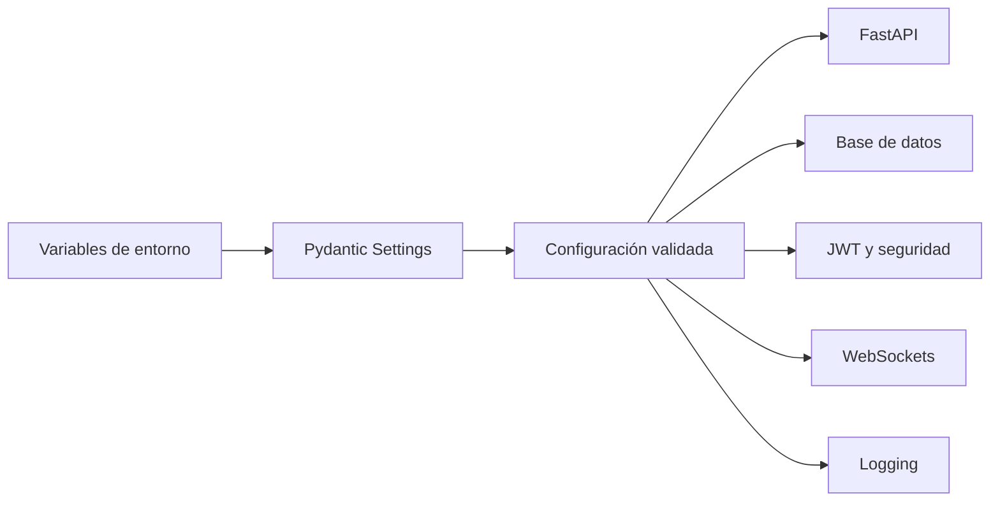
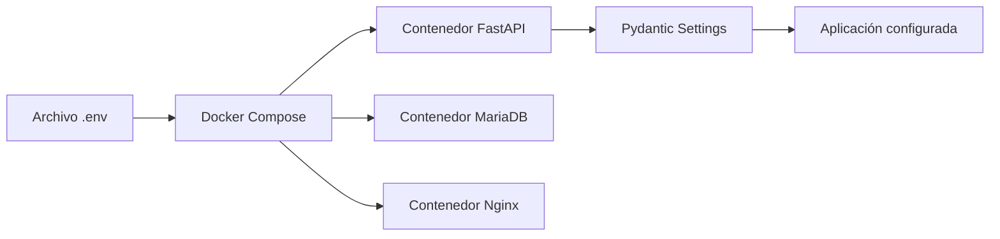
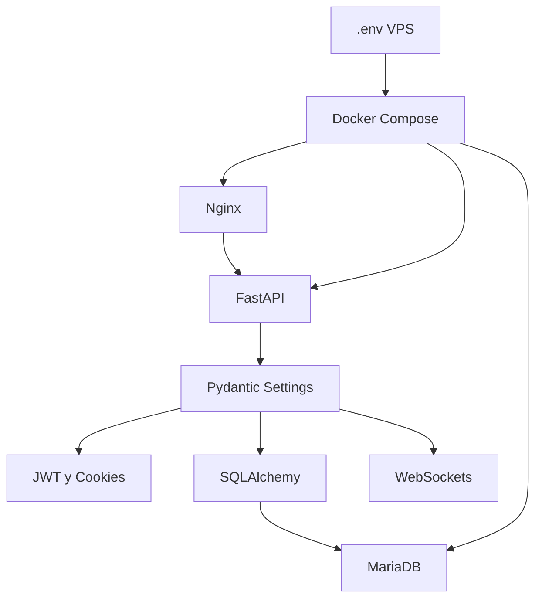
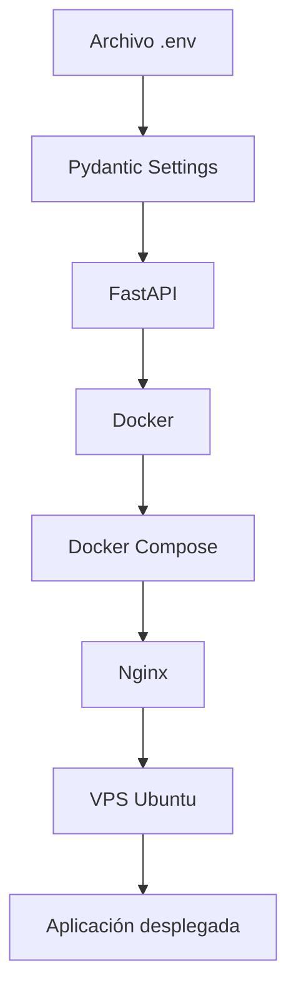

# 42_ENVIRONMENT.md

# ⚙️ Configuración de Entornos

---

# 📌 Introducción

Aula Robótica Platform utiliza una estrategia de configuración desacoplada basada en variables de entorno y clases de configuración centralizadas.

Este enfoque permite ejecutar la misma base de código en distintos contextos sin modificar directamente la lógica de la aplicación.

Actualmente la plataforma puede ejecutarse en:

* entorno local de desarrollo;
* entorno Docker;
* infraestructura VPS Linux;
* despliegue cloud productivo-like.

La configuración se adapta mediante variables externas que controlan aspectos relacionados con:

* aplicación;
* base de datos;
* autenticación;
* seguridad;
* WebSockets;
* logging;
* infraestructura;
* integración futura con SAML y SSO.

La separación entre código y configuración facilita la portabilidad, la seguridad y el mantenimiento del proyecto.

---

# 🎯 Objetivos de la Configuración

La arquitectura de configuración fue diseñada para satisfacer varios objetivos funcionales y técnicos.

## Objetivos funcionales

* permitir ejecución en diferentes entornos;
* adaptar el comportamiento sin modificar código;
* simplificar el despliegue;
* mantener configuraciones reproducibles;
* facilitar el desarrollo local;
* soportar infraestructura Docker y VPS.

---

## Objetivos técnicos

* desacoplar código y configuración;
* centralizar parámetros;
* proteger información sensible;
* validar variables de entorno;
* mantener compatibilidad entre entornos;
* facilitar automatización futura;
* preparar la plataforma para escalabilidad cloud.

---

# 🧠 Principios de Diseño

La configuración del proyecto sigue varios principios fundamentales.

---

# Configuración Externa

Los valores dependientes del entorno se almacenan fuera del código fuente.

Esto incluye:

* credenciales;
* URLs;
* claves secretas;
* opciones de depuración;
* conexiones de base de datos;
* configuraciones de seguridad.

Este modelo evita incorporar parámetros sensibles directamente al repositorio.

---

# Separación Código / Configuración

El código define cómo funciona la aplicación.

La configuración define bajo qué condiciones se ejecuta.

```text
Código de aplicación
        +
Variables de entorno
        ↓
Configuración efectiva
        ↓
Aplicación en ejecución
```

Esta separación permite desplegar el mismo código en múltiples entornos.

---

# Configuración Tipada

La plataforma utiliza Pydantic Settings para cargar y validar la configuración.

Cada variable dispone de:

* nombre;
* tipo;
* valor por defecto, cuando procede;
* validación;
* descripción funcional.

Esto reduce errores derivados de configuraciones incompletas o valores incorrectos.

---

# Fail Fast

Si una variable obligatoria no existe o contiene un valor inválido, la aplicación debe fallar durante el arranque.

Este enfoque evita que el sistema continúe ejecutándose con una configuración insegura o inconsistente.

---

# Mínimo Conocimiento del Entorno

Los módulos funcionales no acceden directamente a archivos `.env`.

La configuración se resuelve desde una capa centralizada y se distribuye posteriormente al resto del sistema.

Esto reduce acoplamiento y evita duplicar lógica de lectura.

---

# 🏗️ Arquitectura General de Configuración

La arquitectura sigue un flujo centralizado.



---

# Flujo de Resolución

Cuando la aplicación se inicia:

1. El proceso carga las variables disponibles.
2. Pydantic Settings interpreta los valores.
3. Se aplican conversiones y validaciones.
4. Se genera una configuración tipada.
5. FastAPI y los distintos módulos consumen dicha configuración.
6. Si existe un error crítico, el arranque se interrumpe.

---

# Componentes Principales

| Componente        | Responsabilidad                        |
| ----------------- | -------------------------------------- |
| `.env`            | Configuración local o del servidor     |
| `.env.example`    | Plantilla pública sin secretos         |
| Pydantic Settings | Carga y validación                     |
| Docker Compose    | Inyección de variables en contenedores |
| FastAPI           | Consumo de configuración               |
| Nginx             | Configuración del proxy                |
| MariaDB           | Credenciales y parámetros de conexión  |

---

# 📁 Archivos de Configuración

La estrategia utiliza diferentes archivos según su responsabilidad.

---

# `.env`

El archivo `.env` almacena la configuración efectiva del entorno.

Puede contener:

* credenciales de base de datos;
* claves JWT;
* modo de ejecución;
* URLs internas;
* configuración de cookies;
* parámetros de logging.

Este archivo no debe incluirse en el repositorio.

---

# `.env.example`

El archivo `.env.example` documenta las variables necesarias sin contener valores sensibles.

Su función es:

* servir como plantilla;
* facilitar la instalación;
* documentar parámetros;
* permitir reproducir el entorno.

Ejemplo conceptual:

```env
APP_NAME=Aula Robótica Platform
ENVIRONMENT=development
DEBUG=true

DATABASE_URL=mysql+pymysql://user:password@db:3306/aula_robotica

SECRET_KEY=replace_me
JWT_ALGORITHM=HS256
ACCESS_TOKEN_EXPIRE_MINUTES=30

COOKIE_SECURE=false
COOKIE_SAMESITE=lax
```

Los valores mostrados deben ser únicamente ejemplos y nunca credenciales reales.

---

# Exclusión del Repositorio

Los archivos con secretos deben incluirse en `.gitignore`.

Ejemplo:

```gitignore
.env
.env.local
.env.production
.env.staging
```

Esto evita publicar accidentalmente información sensible.

---

# 🧩 Configuración Centralizada con Pydantic Settings

Pydantic Settings constituye la capa principal de configuración de la aplicación.

Sus responsabilidades incluyen:

* leer variables;
* convertir tipos;
* aplicar valores predeterminados;
* validar datos;
* exponer una interfaz tipada.

---

# Ejemplo Conceptual

```python
from pydantic_settings import BaseSettings, SettingsConfigDict


class Settings(BaseSettings):
    app_name: str = "Aula Robótica Platform"
    environment: str = "development"
    debug: bool = False

    database_url: str

    secret_key: str
    jwt_algorithm: str = "HS256"
    access_token_expire_minutes: int = 30

    cookie_secure: bool = False
    cookie_samesite: str = "lax"

    model_config = SettingsConfigDict(
        env_file=".env",
        env_file_encoding="utf-8",
        extra="ignore",
    )
```

---

# Instancia de Configuración

La configuración suele exponerse mediante una instancia compartida:

```python
settings = Settings()
```

Los módulos consumen posteriormente:

```python
settings.database_url
settings.secret_key
settings.debug
```

Esto evita leer directamente variables del sistema desde múltiples puntos.

---

# Ventajas de Pydantic Settings

| Ventaja               | Resultado                                             |
| --------------------- | ----------------------------------------------------- |
| Tipado                | Menos errores de configuración                        |
| Validación            | Fallos detectados durante el arranque                 |
| Centralización        | Una única fuente de configuración                     |
| Autocompletado        | Mejor experiencia de desarrollo                       |
| Conversión automática | Booleanos, enteros y URLs correctamente interpretados |
| Extensibilidad        | Fácil incorporación de nuevas variables               |

---

# 🗂️ Categorías de Configuración

La configuración se agrupa por áreas funcionales.

---

# Configuración de Aplicación

Variables habituales:

| Variable       | Descripción             |
| -------------- | ----------------------- |
| `APP_NAME`     | Nombre de la plataforma |
| `APP_VERSION`  | Versión actual          |
| `ENVIRONMENT`  | Entorno activo          |
| `DEBUG`        | Modo depuración         |
| `APP_BASE_URL` | URL pública o base      |

---

# Configuración de Base de Datos

| Variable       | Descripción                 |
| -------------- | --------------------------- |
| `DATABASE_URL` | Cadena de conexión completa |
| `DB_HOST`      | Host de MariaDB             |
| `DB_PORT`      | Puerto interno              |
| `DB_NAME`      | Nombre de la base           |
| `DB_USER`      | Usuario                     |
| `DB_PASSWORD`  | Contraseña                  |

Dependiendo de la implementación, puede utilizarse una URL completa o variables separadas.

---

# Configuración JWT

| Variable                      | Descripción                |
| ----------------------------- | -------------------------- |
| `SECRET_KEY`                  | Clave de firma             |
| `JWT_ALGORITHM`               | Algoritmo criptográfico    |
| `ACCESS_TOKEN_EXPIRE_MINUTES` | Duración del access token  |
| `REFRESH_TOKEN_EXPIRE_DAYS`   | Duración del refresh token |

---

# Configuración de Cookies

| Variable          | Descripción                        |
| ----------------- | ---------------------------------- |
| `COOKIE_SECURE`   | Envío exclusivo mediante HTTPS     |
| `COOKIE_HTTPONLY` | Bloqueo de acceso desde JavaScript |
| `COOKIE_SAMESITE` | Política SameSite                  |
| `COOKIE_DOMAIN`   | Dominio autorizado                 |
| `COOKIE_PATH`     | Ruta de aplicación                 |

---

# Configuración Realtime

| Variable                | Descripción                     |
| ----------------------- | ------------------------------- |
| `WS_ENABLED`            | Activación del sistema realtime |
| `WS_HEARTBEAT_INTERVAL` | Intervalo de comprobación       |
| `WS_MAX_CONNECTIONS`    | Límite orientativo              |
| `WS_ALLOWED_ORIGINS`    | Orígenes permitidos             |

No todas estas variables tienen por qué estar implementadas actualmente, pero representan una evolución coherente del sistema.

---

# Configuración de Logging

| Variable     | Descripción                  |
| ------------ | ---------------------------- |
| `LOG_LEVEL`  | Nivel de logs                |
| `LOG_FORMAT` | Formato                      |
| `LOG_FILE`   | Destino opcional             |
| `ACCESS_LOG` | Activación de logs de acceso |

---

# Configuración SAML / SSO

La arquitectura deja preparada la futura incorporación de variables como:

| Variable            | Descripción                 |
| ------------------- | --------------------------- |
| `SAML_ENABLED`      | Activación de SAML          |
| `SAML_ENTITY_ID`    | Identificador del proveedor |
| `SAML_METADATA_URL` | URL de metadatos            |
| `SAML_CERT_PATH`    | Certificado                 |
| `SSO_CALLBACK_URL`  | Endpoint de retorno         |

---

# Clasificación por Sensibilidad

No todas las variables tienen el mismo nivel de sensibilidad.

| Tipo      | Ejemplos                      |
| --------- | ----------------------------- |
| Pública   | nombre, versión, entorno      |
| Operativa | puerto, nivel de log          |
| Sensible  | contraseña DB, secret key     |
| Crítica   | certificados, tokens externos |

Las variables sensibles y críticas nunca deben incluirse en el repositorio.

---

# 🌍 Entornos de Ejecución

Aula Robótica Platform puede ejecutarse bajo distintas configuraciones.

---

# Desarrollo Local

El entorno local prioriza:

* facilidad de depuración;
* recarga automática;
* logs detallados;
* cookies compatibles con HTTP;
* acceso directo a herramientas.

Configuración orientativa:

```env
ENVIRONMENT=development
DEBUG=true
COOKIE_SECURE=false
LOG_LEVEL=DEBUG
```

---

# Docker Local

El entorno Docker reproduce una arquitectura más próxima al despliegue real.

Incluye:

* FastAPI;
* MariaDB;
* Nginx;
* red interna;
* volúmenes.

Las variables se inyectan mediante Docker Compose.

---

# VPS Cloud

El entorno VPS ejecuta la aplicación en Ubuntu Server mediante Docker Compose.

Características:

* contenedores persistentes;
* reverse proxy;
* firewall;
* WebSockets;
* variables externas;
* logs operativos.

---

# Producción-like

El despliegue actual puede considerarse productivo-like porque incorpora:

* VPS real;
* Docker;
* Nginx;
* MariaDB persistente;
* aislamiento;
* hardening básico;
* snapshot.

No obstante, todavía requiere mejoras como HTTPS y gestión avanzada de secretos para considerarse producción completa.

---

# Matriz de Entornos

| Característica |     Desarrollo     |   Docker local   |      VPS cloud     |
| -------------- | :----------------: | :--------------: | :----------------: |
| Debug          |         Sí         |   Configurable   |   No recomendado   |
| MariaDB        | Local o contenedor |    Contenedor    |     Contenedor     |
| Nginx          |      Opcional      |        Sí        |         Sí         |
| WebSockets     |         Sí         |        Sí        |         Sí         |
| Cookie Secure  |         No         | Depende de HTTPS | Pendiente de HTTPS |
| Persistencia   |        Local       |      Volumen     |       Volumen      |
| Acceso público |         No         |        No        |         Sí         |

---

# Portabilidad

La principal ventaja del modelo consiste en que la aplicación mantiene la misma base de código en todos los entornos.

```text
Windows / desarrollo local
        ↓
Docker local
        ↓
Ubuntu VPS
        ↓
Infraestructura cloud
```

Los cambios se limitan a la configuración externa y no a la lógica funcional.

---

# 🐳 Integración con Docker

Docker permite ejecutar Aula Robótica Platform en un entorno aislado, reproducible y coherente entre desarrollo y despliegue.

La configuración de los contenedores se mantiene desacoplada del código y se inyecta mediante variables de entorno.

Esto permite:

* reutilizar la misma imagen en distintos entornos;
* evitar valores específicos dentro del código;
* separar credenciales y configuración;
* simplificar el despliegue;
* reducir diferencias entre local y VPS.

---

# Flujo de Configuración Docker



Docker Compose carga los valores necesarios y los distribuye entre los servicios correspondientes.

---

# Variables por Servicio

Cada contenedor debe recibir únicamente la configuración necesaria para cumplir su responsabilidad.

| Servicio          | Variables principales                             |
| ----------------- | ------------------------------------------------- |
| `api`             | entorno, base de datos, JWT, cookies, logging     |
| `db`              | usuario, contraseña, base de datos, root password |
| `nginx`           | configuración del proxy y puertos                 |
| servicios futuros | credenciales y parámetros específicos             |

Esta separación reduce el acoplamiento y evita compartir información sensible de forma innecesaria.

---

# Configuración del Servicio API

El contenedor `api` necesita acceso a variables relacionadas con:

* entorno de ejecución;
* conexión a MariaDB;
* claves JWT;
* configuración de cookies;
* logging;
* URLs internas;
* parámetros realtime.

Ejemplo conceptual:

```yaml
services:
  api:
    build:
      context: .
    env_file:
      - .env
    environment:
      ENVIRONMENT: production
      DATABASE_URL: ${DATABASE_URL}
      SECRET_KEY: ${SECRET_KEY}
      JWT_ALGORITHM: ${JWT_ALGORITHM}
      COOKIE_SECURE: ${COOKIE_SECURE}
      LOG_LEVEL: ${LOG_LEVEL}
```

---

# Configuración del Servicio MariaDB

El contenedor de base de datos utiliza variables específicas para inicializar el motor.

Ejemplo conceptual:

```yaml
services:
  db:
    image: mariadb:11
    environment:
      MARIADB_DATABASE: ${DB_NAME}
      MARIADB_USER: ${DB_USER}
      MARIADB_PASSWORD: ${DB_PASSWORD}
      MARIADB_ROOT_PASSWORD: ${DB_ROOT_PASSWORD}
```

Estas variables permiten crear automáticamente:

* base de datos;
* usuario de aplicación;
* credenciales;
* configuración inicial.

---

# Configuración del Servicio Nginx

Nginx utiliza principalmente archivos declarativos en lugar de configuración de aplicación.

Su comportamiento se define mediante:

* `nginx.conf`;
* configuración de virtual host;
* rutas proxy;
* cabeceras;
* puertos;
* soporte WebSocket.

Ejemplo conceptual:

```nginx
server {
    listen 80;

    location / {
        proxy_pass http://api:8000;
        proxy_set_header Host $host;
        proxy_set_header X-Real-IP $remote_addr;
        proxy_set_header X-Forwarded-For $proxy_add_x_forwarded_for;
        proxy_set_header X-Forwarded-Proto $scheme;
    }
}
```

---

# Red Interna Docker

Docker Compose crea una red interna para permitir la comunicación entre servicios.

Dentro de esa red, los contenedores se resuelven mediante el nombre del servicio.

Ejemplo:

```text
api
db
nginx
```

La aplicación no utiliza `localhost` para conectarse a MariaDB cuando se encuentra dentro de Docker.

La URL correcta emplea el nombre del servicio:

```env
DATABASE_URL=mysql+pymysql://usuario:password@db:3306/aula_robotica
```

---

# Diferencia entre Localhost y Servicios Docker

Una fuente frecuente de errores consiste en utilizar `localhost` dentro de un contenedor.

Dentro del contenedor `api`:

```text
localhost
```

hace referencia al propio contenedor FastAPI, no al servidor MariaDB.

Por ello debe utilizarse:

```text
db
```

como host interno.

---

# Variables en Docker Compose

Docker Compose permite utilizar sustitución de variables.

Ejemplo:

```yaml
environment:
  DATABASE_URL: ${DATABASE_URL}
  SECRET_KEY: ${SECRET_KEY}
```

Los valores se resuelven desde:

* archivo `.env`;
* variables del sistema;
* secretos del entorno;
* comandos de despliegue.

---

# Prioridad de Configuración

La configuración efectiva puede depender del siguiente orden:

1. Variables definidas directamente en el sistema.
2. Variables declaradas en Docker Compose.
3. Valores del archivo `.env`.
4. Valores por defecto de Pydantic Settings.

Es recomendable evitar duplicar la misma variable en múltiples capas para reducir ambigüedad.

---

# Docker Compose y Persistencia

La persistencia se configura mediante volúmenes.

Ejemplo conceptual:

```yaml
volumes:
  mariadb_data:
  uploads_data:
```

Y dentro de los servicios:

```yaml
services:
  db:
    volumes:
      - mariadb_data:/var/lib/mysql

  api:
    volumes:
      - uploads_data:/app/storage/uploads
```

Los volúmenes mantienen los datos independientemente del ciclo de vida de los contenedores.

---

# Variables Relacionadas con Persistencia

La configuración puede incluir:

| Variable      | Uso                      |
| ------------- | ------------------------ |
| `UPLOADS_DIR` | ruta de archivos subidos |
| `BACKUP_DIR`  | ruta de backups          |
| `LOG_DIR`     | ruta de logs             |
| `STATIC_DIR`  | recursos estáticos       |

Estas rutas deben ser coherentes con los volúmenes configurados.

---

# 🔌 Configuración de FastAPI

FastAPI consume la configuración centralizada durante el arranque.

La clase `Settings` puede utilizarse para inicializar:

* conexión a base de datos;
* JWT;
* middleware;
* cookies;
* logging;
* CORS;
* WebSockets;
* recursos estáticos.

---

# Integración con el Ciclo de Vida

Durante el arranque de la aplicación se realizan acciones como:

1. Carga de configuración.
2. Validación de variables.
3. Inicialización de logging.
4. Creación de conexión a base de datos.
5. Registro de routers.
6. Registro de WebSockets.
7. Montaje de static y uploads.
8. Validación de servicios.

---

# Configuración de Base de Datos

La URL de conexión se obtiene desde `settings.database_url`.

Ejemplo conceptual:

```python
engine = create_engine(
    settings.database_url,
    pool_pre_ping=True,
)
```

El uso de `pool_pre_ping` permite detectar conexiones obsoletas antes de utilizarlas.

---

# Configuración de JWT

Los servicios de autenticación consumen valores como:

```python
settings.secret_key
settings.jwt_algorithm
settings.access_token_expire_minutes
```

La clave nunca debe declararse directamente en el código.

---

# Configuración de Cookies

La configuración debe adaptarse al entorno activo.

Ejemplo conceptual:

```python
response.set_cookie(
    key="access_token",
    value=token,
    httponly=True,
    secure=settings.cookie_secure,
    samesite=settings.cookie_samesite,
)
```

En desarrollo HTTP:

```env
COOKIE_SECURE=false
```

En producción HTTPS:

```env
COOKIE_SECURE=true
```

---

# Configuración SSR

FastAPI y Jinja2 pueden utilizar valores de configuración para:

* título de la aplicación;
* versión;
* URL base;
* modo debug;
* recursos estáticos;
* funcionalidades activas.

Estos valores pueden incluirse en el contexto global de las plantillas.

---

# ⚡ Configuración WebSocket

El sistema realtime también depende de la configuración del entorno.

Entre los aspectos configurables se encuentran:

* activación de WebSockets;
* URL pública;
* protocolo `ws` o `wss`;
* orígenes permitidos;
* heartbeat;
* timeouts;
* logging realtime.

---

# Construcción de URL WebSocket

En cliente, la URL debe adaptarse automáticamente al protocolo actual.

Ejemplo conceptual:

```javascript
const protocol = window.location.protocol === "https:" ? "wss" : "ws";
const socketUrl = `${protocol}://${window.location.host}/ws/dashboard`;
```

Esto permite reutilizar la misma lógica en HTTP y HTTPS.

---

# WebSockets detrás de Nginx

Nginx debe reenviar correctamente las cabeceras de actualización.

Configuración conceptual:

```nginx
proxy_http_version 1.1;
proxy_set_header Upgrade $http_upgrade;
proxy_set_header Connection "upgrade";
```

La configuración del entorno y la del proxy deben permanecer alineadas.

---

# 🌐 Integración con Nginx

Nginx se configura como punto de entrada público.

Las variables de aplicación deben considerar que FastAPI se ejecuta detrás de un proxy.

Esto afecta especialmente a:

* protocolo;
* IP real;
* host;
* generación de URLs;
* cookies;
* redirecciones;
* WebSockets.

---

# Cabeceras Forwarded

Nginx reenvía cabeceras como:

```text
X-Real-IP
X-Forwarded-For
X-Forwarded-Proto
Host
```

FastAPI puede utilizarlas para conocer la información original del cliente.

---

# Proxy Headers

Uvicorn puede configurarse para confiar en cabeceras proxy únicamente cuando proceden de orígenes autorizados.

Ejemplo conceptual:

```bash
uvicorn app.main:app \
  --host 0.0.0.0 \
  --port 8000 \
  --proxy-headers \
  --forwarded-allow-ips="*"
```

En un entorno más restrictivo, el valor permitido debería limitarse a la red interna o al proxy conocido.

---

# URL Pública de la Aplicación

La configuración puede incluir:

```env
APP_BASE_URL=http://servidor
```

En una futura configuración HTTPS:

```env
APP_BASE_URL=https://dominio.example
```

Esta variable puede utilizarse para:

* callbacks;
* enlaces absolutos;
* notificaciones;
* SAML;
* OAuth2;
* recuperación de contraseña.

---

# Integración con MariaDB

MariaDB recibe su configuración durante la creación del contenedor.

La aplicación consume posteriormente una URL construida a partir de las credenciales disponibles.

---

# Ejemplo de Variables

```env
DB_HOST=db
DB_PORT=3306
DB_NAME=aula_robotica
DB_USER=aula_user
DB_PASSWORD=replace_me
```

La aplicación puede construir:

```text
mysql+pymysql://aula_user:replace_me@db:3306/aula_robotica
```

---

# Configuración de Pool

En entornos reales pueden añadirse parámetros como:

| Variable          | Uso                     |
| ----------------- | ----------------------- |
| `DB_POOL_SIZE`    | conexiones permanentes  |
| `DB_MAX_OVERFLOW` | conexiones adicionales  |
| `DB_POOL_RECYCLE` | reciclado de conexiones |
| `DB_POOL_TIMEOUT` | tiempo máximo de espera |

Esto permite adaptar el acceso a base de datos a la capacidad del servidor.

---

# Healthchecks y Dependencias

Docker Compose puede incorporar healthchecks para determinar cuándo un servicio está preparado.

Ejemplo conceptual para MariaDB:

```yaml
healthcheck:
  test:
    - CMD
    - healthcheck.sh
    - --connect
    - --innodb_initialized
  interval: 10s
  timeout: 5s
  retries: 10
```

El servicio API puede depender de la salud de la base de datos:

```yaml
depends_on:
  db:
    condition: service_healthy
```

---

# Configuración del Healthcheck API

También puede definirse un endpoint como:

```text
/health
```

y comprobarlo desde Docker:

```yaml
healthcheck:
  test:
    - CMD
    - curl
    - -f
    - http://localhost:8000/health
  interval: 30s
  timeout: 5s
  retries: 3
```

---

# Flujo Completo en el Entorno Desplegado



---

# Ventajas de la Integración Multicontenedor

La configuración externa permite:

* reutilizar imágenes;
* sustituir credenciales;
* cambiar URLs;
* modificar comportamiento;
* adaptar seguridad;
* desplegar sin modificar código;
* mantener coherencia entre servicios.

---

# Validación de Configuración en el Arranque

Durante el arranque deberían comprobarse valores críticos como:

* existencia de `SECRET_KEY`;
* conexión a MariaDB;
* formato de `DATABASE_URL`;
* configuración de cookies;
* entorno activo;
* rutas persistentes.

Esto evita ejecutar la aplicación bajo condiciones inseguras o inconsistentes.

---

# Logging de Configuración

La aplicación puede registrar información no sensible como:

* entorno;
* versión;
* nivel de log;
* base de datos configurada, sin credenciales;
* módulos activados;
* WebSockets habilitados.

Nunca deben registrarse:

* contraseñas;
* secret keys;
* tokens;
* certificados privados.

---

# 🔐 Gestión de Secretos

Uno de los principios fundamentales de la arquitectura de configuración consiste en mantener completamente separadas las credenciales del código fuente.

Toda la información sensible debe almacenarse mediante mecanismos externos al repositorio.

Entre los datos considerados secretos se encuentran:

- claves JWT;
- contraseñas de MariaDB;
- credenciales administrativas;
- certificados;
- claves API;
- futuros metadatos SAML.

Este enfoque reduce el riesgo de exposición accidental de información confidencial.

---

# Clasificación de Variables

Las variables utilizadas por la plataforma pueden clasificarse según su nivel de sensibilidad.

| Nivel | Ejemplos |
|--------|----------|
| Pública | APP_NAME, APP_VERSION |
| Configuración | DEBUG, LOG_LEVEL |
| Operativa | DATABASE_URL, APP_BASE_URL |
| Sensible | DB_PASSWORD, SECRET_KEY |
| Crítica | Certificados, claves privadas, tokens externos |

Las variables sensibles y críticas nunca deben almacenarse en el repositorio.

---

# Estrategia de Gestión

La configuración sigue el siguiente modelo:

```text
Repositorio Git

↓

.env.example

↓

Desarrollador / Servidor

↓

.env

↓

Pydantic Settings

↓

Aplicación
```

El repositorio únicamente contiene la plantilla de configuración.

Cada entorno mantiene posteriormente su propia configuración privada.

---

# Buenas Prácticas

Durante el desarrollo se han seguido diversas recomendaciones relacionadas con la gestión de configuración.

Entre ellas:

- mantener secretos fuera del código;
- utilizar `.env.example`;
- excluir `.env` mediante `.gitignore`;
- validar variables durante el arranque;
- minimizar duplicación de configuración;
- documentar todas las variables disponibles;
- centralizar la lectura mediante Pydantic Settings.

---

# Integración con GitHub Actions

GitHub Actions utiliza un mecanismo propio para gestionar información sensible.

Las credenciales necesarias durante los pipelines se almacenan mediante **GitHub Secrets**.

Ejemplos:

- token SonarCloud;
- futuros tokens Docker Registry;
- credenciales de despliegue;
- variables privadas.

Esto permite automatizar procesos sin exponer información sensible en los workflows.

---

# Preparación para Docker Secrets

La arquitectura también deja preparada la futura utilización de Docker Secrets.

Esta tecnología permite suministrar información sensible directamente a los contenedores sin incorporarla a imágenes Docker ni a archivos visibles.

Su incorporación sería especialmente recomendable en un entorno de producción.

---

# Preparación para Kubernetes

Si la plataforma evolucionara hacia Kubernetes, la configuración podría adaptarse mediante:

- ConfigMaps;
- Secrets;
- variables de entorno;
- volúmenes cifrados.

Gracias a la separación entre código y configuración, esta migración requeriría cambios mínimos en la aplicación.

---

# Seguridad de la Configuración

La configuración contribuye directamente a la seguridad global del sistema.

Aspectos como:

- JWT;
- cookies;
- HTTPS;
- WebSockets;
- MariaDB;
- logging;
- SAML;

dependen de parámetros correctamente definidos.

Una configuración incorrecta puede comprometer la seguridad incluso cuando el código sea correcto.

---

# Validación de Configuración

Antes de iniciar completamente la aplicación deben verificarse aspectos como:

| Validación | Objetivo |
|------------|----------|
| Variables obligatorias | evitar configuración incompleta |
| Tipado correcto | impedir valores inválidos |
| DATABASE_URL | garantizar conectividad |
| SECRET_KEY | asegurar autenticación |
| APP_BASE_URL | generar URLs correctas |
| COOKIE_SECURE | coherencia con HTTPS |
| LOG_LEVEL | configuración válida |

La detección temprana de errores simplifica enormemente el despliegue.

---

# Troubleshooting

Los problemas de configuración más habituales suelen estar relacionados con:

- variables inexistentes;
- nombres incorrectos;
- credenciales inválidas;
- rutas erróneas;
- diferencias entre Windows y Linux;
- errores de permisos;
- configuración Docker.

La centralización mediante Pydantic Settings facilita enormemente su diagnóstico.

---

# Estrategia de Migración entre Entornos

La arquitectura permite mover la aplicación entre distintos entornos sin modificar el código.

El proceso consiste únicamente en:

1. preparar el nuevo archivo `.env`;
2. adaptar Docker Compose cuando sea necesario;
3. desplegar los contenedores;
4. verificar el funcionamiento.

La lógica de negocio permanece completamente inalterada.

---

# Configuración y Despliegue

La integración entre configuración e infraestructura desplegada puede resumirse mediante el siguiente flujo.



Este modelo garantiza que la configuración acompañe a la infraestructura sin formar parte del código fuente.

---

# Relación con el Despliegue Cloud

El despliegue realizado sobre Hetzner Cloud valida el correcto funcionamiento del sistema de configuración.

Las mismas clases de configuración utilizadas durante el desarrollo funcionan igualmente sobre:

- Docker;
- Ubuntu Server;
- Nginx;
- MariaDB;
- WebSockets.

Esta reutilización demuestra el desacoplamiento conseguido entre aplicación e infraestructura.

---

# Estado Actual

Actualmente Aula Robótica Platform dispone de:

✅ Configuración centralizada mediante Pydantic Settings.

✅ Variables de entorno desacopladas.

✅ Archivo `.env.example`.

✅ Exclusión de secretos del repositorio.

✅ Integración con Docker Compose.

✅ Configuración preparada para Nginx.

✅ Compatibilidad con VPS Ubuntu.

✅ Configuración de MariaDB.

✅ Configuración JWT.

✅ Configuración de cookies.

✅ Configuración WebSocket.

✅ Preparación para múltiples entornos.

---

# Evolución Futura

La arquitectura permite incorporar progresivamente nuevas capacidades relacionadas con la gestión de configuración.

Entre las principales destacan:

- `.env.production`;
- `.env.staging`;
- Docker Secrets;
- Kubernetes Secrets;
- HashiCorp Vault;
- rotación automática de secretos;
- Feature Flags;
- configuración distribuida;
- observabilidad avanzada;
- validación automática durante el despliegue.

Estas mejoras podrán integrarse sin modificar la arquitectura general del proyecto.

---

# Beneficios Obtenidos

La estrategia de configuración implementada aporta ventajas significativas.

Entre ellas:

- desacoplamiento entre código y configuración;
- mayor seguridad;
- despliegues reproducibles;
- facilidad de mantenimiento;
- portabilidad entre entornos;
- integración con Docker;
- integración con infraestructura cloud;
- preparación para crecimiento futuro.

---

# 📌 Conclusiones

La gestión de configuración de Aula Robótica Platform ha evolucionado desde un modelo orientado al desarrollo local hasta convertirse en una arquitectura preparada para entornos cloud y despliegues multicontenedor.

La utilización de Pydantic Settings, variables de entorno, Docker Compose y una configuración centralizada permite mantener una única base de código capaz de ejecutarse en distintos escenarios sin modificaciones.

La separación entre aplicación, infraestructura y configuración facilita el mantenimiento, mejora la seguridad y proporciona una base sólida para futuras integraciones con mecanismos avanzados de gestión de secretos, despliegues automatizados y plataformas de orquestación como Kubernetes.

Esta aproximación se alinea con las buenas prácticas actuales del desarrollo backend moderno y constituye un elemento clave para la escalabilidad y evolución futura de Aula Robótica Platform.

