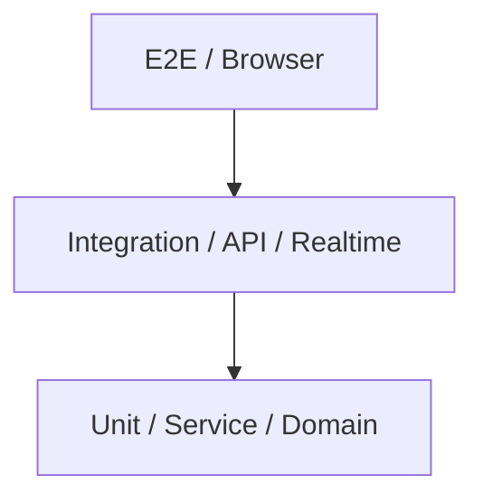
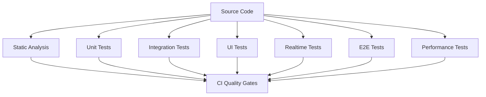
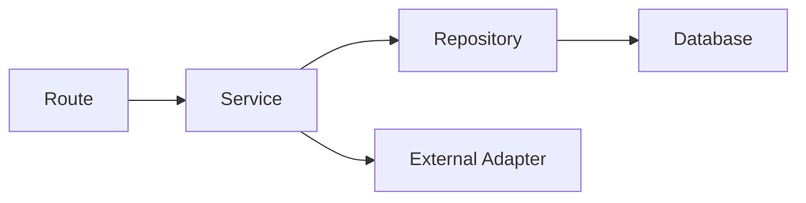
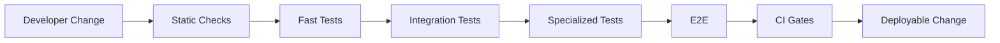
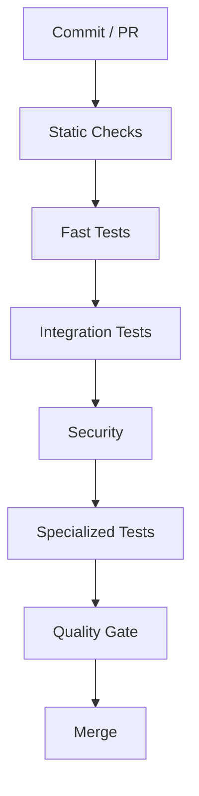

# 44_TESTING_STRATEGY.md

# Testing Strategy

## Parte 1 — Principios, arquitectura, pirámide de testing, infraestructura y estrategia Backend

---

# 1. Introducción

Este documento define la estrategia global de testing de **Aula Robótica Platform**.

El testing constituye una parte estructural de la arquitectura y no una actividad ejecutada únicamente al finalizar el desarrollo.

La estrategia debe permitir evolucionar la plataforma manteniendo:

```text
seguridad

+

estabilidad

+

calidad

+

velocidad de desarrollo

+

capacidad de refactorización
```

---

# 2. Objetivo

La estrategia de testing debe proporcionar confianza suficiente para:

- modificar código existente;
- introducir nuevas funcionalidades;
- corregir defectos;
- actualizar dependencias;
- realizar refactorizaciones;
- evolucionar la arquitectura;
- desplegar nuevas versiones.

El objetivo no consiste únicamente en detectar errores.

Debe permitir:

```text
cambiar el sistema con confianza
```

---

# 3. Estado actual

Aula Robótica Platform ya dispone de una base de testing madura para una plataforma en evolución.

Actualmente utiliza:

- `pytest`;
- FastAPI `TestClient`;
- fixtures reutilizables;
- base de datos aislada;
- dependency overrides;
- testing de JWT;
- testing de middleware;
- testing RBAC;
- testing de permisos;
- testing de ownership;
- testing SSR;
- testing de Services;
- testing de helpers;
- coverage gates;
- integración con CI.

---

# 4. Prioridad estratégica

La estrategia actual prioriza:

```text
Security

↓

Domain correctness

↓

Backend stability

↓

SSR behavior

↓

Integration

↓

Realtime

↓

Browser E2E
```

Esta prioridad refleja la evolución real de la plataforma.

---

# 5. Principio fundamental

La estrategia sigue inicialmente un enfoque:

```text
backend-first testing
```

porque gran parte de la lógica crítica reside en:

- autenticación;
- autorización;
- Services;
- repositories;
- middleware;
- reglas de negocio;
- persistencia.

---

# 6. Evolución del enfoque

`backend-first` no significa:

```text
backend-only
```

La arquitectura debe evolucionar progresivamente hacia:

```text
Backend

+

UI

+

Realtime

+

E2E

+

Performance

+

Security
```

---

# 7. Testing como arquitectura

El código debe diseñarse de forma que pueda probarse.

Esto implica:

- dependencias explícitas;
- Services desacoplados;
- repositories sustituibles;
- side effects controlados;
- configuración inyectable;
- funciones pequeñas;
- interfaces claras.

---

# 8. Testability

La capacidad de testear un componente constituye una propiedad arquitectónica.

Código difícil de probar suele indicar:

- exceso de acoplamiento;
- responsabilidades mezcladas;
- dependencias globales;
- side effects ocultos.

---

# 9. Objetivos de calidad

La suite debe proteger principalmente:

```text
correctness

security

regression prevention

architectural contracts
```

---

# 10. Qué debe demostrar un test

Un test debe responder a una pregunta concreta.

Ejemplos:

```text
¿Puede un usuario sin permiso modificar este proyecto?

¿Se rechaza un JWT inválido?

¿Una Task cambia correctamente de estado?

¿Un conflicto de versión devuelve 409?

¿Un formulario inválido conserva el contexto SSR?
```

---

# 11. Qué no debe perseguirse

La estrategia no busca:

```text
100 % coverage
```

como objetivo aislado.

Tampoco debe generar tests únicamente para aumentar una cifra.

---

# 12. Coverage Philosophy

Coverage se utiliza como:

```text
quality signal

+

regression guard
```

no como vanity metric.

---

# 13. Coverage no demuestra corrección

Un archivo con:

```text
100 % coverage
```

puede seguir teniendo errores si las assertions son débiles.

---

# 14. Prioridad de cobertura

Debe priorizarse cobertura sobre:

1. seguridad;
2. lógica de negocio;
3. autorización;
4. operaciones críticas;
5. errores y edge cases;
6. integraciones;
7. realtime.

---

# 15. Risk-Based Testing

La cantidad y profundidad de tests debe depender del riesgo.

Modelo conceptual:

```text
Risk = Probability × Impact
```

---

# 16. Alto riesgo

Ejemplos:

- autenticación;
- permisos;
- eliminación de datos;
- attachments;
- operaciones concurrentes;
- cambios Kanban;
- realtime;
- Outbox.

Estos componentes requieren cobertura más profunda.

---

# 17. Riesgo medio

Ejemplos:

- filtros;
- búsquedas;
- paginación;
- dashboard;
- Activity Feed.

---

# 18. Riesgo bajo

Ejemplos:

- helpers visuales triviales;
- wrappers simples;
- mappings sin lógica.

No necesitan necesariamente el mismo nivel de cobertura.

---

# 19. Testing Pyramid

La estrategia sigue una pirámide adaptada a la arquitectura.



La base debe contener la mayor cantidad de tests.

---

# 20. Distribución conceptual

```text
          E2E
         /   \
        /     \
   Integration
      /       \
     /         \
 Unit / Service
```

---

# 21. Unit Tests

Constituyen la base de la estrategia.

Deben ser:

- rápidos;
- deterministas;
- aislados;
- fáciles de ejecutar;
- fáciles de diagnosticar.

---

# 22. Objetivo de Unit Testing

Validar pequeñas unidades de comportamiento.

Ejemplos:

- validators;
- helpers;
- policies;
- Service methods;
- serializers;
- builders.

---

# 23. Service Tests

En Aula Robótica Platform los Services constituyen una de las capas más importantes.

Deben probar:

- reglas de negocio;
- validaciones;
- transiciones;
- coordinación;
- errores;
- permisos contextuales cuando corresponda.

---

# 24. Integration Tests

Comprueban que varios componentes funcionan conjuntamente.

Ejemplo:

```text
FastAPI Route

↓

Dependency Injection

↓

Service

↓

Repository

↓

Database
```

---

# 25. API Integration Tests

FastAPI `TestClient` permite cubrir gran parte de esta capa.

Debe validar:

- routing;
- HTTP methods;
- status codes;
- authentication;
- authorization;
- validation;
- response schemas.

---

# 26. SSR Integration Tests

Las rutas SSR deben validar:

```text
request

↓

middleware

↓

route

↓

service

↓

template context

↓

HTML response
```

---

# 27. Realtime Integration Tests

La estrategia debe incorporar progresivamente:

```text
HTTP mutation

↓

database

↓

Outbox

↓

realtime event

↓

WebSocket client
```

Se desarrolla específicamente en:

```text
46_REALTIME_TESTING.md
```

---

# 28. E2E Tests

Los tests End-to-End deben validar flujos completos desde la perspectiva del usuario.

Ejemplo:

```text
Browser

↓

Login

↓

Project

↓

Kanban

↓

Task Move

↓

Realtime Update
```

---

# 29. E2E no sustituye tests inferiores

No debe utilizarse Playwright para probar toda la lógica de negocio.

Los E2E deben cubrir principalmente:

- journeys críticos;
- integración completa;
- regresiones UI;
- browser behavior.

---

# 30. Testing Trophy

Para ciertas funcionalidades web puede resultar útil interpretar la estrategia también como:

```text
Static checks

↓

Unit

↓

Integration

↓

E2E
```

con especial peso en Integration.

---

# 31. Arquitectura general



---

# 32. Capas de validación

La estrategia distingue:

```text
Static validation

Unit behavior

Integration behavior

User interface behavior

Realtime behavior

End-to-end behavior

Non-functional behavior
```

---

# 33. Static Validation

Antes de ejecutar tests debe validarse:

- sintaxis;
- formatting;
- linting;
- typing cuando proceda;
- análisis estático.

---

# 34. Static Analysis

Puede incluir:

```text
Ruff

mypy

SonarCloud
```

según la configuración del proyecto.

---

# 35. Static Analysis no es Testing

Herramientas como SonarCloud detectan:

- smells;
- bugs potenciales;
- duplicación;
- vulnerabilidades.

No sustituyen tests ejecutables.

---

# 36. Test Stack actual

Framework principal:

```text
pytest
```

---

# 37. Pytest

`pytest` debe continuar como framework principal del backend por:

- fixtures;
- parametrización;
- plugins;
- integración coverage;
- buena ergonomía;
- ecosistema maduro.

---

# 38. HTTP Client

Actualmente se utiliza:

```python
FastAPI TestClient
```

para testing HTTP y SSR.

---

# 39. TestClient Scope

Permite probar:

- API endpoints;
- SSR routes;
- middleware;
- cookies;
- redirects;
- authentication flows.

---

# 40. Async Testing

Cuando sea necesario probar comportamiento asíncrono directamente puede incorporarse:

```text
pytest-asyncio
```

o mecanismos equivalentes compatibles con la arquitectura adoptada.

---

# 41. No convertir todo a async tests

Si `TestClient` permite validar correctamente el comportamiento, no es necesario introducir async complexity sin beneficio.

---

# 42. Database Testing Strategy

Actualmente la suite utiliza:

```python
sqlite://
```

con una base de datos aislada.

---

# 43. SQLite In-Memory

La estrategia actual proporciona:

- velocidad;
- aislamiento;
- reproducibilidad;
- ejecución sencilla en CI.

---

# 44. StaticPool

La configuración utiliza:

```python
StaticPool
```

para compartir correctamente la base SQLite in-memory dentro del contexto de testing.

---

# 45. Dependency Override

La dependencia:

```python
get_db
```

se sustituye mediante:

```python
app.dependency_overrides
```

---

# 46. Beneficio del Override

Permite que la aplicación utilice:

```text
Test Database
```

sin modificar el código productivo.

---

# 47. Principio

Nunca debe existir lógica como:

```python
if testing:
    use_test_database()
```

dispersa por el dominio.

La infraestructura de testing debe resolverlo mediante configuración e inyección.

---

# 48. Reset Strategy

Actualmente cada test puede reconstruir el esquema mediante:

```python
drop_all()
create_all()
```

Esto proporciona aislamiento fuerte.

---

# 49. Ventaja

Cada test comienza desde un estado conocido.

Evita:

- contaminación;
- dependencias entre tests;
- orden implícito.

---

# 50. Coste

`drop_all/create_all` puede volverse más lento cuando:

- aumenta el esquema;
- aumenta el número de tests;
- aparecen muchas relaciones.

---

# 51. Evolución futura

Si la suite crece significativamente pueden evaluarse estrategias como:

- transaction rollback;
- nested transactions;
- database templates;
- test containers.

---

# 52. Production Database Parity

SQLite no reproduce exactamente el comportamiento de la base de datos productiva.

Puede diferir en:

- constraints;
- locking;
- tipos;
- SQL;
- concurrencia;
- transaction behavior.

---

# 53. Estrategia híbrida futura

Se recomienda evolucionar hacia:

```text
Fast tests → SQLite

Critical integration tests → Production-like DB
```

cuando la madurez del proyecto lo justifique.

---

# 54. Testcontainers

Una futura estrategia puede utilizar:

```text
Testcontainers
```

para levantar una instancia real de la base de datos utilizada en producción.

---

# 55. Cuándo usar DB real

Especialmente para:

- constraints complejos;
- migrations;
- locking;
- concurrency;
- SQL específico;
- indexes;
- transactions.

---

# 56. Migration Testing

Debe incorporarse progresivamente testing sobre migrations.

Debe comprobar:

```text
empty database

↓

apply migrations

↓

expected schema
```

---

# 57. Upgrade Migration Test

También:

```text
previous schema

↓

new migration

↓

valid upgraded schema
```

cuando existan versiones productivas persistentes.

---

# 58. Schema Creation

Los tests ordinarios pueden continuar utilizando metadata cuando resulte conveniente.

Pero esto no valida necesariamente las migrations.

---

# 59. Fixtures

Las fixtures constituyen uno de los pilares de la suite actual.

Ejemplos:

```python
client

db

seed_data
```

---

# 60. Fixture Design

Una fixture debe:

- tener propósito claro;
- minimizar side effects;
- ser reutilizable;
- evitar dependencias innecesarias.

---

# 61. Fixture Scope

Debe elegirse cuidadosamente:

```text
function

class

module

session
```

---

# 62. Function Scope

Debe ser el default para datos mutables.

Proporciona mayor aislamiento.

---

# 63. Session Scope

Puede utilizarse para recursos costosos e inmutables.

No debe utilizarse indiscriminadamente para datos que los tests modifican.

---

# 64. Fixture Composition

Debe preferirse composición.

Ejemplo:

```text
db

↓

user_factory

↓

authenticated_client
```

---

# 65. Mega Fixtures

Debe evitarse una fixture que cree:

- todos los usuarios;
- todos los proyectos;
- todas las tareas;
- todos los roles;
- todas las notificaciones;

para cualquier test.

---

# 66. Minimal Test Data

Cada test debe crear únicamente los datos necesarios para demostrar el comportamiento.

---

# 67. Seed Strategy

La suite actual incluye datos base relacionados con:

- usuarios;
- roles;
- permisos;
- identidades;
- SAML simulado.

---

# 68. Seed Data

Debe diferenciarse:

```text
reference test data
```

de:

```text
scenario-specific data
```

---

# 69. Reference Data

Ejemplos:

- roles base;
- permissions;
- enums persistidos cuando existan.

Puede inicializarse mediante fixtures comunes.

---

# 70. Scenario Data

Ejemplos:

```text
project owned by user A

task assigned to user B

notification unread
```

Debe construirse específicamente para el test.

---

# 71. Factories

A medida que crezca la suite conviene introducir factories.

Ejemplo conceptual:

```python
def create_user(
    db,
    *,
    role="USER",
    active=True,
):
    ...
```

---

# 72. Factory Benefits

Permiten:

- reducir repetición;
- expresar intención;
- mantener defaults válidos;
- crear variantes fácilmente.

---

# 73. Builders

Para objetos complejos puede utilizarse un patrón builder.

Ejemplo:

```text
ProjectBuilder

TaskBuilder

NotificationBuilder
```

---

# 74. Fixture vs Factory

Fixture:

```text
proporciona contexto
```

Factory:

```text
crea escenarios
```

Ambos patrones son complementarios.

---

# 75. Test Data Naming

Los datos deben utilizar nombres claramente ficticios.

Ejemplo:

```text
alice@example.test

project-alpha

task-001
```

---

# 76. Datos personales reales

Nunca deben utilizarse datos reales de usuarios en fixtures versionadas.

---

# 77. Secrets en tests

No deben incluirse:

- API keys reales;
- passwords reales;
- tokens productivos;
- certificados privados.

---

# 78. Fake Credentials

Cuando se necesiten valores:

```text
test-secret

fake-token
```

deben ser inequívocamente ficticios.

---

# 79. Determinismo

Los tests deben producir el mismo resultado en ejecuciones repetidas.

---

# 80. Fuentes de no determinismo

Ejemplos:

- tiempo actual;
- random;
- orden de queries;
- UUID;
- concurrencia;
- servicios externos.

---

# 81. Time Testing

El código dependiente del tiempo debe diseñarse para permitir controlar:

```text
now
```

---

# 82. Evitar sleeps

Los tests no deben depender normalmente de:

```python
time.sleep(...)
```

para esperar estados.

Produce:

- lentitud;
- fragilidad;
- flaky tests.

---

# 83. Clock Injection

Una evolución puede utilizar una abstracción de reloj para lógica temporal crítica.

Ejemplo conceptual:

```python
class Clock:
    def now(self) -> datetime:
        ...
```

---

# 84. Freeze Time

También puede utilizarse una herramienta de freeze temporal cuando resulte apropiado.

---

# 85. UUID Testing

Cuando un UUID concreto importe para assertions puede:

- inyectarse;
- monkeypatcharse;
- capturarse dinámicamente.

No debe dependerse de un valor aleatorio esperado.

---

# 86. Randomness

Si una funcionalidad utiliza random debe permitirse:

```text
seed
```

o una dependencia sustituible.

---

# 87. External Services

Los unit tests no deben depender de servicios externos reales.

Ejemplos:

- email;
- SAML;
- object storage;
- APIs externas.

---

# 88. Test Doubles

Pueden utilizarse:

```text
Fake

Stub

Mock

Spy
```

según la necesidad.

---

# 89. Fake

Implementación simplificada funcional.

Ejemplo:

```text
FakeStorage
```

que almacena archivos en memoria.

---

# 90. Stub

Devuelve respuestas predefinidas.

Ejemplo:

```text
SAML identity response
```

---

# 91. Mock

Permite verificar interacciones.

Ejemplo:

```text
notification_sender.send()
```

---

# 92. Spy

Permite observar una implementación o wrapper sin sustituir completamente el comportamiento.

---

# 93. Preferencia

Debe preferirse:

```text
state verification
```

cuando sea suficiente.

Los mocks deben utilizarse cuando la interacción constituye parte relevante del contrato.

---

# 94. Mocking excesivo

Un test que mockea todas las capas puede demostrar únicamente que los mocks están configurados correctamente.

---

# 95. Arquitectura de dependencias

Una estructura testeable puede representarse:



Los tests pueden sustituir:

```text
Repository

External Adapter
```

cuando el nivel de prueba lo requiera.

---

# 96. Monkeypatch

La suite actual utiliza frecuentemente:

```python
monkeypatch
```

para aislar dependencias.

---

# 97. Uso adecuado

Es apropiado para:

- funciones externas;
- configuración;
- clocks;
- UUID generators;
- helpers de infraestructura.

---

# 98. Riesgo de Monkeypatch

Debe evitarse parchear detalles internos que no forman parte del contrato.

Esto genera tests frágiles ante refactors.

---

# 99. Patch Where Used

Cuando se monkeypatchea una dependencia debe sustituirse donde realmente es utilizada/importada.

---

# 100. Test Naming

Los nombres deben expresar comportamiento.

Ejemplo:

```python
def test_update_task_returns_403_when_user_lacks_permission():
    ...
```

---

# 101. Nombre insuficiente

Evitar:

```python
def test_task():
    ...
```

---

# 102. Convención recomendada

```text
test_<operation>_<expected_result>_<condition>
```

No necesita aplicarse rígidamente si el nombre sigue siendo claro.

---

# 103. Arrange–Act–Assert

Los tests deben seguir conceptualmente:

```text
Arrange

Act

Assert
```

---

# 104. Arrange

Preparar:

- usuario;
- datos;
- permisos;
- mocks;
- request.

---

# 105. Act

Ejecutar una única acción principal.

---

# 106. Assert

Comprobar el resultado observable.

---

# 107. Ejemplo

```python
def test_delete_project_returns_403_without_permission(
    client,
    project,
):
    response = client.delete(
        f"/api/projects/{project.id}",
    )

    assert response.status_code == 403
```

El ejemplo es conceptual y debe adaptarse a las fixtures reales.

---

# 108. Given–When–Then

Alternativamente puede razonarse:

```text
Given

When

Then
```

especialmente para escenarios funcionales.

---

# 109. Una razón de fallo

Idealmente un test debe representar un comportamiento concreto.

No debe verificar veinte comportamientos independientes.

---

# 110. Assertions múltiples

Varias assertions son correctas cuando validan un único resultado lógico.

Ejemplo:

```text
status = 200

response contains task

database updated
```

pueden pertenecer al mismo escenario de integración.

---

# 111. Assertion Quality

Debe comprobarse el comportamiento relevante.

Evitar assertions triviales como:

```python
assert response is not None
```

cuando el contrato requiere mucho más.

---

# 112. Error Messages

Las assertions deben facilitar diagnosticar por qué falló el test.

Pytest ya proporciona buena introspección.

---

# 113. Parametrización

`pytest.mark.parametrize` debe utilizarse para comportamientos equivalentes con múltiples entradas.

---

# 114. Ejemplo

```python
@pytest.mark.parametrize(
    ("role", "expected_status"),
    [
        ("ADMIN", 200),
        ("TEACHER", 200),
        ("USER", 403),
    ],
)
def test_project_access_by_role(
    role,
    expected_status,
):
    ...
```

---

# 115. Beneficio

Reduce duplicación sin ocultar intención.

---

# 116. Parametrización excesiva

No debe convertirse un escenario complejo en una tabla difícil de comprender.

---

# 117. Test Classes

Pueden utilizarse para agrupar tests relacionados.

No son obligatorias en pytest.

---

# 118. Organización recomendada

Ejemplo conceptual:

```text
tests/
├── unit/
├── integration/
├── security/
├── web/
├── realtime/
└── e2e/
```

La estructura definitiva debe adaptarse al repositorio existente.

---

# 119. Organización por módulo

También puede utilizarse:

```text
tests/
├── projects/
├── tasks/
├── activities/
├── attachments/
├── notifications/
└── dashboard/
```

---

# 120. Estrategia híbrida

Una estructura escalable puede combinar:

```text
test type

+

domain module
```

sin crear una jerarquía excesivamente profunda.

---

# 121. Test Location

Los tests deben encontrarse fácilmente a partir del código que protegen.

---

# 122. Unit Test Boundary

Un unit test debe evitar:

- red;
- filesystem real;
- database real;
- procesos externos.

Salvo que ese recurso sea precisamente la unidad bajo prueba.

---

# 123. Integration Test Boundary

Un integration test puede utilizar:

- FastAPI;
- SQLAlchemy;
- DB de test;
- middleware;
- templates.

---

# 124. E2E Boundary

Un E2E utiliza el sistema desplegado o una instancia completa y actúa desde la interfaz pública.

---

# 125. Contract Tests

La estrategia puede incorporar contract testing para fronteras entre componentes.

---

# 126. API Contract

Debe comprobar:

- status codes;
- response schemas;
- required fields;
- error format.

---

# 127. Schema Tests

Los modelos Pydantic proporcionan parte de la validación.

Los tests deben cubrir contratos importantes, especialmente cambios incompatibles.

---

# 128. Error Contract

Los errores deberían mantener una estructura consistente.

Ejemplo conceptual:

```json
{
  "detail": "..."
}
```

o el formato global definido por la API.

---

# 129. Backward Compatibility

Si existen consumidores externos, los cambios de API deben incorporar tests de compatibilidad.

---

# 130. Internal API

Aunque inicialmente el frontend sea el principal consumidor, mantener contratos claros reduce regresiones.

---

# 131. Security-First Testing

La seguridad constituye actualmente una de las áreas con mayor cobertura del proyecto.

---

# 132. Security Layers

Debe probarse:

```text
Authentication

Authorization

RBAC

Ownership

Session

Middleware

Input Validation
```

---

# 133. Authentication Testing

Debe cubrir:

- login válido;
- login inválido;
- token válido;
- token expirado;
- token corrupto;
- refresh;
- logout.

---

# 134. JWT Testing

Casos mínimos:

```text
valid signature

invalid signature

expired token

missing claims

invalid claims

malformed token
```

---

# 135. Token Leakage

Los tests también deben comprobar indirectamente que tokens no aparecen donde no deben:

- HTML;
- logs;
- redirects;
- error messages.

---

# 136. Refresh Flow

Debe probar:

```text
access token expired

+

refresh valid

↓

session continues
```

---

# 137. Invalid Refresh

Debe conducir a:

```text
authentication required
```

sin loops de redirect.

---

# 138. Logout

Debe invalidar o eliminar el estado de sesión correspondiente según la arquitectura adoptada.

---

# 139. Middleware Testing

La suite actual ya cubre de forma avanzada:

- JWT inválido;
- refresh flow;
- redirects;
- rutas protegidas.

---

# 140. Middleware Contract

Debe comprobar:

```text
request

↓

authentication middleware

↓

context

↓

route
```

---

# 141. Public Routes

Deben permanecer accesibles sin autenticación cuando corresponda.

Ejemplos:

```text
login

static assets

health
```

según configuración.

---

# 142. Protected Routes

Sin autenticación deben producir el comportamiento esperado.

Puede ser:

```text
401
```

para API.

O:

```text
redirect to login
```

para SSR.

---

# 143. API vs SSR Authentication

Los tests deben distinguir ambos contratos.

No debe esperarse el mismo comportamiento necesariamente.

---

# 144. Authorization Testing

Debe validar que estar autenticado no implica automáticamente estar autorizado.

---

# 145. RBAC

La suite debe cubrir combinaciones relevantes:

```text
role

×

permission

×

resource
```

---

# 146. No probar combinaciones inútiles

No es necesario crear el producto cartesiano completo si varias combinaciones representan exactamente la misma regla.

Debe aplicarse equivalence partitioning.

---

# 147. Permission Tests

Para una operación:

```text
project.update
```

debe probarse al menos:

- permiso presente;
- permiso ausente;
- recurso válido;
- recurso fuera de alcance cuando exista scope.

---

# 148. Ownership

Cuando la autorización depende de ownership debe probarse:

```text
owner

non-owner

privileged role
```

---

# 149. Contextual Authorization

Ejemplo:

```text
teacher belongs to project
```

frente a:

```text
teacher outside project
```

---

# 150. Privilege Escalation

Debe existir testing específico para impedir que un usuario modifique:

- roles;
- permisos;
- ownership;
- IDs;

para obtener acceso adicional.

---

# 151. IDOR

Las operaciones sobre recursos deben cubrir posibles:

```text
Insecure Direct Object References
```

Ejemplo:

```text
user A requests task belonging to project B
```

---

# 152. Horizontal Authorization

Debe comprobarse acceso entre usuarios del mismo nivel.

---

# 153. Vertical Authorization

Debe comprobarse que roles inferiores no pueden ejecutar acciones administrativas.

---

# 154. Input Validation

Debe probar:

- required fields;
- lengths;
- enums;
- malformed values;
- invalid IDs.

---

# 155. Boundary Values

Ejemplos:

```text
min length - 1

min length

max length

max length + 1
```

---

# 156. Enum Validation

Debe rechazarse cualquier valor no definido.

---

# 157. Nullability

Los tests deben reflejar exactamente:

```text
required

optional

nullable
```

---

# 158. Injection Safety

La suite debe incluir casos relevantes para:

- SQL injection;
- HTML injection;
- script content;
- path traversal.

El objetivo es validar las defensas existentes, no construir un scanner de seguridad dentro de pytest.

---

# 159. XSS

Las vistas SSR deben comprobar escaping cuando se renderiza contenido controlado por usuarios.

---

# 160. CSRF

Si la arquitectura incorpora protección CSRF, deben probarse:

- token válido;
- ausente;
- inválido;
- expirado cuando proceda.

---

# 161. Attachments Security

La estrategia futura debe cubrir:

- extensión;
- MIME;
- tamaño;
- nombre;
- path traversal;
- autorización;
- storage failures.

---

# 162. Rate Limiting

Si se incorpora rate limiting, debe probar:

```text
within limit

limit exceeded

window reset
```

---

# 163. Security Regression Tests

Toda vulnerabilidad corregida debería producir un test de regresión cuando sea razonablemente automatizable.

---

# 164. Bug Regression Rule

Cuando se corrige un bug:

```text
first reproduce with test

↓

fix

↓

test passes
```

cuando el contexto permita esta secuencia.

---

# 165. Red-Green-Refactor

Puede utilizarse TDD en funcionalidades adecuadas:

```text
Red

↓

Green

↓

Refactor
```

No se exige como metodología universal.

---

# 166. Characterization Tests

Antes de refactorizar código legacy o complejo puede escribirse un test que capture el comportamiento existente.

---

# 167. Objetivo

Permitir cambiar implementación sin alterar accidentalmente el comportamiento.

---

# 168. Service Layer Strategy

La capa Service debe disponer de una cobertura especialmente sólida.

---

# 169. Service Test Categories

Cada Service relevante debería cubrir:

```text
happy path

validation

authorization assumptions

not found

conflict

side effects

rollback
```

---

# 170. Happy Path

Valida el comportamiento esperado con datos válidos.

---

# 171. Validation Path

Valida reglas de negocio que no pertenecen únicamente a Pydantic.

---

# 172. Not Found

Debe comprobarse comportamiento cuando las entidades relacionadas no existen.

---

# 173. Conflict

Ejemplos:

- duplicado;
- versión obsoleta;
- transición inválida;
- estado incompatible.

---

# 174. Side Effects

Una operación puede generar:

- Audit;
- Activity Feed;
- Notification;
- Outbox event.

Debe probarse cuando forme parte del contrato.

---

# 175. Atomicity

Si una operación realiza múltiples cambios dentro de una transacción, debe comprobarse que un fallo no deja estado parcial.

---

# 176. Rollback Test

Ejemplo conceptual:

```text
Task updated

↓

Activity creation fails

↓

transaction rollback

↓

Task remains unchanged
```

cuando ambas operaciones pertenezcan a la misma unidad transaccional.

---

# 177. Repository Testing

Los repositories deben probar principalmente:

- queries complejas;
- filtros;
- relaciones;
- ordering;
- pagination;
- constraints.

---

# 178. CRUD trivial

No es necesario crear tests redundantes para cada wrapper trivial de SQLAlchemy si ya está cubierto adecuadamente mediante integración.

---

# 179. Query Testing

Debe comprobarse:

```text
correct records

correct ordering

correct filtering

correct pagination
```

---

# 180. Pagination

Casos:

- primera página;
- página intermedia;
- última página;
- página vacía;
- límite máximo.

---

# 181. Filtering

Debe cubrir:

- un filtro;
- combinación de filtros;
- filtros vacíos;
- valores inválidos.

---

# 182. Sorting

Debe probar:

```text
ASC

DESC

default ordering
```

cuando la API lo permita.

---

# 183. Deterministic Ordering

Una query paginada debe disponer de orden estable.

Los tests pueden revelar resultados inconsistentes si no existe.

---

# 184. Relationship Loading

Debe verificarse cuando el contrato depende de relaciones.

---

# 185. N+1

Los tests funcionales ordinarios no siempre detectan N+1.

Puede añadirse instrumentación o tests específicos en consultas críticas.

---

# 186. Database Constraints

Deben probarse constraints críticos:

- unique;
- foreign key;
- check;
- not null.

Especialmente con una DB equivalente a producción.

---

# 187. Transaction Boundaries

Debe quedar claro qué capa controla:

```text
commit

rollback
```

Los tests deben reflejar ese contrato.

---

# 188. API Testing

Los endpoints deben probar comportamiento HTTP, no revalidar toda la lógica interna del Service.

---

# 189. API Happy Path

Debe comprobar:

- status;
- response;
- headers relevantes;
- schema.

---

# 190. HTTP Status

Debe utilizarse el código correcto.

Ejemplos:

```text
200 OK

201 Created

204 No Content

400 Bad Request

401 Unauthorized

403 Forbidden

404 Not Found

409 Conflict

422 Unprocessable Entity
```

según el contrato definido.

---

# 191. Response Schema

Los tests deben detectar cambios accidentales de:

- nombres;
- tipos;
- nullability;
- nesting.

---

# 192. Content-Type

Debe comprobarse cuando sea relevante.

Ejemplo:

```text
application/json
```

---

# 193. Redirects

En SSR deben probarse explícitamente.

Ejemplo:

```text
POST form

↓

303

↓

GET resource
```

si se utiliza Post/Redirect/Get.

---

# 194. Redirect Loops

Los flujos de autenticación deben incluir tests contra redirects infinitos.

---

# 195. Cookies

Cuando la sesión utiliza cookies debe probarse:

- creación;
- atributos;
- eliminación;
- renovación.

---

# 196. Secure Cookie Flags

En configuraciones adecuadas deben validarse:

```text
HttpOnly

Secure

SameSite
```

cuando sea posible dentro del nivel de test.

---

# 197. Headers de seguridad

Puede incorporarse testing de headers como:

```text
Content-Security-Policy

X-Content-Type-Options

Referrer-Policy
```

si forman parte de la configuración.

---

# 198. SSR Testing

La arquitectura actual dispone de cobertura sobre:

- login;
- users;
- roles;
- identities;
- dashboard.

Debe ampliarse conforme crezcan los módulos.

---

# 199. SSR Contract

Debe probar:

```text
status

template

context

rendered behavior
```

---

# 200. Template Context

El contexto debe contener los elementos necesarios.

Ejemplos:

```text
current_user

menu

breadcrumbs

flash

page data
```

---

# 201. Context Injection

La suite ya cubre elementos como:

- breadcrumbs;
- menus;
- flash;
- helpers.

Esta cobertura debe mantenerse como contrato transversal.

---

# 202. Breadcrumb Testing

Debe comprobar:

- jerarquía;
- label;
- URL;
- contexto actual.

---

# 203. Menu Testing

Debe verificar especialmente:

```text
permissions

↓

visible menu entries
```

---

# 204. UI Security

Ocultar un menú no constituye autorización.

Los tests deben comprobar también el endpoint protegido.

---

# 205. Flash Messages

Debe validarse:

- tipo;
- mensaje;
- consumo;
- redirect flow.

---

# 206. Form Testing

Debe cubrir:

```text
valid form

invalid form

missing fields

authorization failure

business validation failure
```

---

# 207. Invalid Form SSR

Debe comprobar que:

- se renderiza la página;
- se muestran errores;
- se conserva contexto necesario;
- no se persisten cambios inválidos.

---

# 208. PRG Pattern

Cuando se utiliza:

```text
POST

↓

Redirect

↓

GET
```

debe probarse la secuencia.

---

# 209. Template Rendering vs UI Testing

SSR tests validan HTML y contexto desde backend.

No sustituyen pruebas reales del navegador.

---

# 210. JavaScript

El comportamiento JavaScript requiere una estrategia propia.

Se desarrolla en:

```text
45_UI_TESTING.md
```

---

# 211. Realtime

WebSockets, Outbox, sincronización y Kanban requieren una estrategia especializada.

Se desarrolla en:

```text
46_REALTIME_TESTING.md
```

---

# 212. Estado de madurez actual

La arquitectura actual puede resumirse:

| Área | Madurez |
|---|---|
| Backend unit testing | Alta |
| Security testing | Alta |
| RBAC | Alta |
| Middleware | Alta |
| Services | Alta |
| SSR | Media-Alta |
| Database integration | Media |
| Attachments | En evolución |
| JavaScript | Baja |
| Realtime | Baja/En evolución |
| Browser E2E | Pendiente |
| Performance | Pendiente |

---

# 213. Prioridad inmediata

La siguiente evolución debe mantener la fortaleza existente del backend mientras se amplía cobertura hacia:

```text
Attachments

Dashboard

JavaScript

Realtime

Browser E2E
```

---

# 214. Principio de evolución

No debe reemplazarse la suite rápida existente por una suite E2E pesada.

La evolución correcta es:

```text
preservar base rápida

+

añadir capas especializadas
```

---

# 215. Resultado esperado

La arquitectura de testing debe terminar proporcionando una cadena de confianza:



---

# 216. Parte siguiente

La **Parte 2** desarrollará:

- estrategia por módulos;
- Projects;
- Tasks;
- Activities;
- Attachments;
- Notifications;
- Dashboard;
- Activity Feed;
- testing de concurrencia;
- optimistic locking;
- Outbox;
- testing temporal;
- property-based testing;
- mutation testing;
- contract testing;
- integración externa;
- fixtures y factories avanzadas;
- estrategia de regresión.

---

# 44_TESTING_STRATEGY.md

# Testing Strategy

## Parte 1 — Principios, arquitectura, pirámide de testing, infraestructura y estrategia Backend

---

# 1. Introducción

Este documento define la estrategia global de testing de **Aula Robótica Platform**.

El testing constituye una parte estructural de la arquitectura y no una actividad ejecutada únicamente al finalizar el desarrollo.

La estrategia debe permitir evolucionar la plataforma manteniendo:

```text
seguridad

+

estabilidad

+

calidad

+

velocidad de desarrollo

+

capacidad de refactorización
```

---

# 2. Objetivo

La estrategia de testing debe proporcionar confianza suficiente para:

- modificar código existente;
- introducir nuevas funcionalidades;
- corregir defectos;
- actualizar dependencias;
- realizar refactorizaciones;
- evolucionar la arquitectura;
- desplegar nuevas versiones.

El objetivo no consiste únicamente en detectar errores.

Debe permitir:

```text
cambiar el sistema con confianza
```

---

# 3. Estado actual

Aula Robótica Platform ya dispone de una base de testing madura para una plataforma en evolución.

Actualmente utiliza:

- `pytest`;
- FastAPI `TestClient`;
- fixtures reutilizables;
- base de datos aislada;
- dependency overrides;
- testing de JWT;
- testing de middleware;
- testing RBAC;
- testing de permisos;
- testing de ownership;
- testing SSR;
- testing de Services;
- testing de helpers;
- coverage gates;
- integración con CI.

---

# 4. Prioridad estratégica

La estrategia actual prioriza:

```text
Security

↓

Domain correctness

↓

Backend stability

↓

SSR behavior

↓

Integration

↓

Realtime

↓

Browser E2E
```

Esta prioridad refleja la evolución real de la plataforma.

---

# 5. Principio fundamental

La estrategia sigue inicialmente un enfoque:

```text
backend-first testing
```

porque gran parte de la lógica crítica reside en:

- autenticación;
- autorización;
- Services;
- repositories;
- middleware;
- reglas de negocio;
- persistencia.

---

# 6. Evolución del enfoque

`backend-first` no significa:

```text
backend-only
```

La arquitectura debe evolucionar progresivamente hacia:

```text
Backend

+

UI

+

Realtime

+

E2E

+

Performance

+

Security
```

---

# 7. Testing como arquitectura

El código debe diseñarse de forma que pueda probarse.

Esto implica:

- dependencias explícitas;
- Services desacoplados;
- repositories sustituibles;
- side effects controlados;
- configuración inyectable;
- funciones pequeñas;
- interfaces claras.

---

# 8. Testability

La capacidad de testear un componente constituye una propiedad arquitectónica.

Código difícil de probar suele indicar:

- exceso de acoplamiento;
- responsabilidades mezcladas;
- dependencias globales;
- side effects ocultos.

---

# 9. Objetivos de calidad

La suite debe proteger principalmente:

```text
correctness

security

regression prevention

architectural contracts
```

---

# 10. Qué debe demostrar un test

Un test debe responder a una pregunta concreta.

Ejemplos:

```text
¿Puede un usuario sin permiso modificar este proyecto?

¿Se rechaza un JWT inválido?

¿Una Task cambia correctamente de estado?

¿Un conflicto de versión devuelve 409?

¿Un formulario inválido conserva el contexto SSR?
```

---

# 11. Qué no debe perseguirse

La estrategia no busca:

```text
100 % coverage
```

como objetivo aislado.

Tampoco debe generar tests únicamente para aumentar una cifra.

---

# 12. Coverage Philosophy

Coverage se utiliza como:

```text
quality signal

+

regression guard
```

no como vanity metric.

---

# 13. Coverage no demuestra corrección

Un archivo con:

```text
100 % coverage
```

puede seguir teniendo errores si las assertions son débiles.

---

# 14. Prioridad de cobertura

Debe priorizarse cobertura sobre:

1. seguridad;
2. lógica de negocio;
3. autorización;
4. operaciones críticas;
5. errores y edge cases;
6. integraciones;
7. realtime.

---

# 15. Risk-Based Testing

La cantidad y profundidad de tests debe depender del riesgo.

Modelo conceptual:

```text
Risk = Probability × Impact
```

---

# 16. Alto riesgo

Ejemplos:

- autenticación;
- permisos;
- eliminación de datos;
- attachments;
- operaciones concurrentes;
- cambios Kanban;
- realtime;
- Outbox.

Estos componentes requieren cobertura más profunda.

---

# 17. Riesgo medio

Ejemplos:

- filtros;
- búsquedas;
- paginación;
- dashboard;
- Activity Feed.

---

# 18. Riesgo bajo

Ejemplos:

- helpers visuales triviales;
- wrappers simples;
- mappings sin lógica.

No necesitan necesariamente el mismo nivel de cobertura.

---

# 19. Testing Pyramid

La estrategia sigue una pirámide adaptada a la arquitectura.


La base debe contener la mayor cantidad de tests.

---

# 20. Distribución conceptual

```text
          E2E
         /   \
        /     \
   Integration
      /       \
     /         \
 Unit / Service
```

---

# 21. Unit Tests

Constituyen la base de la estrategia.

Deben ser:

- rápidos;
- deterministas;
- aislados;
- fáciles de ejecutar;
- fáciles de diagnosticar.

---

# 22. Objetivo de Unit Testing

Validar pequeñas unidades de comportamiento.

Ejemplos:

- validators;
- helpers;
- policies;
- Service methods;
- serializers;
- builders.

---

# 23. Service Tests

En Aula Robótica Platform los Services constituyen una de las capas más importantes.

Deben probar:

- reglas de negocio;
- validaciones;
- transiciones;
- coordinación;
- errores;
- permisos contextuales cuando corresponda.

---

# 24. Integration Tests

Comprueban que varios componentes funcionan conjuntamente.

Ejemplo:

```text
FastAPI Route

↓

Dependency Injection

↓

Service

↓

Repository

↓

Database
```

---

# 25. API Integration Tests

FastAPI `TestClient` permite cubrir gran parte de esta capa.

Debe validar:

- routing;
- HTTP methods;
- status codes;
- authentication;
- authorization;
- validation;
- response schemas.

---

# 26. SSR Integration Tests

Las rutas SSR deben validar:

```text
request

↓

middleware

↓

route

↓

service

↓

template context

↓

HTML response
```

---

# 27. Realtime Integration Tests

La estrategia debe incorporar progresivamente:

```text
HTTP mutation

↓

database

↓

Outbox

↓

realtime event

↓

WebSocket client
```

Se desarrolla específicamente en:

```text
46_REALTIME_TESTING.md
```

---

# 28. E2E Tests

Los tests End-to-End deben validar flujos completos desde la perspectiva del usuario.

Ejemplo:

```text
Browser

↓

Login

↓

Project

↓

Kanban

↓

Task Move

↓

Realtime Update
```

---

# 29. E2E no sustituye tests inferiores

No debe utilizarse Playwright para probar toda la lógica de negocio.

Los E2E deben cubrir principalmente:

- journeys críticos;
- integración completa;
- regresiones UI;
- browser behavior.

---

# 30. Testing Trophy

Para ciertas funcionalidades web puede resultar útil interpretar la estrategia también como:

```text
Static checks

↓

Unit

↓

Integration

↓

E2E
```

con especial peso en Integration.

---

# 31. Arquitectura general


---

# 32. Capas de validación

La estrategia distingue:

```text
Static validation

Unit behavior

Integration behavior

User interface behavior

Realtime behavior

End-to-end behavior

Non-functional behavior
```

---

# 33. Static Validation

Antes de ejecutar tests debe validarse:

- sintaxis;
- formatting;
- linting;
- typing cuando proceda;
- análisis estático.

---

# 34. Static Analysis

Puede incluir:

```text
Ruff

mypy

SonarCloud
```

según la configuración del proyecto.

---

# 35. Static Analysis no es Testing

Herramientas como SonarCloud detectan:

- smells;
- bugs potenciales;
- duplicación;
- vulnerabilidades.

No sustituyen tests ejecutables.

---

# 36. Test Stack actual

Framework principal:

```text
pytest
```

---

# 37. Pytest

`pytest` debe continuar como framework principal del backend por:

- fixtures;
- parametrización;
- plugins;
- integración coverage;
- buena ergonomía;
- ecosistema maduro.

---

# 38. HTTP Client

Actualmente se utiliza:

```python
FastAPI TestClient
```

para testing HTTP y SSR.

---

# 39. TestClient Scope

Permite probar:

- API endpoints;
- SSR routes;
- middleware;
- cookies;
- redirects;
- authentication flows.

---

# 40. Async Testing

Cuando sea necesario probar comportamiento asíncrono directamente puede incorporarse:

```text
pytest-asyncio
```

o mecanismos equivalentes compatibles con la arquitectura adoptada.

---

# 41. No convertir todo a async tests

Si `TestClient` permite validar correctamente el comportamiento, no es necesario introducir async complexity sin beneficio.

---

# 42. Database Testing Strategy

Actualmente la suite utiliza:

```python
sqlite://
```

con una base de datos aislada.

---

# 43. SQLite In-Memory

La estrategia actual proporciona:

- velocidad;
- aislamiento;
- reproducibilidad;
- ejecución sencilla en CI.

---

# 44. StaticPool

La configuración utiliza:

```python
StaticPool
```

para compartir correctamente la base SQLite in-memory dentro del contexto de testing.

---

# 45. Dependency Override

La dependencia:

```python
get_db
```

se sustituye mediante:

```python
app.dependency_overrides
```

---

# 46. Beneficio del Override

Permite que la aplicación utilice:

```text
Test Database
```

sin modificar el código productivo.

---

# 47. Principio

Nunca debe existir lógica como:

```python
if testing:
    use_test_database()
```

dispersa por el dominio.

La infraestructura de testing debe resolverlo mediante configuración e inyección.

---

# 48. Reset Strategy

Actualmente cada test puede reconstruir el esquema mediante:

```python
drop_all()
create_all()
```

Esto proporciona aislamiento fuerte.

---

# 49. Ventaja

Cada test comienza desde un estado conocido.

Evita:

- contaminación;
- dependencias entre tests;
- orden implícito.

---

# 50. Coste

`drop_all/create_all` puede volverse más lento cuando:

- aumenta el esquema;
- aumenta el número de tests;
- aparecen muchas relaciones.

---

# 51. Evolución futura

Si la suite crece significativamente pueden evaluarse estrategias como:

- transaction rollback;
- nested transactions;
- database templates;
- test containers.

---

# 52. Production Database Parity

SQLite no reproduce exactamente el comportamiento de la base de datos productiva.

Puede diferir en:

- constraints;
- locking;
- tipos;
- SQL;
- concurrencia;
- transaction behavior.

---

# 53. Estrategia híbrida futura

Se recomienda evolucionar hacia:

```text
Fast tests → SQLite

Critical integration tests → Production-like DB
```

cuando la madurez del proyecto lo justifique.

---

# 54. Testcontainers

Una futura estrategia puede utilizar:

```text
Testcontainers
```

para levantar una instancia real de la base de datos utilizada en producción.

---

# 55. Cuándo usar DB real

Especialmente para:

- constraints complejos;
- migrations;
- locking;
- concurrency;
- SQL específico;
- indexes;
- transactions.

---

# 56. Migration Testing

Debe incorporarse progresivamente testing sobre migrations.

Debe comprobar:

```text
empty database

↓

apply migrations

↓

expected schema
```

---

# 57. Upgrade Migration Test

También:

```text
previous schema

↓

new migration

↓

valid upgraded schema
```

cuando existan versiones productivas persistentes.

---

# 58. Schema Creation

Los tests ordinarios pueden continuar utilizando metadata cuando resulte conveniente.

Pero esto no valida necesariamente las migrations.

---

# 59. Fixtures

Las fixtures constituyen uno de los pilares de la suite actual.

Ejemplos:

```python
client

db

seed_data
```

---

# 60. Fixture Design

Una fixture debe:

- tener propósito claro;
- minimizar side effects;
- ser reutilizable;
- evitar dependencias innecesarias.

---

# 61. Fixture Scope

Debe elegirse cuidadosamente:

```text
function

class

module

session
```

---

# 62. Function Scope

Debe ser el default para datos mutables.

Proporciona mayor aislamiento.

---

# 63. Session Scope

Puede utilizarse para recursos costosos e inmutables.

No debe utilizarse indiscriminadamente para datos que los tests modifican.

---

# 64. Fixture Composition

Debe preferirse composición.

Ejemplo:

```text
db

↓

user_factory

↓

authenticated_client
```

---

# 65. Mega Fixtures

Debe evitarse una fixture que cree:

- todos los usuarios;
- todos los proyectos;
- todas las tareas;
- todos los roles;
- todas las notificaciones;

para cualquier test.

---

# 66. Minimal Test Data

Cada test debe crear únicamente los datos necesarios para demostrar el comportamiento.

---

# 67. Seed Strategy

La suite actual incluye datos base relacionados con:

- usuarios;
- roles;
- permisos;
- identidades;
- SAML simulado.

---

# 68. Seed Data

Debe diferenciarse:

```text
reference test data
```

de:

```text
scenario-specific data
```

---

# 69. Reference Data

Ejemplos:

- roles base;
- permissions;
- enums persistidos cuando existan.

Puede inicializarse mediante fixtures comunes.

---

# 70. Scenario Data

Ejemplos:

```text
project owned by user A

task assigned to user B

notification unread
```

Debe construirse específicamente para el test.

---

# 71. Factories

A medida que crezca la suite conviene introducir factories.

Ejemplo conceptual:

```python
def create_user(
    db,
    *,
    role="USER",
    active=True,
):
    ...
```

---

# 72. Factory Benefits

Permiten:

- reducir repetición;
- expresar intención;
- mantener defaults válidos;
- crear variantes fácilmente.

---

# 73. Builders

Para objetos complejos puede utilizarse un patrón builder.

Ejemplo:

```text
ProjectBuilder

TaskBuilder

NotificationBuilder
```

---

# 74. Fixture vs Factory

Fixture:

```text
proporciona contexto
```

Factory:

```text
crea escenarios
```

Ambos patrones son complementarios.

---

# 75. Test Data Naming

Los datos deben utilizar nombres claramente ficticios.

Ejemplo:

```text
alice@example.test

project-alpha

task-001
```

---

# 76. Datos personales reales

Nunca deben utilizarse datos reales de usuarios en fixtures versionadas.

---

# 77. Secrets en tests

No deben incluirse:

- API keys reales;
- passwords reales;
- tokens productivos;
- certificados privados.

---

# 78. Fake Credentials

Cuando se necesiten valores:

```text
test-secret

fake-token
```

deben ser inequívocamente ficticios.

---

# 79. Determinismo

Los tests deben producir el mismo resultado en ejecuciones repetidas.

---

# 80. Fuentes de no determinismo

Ejemplos:

- tiempo actual;
- random;
- orden de queries;
- UUID;
- concurrencia;
- servicios externos.

---

# 81. Time Testing

El código dependiente del tiempo debe diseñarse para permitir controlar:

```text
now
```

---

# 82. Evitar sleeps

Los tests no deben depender normalmente de:

```python
time.sleep(...)
```

para esperar estados.

Produce:

- lentitud;
- fragilidad;
- flaky tests.

---

# 83. Clock Injection

Una evolución puede utilizar una abstracción de reloj para lógica temporal crítica.

Ejemplo conceptual:

```python
class Clock:
    def now(self) -> datetime:
        ...
```

---

# 84. Freeze Time

También puede utilizarse una herramienta de freeze temporal cuando resulte apropiado.

---

# 85. UUID Testing

Cuando un UUID concreto importe para assertions puede:

- inyectarse;
- monkeypatcharse;
- capturarse dinámicamente.

No debe dependerse de un valor aleatorio esperado.

---

# 86. Randomness

Si una funcionalidad utiliza random debe permitirse:

```text
seed
```

o una dependencia sustituible.

---

# 87. External Services

Los unit tests no deben depender de servicios externos reales.

Ejemplos:

- email;
- SAML;
- object storage;
- APIs externas.

---

# 88. Test Doubles

Pueden utilizarse:

```text
Fake

Stub

Mock

Spy
```

según la necesidad.

---

# 89. Fake

Implementación simplificada funcional.

Ejemplo:

```text
FakeStorage
```

que almacena archivos en memoria.

---

# 90. Stub

Devuelve respuestas predefinidas.

Ejemplo:

```text
SAML identity response
```

---

# 91. Mock

Permite verificar interacciones.

Ejemplo:

```text
notification_sender.send()
```

---

# 92. Spy

Permite observar una implementación o wrapper sin sustituir completamente el comportamiento.

---

# 93. Preferencia

Debe preferirse:

```text
state verification
```

cuando sea suficiente.

Los mocks deben utilizarse cuando la interacción constituye parte relevante del contrato.

---

# 94. Mocking excesivo

Un test que mockea todas las capas puede demostrar únicamente que los mocks están configurados correctamente.

---

# 95. Arquitectura de dependencias

Una estructura testeable puede representarse:


Los tests pueden sustituir:

```text
Repository

External Adapter
```

cuando el nivel de prueba lo requiera.

---

# 96. Monkeypatch

La suite actual utiliza frecuentemente:

```python
monkeypatch
```

para aislar dependencias.

---

# 97. Uso adecuado

Es apropiado para:

- funciones externas;
- configuración;
- clocks;
- UUID generators;
- helpers de infraestructura.

---

# 98. Riesgo de Monkeypatch

Debe evitarse parchear detalles internos que no forman parte del contrato.

Esto genera tests frágiles ante refactors.

---

# 99. Patch Where Used

Cuando se monkeypatchea una dependencia debe sustituirse donde realmente es utilizada/importada.

---

# 100. Test Naming

Los nombres deben expresar comportamiento.

Ejemplo:

```python
def test_update_task_returns_403_when_user_lacks_permission():
    ...
```

---

# 101. Nombre insuficiente

Evitar:

```python
def test_task():
    ...
```

---

# 102. Convención recomendada

```text
test_<operation>_<expected_result>_<condition>
```

No necesita aplicarse rígidamente si el nombre sigue siendo claro.

---

# 103. Arrange–Act–Assert

Los tests deben seguir conceptualmente:

```text
Arrange

Act

Assert
```

---

# 104. Arrange

Preparar:

- usuario;
- datos;
- permisos;
- mocks;
- request.

---

# 105. Act

Ejecutar una única acción principal.

---

# 106. Assert

Comprobar el resultado observable.

---

# 107. Ejemplo

```python
def test_delete_project_returns_403_without_permission(
    client,
    project,
):
    response = client.delete(
        f"/api/projects/{project.id}",
    )

    assert response.status_code == 403
```

El ejemplo es conceptual y debe adaptarse a las fixtures reales.

---

# 108. Given–When–Then

Alternativamente puede razonarse:

```text
Given

When

Then
```

especialmente para escenarios funcionales.

---

# 109. Una razón de fallo

Idealmente un test debe representar un comportamiento concreto.

No debe verificar veinte comportamientos independientes.

---

# 110. Assertions múltiples

Varias assertions son correctas cuando validan un único resultado lógico.

Ejemplo:

```text
status = 200

response contains task

database updated
```

pueden pertenecer al mismo escenario de integración.

---

# 111. Assertion Quality

Debe comprobarse el comportamiento relevante.

Evitar assertions triviales como:

```python
assert response is not None
```

cuando el contrato requiere mucho más.

---

# 112. Error Messages

Las assertions deben facilitar diagnosticar por qué falló el test.

Pytest ya proporciona buena introspección.

---

# 113. Parametrización

`pytest.mark.parametrize` debe utilizarse para comportamientos equivalentes con múltiples entradas.

---

# 114. Ejemplo

```python
@pytest.mark.parametrize(
    ("role", "expected_status"),
    [
        ("ADMIN", 200),
        ("TEACHER", 200),
        ("USER", 403),
    ],
)
def test_project_access_by_role(
    role,
    expected_status,
):
    ...
```

---

# 115. Beneficio

Reduce duplicación sin ocultar intención.

---

# 116. Parametrización excesiva

No debe convertirse un escenario complejo en una tabla difícil de comprender.

---

# 117. Test Classes

Pueden utilizarse para agrupar tests relacionados.

No son obligatorias en pytest.

---

# 118. Organización recomendada

Ejemplo conceptual:

```text
tests/
├── unit/
├── integration/
├── security/
├── web/
├── realtime/
└── e2e/
```

La estructura definitiva debe adaptarse al repositorio existente.

---

# 119. Organización por módulo

También puede utilizarse:

```text
tests/
├── projects/
├── tasks/
├── activities/
├── attachments/
├── notifications/
└── dashboard/
```

---

# 120. Estrategia híbrida

Una estructura escalable puede combinar:

```text
test type

+

domain module
```

sin crear una jerarquía excesivamente profunda.

---

# 121. Test Location

Los tests deben encontrarse fácilmente a partir del código que protegen.

---

# 122. Unit Test Boundary

Un unit test debe evitar:

- red;
- filesystem real;
- database real;
- procesos externos.

Salvo que ese recurso sea precisamente la unidad bajo prueba.

---

# 123. Integration Test Boundary

Un integration test puede utilizar:

- FastAPI;
- SQLAlchemy;
- DB de test;
- middleware;
- templates.

---

# 124. E2E Boundary

Un E2E utiliza el sistema desplegado o una instancia completa y actúa desde la interfaz pública.

---

# 125. Contract Tests

La estrategia puede incorporar contract testing para fronteras entre componentes.

---

# 126. API Contract

Debe comprobar:

- status codes;
- response schemas;
- required fields;
- error format.

---

# 127. Schema Tests

Los modelos Pydantic proporcionan parte de la validación.

Los tests deben cubrir contratos importantes, especialmente cambios incompatibles.

---

# 128. Error Contract

Los errores deberían mantener una estructura consistente.

Ejemplo conceptual:

```json
{
  "detail": "..."
}
```

o el formato global definido por la API.

---

# 129. Backward Compatibility

Si existen consumidores externos, los cambios de API deben incorporar tests de compatibilidad.

---

# 130. Internal API

Aunque inicialmente el frontend sea el principal consumidor, mantener contratos claros reduce regresiones.

---

# 131. Security-First Testing

La seguridad constituye actualmente una de las áreas con mayor cobertura del proyecto.

---

# 132. Security Layers

Debe probarse:

```text
Authentication

Authorization

RBAC

Ownership

Session

Middleware

Input Validation
```

---

# 133. Authentication Testing

Debe cubrir:

- login válido;
- login inválido;
- token válido;
- token expirado;
- token corrupto;
- refresh;
- logout.

---

# 134. JWT Testing

Casos mínimos:

```text
valid signature

invalid signature

expired token

missing claims

invalid claims

malformed token
```

---

# 135. Token Leakage

Los tests también deben comprobar indirectamente que tokens no aparecen donde no deben:

- HTML;
- logs;
- redirects;
- error messages.

---

# 136. Refresh Flow

Debe probar:

```text
access token expired

+

refresh valid

↓

session continues
```

---

# 137. Invalid Refresh

Debe conducir a:

```text
authentication required
```

sin loops de redirect.

---

# 138. Logout

Debe invalidar o eliminar el estado de sesión correspondiente según la arquitectura adoptada.

---

# 139. Middleware Testing

La suite actual ya cubre de forma avanzada:

- JWT inválido;
- refresh flow;
- redirects;
- rutas protegidas.

---

# 140. Middleware Contract

Debe comprobar:

```text
request

↓

authentication middleware

↓

context

↓

route
```

---

# 141. Public Routes

Deben permanecer accesibles sin autenticación cuando corresponda.

Ejemplos:

```text
login

static assets

health
```

según configuración.

---

# 142. Protected Routes

Sin autenticación deben producir el comportamiento esperado.

Puede ser:

```text
401
```

para API.

O:

```text
redirect to login
```

para SSR.

---

# 143. API vs SSR Authentication

Los tests deben distinguir ambos contratos.

No debe esperarse el mismo comportamiento necesariamente.

---

# 144. Authorization Testing

Debe validar que estar autenticado no implica automáticamente estar autorizado.

---

# 145. RBAC

La suite debe cubrir combinaciones relevantes:

```text
role

×

permission

×

resource
```

---

# 146. No probar combinaciones inútiles

No es necesario crear el producto cartesiano completo si varias combinaciones representan exactamente la misma regla.

Debe aplicarse equivalence partitioning.

---

# 147. Permission Tests

Para una operación:

```text
project.update
```

debe probarse al menos:

- permiso presente;
- permiso ausente;
- recurso válido;
- recurso fuera de alcance cuando exista scope.

---

# 148. Ownership

Cuando la autorización depende de ownership debe probarse:

```text
owner

non-owner

privileged role
```

---

# 149. Contextual Authorization

Ejemplo:

```text
teacher belongs to project
```

frente a:

```text
teacher outside project
```

---

# 150. Privilege Escalation

Debe existir testing específico para impedir que un usuario modifique:

- roles;
- permisos;
- ownership;
- IDs;

para obtener acceso adicional.

---

# 151. IDOR

Las operaciones sobre recursos deben cubrir posibles:

```text
Insecure Direct Object References
```

Ejemplo:

```text
user A requests task belonging to project B
```

---

# 152. Horizontal Authorization

Debe comprobarse acceso entre usuarios del mismo nivel.

---

# 153. Vertical Authorization

Debe comprobarse que roles inferiores no pueden ejecutar acciones administrativas.

---

# 154. Input Validation

Debe probar:

- required fields;
- lengths;
- enums;
- malformed values;
- invalid IDs.

---

# 155. Boundary Values

Ejemplos:

```text
min length - 1

min length

max length

max length + 1
```

---

# 156. Enum Validation

Debe rechazarse cualquier valor no definido.

---

# 157. Nullability

Los tests deben reflejar exactamente:

```text
required

optional

nullable
```

---

# 158. Injection Safety

La suite debe incluir casos relevantes para:

- SQL injection;
- HTML injection;
- script content;
- path traversal.

El objetivo es validar las defensas existentes, no construir un scanner de seguridad dentro de pytest.

---

# 159. XSS

Las vistas SSR deben comprobar escaping cuando se renderiza contenido controlado por usuarios.

---

# 160. CSRF

Si la arquitectura incorpora protección CSRF, deben probarse:

- token válido;
- ausente;
- inválido;
- expirado cuando proceda.

---

# 161. Attachments Security

La estrategia futura debe cubrir:

- extensión;
- MIME;
- tamaño;
- nombre;
- path traversal;
- autorización;
- storage failures.

---

# 162. Rate Limiting

Si se incorpora rate limiting, debe probar:

```text
within limit

limit exceeded

window reset
```

---

# 163. Security Regression Tests

Toda vulnerabilidad corregida debería producir un test de regresión cuando sea razonablemente automatizable.

---

# 164. Bug Regression Rule

Cuando se corrige un bug:

```text
first reproduce with test

↓

fix

↓

test passes
```

cuando el contexto permita esta secuencia.

---

# 165. Red-Green-Refactor

Puede utilizarse TDD en funcionalidades adecuadas:

```text
Red

↓

Green

↓

Refactor
```

No se exige como metodología universal.

---

# 166. Characterization Tests

Antes de refactorizar código legacy o complejo puede escribirse un test que capture el comportamiento existente.

---

# 167. Objetivo

Permitir cambiar implementación sin alterar accidentalmente el comportamiento.

---

# 168. Service Layer Strategy

La capa Service debe disponer de una cobertura especialmente sólida.

---

# 169. Service Test Categories

Cada Service relevante debería cubrir:

```text
happy path

validation

authorization assumptions

not found

conflict

side effects

rollback
```

---

# 170. Happy Path

Valida el comportamiento esperado con datos válidos.

---

# 171. Validation Path

Valida reglas de negocio que no pertenecen únicamente a Pydantic.

---

# 172. Not Found

Debe comprobarse comportamiento cuando las entidades relacionadas no existen.

---

# 173. Conflict

Ejemplos:

- duplicado;
- versión obsoleta;
- transición inválida;
- estado incompatible.

---

# 174. Side Effects

Una operación puede generar:

- Audit;
- Activity Feed;
- Notification;
- Outbox event.

Debe probarse cuando forme parte del contrato.

---

# 175. Atomicity

Si una operación realiza múltiples cambios dentro de una transacción, debe comprobarse que un fallo no deja estado parcial.

---

# 176. Rollback Test

Ejemplo conceptual:

```text
Task updated

↓

Activity creation fails

↓

transaction rollback

↓

Task remains unchanged
```

cuando ambas operaciones pertenezcan a la misma unidad transaccional.

---

# 177. Repository Testing

Los repositories deben probar principalmente:

- queries complejas;
- filtros;
- relaciones;
- ordering;
- pagination;
- constraints.

---

# 178. CRUD trivial

No es necesario crear tests redundantes para cada wrapper trivial de SQLAlchemy si ya está cubierto adecuadamente mediante integración.

---

# 179. Query Testing

Debe comprobarse:

```text
correct records

correct ordering

correct filtering

correct pagination
```

---

# 180. Pagination

Casos:

- primera página;
- página intermedia;
- última página;
- página vacía;
- límite máximo.

---

# 181. Filtering

Debe cubrir:

- un filtro;
- combinación de filtros;
- filtros vacíos;
- valores inválidos.

---

# 182. Sorting

Debe probar:

```text
ASC

DESC

default ordering
```

cuando la API lo permita.

---

# 183. Deterministic Ordering

Una query paginada debe disponer de orden estable.

Los tests pueden revelar resultados inconsistentes si no existe.

---

# 184. Relationship Loading

Debe verificarse cuando el contrato depende de relaciones.

---

# 185. N+1

Los tests funcionales ordinarios no siempre detectan N+1.

Puede añadirse instrumentación o tests específicos en consultas críticas.

---

# 186. Database Constraints

Deben probarse constraints críticos:

- unique;
- foreign key;
- check;
- not null.

Especialmente con una DB equivalente a producción.

---

# 187. Transaction Boundaries

Debe quedar claro qué capa controla:

```text
commit

rollback
```

Los tests deben reflejar ese contrato.

---

# 188. API Testing

Los endpoints deben probar comportamiento HTTP, no revalidar toda la lógica interna del Service.

---

# 189. API Happy Path

Debe comprobar:

- status;
- response;
- headers relevantes;
- schema.

---

# 190. HTTP Status

Debe utilizarse el código correcto.

Ejemplos:

```text
200 OK

201 Created

204 No Content

400 Bad Request

401 Unauthorized

403 Forbidden

404 Not Found

409 Conflict

422 Unprocessable Entity
```

según el contrato definido.

---

# 191. Response Schema

Los tests deben detectar cambios accidentales de:

- nombres;
- tipos;
- nullability;
- nesting.

---

# 192. Content-Type

Debe comprobarse cuando sea relevante.

Ejemplo:

```text
application/json
```

---

# 193. Redirects

En SSR deben probarse explícitamente.

Ejemplo:

```text
POST form

↓

303

↓

GET resource
```

si se utiliza Post/Redirect/Get.

---

# 194. Redirect Loops

Los flujos de autenticación deben incluir tests contra redirects infinitos.

---

# 195. Cookies

Cuando la sesión utiliza cookies debe probarse:

- creación;
- atributos;
- eliminación;
- renovación.

---

# 196. Secure Cookie Flags

En configuraciones adecuadas deben validarse:

```text
HttpOnly

Secure

SameSite
```

cuando sea posible dentro del nivel de test.

---

# 197. Headers de seguridad

Puede incorporarse testing de headers como:

```text
Content-Security-Policy

X-Content-Type-Options

Referrer-Policy
```

si forman parte de la configuración.

---

# 198. SSR Testing

La arquitectura actual dispone de cobertura sobre:

- login;
- users;
- roles;
- identities;
- dashboard.

Debe ampliarse conforme crezcan los módulos.

---

# 199. SSR Contract

Debe probar:

```text
status

template

context

rendered behavior
```

---

# 200. Template Context

El contexto debe contener los elementos necesarios.

Ejemplos:

```text
current_user

menu

breadcrumbs

flash

page data
```

---

# 201. Context Injection

La suite ya cubre elementos como:

- breadcrumbs;
- menus;
- flash;
- helpers.

Esta cobertura debe mantenerse como contrato transversal.

---

# 202. Breadcrumb Testing

Debe comprobar:

- jerarquía;
- label;
- URL;
- contexto actual.

---

# 203. Menu Testing

Debe verificar especialmente:

```text
permissions

↓

visible menu entries
```

---

# 204. UI Security

Ocultar un menú no constituye autorización.

Los tests deben comprobar también el endpoint protegido.

---

# 205. Flash Messages

Debe validarse:

- tipo;
- mensaje;
- consumo;
- redirect flow.

---

# 206. Form Testing

Debe cubrir:

```text
valid form

invalid form

missing fields

authorization failure

business validation failure
```

---

# 207. Invalid Form SSR

Debe comprobar que:

- se renderiza la página;
- se muestran errores;
- se conserva contexto necesario;
- no se persisten cambios inválidos.

---

# 208. PRG Pattern

Cuando se utiliza:

```text
POST

↓

Redirect

↓

GET
```

debe probarse la secuencia.

---

# 209. Template Rendering vs UI Testing

SSR tests validan HTML y contexto desde backend.

No sustituyen pruebas reales del navegador.

---

# 210. JavaScript

El comportamiento JavaScript requiere una estrategia propia.

Se desarrolla en:

```text
45_UI_TESTING.md
```

---

# 211. Realtime

WebSockets, Outbox, sincronización y Kanban requieren una estrategia especializada.

Se desarrolla en:

```text
46_REALTIME_TESTING.md
```

---

# 212. Estado de madurez actual

La arquitectura actual puede resumirse:

| Área | Madurez |
|---|---|
| Backend unit testing | Alta |
| Security testing | Alta |
| RBAC | Alta |
| Middleware | Alta |
| Services | Alta |
| SSR | Media-Alta |
| Database integration | Media |
| Attachments | En evolución |
| JavaScript | Baja |
| Realtime | Baja/En evolución |
| Browser E2E | Pendiente |
| Performance | Pendiente |

---

# 213. Prioridad inmediata

La siguiente evolución debe mantener la fortaleza existente del backend mientras se amplía cobertura hacia:

```text
Attachments

Dashboard

JavaScript

Realtime

Browser E2E
```

---

# 214. Principio de evolución

No debe reemplazarse la suite rápida existente por una suite E2E pesada.

La evolución correcta es:

```text
preservar base rápida

+

añadir capas especializadas
```

---

# 215. Resultado esperado

La arquitectura de testing debe terminar proporcionando una cadena de confianza:


---

# 216. Parte siguiente

La **Parte 2** desarrollará:

- estrategia por módulos;
- Projects;
- Tasks;
- Activities;
- Attachments;
- Notifications;
- Dashboard;
- Activity Feed;
- testing de concurrencia;
- optimistic locking;
- Outbox;
- testing temporal;
- property-based testing;
- mutation testing;
- contract testing;
- integración externa;
- fixtures y factories avanzadas;
- estrategia de regresión.

---

# 44_TESTING_STRATEGY.md

# Testing Strategy

## Parte 3 — UI, Realtime, Performance, Security avanzada, CI/CD, Quality Gates y gobernanza

---

# 456. Estrategia de UI Testing

La estrategia global debe incorporar testing específico de interfaz.

Debe distinguir:

```text
SSR rendering

JavaScript behavior

Browser behavior

Accessibility

Visual regression
```

Cada capa cubre riesgos diferentes.

---

# 457. SSR Testing

SSR continúa validándose principalmente desde backend mediante:

```text
FastAPI TestClient
```

Debe comprobar:

- status;
- redirects;
- HTML generado;
- contexto;
- autorización;
- formularios.

---

# 458. JavaScript Unit Testing

Los módulos JavaScript con lógica propia deben probarse aisladamente.

Ejemplos:

```text
dialog manager

toast manager

dashboard invalidation

realtime deduplication

kanban state
```

---

# 459. JavaScript Integration Testing

Debe comprobarse interacción entre:

```text
DOM

+

JavaScript module

+

mocked API
```

sin necesidad de levantar un navegador completo para todos los casos.

---

# 460. Browser E2E

Los flujos críticos deben probarse en navegador real.

Herramienta recomendada:

```text
Playwright
```

---

# 461. Playwright

Puede proporcionar:

- Chromium;
- Firefox;
- WebKit;
- screenshots;
- tracing;
- video;
- network interception.

---

# 462. Browser Coverage

No es necesario ejecutar todos los tests sobre todos los navegadores.

Estrategia posible:

```text
PR

→ Chromium

Nightly / Release

→ Chromium + Firefox + WebKit
```

---

# 463. E2E Critical Journeys

Flujos prioritarios:

```text
Login

Project navigation

Task creation

Kanban move

Activity creation

Attachment upload

Notifications

Realtime synchronization
```

---

# 464. E2E Login

Debe comprobar:

```text
login

↓

session

↓

dashboard

↓

logout
```

---

# 465. E2E Project

Escenario:

```text
login

↓

open project

↓

inspect details

↓

navigate tasks

↓

return
```

---

# 466. E2E Task Creation

Debe recorrer:

```text
open create form

↓

enter valid data

↓

submit

↓

redirect

↓

task visible
```

---

# 467. E2E Validation Error

Debe comprobar:

```text
invalid data

↓

form remains

↓

error shown

↓

invalid change not persisted
```

---

# 468. E2E Kanban

Escenario crítico:

```text
open Kanban

↓

drag Task

↓

HTTP mutation

↓

new status

↓

UI updated
```

---

# 469. E2E Attachment

Debe comprobar:

```text
select file

↓

upload

↓

success feedback

↓

attachment visible
```

---

# 470. E2E Notification

Escenario:

```text
action in session A

↓

notification generated

↓

session B sees notification
```

---

# 471. E2E Dashboard

Debe validar:

- metric cards;
- actionable tasks;
- projects;
- feed;
- notifications.

No debe comprobar cada cálculo interno; esa lógica pertenece a backend tests.

---

# 472. UI Test Duplication

No repetir en browser todas las combinaciones ya cubiertas por Service/API.

E2E debe centrarse en:

```text
integration confidence
```

---

# 473. UI Testing detallado

La estrategia completa de frontend se desarrolla en:

```text
45_UI_TESTING.md
```

---

# 474. Realtime Testing Strategy

Realtime requiere testing especializado por:

- asincronía;
- múltiples clientes;
- ordering;
- duplicate delivery;
- reconnection;
- stale state.

---

# 475. Capas Realtime

Debe probarse:

```text
Domain Event

↓

Outbox

↓

Worker

↓

Connection Manager

↓

WebSocket

↓

Client
```

---

# 476. Realtime Unit Tests

Deben cubrir:

- event builders;
- recipient resolution;
- serialization;
- deduplication;
- invalidation mapping.

---

# 477. Realtime Integration Tests

Deben probar:

```text
WebSocket connection

+

HTTP mutation

+

received event
```

---

# 478. Multi-client Tests

Debe existir testing con:

```text
Client A

Client B
```

conectados simultáneamente.

---

# 479. Isolation

Evento destinado a A:

```text
A receives

B does not receive
```

---

# 480. Multi-project Isolation

Un cliente suscrito a Project 1 no debe recibir eventos exclusivos de Project 2.

---

# 481. Duplicate Delivery

El cliente debe soportar recibir el mismo evento más de una vez sin duplicar estado.

---

# 482. Ordering

Debe comprobarse comportamiento cuando eventos llegan:

```text
in order

out of order
```

---

# 483. Reconnection

Escenario:

```text
connect

↓

disconnect

↓

server changes state

↓

reconnect

↓

HTTP reconciliation

↓

correct state
```

---

# 484. Offline Client

El estado persistente debe permitir recuperar cambios perdidos.

---

# 485. Realtime Kanban

Caso especialmente crítico:

```text
User A moves Task

↓

User B receives update

↓

Kanban B converges
```

---

# 486. Concurrent Kanban

Debe combinarse con optimistic locking.

---

# 487. Realtime Testing detallado

Se desarrolla completamente en:

```text
46_REALTIME_TESTING.md
```

---

# 488. Performance Testing

La corrección funcional no garantiza rendimiento aceptable.

Debe existir una estrategia progresiva de performance testing.

---

# 489. Categorías

```text
Microbenchmark

Performance

Load

Stress

Spike

Soak
```

---

# 490. Microbenchmark

Mide unidades pequeñas.

Debe utilizarse únicamente cuando:

- existe algoritmo relevante;
- rendimiento local importa;
- la medición es estable.

---

# 491. Performance Test

Comprueba tiempos de operaciones concretas con carga controlada.

Ejemplos:

```text
Dashboard load

Project feed

Task listing
```

---

# 492. Load Test

Comprueba comportamiento bajo tráfico esperado.

---

# 493. Stress Test

Incrementa carga hasta superar capacidad.

Objetivo:

```text
determine limits
```

---

# 494. Spike Test

Simula aumento brusco.

Ejemplo:

```text
50 users

↓

500 users in seconds
```

---

# 495. Soak Test

Mantiene carga prolongada.

Permite detectar:

- memory leaks;
- connection leaks;
- resource exhaustion.

---

# 496. Tooling

Herramientas posibles:

```text
Locust

k6
```

La elección debe realizarse según necesidades.

---

# 497. Load Model

Debe basarse en comportamiento realista.

No simplemente enviar:

```text
GET /
```

repetidamente.

---

# 498. User Scenarios

Ejemplos:

```text
login

open dashboard

open project

browse tasks

create activity
```

---

# 499. Read/Write Mix

El test debe reflejar una proporción realista entre:

```text
reads

writes
```

---

# 500. Dataset

Performance testing necesita volumen de datos representativo.

Ejemplo:

```text
1000 users

500 projects

50000 tasks

200000 activities
```

Los valores definitivos dependerán de la escala esperada.

---

# 501. Performance Baseline

Debe registrarse una baseline.

Ejemplo:

```text
Dashboard p95 = 320 ms
```

---

# 502. Regression Detection

Una nueva versión que produce:

```text
Dashboard p95 = 900 ms
```

debe investigarse.

---

# 503. Performance Budget

Puede definirse por operación.

Ejemplos orientativos:

```text
API read p95 < 300 ms

Dashboard p95 < 500 ms

Widget p95 < 250 ms
```

Los valores definitivos deben medirse.

---

# 504. Database Performance

Debe analizar:

- query count;
- query latency;
- indexes;
- locks.

---

# 505. Query Count Regression

Un endpoint que pasa de:

```text
5 queries

↓

105 queries
```

debe detectarse.

---

# 506. N+1 Test

Puede utilizarse un contador SQL específico.

---

# 507. EXPLAIN

Las queries críticas deben revisarse con:

```sql
EXPLAIN
```

sobre la base de datos productiva equivalente.

---

# 508. Index Testing

Debe comprobarse especialmente:

- Tasks;
- Dashboard;
- Notifications;
- Activity Feed.

---

# 509. Realtime Performance

Debe medir:

```text
concurrent connections

messages/sec

broadcast latency

reconnect rate
```

---

# 510. Connection Scale

Debe probarse progresivamente:

```text
10

100

500

1000
```

conexiones según objetivos reales.

---

# 511. Broadcast Test

Debe medir:

```text
1 event

↓

N recipients
```

---

# 512. Fan-Out Performance

Notifications también requiere probar:

```text
recipient resolution

batch insert

Outbox creation
```

---

# 513. Storage Performance

Attachments debe medir:

- upload duration;
- download throughput;
- concurrent uploads.

---

# 514. Performance Environment

Debe parecerse suficientemente a producción.

No tiene valor comparar números absolutos obtenidos en hardware completamente diferente sin contextualizarlos.

---

# 515. CI Performance

Los performance tests completos no necesitan ejecutarse en cada PR.

---

# 516. Estrategia

Puede utilizarse:

```text
PR → smoke performance

Nightly → broader load

Release → full performance validation
```

---

# 517. Security Testing avanzado

La estrategia debe complementar tests funcionales de seguridad con análisis especializado.

---

# 518. Capas

```text
Static analysis

Dependency scanning

Unit security tests

Integration security tests

Dynamic scanning
```

---

# 519. Dependency Scanning

Debe detectar vulnerabilidades conocidas en dependencias.

---

# 520. Python Dependencies

Pueden revisarse mediante herramientas como:

```text
pip-audit
```

o integración equivalente.

---

# 521. JavaScript Dependencies

Debe revisarse:

```text
npm audit
```

o herramientas equivalentes cuando exista pipeline frontend.

---

# 522. Supply Chain

Debe controlarse:

- lockfiles;
- dependency versions;
- hashes cuando proceda;
- provenance futura.

---

# 523. SAST

Herramientas como SonarCloud pueden detectar patrones inseguros.

---

# 524. Secret Scanning

Debe existir detección de:

- tokens;
- credentials;
- private keys.

---

# 525. DAST

Una evolución puede incorporar scanning dinámico sobre una instancia de testing.

Ejemplo:

```text
OWASP ZAP
```

---

# 526. DAST Scope

Debe ejecutarse únicamente contra entornos autorizados y controlados.

---

# 527. Security Headers

Debe verificarse:

```text
CSP

HSTS

X-Content-Type-Options

Referrer-Policy
```

cuando formen parte del despliegue.

---

# 528. Authentication Security

Debe cubrir:

- brute force protection futura;
- invalid tokens;
- logout;
- refresh;
- session expiry.

---

# 529. Authorization Matrix

Debe mantenerse una matriz clara de operaciones críticas.

---

# 530. IDOR Testing

Debe priorizar:

- Projects;
- Tasks;
- Activities;
- Attachments;
- Notifications.

---

# 531. Mass Assignment

Debe comprobarse que campos no editables por cliente no pueden modificarse enviándolos manualmente.

Ejemplos:

```text
owner_id

created_by

role

version
```

cuando no correspondan.

---

# 532. Over-posting

Los schemas de entrada deben excluir campos internos.

Los tests deben verificarlo.

---

# 533. XSS Testing

Especialmente sobre:

- project names;
- task titles;
- activity content;
- filenames;
- notification text.

---

# 534. HTML Escaping

Debe probarse tanto SSR como DOM client-side.

---

# 535. Path Traversal

Especialmente en Attachments.

---

# 536. File Upload Security

Debe cubrir:

- MIME;
- extension;
- size;
- filename;
- malware scanning futuro.

---

# 537. Open Redirect

Debe probarse cualquier parámetro:

```text
next

redirect

return_url
```

si existe.

---

# 538. CSRF

Debe incluir tests de formularios mutadores si se utilizan cookies de autenticación.

---

# 539. Security Regression

Una vulnerabilidad corregida debe producir un test permanente siempre que sea razonable.

---

# 540. CI/CD Testing Strategy

La pipeline debe organizar tests en fases.



---

# 541. Stage 1 — Static

Debe incluir:

```text
format

lint

typing

static analysis
```

según herramientas activas.

---

# 542. Stage 2 — Fast Tests

Debe ejecutar:

```text
unit

service

critical helpers
```

---

# 543. Stage 3 — Integration

Debe ejecutar:

- API;
- DB;
- middleware;
- SSR.

---

# 544. Stage 4 — Security

Puede incluir:

- security tests;
- dependency scan;
- secret scan.

---

# 545. Stage 5 — Specialized

Según madurez:

```text
UI

Realtime

E2E
```

---

# 546. Fail Fast

Las fases baratas deben ejecutarse antes de las costosas.

---

# 547. Parallel CI

Suites independientes pueden ejecutarse en paralelo.

Ejemplo:

```text
backend tests

security scan

frontend tests
```

---

# 548. CI Database

Debe crearse desde cero.

Nunca utilizar datos persistentes compartidos.

---

# 549. CI Isolation

Cada job debe ser reproducible.

---

# 550. Artifacts

Cuando falla E2E deben conservarse:

- screenshot;
- trace;
- video cuando proceda;
- logs relevantes.

---

# 551. Test Reports

CI debe producir resultados legibles.

Puede utilizar:

```text
JUnit XML
```

para integración con plataformas.

---

# 552. Coverage Reports

Debe producirse:

```text
coverage.xml
```

cuando la plataforma de calidad lo requiera.

---

# 553. Coverage Gate

Actualmente existe un umbral global.

Debe mantenerse como protección frente a regresiones importantes.

---

# 554. Coverage Governance

El umbral debe evolucionar gradualmente.

No debe aumentarse arbitrariamente hasta hacer improductivo el desarrollo.

---

# 555. Changed-Code Coverage

Debe priorizarse progresivamente cobertura elevada en:

```text
new code
```

---

# 556. Critical Module Coverage

Puede requerirse más cobertura en:

- Auth;
- RBAC;
- Tasks;
- Attachments;
- Notifications.

---

# 557. Branch Coverage

Debe considerarse especialmente para reglas de:

- autorización;
- estados;
- validaciones.

---

# 558. Coverage Exclusions

Solo deben excluirse:

- código generado;
- wiring trivial;
- defensas imposibles de ejecutar razonablemente;

con justificación.

---

# 559. `pragma: no cover`

Debe utilizarse excepcionalmente.

---

# 560. Quality Gate

Un PR no debe mergearse cuando:

- tests fallan;
- quality gate falla;
- vulnerabilidad crítica aparece;
- coverage cae de forma no aceptada.

---

# 561. Override del Gate

Una excepción debe ser:

- explícita;
- justificada;
- revisada;
- temporal cuando proceda.

---

# 562. CI Flaky Tests

Los retries automáticos no deben convertir un test flaky en verde silenciosamente.

---

# 563. Flaky Reporting

Si se reintenta, CI debe indicar:

```text
passed after retry
```

como señal de deuda.

---

# 564. Release Testing

Antes de una release debe ejecutarse una suite más amplia que en desarrollo local.

---

# 565. Release Suite

Puede incluir:

```text
Full backend tests

DB integration

Security scans

UI E2E

Realtime smoke

Migration tests
```

---

# 566. Migration Validation

Una release que modifica esquema debe comprobar:

```text
upgrade

+

application start

+

core flows
```

---

# 567. Smoke Testing

Después del despliegue debe ejecutarse un conjunto mínimo de pruebas.

---

# 568. Smoke Tests

Ejemplos:

```text
health

login

dashboard

project list

database connectivity
```

---

# 569. Smoke Scope

Debe ser pequeño, rápido y no destructivo.

---

# 570. Production Verification

No deben ejecutarse suites destructivas contra producción.

---

# 571. Synthetic Verification

Puede utilizar operaciones seguras específicas en producción cuando exista infraestructura apropiada.

---

# 572. Canary Testing

Una evolución puede validar una nueva versión con una fracción limitada del tráfico.

---

# 573. Blue/Green

Otra estrategia permite validar el entorno nuevo antes del cambio completo.

---

# 574. Rollback Criteria

El despliegue debe poder revertirse si:

- health falla;
- error rate aumenta;
- smoke tests fallan;
- latencia se degrada gravemente.

---

# 575. Testing + Monitoring

Las pruebas pre-deploy no sustituyen monitoring post-deploy.

---

# 576. Shift Left

Debe detectarse el mayor número posible de problemas:

```text
antes del merge
```

---

# 577. Shift Right

También debe verificarse comportamiento real mediante:

- monitoring;
- logs;
- synthetic checks;
- observability.

---

# 578. Testing in Production

No significa ejecutar tests destructivos.

Incluye técnicas controladas como:

- canary;
- feature flags;
- synthetic monitoring.

---

# 579. Test Environments

Se recomienda distinguir:

```text
local

CI

staging

production
```

---

# 580. Local

Optimizado para:

- velocidad;
- debugging.

---

# 581. CI

Optimizado para:

- reproducibilidad;
- automatización.

---

# 582. Staging

Optimizado para:

- integración;
- E2E;
- migrations;
- release candidate.

---

# 583. Production

Optimizado para:

- monitoring;
- smoke seguro;
- synthetic checks.

---

# 584. Environment Parity

Staging debe parecerse suficientemente a producción en:

- DB;
- reverse proxy;
- storage;
- realtime.

---

# 585. Test Configuration

La configuración debe estar separada de producción.

---

# 586. Test Secrets

CI debe utilizar secrets específicos de testing.

Nunca productivos.

---

# 587. Service Virtualization

Cuando servicios externos son caros o inestables puede utilizarse virtualización.

---

# 588. Test Data Management

Debe existir una estrategia para datos de pruebas en entornos persistentes.

---

# 589. Staging Data

No debería utilizar datos productivos sin anonimización y una necesidad explícita.

---

# 590. Synthetic Data

Preferir datos sintéticos.

---

# 591. Database Snapshot

Puede utilizarse para performance testing siempre que no contenga datos sensibles.

---

# 592. Data Cleanup

Los tests de staging deben poder limpiar sus datos o utilizar namespaces reconocibles.

---

# 593. E2E User

Puede existir un usuario dedicado:

```text
e2e-user
```

con permisos controlados.

---

# 594. E2E Project

Puede crearse un Project exclusivo para tests automatizados.

---

# 595. Test Collision

Si dos pipelines utilizan el mismo entorno, deben evitar colisiones mediante:

- IDs únicos;
- namespaces;
- entornos efímeros.

---

# 596. Preview Environments

Una evolución puede crear un entorno por Pull Request.

Ventajas:

- aislamiento;
- E2E real;
- revisión manual.

---

# 597. Coste

Preview environments añaden:

- infraestructura;
- tiempo;
- mantenimiento.

No son necesarios inicialmente.

---

# 598. Test Reporting

La calidad debe ser visible.

---

# 599. Indicadores útiles

```text
tests total

failed

duration

coverage

flaky tests
```

---

# 600. Evitar vanity metrics

El número de tests por sí solo no representa calidad.

---

# 601. Test Failure Trends

Una evolución puede analizar:

- módulos más inestables;
- frecuencia de fallos;
- flaky rate.

---

# 602. CI Duration

Debe monitorizarse.

Una pipeline demasiado lenta reduce feedback y favorece que desarrolladores eviten ejecutar tests.

---

# 603. Pipeline Budget

Puede existir un objetivo como:

```text
PR validation < 10-15 min
```

según infraestructura.

---

# 604. Optimization

Antes de eliminar tests deben optimizarse:

- parallelism;
- caching;
- fixtures;
- DB setup.

---

# 605. Test Ownership

Los tests pertenecen al mismo equipo que mantiene el código.

---

# 606. No QA-only Ownership

La calidad no debe delegarse exclusivamente a una fase o persona de QA.

---

# 607. Developer Responsibility

Todo cambio debe incluir tests proporcionales al riesgo.

---

# 608. Code Review

La revisión debe evaluar:

- qué comportamiento protege el test;
- edge cases;
- riesgo;
- maintainability.

---

# 609. Test Review Smell

Preguntas útiles:

```text
¿Fallaría este test si la feature se rompe?

¿Está probando comportamiento o implementación?

¿Es determinista?

¿Es suficientemente pequeño?
```

---

# 610. Definition of Done

Una funcionalidad se considera completada cuando, según su riesgo:

- implementación terminada;
- tests adecuados;
- security revisada;
- CI verde;
- documentación actualizada.

---

# 611. Feature Without Test

Debe justificarse explícitamente cuando una feature relevante no pueda probarse automáticamente.

---

# 612. Manual Testing

Continúa siendo útil para:

- exploración;
- UX;
- accesibilidad;
- casos difíciles de automatizar.

No sustituye la regresión automatizada.

---

# 613. Exploratory Testing

Puede descubrir escenarios no anticipados por tests scripted.

---

# 614. Manual Checklist

Antes de releases importantes puede existir una lista breve de validaciones manuales.

---

# 615. Automatización progresiva

Los casos manuales repetitivos y estables deben considerarse candidatos a automatización.

---

# 616. Accessibility Testing

Debe formar parte de UI quality.

Puede combinar:

- automated checks;
- keyboard testing;
- screen reader review manual.

---

# 617. axe

Una futura integración puede utilizar:

```text
axe-core
```

con Playwright.

---

# 618. Automated Accessibility Limit

Las herramientas automáticas no detectan todos los problemas.

---

# 619. Keyboard E2E

Debe probarse en journeys críticos:

```text
Tab

Enter

Escape
```

---

# 620. Responsive Testing

Las vistas principales deben comprobarse en varios viewports.

---

# 621. Mobile Viewport

Ejemplo:

```text
375 × 812
```

---

# 622. Desktop Viewport

Ejemplo:

```text
1440 × 900
```

---

# 623. Visual Regression

Puede incorporarse selectivamente.

---

# 624. Screenshot Comparison

Es útil para:

- layout;
- components;
- dashboards.

---

# 625. Riesgo

Puede generar falsos positivos por:

- fonts;
- rendering;
- browser versions;
- dynamic content.

---

# 626. Uso recomendado

Aplicarlo a componentes visuales estables y críticos.

---

# 627. Testing del propio Testing

La estrategia debe revisarse periódicamente.

---

# 628. Questions

```text
¿Qué bugs llegaron a producción?

¿Qué test los habría detectado?

¿Qué tests nunca fallan pero cuestan mucho?

¿Qué partes siguen sin cobertura?
```

---

# 629. Test Effectiveness

La eficacia se mide mejor mediante defectos evitados y confianza de cambio que mediante el número de casos.

---

# 630. Testing Maturity

Modelo conceptual:

```text
Level 0
Manual only

Level 1
Backend unit tests

Level 2
Integration + security

Level 3
UI + realtime

Level 4
E2E + performance

Level 5
Continuous quality
```

---

# 631. Estado objetivo

Aula Robótica Platform debe avanzar progresivamente hacia:

```text
Level 4-5
```

sin introducir infraestructura innecesaria antes de tiempo.

---

# 632. Checklist General

- [ ] Tests deterministas.
- [ ] Tests aislados.
- [ ] Nombres claros.
- [ ] Arrange–Act–Assert.
- [ ] Sin dependencia de orden.
- [ ] Sin sleeps innecesarios.
- [ ] Fixtures comprensibles.
- [ ] Factories cuando aportan valor.
- [ ] Datos sintéticos.
- [ ] Sin secretos.

---

# 633. Checklist Unit Testing

- [ ] Rápidos.
- [ ] Aislados.
- [ ] Sin red.
- [ ] Sin DB real innecesaria.
- [ ] Edge cases.
- [ ] Boundary values.
- [ ] Errores.
- [ ] Políticas.
- [ ] Builders.
- [ ] Validators.

---

# 634. Checklist Integration

- [ ] FastAPI.
- [ ] Middleware.
- [ ] Services.
- [ ] Repositories.
- [ ] DB.
- [ ] Transactions.
- [ ] SSR.
- [ ] Error mapping.
- [ ] Contracts.
- [ ] Side effects.

---

# 635. Checklist Security

- [ ] Authentication.
- [ ] JWT.
- [ ] RBAC.
- [ ] Ownership.
- [ ] IDOR.
- [ ] XSS.
- [ ] CSRF.
- [ ] File upload.
- [ ] Mass assignment.
- [ ] Security regressions.

---

# 636. Checklist Database

- [ ] Constraints.
- [ ] Relationships.
- [ ] Pagination.
- [ ] Ordering.
- [ ] Transactions.
- [ ] Rollbacks.
- [ ] Migrations.
- [ ] Production-like integration.
- [ ] Locking.
- [ ] Concurrency.

---

# 637. Checklist Tasks / Kanban

- [ ] Creation.
- [ ] Assignment.
- [ ] Status transitions.
- [ ] Priority.
- [ ] Ordering.
- [ ] Same-column move.
- [ ] Cross-column move.
- [ ] Version conflicts.
- [ ] Concurrent updates.
- [ ] Realtime effects.

---

# 638. Checklist Attachments

- [ ] MIME.
- [ ] Size.
- [ ] Filename.
- [ ] Path traversal.
- [ ] Authorization.
- [ ] Storage failure.
- [ ] DB failure.
- [ ] Cleanup.
- [ ] Delete.
- [ ] Reconciliation.

---

# 639. Checklist Notifications

- [ ] Policies.
- [ ] Recipients.
- [ ] Preferences.
- [ ] Deduplication.
- [ ] Mark read.
- [ ] Read all.
- [ ] Fan-out.
- [ ] Outbox.
- [ ] Realtime.
- [ ] Security.

---

# 640. Checklist Dashboard

- [ ] Aggregations.
- [ ] Authorization.
- [ ] No information leakage.
- [ ] Limits.
- [ ] Ordering.
- [ ] N+1.
- [ ] Widget failures.
- [ ] SSR.
- [ ] Partial refresh.
- [ ] Realtime.

---

# 641. Checklist Activity Feed

- [ ] Builders.
- [ ] Policies.
- [ ] Snapshot.
- [ ] Event ID.
- [ ] Cursor.
- [ ] Authorization.
- [ ] Deleted entities.
- [ ] Outbox.
- [ ] Realtime.
- [ ] Dashboard integration.

---

# 642. Checklist Outbox

- [ ] Same transaction.
- [ ] No publish before commit.
- [ ] Retry.
- [ ] Backoff.
- [ ] Idempotency.
- [ ] Worker recovery.
- [ ] Multiple workers.
- [ ] Failed state.
- [ ] Metrics.
- [ ] Logs.

---

# 643. Checklist UI

- [ ] SSR.
- [ ] JavaScript units.
- [ ] Browser E2E.
- [ ] Keyboard.
- [ ] Responsive.
- [ ] Accessibility.
- [ ] Forms.
- [ ] Dialogs.
- [ ] Toasts.
- [ ] Progressive Enhancement.

---

# 644. Checklist Realtime

- [ ] Connection.
- [ ] Authentication.
- [ ] Isolation.
- [ ] Multi-client.
- [ ] Duplicate events.
- [ ] Ordering.
- [ ] Reconnect.
- [ ] Offline recovery.
- [ ] Kanban.
- [ ] Performance.

---

# 645. Checklist Performance

- [ ] Baseline.
- [ ] p50.
- [ ] p95.
- [ ] Query count.
- [ ] N+1.
- [ ] DB indexes.
- [ ] Load.
- [ ] Stress.
- [ ] Realtime scale.
- [ ] Regression budget.

---

# 646. Checklist CI/CD

- [ ] Static checks.
- [ ] Fast tests.
- [ ] Integration.
- [ ] Security.
- [ ] Coverage.
- [ ] Specialized tests.
- [ ] Artifacts.
- [ ] Reports.
- [ ] Quality gate.
- [ ] Release suite.

---

# 647. Criterios de aceptación

La estrategia global de testing se considera correctamente implantada cuando:

- existe una base rápida de tests backend;
- Services y reglas de negocio están protegidos;
- Authentication y RBAC tienen cobertura profunda;
- los módulos críticos disponen de tests de seguridad;
- las operaciones transaccionales tienen tests de rollback;
- Tasks y Kanban tienen cobertura de concurrencia;
- Outbox dispone de tests de idempotencia y retry;
- Attachments cubre storage y seguridad;
- Dashboard protege agregaciones y autorización;
- Activity Feed valida builders, policies y cursor;
- UI dispone de una estrategia automatizada;
- realtime dispone de tests especializados;
- CI ejecuta quality gates;
- coverage actúa como guardrail;
- las regresiones producen tests permanentes;
- los tests permanecen deterministas y reproducibles.

---

# 648. Roadmap de Testing

La evolución recomendada debe realizarse por fases.

---

# 649. Fase 1 — Consolidación Backend

Mantener y mejorar:

```text
pytest

TestClient

Service tests

Security tests

SSR tests
```

---

# 650. Fase 2 — Domain Completeness

Completar:

```text
Projects

Tasks

Activities

Attachments

Notifications

Dashboard

Activity Feed
```

---

# 651. Fase 3 — Database Reliability

Añadir:

```text
production-like DB tests

migration tests

concurrency tests

locking tests
```

---

# 652. Fase 4 — UI Automation

Incorporar:

```text
JavaScript testing

Playwright

Accessibility
```

---

# 653. Fase 5 — Realtime

Incorporar:

```text
WebSocket integration

multi-client

reconnection

Kanban synchronization
```

---

# 654. Fase 6 — Performance

Añadir:

```text
load tests

stress tests

performance budgets
```

---

# 655. Fase 7 — Advanced Quality

Incorporar selectivamente:

```text
Property-Based Testing

Mutation Testing

Contract Testing

Visual Regression
```

---

# 656. Fase 8 — Continuous Quality

Integrar:

```text
CI quality trends

flaky detection

performance regression

production verification
```

---

# 657. Testing y Observability

La madurez completa conecta testing con producción.

```text
Test expectation

↓

deployment

↓

monitoring

↓

observed behavior

↓

new tests
```

---

# 658. Feedback Loop

Los incidentes reales deben alimentar la suite.

---

# 659. Postmortem to Test

Cuando un incidente revela un caso reproducible:

```text
incident

↓

regression test

↓

permanent protection
```

---

# 660. AI-assisted Testing

Una evolución futura puede utilizar IA para:

- sugerir edge cases;
- generar borradores de tests;
- analizar fallos;
- identificar cobertura débil;
- resumir CI failures.

---

# 661. IA como asistente

La IA no debe sustituir:

- assertions;
- diseño de contratos;
- revisión humana.

---

# 662. Test Generation

Los tests generados automáticamente deben revisarse.

Un test compilable no es necesariamente un test útil.

---

# 663. Failure Analysis

La IA puede agrupar fallos de CI y sugerir:

```text
probable shared root cause
```

---

# 664. Flaky Detection

Puede analizar históricos para detectar patrones de inestabilidad.

---

# 665. Mutation Suggestions

Puede sugerir áreas donde mutation testing aportaría valor.

---

# 666. Security Test Suggestions

Puede detectar endpoints sin casos de autorización correspondientes.

Debe considerarse una ayuda, no una garantía de seguridad.

---

# 667. Test Data Generation

Puede ayudar a generar datos sintéticos.

Nunca debe utilizar datos personales reales sin autorización y necesidad.

---

# 668. Human Review

Toda automatización de testing debe conservar revisión humana para cambios significativos.

---

# 669. Anti-pattern: Coverage Driven Development

No debe escribirse código de test únicamente para alcanzar:

```text
X %
```

---

# 670. Anti-pattern: E2E Everything

No debe trasladarse toda la lógica a tests de navegador.

---

# 671. Anti-pattern: Mock Everything

No debe sustituirse cada collaborator hasta eliminar toda integración real.

---

# 672. Anti-pattern: Shared Mutable Fixtures

Producen tests dependientes y difíciles de reproducir.

---

# 673. Anti-pattern: Sleep-Based Tests

Generan lentitud y flakiness.

---

# 674. Anti-pattern: Production Data

No debe copiarse información real de usuarios en la suite.

---

# 675. Anti-pattern: Test Order Dependency

Cada test debe funcionar de forma independiente.

---

# 676. Anti-pattern: Ignoring Flaky Tests

Un test inestable reduce la confianza en toda la suite.

---

# 677. Anti-pattern: Huge Test Functions

Un test con docenas de acciones suele cubrir demasiados comportamientos.

---

# 678. Anti-pattern: Testing Implementation

No debe afirmarse:

```text
method X called exactly once
```

si lo importante es únicamente el resultado final y esa interacción no forma parte del contrato.

---

# 679. Anti-pattern: No Failure Tests

Probar únicamente happy paths deja sin protección gran parte del comportamiento real.

---

# 680. Anti-pattern: Happy CI, Broken Production

Una suite verde no garantiza ausencia de fallos.

Por eso testing debe complementarse con:

- monitoring;
- logging;
- observability;
- incident feedback.

---

# 681. Principios definitivos

1. Testing es parte de la arquitectura.
2. La estrategia es backend-first, no backend-only.
3. Los tests deben priorizar riesgo.
4. Unit tests forman la base.
5. Integration tests protegen contratos reales.
6. E2E protege journeys críticos.
7. Security requiere múltiples capas.
8. Realtime requiere testing especializado.
9. Concurrencia debe probarse con infraestructura representativa.
10. Los side effects deben ser transaccionalmente verificables.
11. Coverage es un guardrail, no un objetivo aislado.
12. Los tests deben ser deterministas.
13. Los flaky tests son defectos.
14. Los bugs importantes deben producir regresiones automatizadas.
15. CI debe ofrecer feedback rápido y fiable.

---

# 682. Conclusiones

La estrategia de **Testing** de Aula Robótica Platform establece una arquitectura de calidad progresiva basada en riesgo, automatización y feedback rápido.

La plataforma ya dispone de una base sólida centrada en `pytest`, FastAPI `TestClient`, Services, Authentication, RBAC, middleware y SSR. Esta fortaleza debe preservarse mientras la cobertura evoluciona hacia los nuevos dominios funcionales y técnicos de Projects, Tasks, Activities, Attachments, Notifications, Dashboard y Activity Feed.

Tasks y Kanban requieren una atención particular por sus reglas de estado, ordenamiento, optimistic locking y sincronización concurrente. Attachments introduce una frontera adicional con filesystem u object storage que obliga a probar seguridad, compensación y reconciliación. Notifications, Activity Feed y Outbox incorporan idempotencia y side effects asíncronos, mientras Dashboard exige validar agregaciones, autorización y ausencia de filtraciones indirectas.

La estrategia evita convertir E2E en la única fuente de confianza. Los unit tests y Service tests continúan formando la base rápida de la pirámide, los integration tests comprueban contratos reales y Playwright queda reservado para journeys donde el navegador constituye una parte esencial del comportamiento. UI y realtime disponen de estrategias especializadas desarrolladas en sus propios documentos.

La infraestructura de CI/CD debe ejecutar primero las validaciones más rápidas, aplicar quality gates, controlar cobertura y ampliar progresivamente la suite hacia security scanning, browser testing, concurrency y performance. Las pruebas más costosas pueden distribuirse entre PR, nightly y release pipelines sin penalizar innecesariamente el ciclo de desarrollo.

El objetivo final no es maximizar el número de tests ni alcanzar una cifra arbitraria de cobertura, sino construir una red de seguridad que permita modificar la plataforma con confianza. Bugs, incidentes y regresiones deben alimentar continuamente esta red mediante nuevos casos automatizados y mejoras de diseño.

Con esta estrategia, Aula Robótica Platform dispone de una base de calidad escalable capaz de acompañar la evolución desde el monolito modular actual hacia una plataforma con frontend interactivo, realtime, procesos asíncronos y futuras integraciones distribuidas sin perder estabilidad, seguridad ni velocidad de desarrollo.
