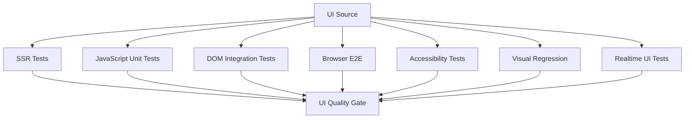
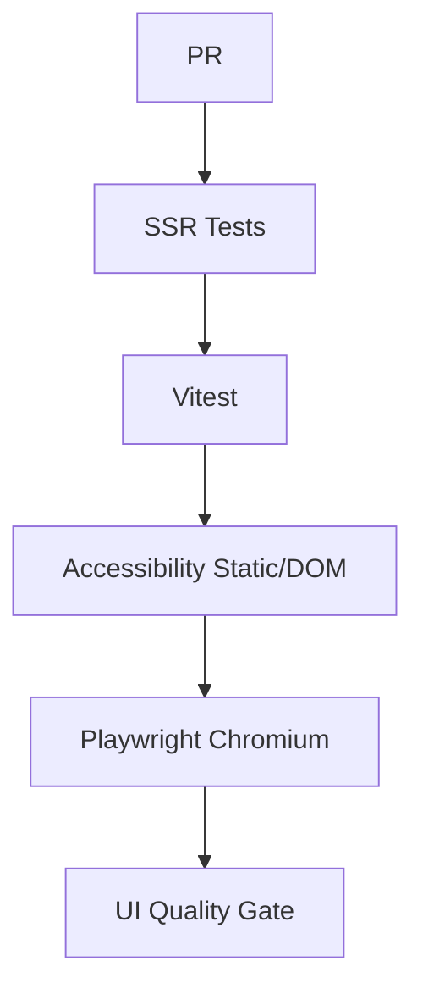

# 45_UI_TESTING.md

# UI Testing Architecture

## Parte 1 — Estrategia SSR-first, testing de rutas, formularios, contexto, permisos y arquitectura frontend

---

# 1. Introducción

Este documento define la estrategia de testing de interfaz de usuario de **Aula Robótica Platform**.

La plataforma utiliza una arquitectura:

```text
SSR-first
```

por lo que una parte importante de la calidad UI puede validarse desde backend mediante:

- FastAPI `TestClient`;
- renderizado Jinja2;
- respuestas HTML;
- redirects;
- formularios;
- permisos;
- contexto;
- navegación.

Sin embargo, la evolución del frontend hacia:

```text
SSR

+

JavaScript modular

+

Realtime

+

UI enterprise
```

requiere ampliar progresivamente la estrategia hacia testing de navegador, accesibilidad, comportamiento JavaScript y flujos colaborativos.

---

# 2. Objetivo

La estrategia de UI Testing debe proporcionar confianza sobre:

- renderizado SSR;
- navegación;
- formularios;
- autorización visual;
- context injection;
- menús;
- breadcrumbs;
- flash messages;
- diálogos;
- toasts;
- comportamiento JavaScript;
- responsive;
- accesibilidad;
- realtime UI;
- journeys completos.

---

# 3. Principio fundamental

El testing de UI debe realizarse en la capa más barata capaz de demostrar correctamente el comportamiento.

```text
SSR contract
    ↓
TestClient

JavaScript behavior
    ↓
JS tests

Browser behavior
    ↓
Playwright

Collaborative realtime flow
    ↓
multi-browser E2E
```

No todo requiere navegador real.

---

# 4. Estado actual

La plataforma ya dispone de una cobertura SSR relevante mediante:

- FastAPI `TestClient`;
- validación de HTML;
- testing de formularios;
- testing de redirects;
- RBAC UI;
- contextual rendering;
- helpers;
- menús;
- breadcrumbs;
- flash messages.

---

# 5. Estado actual de JavaScript

Actualmente no existe una infraestructura formal de testing JavaScript basada en herramientas como:

```text
Vitest

Jest

Playwright

Cypress
```

La validación JavaScript se realiza principalmente mediante:

- testing manual;
- browser debugging;
- consola;
- integración con SSR.

---

# 6. Estado de transición

La UI está evolucionando desde:

```text
SSR clásico
```

hacia:

```text
SSR + realtime enterprise UI
```

Por ello, la estrategia debe conservar la solidez del testing SSR mientras incorpora nuevas capas.

---

# 7. Arquitectura objetivo



---

# 8. Capas de UI Testing

La estrategia debe distinguir:

```text
SSR Route Testing

Template / Context Testing

Form Testing

Permission Rendering

JavaScript Unit Testing

DOM Integration Testing

Browser E2E

Accessibility Testing

Visual Regression

Realtime UI Testing
```

---

# 9. Responsabilidad por capa

Cada capa responde preguntas distintas.

| Capa | Pregunta |
|---|---|
| SSR | ¿El servidor genera la vista correcta? |
| Template | ¿Existe el contexto esperado? |
| Forms | ¿Se procesa correctamente la entrada? |
| RBAC UI | ¿Se muestran las acciones apropiadas? |
| JS Unit | ¿La lógica frontend funciona? |
| DOM Integration | ¿JS y DOM cooperan correctamente? |
| E2E | ¿Puede el usuario completar el flujo? |
| Accessibility | ¿La interfaz es operable y comprensible? |
| Visual | ¿Se ha roto la presentación? |
| Realtime | ¿La UI converge ante cambios remotos? |

---

# 10. Principio SSR-first

Mientras una interacción pueda validarse correctamente desde SSR, debe aprovecharse esa capa.

Ventajas:

- velocidad;
- determinismo;
- facilidad de debugging;
- menor coste de CI;
- menor flakiness.

---

# 11. SSR Testing no es browser testing

`TestClient` puede comprobar HTML.

No puede demostrar completamente:

- layout;
- CSS;
- focus;
- drag-and-drop;
- animations;
- comportamiento real del navegador;
- APIs DOM;
- WebSocket browser behavior.

---

# 12. Pirámide UI

```text
             Browser E2E
            /           \
           /             \
       DOM Integration
      /                 \
     /                   \
SSR + JavaScript Unit Tests
```

La mayor parte de la suite debe permanecer en las capas inferiores.

---

# 13. Estrategia de selección

Para cada comportamiento debe preguntarse:

```text
¿Cuál es la capa mínima capaz de demostrarlo?
```

Ejemplo:

```text
menu hidden by permission
```

puede probarse en SSR.

```text
dialog returns focus after close
```

requiere DOM/browser.

---

# 14. SSR Route Testing

Actualmente se prueban rutas como:

- login;
- users;
- roles;
- identities;
- dashboard.

Esta estrategia debe ampliarse a los nuevos módulos.

---

# 15. Rutas candidatas

La cobertura SSR debe extenderse progresivamente a:

```text
Projects

Tasks

Activities

Attachments

Notifications

Dashboard

Activity Feed
```

---

# 16. Contrato de ruta SSR

Un test SSR debe poder validar:

```text
request

↓

authentication

↓

authorization

↓

service

↓

template context

↓

HTML response
```

---

# 17. Status Code

Debe comprobarse explícitamente.

Ejemplos:

```text
200

302

303

401

403

404

422
```

según el contrato.

---

# 18. Content-Type

Las vistas SSR deben devolver:

```text
text/html
```

cuando corresponda.

---

# 19. Redirect Testing

Los redirects constituyen actualmente una parte importante de la cobertura.

Ejemplo:

```python
assert response.status_code in (302, 303)
```

Debe ampliarse comprobando también el destino cuando sea importante.

---

# 20. Redirect Destination

Ejemplo conceptual:

```python
assert response.headers["location"] == "/dashboard"
```

No basta siempre con conocer que hubo redirect.

---

# 21. Redirect Contracts

Debe probarse especialmente:

```text
login success

login failure

form success

unauthenticated access

expired session

logout
```

---

# 22. Post/Redirect/Get

Las operaciones SSR mutadoras deberían seguir cuando proceda:

```text
POST

↓

303 See Other

↓

GET
```

---

# 23. PRG Testing

Debe comprobarse:

1. POST válido;
2. redirect;
3. recurso disponible mediante GET;
4. ausencia de resubmission accidental.

---

# 24. Redirect Loop

Debe existir testing contra loops como:

```text
/dashboard

↓

/login

↓

/dashboard

↓

/login
```

especialmente en refresh/auth flows.

---

# 25. Follow Redirects

En algunos tests interesa:

```text
follow_redirects=False
```

para comprobar el contrato exacto.

En otros puede seguirse el flujo completo.

---

# 26. HTML Validation

La suite actual utiliza con frecuencia:

```python
assert "texto" in response.text
```

Es una estrategia válida para checks simples.

---

# 27. Limitación de String Assertions

Las assertions de texto pueden ser frágiles ante:

- traducción;
- cambios menores de copy;
- espacios;
- markup.

No deben constituir la única estrategia futura.

---

# 28. Selectores semánticos

Cuando el contenido sea más complejo puede resultar preferible validar:

- IDs estables;
- atributos `data-*`;
- roles;
- estructura.

---

# 29. HTML Parser

Puede incorporarse parsing HTML en tests backend cuando se necesite validar estructura sin navegador.

Ejemplo de herramientas posibles:

```text
BeautifulSoup

selectolax
```

La herramienta debe introducirse únicamente si aporta claridad.

---

# 30. Data Test IDs

Puede utilizarse selectivamente:

```html
data-testid="project-create-button"
```

cuando no exista un selector semántico estable.

---

# 31. Preferencia de selectores

Orden recomendado:

```text
role / accessible name

↓

semantic element

↓

stable ID

↓

data-testid

↓

CSS implementation details
```

---

# 32. No diseñar toda la UI para tests

`data-testid` debe ser una herramienta de último recurso, no llenar todo el HTML de atributos exclusivos para testing.

---

# 33. Template Testing

Las templates deben comprobarse principalmente mediante rutas SSR reales.

No suele ser necesario testear Jinja2 completamente aislado para cada plantilla.

---

# 34. Template Contract

Debe comprobar:

- template correcta;
- contexto suficiente;
- contenido esperado;
- permisos;
- estados vacíos.

---

# 35. Template Name

Cuando la infraestructura permita capturarlo, puede comprobarse la plantilla utilizada.

---

# 36. Context Testing

Actualmente existe cobertura relevante sobre context injection.

Debe mantenerse como contrato transversal.

---

# 37. Contexto global

Puede incluir:

```text
current_user

menu

breadcrumbs

flash

notification_count

permissions
```

según la arquitectura real.

---

# 38. Context Isolation

Los tests deben asegurar que datos de un usuario no se reutilizan accidentalmente para otro.

---

# 39. Current User

Debe comprobarse que la identidad correcta llega a la vista.

---

# 40. Context Helpers

Los helpers deben disponer de unit tests cuando contienen lógica.

Ejemplos existentes:

```text
audit_ui

menu_service

context helpers
```

---

# 41. Helper puro

Un helper puro puede probarse directamente sin HTTP.

---

# 42. Helper integrado

También puede existir un test SSR que demuestre que el helper se expone correctamente a Jinja2.

---

# 43. Menú principal

La UI debe renderizar navegación contextual.

Los tests deben comprobar:

- opciones visibles;
- opciones ocultas;
- elemento activo;
- permisos.

---

# 44. Menu Testing

Escenarios:

```text
Admin

Teacher / Coordinator

Student / Member

Unauthenticated
```

según los roles definitivos.

---

# 45. Menu Authorization

Ejemplo:

```text
User lacks admin permission

↓

Admin menu item absent
```

---

# 46. UI hiding no es seguridad

La ausencia del botón:

```text
Delete project
```

no demuestra que el endpoint esté protegido.

Debe existir además un test backend:

```text
DELETE /project

↓

403
```

---

# 47. Defense in Depth

La estrategia debe comprobar ambas dimensiones:

```text
UI visibility

+

backend enforcement
```

---

# 48. Breadcrumb Testing

Actualmente existen breadcrumbs dinámicos.

Deben probarse:

- orden;
- labels;
- enlaces;
- recurso actual.

---

# 49. Breadcrumb Example

```text
Projects

>

Robot Explorer

>

Task
```

Debe corresponder con el contexto actual.

---

# 50. Breadcrumb Permission

No debe existir un breadcrumb hacia un recurso no accesible.

---

# 51. Breadcrumb Deleted Resource

Cuando el recurso no existe debe mostrarse la página/error correspondiente sin breadcrumb roto.

---

# 52. Flash Messages

Actualmente forman parte del contexto UI.

Deben probarse:

- success;
- warning;
- error;
- consumo.

---

# 53. Flash Success

Ejemplo:

```text
Project created successfully.
```

Debe aparecer después del redirect correspondiente.

---

# 54. Flash Lifetime

Debe comprobarse que no persiste indefinidamente después de consumirse.

---

# 55. Flash Isolation

Un mensaje de una sesión no debe aparecer en otra.

---

# 56. Toast vs Flash

Debe mantenerse la distinción arquitectónica.

```text
Flash
```

puede estar asociado a navegación SSR.

```text
Toast
```

puede representar feedback frontend/realtime.

Los tests deben respetar el contrato concreto definido en `18_TOAST_SYSTEM.md`.

---

# 57. Formularios

La cobertura actual incluye:

- create;
- edit;
- delete;
- validation errors.

Debe mantenerse y ampliarse por dominio.

---

# 58. Form Test Matrix

Para cada formulario relevante:

```text
GET form

valid POST

invalid POST

authorization failure

business conflict
```

---

# 59. GET Form

Debe comprobar:

- status;
- campos;
- datos iniciales;
- permisos;
- CSRF cuando proceda.

---

# 60. Valid POST

Debe comprobar:

```text
request

↓

validation

↓

service

↓

persist

↓

redirect
```

---

# 61. Invalid POST

Debe comprobar:

```text
invalid input

↓

no persistence

↓

form re-rendered

↓

error visible
```

---

# 62. Form State Preservation

Cuando exista error, debe preservarse la entrada válida del usuario cuando sea apropiado.

---

# 63. Sensitive Fields

Campos sensibles como:

```text
password
```

no deben necesariamente volver a renderizarse tras error.

---

# 64. Validation Error Location

Debe comprobarse que el error se asocia correctamente:

- campo;
- formulario;
- mensaje global.

---

# 65. Error Summary

Si la UI incorpora un resumen accesible de errores, debe probarse.

---

# 66. Required Fields

Debe validarse:

```text
missing

empty

whitespace-only
```

según reglas.

---

# 67. Length Boundaries

Ejemplo:

```text
max - 1

max

max + 1
```

---

# 68. Invalid Enums

Selects y valores manipulados manualmente deben rechazarse también en backend.

---

# 69. Form Tampering

Un cliente puede enviar valores que la UI no ofrece.

Los tests deben cubrirlo en operaciones críticas.

---

# 70. Disabled Fields

Un campo visualmente disabled no constituye protección.

Debe rechazarse o ignorarse en backend si el usuario lo manipula.

---

# 71. Hidden Fields

Tampoco deben considerarse confiables.

---

# 72. Ownership Fields

Campos como:

```text
owner_id

created_by

project_id
```

deben validarse server-side aunque aparezcan ocultos.

---

# 73. Edit Form

Debe precargar el estado actual correcto.

---

# 74. Edit Authorization

Usuario sin permiso:

```text
GET edit

↓

403 / 404
```

según política.

También:

```text
POST edit

↓

403 / 404
```

---

# 75. Stale Edit Form

Cuando exista optimistic locking, debe probarse:

```text
form opened at version 4

↓

resource updated elsewhere

↓

submit version 4

↓

conflict
```

---

# 76. Conflict UI

La interfaz debe mostrar feedback claro y preservar seguridad de datos.

---

# 77. Delete UI

La eliminación normalmente requiere:

- autorización;
- confirmación;
- feedback.

---

# 78. Delete Button Visibility

Debe mostrarse únicamente cuando el usuario tenga capacidad.

---

# 79. Delete Confirmation

Si utiliza Dialog System, su comportamiento browser se probará en capas posteriores.

El backend debe seguir rechazando una llamada no autorizada independientemente del diálogo.

---

# 80. Delete POST

Debe comprobar:

- CSRF cuando exista;
- autorización;
- recurso;
- redirect;
- flash.

---

# 81. Duplicate Submission

Los formularios importantes deben ser robustos ante doble click o repetición.

Según el caso puede utilizarse:

- disabled submit;
- idempotency;
- redirect;
- uniqueness.

---

# 82. Browser Double Submit

Puede probarse en E2E para operaciones donde tenga riesgo real.

---

# 83. RBAC UI Testing

La plataforma ya dispone de cobertura de permisos visuales SSR.

Debe continuar como una estrategia explícita.

---

# 84. RBAC UI Matrix

Por componente puede documentarse:

| Acción | Admin | Coordinator | Member |
|---|---:|---:|---:|
| Crear Project | Según regla | Según regla | Según regla |
| Editar Project | Sí | Contextual | No |
| Crear Task | Sí | Sí | Según regla |
| Administrar usuarios | Sí | No | No |

Los valores reales deben corresponder al modelo RBAC definitivo.

---

# 85. Permission-Based Rendering

Debe comprobarse:

```text
can_edit = true

↓

edit action visible
```

y:

```text
can_edit = false

↓

edit action absent
```

---

# 86. Global Role vs Contextual Role

Los tests deben distinguir:

```text
global role
```

de:

```text
project role
```

---

# 87. Same User, Different Project

Caso importante:

```text
User is coordinator in Project A

User is member in Project B
```

La UI debe reflejar capacidades distintas.

---

# 88. Admin Override

Si Admin dispone de override global, debe probarse explícitamente.

---

# 89. UI Permission Regression

Toda vulnerabilidad de autorización visual corregida debe considerar un regression test.

---

# 90. Login UI Testing

Actualmente Auth dispone de cobertura SSR.

Debe comprobar:

- GET login;
- valid login;
- invalid login;
- redirect;
- authenticated access;
- logout.

---

# 91. Login GET

Debe mostrar formulario sin información sensible.

---

# 92. Invalid Login

Debe mostrar un error adecuado sin revelar:

```text
user exists

password wrong
```

si la política evita user enumeration.

---

# 93. Successful Login

Debe establecer la sesión/cookies correspondientes y redirigir al destino esperado.

---

# 94. Return URL

Si existe un mecanismo:

```text
next
```

debe probarse contra open redirect.

---

# 95. Already Authenticated

Un usuario autenticado que abre login debe recibir el comportamiento definido.

Puede:

- redirigirse;
- mostrar login;

según política.

---

# 96. Expired Session

Una vista protegida con sesión caducada debe llevar al flujo correcto.

---

# 97. Refresh Authentication UI

La suite actual ya cubre parte del refresh flow en middleware.

Debe asegurarse que la interfaz no:

- muestra errores intermedios innecesarios;
- entra en loops;
- pierde destino.

---

# 98. Logout UI

Debe:

- invalidar sesión;
- limpiar cookies;
- redirigir;
- impedir volver a recursos privados mediante sesión antigua.

---

# 99. Browser Cache

Para contenido sensible puede evaluarse testing de headers que reduzcan riesgos de cache.

---

# 100. Users UI

La cobertura actual incluye Users.

Debe proteger:

- listado;
- detalle;
- create;
- edit;
- activation;
- roles.

---

# 101. Users List

Debe comprobar:

- autorización;
- contenido;
- paginación cuando exista;
- empty state.

---

# 102. Users Create

Debe validar:

- formulario;
- duplicado;
- required fields;
- roles permitidos.

---

# 103. Users Edit

Debe proteger campos administrativos.

---

# 104. Privilege Escalation UI

Un usuario sin capacidad administrativa no debe poder manipular manualmente el formulario para elevar roles.

---

# 105. Roles UI

La suite actual incluye Roles.

Debe comprobar:

- listado;
- detalle;
- permisos;
- asignación.

---

# 106. Role Editing

Debe evitar modificaciones no autorizadas aunque el cliente construya manualmente el request.

---

# 107. Identities UI

La cobertura actual incluye Identities.

Debe validar:

- listado;
- mapping;
- errores;
- autorización.

---

# 108. SAML Identity UI

Debe manejar correctamente:

- identity existente;
- identity desconocida;
- mapping inválido;
- atributos incompletos.

---

# 109. Dashboard UI

El Dashboard es una de las áreas prioritarias de expansión.

---

# 110. Dashboard SSR

Debe comprobar:

- summary;
- widgets;
- empty states;
- permisos;
- partial failures.

---

# 111. Metric Cards

Backend tests deben validar:

```text
label

value

URL

severity
```

cuando estos formen parte del ViewModel.

---

# 112. No recomputar métricas en UI test

El cálculo de negocio pertenece a `33_DASHBOARD_MODULE.md` y sus tests backend.

UI Testing debe comprobar:

```text
ViewModel → correct presentation
```

---

# 113. Dashboard Empty State

Usuario sin proyectos:

```text
appropriate empty state
```

sin cards inconsistentes.

---

# 114. Dashboard Role Variation

Debe comprobar:

```text
member dashboard

coordinator dashboard

admin dashboard
```

según capacidades.

---

# 115. Dashboard Partial Error

Si un widget no está disponible, la UI debe seguir siendo usable cuando la arquitectura contempla degradación parcial.

---

# 116. Dashboard Links

Los enlaces de metric cards/widgets deben conducir a destinos autorizados.

---

# 117. Projects UI

Debe cubrir progresivamente:

- list;
- card;
- detail;
- create;
- edit;
- membership.

---

# 118. Project List

Casos:

```text
projects exist

no projects

filters

different permissions
```

---

# 119. Project Card

Debe mostrar:

- nombre;
- status;
- role;
- progreso;

según diseño.

---

# 120. Project Detail

Debe comprobar que las acciones cambian según capacidad.

---

# 121. Project Archive UI

Un proyecto archivado puede:

- mostrar badge;
- ocultar acciones mutadoras;
- permitir histórico.

Esto debe probarse.

---

# 122. Tasks UI

Debe cubrir:

- list;
- detail;
- forms;
- status;
- priority;
- assignee;
- Kanban.

---

# 123. Task Badge

Status y priority deben renderizar correctamente según el catálogo visual.

---

# 124. Assignee

Debe manejar:

```text
assigned user

unassigned
```

sin errores de plantilla.

---

# 125. Overdue

Debe existir test visual semántico desde SSR:

```text
task overdue

↓

appropriate label/icon state
```

No depender únicamente del color.

---

# 126. Task Detail Actions

Deben variar por permisos.

---

# 127. Activities UI

Debe probar:

- create;
- list;
- complete;
- attachments;
- permissions.

---

# 128. Activity Empty State

Una Task sin Activities debe mostrar un estado vacío consistente.

---

# 129. Attachments UI

Debe cubrir:

- upload form;
- attachment list;
- download;
- delete;
- error states.

---

# 130. Upload Form

Debe mostrar:

- accepted type;
- max size;
- accessible label.

---

# 131. Upload Error

Errores como:

```text
file too large

unsupported type

storage unavailable
```

deben convertirse en feedback comprensible.

---

# 132. Attachment List

Debe manejar:

- filename;
- size;
- uploader;
- date;
- actions.

---

# 133. Dangerous Filename

Un filename con HTML debe renderizarse escapado.

---

# 134. Notifications UI

Debe cubrir:

- notification center;
- unread count;
- list;
- mark read;
- mark all read;
- empty state.

---

# 135. Notification Badge

Debe representar el número correcto desde SSR inicial.

La sincronización realtime se cubrirá posteriormente.

---

# 136. Notification Item

Debe mostrar:

- title;
- severity;
- date;
- read state;
- link.

---

# 137. Read State

Debe existir una diferencia semántica además de visual cuando sea necesaria para accesibilidad.

---

# 138. Activity Feed UI

Debe probar:

- timeline;
- feed item;
- empty state;
- pagination/load more;
- filters.

---

# 139. Feed Item

Debe renderizar:

```text
actor

message

time

icon

entity link
```

según el ViewModel.

---

# 140. Deleted Entity

Un Feed Event cuyo recurso ya no existe debe seguir renderizando sin enlace roto.

---

# 141. Feed Message Escaping

El mensaje debe tratarse como texto.

No debe renderizar HTML introducido por usuarios.

---

# 142. Contextual Rendering Philosophy

La filosofía actual:

```text
render contextual

+

backend authorization
```

debe mantenerse.

---

# 143. Progressive Enhancement

La UI debe funcionar en su núcleo sin JavaScript cuando la arquitectura lo permita.

---

# 144. Testing sin JavaScript

Para journeys SSR fundamentales debe comprobarse:

- formularios;
- navegación;
- redirects;
- lectura de contenido.

---

# 145. JavaScript Enhancement

Posteriormente debe comprobarse que JavaScript mejora la experiencia sin romper el fallback.

---

# 146. Fallback Test

Ejemplo:

```text
dialog enhancement unavailable

↓

native/SSR action remains possible
```

cuando el diseño contemple ese fallback.

---

# 147. JavaScript Architecture

El frontend modular definido en `20_JS_ARCHITECTURE.md` debe reflejarse también en los tests.

Cada módulo JS con lógica debe tener un límite testeable.

---

# 148. Módulos candidatos

Especialmente:

```text
dialogs

toasts

dashboard

notifications

realtime

kanban
```

---

# 149. Principio

No debe probarse JavaScript únicamente mediante E2E.

La lógica pura debe moverse a módulos fáciles de testear.

---

# 150. Functional Core

Cuando sea posible:

```text
functional core

+

imperative shell
```

---

# 151. Ejemplo

En lugar de mezclar:

```text
event parsing

DOM query

state update

render
```

en una sola función, pueden separarse:

```text
parse event

derive state

render state
```

---

# 152. Beneficio

La lógica de:

```text
derive state
```

puede probarse sin navegador.

---

# 153. DOM Boundary

Las operaciones que realmente dependen del DOM se cubren mediante integración frontend.

---

# 154. Event Listener Testing

Debe comprobarse:

- listener registered;
- action executed;
- no duplicate registration.

---

# 155. Duplicate Initialization

Especialmente importante si scripts pueden inicializarse tras partial refresh.

---

# 156. Idempotent Init

Cuando corresponda:

```text
init()

init()
```

no debe generar dos listeners equivalentes.

---

# 157. Event Delegation

Si se utiliza delegación, debe probarse con elementos insertados dinámicamente.

---

# 158. Custom Events

Los módulos pueden comunicarse mediante eventos internos.

Los contratos deben probar:

- event name;
- detail;
- target behavior.

---

# 159. DOM Cleanup

Componentes desmontados deben limpiar listeners u observers cuando sea necesario.

---

# 160. Memory Leaks

No suelen detectarse con unit tests ordinarios.

Journeys largos o profiling pueden ayudar en componentes complejos.

---

# 161. UI State

Debe distinguirse:

```text
server state

UI state

ephemeral state
```

---

# 162. Server State

Ejemplos:

- Task;
- Notification;
- Project.

La fuente de verdad es backend.

---

# 163. UI State

Ejemplos:

- dialog open;
- active tab;
- pending filter.

---

# 164. Ephemeral State

Ejemplos:

- loading;
- toast animation;
- focus target.

---

# 165. Testing State Boundaries

No debe esperarse que JavaScript mantenga como autoridad información que pertenece al servidor.

---

# 166. Loading States

Toda operación asíncrona relevante debe probar:

```text
idle

↓

loading

↓

success
```

y:

```text
loading

↓

error
```

---

# 167. Disable During Submit

Un botón puede deshabilitarse durante una request.

Debe reactivarse ante error cuando proceda.

---

# 168. Network Error

Debe existir feedback comprensible cuando `fetch()` falla.

---

# 169. HTTP Error

Debe distinguirse:

```text
network failure

HTTP 403

HTTP 409

HTTP 500
```

cuando la UX sea diferente.

---

# 170. 401 en frontend

Debe seguir la política de sesión definida.

Puede requerir:

- redirect;
- refresh;
- login.

Debe testearse evitando loops.

---

# 171. 403

Debe mostrar feedback de acceso, no fingir que la operación tuvo éxito.

---

# 172. 409 Conflict

Especialmente relevante para Kanban y optimistic locking.

Debe provocar reconciliación o mensaje según diseño.

---

# 173. 422

Debe representar errores de entrada cuando una interacción JS utiliza API.

---

# 174. 500

Debe mostrar error genérico sin detalles internos.

---

# 175. Loading Accessibility

Los estados de carga deben ser comprensibles para tecnologías de asistencia cuando sea necesario.

---

# 176. `aria-busy`

Puede utilizarse en regiones dinámicas.

Debe probarse cuando forme parte del componente.

---

# 177. Empty States

Cada componente importante debe tener tests para:

```text
zero items
```

---

# 178. Error States

También:

```text
failed to load
```

---

# 179. Partial Data

Cuando el diseño soporte degradación, debe probarse:

```text
some widgets succeed

some fail
```

---

# 180. UI Test Data

Los tests deben utilizar contenido suficientemente representativo.

---

# 181. Special Characters

Incluir:

```text
á

ñ

&

<

>

"

'
```

para detectar problemas de encoding/escaping.

---

# 182. Unicode

Debe probarse contenido Unicode válido cuando sea relevante.

---

# 183. Long Content

Debe probar:

- títulos largos;
- nombres largos;
- textos cercanos al máximo.

Backend tests validan límites; browser/visual tests pueden validar layout.

---

# 184. Empty Strings

Debe probarse donde la semántica los distinga de `null`.

---

# 185. Localization

Si la plataforma incorpora múltiples idiomas en el futuro, los tests no deben quedar excesivamente acoplados al texto literal.

---

# 186. Accessible Queries

Herramientas browser deben preferir:

```text
role

label

accessible name
```

lo que además mejora estabilidad.

---

# 187. Ejemplo Playwright futuro

```javascript
await page.getByRole(
  "button",
  { name: "Crear tarea" }
).click();
```

es preferible a selectores de clases visuales.

---

# 188. CSS Selectors

Selectores como:

```text
div:nth-child(3) > button
```

deben evitarse.

Son extremadamente frágiles.

---

# 189. Stable Component Hooks

Cuando no exista alternativa semántica puede utilizarse:

```text
data-testid
```

---

# 190. Arquitectura de tests UI

Estructura futura posible:

```text
tests/
└── ui/
    ├── ssr/
    ├── javascript/
    ├── e2e/
    ├── accessibility/
    └── visual/
```

Debe adaptarse al repositorio real.

---

# 191. Frontend Tests

Si el JavaScript dispone de su propio tooling:

```text
frontend-tests/
```

o ubicación equivalente puede utilizarse.

Debe evitarse una estructura innecesariamente fragmentada.

---

# 192. Nomenclatura

Los tests deben expresar intención.

Ejemplo:

```text
test_member_does_not_see_project_admin_actions
```

---

# 193. UI Contract Tests

Deben evitar nombres genéricos como:

```text
test_page
```

---

# 194. Determinismo

La UI testing debe evitar:

- dependencias externas;
- tiempo real;
- datos aleatorios no controlados;
- animaciones en E2E cuando dificulten estabilidad.

---

# 195. Animations in Tests

Puede utilizarse configuración de reduced motion o deshabilitar animaciones en entorno E2E cuando no sean el comportamiento bajo prueba.

---

# 196. `prefers-reduced-motion`

Además de mejorar estabilidad puede comprobarse como requisito de accesibilidad.

---

# 197. Time Control

Para JavaScript con temporizadores:

- toast duration;
- debounce;
- reconnect;

los unit tests deben utilizar fake timers cuando sea apropiado.

---

# 198. No `sleep()` arbitrario

No deben escribirse tests browser como:

```text
wait 5 seconds
```

para esperar una condición.

---

# 199. Condition-Based Waiting

Debe esperar:

- elemento visible;
- response;
- event;
- state.

---

# 200. Playwright Auto-wait

La futura estrategia debe aprovechar el auto-wait de Playwright en lugar de sleeps manuales.

---

# 201. SSR Quality Baseline

La base actual puede considerarse madura en:

- formularios;
- permisos;
- redirects;
- contexto;
- menús;
- RBAC UI.

Debe conservarse durante la evolución.

---

# 202. Gaps actuales

Los principales gaps siguen siendo:

```text
Browser automation

JavaScript unit testing

Visual regression

Accessibility automation

Realtime UI testing
```

---

# 203. Prioridad inmediata

Debe ampliarse primero cobertura sobre:

```text
Dashboard

Notifications

Projects

Tasks

Attachments
```

manteniendo el patrón SSR actual.

---

# 204. Segunda prioridad

Introducir testing de componentes JavaScript que ya concentran lógica.

Especialmente:

```text
Dialog System

Toast System

Dashboard JS

Notifications JS
```

---

# 205. Tercera prioridad

Añadir Playwright para journeys críticos.

---

# 206. Cuarta prioridad

Extender browser automation a:

```text
Kanban

Realtime

Collaborative flows
```

---

# 207. Quinta prioridad

Incorporar:

```text
Accessibility

Visual Regression
```

de forma selectiva.

---

# 208. No migración abrupta

La introducción de Playwright no debe provocar eliminar tests SSR existentes.

Ambos cubren riesgos diferentes.

---

# 209. Testing Cost Model

Puede representarse:

```text
SSR
fastest

↓

JS Unit

↓

DOM Integration

↓

Browser E2E

↓

Multi-browser collaborative E2E
most expensive
```

---

# 210. Estrategia eficiente

Para un bug de lógica JS:

```text
unit test
```

puede ser suficiente.

Para un bug de foco:

```text
browser test
```

es necesario.

---

# 211. Regla de selección

Debe utilizarse siempre:

```text
lowest reliable testing layer
```

---

# 212. Gaps como deuda explícita

Los gaps UI conocidos deben mantenerse visibles en backlog técnico.

No deben depender únicamente del conocimiento del equipo.

---

# 213. UI Regression Rule

Todo bug significativo de interfaz debe considerar un regression test en la capa adecuada.

---

# 214. Ejemplo

Bug:

```text
Student sees Admin menu
```

Regression:

```text
SSR permission test
```

---

# 215. Ejemplo JS

Bug:

```text
Dialog does not restore focus
```

Regression:

```text
browser accessibility test
```

---

# 216. Ejemplo Realtime

Bug:

```text
Task duplicated after reconnect
```

Regression:

```text
realtime E2E
```

---

# 217. Continuación

La **Parte 2** desarrollará:

- estrategia JavaScript con Vitest;
- DOM testing;
- `jsdom`;
- Dialog System;
- Toast System;
- Notification UI;
- Dashboard JS;
- Kanban;
- Playwright;
- browser contexts;
- selectors;
- fixtures;
- Page Objects;
- accessibility;
- responsive testing;
- visual regression.

---

# 45_UI_TESTING.md

# UI Testing Architecture

## Parte 2 — JavaScript Testing, DOM, Dialogs, Toasts, Dashboard, Kanban, Playwright y accesibilidad

---

# 218. Estrategia JavaScript

La evolución de Aula Robótica Platform requiere una capa explícita de testing para los módulos JavaScript.

El objetivo no consiste en trasladar toda la validación de UI al navegador.

Debe separarse:

```text
JavaScript logic

↓

DOM behavior

↓

Browser integration
```

---

# 219. Tooling recomendado

La herramienta recomendada para unit e integration testing JavaScript es:

```text
Vitest
```

por su:

- velocidad;
- soporte moderno ES Modules;
- mocks;
- fake timers;
- coverage;
- integración sencilla con frontend modular.

---

# 220. Vitest

Vitest puede utilizarse para probar:

- funciones puras;
- stores ligeros;
- event handlers;
- state derivation;
- API adapters;
- realtime utilities;
- DOM logic.

---

# 221. Alternativa

`Jest` continúa siendo una alternativa válida.

Sin embargo, para una arquitectura JavaScript moderna basada en módulos ES, Vitest proporciona una integración especialmente sencilla.

---

# 222. Principio de independencia

La arquitectura JavaScript no debe depender de Vitest.

Los módulos productivos deben continuar siendo JavaScript estándar.

---

# 223. Estructura posible

```text
static/
└── js/
    ├── dialogs/
    ├── toasts/
    ├── dashboard/
    ├── notifications/
    ├── realtime/
    └── kanban/

tests/
└── javascript/
    ├── dialogs/
    ├── toasts/
    ├── dashboard/
    ├── notifications/
    ├── realtime/
    └── kanban/
```

---

# 224. Colocación alternativa

También puede utilizarse colocación cercana:

```text
dialog.js

dialog.test.js
```

La convención debe mantenerse uniforme.

---

# 225. Unit Tests JavaScript

Deben cubrir principalmente:

```text
pure transformations

validation

state changes

event mapping

deduplication

filtering
```

---

# 226. Funciones puras

Son las unidades ideales.

Ejemplo:

```javascript
export function shouldShowToast(notification) {
    return (
        notification.toast === true &&
        notification.read === false
    );
}
```

Puede probarse sin DOM.

---

# 227. Beneficio

Los tests de funciones puras son:

- rápidos;
- deterministas;
- fáciles de mantener;
- independientes del navegador.

---

# 228. Separación de lógica

Debe evitarse:

```javascript
function handleEvent(event) {
    // parse payload
    // update state
    // query DOM
    // create markup
    // animate
    // send request
}
```

en una única función.

---

# 229. Descomposición recomendada

```text
parseEvent()

↓

deriveState()

↓

renderState()

↓

performSideEffect()
```

---

# 230. API Adapters

Los módulos que realizan `fetch()` deben aislar la comunicación HTTP.

Ejemplo:

```text
dashboard_api.js

notification_api.js

kanban_api.js
```

---

# 231. Testing API Adapter

Debe cubrir:

```text
successful response

4xx response

5xx response

network failure

invalid JSON
```

---

# 232. Fetch Mock

Los unit tests pueden sustituir:

```text
fetch
```

mediante un mock controlado.

---

# 233. No mockear en E2E innecesariamente

Los journeys E2E principales deberían atravesar el backend real del entorno de testing.

Network mocking se reserva para escenarios específicos.

---

# 234. DOM Testing

Los componentes que manipulan DOM necesitan un entorno DOM simulado o browser.

---

# 235. jsdom

Para integración JavaScript ligera puede utilizarse:

```text
jsdom
```

---

# 236. Responsabilidad de jsdom

Permite probar:

- query selectors;
- event listeners;
- attributes;
- classes;
- content;
- custom events.

---

# 237. Limitaciones de jsdom

No reproduce completamente:

- layout;
- rendering;
- CSS;
- focus browser real;
- drag-and-drop nativo;
- WebSocket real;
- animation frame behavior complejo.

---

# 238. Regla

Si el comportamiento depende de una implementación real del navegador:

```text
use Playwright
```

---

# 239. DOM Fixture

Un test puede crear HTML mínimo.

Ejemplo conceptual:

```javascript
document.body.innerHTML = `
    <button id="open-dialog">
        Delete
    </button>

    <div id="dialog" hidden></div>
`;
```

---

# 240. HTML mínimo

Debe incluir únicamente la estructura necesaria.

No cargar una página completa cuando se prueba una unidad pequeña.

---

# 241. Cleanup DOM

Cada test debe limpiar:

```text
document.body
```

o recrear el entorno.

---

# 242. Event Listener Isolation

Los listeners registrados por un test no deben sobrevivir al siguiente.

---

# 243. Global State

Los módulos que contienen estado global necesitan una función de reset o diseño que evite contaminación.

---

# 244. Event Bus

Si existe un bus de eventos interno debe poder reiniciarse entre tests.

---

# 245. CustomEvent

Los contratos internos pueden probarse mediante:

```javascript
new CustomEvent(...)
```

---

# 246. Event Contract

Debe validar:

```text
event name

detail shape

listener behavior
```

---

# 247. Dialog System

`17_DIALOG_SYSTEM.md` define un sistema transversal de diálogos.

Debe disponer de testing específico.

---

# 248. Casos fundamentales de Dialog

Debe comprobar:

```text
open

close

confirm

cancel

Escape

backdrop

focus

multiple open attempts
```

---

# 249. Dialog Open

Al abrir:

- debe hacerse visible;
- debe marcarse como activo;
- debe recibir el contenido esperado;
- debe posicionar foco correctamente.

---

# 250. Dialog Close

Al cerrar:

- debe ocultarse;
- limpiar estado efímero;
- devolver foco;
- eliminar listeners temporales cuando proceda.

---

# 251. Trigger Focus

Antes de abrir debe conservarse referencia al elemento que originó la acción.

---

# 252. Focus Restoration

Después de cerrar:

```text
focus

↓

original trigger
```

cuando el elemento siga disponible.

---

# 253. Focus Trap

Los diálogos modales deben impedir que el foco escape al contenido de fondo.

Este comportamiento debe validarse preferentemente con navegador real.

---

# 254. Escape

Cuando la política lo permita:

```text
Escape

↓

close dialog
```

---

# 255. Escape no permitido

Para ciertos estados críticos puede impedirse cierre mediante Escape.

Debe existir test específico cuando ocurra.

---

# 256. Backdrop

Debe probarse la política:

```text
click backdrop

↓

close
```

o no cerrar, según tipo.

---

# 257. Confirm Action

Debe comprobar:

```text
confirm

↓

callback / HTTP action

↓

loading state

↓

result
```

---

# 258. Cancel Action

No debe ejecutar la operación mutadora.

---

# 259. Confirm Double Click

Debe evitar ejecuciones duplicadas.

---

# 260. Async Confirm

Si la operación es async:

```text
confirm

↓

button disabled

↓

request

↓

success / error
```

---

# 261. Dialog Error

Ante error:

- diálogo puede permanecer abierto;
- debe mostrar feedback;
- debe restaurar botones;
- no debe perder el contexto.

---

# 262. Dialog Dynamic Content

Debe comprobar que abrir dos recursos sucesivos no reutiliza contenido anterior.

---

# 263. Dialog State Leakage

Ejemplo:

```text
open delete Task A

close

open delete Task B
```

Debe referirse únicamente a Task B.

---

# 264. Dialog Accessibility

Debe validar:

```text
role="dialog"

aria-modal="true"

accessible name
```

según markup definitivo.

---

# 265. Toast System

`18_TOAST_SYSTEM.md` requiere una estrategia específica.

---

# 266. Toast Tests

Debe cubrir:

```text
create

render

timeout

dismiss

queue

deduplication

maximum visible

accessibility
```

---

# 267. Toast Creation

Un evento válido debe producir el modelo esperado.

---

# 268. Toast Type

Debe mapear correctamente:

```text
success

info

warning

error
```

---

# 269. Invalid Type

Debe:

- normalizarse;
- usar default;
- rechazarse;

según el contrato del sistema.

---

# 270. Toast Message

Debe tratarse como texto seguro.

---

# 271. XSS en Toast

Un mensaje:

```text
<script>alert(1)</script>
```

debe aparecer como texto o ser rechazado.

Nunca ejecutarse.

---

# 272. Toast Timeout

Debe probarse utilizando:

```text
fake timers
```

en unit tests.

---

# 273. No esperar segundos reales

Incorrecto:

```text
await sleep(5000)
```

Correcto:

```text
advance timers
```

---

# 274. Persistent Toast

Los errores que requieren intervención pueden no auto-dismiss.

Debe comprobarse cuando exista ese tipo.

---

# 275. Manual Dismiss

El botón de cierre debe retirar únicamente el toast seleccionado.

---

# 276. Queue

Si se supera el máximo visible:

```text
new toast

↓

queue
```

según política.

---

# 277. Maximum Visible

Debe comprobarse el límite definido en el sistema.

---

# 278. Queue Promotion

Cuando desaparece uno:

```text
queued toast

↓

becomes visible
```

---

# 279. Toast Deduplication

Eventos repetidos dentro de una ventana pueden agruparse según la política.

---

# 280. Same Message, Different Event

No deben deduplicarse incorrectamente si representan eventos distintos cuando el contrato exige conservarlos.

---

# 281. Toast Realtime

Debe diferenciar:

```text
notification stored

vs

toast shown
```

---

# 282. Preference

Si el usuario tiene:

```text
toast disabled
```

puede persistirse Notification sin mostrar Toast.

---

# 283. `aria-live`

El contenedor debe utilizar la estrategia accesible definida.

Debe probarse su existencia.

---

# 284. Toast Focus

Un toast informativo no debería robar automáticamente el foco.

---

# 285. Actionable Toast

Si incorpora acción:

```text
View Task
```

debe ser accesible por teclado.

---

# 286. Dashboard JavaScript

Dashboard contiene lógica de actualización incremental.

Debe probarse de forma aislada.

---

# 287. Dashboard Widget State

Estados:

```text
idle

stale

loading

ready

error
```

---

# 288. State Transition Tests

Debe comprobar:

```text
ready → stale

stale → loading

loading → ready

loading → error

error → loading
```

---

# 289. Dashboard Invalidation

Un evento puede invalidar:

```text
summary

tasks

projects
```

Debe comprobarse el mapping correspondiente.

---

# 290. Invalidation Deduplication

Si llegan:

```text
summary

summary

tasks

summary
```

antes del refresh, el resultado debe ser:

```text
summary

tasks
```

---

# 291. Dashboard Debounce

Debe utilizar fake timers.

---

# 292. Debounce Scenario

```text
event A

100 ms

event B

100 ms

event C
```

debe producir un único refresh dentro de la ventana configurada.

---

# 293. Widget Fetch Success

Debe sustituir o actualizar el contenido correspondiente.

---

# 294. Widget Fetch Error

Debe:

- mantener contenido anterior si existe;
- marcar error;
- permitir retry.

---

# 295. Stale-While-Revalidate

Debe probar:

```text
old data remains

while loading

↓

new data replaces on success
```

---

# 296. Focus Preservation

Si un widget refresca mientras contiene el foco, debe seguir la estrategia definida.

Los casos más sensibles requieren Playwright.

---

# 297. Page Visibility

Debe probar:

```text
document.hidden = true
```

conceptualmente mediante abstraction/mocking cuando el módulo lo permita.

---

# 298. Hidden Tab

Debe evitar refresh innecesario.

---

# 299. Visible Again

Debe refrescar widgets stale.

---

# 300. Dashboard Partial HTML

Si el backend devuelve HTML parcial, los tests frontend deben validar:

- inserción correcta;
- no duplicación;
- reinitialization controlada.

---

# 301. Script Reinitialization

Un partial insertado no debe provocar listeners duplicados.

---

# 302. Notifications JavaScript

Debe probar:

- badge;
- notification list;
- mark read;
- realtime insert;
- dedupe.

---

# 303. Notification Badge

Evento:

```text
notification.created
```

puede incrementar el contador.

---

# 304. Badge Server Reconciliation

Después de refresh, el valor del servidor prevalece.

---

# 305. Badge Zero State

Cuando pasa a cero:

- puede ocultarse;
- mostrar `0`;

según diseño.

Debe probarse.

---

# 306. Notification Insert

Un nuevo elemento debe insertarse según orden.

---

# 307. Duplicate Notification

Mismo:

```text
notification_id
```

no debe insertarse dos veces.

---

# 308. Mark Read Optimistic UI

Si se utiliza optimismo:

```text
click

↓

mark visually read

↓

request
```

debe existir rollback ante error.

---

# 309. Mark Read Pessimistic UI

Si espera servidor:

```text
request

↓

success

↓

update UI
```

debe probarse loading.

---

# 310. Read All

Debe actualizar:

- lista;
- badge;
- states.

---

# 311. Realtime Notifications

Los detalles específicos de transporte pertenecen a `46_REALTIME_TESTING.md`.

Aquí se prueba la reacción UI al evento recibido.

---

# 312. Kanban JavaScript

Kanban constituye uno de los componentes frontend de mayor riesgo.

Combina:

```text
DOM

+

drag-and-drop

+

server state

+

optimistic updates

+

realtime

+

concurrency
```

---

# 313. Kanban Unit Logic

Debe extraerse y probarse lógica como:

```text
derive move command

normalize positions

apply remote event

detect stale version
```

---

# 314. Move Command

A partir de:

```text
task id

source status

target status

target index

version
```

debe generarse el command correcto.

---

# 315. Same Column Move

Debe producir:

```text
same status

new position
```

---

# 316. Cross Column Move

Debe producir:

```text
new status

new position
```

---

# 317. Invalid Drop

Debe ignorarse o revertirse según contrato.

---

# 318. Optimistic Move

Secuencia:

```text
user drops

↓

DOM moves immediately

↓

request

↓

success
```

---

# 319. Optimistic Success

La posición local debe confirmarse con respuesta del servidor.

---

# 320. Optimistic Failure

Debe restaurar el estado correcto.

---

# 321. Conflict

Un:

```text
409
```

debe provocar:

```text
reconciliation
```

o mensaje de conflicto según diseño.

---

# 322. Remote Kanban Event

Debe aplicar un cambio recibido sin simular un nuevo drag local.

---

# 323. Echo Event

Si el cliente recibe el mismo evento que originó:

```text
do not duplicate movement
```

---

# 324. Stale Remote Event

Si llega un evento con versión anterior debe ignorarse según el contrato.

---

# 325. Future Version

Un gap inesperado de versiones puede requerir refresh completo.

Debe probarse.

---

# 326. Kanban DOM

Debe verificar:

- card moved;
- column counts;
- empty state;
- attributes;
- version metadata.

---

# 327. Drag-and-Drop real

La interacción real debe probarse con Playwright.

---

# 328. Browser Automation

Playwright es la herramienta recomendada para testing real de navegador.

---

# 329. Playwright Responsibilities

Debe cubrir:

- browser APIs;
- navigation;
- focus;
- dialogs;
- forms;
- drag-and-drop;
- responsive;
- accessibility;
- realtime collaboration.

---

# 330. Lo que no debe hacer Playwright

No debe convertirse en sustituto de:

- Service tests;
- validators;
- Repository tests;
- combinaciones completas RBAC.

---

# 331. Browser Matrix

Estrategia inicial:

```text
Chromium
```

para PR.

---

# 332. Browser Matrix ampliada

Posteriormente:

```text
Chromium

Firefox

WebKit
```

para suites nightly/release.

---

# 333. Mobile Emulation

Puede probarse mediante perfiles de dispositivo o viewport.

---

# 334. Playwright Configuration

Debe centralizar:

- base URL;
- browser;
- retries;
- screenshots;
- traces;
- video;
- timeout.

---

# 335. Retries

En CI puede configurarse un retry limitado para diagnóstico.

No debe ocultar flakiness.

---

# 336. Trace on Failure

Se recomienda:

```text
trace = retain-on-failure
```

o estrategia equivalente.

---

# 337. Screenshot on Failure

Debe conservarse automáticamente.

---

# 338. Video

Puede activarse:

```text
retain-on-failure
```

para journeys complejos.

---

# 339. E2E Environment

Debe utilizar:

- backend real;
- test database;
- storage de testing;
- configuración realtime de testing.

---

# 340. Browser Context

Cada usuario debe utilizar un contexto independiente.

---

# 341. Isolation by Context

Un contexto mantiene:

- cookies;
- localStorage;
- sessionStorage.

---

# 342. Multi-user E2E

Ejemplo:

```text
context A = coordinator

context B = member
```

permite probar colaboración.

---

# 343. Login Strategy

Existen dos estrategias.

## UI Login

Ejecutar formulario.

## Auth State

Preparar sesión programáticamente.

---

# 344. UI Login

Debe utilizarse al menos para probar el propio flujo de autenticación.

---

# 345. Auth State Reuse

Para otros tests puede prepararse estado autenticado para ahorrar tiempo.

---

# 346. No saltarse autorización

Preparar sesión no debe implicar bypass de la lógica de autorización.

Solo evita repetir el formulario.

---

# 347. Storage State

Playwright puede conservar un estado autenticado por rol.

Ejemplos:

```text
admin.json

coordinator.json

member.json
```

solo dentro del entorno de test seguro.

---

# 348. Secrets de E2E

Los ficheros de storage state no deben versionarse si contienen credenciales/sesiones sensibles.

---

# 349. Selectores Playwright

Preferencia:

```text
getByRole

getByLabel

getByText when stable

getByTestId
```

---

# 350. Accessible Selectors

Ejemplo:

```javascript
page.getByRole(
    "button",
    { name: "Crear proyecto" }
)
```

---

# 351. Beneficio

Estos selectores validan indirectamente parte de la semántica accesible.

---

# 352. Test IDs

Utilizar cuando:

- no existe rol adecuado;
- el copy es variable;
- el componente es difícil de localizar.

---

# 353. CSS Classes

No deben utilizarse preferentemente como contrato de testing.

Clases cambian con frecuencia por motivos visuales.

---

# 354. Page Objects

Puede utilizarse Page Object Pattern para flujos repetitivos.

---

# 355. Page Object Example

```text
LoginPage

DashboardPage

ProjectPage

KanbanPage
```

---

# 356. Responsabilidad de Page Object

Debe encapsular:

- selectors;
- acciones comunes.

No debe ocultar toda la semántica del test.

---

# 357. Anti-pattern Page Object

Un Page Object con:

```text
200 métodos

+

assertions

+

business logic
```

se convierte en otra aplicación difícil de mantener.

---

# 358. Preferencia

Utilizar objetos pequeños y específicos.

---

# 359. Component Objects

También pueden existir:

```text
DialogComponent

ToastComponent

NotificationCenter
```

---

# 360. Assertions en Tests

Preferiblemente las assertions principales permanecen en el test.

Los Page Objects ejecutan acciones y exponen estado.

---

# 361. Fixtures Playwright

Fixtures pueden preparar:

- users;
- projects;
- tasks;
- authenticated contexts.

---

# 362. Test Data API

Para E2E puede existir infraestructura interna de testing que cree datos rápidamente.

Debe estar:

- deshabilitada en producción;
- restringida al entorno de test.

---

# 363. Setup por API

Es preferible crear diez Tasks mediante backend/API de test que realizar diez formularios UI si el setup no es lo que se está probando.

---

# 364. Cleanup E2E

Cada test debe limpiar datos o utilizar aislamiento.

---

# 365. Unique Prefix

Puede utilizar:

```text
e2e-<run-id>
```

para evitar colisiones.

---

# 366. Parallel E2E

Los tests deben poder ejecutarse en paralelo cuando el entorno lo permita.

---

# 367. Shared Resources

Debe evitarse que varios tests modifiquen el mismo Project.

---

# 368. Serial Tests

Solo utilizar modo serial para journeys que realmente comparten un estado intencional.

---

# 369. Waiting Strategy

Playwright debe esperar condiciones observables.

---

# 370. Correct Waiting

Ejemplos:

```text
await expect(locator).toBeVisible()

await page.waitForResponse(...)

await expect(locator).toHaveText(...)
```

---

# 371. Incorrect Waiting

Evitar:

```javascript
await page.waitForTimeout(5000);
```

---

# 372. Accessibility Testing

Debe combinar múltiples niveles.

---

# 373. Automated Accessibility

Puede integrarse:

```text
axe-core
```

con Playwright.

---

# 374. Axe Scope

Debe ejecutarse sobre:

- login;
- dashboard;
- project;
- task;
- dialogs;
- forms.

---

# 375. Limitaciones

Un resultado:

```text
0 automated violations
```

no garantiza accesibilidad completa.

---

# 376. Keyboard Testing

Debe probarse manual o automáticamente:

```text
Tab

Shift+Tab

Enter

Space

Escape
```

---

# 377. Focus Order

Debe seguir una secuencia lógica.

---

# 378. Skip Link

Si existe, debe ser:

- focusable;
- visible al foco;
- funcional.

---

# 379. Dialog Focus

Browser test obligatorio para:

- initial focus;
- focus trap;
- focus restoration.

---

# 380. Toast Accessibility

Debe comprobar:

- live region;
- no focus stealing;
- dismiss button accessible.

---

# 381. Form Accessibility

Campos deben tener:

- label;
- error association;
- required semantics;
- description cuando proceda.

---

# 382. Error Association

Puede utilizar:

```text
aria-describedby
```

según implementación.

---

# 383. Color Independence

Estados como:

```text
overdue

error

priority
```

no deben depender exclusivamente del color.

---

# 384. Responsive Testing

Debe comprobarse en varios tamaños.

---

# 385. Viewports mínimos

Ejemplo:

```text
Mobile

375 × 812

Tablet

768 × 1024

Desktop

1440 × 900
```

---

# 386. No Pixel-Perfect Universal

El objetivo no es garantizar idénticos píxeles entre dispositivos.

Debe comprobar:

- usabilidad;
- visibilidad;
- overflow;
- navegación.

---

# 387. Horizontal Overflow

Las páginas principales no deben generar scroll horizontal accidental.

---

# 388. Mobile Navigation

Debe probar:

- open;
- close;
- links;
- focus;
- Escape cuando proceda.

---

# 389. Kanban Mobile

Si Kanban utiliza scroll horizontal intencional, debe distinguirse de overflow accidental.

---

# 390. Tables

Las tablas deben mantener una estrategia usable en viewport pequeño.

---

# 391. Visual Regression

Puede incorporarse después de estabilizar componentes.

---

# 392. Playwright Screenshots

Puede utilizar:

```text
toHaveScreenshot()
```

en vistas seleccionadas.

---

# 393. Candidatos

Especialmente:

```text
Dashboard

Kanban

Dialogs

Notification Center

Project Cards
```

---

# 394. Dynamic Data

Debe estabilizarse antes del screenshot.

Ejemplos:

- timestamps;
- avatars externos;
- generated IDs;
- animations.

---

# 395. Reduced Motion

Debe activarse cuando ayude a estabilizar screenshots y además validar accesibilidad.

---

# 396. Fonts

Diferencias de fuentes entre entornos pueden producir ruido.

La infraestructura de CI debe ser estable.

---

# 397. Browser Version

Las comparaciones visuales deben utilizar versiones controladas.

---

# 398. Screenshot Threshold

Debe mantenerse estricto pero razonable.

No ignorar grandes diferencias mediante thresholds excesivos.

---

# 399. Update Snapshots

Las imágenes baseline solo deben actualizarse después de revisar visualmente el cambio.

---

# 400. Visual Regression no sustituye assertions

Una captura verde no demuestra que:

- un botón sea clicable;
- una acción funcione;
- el usuario tenga permiso.

---

# 401. Browser Error Monitoring durante tests

Los E2E deberían detectar:

```text
console.error

pageerror
```

cuando no estén esperados.

---

# 402. Console Error

Una página aparentemente funcional con errores JS debe hacer fallar el test cuando corresponda.

---

# 403. Network Failure

Puede capturarse:

```text
response.status >= 500
```

durante journeys críticos si no es esperado.

---

# 404. Unhandled Promise Rejection

Debe considerarse fallo.

---

# 405. Browser Storage

Los tests deben comprobar únicamente comportamiento relevante.

No deben acoplarse a detalles internos de `localStorage` salvo que ese storage sea parte explícita del contrato.

---

# 406. CSRF Browser Testing

Si los formularios utilizan CSRF debe existir al menos un journey real que demuestre funcionamiento correcto.

---

# 407. Session Expiry Browser Test

Escenario:

```text
user authenticated

↓

session expires

↓

next action

↓

appropriate login/recovery
```

---

# 408. Back Button

Flujos sensibles pueden probar el comportamiento del navegador al utilizar:

```text
Back
```

especialmente después de logout.

---

# 409. Browser Refresh

Debe probarse en vistas con estado client-side importante.

Ejemplo:

```text
Kanban

Notification Center
```

Después de refresh, servidor debe reconstruir el estado correcto.

---

# 410. Deep Link

Abrir directamente:

```text
/projects/12/tasks/84
```

debe funcionar si está autorizado.

La navegación previa no debe ser obligatoria.

---

# 411. Bookmarkability

Las vistas que representan recursos deben funcionar mediante URL directa.

---

# 412. History API

Si JavaScript modifica URLs mediante History API, debe testearse:

- back;
- forward;
- refresh.

---

# 413. Progressive Enhancement E2E

Puede ejecutarse un subconjunto con JavaScript deshabilitado cuando la arquitectura lo justifique.

---

# 414. JavaScript Disabled

Debe seguir funcionando el núcleo SSR definido como fallback.

---

# 415. Feature Detection

Si un navegador carece de una API opcional, la UI debe degradarse razonablemente.

---

# 416. Accessibility + Progressive Enhancement

Ambos principios se refuerzan.

Una UI semántica SSR suele proporcionar una mejor base para ambos.

---

# 417. Cross-Browser Strategy

No debe asumirse que Chromium representa todos los navegadores.

---

# 418. Firefox

Puede detectar diferencias en:

- focus;
- layout;
- events.

---

# 419. WebKit

Puede detectar diferencias relevantes para Safari.

---

# 420. Matriz racional

No todos los tests deben multiplicarse por tres navegadores.

---

# 421. PR Suite

Ejemplo:

```text
Chromium

critical journeys
```

---

# 422. Nightly Suite

Ejemplo:

```text
Chromium

Firefox

WebKit
```

sobre journeys principales.

---

# 423. Release Suite

Debe priorizar flujos críticos y navegadores soportados oficialmente.

---

# 424. Browser Support Policy

La plataforma debería documentar qué navegadores soporta.

Los tests deben reflejar esa política.

---

# 425. Mobile Browser

La emulación ayuda, pero no sustituye completamente dispositivos reales.

Para el alcance actual, emulación suele ser suficiente.

---

# 426. UI Coverage

No debe perseguirse un porcentaje único de cobertura UI.

---

# 427. JavaScript Coverage

Vitest puede proporcionar:

```text
lines

functions

branches
```

Debe utilizarse como guardrail.

---

# 428. Browser Coverage

No se mide adecuadamente únicamente como porcentaje de código.

Debe analizarse mediante:

```text
critical journeys covered
```

---

# 429. Journey Inventory

Debe mantenerse un catálogo de journeys críticos.

---

# 430. Ejemplo de inventario

```text
AUTH-01 Login

AUTH-02 Logout

PRJ-01 Open Project

TSK-01 Create Task

TSK-02 Move Kanban Task

ATT-01 Upload Attachment

NOT-01 Receive Notification
```

---

# 431. Risk-Based UI Testing

Los journeys con mayor riesgo deben tener más capas.

---

# 432. High Risk UI

Ejemplos:

```text
authentication

permissions

deletion

attachments

kanban concurrency
```

---

# 433. Medium Risk UI

Ejemplos:

```text
filters

dashboard widgets

notification center
```

---

# 434. Low Risk UI

Ejemplos:

```text
decorative icon

non-interactive label
```

---

# 435. Testing CSS

No debe probarse cada propiedad CSS.

---

# 436. CSS Contract

Debe probarse comportamiento visible relevante:

- hidden/visible;
- responsive;
- overflow;
- focus state.

---

# 437. CSS Classes como State

Si una clase representa estado funcional:

```text
is-open

is-loading
```

puede ser razonable comprobarla en unit DOM tests.

---

# 438. CSS Implementation Classes

Clases puramente visuales no deberían formar parte del contrato de tests.

---

# 439. Testing Web Components

Si en el futuro existen Custom Elements deben probar:

- lifecycle;
- attributes;
- events;
- accessibility.

---

# 440. Component Pattern Testing

Los patrones definidos en `19_COMPONENT_PATTERNS.md` deben tener contratos reutilizables.

---

# 441. Shared Component Contract

Ejemplo:

Toda:

```text
Metric Card
```

debe disponer de:

- heading/label;
- value;
- link cuando corresponda;
- accessible structure.

---

# 442. Contract Tests de componentes

Una función/helper común puede probar estas reglas una vez.

Las páginas concretas comprueban que utilizan el componente apropiadamente.

---

# 443. Test Helpers

Puede existir una librería pequeña de helpers de testing.

Ejemplos:

```text
login_as()

create_test_project()

expect_no_console_errors()
```

---

# 444. Helper Complexity

No debe ocultar comportamiento importante.

---

# 445. Assertions personalizadas

Pueden mejorar claridad.

Ejemplo:

```text
expectAccessibleDialog()
```

si se utiliza en varios componentes.

---

# 446. Test Fixture HTML

Los componentes JS deben utilizar fixtures pequeñas y explícitas.

---

# 447. Shared HTML Fixtures

Solo cuando la estructura sea estable y realmente compartida.

---

# 448. Mock Server

Una evolución puede utilizar:

```text
MSW
```

para tests frontend de integración.

---

# 449. MSW

Mock Service Worker permite simular HTTP de forma cercana al navegador.

Puede ser útil cuando la capa frontend crezca.

---

# 450. No necesario inicialmente

Si la lógica frontend permanece ligera, mocks de `fetch()` pueden ser suficientes.

---

# 451. Frontend Test Build

La configuración de tests debe mantenerse separada del bundle productivo cuando sea posible.

---

# 452. Test Dependencies

Herramientas como Vitest, jsdom y Playwright deben ser:

```text
devDependencies
```

---

# 453. Lockfile

Debe versionarse para reproducibilidad.

---

# 454. Node Version

CI y desarrollo deben utilizar una versión definida.

---

# 455. CI JavaScript

Pipeline futura:

```text
npm ci

↓

lint

↓

unit tests

↓

coverage

↓

browser tests
```

---

# 456. Fast JS Gate

Los Vitest tests deben ejecutarse en cada PR una vez introducidos.

---

# 457. Browser Gate

Los E2E críticos también deberían ejecutarse en PR cuando el tiempo sea razonable.

---

# 458. Browser Parallelism

Playwright puede paralelizar tests.

Debe garantizarse aislamiento del backend.

---

# 459. Artifact Retention

Al fallar un E2E:

```text
trace

screenshot

video

console logs
```

deben conservarse como artifacts de CI.

---

# 460. Debugging Playwright

El trace viewer debe ser la primera herramienta para fallos difíciles.

---

# 461. Flaky UI Tests

Deben tratarse como defectos.

---

# 462. Causas frecuentes

- selectors inestables;
- waits temporales;
- shared data;
- realtime races;
- animations;
- network assumptions.

---

# 463. No solucionar con waits largos

Aumentar:

```text
timeout = 30s
```

sin investigar puede ocultar el problema.

---

# 464. Flaky Retry

Un retry puede ayudar a identificar inestabilidad, pero debe reportarse.

---

# 465. UI Test Ownership

Los desarrolladores responsables del componente deben mantener sus tests.

---

# 466. Definition of Done UI

Una nueva interacción relevante debe considerar:

```text
SSR test

JS unit test

browser test
```

según la capa mínima necesaria.

---

# 467. UI Regression Rule

Todo bug significativo de UI debe producir un test en la capa que mejor represente el fallo.

---

# 468. No duplicar innecesariamente

Ejemplo:

```text
Task title required
```

puede estar cubierto exhaustivamente en backend.

Browser E2E solo necesita demostrar que el error llega correctamente al usuario.

---

# 469. Contract Boundary

La UI testing debe comprobar principalmente:

```text
backend state

↓

view model

↓

render

↓

interaction

↓

feedback
```

---

# 470. Continuación

La **Parte 3** completará `45_UI_TESTING.md` con:

- E2E journeys completos;
- multi-user testing;
- realtime UI;
- Kanban colaborativo;
- network interception;
- error recovery;
- browser security;
- performance UX;
- Core Web Vitals;
- CI/CD;
- visual regression governance;
- accessibility avanzada;
- checklists enterprise;
- criterios de aceptación;
- roadmap;
- conclusiones.

---

# 45_UI_TESTING.md

# UI Testing Architecture

## Parte 2 — JavaScript Testing, DOM, Dialogs, Toasts, Dashboard, Kanban, Playwright y accesibilidad

---

# 218. Estrategia JavaScript

La evolución de Aula Robótica Platform requiere una capa explícita de testing para los módulos JavaScript.

El objetivo no consiste en trasladar toda la validación de UI al navegador.

Debe separarse:

```text
JavaScript logic

↓

DOM behavior

↓

Browser integration
```

---

# 219. Tooling recomendado

La herramienta recomendada para unit e integration testing JavaScript es:

```text
Vitest
```

por su:

- velocidad;
- soporte moderno ES Modules;
- mocks;
- fake timers;
- coverage;
- integración sencilla con frontend modular.

---

# 220. Vitest

Vitest puede utilizarse para probar:

- funciones puras;
- stores ligeros;
- event handlers;
- state derivation;
- API adapters;
- realtime utilities;
- DOM logic.

---

# 221. Alternativa

`Jest` continúa siendo una alternativa válida.

Sin embargo, para una arquitectura JavaScript moderna basada en módulos ES, Vitest proporciona una integración especialmente sencilla.

---

# 222. Principio de independencia

La arquitectura JavaScript no debe depender de Vitest.

Los módulos productivos deben continuar siendo JavaScript estándar.

---

# 223. Estructura posible

```text
static/
└── js/
    ├── dialogs/
    ├── toasts/
    ├── dashboard/
    ├── notifications/
    ├── realtime/
    └── kanban/

tests/
└── javascript/
    ├── dialogs/
    ├── toasts/
    ├── dashboard/
    ├── notifications/
    ├── realtime/
    └── kanban/
```

---

# 224. Colocación alternativa

También puede utilizarse colocación cercana:

```text
dialog.js

dialog.test.js
```

La convención debe mantenerse uniforme.

---

# 225. Unit Tests JavaScript

Deben cubrir principalmente:

```text
pure transformations

validation

state changes

event mapping

deduplication

filtering
```

---

# 226. Funciones puras

Son las unidades ideales.

Ejemplo:

```javascript
export function shouldShowToast(notification) {
    return (
        notification.toast === true &&
        notification.read === false
    );
}
```

Puede probarse sin DOM.

---

# 227. Beneficio

Los tests de funciones puras son:

- rápidos;
- deterministas;
- fáciles de mantener;
- independientes del navegador.

---

# 228. Separación de lógica

Debe evitarse:

```javascript
function handleEvent(event) {
    // parse payload
    // update state
    // query DOM
    // create markup
    // animate
    // send request
}
```

en una única función.

---

# 229. Descomposición recomendada

```text
parseEvent()

↓

deriveState()

↓

renderState()

↓

performSideEffect()
```

---

# 230. API Adapters

Los módulos que realizan `fetch()` deben aislar la comunicación HTTP.

Ejemplo:

```text
dashboard_api.js

notification_api.js

kanban_api.js
```

---

# 231. Testing API Adapter

Debe cubrir:

```text
successful response

4xx response

5xx response

network failure

invalid JSON
```

---

# 232. Fetch Mock

Los unit tests pueden sustituir:

```text
fetch
```

mediante un mock controlado.

---

# 233. No mockear en E2E innecesariamente

Los journeys E2E principales deberían atravesar el backend real del entorno de testing.

Network mocking se reserva para escenarios específicos.

---

# 234. DOM Testing

Los componentes que manipulan DOM necesitan un entorno DOM simulado o browser.

---

# 235. jsdom

Para integración JavaScript ligera puede utilizarse:

```text
jsdom
```

---

# 236. Responsabilidad de jsdom

Permite probar:

- query selectors;
- event listeners;
- attributes;
- classes;
- content;
- custom events.

---

# 237. Limitaciones de jsdom

No reproduce completamente:

- layout;
- rendering;
- CSS;
- focus browser real;
- drag-and-drop nativo;
- WebSocket real;
- animation frame behavior complejo.

---

# 238. Regla

Si el comportamiento depende de una implementación real del navegador:

```text
use Playwright
```

---

# 239. DOM Fixture

Un test puede crear HTML mínimo.

Ejemplo conceptual:

```javascript
document.body.innerHTML = `
    <button id="open-dialog">
        Delete
    </button>

    <div id="dialog" hidden></div>
`;
```

---

# 240. HTML mínimo

Debe incluir únicamente la estructura necesaria.

No cargar una página completa cuando se prueba una unidad pequeña.

---

# 241. Cleanup DOM

Cada test debe limpiar:

```text
document.body
```

o recrear el entorno.

---

# 242. Event Listener Isolation

Los listeners registrados por un test no deben sobrevivir al siguiente.

---

# 243. Global State

Los módulos que contienen estado global necesitan una función de reset o diseño que evite contaminación.

---

# 244. Event Bus

Si existe un bus de eventos interno debe poder reiniciarse entre tests.

---

# 245. CustomEvent

Los contratos internos pueden probarse mediante:

```javascript
new CustomEvent(...)
```

---

# 246. Event Contract

Debe validar:

```text
event name

detail shape

listener behavior
```

---

# 247. Dialog System

`17_DIALOG_SYSTEM.md` define un sistema transversal de diálogos.

Debe disponer de testing específico.

---

# 248. Casos fundamentales de Dialog

Debe comprobar:

```text
open

close

confirm

cancel

Escape

backdrop

focus

multiple open attempts
```

---

# 249. Dialog Open

Al abrir:

- debe hacerse visible;
- debe marcarse como activo;
- debe recibir el contenido esperado;
- debe posicionar foco correctamente.

---

# 250. Dialog Close

Al cerrar:

- debe ocultarse;
- limpiar estado efímero;
- devolver foco;
- eliminar listeners temporales cuando proceda.

---

# 251. Trigger Focus

Antes de abrir debe conservarse referencia al elemento que originó la acción.

---

# 252. Focus Restoration

Después de cerrar:

```text
focus

↓

original trigger
```

cuando el elemento siga disponible.

---

# 253. Focus Trap

Los diálogos modales deben impedir que el foco escape al contenido de fondo.

Este comportamiento debe validarse preferentemente con navegador real.

---

# 254. Escape

Cuando la política lo permita:

```text
Escape

↓

close dialog
```

---

# 255. Escape no permitido

Para ciertos estados críticos puede impedirse cierre mediante Escape.

Debe existir test específico cuando ocurra.

---

# 256. Backdrop

Debe probarse la política:

```text
click backdrop

↓

close
```

o no cerrar, según tipo.

---

# 257. Confirm Action

Debe comprobar:

```text
confirm

↓

callback / HTTP action

↓

loading state

↓

result
```

---

# 258. Cancel Action

No debe ejecutar la operación mutadora.

---

# 259. Confirm Double Click

Debe evitar ejecuciones duplicadas.

---

# 260. Async Confirm

Si la operación es async:

```text
confirm

↓

button disabled

↓

request

↓

success / error
```

---

# 261. Dialog Error

Ante error:

- diálogo puede permanecer abierto;
- debe mostrar feedback;
- debe restaurar botones;
- no debe perder el contexto.

---

# 262. Dialog Dynamic Content

Debe comprobar que abrir dos recursos sucesivos no reutiliza contenido anterior.

---

# 263. Dialog State Leakage

Ejemplo:

```text
open delete Task A

close

open delete Task B
```

Debe referirse únicamente a Task B.

---

# 264. Dialog Accessibility

Debe validar:

```text
role="dialog"

aria-modal="true"

accessible name
```

según markup definitivo.

---

# 265. Toast System

`18_TOAST_SYSTEM.md` requiere una estrategia específica.

---

# 266. Toast Tests

Debe cubrir:

```text
create

render

timeout

dismiss

queue

deduplication

maximum visible

accessibility
```

---

# 267. Toast Creation

Un evento válido debe producir el modelo esperado.

---

# 268. Toast Type

Debe mapear correctamente:

```text
success

info

warning

error
```

---

# 269. Invalid Type

Debe:

- normalizarse;
- usar default;
- rechazarse;

según el contrato del sistema.

---

# 270. Toast Message

Debe tratarse como texto seguro.

---

# 271. XSS en Toast

Un mensaje:

```text
<script>alert(1)</script>
```

debe aparecer como texto o ser rechazado.

Nunca ejecutarse.

---

# 272. Toast Timeout

Debe probarse utilizando:

```text
fake timers
```

en unit tests.

---

# 273. No esperar segundos reales

Incorrecto:

```text
await sleep(5000)
```

Correcto:

```text
advance timers
```

---

# 274. Persistent Toast

Los errores que requieren intervención pueden no auto-dismiss.

Debe comprobarse cuando exista ese tipo.

---

# 275. Manual Dismiss

El botón de cierre debe retirar únicamente el toast seleccionado.

---

# 276. Queue

Si se supera el máximo visible:

```text
new toast

↓

queue
```

según política.

---

# 277. Maximum Visible

Debe comprobarse el límite definido en el sistema.

---

# 278. Queue Promotion

Cuando desaparece uno:

```text
queued toast

↓

becomes visible
```

---

# 279. Toast Deduplication

Eventos repetidos dentro de una ventana pueden agruparse según la política.

---

# 280. Same Message, Different Event

No deben deduplicarse incorrectamente si representan eventos distintos cuando el contrato exige conservarlos.

---

# 281. Toast Realtime

Debe diferenciar:

```text
notification stored

vs

toast shown
```

---

# 282. Preference

Si el usuario tiene:

```text
toast disabled
```

puede persistirse Notification sin mostrar Toast.

---

# 283. `aria-live`

El contenedor debe utilizar la estrategia accesible definida.

Debe probarse su existencia.

---

# 284. Toast Focus

Un toast informativo no debería robar automáticamente el foco.

---

# 285. Actionable Toast

Si incorpora acción:

```text
View Task
```

debe ser accesible por teclado.

---

# 286. Dashboard JavaScript

Dashboard contiene lógica de actualización incremental.

Debe probarse de forma aislada.

---

# 287. Dashboard Widget State

Estados:

```text
idle

stale

loading

ready

error
```

---

# 288. State Transition Tests

Debe comprobar:

```text
ready → stale

stale → loading

loading → ready

loading → error

error → loading
```

---

# 289. Dashboard Invalidation

Un evento puede invalidar:

```text
summary

tasks

projects
```

Debe comprobarse el mapping correspondiente.

---

# 290. Invalidation Deduplication

Si llegan:

```text
summary

summary

tasks

summary
```

antes del refresh, el resultado debe ser:

```text
summary

tasks
```

---

# 291. Dashboard Debounce

Debe utilizar fake timers.

---

# 292. Debounce Scenario

```text
event A

100 ms

event B

100 ms

event C
```

debe producir un único refresh dentro de la ventana configurada.

---

# 293. Widget Fetch Success

Debe sustituir o actualizar el contenido correspondiente.

---

# 294. Widget Fetch Error

Debe:

- mantener contenido anterior si existe;
- marcar error;
- permitir retry.

---

# 295. Stale-While-Revalidate

Debe probar:

```text
old data remains

while loading

↓

new data replaces on success
```

---

# 296. Focus Preservation

Si un widget refresca mientras contiene el foco, debe seguir la estrategia definida.

Los casos más sensibles requieren Playwright.

---

# 297. Page Visibility

Debe probar:

```text
document.hidden = true
```

conceptualmente mediante abstraction/mocking cuando el módulo lo permita.

---

# 298. Hidden Tab

Debe evitar refresh innecesario.

---

# 299. Visible Again

Debe refrescar widgets stale.

---

# 300. Dashboard Partial HTML

Si el backend devuelve HTML parcial, los tests frontend deben validar:

- inserción correcta;
- no duplicación;
- reinitialization controlada.

---

# 301. Script Reinitialization

Un partial insertado no debe provocar listeners duplicados.

---

# 302. Notifications JavaScript

Debe probar:

- badge;
- notification list;
- mark read;
- realtime insert;
- dedupe.

---

# 303. Notification Badge

Evento:

```text
notification.created
```

puede incrementar el contador.

---

# 304. Badge Server Reconciliation

Después de refresh, el valor del servidor prevalece.

---

# 305. Badge Zero State

Cuando pasa a cero:

- puede ocultarse;
- mostrar `0`;

según diseño.

Debe probarse.

---

# 306. Notification Insert

Un nuevo elemento debe insertarse según orden.

---

# 307. Duplicate Notification

Mismo:

```text
notification_id
```

no debe insertarse dos veces.

---

# 308. Mark Read Optimistic UI

Si se utiliza optimismo:

```text
click

↓

mark visually read

↓

request
```

debe existir rollback ante error.

---

# 309. Mark Read Pessimistic UI

Si espera servidor:

```text
request

↓

success

↓

update UI
```

debe probarse loading.

---

# 310. Read All

Debe actualizar:

- lista;
- badge;
- states.

---

# 311. Realtime Notifications

Los detalles específicos de transporte pertenecen a `46_REALTIME_TESTING.md`.

Aquí se prueba la reacción UI al evento recibido.

---

# 312. Kanban JavaScript

Kanban constituye uno de los componentes frontend de mayor riesgo.

Combina:

```text
DOM

+

drag-and-drop

+

server state

+

optimistic updates

+

realtime

+

concurrency
```

---

# 313. Kanban Unit Logic

Debe extraerse y probarse lógica como:

```text
derive move command

normalize positions

apply remote event

detect stale version
```

---

# 314. Move Command

A partir de:

```text
task id

source status

target status

target index

version
```

debe generarse el command correcto.

---

# 315. Same Column Move

Debe producir:

```text
same status

new position
```

---

# 316. Cross Column Move

Debe producir:

```text
new status

new position
```

---

# 317. Invalid Drop

Debe ignorarse o revertirse según contrato.

---

# 318. Optimistic Move

Secuencia:

```text
user drops

↓

DOM moves immediately

↓

request

↓

success
```

---

# 319. Optimistic Success

La posición local debe confirmarse con respuesta del servidor.

---

# 320. Optimistic Failure

Debe restaurar el estado correcto.

---

# 321. Conflict

Un:

```text
409
```

debe provocar:

```text
reconciliation
```

o mensaje de conflicto según diseño.

---

# 322. Remote Kanban Event

Debe aplicar un cambio recibido sin simular un nuevo drag local.

---

# 323. Echo Event

Si el cliente recibe el mismo evento que originó:

```text
do not duplicate movement
```

---

# 324. Stale Remote Event

Si llega un evento con versión anterior debe ignorarse según el contrato.

---

# 325. Future Version

Un gap inesperado de versiones puede requerir refresh completo.

Debe probarse.

---

# 326. Kanban DOM

Debe verificar:

- card moved;
- column counts;
- empty state;
- attributes;
- version metadata.

---

# 327. Drag-and-Drop real

La interacción real debe probarse con Playwright.

---

# 328. Browser Automation

Playwright es la herramienta recomendada para testing real de navegador.

---

# 329. Playwright Responsibilities

Debe cubrir:

- browser APIs;
- navigation;
- focus;
- dialogs;
- forms;
- drag-and-drop;
- responsive;
- accessibility;
- realtime collaboration.

---

# 330. Lo que no debe hacer Playwright

No debe convertirse en sustituto de:

- Service tests;
- validators;
- Repository tests;
- combinaciones completas RBAC.

---

# 331. Browser Matrix

Estrategia inicial:

```text
Chromium
```

para PR.

---

# 332. Browser Matrix ampliada

Posteriormente:

```text
Chromium

Firefox

WebKit
```

para suites nightly/release.

---

# 333. Mobile Emulation

Puede probarse mediante perfiles de dispositivo o viewport.

---

# 334. Playwright Configuration

Debe centralizar:

- base URL;
- browser;
- retries;
- screenshots;
- traces;
- video;
- timeout.

---

# 335. Retries

En CI puede configurarse un retry limitado para diagnóstico.

No debe ocultar flakiness.

---

# 336. Trace on Failure

Se recomienda:

```text
trace = retain-on-failure
```

o estrategia equivalente.

---

# 337. Screenshot on Failure

Debe conservarse automáticamente.

---

# 338. Video

Puede activarse:

```text
retain-on-failure
```

para journeys complejos.

---

# 339. E2E Environment

Debe utilizar:

- backend real;
- test database;
- storage de testing;
- configuración realtime de testing.

---

# 340. Browser Context

Cada usuario debe utilizar un contexto independiente.

---

# 341. Isolation by Context

Un contexto mantiene:

- cookies;
- localStorage;
- sessionStorage.

---

# 342. Multi-user E2E

Ejemplo:

```text
context A = coordinator

context B = member
```

permite probar colaboración.

---

# 343. Login Strategy

Existen dos estrategias.

## UI Login

Ejecutar formulario.

## Auth State

Preparar sesión programáticamente.

---

# 344. UI Login

Debe utilizarse al menos para probar el propio flujo de autenticación.

---

# 345. Auth State Reuse

Para otros tests puede prepararse estado autenticado para ahorrar tiempo.

---

# 346. No saltarse autorización

Preparar sesión no debe implicar bypass de la lógica de autorización.

Solo evita repetir el formulario.

---

# 347. Storage State

Playwright puede conservar un estado autenticado por rol.

Ejemplos:

```text
admin.json

coordinator.json

member.json
```

solo dentro del entorno de test seguro.

---

# 348. Secrets de E2E

Los ficheros de storage state no deben versionarse si contienen credenciales/sesiones sensibles.

---

# 349. Selectores Playwright

Preferencia:

```text
getByRole

getByLabel

getByText when stable

getByTestId
```

---

# 350. Accessible Selectors

Ejemplo:

```javascript
page.getByRole(
    "button",
    { name: "Crear proyecto" }
)
```

---

# 351. Beneficio

Estos selectores validan indirectamente parte de la semántica accesible.

---

# 352. Test IDs

Utilizar cuando:

- no existe rol adecuado;
- el copy es variable;
- el componente es difícil de localizar.

---

# 353. CSS Classes

No deben utilizarse preferentemente como contrato de testing.

Clases cambian con frecuencia por motivos visuales.

---

# 354. Page Objects

Puede utilizarse Page Object Pattern para flujos repetitivos.

---

# 355. Page Object Example

```text
LoginPage

DashboardPage

ProjectPage

KanbanPage
```

---

# 356. Responsabilidad de Page Object

Debe encapsular:

- selectors;
- acciones comunes.

No debe ocultar toda la semántica del test.

---

# 357. Anti-pattern Page Object

Un Page Object con:

```text
200 métodos

+

assertions

+

business logic
```

se convierte en otra aplicación difícil de mantener.

---

# 358. Preferencia

Utilizar objetos pequeños y específicos.

---

# 359. Component Objects

También pueden existir:

```text
DialogComponent

ToastComponent

NotificationCenter
```

---

# 360. Assertions en Tests

Preferiblemente las assertions principales permanecen en el test.

Los Page Objects ejecutan acciones y exponen estado.

---

# 361. Fixtures Playwright

Fixtures pueden preparar:

- users;
- projects;
- tasks;
- authenticated contexts.

---

# 362. Test Data API

Para E2E puede existir infraestructura interna de testing que cree datos rápidamente.

Debe estar:

- deshabilitada en producción;
- restringida al entorno de test.

---

# 363. Setup por API

Es preferible crear diez Tasks mediante backend/API de test que realizar diez formularios UI si el setup no es lo que se está probando.

---

# 364. Cleanup E2E

Cada test debe limpiar datos o utilizar aislamiento.

---

# 365. Unique Prefix

Puede utilizar:

```text
e2e-<run-id>
```

para evitar colisiones.

---

# 366. Parallel E2E

Los tests deben poder ejecutarse en paralelo cuando el entorno lo permita.

---

# 367. Shared Resources

Debe evitarse que varios tests modifiquen el mismo Project.

---

# 368. Serial Tests

Solo utilizar modo serial para journeys que realmente comparten un estado intencional.

---

# 369. Waiting Strategy

Playwright debe esperar condiciones observables.

---

# 370. Correct Waiting

Ejemplos:

```text
await expect(locator).toBeVisible()

await page.waitForResponse(...)

await expect(locator).toHaveText(...)
```

---

# 371. Incorrect Waiting

Evitar:

```javascript
await page.waitForTimeout(5000);
```

---

# 372. Accessibility Testing

Debe combinar múltiples niveles.

---

# 373. Automated Accessibility

Puede integrarse:

```text
axe-core
```

con Playwright.

---

# 374. Axe Scope

Debe ejecutarse sobre:

- login;
- dashboard;
- project;
- task;
- dialogs;
- forms.

---

# 375. Limitaciones

Un resultado:

```text
0 automated violations
```

no garantiza accesibilidad completa.

---

# 376. Keyboard Testing

Debe probarse manual o automáticamente:

```text
Tab

Shift+Tab

Enter

Space

Escape
```

---

# 377. Focus Order

Debe seguir una secuencia lógica.

---

# 378. Skip Link

Si existe, debe ser:

- focusable;
- visible al foco;
- funcional.

---

# 379. Dialog Focus

Browser test obligatorio para:

- initial focus;
- focus trap;
- focus restoration.

---

# 380. Toast Accessibility

Debe comprobar:

- live region;
- no focus stealing;
- dismiss button accessible.

---

# 381. Form Accessibility

Campos deben tener:

- label;
- error association;
- required semantics;
- description cuando proceda.

---

# 382. Error Association

Puede utilizar:

```text
aria-describedby
```

según implementación.

---

# 383. Color Independence

Estados como:

```text
overdue

error

priority
```

no deben depender exclusivamente del color.

---

# 384. Responsive Testing

Debe comprobarse en varios tamaños.

---

# 385. Viewports mínimos

Ejemplo:

```text
Mobile

375 × 812

Tablet

768 × 1024

Desktop

1440 × 900
```

---

# 386. No Pixel-Perfect Universal

El objetivo no es garantizar idénticos píxeles entre dispositivos.

Debe comprobar:

- usabilidad;
- visibilidad;
- overflow;
- navegación.

---

# 387. Horizontal Overflow

Las páginas principales no deben generar scroll horizontal accidental.

---

# 388. Mobile Navigation

Debe probar:

- open;
- close;
- links;
- focus;
- Escape cuando proceda.

---

# 389. Kanban Mobile

Si Kanban utiliza scroll horizontal intencional, debe distinguirse de overflow accidental.

---

# 390. Tables

Las tablas deben mantener una estrategia usable en viewport pequeño.

---

# 391. Visual Regression

Puede incorporarse después de estabilizar componentes.

---

# 392. Playwright Screenshots

Puede utilizar:

```text
toHaveScreenshot()
```

en vistas seleccionadas.

---

# 393. Candidatos

Especialmente:

```text
Dashboard

Kanban

Dialogs

Notification Center

Project Cards
```

---

# 394. Dynamic Data

Debe estabilizarse antes del screenshot.

Ejemplos:

- timestamps;
- avatars externos;
- generated IDs;
- animations.

---

# 395. Reduced Motion

Debe activarse cuando ayude a estabilizar screenshots y además validar accesibilidad.

---

# 396. Fonts

Diferencias de fuentes entre entornos pueden producir ruido.

La infraestructura de CI debe ser estable.

---

# 397. Browser Version

Las comparaciones visuales deben utilizar versiones controladas.

---

# 398. Screenshot Threshold

Debe mantenerse estricto pero razonable.

No ignorar grandes diferencias mediante thresholds excesivos.

---

# 399. Update Snapshots

Las imágenes baseline solo deben actualizarse después de revisar visualmente el cambio.

---

# 400. Visual Regression no sustituye assertions

Una captura verde no demuestra que:

- un botón sea clicable;
- una acción funcione;
- el usuario tenga permiso.

---

# 401. Browser Error Monitoring durante tests

Los E2E deberían detectar:

```text
console.error

pageerror
```

cuando no estén esperados.

---

# 402. Console Error

Una página aparentemente funcional con errores JS debe hacer fallar el test cuando corresponda.

---

# 403. Network Failure

Puede capturarse:

```text
response.status >= 500
```

durante journeys críticos si no es esperado.

---

# 404. Unhandled Promise Rejection

Debe considerarse fallo.

---

# 405. Browser Storage

Los tests deben comprobar únicamente comportamiento relevante.

No deben acoplarse a detalles internos de `localStorage` salvo que ese storage sea parte explícita del contrato.

---

# 406. CSRF Browser Testing

Si los formularios utilizan CSRF debe existir al menos un journey real que demuestre funcionamiento correcto.

---

# 407. Session Expiry Browser Test

Escenario:

```text
user authenticated

↓

session expires

↓

next action

↓

appropriate login/recovery
```

---

# 408. Back Button

Flujos sensibles pueden probar el comportamiento del navegador al utilizar:

```text
Back
```

especialmente después de logout.

---

# 409. Browser Refresh

Debe probarse en vistas con estado client-side importante.

Ejemplo:

```text
Kanban

Notification Center
```

Después de refresh, servidor debe reconstruir el estado correcto.

---

# 410. Deep Link

Abrir directamente:

```text
/projects/12/tasks/84
```

debe funcionar si está autorizado.

La navegación previa no debe ser obligatoria.

---

# 411. Bookmarkability

Las vistas que representan recursos deben funcionar mediante URL directa.

---

# 412. History API

Si JavaScript modifica URLs mediante History API, debe testearse:

- back;
- forward;
- refresh.

---

# 413. Progressive Enhancement E2E

Puede ejecutarse un subconjunto con JavaScript deshabilitado cuando la arquitectura lo justifique.

---

# 414. JavaScript Disabled

Debe seguir funcionando el núcleo SSR definido como fallback.

---

# 415. Feature Detection

Si un navegador carece de una API opcional, la UI debe degradarse razonablemente.

---

# 416. Accessibility + Progressive Enhancement

Ambos principios se refuerzan.

Una UI semántica SSR suele proporcionar una mejor base para ambos.

---

# 417. Cross-Browser Strategy

No debe asumirse que Chromium representa todos los navegadores.

---

# 418. Firefox

Puede detectar diferencias en:

- focus;
- layout;
- events.

---

# 419. WebKit

Puede detectar diferencias relevantes para Safari.

---

# 420. Matriz racional

No todos los tests deben multiplicarse por tres navegadores.

---

# 421. PR Suite

Ejemplo:

```text
Chromium

critical journeys
```

---

# 422. Nightly Suite

Ejemplo:

```text
Chromium

Firefox

WebKit
```

sobre journeys principales.

---

# 423. Release Suite

Debe priorizar flujos críticos y navegadores soportados oficialmente.

---

# 424. Browser Support Policy

La plataforma debería documentar qué navegadores soporta.

Los tests deben reflejar esa política.

---

# 425. Mobile Browser

La emulación ayuda, pero no sustituye completamente dispositivos reales.

Para el alcance actual, emulación suele ser suficiente.

---

# 426. UI Coverage

No debe perseguirse un porcentaje único de cobertura UI.

---

# 427. JavaScript Coverage

Vitest puede proporcionar:

```text
lines

functions

branches
```

Debe utilizarse como guardrail.

---

# 428. Browser Coverage

No se mide adecuadamente únicamente como porcentaje de código.

Debe analizarse mediante:

```text
critical journeys covered
```

---

# 429. Journey Inventory

Debe mantenerse un catálogo de journeys críticos.

---

# 430. Ejemplo de inventario

```text
AUTH-01 Login

AUTH-02 Logout

PRJ-01 Open Project

TSK-01 Create Task

TSK-02 Move Kanban Task

ATT-01 Upload Attachment

NOT-01 Receive Notification
```

---

# 431. Risk-Based UI Testing

Los journeys con mayor riesgo deben tener más capas.

---

# 432. High Risk UI

Ejemplos:

```text
authentication

permissions

deletion

attachments

kanban concurrency
```

---

# 433. Medium Risk UI

Ejemplos:

```text
filters

dashboard widgets

notification center
```

---

# 434. Low Risk UI

Ejemplos:

```text
decorative icon

non-interactive label
```

---

# 435. Testing CSS

No debe probarse cada propiedad CSS.

---

# 436. CSS Contract

Debe probarse comportamiento visible relevante:

- hidden/visible;
- responsive;
- overflow;
- focus state.

---

# 437. CSS Classes como State

Si una clase representa estado funcional:

```text
is-open

is-loading
```

puede ser razonable comprobarla en unit DOM tests.

---

# 438. CSS Implementation Classes

Clases puramente visuales no deberían formar parte del contrato de tests.

---

# 439. Testing Web Components

Si en el futuro existen Custom Elements deben probar:

- lifecycle;
- attributes;
- events;
- accessibility.

---

# 440. Component Pattern Testing

Los patrones definidos en `19_COMPONENT_PATTERNS.md` deben tener contratos reutilizables.

---

# 441. Shared Component Contract

Ejemplo:

Toda:

```text
Metric Card
```

debe disponer de:

- heading/label;
- value;
- link cuando corresponda;
- accessible structure.

---

# 442. Contract Tests de componentes

Una función/helper común puede probar estas reglas una vez.

Las páginas concretas comprueban que utilizan el componente apropiadamente.

---

# 443. Test Helpers

Puede existir una librería pequeña de helpers de testing.

Ejemplos:

```text
login_as()

create_test_project()

expect_no_console_errors()
```

---

# 444. Helper Complexity

No debe ocultar comportamiento importante.

---

# 445. Assertions personalizadas

Pueden mejorar claridad.

Ejemplo:

```text
expectAccessibleDialog()
```

si se utiliza en varios componentes.

---

# 446. Test Fixture HTML

Los componentes JS deben utilizar fixtures pequeñas y explícitas.

---

# 447. Shared HTML Fixtures

Solo cuando la estructura sea estable y realmente compartida.

---

# 448. Mock Server

Una evolución puede utilizar:

```text
MSW
```

para tests frontend de integración.

---

# 449. MSW

Mock Service Worker permite simular HTTP de forma cercana al navegador.

Puede ser útil cuando la capa frontend crezca.

---

# 450. No necesario inicialmente

Si la lógica frontend permanece ligera, mocks de `fetch()` pueden ser suficientes.

---

# 451. Frontend Test Build

La configuración de tests debe mantenerse separada del bundle productivo cuando sea posible.

---

# 452. Test Dependencies

Herramientas como Vitest, jsdom y Playwright deben ser:

```text
devDependencies
```

---

# 453. Lockfile

Debe versionarse para reproducibilidad.

---

# 454. Node Version

CI y desarrollo deben utilizar una versión definida.

---

# 455. CI JavaScript

Pipeline futura:

```text
npm ci

↓

lint

↓

unit tests

↓

coverage

↓

browser tests
```

---

# 456. Fast JS Gate

Los Vitest tests deben ejecutarse en cada PR una vez introducidos.

---

# 457. Browser Gate

Los E2E críticos también deberían ejecutarse en PR cuando el tiempo sea razonable.

---

# 458. Browser Parallelism

Playwright puede paralelizar tests.

Debe garantizarse aislamiento del backend.

---

# 459. Artifact Retention

Al fallar un E2E:

```text
trace

screenshot

video

console logs
```

deben conservarse como artifacts de CI.

---

# 460. Debugging Playwright

El trace viewer debe ser la primera herramienta para fallos difíciles.

---

# 461. Flaky UI Tests

Deben tratarse como defectos.

---

# 462. Causas frecuentes

- selectors inestables;
- waits temporales;
- shared data;
- realtime races;
- animations;
- network assumptions.

---

# 463. No solucionar con waits largos

Aumentar:

```text
timeout = 30s
```

sin investigar puede ocultar el problema.

---

# 464. Flaky Retry

Un retry puede ayudar a identificar inestabilidad, pero debe reportarse.

---

# 465. UI Test Ownership

Los desarrolladores responsables del componente deben mantener sus tests.

---

# 466. Definition of Done UI

Una nueva interacción relevante debe considerar:

```text
SSR test

JS unit test

browser test
```

según la capa mínima necesaria.

---

# 467. UI Regression Rule

Todo bug significativo de UI debe producir un test en la capa que mejor represente el fallo.

---

# 468. No duplicar innecesariamente

Ejemplo:

```text
Task title required
```

puede estar cubierto exhaustivamente en backend.

Browser E2E solo necesita demostrar que el error llega correctamente al usuario.

---

# 469. Contract Boundary

La UI testing debe comprobar principalmente:

```text
backend state

↓

view model

↓

render

↓

interaction

↓

feedback
```

---

# 470. Continuación

La **Parte 3** completará `45_UI_TESTING.md` con:

- E2E journeys completos;
- multi-user testing;
- realtime UI;
- Kanban colaborativo;
- network interception;
- error recovery;
- browser security;
- performance UX;
- Core Web Vitals;
- CI/CD;
- visual regression governance;
- accessibility avanzada;
- checklists enterprise;
- criterios de aceptación;
- roadmap;
- conclusiones.

---

# 45_UI_TESTING.md

# UI Testing Architecture

## Parte 3 — E2E avanzado, multiusuario, realtime UI, seguridad, rendimiento, CI/CD y gobernanza

---

# 471. E2E Journey Strategy

Los tests End-to-End deben representar flujos completos desde la perspectiva real del usuario.

No deben limitarse a comprobar páginas aisladas.

Un journey debe responder:

```text
¿Puede el usuario completar correctamente una tarea real dentro de la plataforma?
```

---

# 472. Journey Structure

Un journey puede atravesar:

```text
Authentication

↓

Navigation

↓

Domain interaction

↓

Backend mutation

↓

UI feedback

↓

Result verification
```

---

# 473. Critical Journey Catalog

Debe existir un catálogo explícito de journeys críticos.

Ejemplo:

```text
AUTH-01 Login

AUTH-02 Logout

PRJ-01 Create Project

PRJ-02 Update Project

TSK-01 Create Task

TSK-02 Assign Task

TSK-03 Move Task in Kanban

ACT-01 Create Activity

ATT-01 Upload Attachment

NOT-01 Receive Notification

DASH-01 Open Dashboard

FEED-01 Observe Activity Feed
```

---

# 474. Journey IDs

Los IDs pueden utilizarse para:

- documentación;
- trazabilidad;
- CI reports;
- cobertura funcional.

No deben sustituir nombres descriptivos en los tests.

---

# 475. Journey Prioritization

Los journeys deben clasificarse por riesgo.

Ejemplo:

```text
Critical

High

Medium

Low
```

---

# 476. Critical Journeys

Deben ejecutarse:

```text
every Pull Request
```

si el tiempo de pipeline lo permite.

---

# 477. Extended Journeys

Pueden ejecutarse:

```text
nightly

release
```

para reducir coste.

---

# 478. Authentication Journey

Debe existir al menos un test browser completo:

```text
open login

↓

enter credentials

↓

submit

↓

authenticated dashboard

↓

logout

↓

login required
```

---

# 479. Login Failure Journey

Debe comprobar:

```text
invalid credentials

↓

error feedback

↓

no authenticated session
```

---

# 480. Session Expiration Journey

Escenario:

```text
authenticated user

↓

session expires

↓

protected interaction

↓

authentication recovery
```

Debe evitar:

- redirects infinitos;
- estados parciales;
- mensajes internos.

---

# 481. Project Creation Journey

Flujo:

```text
open projects

↓

create project

↓

submit form

↓

redirect

↓

project visible
```

---

# 482. Project Edit Journey

Debe verificar:

```text
existing project

↓

edit

↓

save

↓

updated detail
```

---

# 483. Project Permission Journey

Usuario sin permiso:

```text
open project

↓

no privileged action visible
```

y una llamada manual al endpoint continúa protegida por backend.

---

# 484. Task Creation Journey

Debe recorrer:

```text
open project

↓

create task

↓

fill form

↓

submit

↓

task visible in project
```

---

# 485. Task Assignment Journey

Debe comprobar:

```text
select valid member

↓

save

↓

assignee visible
```

---

# 486. Task Completion Journey

Escenario:

```text
open task

↓

complete

↓

status changes

↓

feedback shown

↓

dashboard/feed eventually reflects change
```

---

# 487. Kanban Journey

Debe cubrir el comportamiento real de drag-and-drop.

```text
open Kanban

↓

drag Task

↓

drop in new column

↓

request succeeds

↓

card remains in target column
```

---

# 488. Same-Column Reorder Journey

Debe mover una card dentro de la misma columna y comprobar orden persistente.

---

# 489. Cross-Column Journey

Debe comprobar:

```text
status

+

position
```

tras el movimiento.

---

# 490. Kanban Refresh Verification

Después del movimiento:

```text
page.reload()
```

debe mostrar el mismo estado.

Esto demuestra que el cambio no existe únicamente en DOM.

---

# 491. Optimistic UI Verification

Si Kanban actualiza optimistamente:

```text
drop

↓

immediate local movement

↓

server confirmation
```

debe comprobarse tanto la reacción inmediata como el estado persistido.

---

# 492. Kanban Failure Journey

Simular una respuesta fallida puede comprobar:

```text
optimistic move

↓

HTTP failure

↓

UI rollback / reconciliation

↓

error feedback
```

---

# 493. Conflict Journey

Un `409 Conflict` debe producir el comportamiento definido.

Ejemplo:

```text
reload state

+

conflict feedback
```

---

# 494. Activity Journey

Flujo:

```text
open Task

↓

create Activity

↓

submit

↓

Activity visible
```

---

# 495. Activity Completion Journey

Debe comprobar:

```text
open Activity

↓

complete

↓

status updated

↓

relevant UI refreshed
```

---

# 496. Attachment Journey

Debe utilizar un archivo sintético seguro.

```text
select file

↓

upload

↓

success

↓

attachment visible

↓

download available
```

---

# 497. Attachment Test File

Los fixtures deben utilizar ficheros pequeños y claramente de testing.

Ejemplo:

```text
sample-document.pdf
```

---

# 498. Invalid Attachment Journey

Debe cubrir al menos:

```text
unsupported type

or

oversized file
```

según la política.

---

# 499. Attachment Delete Journey

Debe comprobar:

```text
delete action

↓

confirmation

↓

request

↓

item disappears

↓

refresh confirms deletion
```

---

# 500. Notification Journey

Puede involucrar dos usuarios.

```text
User A performs action

↓

Notification created for User B

↓

User B receives it
```

---

# 501. Notification Center Journey

Debe probar:

```text
open center

↓

view unread notification

↓

mark read

↓

badge updates
```

---

# 502. Mark All Read Journey

Debe comprobar:

- all visible notifications;
- badge;
- persisted state after refresh.

---

# 503. Dashboard Journey

Debe comprobar:

```text
login

↓

dashboard loads

↓

widgets visible

↓

deep link from widget works
```

---

# 504. Dashboard Widget Navigation

Ejemplo:

```text
Overdue Tasks card

↓

click

↓

filtered Tasks view
```

si ese contrato existe.

---

# 505. Dashboard Partial Refresh Journey

Cuando un widget soporte actualización incremental:

```text
trigger data change

↓

invalidate widget

↓

partial refresh

↓

new value visible
```

---

# 506. Activity Feed Journey

Debe comprobar:

```text
domain action

↓

feed event created

↓

feed visible

↓

correct relative ordering
```

---

# 507. Feed Load More Journey

Debe verificar:

```text
initial page

↓

load more

↓

older items appended

↓

no duplicate entries
```

---

# 508. Deep Link Testing

Las rutas principales deben poder abrirse directamente.

Ejemplos:

```text
/projects/12

/tasks/84

/projects/12/feed
```

si están autorizadas.

---

# 509. Browser Refresh Testing

Después de llegar mediante UI dinámica:

```text
refresh
```

debe reconstruir el estado desde backend.

---

# 510. Back/Forward Navigation

Cuando una interacción altera URL o navegación, debe comprobarse:

```text
Back

Forward
```

cuando sea relevante.

---

# 511. Multi-user UI Testing

Las funcionalidades colaborativas requieren más de una sesión browser.

---

# 512. Browser Context Isolation

Cada usuario debe utilizar un `BrowserContext` independiente.

```text
Context A

Context B
```

No dos páginas dentro del mismo contexto si se necesitan sesiones distintas.

---

# 513. Multi-user Fixture

Puede exponer conceptualmente:

```text
coordinatorContext

memberContext
```

---

# 514. Multi-user Project

Ambos usuarios deben pertenecer al mismo Project únicamente cuando el escenario lo requiera.

---

# 515. Authorization Isolation

Puede combinar:

```text
User A → Project A

User B → Project B
```

y comprobar que la UI no cruza información.

---

# 516. Collaborative Task Journey

Escenario:

```text
A opens Kanban

B opens Kanban

A moves Task

B sees update
```

---

# 517. Bidirectional Collaboration

También:

```text
B performs second change

↓

A receives update
```

para demostrar convergencia bidireccional.

---

# 518. Same Task Concurrent Edit

Escenario:

```text
A opens Task v4

B opens Task v4

A saves → v5

B saves v4

↓

conflict
```

---

# 519. Conflict UX

B debe recibir feedback comprensible y recuperar estado actual.

---

# 520. No Silent Data Loss

El test debe demostrar que el cambio de A permanece.

---

# 521. Multi-user Notification

Ejemplo:

```text
A assigns Task to B

↓

B receives Notification

↓

A does not receive duplicate recipient notification
```

según policy.

---

# 522. Multi-user Activity Feed

Ambos usuarios autorizados deben observar el mismo evento funcional.

---

# 523. Different Permissions

Aunque ambos vean el mismo Project:

```text
Coordinator

Member
```

deben mostrar distintas acciones.

---

# 524. Realtime UI Testing

La UI realtime debe comprobar:

```text
event received

↓

deduplicated

↓

state updated

↓

DOM converges
```

---

# 525. Realtime Transport vs UI

`46_REALTIME_TESTING.md` prueba principalmente el subsistema realtime.

Este documento debe probar:

```text
received realtime contract

↓

correct UI behavior
```

---

# 526. Event Injection

Para unit/integration frontend puede inyectarse directamente un evento válido sin utilizar WebSocket real.

---

# 527. Browser Realtime

En E2E debe utilizarse el canal real cuando se valida integración completa.

---

# 528. Realtime Notification UI

Debe comprobar:

```text
notification.created

↓

badge update

↓

item inserted

↓

toast shown if policy allows
```

---

# 529. Realtime Dashboard UI

Evento:

```text
dashboard.invalidate
```

debe provocar únicamente los refresh necesarios.

---

# 530. Realtime Feed UI

Evento:

```text
activity_feed.created
```

debe:

- insertarse;
- respetar filtros;
- no duplicarse.

---

# 531. Realtime Kanban UI

Evento remoto:

```text
task.moved
```

debe actualizar card y columnas correctamente.

---

# 532. Echo Handling

El cliente que originó el cambio puede recibir el mismo evento por WebSocket.

Debe evitar:

```text
apply local change twice
```

---

# 533. Event Deduplication Browser Test

Puede enviar el mismo evento dos veces y comprobar:

```text
one visible item
```

---

# 534. Out-of-order Event

Debe probarse cuando la arquitectura utiliza versión.

Ejemplo:

```text
version 6

then

version 5
```

El segundo evento debe ignorarse.

---

# 535. Missing Version

Cuando el cliente detecta:

```text
local version 4

incoming version 7
```

puede existir un gap.

Debe ejecutar la política definida:

```text
reconcile / refetch
```

---

# 536. Realtime Disconnection UI

Debe comprobarse el estado visual cuando se pierde conexión, si se comunica al usuario.

---

# 537. Silent Reconnect

Para desconexiones breves puede no necesitar feedback intrusivo.

La política debe estar testeada.

---

# 538. Reconnect Success

Escenario:

```text
disconnect

↓

reconnect

↓

state reconciliation

↓

normal UI
```

---

# 539. Reconnect Failure

Si la conexión no vuelve tras el umbral definido, debe existir feedback o fallback.

---

# 540. Offline UI

Cuando sea detectable:

```text
navigator offline
```

puede mostrar estado apropiado.

No debe afirmar que una operación se guardó si nunca llegó al servidor.

---

# 541. Browser Network Interception

Playwright permite interceptar tráfico para reproducir fallos.

---

# 542. Network Abort

Puede simular:

```text
route.abort()
```

para probar errores de red.

---

# 543. HTTP Override

Puede responder artificialmente:

```text
500

409

429
```

para probar UX específicas.

---

# 544. Uso limitado

Network interception no debe sustituir la integración real en todos los tests.

---

# 545. Slow Network

Puede simularse latencia para comprobar:

- loading;
- disabled actions;
- no duplicate submit.

---

# 546. Request Verification

Puede comprobarse que una interacción envía:

- método;
- endpoint;
- payload esperado.

Debe evitarse acoplar E2E a detalles internos innecesarios.

---

# 547. Error Recovery

Toda interacción async importante debe disponer de un camino de recuperación.

---

# 548. Retry Button

Si existe:

```text
Retry
```

debe probarse:

```text
first request fails

↓

retry

↓

second succeeds

↓

normal state
```

---

# 549. Preserve User Input

Ante errores temporales, la UI debe evitar perder datos del formulario cuando sea seguro.

---

# 550. Conflict Recovery

Ante concurrencia:

```text
reload current state

↓

allow user to retry
```

según diseño.

---

# 551. Stale UI

La UI puede mostrar datos antiguos durante una actualización.

Debe diferenciar:

```text
stale but usable
```

de:

```text
failed and unavailable
```

---

# 552. Browser Security Testing

UI Testing debe complementar la estrategia backend de seguridad.

---

# 553. XSS Browser Tests

Debe comprobarse contenido generado por usuario en:

- Project names;
- Task titles;
- Activities;
- filenames;
- Feed;
- Toasts.

---

# 554. Script Payload

Ejemplo de valor sintético:

```text
<script>window.__xss = true</script>
```

Después de render:

```text
window.__xss
```

no debe existir como efecto ejecutado.

---

# 555. Event Handler Injection

También puede probarse:

```text

```

en campos relevantes.

Debe renderizarse de forma segura.

---

# 556. DOM Injection

Los módulos JS deben utilizar:

```text
textContent
```

cuando muestran contenido no confiable.

---

# 557. Open Redirect Browser Test

Si existe `next`:

```text
/login?next=https://evil.example
```

no debe redirigir a un dominio externo no autorizado.

---

# 558. CSRF Browser Tests

Un flujo normal debe demostrar que formularios legítimos funcionan con CSRF.

---

# 559. Missing CSRF

La manipulación del formulario debe provocar rechazo cuando la protección esté habilitada.

---

# 560. Logout Cache Behavior

Después de logout:

```text
Back
```

no debe restaurar una sesión funcional.

---

# 561. Sensitive Content Cache

Puede validarse mediante headers cuando el modelo de seguridad lo exija.

---

# 562. Download Authorization

Browser test:

```text
unauthorized user

↓

attachment URL

↓

denied
```

---

# 563. UI Permission Manipulation

Ocultar botón no basta.

Puede ejecutarse `fetch()` manual desde la página y comprobar que backend rechaza la acción.

---

# 564. Accessibility Strategy

La accesibilidad debe tratarse como un contrato continuo.

---

# 565. Accessibility Layers

```text
Semantic HTML

↓

Automated scanning

↓

Keyboard tests

↓

Screen reader/manual review
```

---

# 566. Automated Axe Tests

Debe ejecutarse en vistas críticas.

Ejemplos:

```text
Login

Dashboard

Project

Task

Kanban

Dialog
```

---

# 567. Axe Violations

Las violaciones serias/críticas deben bloquear la pipeline cuando la configuración esté estabilizada.

---

# 568. Baseline Accessibility Debt

Si existen problemas legacy, deben registrarse explícitamente.

No debe deshabilitarse todo el scan.

---

# 569. Keyboard Journey

Debe poder completarse:

```text
login

navigation

form submission
```

sin mouse.

---

# 570. Tab Order

Debe ser lógico.

---

# 571. Visible Focus

El browser test puede comprobar que el elemento activo cambia correctamente.

La validación visual completa puede requerir revisión manual.

---

# 572. Dialog Keyboard Journey

Debe comprobar:

```text
open

↓

focus enters

↓

Tab cycles within

↓

Escape closes

↓

focus returns
```

cuando esa sea la policy.

---

# 573. Kanban Accessibility

Si drag-and-drop es una función crítica, debe existir alternativa accesible mediante teclado o acciones equivalentes.

---

# 574. Kanban Keyboard Test

Debe probar esa alternativa cuando exista.

---

# 575. Toast Accessibility

Debe comprobar:

- live region;
- announcement semantics;
- dismiss button;
- no focus theft.

---

# 576. Notification Accessibility

Read/unread state no debe depender únicamente de color.

---

# 577. Status Badges

Debe existir texto semántico:

```text
Done

Overdue

High priority
```

además de color.

---

# 578. Form Errors

Deben poder asociarse al input correspondiente.

---

# 579. Required Fields

Debe existir semántica accesible además de un asterisco visual.

---

# 580. Headings

Las páginas deben mantener jerarquía lógica.

---

# 581. Landmarks

Debe existir estructura apropiada:

```text
header

nav

main

aside

footer
```

cuando corresponda.

---

# 582. Skip Link

Debe probarse si forma parte del layout.

---

# 583. Reduced Motion

Los componentes animados deben respetar:

```text
prefers-reduced-motion
```

---

# 584. Reduced Motion Test

Playwright puede emular:

```text
reducedMotion: "reduce"
```

y comprobar comportamiento adecuado.

---

# 585. High Contrast

Puede realizarse validación manual o específica cuando el soporte de plataforma lo permita.

---

# 586. Screen Reader Review

No todo puede automatizarse.

Las releases importantes pueden incluir revisión manual de journeys críticos con tecnologías de asistencia.

---

# 587. Responsive Strategy

Las vistas deben comprobarse en breakpoints representativos.

---

# 588. Responsive Matrix

Ejemplo:

```text
375 px

768 px

1024 px

1440 px
```

No es necesario testear cada anchura posible.

---

# 589. Responsive Assertions

Debe comprobar:

- navigation available;
- actions visible;
- no accidental overflow;
- readable content;
- modal fits viewport.

---

# 590. Dialog Mobile

Debe caber y ser operable sin perder acciones.

---

# 591. Toast Mobile

No debe cubrir controles críticos.

---

# 592. Dashboard Mobile

Los widgets deben apilarse correctamente.

---

# 593. Kanban Mobile

Debe validar el patrón responsive decidido:

- horizontal board;
- alternative list;
- tabs.

---

# 594. Attachment Mobile

File controls y actions deben permanecer operables.

---

# 595. Orientation

No necesita probarse inicialmente salvo que exista comportamiento específico.

---

# 596. Visual Regression Strategy

Debe utilizarse con intención.

---

# 597. Golden Screenshots

Pueden mantenerse para componentes/vistas seleccionadas.

---

# 598. Candidatos principales

```text
Login

Dashboard

Project Detail

Kanban

Dialog

Notification Center
```

---

# 599. Stable Test Data

Las screenshots requieren:

- timestamps fijos;
- datos deterministas;
- animations controladas.

---

# 600. Dynamic Regions

Pueden:

- ocultarse;
- maskearse;
- fijarse;

si no forman parte del contrato visual.

---

# 601. Visual Mask

Debe utilizarse únicamente para contenido realmente no determinista.

No para ocultar diferencias importantes.

---

# 602. Screenshot Review

Una diferencia visual debe revisarse antes de aceptar una nueva baseline.

---

# 603. Visual Baseline Ownership

Debe versionarse junto al test cuando la herramienta lo requiera.

---

# 604. Multi-browser Visual Regression

No debe multiplicarse inicialmente por todos los navegadores.

Chromium puede utilizarse como baseline principal.

---

# 605. UX Performance Testing

La interfaz también debe evaluarse por rendimiento percibido.

---

# 606. Performance Dimensions

Debe considerarse:

```text
initial page load

interaction latency

async feedback

layout stability

realtime responsiveness
```

---

# 607. Server-Side Timing

SSR performance se cubre principalmente en backend.

---

# 608. Browser Timing

Playwright puede medir ciertos tiempos de navegación e interacción.

Para telemetría real puede utilizarse posteriormente RUM.

---

# 609. Core Web Vitals

Una evolución puede medir:

```text
LCP

INP

CLS
```

---

# 610. LCP

Largest Contentful Paint mide velocidad de carga percibida.

---

# 611. INP

Interaction to Next Paint mide capacidad de respuesta.

---

# 612. CLS

Cumulative Layout Shift mide estabilidad visual.

---

# 613. Core Web Vitals en CI

Los valores de laboratorio deben interpretarse con cautela.

El hardware CI puede variar.

---

# 614. Lighthouse

Puede incorporarse selectivamente para:

- performance;
- accessibility;
- best practices.

---

# 615. Lighthouse no sustituye Playwright

Ambas herramientas responden preguntas distintas.

---

# 616. Performance Budget UI

Puede establecer objetivos orientativos.

Ejemplo:

```text
No major layout shift

Immediate loading feedback

Critical interaction < 200 ms client-side
```

Los presupuestos reales deben medirse.

---

# 617. JS Bundle Size

Si el frontend crece, puede monitorizarse tamaño de bundles.

---

# 618. SSR-first Advantage

Una arquitectura JS ligera debería ayudar a mantener bajo el coste frontend.

---

# 619. Unused JavaScript

Debe evitarse introducir librerías pesadas para comportamientos triviales.

---

# 620. Browser Memory

Journeys largos pueden revelar leaks.

Especialmente:

- realtime;
- dashboard refresh;
- dialogs;
- Kanban.

---

# 621. Repeated Dialog Test

Puede abrir/cerrar un Dialog múltiples veces y comprobar comportamiento estable.

---

# 622. Repeated Partial Refresh

Dashboard puede actualizar widgets repetidamente sin duplicar listeners.

---

# 623. Long-lived Realtime Session

Un soak E2E futuro puede mantener sesión conectada durante un periodo prolongado.

---

# 624. UI Error Observability

Los E2E deben detectar errores de consola inesperados.

---

# 625. `pageerror`

Debe tratarse como fallo por defecto.

---

# 626. `console.error`

Debe capturarse.

Puede existir allowlist únicamente para errores conocidos explícitamente aceptados.

---

# 627. Failed Network Requests

Las requests 5xx inesperadas durante un journey crítico deben registrarse en artifacts y normalmente hacer fallar el test.

---

# 628. Artifact Context

En fallo debe conservarse:

```text
screenshot

trace

console errors

request failures
```

---

# 629. CI/CD UI Pipeline

La evolución puede seguir:



---

# 630. Fast First

Los tests más baratos deben ejecutarse primero.

---

# 631. SSR Gate

La cobertura SSR actual debe continuar en la pipeline backend.

---

# 632. JavaScript Gate

Cuando Vitest se incorpore:

```text
npm test
```

debe ejecutarse en cada PR.

---

# 633. JavaScript Coverage Gate

Puede establecerse gradualmente.

Debe priorizar:

- Dialog;
- Toast;
- Dashboard;
- Notifications;
- Kanban state logic.

---

# 634. Browser Gate

Una suite Chromium crítica puede ejecutarse en cada PR.

---

# 635. Extended Browser Suite

Firefox/WebKit puede ejecutarse:

```text
nightly

release
```

---

# 636. Accessibility Gate

Las violaciones automáticas de severidad acordada deben bloquear merge.

---

# 637. Visual Gate

Solo debe bloquear cuando las baselines sean suficientemente estables.

---

# 638. E2E Parallelism

Puede reducir significativamente duración.

Debe evitar conflictos de datos.

---

# 639. Sharding

Playwright permite repartir tests entre jobs.

Puede incorporarse cuando la suite crezca.

---

# 640. Browser Cache in CI

Los binarios Playwright pueden cachearse de acuerdo con la estrategia CI.

---

# 641. Reproducibility

La versión de Playwright y browsers debe estar controlada por lockfile.

---

# 642. Failure Artifact Retention

Los artifacts pueden conservarse durante un periodo limitado.

No necesitan retención indefinida.

---

# 643. Security of Artifacts

Screenshots, videos o traces pueden contener datos del entorno de testing.

Deben utilizar únicamente datos sintéticos.

---

# 644. Test Report

El resultado debe identificar:

- journey;
- browser;
- duration;
- retries;
- failure artifact.

---

# 645. Flaky Test Governance

Un test browser flaky debe registrarse como deuda técnica.

---

# 646. Flaky Classification

Debe distinguirse:

```text
test defect

product race condition

environment instability
```

---

# 647. Product Race Condition

Un E2E flaky puede revelar un bug real de sincronización.

No debe asumirse automáticamente que el test está mal.

---

# 648. Retry Policy

Puede utilizarse un único retry en CI para diagnóstico.

Un test que pasa únicamente tras retry sigue siendo sospechoso.

---

# 649. Quarantine Policy

Si un test bloquea continuamente por inestabilidad conocida:

- marcar;
- ticket;
- owner;
- fecha de revisión.

No eliminarlo silenciosamente.

---

# 650. Page Object Governance

Page Objects deben mantenerse pequeños.

---

# 651. Component Object Governance

Los componentes compartidos pueden encapsular:

- Dialog;
- Toast;
- Navigation;
- Notification Center.

---

# 652. Avoid Business Logic in Tests

Los Page Objects no deben decidir qué debería hacer el dominio.

---

# 653. Test Data Governance

Los E2E deben utilizar factories/APIs de test claramente separadas de producción.

---

# 654. No Production Data

Nunca utilizar copias directas no anonimizadas.

---

# 655. Ephemeral Test Environments

Una evolución futura puede crear:

```text
one environment per PR
```

---

# 656. Beneficios

- aislamiento;
- parallelism;
- realistic E2E;
- manual review.

---

# 657. Coste

Requiere mayor madurez DevOps.

No es imprescindible inicialmente.

---

# 658. UI Test Documentation

Los journeys principales deben documentarse brevemente.

---

# 659. Journey Specification

Ejemplo:

```text
ID: TSK-03

Name: Move Task Between Columns

Actor: Coordinator

Preconditions:
- Project exists
- Task is TODO

Expected:
- Task moves to DOING
- State persists
- Other clients converge
```

---

# 660. Traceability

Puede relacionarse:

```text
Requirement

↓

Journey

↓

Automated Test
```

cuando la formalidad del proyecto lo justifique.

---

# 661. Manual Exploratory Testing

Sigue siendo importante para UI.

Especialmente:

- nuevas interacciones;
- mobile;
- accessibility;
- unusual workflows.

---

# 662. Exploratory Session

Puede centrarse en una misión.

Ejemplo:

```text
Explore Kanban behavior during network instability.
```

---

# 663. Findings

Los defectos reproducibles deben convertirse en tests automáticos cuando aporten valor.

---

# 664. Manual Visual Review

Debe utilizarse para cambios significativos del design system.

---

# 665. Cross-browser Manual Testing

Puede complementar la automatización en releases importantes.

---

# 666. UI Testing Maturity Model

Puede definirse:

```text
Level 0
Manual browser checking

Level 1
SSR automated tests

Level 2
JavaScript unit tests

Level 3
Browser E2E

Level 4
Accessibility + realtime

Level 5
Visual + performance + continuous quality
```

---

# 667. Estado actual

La plataforma se encuentra principalmente entre:

```text
Level 1

and

Level 2 transition
```

con una base SSR sólida y frontend JavaScript en evolución.

---

# 668. Objetivo próximo

Avanzar hacia:

```text
Level 3
```

sin sacrificar la velocidad de la suite backend existente.

---

# 669. Roadmap UI Testing

La adopción debe ser gradual.

---

# 670. Fase 1 — Consolidación SSR

Completar cobertura para:

```text
Projects

Tasks

Activities

Attachments

Notifications

Dashboard

Activity Feed
```

---

# 671. Fase 2 — JavaScript Foundations

Introducir:

```text
Vitest

jsdom

coverage
```

---

# 672. Fase 3 — Component Systems

Cubrir:

```text
Dialogs

Toasts

Notifications

Dashboard widgets
```

---

# 673. Fase 4 — Playwright Foundations

Añadir:

```text
Chromium

critical journeys

trace on failure
```

---

# 674. Fase 5 — Kanban & Realtime

Añadir:

```text
drag-and-drop

multi-user

reconnect

conflict
```

---

# 675. Fase 6 — Accessibility

Integrar:

```text
axe-core

keyboard journeys

focus tests
```

---

# 676. Fase 7 — Cross Browser

Añadir:

```text
Firefox

WebKit
```

para suites seleccionadas.

---

# 677. Fase 8 — Visual & Performance

Añadir selectivamente:

```text
visual regression

Core Web Vitals

Lighthouse
```

---

# 678. Fase 9 — Continuous UX Quality

Integrar:

- flaky trends;
- performance regression;
- RUM;
- production feedback.

---

# 679. Checklist SSR

- [ ] Status codes.
- [ ] Templates.
- [ ] Context.
- [ ] Redirects.
- [ ] Forms.
- [ ] Errors.
- [ ] RBAC UI.
- [ ] Menus.
- [ ] Breadcrumbs.
- [ ] Flash messages.

---

# 680. Checklist JavaScript

- [ ] Vitest.
- [ ] Pure logic separated.
- [ ] API adapters.
- [ ] Fake timers.
- [ ] DOM cleanup.
- [ ] Event contracts.
- [ ] No duplicated listeners.
- [ ] Network errors.
- [ ] State transitions.
- [ ] Coverage.

---

# 681. Checklist Dialog

- [ ] Open.
- [ ] Close.
- [ ] Confirm.
- [ ] Cancel.
- [ ] Escape.
- [ ] Backdrop.
- [ ] Initial focus.
- [ ] Focus trap.
- [ ] Focus restoration.
- [ ] Async error.

---

# 682. Checklist Toast

- [ ] Render.
- [ ] Type.
- [ ] Safe content.
- [ ] Timeout.
- [ ] Dismiss.
- [ ] Queue.
- [ ] Deduplication.
- [ ] Preferences.
- [ ] `aria-live`.
- [ ] No focus stealing.

---

# 683. Checklist Dashboard UI

- [ ] SSR initial state.
- [ ] Widget states.
- [ ] Invalidation.
- [ ] Debounce.
- [ ] Refresh.
- [ ] Partial failure.
- [ ] Retry.
- [ ] Focus preservation.
- [ ] Page visibility.
- [ ] Realtime.

---

# 684. Checklist Notifications UI

- [ ] Initial badge.
- [ ] Realtime badge.
- [ ] List.
- [ ] Insert.
- [ ] Deduplication.
- [ ] Mark read.
- [ ] Mark all read.
- [ ] Toast policy.
- [ ] Empty state.
- [ ] Accessibility.

---

# 685. Checklist Kanban

- [ ] Same-column move.
- [ ] Cross-column move.
- [ ] Optimistic success.
- [ ] Optimistic failure.
- [ ] 409 conflict.
- [ ] Remote move.
- [ ] Echo event.
- [ ] Stale event.
- [ ] Version gap.
- [ ] Persistence after refresh.

---

# 686. Checklist Playwright

- [ ] Chromium PR suite.
- [ ] Isolated contexts.
- [ ] Stable selectors.
- [ ] No arbitrary sleeps.
- [ ] Trace on failure.
- [ ] Screenshots.
- [ ] Console errors.
- [ ] Request failures.
- [ ] Synthetic test data.
- [ ] Cleanup.

---

# 687. Checklist Multi-user

- [ ] Separate contexts.
- [ ] Separate sessions.
- [ ] Shared Project where intended.
- [ ] Permission differences.
- [ ] Realtime convergence.
- [ ] Notification routing.
- [ ] Concurrent update.
- [ ] Conflict UX.
- [ ] No data leakage.
- [ ] Bidirectional update.

---

# 688. Checklist Accessibility

- [ ] Semantic HTML.
- [ ] Axe.
- [ ] Keyboard.
- [ ] Focus order.
- [ ] Dialog focus.
- [ ] Skip link.
- [ ] Form labels.
- [ ] Error association.
- [ ] Color independence.
- [ ] Reduced motion.

---

# 689. Checklist Responsive

- [ ] Mobile.
- [ ] Tablet.
- [ ] Desktop.
- [ ] Navigation.
- [ ] Forms.
- [ ] Dialogs.
- [ ] Toasts.
- [ ] Dashboard.
- [ ] Kanban.
- [ ] No accidental overflow.

---

# 690. Checklist Visual Regression

- [ ] Stable data.
- [ ] Stable browser.
- [ ] Controlled animations.
- [ ] Selected critical views.
- [ ] Baseline reviewed.
- [ ] Dynamic regions controlled.
- [ ] Sensible threshold.
- [ ] CI artifacts.
- [ ] No blind snapshot update.
- [ ] Functional assertions remain.

---

# 691. Checklist Security UI

- [ ] XSS.
- [ ] DOM injection.
- [ ] Open redirect.
- [ ] CSRF.
- [ ] Unauthorized downloads.
- [ ] Permission manipulation.
- [ ] Logout.
- [ ] Session expiration.
- [ ] No sensitive errors.
- [ ] Safe artifacts.

---

# 692. Checklist CI/CD UI

- [ ] SSR tests.
- [ ] JS tests.
- [ ] JS coverage.
- [ ] Chromium E2E.
- [ ] Accessibility.
- [ ] Trace artifacts.
- [ ] Screenshot artifacts.
- [ ] Flaky tracking.
- [ ] Extended nightly suite.
- [ ] Release cross-browser suite.

---

# 693. Criterios de aceptación

La estrategia de UI Testing se considera correctamente implantada cuando:

- la cobertura SSR existente se mantiene;
- Projects, Tasks, Activities y Attachments disponen de pruebas UI;
- Notifications y Dashboard están cubiertos;
- la lógica JavaScript relevante dispone de unit tests;
- Dialog y Toast Systems tienen contratos automatizados;
- Kanban dispone de testing lógico y browser;
- Playwright cubre journeys críticos;
- las sesiones multiusuario se prueban con contexts aislados;
- realtime UI converge correctamente;
- errores de red y conflictos tienen pruebas;
- XSS y autorización visual están protegidos;
- la accesibilidad dispone de automated checks y keyboard tests;
- los principales viewports están cubiertos;
- los fallos E2E producen artifacts útiles;
- la suite evita sleeps arbitrarios y selectores frágiles;
- CI aplica una estrategia progresiva por coste.

---

# 694. Principios definitivos

1. UI Testing debe utilizar la capa mínima fiable.
2. SSR continúa siendo una base esencial.
3. Browser E2E no sustituye backend testing.
4. JavaScript con lógica debe poder probarse aisladamente.
5. DOM y lógica de estado deben separarse cuando sea posible.
6. Playwright debe centrarse en comportamiento real del navegador.
7. Los selectores accesibles son preferibles.
8. Los tests multiusuario requieren contexts independientes.
9. Realtime debe converger con el servidor como fuente de verdad.
10. Los errores async necesitan estados de recuperación.
11. La accesibilidad forma parte del contrato funcional.
12. Responsive no significa pixel-perfect.
13. Visual regression debe utilizarse selectivamente.
14. Los tests flaky son defectos.
15. La estrategia debe crecer de forma proporcional a la complejidad real.

---

# 695. Conclusiones

La estrategia de **UI Testing** de Aula Robótica Platform se apoya en una característica arquitectónica fundamental: el enfoque SSR-first permite validar gran parte de la interfaz mediante tests rápidos, deterministas y cercanos al backend sin depender constantemente de un navegador completo.

La cobertura existente sobre autenticación, formularios, RBAC, menús, breadcrumbs, contexto y redirects proporciona una base sólida. Esta base debe mantenerse mientras Projects, Tasks, Activities, Attachments, Notifications, Dashboard y Activity Feed amplían progresivamente sus contratos de interfaz.

La evolución del JavaScript hacia módulos especializados requiere introducir una capa propia de unit e integration testing. Vitest y jsdom permiten validar lógica, eventos, estado, temporizadores y manipulación DOM sin el coste de un navegador completo. Los sistemas transversales de Dialogs y Toasts, la invalidación de Dashboard, Notifications y la lógica interna de Kanban son candidatos prioritarios para esta capa.

Playwright completa la estrategia allí donde el navegador forma parte inseparable del comportamiento. Autenticación, navegación, focus management, drag-and-drop, responsive, accesibilidad y colaboración realtime requieren un entorno browser real. La utilización de `BrowserContext` independientes permite además reproducir escenarios multiusuario y validar sincronización, permisos contextuales y conflictos de concurrencia.

Kanban representa el caso UI de mayor complejidad porque combina optimistic updates, estado persistido, versionado, drag-and-drop y eventos realtime. Su testing debe repartirse entre funciones puras, DOM integration, backend concurrency y E2E colaborativo, evitando confiar en una única capa.

La accesibilidad se integra como requisito continuo mediante semántica HTML, selectores accesibles, axe-core, keyboard journeys, focus testing y soporte de `prefers-reduced-motion`. De forma similar, responsive y visual regression se incorporan progresivamente sin convertir el sistema en una colección de comparaciones pixel-perfect frágiles.

Finalmente, CI/CD debe mantener una estrategia proporcional al coste: SSR y JavaScript tests proporcionan feedback rápido, Chromium protege journeys críticos en Pull Requests y suites ampliadas de accesibilidad, cross-browser y visual regression pueden ejecutarse en pipelines nightly o de release.

Con esta arquitectura, Aula Robótica Platform puede evolucionar desde una interfaz SSR robusta hacia una experiencia interactiva, accesible, colaborativa y realtime sin perder determinismo, mantenibilidad ni velocidad de desarrollo.

