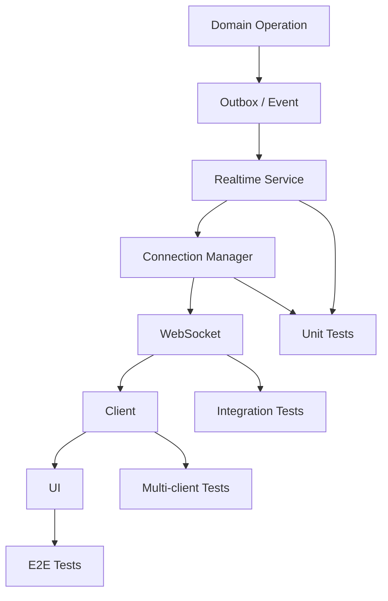
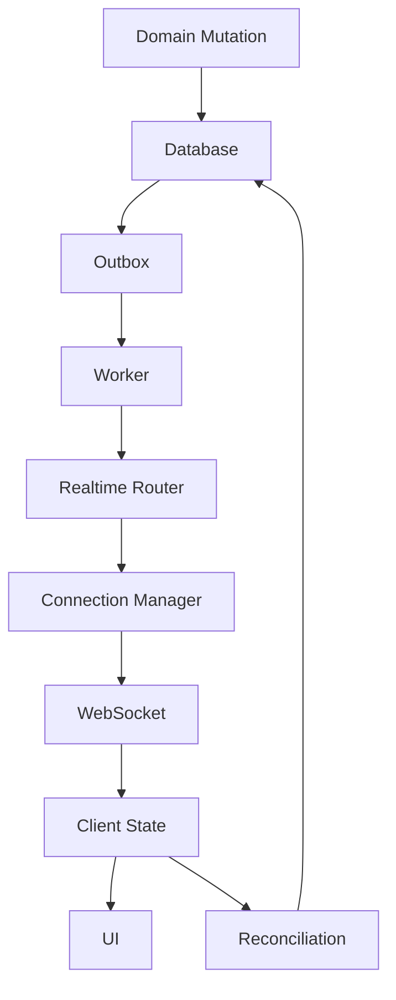

# 46_REALTIME_TESTING.md

# Realtime Testing Architecture

## Parte 1 — Estrategia, arquitectura, WebSocket backend, autenticación, rooms, canales y contratos de eventos

---

# 1. Introducción

Este documento define la estrategia de testing realtime de **Aula Robótica Platform**.

La plataforma ya dispone de una arquitectura colaborativa basada en:

- WebSockets;
- Project Rooms;
- Dashboard Realtime;
- Notifications;
- Kanban;
- Online Users;
- Activity Feed;
- Audit Timeline Live.

Sin embargo, la arquitectura realtime actual todavía necesita una capa automatizada de testing proporcional a su complejidad.

El objetivo de este documento es evolucionar desde:

```text
manual realtime validation
```

hacia:

```text
automated enterprise realtime testing
```

---

# 2. Objetivo

La estrategia debe proporcionar confianza sobre:

- conexión;
- autenticación;
- autorización;
- rooms;
- channels;
- targeting;
- broadcasts;
- ordering;
- deduplicación;
- reconexión;
- optimistic UI;
- rollback;
- concurrencia;
- multiusuario;
- aislamiento;
- rendimiento;
- resiliencia.

---

# 3. Principio fundamental

Realtime no debe probarse únicamente desde una única capa.

La estrategia debe separar:

```text
Event Logic

↓

Connection Manager

↓

WebSocket Endpoint

↓

Broadcast Infrastructure

↓

Client State

↓

Browser Collaboration
```

---

# 4. Capas de testing

La estrategia se divide en:

```text
Unit Tests

Integration Tests

WebSocket Contract Tests

Multi-client Tests

Frontend Realtime Tests

Browser E2E

Load / Stress Tests
```

---

# 5. Arquitectura realtime actual

La plataforma dispone actualmente de endpoints:

```text
/ws/projects/{project_id}

/ws/dashboard

/ws/notifications
```

Estos canales responden a responsabilidades diferentes.

---

# 6. Project WebSocket

Ruta:

```text
/ws/projects/{project_id}
```

Responsabilidades:

- colaboración dentro de un Project;
- Kanban;
- Activity Feed;
- cambios relevantes del proyecto;
- presencia contextual cuando corresponda.

---

# 7. Dashboard WebSocket

Ruta:

```text
/ws/dashboard
```

Responsabilidades:

- invalidaciones;
- feed live;
- cambios de métricas;
- actualizaciones globales autorizadas.

---

# 8. Notifications WebSocket

Ruta:

```text
/ws/notifications
```

Responsabilidades:

- notificaciones dirigidas;
- unread state;
- eventos personales.

---

# 9. Connection Manager

La arquitectura utiliza:

```python
ConnectionManager
```

como componente central para gestionar conexiones activas.

---

# 10. Estado conceptual del Connection Manager

Actualmente maneja estructuras equivalentes a:

```python
rooms[project_id]

dashboard_connections

user_connections
```

---

# 11. Rooms

Las Project Rooms permiten agrupar clientes por proyecto.

Modelo:

```text
Project A

├── User 1
├── User 2
└── User 3

Project B

├── User 4
└── User 5
```

---

# 12. Dashboard Connections

Representan conexiones activas al canal general de Dashboard.

No deben confundirse con rooms de proyectos.

---

# 13. User Connections

Permiten dirigir eventos a usuarios concretos.

Especialmente:

```text
notifications
```

---

# 14. Arquitectura de testing



---

# 15. Estado actual de testing

Actualmente la validación realtime se realiza principalmente mediante:

- testing manual;
- browser console;
- varias sesiones simultáneas;
- debugging runtime;
- reconnect manual;
- verificación visual.

---

# 16. Gap principal

Todavía no existe una suite formal y automatizada que proteja sistemáticamente:

```text
connect

disconnect

auth

rooms

broadcast

targeting

reconnect

deduplication
```

---

# 17. Riesgo arquitectónico

La ausencia de tests automáticos realtime deja expuestos bugs especialmente difíciles de detectar:

- race conditions;
- event leakage;
- duplicate delivery;
- stale state;
- reconnect storms;
- lost updates;
- cross-project broadcasts.

---

# 18. Prioridad

El testing realtime debe priorizar inicialmente:

```text
correctness

security

isolation

idempotency

convergence
```

antes de rendimiento extremo.

---

# 19. Principio de fuente de verdad

El servidor sigue siendo la fuente de verdad.

Realtime comunica cambios.

No debe convertirse en un estado independiente.

```text
Database / Domain

↓

Realtime Event

↓

Client State
```

---

# 20. Realtime Test Pyramid

```text
               Multi-browser E2E
              /                 \
             /                   \
        WebSocket Integration
       /                         \
      /                           \
Event + Manager Unit Tests
```

---

# 21. Unit Testing

Debe cubrir principalmente:

- event builders;
- serializers;
- recipient resolution;
- room logic;
- deduplication;
- channel selection;
- reconnect calculations cuando sean backend.

---

# 22. Integration Testing

Debe cubrir:

```text
actual WebSocket endpoint

+

authentication

+

ConnectionManager
```

---

# 23. Multi-client Testing

Debe verificar:

```text
Client A

Client B

Client C
```

simultáneamente.

---

# 24. Browser E2E

Debe comprobar:

```text
WebSocket

↓

JavaScript realtime module

↓

DOM

↓

actual user experience
```

---

# 25. Backend tooling

Herramientas candidatas:

```text
pytest

pytest-asyncio

FastAPI TestClient

httpx

WebSocket test clients
```

La elección exacta depende de la implementación final.

---

# 26. FastAPI TestClient WebSocket

FastAPI permite probar conexiones mediante:

```python
client.websocket_connect(...)
```

---

# 27. Ejemplo conceptual

```python
def test_project_websocket_connects(
    client,
    authenticated_user,
    project,
):
    with client.websocket_connect(
        f"/ws/projects/{project.id}"
    ) as websocket:
        ...
```

---

# 28. Test síncrono vs async

Cuando `TestClient` cubra adecuadamente el escenario, puede mantenerse un test síncrono.

Para concurrencia avanzada o workers async puede ser necesario:

```text
pytest-asyncio
```

---

# 29. No introducir async innecesario

La complejidad async debe justificarse por el comportamiento probado.

---

# 30. WebSocket Contract

Cada endpoint debe disponer de un contrato explícito.

Debe definir:

- autenticación;
- autorización;
- handshake;
- mensajes;
- errores;
- disconnect behavior.

---

# 31. Contract mínimo de evento

Un evento realtime debería contener, según el diseño:

```text
event_id

event_type

occurred_at

payload
```

y contexto adicional cuando corresponda.

---

# 32. Evento de proyecto

Puede incluir:

```text
project_id
```

---

# 33. Evento versionado

Para entidades concurrentes puede incluir:

```text
version
```

---

# 34. Notification Event

Puede incluir:

```text
notification_id

recipient_id
```

sin exponer información innecesaria.

---

# 35. Schema Validation

Los tests deben validar que el payload cumple el schema esperado.

---

# 36. Extra Fields

Debe definirse si:

- se permiten;
- se ignoran;
- se rechazan.

---

# 37. Missing Required Field

Un evento inválido no debe procesarse silenciosamente como válido.

---

# 38. Event Type Registry

Debe existir un catálogo cerrado de tipos.

Ejemplo:

```text
task.created

task.updated

task.moved

notification.created

activity_feed.created

dashboard.invalidate
```

---

# 39. Unknown Event Type

El cliente debe manejarlo de forma segura.

Opciones:

```text
ignore

log warning

trigger reconciliation
```

según política.

---

# 40. Event ID

Debe ser único por evento lógico cuando se utiliza para deduplicación.

---

# 41. Event ID Test

Dos eventos diferentes no deben compartir accidentalmente ID.

---

# 42. Duplicate Event

Procesar dos veces:

```text
event_id = X
```

no debe duplicar efectos cuando el consumidor es idempotente.

---

# 43. Event Timestamp

Debe utilizar formato temporal consistente.

Preferiblemente:

```text
ISO 8601 UTC
```

---

# 44. Event Ordering

El timestamp no debe ser la única garantía de orden para entidades con concurrencia.

Puede requerirse:

```text
version
```

---

# 45. Version Test

Para una Task:

```text
version 7

↓

version 8
```

debe representar una evolución válida.

---

# 46. Stale Version Event

Un evento:

```text
version 6
```

recibido después de:

```text
version 8
```

debe considerarse stale.

---

# 47. Version Gap

Evento:

```text
local version 5

incoming version 8
```

puede indicar eventos perdidos.

Debe activarse la estrategia de reconciliación definida.

---

# 48. Connection Lifecycle

Cada endpoint debe probar:

```text
connect

active

disconnect
```

---

# 49. Successful Connect

Debe comprobar:

- handshake;
- registro;
- channel/room;
- connection count.

---

# 50. Disconnect

Debe eliminar correctamente la conexión del manager.

---

# 51. Disconnect Cleanup

Después de disconnect:

```text
connection
```

no debe permanecer en:

- room;
- dashboard connections;
- user connections.

---

# 52. Abrupt Disconnect

Debe simularse cierre inesperado cuando sea posible.

---

# 53. Cleanup idempotente

Llamar dos veces a cleanup no debe romper el manager.

---

# 54. Connection Leak

Debe existir un test que detecte conexiones huérfanas tras múltiples connect/disconnect.

---

# 55. Multiple Connections Same User

Un usuario puede tener:

- varias tabs;
- varios dispositivos.

La política debe definirse explícitamente.

---

# 56. Same User Multi-tab

Si está permitido:

```text
user_connections[user_id]
```

debe contener múltiples sockets.

---

# 57. Disconnect One Tab

Cerrar una conexión no debe eliminar las demás.

---

# 58. User Fully Offline

Solo cuando desaparece la última conexión debe considerarse offline, si esa es la definición funcional.

---

# 59. Dashboard Multi-tab

Mismo principio.

Cada tab es una conexión independiente.

---

# 60. Connection Identity

Puede existir un:

```text
connection_id
```

interno para distinguir sockets.

---

# 61. Authentication

WebSocket debe aplicar autenticación con el mismo rigor que HTTP.

---

# 62. Auth Scenarios

Debe cubrir:

```text
valid authentication

missing authentication

invalid token

expired token

malformed token
```

---

# 63. JWT válido

Debe permitir establecer conexión si el usuario está autorizado.

---

# 64. JWT inválido

Debe rechazar conexión.

---

# 65. Token expirado

Debe cerrar/rechazar según la política exacta.

---

# 66. Token manipulado

Una firma inválida nunca debe permitir conexión.

---

# 67. Missing Token

Debe producir rechazo seguro.

---

# 68. Authentication Transport

Dependiendo de la implementación, la identidad puede llegar mediante:

- cookie;
- query parameter;
- subprotocol;
- header/proxy context.

El test debe reproducir el mecanismo real.

---

# 69. No token leakage

El token no debe aparecer en:

- payload;
- broadcast;
- logs;
- close reason visible.

---

# 70. Cookie Authentication

Si WebSocket utiliza cookie de sesión, los tests deben comprobar que el contexto autenticado se resuelve correctamente.

---

# 71. Session Expiration While Connected

Debe definirse qué ocurre cuando:

```text
socket connected

↓

session expires
```

---

# 72. Opciones

Puede:

- mantenerse hasta disconnect;
- revalidarse periódicamente;
- cerrarse al detectar expiración.

La política final debe quedar testeada.

---

# 73. Authorization

Autenticación no implica autorización.

---

# 74. Project Room Authorization

Para:

```text
/ws/projects/{project_id}
```

debe comprobarse que el usuario puede acceder al proyecto.

---

# 75. Authorized Member

Debe conectar correctamente.

---

# 76. Unauthorized User

Un usuario autenticado pero ajeno al Project debe ser rechazado.

---

# 77. Archived Project

Debe definirse si permite conexión read-only o si se rechaza.

---

# 78. Removed Member

Caso importante:

```text
user connected

↓

membership removed
```

Debe definirse qué sucede.

---

# 79. Membership Revocation

Una estrategia robusta puede:

```text
disconnect user from project room
```

cuando pierde acceso.

---

# 80. Revocation Test

Debe comprobar:

```text
membership removed

↓

user stops receiving project events
```

---

# 81. Admin Access

Si Admin posee acceso global, debe probarse.

---

# 82. Contextual Role

Un usuario puede tener permisos distintos por proyecto.

El WebSocket debe respetar ese scope.

---

# 83. Dashboard Authorization

El canal Dashboard debe exponer únicamente información autorizada para el usuario.

---

# 84. Notification Authorization

`/ws/notifications` debe asociarse exclusivamente al usuario autenticado.

---

# 85. User Channel Spoofing

El cliente no debe poder solicitar:

```text
user_id = another user
```

para recibir sus notificaciones.

---

# 86. Identity from Session

El servidor debe derivar:

```text
user_id
```

del contexto autenticado.

Nunca confiar en un ID enviado por cliente.

---

# 87. Project ID Tampering

Modificar:

```text
/ws/projects/12

↓

/ws/projects/13
```

debe volver a ejecutar autorización.

---

# 88. Room Isolation

Uno de los contratos más importantes.

---

# 89. Isolation Test

```text
User A → Project 1

User B → Project 2

broadcast Project 1

↓

A receives

B does not
```

---

# 90. Multiple Members Same Room

```text
A → Project 1

B → Project 1

broadcast

↓

A receives

B receives
```

---

# 91. User in Multiple Rooms

Si está permitido mediante varias conexiones:

```text
User A → Project 1

User A → Project 2
```

cada socket debe recibir únicamente el room correspondiente.

---

# 92. Cross-room Leak

Debe existir un regression test explícito contra filtraciones de eventos entre proyectos.

---

# 93. Dashboard Isolation

Los eventos de Dashboard deben respetar el scope individual de cada usuario.

---

# 94. Notification Isolation

Evento para User A:

```text
A receives

B does not
```

aunque ambos estén conectados a `/ws/notifications`.

---

# 95. User Targeting

Debe probarse con al menos:

```text
two authenticated users
```

---

# 96. Broadcast Types

El ConnectionManager puede necesitar operaciones conceptuales:

```text
broadcast_to_room()

broadcast_to_dashboard()

send_to_user()
```

---

# 97. Unit Tests del Manager

Cada operación debe probarse aisladamente.

---

# 98. `connect_room`

Debe:

- añadir conexión;
- crear room si no existe;
- evitar estructuras inválidas.

---

# 99. `disconnect_room`

Debe:

- retirar socket;
- eliminar room vacío cuando esa sea la política.

---

# 100. `broadcast_to_room`

Debe enviar únicamente a conexiones del room.

---

# 101. Failed Socket During Broadcast

Un socket puede fallar mientras se envía.

El manager debe:

- continuar con otros sockets;
- limpiar conexión rota;
- registrar error cuando proceda.

---

# 102. Broadcast Partial Failure

Ejemplo:

```text
3 sockets

socket 2 fails

↓

socket 1 receives

socket 3 receives

socket 2 removed
```

---

# 103. One Bad Client Must Not Break Room

Debe existir un test específico.

---

# 104. Empty Room Broadcast

Debe ser seguro.

No debe lanzar error funcional.

---

# 105. Dashboard Connect

Debe añadir conexión correctamente.

---

# 106. Dashboard Disconnect

Debe limpiar.

---

# 107. Dashboard Broadcast

Debe llegar a todas las conexiones elegibles.

---

# 108. User Connect

Debe registrar:

```text
user_id → connection
```

---

# 109. Multiple User Connections

Debe mantener colección, no una sola referencia, si multi-tab está soportado.

---

# 110. User Disconnect

Debe retirar únicamente el socket concreto.

---

# 111. Send to User

Debe entregar el evento a todas las conexiones activas del usuario cuando esa sea la política.

---

# 112. Send to Offline User

Debe ser seguro.

La Notification persistida sigue existiendo aunque no haya socket.

---

# 113. Realtime no sustituye persistencia

Especialmente para Notifications:

```text
database

= source of truth
```

Realtime solo reduce latencia de visualización.

---

# 114. Offline Notification Test

```text
user offline

↓

notification created

↓

no WebSocket delivery

↓

user reconnects / opens UI

↓

notification available from DB
```

---

# 115. Online Presence

La presencia realtime necesita una definición exacta.

---

# 116. Online Definition

Puede ser:

```text
at least one active socket
```

---

# 117. Presence Connect

Primera conexión:

```text
offline → online
```

---

# 118. Presence Second Tab

Segunda conexión:

```text
online → online
```

No debe generar necesariamente un segundo cambio de presencia.

---

# 119. Presence Disconnect One Tab

Si queda otra conexión:

```text
online remains
```

---

# 120. Presence Final Disconnect

Última conexión:

```text
online → offline
```

---

# 121. Presence Race Conditions

Dos tabs pueden conectar/cerrar casi simultáneamente.

La lógica debe basarse en número de conexiones activas.

---

# 122. Presence Event

Si se publica un evento:

```text
user.online

user.offline
```

debe generarse únicamente en transición real.

---

# 123. Presence Privacy

No todos los usuarios tienen necesariamente derecho a conocer presencia de todos.

Los tests deben respetar la política funcional.

---

# 124. Connection Counts

Los tests pueden comprobar el estado interno del manager únicamente en unit tests.

Los integration tests deben preferir comportamiento observable.

---

# 125. Avoid Implementation Coupling

No debe afirmarse:

```text
len(manager.rooms[12]) == 1
```

en todos los tests si el contrato puede demostrarse mediante recepción de eventos.

---

# 126. Manager Internal Tests

Sí pueden inspeccionar estructuras cuando el propio manager es la unidad bajo prueba.

---

# 127. Event Serialization

Los eventos deben serializarse de forma consistente.

---

# 128. JSON Contract

Debe producir JSON válido.

---

# 129. Datetime Serialization

Debe ser estable:

```text
2026-08-14T18:00:00Z
```

o formato definitivo.

---

# 130. Enum Serialization

Debe utilizar valores estables.

Ejemplo:

```text
task.moved
```

no representaciones Python internas.

---

# 131. Null Handling

Campos opcionales deben mantener contrato:

```text
null
```

o ausencia, según schema.

---

# 132. Payload Size

Los eventos deben mantenerse pequeños.

---

# 133. Oversized Payload Test

Puede existir una validación contra payloads inesperadamente grandes cuando el sistema lo requiera.

---

# 134. No Full Entity Broadcast

No debe enviarse la entidad ORM completa por defecto.

---

# 135. Minimal Payload

Un evento debe transportar únicamente lo necesario para:

- aplicar cambio;
- invalidar;
- reconciliar.

---

# 136. Event Builder Tests

Ejemplo:

```text
TaskMovedDomainEvent

↓

task.moved realtime payload
```

---

# 137. Deterministic Event Builder

Mismo input debe producir el mismo payload funcional, salvo IDs/timestamps inyectados.

---

# 138. Clock Control

Los timestamps deben utilizar reloj controlable en tests cuando importen.

---

# 139. Event ID Control

Puede inyectarse generador para assertions deterministas.

---

# 140. Realtime Event vs Domain Event

No deben confundirse.

Un Domain Event puede producir:

- Feed;
- Notification;
- Realtime invalidation.

Cada contrato debe testearse por separado.

---

# 141. Event Routing

Debe existir lógica que determine:

```text
event

↓

target channel
```

---

# 142. Routing Tests

Ejemplo:

```text
task.moved

→ project room
```

---

# 143. Notification Routing

```text
notification.created

→ user channel
```

---

# 144. Dashboard Routing

```text
dashboard.invalidate

→ dashboard connection
```

---

# 145. Multi-target Event

Un único Domain Event puede generar varios eventos realtime.

Ejemplo:

```text
Task completed

↓

Project room update

+

Dashboard invalidation

+

Notification user event
```

---

# 146. Multi-target Test

Debe comprobar cada salida sin mezclar payloads.

---

# 147. Security Boundary

El router de eventos debe aplicar siempre destinatarios calculados desde backend.

---

# 148. No Client-controlled Broadcast

Un cliente WebSocket no debe poder enviar:

```text
broadcast to project 99
```

sin una operación autorizada específica.

---

# 149. Client-to-server Messages

Si los sockets aceptan mensajes desde cliente, debe definirse un contrato independiente.

---

# 150. Read-only Socket

Si un canal existe solo para server push, mensajes arbitrarios del cliente deben:

- ignorarse;
- rechazarse;
- cerrar conexión;

según política.

---

# 151. Keepalive

La plataforma actual utiliza lógica de reconnect y keepalive en frontend.

El contrato backend debe definir:

```text
ping

pong
```

si existe a nivel aplicación.

---

# 152. WebSocket Protocol Ping

Puede utilizarse el mecanismo del protocolo o heartbeat de aplicación.

No deben duplicarse sin necesidad.

---

# 153. Heartbeat Test

Si existe:

```text
client ping

↓

server pong
```

debe probarse.

---

# 154. Missing Heartbeat

La política de timeout debe comprobarse en niveles adecuados.

---

# 155. Timeout Tests

No deben depender de esperar decenas de segundos reales.

Debe utilizarse:

- clock control;
- timeout reducido en config test;
- unit testing de la lógica.

---

# 156. Reconnect Backend Responsibility

El backend no ejecuta el reconnect del navegador.

Debe garantizar que una nueva conexión:

- autentica;
- se registra;
- recibe estado/eventos conforme al contrato.

---

# 157. Frontend reconnect actual

Actualmente existen intervalos conceptuales distintos:

```text
Notifications → 3000 ms

Dashboard → 2500 ms

Project → 2000 ms
```

Estos valores forman parte del comportamiento frontend actual y deben tratarse mediante tests de JavaScript cuando se mantengan.

---

# 158. Configurabilidad

Una evolución pro debería centralizar los intervalos de reconnect.

Esto simplifica:

- testing;
- tuning;
- observabilidad.

---

# 159. Reconnect Test Layers

Debe distinguirse:

```text
unit → backoff logic

browser → actual reconnection

integration → server accepts reconnect
```

---

# 160. Connection Manager Concurrency

El manager puede recibir simultáneamente:

- connects;
- disconnects;
- broadcasts.

Debe diseñarse y probarse para no corromper su estado.

---

# 161. Concurrent Connect

Dos sockets pueden conectarse al mismo room casi simultáneamente.

Ambos deben permanecer registrados.

---

# 162. Connect While Broadcast

Debe evitar fallos por modificar la colección mientras se itera.

---

# 163. Disconnect While Broadcast

Caso crítico.

Debe probarse especialmente.

---

# 164. Safe Iteration

Una implementación puede necesitar snapshot de conexiones antes de emitir.

El test debe proteger comportamiento, no obligar a una implementación específica.

---

# 165. Race Condition Test

La estrategia puede utilizar tareas concurrentes controladas para reproducir:

```text
broadcast

+

disconnect
```

---

# 166. Deterministic Concurrency

Los tests deben utilizar mecanismos como:

- barriers;
- events;
- controlled futures;

en lugar de depender de timings aleatorios.

---

# 167. Thread/Async Safety

Debe corresponder con el modelo real de ejecución de FastAPI/ASGI.

---

# 168. Realtime Transaction Boundary

Los eventos no deben anunciar estados no confirmados.

---

# 169. Commit Before Broadcast

Debe cumplirse:

```text
domain mutation

↓

database commit

↓

broadcast
```

o:

```text
domain mutation

↓

Outbox insert

↓

commit

↓

worker broadcast
```

---

# 170. Rollback Test

Si la transacción falla:

```text
no realtime event representing committed success
```

---

# 171. Outbox Preferred Flow

Para eventos fiables:

```text
DB transaction

↓

Outbox

↓

Worker

↓

Realtime
```

---

# 172. Outbox Realtime Testing

Debe cubrir:

- event persisted;
- worker processes;
- broadcast occurs;
- event marked processed.

---

# 173. Worker Failure

Si broadcast falla:

```text
retry
```

según policy.

---

# 174. No Lost Event

Un fallo temporal del WebSocket layer no debe eliminar prematuramente el evento Outbox.

---

# 175. Retry Idempotency

Un retry puede volver a enviar el mismo evento.

Por ello el cliente debe tolerar duplicados.

---

# 176. At-least-once Delivery

Si el sistema usa Outbox con retry, el contrato practical puede ser:

```text
at least once
```

no exactamente una vez.

---

# 177. Client Idempotency

Debe considerarse parte obligatoria del diseño.

---

# 178. Exactly-once Illusion

No debe diseñarse confiando en una garantía difícil de sostener entre:

- DB;
- worker;
- WebSocket;
- browser.

---

# 179. Convergence

El objetivo final debe ser:

```text
all authorized clients

↓

eventually converge to server state
```

---

# 180. Reconciliation

Debe existir una estrategia de recuperación.

Ejemplos:

```text
refetch Task

reload Kanban

refresh Notification count

reload Feed page
```

---

# 181. Reconciliation Test

Debe comprobar que un cliente con estado stale puede volver al estado del servidor.

---

# 182. Event Loss

Puede simularse omitiendo un evento intermedio.

---

# 183. Version Gap Recovery

Ejemplo:

```text
client v4

server v6

receives v6

↓

detect gap

↓

refetch

↓

client v6
```

---

# 184. Reconnect Recovery

Después de desconexión:

```text
reconnect

↓

reconcile

↓

current state
```

---

# 185. Server Restart

Una evolución de integración debe probar:

```text
server restart

↓

socket lost

↓

client reconnects

↓

state recovered
```

---

# 186. Connection Manager Restart

Su estado en memoria se pierde.

No debe considerarse fuente de verdad.

---

# 187. Presence After Restart

Debe reconstruirse progresivamente según nuevas conexiones.

---

# 188. Notification Persistence After Restart

Notifications deben seguir disponibles desde DB.

---

# 189. Feed Persistence After Restart

Activity Feed también.

---

# 190. Kanban State After Restart

Debe provenir de DB.

---

# 191. Realtime Security Tests

Deben formar parte explícita de la suite.

---

# 192. Security Matrix

Debe cubrir:

```text
unauthenticated

authenticated unauthorized

authenticated authorized

revoked access
```

---

# 193. Cross-user Leakage

Debe existir un test permanente para Notifications.

---

# 194. Cross-project Leakage

Debe existir un test permanente para Project Rooms.

---

# 195. Payload Leakage

Eventos no deben incluir campos sensibles.

---

# 196. Token Exposure

Debe comprobarse que ningún payload contiene:

```text
access_token

refresh_token

cookie

authorization
```

---

# 197. Internal Metadata

No debe exponerse:

- internal storage paths;
- stack traces;
- secrets;
- SQL.

---

# 198. Error Handling

Los errores de WebSocket deben ser seguros.

---

# 199. Close Code

Debe definirse cuándo utilizar códigos de cierre específicos.

---

# 200. Authentication Close

Puede utilizar un código/policy apropiado.

El test debe comprobar el contrato final.

---

# 201. Authorization Close

Debe distinguirse cuando resulte útil sin revelar información sensible.

---

# 202. Invalid Message

Si el cliente envía payload inválido:

```text
safe rejection
```

sin romper el manager.

---

# 203. Oversized Client Message

Puede probarse si el canal acepta mensajes.

Debe existir límite en infraestructura o aplicación.

---

# 204. Malformed JSON

Debe producir comportamiento controlado.

---

# 205. Flooding

Load/stress testing futuro debe comprobar clientes que envían mensajes excesivos cuando el canal sea bidireccional.

---

# 206. Rate Limiting

Si se incorpora rate limit para mensajes, debe probarse.

---

# 207. Origin Validation

Si la seguridad WebSocket aplica validación de `Origin`, debe existir test:

```text
allowed origin

blocked origin
```

---

# 208. CSWSH

WebSockets autenticados con cookies pueden ser susceptibles a Cross-Site WebSocket Hijacking si no se valida correctamente el origen.

Debe formar parte de la estrategia de seguridad cuando aplique.

---

# 209. Secure Transport

En producción:

```text
wss://
```

debe utilizarse detrás de TLS.

No se valida principalmente mediante unit testing, sino mediante configuración y smoke/integration tests.

---

# 210. Reverse Proxy

Nginx u otro proxy debe preservar:

```text
Upgrade

Connection
```

para WebSockets.

---

# 211. Deployment Smoke Test

El entorno desplegado debe comprobar al menos una conexión WebSocket real.

Esto detecta errores de proxy que los tests internos no pueden encontrar.

---

# 212. Current Functional Areas

La suite futura debe cubrir:

```text
Project Kanban

Dashboard Feed

Notifications

Users Online

Activity Feed Live

Audit Timeline Live
```

---

# 213. Project Kanban Priority

Es la funcionalidad realtime más compleja y debe recibir la mayor profundidad de testing.

---

# 214. Notifications Priority

Alta prioridad por requerir:

- targeting;
- persistence;
- multi-tab;
- dedupe.

---

# 215. Dashboard Priority

Debe proteger principalmente:

- invalidation;
- dedupe;
- controlled refresh.

---

# 216. Feed Priority

Debe proteger:

- ordering;
- duplicate prevention;
- authorized scope.

---

# 217. Audit Timeline Priority

Debe proteger:

- admin authorization;
- append behavior;
- no mutation;
- ordering.

---

# 218. Presence Priority

Debe proteger:

- connect count;
- multi-tab;
- final disconnect;
- privacy.

---

# 219. Test Organization

Estructura futura posible:

```text
tests/
└── realtime/
    ├── unit/
    ├── websocket/
    ├── rooms/
    ├── notifications/
    ├── dashboard/
    ├── kanban/
    ├── presence/
    └── integration/
```

---

# 220. Alternativa modular

También puede organizarse por dominio:

```text
tests/tasks/realtime/

tests/notifications/realtime/

tests/dashboard/realtime/
```

La convención debe minimizar dispersión.

---

# 221. Markers

Puede utilizarse:

```python
@pytest.mark.realtime
```

---

# 222. Marker WebSocket

También:

```text
websocket
```

si ayuda a seleccionar la suite.

---

# 223. Fast Realtime Suite

Debe incluir:

- event builders;
- manager;
- simple socket contracts.

---

# 224. Slow Realtime Suite

Puede incluir:

- multi-client;
- concurrency;
- browser collaboration.

---

# 225. Determinismo

Es especialmente importante en realtime.

---

# 226. No Sleeps

Evitar:

```python
time.sleep(2)
```

como mecanismo principal de sincronización.

---

# 227. Await Observable Condition

Debe esperarse:

- message;
- event;
- state;
- barrier.

---

# 228. Timeout

Toda espera async necesita un timeout limitado para evitar suites bloqueadas.

---

# 229. Timeout Failure

El mensaje de error debe indicar qué evento se esperaba.

---

# 230. Test Clock

Debe utilizarse para:

- reconnect;
- retry;
- heartbeat;
- timeout logic.

---

# 231. Isolation

Cada test debe comenzar con un manager limpio.

---

# 232. Global Manager

Si existe singleton/global, debe disponer de estrategia de reset en tests.

---

# 233. Cleanup

Después de cada test:

```text
no active connections
```

debería quedar en la infraestructura de testing.

---

# 234. Fixture de Manager

Puede proporcionar una instancia nueva por test cuando el diseño lo permita.

---

# 235. App Dependency

Si el manager está ligado al `app.state`, los tests deben reconstruir/resetear ese estado.

---

# 236. Realtime Fixture Users

Debe ser fácil crear:

```text
admin

coordinator

member A

member B

external user
```

---

# 237. Realtime Fixture Projects

Debe permitir:

```text
Project A

Project B
```

para aislamiento.

---

# 238. Helper de conexión

Puede existir un helper:

```text
connect_project_ws(user, project)
```

pero debe mantener visible qué contexto crea.

---

# 239. Helper de recepción

Puede abstraer:

```text
receive_event(type)
```

con timeout.

---

# 240. Helper de assertion

Ejemplo:

```text
assert_no_event()
```

requiere implementación cuidadosa para no introducir waits largos.

---

# 241. No-event Testing

Probar ausencia de mensaje es más difícil que probar presencia.

Debe utilizar:

- timeout corto y controlado;
- canal independiente;
- state inspection cuando sea más fiable.

---

# 242. Isolation Test Reliability

Una alternativa es emitir un identificador único y comprobar que solo aparece en el destinatario esperado.

---

# 243. Event Correlation in Tests

Cada evento de prueba puede utilizar:

```text
test event_id
```

único para evitar confusión con mensajes previos.

---

# 244. Drain Existing Messages

Antes de ciertas assertions puede ser necesario vaciar mensajes de setup.

Debe hacerse explícitamente.

---

# 245. Message Order Assumptions

No debe asumirse orden global entre canales diferentes.

---

# 246. Per-entity Ordering

Sí puede definirse un contrato para eventos versionados de una misma entidad.

---

# 247. No Global Ordering

Eventos:

```text
Task A moved

Notification B created
```

pueden no tener un orden total significativo.

---

# 248. Event Causality

Cuando una operación produce varios eventos, puede utilizarse:

```text
correlation_id
```

para relacionarlos.

---

# 249. Realtime Logging in Tests

Cuando un test falla debe poder inspeccionarse:

- connection;
- event type;
- target;
- event ID.

---

# 250. No Sensitive Debug Output

Incluso en tests no deben imprimirse credenciales reales.

---

# 251. Metrics in Testing

Puede comprobarse que eventos importantes incrementan métricas realtime.

Ejemplo:

```text
websocket_connections

websocket_broadcast_total
```

si la instrumentación forma parte del contrato.

---

# 252. Observability Integration

Los fallos realtime complejos deben ser investigables mediante:

- logs;
- metrics;
- traces.

---

# 253. Trace Context

Un evento Outbox puede mantener correlation/trace context.

Los integration tests pueden verificar propagación cuando OpenTelemetry se incorpore.

---

# 254. CI Strategy inicial

La primera automatización realtime debería ejecutar en cada PR:

```text
ConnectionManager unit tests

WebSocket auth tests

Room isolation tests

Notification targeting tests
```

---

# 255. Segunda etapa CI

Añadir:

```text
multi-client

Outbox integration

Kanban event tests
```

---

# 256. Browser realtime

Puede ejecutarse después:

```text
critical Playwright collaborative scenarios
```

---

# 257. Load Tests

No necesitan ejecutarse en cada PR.

---

# 258. Nightly

Puede incluir:

```text
multi-client extended

reconnect

cross-browser realtime
```

---

# 259. Release

Debe incluir:

- deployed WebSocket smoke;
- proxy validation;
- critical collaboration;
- Notifications;
- Kanban.

---

# 260. Current Reconnect Logic

Los intervalos actuales:

```text
Project → 2000 ms

Dashboard → 2500 ms

Notifications → 3000 ms
```

deben quedar protegidos mientras sigan formando parte del comportamiento real.

---

# 261. Reconnect Timing Tests

No deben afirmar necesariamente cada número literal si estos valores se centralizan como configuración.

Debe probarse la policy.

---

# 262. Future Backoff

Una evolución puede sustituir intervalos fijos por:

```text
exponential backoff

+

jitter
```

---

# 263. Backoff Tests

Deben probar:

- first delay;
- increase;
- maximum cap;
- reset after successful connection.

---

# 264. Jitter Testing

Debe inyectarse random controlado.

---

# 265. Reconnect Storm

Cuando el servidor vuelve tras una caída, cientos de clientes pueden intentar conectar simultáneamente.

Esto requiere stress testing futuro.

---

# 266. Jitter Benefit

Reduce:

```text
thundering herd
```

---

# 267. Frontend Realtime Boundary

La lógica frontend debe separar:

```text
WebSocket transport

event parsing

state reconciliation

DOM rendering
```

---

# 268. Unit Test Benefit

Esto permite probar dedupe y ordering sin abrir sockets reales.

---

# 269. Browser Test Benefit

Después se prueba únicamente que las piezas funcionan juntas.

---

# 270. Continuación

La **Parte 2** desarrollará:

- Notifications realtime testing;
- Dashboard realtime;
- Activity Feed live;
- Audit Timeline live;
- Online Users;
- Kanban realtime;
- optimistic UI;
- rollback;
- version conflicts;
- multi-client concurrency;
- reconnect;
- event loss;
- reconciliation;
- browser multi-user testing.

---

# 46_REALTIME_TESTING.md

# Realtime Testing Architecture

## Parte 1 — Estrategia, arquitectura, WebSocket backend, autenticación, rooms, canales y contratos de eventos

---

# 1. Introducción

Este documento define la estrategia de testing realtime de **Aula Robótica Platform**.

La plataforma ya dispone de una arquitectura colaborativa basada en:

- WebSockets;
- Project Rooms;
- Dashboard Realtime;
- Notifications;
- Kanban;
- Online Users;
- Activity Feed;
- Audit Timeline Live.

Sin embargo, la arquitectura realtime actual todavía necesita una capa automatizada de testing proporcional a su complejidad.

El objetivo de este documento es evolucionar desde:

```text
manual realtime validation
```

hacia:

```text
automated enterprise realtime testing
```

---

# 2. Objetivo

La estrategia debe proporcionar confianza sobre:

- conexión;
- autenticación;
- autorización;
- rooms;
- channels;
- targeting;
- broadcasts;
- ordering;
- deduplicación;
- reconexión;
- optimistic UI;
- rollback;
- concurrencia;
- multiusuario;
- aislamiento;
- rendimiento;
- resiliencia.

---

# 3. Principio fundamental

Realtime no debe probarse únicamente desde una única capa.

La estrategia debe separar:

```text
Event Logic

↓

Connection Manager

↓

WebSocket Endpoint

↓

Broadcast Infrastructure

↓

Client State

↓

Browser Collaboration
```

---

# 4. Capas de testing

La estrategia se divide en:

```text
Unit Tests

Integration Tests

WebSocket Contract Tests

Multi-client Tests

Frontend Realtime Tests

Browser E2E

Load / Stress Tests
```

---

# 5. Arquitectura realtime actual

La plataforma dispone actualmente de endpoints:

```text
/ws/projects/{project_id}

/ws/dashboard

/ws/notifications
```

Estos canales responden a responsabilidades diferentes.

---

# 6. Project WebSocket

Ruta:

```text
/ws/projects/{project_id}
```

Responsabilidades:

- colaboración dentro de un Project;
- Kanban;
- Activity Feed;
- cambios relevantes del proyecto;
- presencia contextual cuando corresponda.

---

# 7. Dashboard WebSocket

Ruta:

```text
/ws/dashboard
```

Responsabilidades:

- invalidaciones;
- feed live;
- cambios de métricas;
- actualizaciones globales autorizadas.

---

# 8. Notifications WebSocket

Ruta:

```text
/ws/notifications
```

Responsabilidades:

- notificaciones dirigidas;
- unread state;
- eventos personales.

---

# 9. Connection Manager

La arquitectura utiliza:

```python
ConnectionManager
```

como componente central para gestionar conexiones activas.

---

# 10. Estado conceptual del Connection Manager

Actualmente maneja estructuras equivalentes a:

```python
rooms[project_id]

dashboard_connections

user_connections
```

---

# 11. Rooms

Las Project Rooms permiten agrupar clientes por proyecto.

Modelo:

```text
Project A

├── User 1
├── User 2
└── User 3

Project B

├── User 4
└── User 5
```

---

# 12. Dashboard Connections

Representan conexiones activas al canal general de Dashboard.

No deben confundirse con rooms de proyectos.

---

# 13. User Connections

Permiten dirigir eventos a usuarios concretos.

Especialmente:

```text
notifications
```

---

# 14. Arquitectura de testing


---

# 15. Estado actual de testing

Actualmente la validación realtime se realiza principalmente mediante:

- testing manual;
- browser console;
- varias sesiones simultáneas;
- debugging runtime;
- reconnect manual;
- verificación visual.

---

# 16. Gap principal

Todavía no existe una suite formal y automatizada que proteja sistemáticamente:

```text
connect

disconnect

auth

rooms

broadcast

targeting

reconnect

deduplication
```

---

# 17. Riesgo arquitectónico

La ausencia de tests automáticos realtime deja expuestos bugs especialmente difíciles de detectar:

- race conditions;
- event leakage;
- duplicate delivery;
- stale state;
- reconnect storms;
- lost updates;
- cross-project broadcasts.

---

# 18. Prioridad

El testing realtime debe priorizar inicialmente:

```text
correctness

security

isolation

idempotency

convergence
```

antes de rendimiento extremo.

---

# 19. Principio de fuente de verdad

El servidor sigue siendo la fuente de verdad.

Realtime comunica cambios.

No debe convertirse en un estado independiente.

```text
Database / Domain

↓

Realtime Event

↓

Client State
```

---

# 20. Realtime Test Pyramid

```text
               Multi-browser E2E
              /                 \
             /                   \
        WebSocket Integration
       /                         \
      /                           \
Event + Manager Unit Tests
```

---

# 21. Unit Testing

Debe cubrir principalmente:

- event builders;
- serializers;
- recipient resolution;
- room logic;
- deduplication;
- channel selection;
- reconnect calculations cuando sean backend.

---

# 22. Integration Testing

Debe cubrir:

```text
actual WebSocket endpoint

+

authentication

+

ConnectionManager
```

---

# 23. Multi-client Testing

Debe verificar:

```text
Client A

Client B

Client C
```

simultáneamente.

---

# 24. Browser E2E

Debe comprobar:

```text
WebSocket

↓

JavaScript realtime module

↓

DOM

↓

actual user experience
```

---

# 25. Backend tooling

Herramientas candidatas:

```text
pytest

pytest-asyncio

FastAPI TestClient

httpx

WebSocket test clients
```

La elección exacta depende de la implementación final.

---

# 26. FastAPI TestClient WebSocket

FastAPI permite probar conexiones mediante:

```python
client.websocket_connect(...)
```

---

# 27. Ejemplo conceptual

```python
def test_project_websocket_connects(
    client,
    authenticated_user,
    project,
):
    with client.websocket_connect(
        f"/ws/projects/{project.id}"
    ) as websocket:
        ...
```

---

# 28. Test síncrono vs async

Cuando `TestClient` cubra adecuadamente el escenario, puede mantenerse un test síncrono.

Para concurrencia avanzada o workers async puede ser necesario:

```text
pytest-asyncio
```

---

# 29. No introducir async innecesario

La complejidad async debe justificarse por el comportamiento probado.

---

# 30. WebSocket Contract

Cada endpoint debe disponer de un contrato explícito.

Debe definir:

- autenticación;
- autorización;
- handshake;
- mensajes;
- errores;
- disconnect behavior.

---

# 31. Contract mínimo de evento

Un evento realtime debería contener, según el diseño:

```text
event_id

event_type

occurred_at

payload
```

y contexto adicional cuando corresponda.

---

# 32. Evento de proyecto

Puede incluir:

```text
project_id
```

---

# 33. Evento versionado

Para entidades concurrentes puede incluir:

```text
version
```

---

# 34. Notification Event

Puede incluir:

```text
notification_id

recipient_id
```

sin exponer información innecesaria.

---

# 35. Schema Validation

Los tests deben validar que el payload cumple el schema esperado.

---

# 36. Extra Fields

Debe definirse si:

- se permiten;
- se ignoran;
- se rechazan.

---

# 37. Missing Required Field

Un evento inválido no debe procesarse silenciosamente como válido.

---

# 38. Event Type Registry

Debe existir un catálogo cerrado de tipos.

Ejemplo:

```text
task.created

task.updated

task.moved

notification.created

activity_feed.created

dashboard.invalidate
```

---

# 39. Unknown Event Type

El cliente debe manejarlo de forma segura.

Opciones:

```text
ignore

log warning

trigger reconciliation
```

según política.

---

# 40. Event ID

Debe ser único por evento lógico cuando se utiliza para deduplicación.

---

# 41. Event ID Test

Dos eventos diferentes no deben compartir accidentalmente ID.

---

# 42. Duplicate Event

Procesar dos veces:

```text
event_id = X
```

no debe duplicar efectos cuando el consumidor es idempotente.

---

# 43. Event Timestamp

Debe utilizar formato temporal consistente.

Preferiblemente:

```text
ISO 8601 UTC
```

---

# 44. Event Ordering

El timestamp no debe ser la única garantía de orden para entidades con concurrencia.

Puede requerirse:

```text
version
```

---

# 45. Version Test

Para una Task:

```text
version 7

↓

version 8
```

debe representar una evolución válida.

---

# 46. Stale Version Event

Un evento:

```text
version 6
```

recibido después de:

```text
version 8
```

debe considerarse stale.

---

# 47. Version Gap

Evento:

```text
local version 5

incoming version 8
```

puede indicar eventos perdidos.

Debe activarse la estrategia de reconciliación definida.

---

# 48. Connection Lifecycle

Cada endpoint debe probar:

```text
connect

active

disconnect
```

---

# 49. Successful Connect

Debe comprobar:

- handshake;
- registro;
- channel/room;
- connection count.

---

# 50. Disconnect

Debe eliminar correctamente la conexión del manager.

---

# 51. Disconnect Cleanup

Después de disconnect:

```text
connection
```

no debe permanecer en:

- room;
- dashboard connections;
- user connections.

---

# 52. Abrupt Disconnect

Debe simularse cierre inesperado cuando sea posible.

---

# 53. Cleanup idempotente

Llamar dos veces a cleanup no debe romper el manager.

---

# 54. Connection Leak

Debe existir un test que detecte conexiones huérfanas tras múltiples connect/disconnect.

---

# 55. Multiple Connections Same User

Un usuario puede tener:

- varias tabs;
- varios dispositivos.

La política debe definirse explícitamente.

---

# 56. Same User Multi-tab

Si está permitido:

```text
user_connections[user_id]
```

debe contener múltiples sockets.

---

# 57. Disconnect One Tab

Cerrar una conexión no debe eliminar las demás.

---

# 58. User Fully Offline

Solo cuando desaparece la última conexión debe considerarse offline, si esa es la definición funcional.

---

# 59. Dashboard Multi-tab

Mismo principio.

Cada tab es una conexión independiente.

---

# 60. Connection Identity

Puede existir un:

```text
connection_id
```

interno para distinguir sockets.

---

# 61. Authentication

WebSocket debe aplicar autenticación con el mismo rigor que HTTP.

---

# 62. Auth Scenarios

Debe cubrir:

```text
valid authentication

missing authentication

invalid token

expired token

malformed token
```

---

# 63. JWT válido

Debe permitir establecer conexión si el usuario está autorizado.

---

# 64. JWT inválido

Debe rechazar conexión.

---

# 65. Token expirado

Debe cerrar/rechazar según la política exacta.

---

# 66. Token manipulado

Una firma inválida nunca debe permitir conexión.

---

# 67. Missing Token

Debe producir rechazo seguro.

---

# 68. Authentication Transport

Dependiendo de la implementación, la identidad puede llegar mediante:

- cookie;
- query parameter;
- subprotocol;
- header/proxy context.

El test debe reproducir el mecanismo real.

---

# 69. No token leakage

El token no debe aparecer en:

- payload;
- broadcast;
- logs;
- close reason visible.

---

# 70. Cookie Authentication

Si WebSocket utiliza cookie de sesión, los tests deben comprobar que el contexto autenticado se resuelve correctamente.

---

# 71. Session Expiration While Connected

Debe definirse qué ocurre cuando:

```text
socket connected

↓

session expires
```

---

# 72. Opciones

Puede:

- mantenerse hasta disconnect;
- revalidarse periódicamente;
- cerrarse al detectar expiración.

La política final debe quedar testeada.

---

# 73. Authorization

Autenticación no implica autorización.

---

# 74. Project Room Authorization

Para:

```text
/ws/projects/{project_id}
```

debe comprobarse que el usuario puede acceder al proyecto.

---

# 75. Authorized Member

Debe conectar correctamente.

---

# 76. Unauthorized User

Un usuario autenticado pero ajeno al Project debe ser rechazado.

---

# 77. Archived Project

Debe definirse si permite conexión read-only o si se rechaza.

---

# 78. Removed Member

Caso importante:

```text
user connected

↓

membership removed
```

Debe definirse qué sucede.

---

# 79. Membership Revocation

Una estrategia robusta puede:

```text
disconnect user from project room
```

cuando pierde acceso.

---

# 80. Revocation Test

Debe comprobar:

```text
membership removed

↓

user stops receiving project events
```

---

# 81. Admin Access

Si Admin posee acceso global, debe probarse.

---

# 82. Contextual Role

Un usuario puede tener permisos distintos por proyecto.

El WebSocket debe respetar ese scope.

---

# 83. Dashboard Authorization

El canal Dashboard debe exponer únicamente información autorizada para el usuario.

---

# 84. Notification Authorization

`/ws/notifications` debe asociarse exclusivamente al usuario autenticado.

---

# 85. User Channel Spoofing

El cliente no debe poder solicitar:

```text
user_id = another user
```

para recibir sus notificaciones.

---

# 86. Identity from Session

El servidor debe derivar:

```text
user_id
```

del contexto autenticado.

Nunca confiar en un ID enviado por cliente.

---

# 87. Project ID Tampering

Modificar:

```text
/ws/projects/12

↓

/ws/projects/13
```

debe volver a ejecutar autorización.

---

# 88. Room Isolation

Uno de los contratos más importantes.

---

# 89. Isolation Test

```text
User A → Project 1

User B → Project 2

broadcast Project 1

↓

A receives

B does not
```

---

# 90. Multiple Members Same Room

```text
A → Project 1

B → Project 1

broadcast

↓

A receives

B receives
```

---

# 91. User in Multiple Rooms

Si está permitido mediante varias conexiones:

```text
User A → Project 1

User A → Project 2
```

cada socket debe recibir únicamente el room correspondiente.

---

# 92. Cross-room Leak

Debe existir un regression test explícito contra filtraciones de eventos entre proyectos.

---

# 93. Dashboard Isolation

Los eventos de Dashboard deben respetar el scope individual de cada usuario.

---

# 94. Notification Isolation

Evento para User A:

```text
A receives

B does not
```

aunque ambos estén conectados a `/ws/notifications`.

---

# 95. User Targeting

Debe probarse con al menos:

```text
two authenticated users
```

---

# 96. Broadcast Types

El ConnectionManager puede necesitar operaciones conceptuales:

```text
broadcast_to_room()

broadcast_to_dashboard()

send_to_user()
```

---

# 97. Unit Tests del Manager

Cada operación debe probarse aisladamente.

---

# 98. `connect_room`

Debe:

- añadir conexión;
- crear room si no existe;
- evitar estructuras inválidas.

---

# 99. `disconnect_room`

Debe:

- retirar socket;
- eliminar room vacío cuando esa sea la política.

---

# 100. `broadcast_to_room`

Debe enviar únicamente a conexiones del room.

---

# 101. Failed Socket During Broadcast

Un socket puede fallar mientras se envía.

El manager debe:

- continuar con otros sockets;
- limpiar conexión rota;
- registrar error cuando proceda.

---

# 102. Broadcast Partial Failure

Ejemplo:

```text
3 sockets

socket 2 fails

↓

socket 1 receives

socket 3 receives

socket 2 removed
```

---

# 103. One Bad Client Must Not Break Room

Debe existir un test específico.

---

# 104. Empty Room Broadcast

Debe ser seguro.

No debe lanzar error funcional.

---

# 105. Dashboard Connect

Debe añadir conexión correctamente.

---

# 106. Dashboard Disconnect

Debe limpiar.

---

# 107. Dashboard Broadcast

Debe llegar a todas las conexiones elegibles.

---

# 108. User Connect

Debe registrar:

```text
user_id → connection
```

---

# 109. Multiple User Connections

Debe mantener colección, no una sola referencia, si multi-tab está soportado.

---

# 110. User Disconnect

Debe retirar únicamente el socket concreto.

---

# 111. Send to User

Debe entregar el evento a todas las conexiones activas del usuario cuando esa sea la política.

---

# 112. Send to Offline User

Debe ser seguro.

La Notification persistida sigue existiendo aunque no haya socket.

---

# 113. Realtime no sustituye persistencia

Especialmente para Notifications:

```text
database

= source of truth
```

Realtime solo reduce latencia de visualización.

---

# 114. Offline Notification Test

```text
user offline

↓

notification created

↓

no WebSocket delivery

↓

user reconnects / opens UI

↓

notification available from DB
```

---

# 115. Online Presence

La presencia realtime necesita una definición exacta.

---

# 116. Online Definition

Puede ser:

```text
at least one active socket
```

---

# 117. Presence Connect

Primera conexión:

```text
offline → online
```

---

# 118. Presence Second Tab

Segunda conexión:

```text
online → online
```

No debe generar necesariamente un segundo cambio de presencia.

---

# 119. Presence Disconnect One Tab

Si queda otra conexión:

```text
online remains
```

---

# 120. Presence Final Disconnect

Última conexión:

```text
online → offline
```

---

# 121. Presence Race Conditions

Dos tabs pueden conectar/cerrar casi simultáneamente.

La lógica debe basarse en número de conexiones activas.

---

# 122. Presence Event

Si se publica un evento:

```text
user.online

user.offline
```

debe generarse únicamente en transición real.

---

# 123. Presence Privacy

No todos los usuarios tienen necesariamente derecho a conocer presencia de todos.

Los tests deben respetar la política funcional.

---

# 124. Connection Counts

Los tests pueden comprobar el estado interno del manager únicamente en unit tests.

Los integration tests deben preferir comportamiento observable.

---

# 125. Avoid Implementation Coupling

No debe afirmarse:

```text
len(manager.rooms[12]) == 1
```

en todos los tests si el contrato puede demostrarse mediante recepción de eventos.

---

# 126. Manager Internal Tests

Sí pueden inspeccionar estructuras cuando el propio manager es la unidad bajo prueba.

---

# 127. Event Serialization

Los eventos deben serializarse de forma consistente.

---

# 128. JSON Contract

Debe producir JSON válido.

---

# 129. Datetime Serialization

Debe ser estable:

```text
2026-08-14T18:00:00Z
```

o formato definitivo.

---

# 130. Enum Serialization

Debe utilizar valores estables.

Ejemplo:

```text
task.moved
```

no representaciones Python internas.

---

# 131. Null Handling

Campos opcionales deben mantener contrato:

```text
null
```

o ausencia, según schema.

---

# 132. Payload Size

Los eventos deben mantenerse pequeños.

---

# 133. Oversized Payload Test

Puede existir una validación contra payloads inesperadamente grandes cuando el sistema lo requiera.

---

# 134. No Full Entity Broadcast

No debe enviarse la entidad ORM completa por defecto.

---

# 135. Minimal Payload

Un evento debe transportar únicamente lo necesario para:

- aplicar cambio;
- invalidar;
- reconciliar.

---

# 136. Event Builder Tests

Ejemplo:

```text
TaskMovedDomainEvent

↓

task.moved realtime payload
```

---

# 137. Deterministic Event Builder

Mismo input debe producir el mismo payload funcional, salvo IDs/timestamps inyectados.

---

# 138. Clock Control

Los timestamps deben utilizar reloj controlable en tests cuando importen.

---

# 139. Event ID Control

Puede inyectarse generador para assertions deterministas.

---

# 140. Realtime Event vs Domain Event

No deben confundirse.

Un Domain Event puede producir:

- Feed;
- Notification;
- Realtime invalidation.

Cada contrato debe testearse por separado.

---

# 141. Event Routing

Debe existir lógica que determine:

```text
event

↓

target channel
```

---

# 142. Routing Tests

Ejemplo:

```text
task.moved

→ project room
```

---

# 143. Notification Routing

```text
notification.created

→ user channel
```

---

# 144. Dashboard Routing

```text
dashboard.invalidate

→ dashboard connection
```

---

# 145. Multi-target Event

Un único Domain Event puede generar varios eventos realtime.

Ejemplo:

```text
Task completed

↓

Project room update

+

Dashboard invalidation

+

Notification user event
```

---

# 146. Multi-target Test

Debe comprobar cada salida sin mezclar payloads.

---

# 147. Security Boundary

El router de eventos debe aplicar siempre destinatarios calculados desde backend.

---

# 148. No Client-controlled Broadcast

Un cliente WebSocket no debe poder enviar:

```text
broadcast to project 99
```

sin una operación autorizada específica.

---

# 149. Client-to-server Messages

Si los sockets aceptan mensajes desde cliente, debe definirse un contrato independiente.

---

# 150. Read-only Socket

Si un canal existe solo para server push, mensajes arbitrarios del cliente deben:

- ignorarse;
- rechazarse;
- cerrar conexión;

según política.

---

# 151. Keepalive

La plataforma actual utiliza lógica de reconnect y keepalive en frontend.

El contrato backend debe definir:

```text
ping

pong
```

si existe a nivel aplicación.

---

# 152. WebSocket Protocol Ping

Puede utilizarse el mecanismo del protocolo o heartbeat de aplicación.

No deben duplicarse sin necesidad.

---

# 153. Heartbeat Test

Si existe:

```text
client ping

↓

server pong
```

debe probarse.

---

# 154. Missing Heartbeat

La política de timeout debe comprobarse en niveles adecuados.

---

# 155. Timeout Tests

No deben depender de esperar decenas de segundos reales.

Debe utilizarse:

- clock control;
- timeout reducido en config test;
- unit testing de la lógica.

---

# 156. Reconnect Backend Responsibility

El backend no ejecuta el reconnect del navegador.

Debe garantizar que una nueva conexión:

- autentica;
- se registra;
- recibe estado/eventos conforme al contrato.

---

# 157. Frontend reconnect actual

Actualmente existen intervalos conceptuales distintos:

```text
Notifications → 3000 ms

Dashboard → 2500 ms

Project → 2000 ms
```

Estos valores forman parte del comportamiento frontend actual y deben tratarse mediante tests de JavaScript cuando se mantengan.

---

# 158. Configurabilidad

Una evolución pro debería centralizar los intervalos de reconnect.

Esto simplifica:

- testing;
- tuning;
- observabilidad.

---

# 159. Reconnect Test Layers

Debe distinguirse:

```text
unit → backoff logic

browser → actual reconnection

integration → server accepts reconnect
```

---

# 160. Connection Manager Concurrency

El manager puede recibir simultáneamente:

- connects;
- disconnects;
- broadcasts.

Debe diseñarse y probarse para no corromper su estado.

---

# 161. Concurrent Connect

Dos sockets pueden conectarse al mismo room casi simultáneamente.

Ambos deben permanecer registrados.

---

# 162. Connect While Broadcast

Debe evitar fallos por modificar la colección mientras se itera.

---

# 163. Disconnect While Broadcast

Caso crítico.

Debe probarse especialmente.

---

# 164. Safe Iteration

Una implementación puede necesitar snapshot de conexiones antes de emitir.

El test debe proteger comportamiento, no obligar a una implementación específica.

---

# 165. Race Condition Test

La estrategia puede utilizar tareas concurrentes controladas para reproducir:

```text
broadcast

+

disconnect
```

---

# 166. Deterministic Concurrency

Los tests deben utilizar mecanismos como:

- barriers;
- events;
- controlled futures;

en lugar de depender de timings aleatorios.

---

# 167. Thread/Async Safety

Debe corresponder con el modelo real de ejecución de FastAPI/ASGI.

---

# 168. Realtime Transaction Boundary

Los eventos no deben anunciar estados no confirmados.

---

# 169. Commit Before Broadcast

Debe cumplirse:

```text
domain mutation

↓

database commit

↓

broadcast
```

o:

```text
domain mutation

↓

Outbox insert

↓

commit

↓

worker broadcast
```

---

# 170. Rollback Test

Si la transacción falla:

```text
no realtime event representing committed success
```

---

# 171. Outbox Preferred Flow

Para eventos fiables:

```text
DB transaction

↓

Outbox

↓

Worker

↓

Realtime
```

---

# 172. Outbox Realtime Testing

Debe cubrir:

- event persisted;
- worker processes;
- broadcast occurs;
- event marked processed.

---

# 173. Worker Failure

Si broadcast falla:

```text
retry
```

según policy.

---

# 174. No Lost Event

Un fallo temporal del WebSocket layer no debe eliminar prematuramente el evento Outbox.

---

# 175. Retry Idempotency

Un retry puede volver a enviar el mismo evento.

Por ello el cliente debe tolerar duplicados.

---

# 176. At-least-once Delivery

Si el sistema usa Outbox con retry, el contrato practical puede ser:

```text
at least once
```

no exactamente una vez.

---

# 177. Client Idempotency

Debe considerarse parte obligatoria del diseño.

---

# 178. Exactly-once Illusion

No debe diseñarse confiando en una garantía difícil de sostener entre:

- DB;
- worker;
- WebSocket;
- browser.

---

# 179. Convergence

El objetivo final debe ser:

```text
all authorized clients

↓

eventually converge to server state
```

---

# 180. Reconciliation

Debe existir una estrategia de recuperación.

Ejemplos:

```text
refetch Task

reload Kanban

refresh Notification count

reload Feed page
```

---

# 181. Reconciliation Test

Debe comprobar que un cliente con estado stale puede volver al estado del servidor.

---

# 182. Event Loss

Puede simularse omitiendo un evento intermedio.

---

# 183. Version Gap Recovery

Ejemplo:

```text
client v4

server v6

receives v6

↓

detect gap

↓

refetch

↓

client v6
```

---

# 184. Reconnect Recovery

Después de desconexión:

```text
reconnect

↓

reconcile

↓

current state
```

---

# 185. Server Restart

Una evolución de integración debe probar:

```text
server restart

↓

socket lost

↓

client reconnects

↓

state recovered
```

---

# 186. Connection Manager Restart

Su estado en memoria se pierde.

No debe considerarse fuente de verdad.

---

# 187. Presence After Restart

Debe reconstruirse progresivamente según nuevas conexiones.

---

# 188. Notification Persistence After Restart

Notifications deben seguir disponibles desde DB.

---

# 189. Feed Persistence After Restart

Activity Feed también.

---

# 190. Kanban State After Restart

Debe provenir de DB.

---

# 191. Realtime Security Tests

Deben formar parte explícita de la suite.

---

# 192. Security Matrix

Debe cubrir:

```text
unauthenticated

authenticated unauthorized

authenticated authorized

revoked access
```

---

# 193. Cross-user Leakage

Debe existir un test permanente para Notifications.

---

# 194. Cross-project Leakage

Debe existir un test permanente para Project Rooms.

---

# 195. Payload Leakage

Eventos no deben incluir campos sensibles.

---

# 196. Token Exposure

Debe comprobarse que ningún payload contiene:

```text
access_token

refresh_token

cookie

authorization
```

---

# 197. Internal Metadata

No debe exponerse:

- internal storage paths;
- stack traces;
- secrets;
- SQL.

---

# 198. Error Handling

Los errores de WebSocket deben ser seguros.

---

# 199. Close Code

Debe definirse cuándo utilizar códigos de cierre específicos.

---

# 200. Authentication Close

Puede utilizar un código/policy apropiado.

El test debe comprobar el contrato final.

---

# 201. Authorization Close

Debe distinguirse cuando resulte útil sin revelar información sensible.

---

# 202. Invalid Message

Si el cliente envía payload inválido:

```text
safe rejection
```

sin romper el manager.

---

# 203. Oversized Client Message

Puede probarse si el canal acepta mensajes.

Debe existir límite en infraestructura o aplicación.

---

# 204. Malformed JSON

Debe producir comportamiento controlado.

---

# 205. Flooding

Load/stress testing futuro debe comprobar clientes que envían mensajes excesivos cuando el canal sea bidireccional.

---

# 206. Rate Limiting

Si se incorpora rate limit para mensajes, debe probarse.

---

# 207. Origin Validation

Si la seguridad WebSocket aplica validación de `Origin`, debe existir test:

```text
allowed origin

blocked origin
```

---

# 208. CSWSH

WebSockets autenticados con cookies pueden ser susceptibles a Cross-Site WebSocket Hijacking si no se valida correctamente el origen.

Debe formar parte de la estrategia de seguridad cuando aplique.

---

# 209. Secure Transport

En producción:

```text
wss://
```

debe utilizarse detrás de TLS.

No se valida principalmente mediante unit testing, sino mediante configuración y smoke/integration tests.

---

# 210. Reverse Proxy

Nginx u otro proxy debe preservar:

```text
Upgrade

Connection
```

para WebSockets.

---

# 211. Deployment Smoke Test

El entorno desplegado debe comprobar al menos una conexión WebSocket real.

Esto detecta errores de proxy que los tests internos no pueden encontrar.

---

# 212. Current Functional Areas

La suite futura debe cubrir:

```text
Project Kanban

Dashboard Feed

Notifications

Users Online

Activity Feed Live

Audit Timeline Live
```

---

# 213. Project Kanban Priority

Es la funcionalidad realtime más compleja y debe recibir la mayor profundidad de testing.

---

# 214. Notifications Priority

Alta prioridad por requerir:

- targeting;
- persistence;
- multi-tab;
- dedupe.

---

# 215. Dashboard Priority

Debe proteger principalmente:

- invalidation;
- dedupe;
- controlled refresh.

---

# 216. Feed Priority

Debe proteger:

- ordering;
- duplicate prevention;
- authorized scope.

---

# 217. Audit Timeline Priority

Debe proteger:

- admin authorization;
- append behavior;
- no mutation;
- ordering.

---

# 218. Presence Priority

Debe proteger:

- connect count;
- multi-tab;
- final disconnect;
- privacy.

---

# 219. Test Organization

Estructura futura posible:

```text
tests/
└── realtime/
    ├── unit/
    ├── websocket/
    ├── rooms/
    ├── notifications/
    ├── dashboard/
    ├── kanban/
    ├── presence/
    └── integration/
```

---

# 220. Alternativa modular

También puede organizarse por dominio:

```text
tests/tasks/realtime/

tests/notifications/realtime/

tests/dashboard/realtime/
```

La convención debe minimizar dispersión.

---

# 221. Markers

Puede utilizarse:

```python
@pytest.mark.realtime
```

---

# 222. Marker WebSocket

También:

```text
websocket
```

si ayuda a seleccionar la suite.

---

# 223. Fast Realtime Suite

Debe incluir:

- event builders;
- manager;
- simple socket contracts.

---

# 224. Slow Realtime Suite

Puede incluir:

- multi-client;
- concurrency;
- browser collaboration.

---

# 225. Determinismo

Es especialmente importante en realtime.

---

# 226. No Sleeps

Evitar:

```python
time.sleep(2)
```

como mecanismo principal de sincronización.

---

# 227. Await Observable Condition

Debe esperarse:

- message;
- event;
- state;
- barrier.

---

# 228. Timeout

Toda espera async necesita un timeout limitado para evitar suites bloqueadas.

---

# 229. Timeout Failure

El mensaje de error debe indicar qué evento se esperaba.

---

# 230. Test Clock

Debe utilizarse para:

- reconnect;
- retry;
- heartbeat;
- timeout logic.

---

# 231. Isolation

Cada test debe comenzar con un manager limpio.

---

# 232. Global Manager

Si existe singleton/global, debe disponer de estrategia de reset en tests.

---

# 233. Cleanup

Después de cada test:

```text
no active connections
```

debería quedar en la infraestructura de testing.

---

# 234. Fixture de Manager

Puede proporcionar una instancia nueva por test cuando el diseño lo permita.

---

# 235. App Dependency

Si el manager está ligado al `app.state`, los tests deben reconstruir/resetear ese estado.

---

# 236. Realtime Fixture Users

Debe ser fácil crear:

```text
admin

coordinator

member A

member B

external user
```

---

# 237. Realtime Fixture Projects

Debe permitir:

```text
Project A

Project B
```

para aislamiento.

---

# 238. Helper de conexión

Puede existir un helper:

```text
connect_project_ws(user, project)
```

pero debe mantener visible qué contexto crea.

---

# 239. Helper de recepción

Puede abstraer:

```text
receive_event(type)
```

con timeout.

---

# 240. Helper de assertion

Ejemplo:

```text
assert_no_event()
```

requiere implementación cuidadosa para no introducir waits largos.

---

# 241. No-event Testing

Probar ausencia de mensaje es más difícil que probar presencia.

Debe utilizar:

- timeout corto y controlado;
- canal independiente;
- state inspection cuando sea más fiable.

---

# 242. Isolation Test Reliability

Una alternativa es emitir un identificador único y comprobar que solo aparece en el destinatario esperado.

---

# 243. Event Correlation in Tests

Cada evento de prueba puede utilizar:

```text
test event_id
```

único para evitar confusión con mensajes previos.

---

# 244. Drain Existing Messages

Antes de ciertas assertions puede ser necesario vaciar mensajes de setup.

Debe hacerse explícitamente.

---

# 245. Message Order Assumptions

No debe asumirse orden global entre canales diferentes.

---

# 246. Per-entity Ordering

Sí puede definirse un contrato para eventos versionados de una misma entidad.

---

# 247. No Global Ordering

Eventos:

```text
Task A moved

Notification B created
```

pueden no tener un orden total significativo.

---

# 248. Event Causality

Cuando una operación produce varios eventos, puede utilizarse:

```text
correlation_id
```

para relacionarlos.

---

# 249. Realtime Logging in Tests

Cuando un test falla debe poder inspeccionarse:

- connection;
- event type;
- target;
- event ID.

---

# 250. No Sensitive Debug Output

Incluso en tests no deben imprimirse credenciales reales.

---

# 251. Metrics in Testing

Puede comprobarse que eventos importantes incrementan métricas realtime.

Ejemplo:

```text
websocket_connections

websocket_broadcast_total
```

si la instrumentación forma parte del contrato.

---

# 252. Observability Integration

Los fallos realtime complejos deben ser investigables mediante:

- logs;
- metrics;
- traces.

---

# 253. Trace Context

Un evento Outbox puede mantener correlation/trace context.

Los integration tests pueden verificar propagación cuando OpenTelemetry se incorpore.

---

# 254. CI Strategy inicial

La primera automatización realtime debería ejecutar en cada PR:

```text
ConnectionManager unit tests

WebSocket auth tests

Room isolation tests

Notification targeting tests
```

---

# 255. Segunda etapa CI

Añadir:

```text
multi-client

Outbox integration

Kanban event tests
```

---

# 256. Browser realtime

Puede ejecutarse después:

```text
critical Playwright collaborative scenarios
```

---

# 257. Load Tests

No necesitan ejecutarse en cada PR.

---

# 258. Nightly

Puede incluir:

```text
multi-client extended

reconnect

cross-browser realtime
```

---

# 259. Release

Debe incluir:

- deployed WebSocket smoke;
- proxy validation;
- critical collaboration;
- Notifications;
- Kanban.

---

# 260. Current Reconnect Logic

Los intervalos actuales:

```text
Project → 2000 ms

Dashboard → 2500 ms

Notifications → 3000 ms
```

deben quedar protegidos mientras sigan formando parte del comportamiento real.

---

# 261. Reconnect Timing Tests

No deben afirmar necesariamente cada número literal si estos valores se centralizan como configuración.

Debe probarse la policy.

---

# 262. Future Backoff

Una evolución puede sustituir intervalos fijos por:

```text
exponential backoff

+

jitter
```

---

# 263. Backoff Tests

Deben probar:

- first delay;
- increase;
- maximum cap;
- reset after successful connection.

---

# 264. Jitter Testing

Debe inyectarse random controlado.

---

# 265. Reconnect Storm

Cuando el servidor vuelve tras una caída, cientos de clientes pueden intentar conectar simultáneamente.

Esto requiere stress testing futuro.

---

# 266. Jitter Benefit

Reduce:

```text
thundering herd
```

---

# 267. Frontend Realtime Boundary

La lógica frontend debe separar:

```text
WebSocket transport

event parsing

state reconciliation

DOM rendering
```

---

# 268. Unit Test Benefit

Esto permite probar dedupe y ordering sin abrir sockets reales.

---

# 269. Browser Test Benefit

Después se prueba únicamente que las piezas funcionan juntas.

---

# 270. Continuación

La **Parte 2** desarrollará:

- Notifications realtime testing;
- Dashboard realtime;
- Activity Feed live;
- Audit Timeline live;
- Online Users;
- Kanban realtime;
- optimistic UI;
- rollback;
- version conflicts;
- multi-client concurrency;
- reconnect;
- event loss;
- reconciliation;
- browser multi-user testing.

---

# 46_REALTIME_TESTING.md

# Realtime Testing Architecture

## Parte 3 — Load, stress, soak, resiliencia, seguridad avanzada, observabilidad, CI/CD, checklists y roadmap

---

# 517. Realtime Performance Testing

Una plataforma realtime no puede validarse únicamente mediante corrección funcional.

Debe comprobarse también:

```text
capacity

latency

stability

recovery

resource usage
```

bajo múltiples conexiones simultáneas.

---

# 518. Categorías de performance testing

La estrategia debe distinguir:

```text
Load Testing

Stress Testing

Spike Testing

Soak Testing

Reconnect Storm Testing
```

Cada categoría responde a un riesgo diferente.

---

# 519. Load Testing

Load Testing comprueba el comportamiento bajo carga esperada.

Ejemplo:

```text
100 usuarios conectados

+

actividad normal

+

eventos periódicos
```

---

# 520. Objetivo de Load Testing

Debe responder:

```text
¿Puede la arquitectura soportar la carga prevista manteniendo una latencia aceptable?
```

---

# 521. Escenario base

Un escenario realista puede incluir:

```text
70 % usuarios conectados sin actividad

20 % recibiendo eventos

10 % realizando operaciones mutadoras
```

Los porcentajes definitivos deben basarse en uso real.

---

# 522. Conexiones concurrentes

Debe probarse progresivamente:

```text
10

50

100

250

500

1000
```

conexiones o los niveles apropiados para la escala esperada.

---

# 523. Ramp-up

La carga no debe aparecer siempre instantáneamente.

Puede introducirse progresivamente:

```text
0

↓

100 connections

↓

250

↓

500
```

---

# 524. Connection Rate

Debe medirse también:

```text
new connections / second
```

---

# 525. Connection Establishment Latency

Métrica:

```text
websocket_connect_duration
```

o equivalente.

Debe medirse:

- p50;
- p95;
- p99.

---

# 526. Active Connection Stability

Durante carga estable debe comprobarse:

```text
unexpected disconnect rate
```

---

# 527. Broadcast Throughput

Debe medirse:

```text
messages / second
```

---

# 528. Broadcast Latency

Debe medir:

```text
event committed

↓

event received by client
```

---

# 529. End-to-End Realtime Latency

Es una de las métricas más relevantes.

Puede representarse:

```text
domain commit timestamp

↓

browser receive timestamp
```

---

# 530. Network Clock Risk

Para mediciones entre procesos distintos deben utilizarse relojes suficientemente sincronizados.

---

# 531. Server-side Delivery Latency

Puede medirse sin depender del reloj del navegador:

```text
event ready

↓

socket send completed
```

---

# 532. Client Receive Latency

Puede complementarse mediante telemetry del cliente.

---

# 533. Realtime SLI

Una futura SLI puede definir:

```text
99 % de eventos realtime procesados por el backend en menos de 2 segundos
```

El valor debe validarse con datos reales.

---

# 534. Room Broadcast Load

Debe probar:

```text
one room

many clients
```

---

# 535. Multiple Room Load

También:

```text
many rooms

few clients per room
```

---

# 536. Distribution Matters

Estas dos cargas son diferentes.

Ejemplo:

```text
1 room × 500 users
```

no ejerce exactamente la misma presión que:

```text
100 rooms × 5 users
```

---

# 537. User Channel Load

Notifications requiere:

```text
many user-targeted sends
```

más que broadcasts masivos.

---

# 538. Dashboard Load

Dashboard puede producir:

```text
many invalidation events
```

que posteriormente generan HTTP refresh.

Por ello debe medirse el efecto combinado:

```text
WebSocket

+

HTTP
```

---

# 539. Notification Fan-Out Load

Un Domain Event puede generar Notifications para muchos usuarios.

Debe medirse:

```text
recipient resolution

+

DB inserts

+

Outbox

+

delivery
```

---

# 540. Kanban Load

Debe simular:

- múltiples Projects;
- varias Tasks;
- movimientos concurrentes.

---

# 541. Kanban Throughput

Puede medirse:

```text
successful moves / second
```

pero la corrección del ordering continúa siendo prioritaria.

---

# 542. Event Size

Debe monitorizarse tamaño medio de mensajes.

---

# 543. Payload Size Budget

Los payloads grandes incrementan:

- bandwidth;
- serialization;
- memory;
- latency.

---

# 544. Payload Distribution

Debe medirse:

```text
median

p95

maximum
```

---

# 545. Compression

Si la infraestructura utiliza compresión WebSocket, su impacto puede medirse.

No debe asumirse que siempre mejora rendimiento para mensajes muy pequeños.

---

# 546. CPU

Debe observarse CPU del backend durante load testing.

---

# 547. Memory

Debe medirse memoria respecto al número de conexiones.

---

# 548. Memory per Connection

Puede estimarse:

```text
additional memory

/

active connections
```

---

# 549. Connection Leak Detection

Al terminar la carga:

```text
active_connections → 0
```

y la memoria debería estabilizarse razonablemente.

---

# 550. File Descriptor Usage

Cada socket consume recursos del sistema operativo.

Debe monitorizarse:

```text
open file descriptors
```

cuando el entorno lo permita.

---

# 551. OS Limits

Los tests de alta escala deben comprobar límites como:

- open files;
- sockets;
- ephemeral ports;
- TCP backlog.

---

# 552. Reverse Proxy Limits

También deben considerarse:

- max connections;
- idle timeout;
- buffers;
- proxy workers.

---

# 553. Database Impact

Realtime puede aumentar consultas indirectamente.

Ejemplo:

```text
dashboard.invalidate

↓

100 clients refetch widget
```

Esto puede producir un pico de DB.

---

# 554. Thundering Herd

Debe probarse:

```text
one event

↓

many clients perform same refresh
```

---

# 555. Mitigation

Puede utilizar:

- debounce;
- jitter;
- server caching;
- shared partial state;

según arquitectura.

---

# 556. Dashboard Herd Test

Debe medir cuántas requests HTTP produce una invalidación con muchos clientes.

---

# 557. Reconnect Herd

Después de caída:

```text
many clients reconnect simultaneously
```

---

# 558. Reconnect Storm Test

Debe simular:

```text
N active sockets

↓

server unavailable

↓

all disconnected

↓

server available

↓

all reconnect
```

---

# 559. Objetivos

Comprobar:

- backend survives;
- connections recover;
- DB/auth does not saturate;
- no event corruption.

---

# 560. Reconnect Authentication Load

Cada reconnect puede volver a validar:

- session;
- JWT;
- membership.

Esto puede convertirse en cuello de botella.

---

# 561. Jitter Test

Si existe jitter, debe verificarse que reconexiones se distribuyen.

---

# 562. Backoff Cap

Debe impedir tiempos de recuperación excesivamente largos.

---

# 563. Backoff Reset

Tras reconectar:

```text
next failure

↓

initial delay again
```

---

# 564. Stress Testing

Stress Testing aumenta carga hasta identificar límites.

---

# 565. Objetivo

No busca necesariamente que todo permanezca perfecto.

Busca conocer:

```text
where degradation begins

how failure occurs

how recovery behaves
```

---

# 566. Stress Ramp

Ejemplo:

```text
100

250

500

1000

2000 connections
```

hasta alcanzar capacidad o límite planificado.

---

# 567. Saturation Signals

Debe observarse:

- CPU;
- memory;
- event loop lag;
- DB pool;
- proxy limits;
- broadcast latency.

---

# 568. Graceful Degradation

La degradación debe ser controlada.

Es preferible:

```text
higher latency
```

a:

```text
corrupted state
```

---

# 569. No Data Corruption

Incluso bajo stress:

- Tasks no deben duplicarse;
- positions deben mantenerse válidas;
- Notifications no deben cruzarse;
- authorization debe seguir aplicándose.

---

# 570. Security Under Load

No debe deshabilitarse autorización para mejorar capacidad.

---

# 571. Stress Failure Mode

Debe documentarse si el límite aparece por:

```text
CPU

memory

DB

proxy

OS

application manager
```

---

# 572. Recovery after Stress

Al reducir carga:

```text
system

↓

returns to normal
```

sin necesitar reinicio manual idealmente.

---

# 573. Spike Testing

Simula un aumento repentino.

---

# 574. Ejemplo

```text
50 connections

↓

1000 connections in 10 seconds
```

---

# 575. Casos reales

Puede ocurrir por:

- comienzo de una clase;
- evento/competición;
- recuperación tras outage;
- reapertura masiva de pestañas.

---

# 576. Spike Acceptance

Debe definirse un comportamiento esperado.

Puede aceptarse aumento temporal de latencia sin errores graves.

---

# 577. Soak Testing

Soak Testing mantiene una carga razonable durante largo tiempo.

---

# 578. Objetivo

Detectar:

- memory leaks;
- socket leaks;
- stale rooms;
- timer leaks;
- queue growth;
- long-term degradation.

---

# 579. Duración

Escenarios pueden durar:

```text
30 min

2 h

8 h

24 h
```

según madurez.

---

# 580. Soak Metrics

Debe observarse evolución de:

```text
memory

connections

CPU

latency

errors

rooms

queue size
```

---

# 581. Memory Baseline

Después del calentamiento, el consumo debería estabilizarse.

---

# 582. Stale Room Detection

Rooms vacías no deben acumularse indefinidamente.

---

# 583. Stale User Connections

Mismo principio.

---

# 584. Timer Leak

Reconnect, heartbeat y debounce pueden crear timers no liberados en frontend.

---

# 585. Long-lived Browser Test

Una evolución puede utilizar navegador durante sesiones prolongadas.

---

# 586. Visibility Changes During Soak

El test puede alternar:

```text
foreground

background

foreground
```

para simular comportamiento real.

---

# 587. Chaos Testing

Realtime se beneficia especialmente de fallos controlados.

---

# 588. Chaos Scenarios

Puede simular:

```text
backend restart

database outage

worker outage

network partition

broker outage

proxy restart
```

---

# 589. Chaos Goal

Comprobar:

```text
detection

↓

degradation

↓

recovery

↓

convergence
```

---

# 590. Backend Restart

Debe producir:

```text
connections lost

↓

clients reconnect

↓

state reconciled
```

---

# 591. Worker Stop

Si Outbox Worker se detiene:

```text
events accumulate
```

sin perderse.

---

# 592. Worker Recovery

Al volver:

```text
backlog processed

↓

clients eventually updated
```

---

# 593. Duplicate Delivery after Recovery

Los retries pueden provocar duplicados.

Debe mantenerse idempotencia.

---

# 594. Database Outage

Mutaciones deben fallar correctamente.

No debe enviarse evento de éxito.

---

# 595. Database Recovery

Después de volver:

- nuevas operaciones funcionan;
- sockets continúan o se recuperan;
- DB pool se normaliza.

---

# 596. Network Partition

Puede separar temporalmente:

```text
client

X

server
```

---

# 597. Partition Recovery

Después:

```text
reconnect

↓

reconciliation
```

---

# 598. Proxy Restart

Importante en despliegues reales porque puede desconectar todos los sockets aunque backend permanezca operativo.

---

# 599. Broker Chaos

Cuando exista broker:

```text
broker unavailable

↓

publication delayed / failed

↓

recovery
```

---

# 600. Chaos Environment

Estas pruebas deben realizarse únicamente en entornos controlados.

---

# 601. Multi-instance Architecture

Cuando la plataforma escale horizontalmente:

```text
Backend 1

Backend 2

Backend 3
```

el testing deberá incorporar comunicación entre instancias.

---

# 602. Problem

Un `ConnectionManager` únicamente en memoria conoce sockets locales.

---

# 603. Example

```text
User A → Backend 1

User B → Backend 2
```

Un evento generado en Backend 1 necesita llegar también a B.

---

# 604. Broker Layer

Puede introducirse:

```text
Redis Pub/Sub

NATS

RabbitMQ

Kafka
```

según necesidades.

---

# 605. Testing Broker

Debe cubrir:

```text
publish

subscribe

routing

duplicate handling

reconnect

failure
```

---

# 606. Multi-instance Integration Test

```text
Client A → Instance 1

Client B → Instance 2

↓

Project event

↓

A receives

B receives
```

---

# 607. User-targeted Multi-instance

Notification para B debe llegar aunque B esté conectado a una instancia diferente de la que creó la Notification.

---

# 608. Multiple Connections Across Instances

Mismo usuario puede tener:

```text
Tab A → Instance 1

Tab B → Instance 2
```

Ambas deben recibir la Notification cuando el contrato lo exige.

---

# 609. Presence Multi-instance

Presence global no puede depender únicamente de conexiones locales.

---

# 610. Distributed Presence Test

Debe comprobar conteos agregados entre instancias cuando la arquitectura lo implemente.

---

# 611. Distributed Disconnect

Cerrar última conexión global debe generar offline.

No simplemente la última conexión de una instancia.

---

# 612. Broker Ordering

Debe conocer las garantías concretas de la tecnología elegida.

No asumir orden global si no existe.

---

# 613. Broker Redelivery

Debe diseñarse idempotencia desde el inicio.

---

# 614. Broker Partition

Una instancia puede perder conexión con broker.

Debe detectarse mediante Monitoring.

---

# 615. Broker Recovery

Debe restaurar subscriptions y continuar.

---

# 616. Horizontal Rolling Deployment

Debe probarse:

```text
old instance

+

new instance
```

temporalmente coexistiendo.

---

# 617. Event Schema Compatibility

Durante rolling deployment pueden coexistir versiones distintas.

---

# 618. Compatibility Test

Un backend nuevo debería evitar romper inmediatamente clientes conectados a versión anterior cuando la política requiera compatibilidad.

---

# 619. Additive Schema Evolution

Preferir:

```text
add optional field
```

frente a:

```text
rename required field
```

---

# 620. Schema Version Testing

Si existe:

```text
schema_version
```

deben mantenerse fixtures de versiones soportadas.

---

# 621. Old Event Fixture

Puede comprobar que el cliente actual sigue procesando:

```text
schema_version = 1
```

durante la ventana de compatibilidad.

---

# 622. New Client / Old Server

También puede existir temporalmente tras assets cacheados o despliegues.

La estrategia debe definir qué combinaciones se soportan.

---

# 623. Cache Busting

Los assets frontend versionados reducen este riesgo.

No lo eliminan completamente durante tabs abiertas.

---

# 624. Long-lived Tabs

Una pestaña puede permanecer abierta durante horas mientras backend cambia.

Debe tolerarse razonablemente.

---

# 625. Unsupported Schema

Si llega un evento incompatible:

```text
do not corrupt state
```

Puede:

- ignore;
- log;
- reconcile;
- request reload.

---

# 626. Security Testing avanzado

Realtime amplía la superficie de ataque.

---

# 627. Threat Areas

Deben considerarse:

```text
authentication

authorization

origin

message validation

resource exhaustion

data leakage

connection abuse
```

---

# 628. Unauthorized Connection Flood

Debe comprobarse que múltiples conexiones no autorizadas no degradan fácilmente el servicio.

---

# 629. Handshake Cost

La autenticación no debe permitir operaciones extremadamente costosas antes de rechazar al cliente.

---

# 630. Origin Validation

Para auth basada en cookies, debe validarse el origen permitido cuando aplique.

---

# 631. Cross-Site WebSocket Hijacking

Debe existir un test de seguridad específico si la autenticación utiliza cookies.

Escenario:

```text
valid browser session

+

foreign Origin

↓

connection rejected
```

---

# 632. Allowed Origin

Debe conectar.

---

# 633. Missing Origin

Debe seguir la política definida para clientes soportados.

---

# 634. Message Validation

Canales bidireccionales deben validar:

- JSON;
- schema;
- type;
- size.

---

# 635. Unknown Command

No debe ejecutar ninguna acción.

---

# 636. Unauthorized Command

Aunque el socket esté conectado, cada comando mutador debe aplicar autorización correspondiente.

---

# 637. Connection ≠ Mutation Permission

Un usuario read-only puede recibir eventos sin poder emitir cambios.

---

# 638. Resource ID Tampering

Un comando que incluya:

```text
task_id
```

debe verificar que pertenece al scope autorizado.

---

# 639. Project Tampering

No debe confiarse en `project_id` enviado dentro del payload si el room ya determina scope.

---

# 640. Message Size Limit

Debe existir un límite en aplicación/proxy.

---

# 641. Oversized Message Test

Debe comprobar rechazo controlado.

---

# 642. Message Flood

Un cliente puede intentar enviar miles de mensajes.

---

# 643. Rate Limiting

Si el canal acepta commands frecuentes puede necesitar rate limit.

---

# 644. Per-user Rate Limit

Puede ser más adecuado que únicamente por IP.

---

# 645. Connection Limit

Puede limitarse:

```text
connections per user
```

si existe riesgo de abuso.

---

# 646. Multi-tab Compatibility

El límite no debe romper el uso normal de varias tabs.

---

# 647. Invalid JSON Flood

Debe rechazarse sin generar stack traces masivos ni consumo desproporcionado.

---

# 648. Log Amplification

Un atacante no debería poder generar gigabytes de logs mediante mensajes inválidos triviales.

---

# 649. Error Rate Limiting

Puede muestrearse logging repetitivo mientras se mantiene una métrica.

---

# 650. Sensitive Payload Test

Los eventos deben excluir:

- passwords;
- tokens;
- emails innecesarios;
- internal paths;
- stack traces.

---

# 651. Security Schema Test

Puede existir un helper que examine payloads contra una lista de campos prohibidos.

---

# 652. Notification Confidentiality

Es especialmente crítica.

Un evento de User A nunca debe llegar a User B.

---

# 653. Project Confidentiality

Mismo principio entre Projects privados.

---

# 654. Dashboard Confidentiality

Las invalidaciones deben evitar transportar detalles no necesarios.

---

# 655. Presence Confidentiality

Debe respetar scope.

---

# 656. Audit Confidentiality

Solo roles autorizados reciben información de Audit live.

---

# 657. TLS

Debe verificarse en entorno desplegado:

```text
wss://
```

---

# 658. Mixed Content

Una aplicación HTTPS no debe intentar conectar mediante:

```text
ws://
```

en producción.

---

# 659. Certificate

Synthetic tests pueden detectar expiración de TLS.

---

# 660. Reverse Proxy Security

Debe limitar:

- origins;
- timeouts;
- message size;
- headers.

---

# 661. Observabilidad Realtime

Los tests deben apoyarse en métricas y logs para diagnosticar fallos.

---

# 662. Métricas principales

Ejemplos:

```text
websocket_connections

websocket_connect_total

websocket_disconnect_total

websocket_broadcast_total

websocket_broadcast_failure_total

websocket_reconnect_total
```

---

# 663. Connection Gauge

Debe reflejar aproximadamente sockets actuales.

Después de la suite:

```text
returns to baseline
```

---

# 664. Broadcast Counter

Un test puede comprobar incremento esperado cuando esa métrica forma parte del contrato.

---

# 665. Failure Counter

Un socket roto durante broadcast debe incrementar señal de fallo si está instrumentado.

---

# 666. Reconnect Metrics

El navegador puede emitir telemetría agregada o el backend inferir conexiones repetidas.

Debe evitar labels de alta cardinalidad.

---

# 667. Room Metrics

No debe crearse:

```text
project_id
```

como label Prometheus para cada proyecto.

---

# 668. Cardinality

Preferir métricas globales/agregadas.

---

# 669. Latency Histogram

Puede existir:

```text
realtime_delivery_duration_seconds
```

---

# 670. Outbox Latency

También:

```text
outbox_event_age_seconds
```

o métricas equivalentes.

---

# 671. Oldest Pending Event

Especialmente importante:

```text
outbox_oldest_pending_age_seconds
```

---

# 672. Realtime Dashboard técnico

Debe mostrar:

- active connections;
- connection rate;
- disconnect rate;
- broadcasts;
- failures;
- delivery latency;
- Outbox backlog.

---

# 673. Logging

Eventos relevantes:

```text
websocket.connected

websocket.disconnected

websocket.authentication_failed

websocket.broadcast_failed
```

---

# 674. No Log Every Message

No debe registrarse cada evento exitoso a nivel INFO bajo alto volumen.

---

# 675. Correlation ID

Los eventos originados en operaciones HTTP deben conservar contexto cuando sea posible.

---

# 676. Event ID

Debe aparecer en logs técnicos de processing cuando sea útil.

---

# 677. Trace Integration

Flujo ideal futuro:

```text
HTTP mutation

↓

Outbox create

↓

Worker

↓

Realtime broadcast
```

correlacionado mediante tracing.

---

# 678. Browser Trace

No es imprescindible enlazar cada render DOM al trace backend.

Puede integrarse progresivamente.

---

# 679. Failure Diagnostics

Un fallo realtime debe permitir encontrar:

```text
event creation

↓

routing

↓

broadcast

↓

client receipt
```

---

# 680. Observability Testing

La suite puede validar que ciertos eventos de fallo generan logs/métricas esperados.

---

# 681. CI/CD Realtime Strategy

Los tests deben distribuirse por coste.

---

# 682. PR Fast Suite

Debe ejecutar:

```text
event builders

ConnectionManager

auth

authorization

room isolation

notification targeting

dedupe logic
```

---

# 683. PR Integration Suite

Debe añadir:

```text
actual WebSocket endpoint

Outbox integration

simple multi-client
```

si el tiempo lo permite.

---

# 684. Browser Critical Realtime

Puede incluir pocos journeys:

```text
Task move sync

Notification delivery
```

---

# 685. Nightly Suite

Puede ejecutar:

- reconnect;
- multi-tab;
- multi-browser;
- event loss;
- longer concurrency.

---

# 686. Performance Pipeline

Load/stress deben estar separados del PR normal.

---

# 687. Release Pipeline

Debe ejecutar:

```text
deployed WebSocket smoke

reverse proxy validation

critical realtime journeys
```

---

# 688. Production Smoke

Después del deployment:

```text
connect

↓

authenticate

↓

receive safe test event

↓

disconnect
```

cuando exista infraestructura segura para ello.

---

# 689. Non-destructive

Nunca debe alterar datos productivos de usuarios reales.

---

# 690. Synthetic User

Puede existir una identidad técnica específica para synthetic checks.

---

# 691. Synthetic Project

Puede existir un Project técnico aislado.

---

# 692. Health Check

Un endpoint HTTP `health` no sustituye el smoke WebSocket.

---

# 693. Proxy Failures

Solo un test desplegado detecta correctamente ciertos problemas de:

- `Upgrade`;
- TLS;
- idle timeout;
- routing.

---

# 694. Test Artifacts

Ante fallo multi-client deben conservarse:

- logs;
- traces;
- screenshots si browser;
- events received;
- connection metadata.

---

# 695. Event Transcript

Puede ser útil generar un transcript:

```text
20:01:02 A connected

20:01:03 B connected

20:01:04 event X emitted

20:01:04 A received X

20:01:05 B timeout waiting X
```

---

# 696. Transcript Scope

Debe contener únicamente datos sintéticos/no sensibles.

---

# 697. CI Timeout

Los tests realtime deben tener timeouts estrictos para evitar jobs bloqueados.

---

# 698. Global Timeout

Además del timeout individual puede existir límite global por suite.

---

# 699. Retry

No utilizar retries como solución a races.

---

# 700. Diagnostic Retry

Puede ejecutarse una segunda vez para clasificar flakiness, manteniendo el fallo visible.

---

# 701. Flaky Realtime Tests

Son particularmente peligrosos porque pueden esconder races reales.

---

# 702. Clasificación

Debe investigarse si procede de:

```text
product race

test race

environment instability

network timing
```

---

# 703. Deterministic Synchronization

Debe preferirse:

- barriers;
- queues;
- controlled events;
- exact message awaits.

---

# 704. Avoid Shared Global Manager

En tests paralelos, una instancia global puede producir contaminación.

---

# 705. Test Instance Per App

Una estrategia preferible puede ligar manager al `app.state` de cada aplicación test.

---

# 706. Fixture Cleanup

Debe cerrar todos los sockets incluso cuando una assertion falla.

---

# 707. Context Manager

`with websocket_connect(...)` facilita cleanup en tests síncronos.

---

# 708. Async Cleanup

En async debe utilizar:

```text
try/finally
```

o fixtures adecuadas.

---

# 709. Test Factories

Deben existir factories consistentes para:

```text
users

projects

tasks

notifications

events
```

---

# 710. Event Factory

Ejemplo conceptual:

```python
event_factory(
    event_type="task.moved",
    project_id=project.id,
    version=5,
)
```

---

# 711. Deterministic Event IDs

Factories pueden utilizar secuencias o UUID controlados.

---

# 712. Connection Factory

Puede encapsular autenticación sin ocultar permisos.

---

# 713. User Roles

Fixtures mínimas:

```text
admin

coordinator

member

external
```

---

# 714. Multi-tab Fixture

Debe crear dos conexiones del mismo usuario.

---

# 715. Multi-project Fixture

Debe crear dos Projects independientes para isolation tests.

---

# 716. Event Capture Helper

Puede guardar mensajes recibidos por socket.

---

# 717. Event Matcher

Debe comparar:

```text
event_type

event_id

selected payload fields
```

sin depender del orden JSON.

---

# 718. Schema Validation Helper

Puede utilizar Pydantic/JSON Schema según stack.

---

# 719. Contract Fixture

Los ejemplos de eventos pueden mantenerse versionados.

---

# 720. Golden Payloads

Pueden utilizarse selectivamente para detectar cambios incompatibles.

---

# 721. Snapshot Risk

Actualizar un snapshot sin revisar puede aceptar una ruptura de contrato.

---

# 722. Contract Assertions

Para eventos críticos es preferible assertions explícitas sobre campos esenciales.

---

# 723. Browser Fixtures

Playwright debe utilizar:

```text
BrowserContext
```

independiente por usuario.

---

# 724. Browser Authentication

Puede reutilizar storage state para acelerar tests, excepto en tests específicos de login.

---

# 725. Browser Data Setup

Preferir factories/API directa para preparar escenario.

No usar UI para crear 50 Tasks antes de probar Kanban.

---

# 726. Browser Cleanup

Debe aislar Project/datos por test.

---

# 727. Parallel Browser Tests

No deben compartir el mismo board mutable.

---

# 728. Unique Scenario IDs

Puede utilizarse:

```text
rt-<run>-<test>
```

---

# 729. Realtime Testing Anti-patterns

Deben evitarse sistemáticamente.

---

# 730. Anti-pattern: `sleep()`

```python
sleep(2)
```

no constituye sincronización robusta.

---

# 731. Anti-pattern: One Client Only

Probar únicamente un socket no demuestra aislamiento ni colaboración.

---

# 732. Anti-pattern: WebSocket as Source of Truth

Los tests deben comprobar estado persistido cuando la operación lo modifica.

---

# 733. Anti-pattern: Assume Exactly Once

El cliente debe soportar duplicate delivery.

---

# 734. Anti-pattern: Assume Perfect Ordering

Solo deben asumirse garantías explícitas.

---

# 735. Anti-pattern: Ignore Reconnect

Una conexión perfecta permanente no representa el entorno real.

---

# 736. Anti-pattern: Test Implementation Only

Inspeccionar diccionarios internos no sustituye probar entrega real.

---

# 737. Anti-pattern: No Authorization Tests

Los sockets constituyen una frontera de seguridad.

---

# 738. Anti-pattern: Broadcast Everything

Los tests deben detectar accidental cross-room/cross-user delivery.

---

# 739. Anti-pattern: Huge Payloads

No debe convertirse realtime en replicación de entidades completas sin necesidad.

---

# 740. Anti-pattern: Browser-only Suite

Toda la lógica de eventos no debe depender de Playwright.

---

# 741. Anti-pattern: Mock Entire Realtime Stack

Si todo se mockea, no se demuestra que los sockets funcionan.

---

# 742. Anti-pattern: Load Test on Production

Los stress tests no deben ejecutarse contra producción salvo procedimientos excepcionales específicamente autorizados.

---

# 743. Anti-pattern: Random Timing

Las races deben sincronizarse deliberadamente.

---

# 744. Anti-pattern: Ignore Failed Socket

Un socket roto no debe detener broadcasts a los demás.

---

# 745. Anti-pattern: Presence as Exact History

Presence es señal efímera y aproximada.

---

# 746. Anti-pattern: Presence Leaks

No publicar información global innecesaria.

---

# 747. Checklist Connection Manager

- [ ] Connect.
- [ ] Disconnect.
- [ ] Room creation.
- [ ] Empty room cleanup.
- [ ] Dashboard connections.
- [ ] User connections.
- [ ] Multi-tab.
- [ ] Broken socket cleanup.
- [ ] Broadcast partial failure.
- [ ] Isolation.

---

# 748. Checklist Authentication

- [ ] Valid authentication.
- [ ] Missing authentication.
- [ ] Invalid token/session.
- [ ] Expired authentication.
- [ ] Malformed token.
- [ ] No token leakage.
- [ ] Session policy.
- [ ] Origin policy.
- [ ] Reconnect auth.
- [ ] Revocation.

---

# 749. Checklist Authorization

- [ ] Project member.
- [ ] External user.
- [ ] Contextual role.
- [ ] Admin policy.
- [ ] Removed member.
- [ ] Dashboard scope.
- [ ] Notification user isolation.
- [ ] Audit scope.
- [ ] No client-selected recipient.
- [ ] No cross-project leak.

---

# 750. Checklist Event Contract

- [ ] `event_id`.
- [ ] `event_type`.
- [ ] Timestamp.
- [ ] Payload.
- [ ] Project/user context.
- [ ] Version when needed.
- [ ] Valid JSON.
- [ ] Optional fields.
- [ ] Unknown event handling.
- [ ] No secrets.

---

# 751. Checklist Routing

- [ ] Project room.
- [ ] Dashboard.
- [ ] User channel.
- [ ] Multi-target.
- [ ] Actor policy.
- [ ] Recipient policy.
- [ ] Room isolation.
- [ ] User isolation.
- [ ] Empty target.
- [ ] Failed target.

---

# 752. Checklist Notifications

- [ ] Persist first.
- [ ] Recipient targeting.
- [ ] Preferences.
- [ ] Multi-tab.
- [ ] Offline user.
- [ ] Dedupe.
- [ ] Badge reconciliation.
- [ ] Mark read.
- [ ] Read all.
- [ ] Reconnect.

---

# 753. Checklist Dashboard

- [ ] Invalidation.
- [ ] Widget mapping.
- [ ] Authorization.
- [ ] Minimal payload.
- [ ] Dedupe.
- [ ] Debounce.
- [ ] Reconnect.
- [ ] Missed event recovery.
- [ ] Partial refresh.
- [ ] Herd protection.

---

# 754. Checklist Activity Feed

- [ ] Persistence.
- [ ] Room targeting.
- [ ] Event ID.
- [ ] Ordering.
- [ ] Deduplication.
- [ ] Filters.
- [ ] Retry.
- [ ] Deleted entity.
- [ ] Reconnect.
- [ ] Authorization.

---

# 755. Checklist Audit Live

- [ ] Authorization.
- [ ] Append-only.
- [ ] Ordering.
- [ ] Deduplication.
- [ ] Minimal payload.
- [ ] No secrets.
- [ ] Scope.
- [ ] Reconnect.
- [ ] Historical persistence.
- [ ] Admin restrictions.

---

# 756. Checklist Presence

- [ ] First connection.
- [ ] Second tab.
- [ ] Single-tab disconnect.
- [ ] Final disconnect.
- [ ] Abrupt disconnect.
- [ ] Heartbeat expiry.
- [ ] Privacy.
- [ ] Project scope.
- [ ] Server restart.
- [ ] Multi-instance future.

---

# 757. Checklist Kanban

- [ ] Same-column move.
- [ ] Cross-column move.
- [ ] Version.
- [ ] Optimistic success.
- [ ] Optimistic failure.
- [ ] Echo event.
- [ ] Remote event.
- [ ] Duplicate event.
- [ ] Stale event.
- [ ] Version gap.
- [ ] Concurrent same Task.
- [ ] Concurrent different Tasks.
- [ ] Position invariants.
- [ ] Reconciliation.
- [ ] Persistence after refresh.

---

# 758. Checklist Reconnect

- [ ] Unexpected close.
- [ ] Intentional close.
- [ ] Backoff.
- [ ] Maximum delay.
- [ ] Jitter.
- [ ] Reset after success.
- [ ] Network offline.
- [ ] Network restored.
- [ ] Server restart.
- [ ] Reconciliation.

---

# 759. Checklist Concurrency

- [ ] Concurrent connect.
- [ ] Disconnect during broadcast.
- [ ] Connect during broadcast.
- [ ] Two users same Task.
- [ ] Different Tasks same column.
- [ ] Transaction rollback.
- [ ] No premature broadcast.
- [ ] DB representative.
- [ ] Deterministic barriers.
- [ ] Final convergence.

---

# 760. Checklist Performance

- [ ] Connection latency.
- [ ] Active connections.
- [ ] Broadcast throughput.
- [ ] Delivery latency.
- [ ] Payload size.
- [ ] CPU.
- [ ] Memory.
- [ ] File descriptors.
- [ ] Database impact.
- [ ] Reconnect storm.

---

# 761. Checklist Stress / Soak

- [ ] Ramp load.
- [ ] Saturation point.
- [ ] Graceful degradation.
- [ ] Recovery.
- [ ] Memory leak.
- [ ] Socket leak.
- [ ] Stale rooms.
- [ ] Long-lived sessions.
- [ ] Timer leak.
- [ ] Backlog stability.

---

# 762. Checklist Security

- [ ] Origin validation.
- [ ] CSWSH protection.
- [ ] Authentication.
- [ ] Authorization.
- [ ] Message schema.
- [ ] Size limits.
- [ ] Rate limits when needed.
- [ ] No payload leakage.
- [ ] WSS.
- [ ] Proxy security.

---

# 763. Checklist Observability

- [ ] Active connections.
- [ ] Connect rate.
- [ ] Disconnect rate.
- [ ] Broadcast count.
- [ ] Failure count.
- [ ] Delivery latency.
- [ ] Outbox backlog.
- [ ] Logs.
- [ ] Correlation ID.
- [ ] Trace integration future.

---

# 764. Checklist CI/CD

- [ ] Fast unit realtime.
- [ ] WebSocket integration.
- [ ] Room isolation.
- [ ] Notification targeting.
- [ ] Multi-client.
- [ ] Browser critical journeys.
- [ ] Reconnect nightly.
- [ ] Performance separate.
- [ ] Deployment smoke.
- [ ] Failure artifacts.

---

# 765. Checklist Horizontal Scaling

- [ ] Broker.
- [ ] Cross-instance Project events.
- [ ] Cross-instance Notifications.
- [ ] Multi-instance multi-tab.
- [ ] Distributed presence.
- [ ] Broker reconnect.
- [ ] Broker redelivery.
- [ ] Event compatibility.
- [ ] Rolling deployment.
- [ ] No local-manager assumptions.

---

# 766. Criterios de aceptación

La estrategia de Realtime Testing se considera correctamente implantada cuando:

- ConnectionManager dispone de unit tests;
- los endpoints WebSocket están cubiertos;
- autenticación y autorización se prueban explícitamente;
- Project Rooms están aisladas;
- Notifications no cruzan usuarios;
- múltiples tabs de un mismo usuario funcionan correctamente;
- disconnect limpia conexiones;
- sockets rotos no interrumpen broadcasts completos;
- Outbox publica únicamente después del commit;
- duplicate delivery es tolerada;
- Kanban utiliza versionado y reconciliación;
- existen escenarios multi-client;
- event loss puede recuperarse;
- reconnect devuelve al estado correcto;
- presence maneja correctamente múltiples conexiones;
- Dashboard usa invalidación segura;
- Activity Feed mantiene ordering y dedupe;
- Audit Live respeta permisos;
- los tests evitan sleeps arbitrarios;
- CI ejecuta una suite realtime rápida;
- existen smoke tests sobre el despliegue real;
- performance y resiliencia disponen de una estrategia separada.

---

# 767. Roadmap Realtime Testing

La adopción debe realizarse progresivamente.

---

# 768. Fase 1 — ConnectionManager

Automatizar:

```text
connect

disconnect

rooms

user connections

broadcast
```

---

# 769. Fase 2 — WebSocket Security

Añadir:

```text
authentication

authorization

project isolation

notification isolation
```

---

# 770. Fase 3 — Contracts

Formalizar:

```text
event schemas

event IDs

timestamps

versions
```

---

# 771. Fase 4 — Outbox Integration

Cubrir:

```text
commit

Outbox

worker

broadcast

retry
```

---

# 772. Fase 5 — Functional Realtime

Completar:

```text
Notifications

Dashboard

Activity Feed

Presence
```

---

# 773. Fase 6 — Kanban

Añadir profundidad sobre:

```text
optimistic UI

version conflicts

concurrent moves

reconciliation
```

---

# 774. Fase 7 — Multi-user Browser

Introducir:

```text
Playwright contexts

collaborative scenarios
```

---

# 775. Fase 8 — Reconnect & Failure Recovery

Añadir:

```text
network loss

server restart

event loss

version gaps
```

---

# 776. Fase 9 — Performance

Incorporar:

```text
load

stress

spike

reconnect storm
```

---

# 777. Fase 10 — Soak & Chaos

Validar:

```text
long-lived sessions

worker outages

database outages

proxy restarts
```

---

# 778. Fase 11 — Horizontal Scaling

Cuando sea necesario:

```text
broker

multi-instance

distributed presence
```

---

# 779. Fase 12 — Continuous Reliability

Integrar:

- realtime SLI;
- regression thresholds;
- synthetic checks;
- incident feedback.

---

# 780. Realtime Test Maturity

Modelo conceptual:

```text
Level 0
Manual multi-tab validation

Level 1
ConnectionManager tests

Level 2
WebSocket integration

Level 3
Multi-client correctness

Level 4
Browser collaboration

Level 5
Load + resiliency

Level 6
Distributed realtime reliability
```

---

# 781. Estado inicial

La plataforma parte principalmente de:

```text
Level 0–1
```

con funcionalidad realtime implementada pero automatización todavía limitada.

---

# 782. Objetivo próximo

Avanzar primero hacia:

```text
Level 3
```

centrándose en:

- seguridad;
- rooms;
- targeting;
- idempotencia;
- reconexión.

---

# 783. Objetivo posterior

Cuando Kanban y Notifications sean críticos:

```text
Level 4
```

mediante Playwright multiusuario.

---

# 784. No perseguir escala prematuramente

No es necesario simular:

```text
100000 sockets
```

si la aplicación todavía opera con una escala mucho menor.

---

# 785. Capacity Based on Reality

Los objetivos deben basarse en:

- usuarios esperados;
- sesiones simultáneas;
- número de Projects;
- frecuencia de eventos.

---

# 786. Regression Feedback

Todo incidente realtime debe preguntarse:

```text
¿Qué test habría detectado esto?
```

---

# 787. Bug Categories

Especialmente:

```text
leakage

duplicate

ordering

race

reconnect

stale state

lost event
```

---

# 788. Postmortem-to-Test

Un incidente reproducible debe producir regression test.

---

# 789. AI-assisted Realtime Testing

Una evolución futura puede utilizar IA para:

- generar escenarios concurrentes;
- analizar transcripts;
- agrupar fallos;
- detectar secuencias anómalas.

---

# 790. AI Limit

No debe considerarse prueba suficiente una conclusión probabilística.

Las assertions continúan siendo deterministas.

---

# 791. Event Transcript Analysis

La IA puede revisar secuencias como:

```text
connect

event

disconnect

retry

duplicate
```

para sugerir la posible race.

---

# 792. Failure Summarization

Puede resumir artifacts multi-client:

```text
Client A received event v8.
Client B remained at v7.
No reconciliation request was observed after reconnect.
```

---

# 793. Synthetic Scenario Generation

Puede proponer combinaciones:

```text
disconnect during move

duplicate notification during retry

concurrent reorder
```

que luego deben formalizarse como tests reales.

---

# 794. Property-Based Realtime Testing

Una evolución avanzada puede utilizar generación de secuencias.

---

# 795. State Machine Testing

Kanban y conexión pueden modelarse como máquinas de estados.

---

# 796. Connection State Machine

Ejemplo:

```text
DISCONNECTED

↓

CONNECTING

↓

CONNECTED

↓

RECONNECTING

↓

CONNECTED
```

---

# 797. Property

Nunca debería existir:

```text
CONNECTED
```

sin un socket activo.

---

# 798. Kanban State Machine

Puede generar secuencias de:

```text
create

move

move

disconnect

reconnect

delete
```

y comprobar invariantes.

---

# 799. Invariants

Ejemplos:

```text
one Task appears once

positions remain valid

client eventually equals server
```

---

# 800. Model-Based Testing

Una evolución muy avanzada podría mantener un modelo simplificado del board y compararlo con la aplicación real.

No es necesario inicialmente.

---

# 801. Formal Invariants

Para realtime crítico pueden documentarse invariantes explícitas.

---

# 802. Invariant — Authorization

```text
No unauthorized client receives protected event.
```

---

# 803. Invariant — Notification Isolation

```text
A Notification belongs only to its authorized recipients.
```

---

# 804. Invariant — Kanban Uniqueness

```text
A Task appears once in the board.
```

---

# 805. Invariant — Version Monotonicity

```text
Applied Task versions never decrease.
```

---

# 806. Invariant — Persistence

```text
UI state eventually converges to persisted server state.
```

---

# 807. Invariant — Failed Transaction

```text
A rolled-back mutation never produces a committed-success realtime state.
```

---

# 808. Invariant — Duplicate Delivery

```text
Duplicate event delivery does not duplicate functional state.
```

---

# 809. Invariant — Reconnect

```text
A reconnect can recover without relying on every missed realtime event.
```

---

# 810. Invariant — Multi-tab Presence

```text
User becomes offline only after final relevant connection closes.
```

---

# 811. Invariant — Broken Client

```text
One failed socket cannot prevent valid recipients from receiving an event.
```

---

# 812. Test Strategy as Contract

Estas invariantes deben guiar tanto:

- diseño;
- implementación;
- tests;
- observabilidad.

---

# 813. Definition of Done Realtime

Una nueva funcionalidad realtime importante debe considerar:

- event contract;
- authorization;
- unit tests;
- integration;
- dedupe;
- reconnect;
- observability.

---

# 814. Feature Without Reconciliation

Una feature que depende completamente de no perder ningún evento WebSocket debe considerarse arquitectónicamente incompleta para estados persistentes críticos.

---

# 815. Feature Without Isolation Test

Una nueva room/channel protegido no debe darse por completo sin un test de no recepción por usuarios no autorizados.

---

# 816. Feature Without Multi-client Test

Una funcionalidad declarada colaborativa debe disponer de al menos un escenario con más de un cliente.

---

# 817. Feature Without Error Path

Debe probar también:

```text
broadcast failure

authorization failure

disconnect
```

según riesgo.

---

# 818. Final Architecture

La estrategia completa puede resumirse:



Cada frontera debe disponer de la profundidad de testing adecuada.

---

# 819. Principios definitivos

1. El servidor continúa siendo la fuente de verdad.
2. Realtime comunica cambios, no sustituye persistencia.
3. Los sockets son una frontera de seguridad.
4. Authentication y authorization deben probarse separadamente.
5. Project Rooms deben estar estrictamente aisladas.
6. Notifications deben permanecer aisladas por usuario.
7. Multiple tabs forman parte del comportamiento normal.
8. Duplicate delivery debe asumirse posible.
9. Exactamente-una-vez no debe ser una dependencia del cliente.
10. Event IDs permiten deduplicación.
11. Versions permiten detectar stale state.
12. Version gaps deben provocar reconciliación.
13. Un socket roto no debe romper un broadcast completo.
14. Los eventos no deben publicarse antes del commit.
15. Outbox proporciona fiabilidad y retry.
16. Reconnect debe considerarse comportamiento normal.
17. El cliente debe poder recuperarse de eventos perdidos.
18. Kanban requiere testing de concurrencia con DB representativa.
19. Los tests realtime deben evitar sleeps arbitrarios.
20. Load, stress y chaos deben crecer con las necesidades reales.

---

# 820. Conclusiones

La estrategia de **Realtime Testing** de Aula Robótica Platform establece una arquitectura de validación especializada para uno de los subsistemas técnicamente más complejos de la plataforma.

El punto de partida es una arquitectura realtime ya funcional basada en WebSockets diferenciados para Projects, Dashboard y Notifications, junto con un `ConnectionManager` responsable de rooms, conexiones globales y conexiones dirigidas por usuario. La prioridad inmediata consiste en transformar la validación manual actual en una suite automatizada que proteja conexión, autenticación, autorización, routing, aislamiento y cleanup.

La seguridad ocupa un lugar central. Un WebSocket autenticado no implica autorización sobre cualquier Project o usuario. Los tests deben demostrar explícitamente que los eventos de Project nunca cruzan rooms, que las Notifications solo alcanzan a sus destinatarios y que la pérdida de membresía puede revocar correctamente el acceso realtime. La validación de origen, los límites de mensajes y la prevención de Cross-Site WebSocket Hijacking completan esta frontera.

Notifications, Dashboard y Activity Feed utilizan realtime como mecanismo de frescura sobre datos persistentes. Esta decisión permite que usuarios offline o clientes temporalmente desconectados recuperen el estado mediante HTTP después de reconectar. El diseño evita así depender de una entrega perfecta de todos los mensajes WebSocket.

Kanban representa el escenario más exigente. Los tests deben combinar optimistic updates, versionado, posiciones, concurrencia y eventos remotos. Los clientes deben tolerar que HTTP y WebSocket lleguen en distinto orden, ignorar eventos stale, detectar gaps de versión y reconciliarse con el servidor cuando sea necesario. Al finalizar cualquier escenario concurrente debe cumplirse la propiedad fundamental:

```text
Client A

=

Client B

=

Server
```

La estrategia adopta una semántica compatible con entrega `at-least-once`. Los retries de Outbox pueden provocar duplicados y, por tanto, la idempotencia del cliente constituye un requisito arquitectónico. `event_id` permite detectar duplicados mientras `version` expresa evolución de una entidad; ambos identificadores tienen responsabilidades diferentes.

La reconexión se considera comportamiento ordinario, especialmente en dispositivos móviles, pestañas en background, reinicios de servidor y despliegues. Una conexión perdida no debe convertirse en corrupción de estado. Las estrategias de backoff, jitter y reconciliación permiten recuperar de forma segura sin generar reconnect storms.

A medida que aumente la escala, la suite deberá incorporar load, stress, spike y soak testing para medir conexiones concurrentes, throughput, broadcast latency, memoria, file descriptors y consumo de infraestructura. Chaos testing permitirá validar recuperación ante caídas de workers, base de datos, proxies y futuros brokers.

La futura horizontalización requerirá extender los tests hacia escenarios multi-instance donde clientes conectados a backends diferentes continúen recibiendo los mismos eventos autorizados. Un broker de mensajería podrá proporcionar esta coordinación, pero la arquitectura de aplicación continuará necesitando idempotencia, compatibilidad de schemas y recuperación ante redelivery.

Finalmente, la estrategia define invariantes funcionales que trascienden implementaciones concretas: ningún usuario no autorizado recibe información, una Task aparece una sola vez en Kanban, las versiones aplicadas nunca retroceden, las operaciones fallidas no producen estados realtime confirmados y los clientes convergen finalmente hacia el estado persistido.

Con este enfoque, Aula Robótica Platform puede evolucionar desde una validación realtime manual hacia una infraestructura colaborativa automatizada, segura, observable y escalable, manteniendo como principio central que la velocidad de actualización nunca debe comprometer la consistencia, la autorización ni la capacidad de recuperación del sistema.
