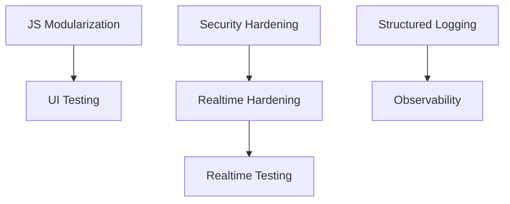
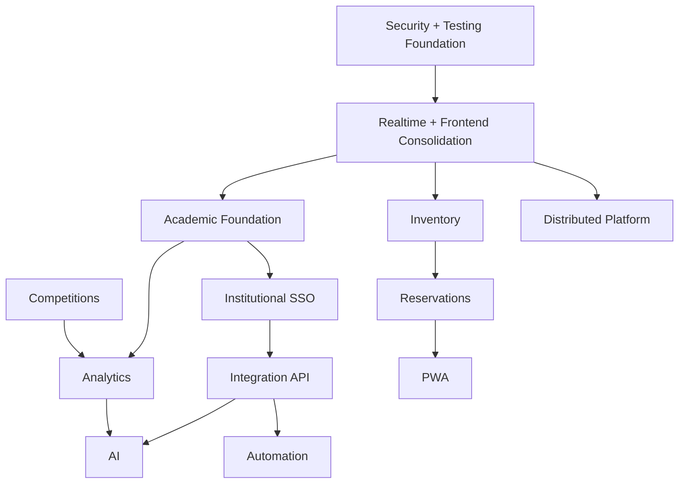
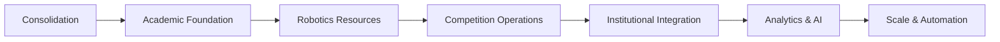

# 47_PRODUCT_ROADMAP.md

# Aula Robótica Platform — Product Roadmap

## Parte 1 — Visión estratégica, estado actual, principios de evolución y roadmap near-term

---

# 1. Propósito del documento

Este documento define el roadmap estratégico, técnico y funcional de evolución de **Aula Robótica Platform**.

Su objetivo es proporcionar una visión estructurada de:

- dónde se encuentra actualmente el producto;
- qué capacidades ya están consolidadas;
- qué áreas requieren hardening;
- qué funcionalidades deben priorizarse;
- qué capacidades deben incorporarse progresivamente;
- cómo debe evolucionar la arquitectura sin perder coherencia.

El roadmap no representa únicamente una lista de funcionalidades.

Debe actuar como instrumento para alinear:

```text
Product Vision

+

Architecture

+

Engineering

+

Security

+

Operations

+

User Experience
```

---

# 2. Naturaleza del roadmap

El roadmap debe entenderse como:

```text
directional

+

incremental

+

risk-aware

+

architecture-driven
```

No constituye un calendario contractual inmutable.

Las prioridades pueden cambiar según:

- necesidades reales del Aula de Robótica;
- feedback de usuarios;
- riesgos técnicos;
- deuda acumulada;
- seguridad;
- disponibilidad del equipo;
- dependencias institucionales.

---

# 3. Visión estratégica

Aula Robótica Platform evoluciona hacia una plataforma enterprise modular orientada a:

- gestión operativa del Aula de Robótica;
- administración académica;
- coordinación de proyectos;
- colaboración educativa;
- operación realtime;
- gestión de competiciones;
- observabilidad institucional;
- integración SSO universitaria.

---

# 4. Evolución del concepto de producto

La plataforma ya no debe concebirse únicamente como:

```text
administrative CRUD
```

Su evolución apunta hacia una combinación de:

```text
Internal Operations Platform

+

Educational Management Platform

+

Realtime Collaboration Platform

+

Robotics Operations Hub
```

---

# 5. Internal Operations Platform

Debe permitir gestionar de forma centralizada:

- usuarios;
- proyectos;
- tareas;
- actividades;
- recursos;
- documentación;
- notificaciones;
- trazabilidad;
- operación diaria.

---

# 6. Educational Management Platform

La evolución académica debe permitir incorporar progresivamente:

- estudiantes;
- cursos;
- talleres;
- sesiones;
- participación;
- progreso;
- seguimiento académico.

---

# 7. Realtime Collaboration Platform

La plataforma ya dispone de una base realtime mediante WebSockets, notificaciones y difusión contextual.

La evolución colaborativa debe incorporar progresivamente:

- Kanban;
- drag and drop;
- Live Kanban;
- Activity Feed más maduro;
- notificaciones;
- Dashboard live;
- presencia cuando exista un requisito validado;
- sincronización contextual.

Debe distinguirse:

```text
WebSocket Foundation
    CURRENT

Kanban
    PLANNED

Live Kanban
    PLANNED

Distributed Realtime
    FUTURE / CONDITIONAL.
```

---

# 8. Robotics Operations Hub

A medio y largo plazo debe centralizar capacidades relacionadas con:

- inventario;
- componentes;
- kits;
- reservas;
- competiciones;
- equipos;
- documentación técnica;
- resultados.

---

# 9. Plataforma institucional

A largo plazo, la plataforma debe estar preparada para integrarse con el ecosistema institucional de la Universidad de Alcalá.

Capacidades previstas:

```text
SSO

APIs universitarias

Reporting

Academic exports

Institutional analytics
```

---

# 10. Principio de evolución

El producto debe crecer:

```text
capability by capability
```

sin introducir simultáneamente toda la visión final.

---

# 11. Incremental Delivery

Cada etapa debe producir valor independiente.

Ejemplo:

```text
Projects

↓

Tasks

↓

Activities

↓

Attachments

↓

Notifications

↓

Realtime

↓

Academic modules
```

---

# 12. Arquitectura antes que expansión descontrolada

Antes de añadir grandes módulos nuevos debe consolidarse suficientemente:

- testing;
- seguridad;
- frontend architecture;
- realtime;
- DevOps;
- observabilidad.

---

# 13. Estado actual del producto

La plataforma dispone actualmente de una arquitectura SSR moderna basada en:

```text
FastAPI

SQLAlchemy

MariaDB

Jinja2 SSR

JWT + HTTPOnly Cookies

WebSockets

Modular Architecture
```

---

# 14. Estado arquitectónico

El sistema ha evolucionado desde una aplicación administrativa básica hacia una arquitectura modular donde ya existen dominios y servicios diferenciados.

---

# 15. Backend

El backend proporciona actualmente capacidades relacionadas con:

- autenticación;
- autorización;
- usuarios;
- proyectos;
- tareas;
- actividades;
- adjuntos;
- auditoría;
- Dashboard;
- realtime.

---

# 16. Frontend

La interfaz utiliza una estrategia:

```text
SSR-first
```

complementada progresivamente mediante JavaScript modular.

---

# 17. Realtime

La plataforma incorpora actualmente:

- Project Rooms;
- Dashboard WebSocket;
- Notifications WebSocket;
- realtime Kanban;
- broadcasting contextual;
- connection management.

---

# 18. Persistencia

La plataforma utiliza:

```text
SQLAlchemy

+

MariaDB
```

como base principal de persistencia.


Estado:

```text
SQLAlchemy
    CURRENT

MariaDB
    CURRENT / AUTHORITATIVE

PostgreSQL
    FUTURE / CANDIDATE / CONDITIONAL

No MariaDB → PostgreSQL migration
    has been completed.
```

---

# 19. Seguridad actual

El sistema dispone actualmente de:

```text
JWT Access Token
    CURRENT

JWT Refresh Token
    CURRENT

HTTPOnly Cookies
    CURRENT

Explicit /refresh
    CURRENT

Automatic Access Refresh
    CURRENT

Global RBAC
    CURRENT / MATURE

Contextual Authorization
    PARTIAL / IN PROGRESS

ProjectMembership
    TARGET / IN CONSOLIDATION

UI Authorization
    CURRENT
    as UX support, never as backend enforcement.
```

La existencia de mecanismos contextuales no implica que toda la autorización contextual esté ya consolidada.

---

# 20. Estado funcional implementado

Las principales capacidades actuales se agrupan en:

```text
IAM

Administration

Projects

Tasks

Activities

Attachments

Audit

Realtime

Frontend/UI
```

---

# 21. IAM / Seguridad

El estado actual debe distinguir entre capacidades implementadas y capacidades todavía en consolidación.

```text
CURRENT

    Login JWT
    Access Token
    Refresh Token
    HTTPOnly Cookies
    Explicit Refresh
    Automatic Access Refresh
    Global RBAC
    Roles globales
    Authentication / Authorization Helpers
    Context Injection SSR
    UI Authorization

PARTIAL / IN PROGRESS

    Contextual Authorization
    Context-sensitive Permissions

TARGET / IN CONSOLIDATION

    ProjectMembership
    Mature Contextual Roles
    Cross-project Authorization Tests.
```

---

# 22. Login

El sistema dispone de autenticación basada en JWT integrada con la experiencia SSR.

---

# 23. Refresh Tokens

La renovación mediante refresh token forma parte de la implementación actual.

```text
Refresh-token Workflow
    CURRENT

Explicit /refresh
    CURRENT

Automatic Access Refresh
    CURRENT

Refresh-token Rotation
    VERIFY / HARDENING

Server-side Revocation
    VERIFY / HARDENING

Reuse Detection
    FUTURE HARDENING

Session / Device Management
    FUTURE.
```

---

# 24. HTTPOnly Cookies

Las credenciales de sesión pueden mantenerse protegidas frente a acceso directo desde JavaScript mediante cookies HTTPOnly.

---

# 25. RBAC

El sistema dispone de Global RBAC como capacidad transversal consolidada.

```text
Global RBAC
    CURRENT / MATURE

Contextual Authorization
    PARTIAL / IN PROGRESS.
```

No debe utilizarse la madurez del RBAC global como evidencia de que toda la autorización contextual esté igualmente consolidada.

---

# 26. Roles globales

Permiten representar capacidades institucionales o administrativas generales.

---

# 27. Roles contextuales

Los roles y permisos contextuales representan la dirección de consolidación de la autorización por proyecto.

Su estado debe considerarse:

```text
Contextual Authorization
    PARTIAL / IN PROGRESS

ProjectMembership
    TARGET / IN CONSOLIDATION.
```

El modelo objetivo permitirá adaptar permisos según:

```text
user

+

membership

+

project

+

requested action.
```

---

# 28. Helpers de autorización

La autorización se encuentra encapsulada mediante helpers reutilizables.

---

# 29. Context Injection SSR

La capa SSR recibe contexto de:

- usuario;
- permisos;
- navegación;
- otros datos transversales.

---

# 30. UI Authorization

La interfaz adapta acciones visibles según permisos.

Debe mantenerse siempre complementada por autorización backend.

---

# 31. Gestión administrativa

La plataforma ya incluye:

- Usuarios;
- Roles;
- Identidades;
- Dashboard administrativo;
- Navegación dinámica;
- Menús contextuales;
- Breadcrumbs.

---

# 32. Users

Existe gestión administrativa de usuarios.

---

# 33. Roles

Los roles forman parte del modelo IAM y de administración.

---

# 34. Identities

La plataforma dispone de gestión de identidades, base relevante para futuras integraciones institucionales.

---

# 35. Dashboard administrativo

Existe una vista consolidada de información operativa y administrativa.

---

# 36. Navegación dinámica

La navegación se adapta a contexto y permisos.

---

# 37. Menús contextuales

Los menús permiten representar capacidades disponibles para cada usuario.

---

# 38. Breadcrumbs

El sistema dispone de navegación jerárquica contextual.

---

# 39. Gestión de proyectos

Projects constituye uno de los dominios principales ya implementados.

Capacidades actuales y en consolidación:

```text
CURRENT

    Project CRUD
    Project participants / membership foundation
    timeline funcional
    actividad realtime
    coordinación operativa

PARTIAL / TARGET

    mature contextual roles
    explicit ProjectMembership model
    cross-project authorization guarantees.
```

---

# 40. Project CRUD

Permite:

```text
Create

Read

Update

Delete / lifecycle operations
```

según las reglas funcionales implementadas.

---

# 41. Project Members

La plataforma gestiona participantes asociados a cada proyecto.

---

# 42. Contextual Project Roles

La plataforma dispone de una base de autorización contextual, pero su madurez debe considerarse parcial.

```text
Contextual Project Authorization
    PARTIAL / IN PROGRESS

ProjectMembership
    TARGET / IN CONSOLIDATION.
```

El objetivo es que los miembros puedan disponer de capacidades explícitas y verificables dentro de cada Project sin depender únicamente del rol global.

---

# 43. Project Timeline

Existe una representación temporal de actividad funcional relacionada con el proyecto.

---

# 44. Project Realtime

Los cambios relevantes pueden distribuirse mediante Project Rooms.

---

# 45. Coordinación operativa

Projects proporciona el contexto principal desde el que coordinar trabajo.

---

# 46. Gestión de tareas

Tasks constituye otro de los dominios centrales.

Actualmente incluye:

- CRUD;
- prioridades;
- estados;
- ownership;
- asignaciones.

La evolución Kanban debe clasificarse separadamente:

```text
Task Domain
    CURRENT

Task Status Model
    CURRENT

Kanban
    PLANNED

Drag and Drop
    PLANNED

Live Kanban
    PLANNED.
```

---

# 47. Task CRUD

Permite gestionar el ciclo de vida de las tareas.

---

# 48. Task Status

Las tareas se organizan mediante estados compatibles con el flujo Kanban.

---

# 49. Priorities

La prioridad permite expresar criticidad relativa.

---

# 50. Ownership

Las tareas mantienen contexto sobre responsabilidad y pertenencia.

---

# 51. Assignment

Las Tasks pueden asociarse a usuarios.

---

# 52. Kanban

Kanban constituye una de las principales evoluciones planificadas sobre el dominio Tasks.

Estado:

```text
PLANNED.
```

La secuencia prevista es:

```text
Task Domain
    CURRENT

↓

SSR Kanban Board
    PLANNED

↓

Authorized Status Mutation
    PLANNED

↓

Drag and Drop
    PLANNED

↓

Realtime Synchronization
    PLANNED

↓

Live Kanban
    PLANNED.
```

La persistencia seguirá siendo la autoridad del estado.

---

# 53. Sistema de actividades

Activities permite registrar trabajo operativo asociado a los principales dominios.

---

# 54. Activity Tracking

Incluye:

- registro operativo;
- tracking temporal;
- timeline;
- relaciones proyecto/tarea;
- actividad colaborativa.

---

# 55. Project / Task Relationship

Las Activities pueden contextualizarse dentro de Projects y Tasks.

---

# 56. Temporal Tracking

Permiten reflejar evolución o dedicación en el tiempo.

---

# 57. Collaborative Activity

Los eventos pueden alimentar diferentes vistas colaborativas.

---

# 58. Sistema de adjuntos

Attachments se encuentra implementado como capacidad transversal.

Actualmente incluye:

- Upload de archivos;
- Metadata persistente;
- UUID filenames;
- MIME validation;
- Ownership tracking;
- Descarga segura.

---

# 59. Metadata Persistence

La información funcional del Attachment se mantiene en base de datos.

---

# 60. UUID Filenames

El almacenamiento utiliza nombres técnicos desacoplados del nombre proporcionado por usuario.

---

# 61. MIME Validation

Existe validación sobre los tipos aceptados.

---

# 62. Ownership Tracking

Los adjuntos mantienen trazabilidad sobre usuario y recurso asociado.

---

# 63. Secure Download

La descarga debe continuar pasando por controles de autorización.

---

# 64. Auditoría y trazabilidad

La plataforma ya dispone de capacidades de auditoría.

Incluye:

- Audit Logs centralizados;
- Timeline administrativa;
- Eventos críticos;
- Logging contextual;
- Auditoría SSR integrada.

---

# 65. Audit Logs

Permiten mantener trazabilidad sobre operaciones relevantes.

---

# 66. Administrative Timeline

Proporciona una vista orientada a administración y soporte.

---

# 67. Critical Events

Las operaciones sensibles pueden generar eventos específicos.

---

# 68. Contextual Logging

El logging complementa la auditoría con información técnica.

---

# 69. Audit SSR

La interfaz permite consultar información de trazabilidad desde el contexto administrativo.

---

# 70. Realtime Architecture

La plataforma dispone actualmente de una base realtime construida sobre:

```text
FastAPI WebSockets

Notifications Realtime

WebSocket Rooms / contextual scopes

Contextual Broadcasting

In-memory Connection Manager.
```

Debe distinguirse de la evolución planificada:

```text
Kanban Realtime
    PLANNED

Live Kanban
    PLANNED

Distributed Realtime
    FUTURE / CONDITIONAL.
```

---

# 71. Dashboard Realtime

Permite invalidar o actualizar información operacional sin navegación completa.

---

# 72. Kanban Realtime

Kanban Realtime forma parte de la evolución planificada del producto.

Su objetivo será sincronizar cambios autorizados entre usuarios una vez consolidados:

```text
ProjectMembership

Contextual Authorization

WebSocket Security

Subscription Authorization

Event Contract

Reconnect

Reconciliation.
```

Estado:

```text
PLANNED.
```

---

# 73. Notifications Realtime

Reduce la latencia entre creación de Notification y visualización.

---

# 74. WebSocket Rooms

Los Projects pueden actuar como frontera de difusión.

---

# 75. Broadcasting contextual

Los eventos se envían según:

- Project;
- usuario;
- Dashboard;
- permisos.

---

# 76. Connection Manager

Centraliza conexiones WebSocket activas dentro de la arquitectura actual.

---

# 77. Frontend / UI System

La plataforma dispone de una arquitectura SSR reutilizable basada en:

- detail layouts;
- cards;
- tables;
- dialogs;
- toasts;
- timelines;
- Jinja2 macros;
- contextual rendering;
- UI authorization.

---

# 78. Reusable SSR Architecture

Las vistas comparten patrones en lugar de diseñarse como páginas completamente independientes.

---

# 79. Detail Layouts

Los recursos utilizan estructuras consistentes de detalle.

---

# 80. Cards

El sistema dispone de componentes reutilizables para presentar información.

---

# 81. Tables

Las tablas siguen patrones comunes.

---

# 82. Dialog System

Existe un sistema transversal para confirmaciones e interacciones modales.

---

# 83. Toast System

Existe una arquitectura común de feedback temporal.

---

# 84. Timeline System

Audit y Activity Feed utilizan patrones temporales reutilizables.

---

# 85. Jinja2 Macros

Los componentes repetitivos pueden encapsularse mediante macros.

---

# 86. Contextual Rendering

La interfaz se adapta a:

- usuario;
- roles;
- permisos;
- contexto.

---

# 87. Estado estratégico

La plataforma ha superado claramente la etapa de:

```text
CRUD académico

Proyecto demo

Panel administrativo básico
```

---

# 88. Estado de madurez

Actualmente puede describirse como:

```text
Modular Educational Operations Platform

+

Realtime Operations Console
```

en proceso de consolidación.

---

# 89. Principal riesgo actual

El mayor riesgo no consiste en ausencia de funcionalidades.

Consiste en expandir el producto demasiado rápido antes de consolidar:

- testing;
- seguridad;
- realtime;
- frontend;
- operación.

---

# 90. Near-Term Roadmap

Horizonte:

```text
0–3 meses
```

El objetivo principal debe ser:

```text
consolidar antes de expandir
```

---

# 91. Ejes Near-Term

Se priorizan cinco grandes líneas:

```text
Technical Consolidation

Testing Expansion

Security Hardening

Realtime Hardening

Initial Observability
```

---

# 92. Consolidación técnica

Objetivos prioritarios:

- Refactor JS modular completo;
- Consolidación frontend architecture;
- Mejoras UX enterprise;
- Realtime stability improvements;
- Cache strategy;
- Error handling unificado;
- Mejoras de accesibilidad.

---

# 93. Refactor JavaScript modular

Debe continuar reduciéndose:

```text
inline scripts
```

y trasladando lógica hacia módulos reutilizables.

---

# 94. Objetivos del refactor JS

- separación de responsabilidades;
- testing;
- reutilización;
- lifecycle control;
- reducción de duplicación.

---

# 95. Arquitectura frontend

Debe consolidarse la separación entre:

```text
server-rendered HTML

+

JavaScript enhancement

+

realtime state
```

---

# 96. UI Enterprise

La mejora UX debe centrarse en:

- consistencia;
- feedback;
- estados vacíos;
- errores;
- navegación;
- accesibilidad;
- colaboración.

---

# 97. No redesign continuo

La prioridad no debe convertirse en rehacer visualmente componentes que ya funcionan sin necesidad funcional.

---

# 98. Realtime Stability

Debe reforzarse:

- lifecycle;
- reconnect;
- deduplication;
- authorization;
- reconciliation;
- event contracts.

---

# 99. Cache Strategy

Debe estudiarse una estrategia de caching donde aporte valor.

Candidatos:

- Dashboard;
- catálogos;
- aggregates costosos;
- datos de lectura frecuente.

---

# 100. Cache no como parche

No debe introducirse cache para ocultar queries mal diseñadas.

Primero deben optimizarse:

- SQL;
- indexes;
- N+1;
- agregaciones.

---

# 101. Error Handling unificado

La plataforma debe converger hacia contratos consistentes para:

- API errors;
- SSR errors;
- JavaScript errors;
- realtime failures.

---

# 102. UX de error

Los errores deben convertirse en estados comprensibles.

Ejemplos:

```text
403

409

422

500

network unavailable
```

---

# 103. Accessibility

La accesibilidad debe pasar de mejora opcional a requisito transversal.

Prioridades:

- semantic HTML;
- labels;
- focus;
- keyboard;
- dialogs;
- contrast;
- reduced motion.

---

# 104. Testing Expansion

El roadmap near-term debe ampliar significativamente la suite automatizada.

---

# 105. Objetivo de Testing

Evolucionar desde una estrategia principalmente backend hacia:

```text
Backend

+

UI

+

Realtime

+

Integration
```

---

# 106. Unit Testing

Prioridades:

- Services;
- repositories;
- auth helpers;
- WebSocket managers.

---

# 107. Service Coverage

Los Services deben mantener cobertura profunda sobre:

- reglas;
- validaciones;
- transiciones;
- side effects.

---

# 108. Repository Testing

Debe priorizar:

- queries complejas;
- ordering;
- filters;
- relationships.

---

# 109. Authentication Helpers

Debe continuar protegiéndose:

- tokens;
- refresh;
- permisos;
- context.

---

# 110. WebSocket Manager

Debe incorporar testing automatizado sobre:

- rooms;
- users;
- connect;
- disconnect;
- broadcast.

---

# 111. Integration Testing

Prioridades:

```text
auth flows

realtime flows

uploads

permissions
```

---

# 112. Authentication Integration

Debe validar la cadena completa:

```text
request

↓

middleware

↓

identity

↓

authorization

↓

route
```

---

# 113. Realtime Integration

Debe comenzar a comprobar:

```text
HTTP mutation

↓

Outbox

↓

WebSocket

↓

client
```

---

# 114. Upload Integration

Debe cubrir:

- DB;
- storage;
- authorization;
- errors.

---

# 115. Permissions Integration

Debe proteger contra:

- IDOR;
- privilege escalation;
- contextual scope errors.

---

# 116. UI Testing

Prioridades iniciales:

- Dialogs;
- Toasts;
- Contextual Rendering;
- Reusable Components.

---

# 117. Dialog Testing

Debe cubrir:

- open;
- close;
- focus;
- confirmation;
- error.

---

# 118. Toast Testing

Debe cubrir:

- render;
- timeout;
- dismiss;
- queue;
- accessibility.

---

# 119. Contextual Rendering

Debe comprobar que diferentes roles reciben distintas capacidades visuales.

---

# 120. Reusable Components

Los componentes compartidos deben disponer de contratos comunes.

---

# 121. Browser Automation

Una evolución near-term recomendable consiste en introducir una suite mínima con:

```text
Playwright
```

para journeys críticos.

---

# 122. Primeros E2E

Candidatos:

```text
Login

Create Project

Create Task

Move Kanban Task

Upload Attachment
```

---

# 123. Realtime Testing

Debe comenzar por:

- ConnectionManager;
- Project Rooms;
- Notification targeting;
- room isolation.

---

# 124. Multi-client Testing

La siguiente etapa debe incorporar dos clientes simultáneos.

---

# 125. Security Hardening

El roadmap actual identifica como prioridades:

- CSRF protection;
- Session invalidation;
- Token revocation;
- Rate limiting;
- Upload hardening;
- WebSocket authorization hardening.

---

# 126. CSRF Protection

Debe priorizarse especialmente si la autenticación mutadora utiliza cookies.

---

# 127. CSRF Scope

Debe cubrir:

- forms;
- mutating SSR actions;
- API calls autenticadas mediante cookie cuando proceda.

---

# 128. Session Invalidation

Debe permitir invalidar sesiones activas de forma controlada.

---

# 129. Token Revocation

La arquitectura debe evolucionar hacia revocación explícita cuando el riesgo lo justifique.

---

# 130. Refresh Rotation

La rotación no debe confundirse con la existencia del refresh-token workflow, que ya es CURRENT.

Estado:

```text
Refresh-token Workflow
    CURRENT

Refresh-token Rotation
    VERIFY / HARDENING.
```

La rotación puede reforzar la protección frente a reutilización de refresh tokens si la política de sesión adoptada lo requiere.

---

# 131. Rate Limiting

Debe proteger operaciones susceptibles a abuso.

Prioridades:

```text
login

authentication

uploads

future public endpoints
```

---

# 132. Upload Hardening

Debe completar:

- MIME;
- size;
- extension;
- filename;
- storage isolation;
- scanning futuro.

---

# 133. WebSocket Hardening

Debe reforzar:

- auth;
- authorization;
- Origin;
- message limits;
- room isolation;
- reconnect.

---

# 134. Security Regression

Cada vulnerabilidad corregida debe considerar test automático.

---

# 135. Observabilidad inicial

La plataforma debe comenzar a evolucionar desde debugging principalmente manual hacia observabilidad sistemática.

---

# 136. Logging Near-Term

Prioridades:

```text
structured logging

request tracing

websocket logs

audit enrichment
```

---

# 137. Structured Logging

Los logs deben evolucionar hacia formato estructurado.

---

# 138. Request Correlation

Debe incorporarse:

```text
request_id

correlation_id
```

como base de diagnóstico.

---

# 139. WebSocket Logs

Deben registrarse eventos relevantes:

- connect;
- disconnect;
- auth failure;
- broadcast failure.

---

# 140. Audit Enrichment

Audit debe disponer de contexto suficiente para soporte y administración.

---

# 141. Monitoring Near-Term

Prioridades:

```text
basic metrics

health checks

error tracking
```

---

# 142. Health Checks

Endpoints recomendados:

```text
/health

/live

/ready
```

---

# 143. Basic Metrics

Debe comenzar a medirse:

- HTTP;
- errors;
- latency;
- DB;
- WebSocket.

---

# 144. Error Tracking

Una solución especializada puede incorporarse para excepciones relevantes.

---

# 145. Monitoring Stack

El stack completo Prometheus/Grafana no necesita bloquear las primeras mejoras.

Puede introducirse progresivamente.

---

# 146. Near-Term DevOps Foundation

Aunque el roadmap original sitúa parte de DevOps en horizonte medio, algunas capacidades deben comenzar durante la consolidación.

---

# 147. Docker

Debe existir una estrategia reproducible de ejecución mediante contenedores cuando se adopte formalmente.

---

# 148. Docker Compose

Puede proporcionar entorno local integrado para:

- app;
- DB;
- monitoring futuro.

---

# 149. CI Base

Debe automatizar:

```text
lint

tests

coverage
```

como mínimo.

---

# 150. Quality Gate

Ningún cambio debería integrarse si rompe las garantías básicas de calidad.

---

# 151. Near-Term Product Outcomes

Al finalizar la etapa de 0–3 meses, la plataforma debería ser:

```text
more testable

more secure

more observable

more predictable

more maintainable
```

sin necesidad de añadir todavía grandes dominios académicos.

---

# 152. Exit Criteria — Technical Consolidation

La etapa puede considerarse suficientemente consolidada cuando:

- JavaScript está modularizado en áreas críticas;
- los errores siguen contratos consistentes;
- la accesibilidad básica está integrada;
- frontend shared systems están estabilizados.

---

# 153. Exit Criteria — Testing

Debe existir cobertura automatizada sobre:

- Services críticos;
- Auth;
- permissions;
- Attachments;
- ConnectionManager;
- principales flujos realtime.

---

# 154. Exit Criteria — Security

Debe haber progresado:

- CSRF;
- session controls;
- upload hardening;
- WebSocket hardening.

---

# 155. Exit Criteria — Realtime

Debe existir:

- reconnect strategy;
- dedupe;
- room isolation;
- reconciliation;
- tests multi-client iniciales.

---

# 156. Exit Criteria — Observability

Debe existir al menos:

- structured logs;
- health checks;
- error visibility;
- métricas básicas.

---

# 157. Dependencias entre iniciativas

Las iniciativas no son independientes.



---

# 158. Testing depende de arquitectura testeable

La modularización de JavaScript facilita UI Testing.

---

# 159. Realtime Testing depende de contratos

No puede existir testing robusto si los eventos no tienen contratos estables.

---

# 160. Observability depende de instrumentación

Grafana por sí sola no crea observabilidad.

La aplicación debe producir señales útiles.

---

# 161. Security y Realtime

El hardening de WebSocket depende directamente del modelo de autenticación y autorización.

---

# 162. Priorización Near-Term

Orden recomendado:

```text
1. Testing foundation
2. Security hardening
3. Realtime hardening
4. Frontend consolidation
5. Observability foundation
6. DevOps baseline
```

Las líneas pueden avanzar parcialmente en paralelo.

---

# 163. P0 — Testing Foundation

Debe reducir el riesgo de seguir desarrollando sobre comportamiento no protegido.

---

# 164. P0 — Security

CSRF, sesiones y autorización realtime deben considerarse prioritarios antes de aumentar exposición.

---

# 165. P0 — Realtime Reliability

Kanban y Notifications dependen de una base realtime suficientemente robusta.

---

# 166. P1 — Frontend Consolidation

Debe reducir deuda y mejorar capacidad de evolución.

---

# 167. P1 — Observability

Debe permitir diagnosticar con rapidez la complejidad creciente.

---

# 168. P1 — DevOps

Debe reducir divergencia entre entornos y automatizar quality gates.

---

# 169. Qué no priorizar todavía

Durante la consolidación deben evitarse grandes inversiones en:

- IA operacional;
- automatización autónoma;
- integraciones institucionales complejas;
- microservicios;
- infraestructura distribuida prematura.

---

# 170. Rationale

Estas capacidades aumentan complejidad antes de consolidar los fundamentos actuales.

---

# 171. No Microservices Prematuros

La arquitectura modular actual debe aprovecharse antes de distribuir dominios.

---

# 172. Monolito modular

Continúa siendo una opción adecuada mientras:

- los boundaries sean claros;
- la escala no exija distribución;
- la operación permanezca manejable.

---

# 173. Preparación para evolución

La arquitectura sí debe evitar decisiones que impidan una futura separación de servicios.

---

# 174. Roadmap como instrumento vivo

Debe actualizarse cuando:

- cambia el estado real;
- una iniciativa termina;
- aparece un nuevo riesgo;
- cambia una dependencia;
- feedback modifica prioridades.

---

# 175. Cadencia de revisión

Una revisión razonable puede realizarse:

```text
mensualmente

+

al cierre de cada milestone relevante
```

---

# 176. Weekly Update

El seguimiento operativo más frecuente se mantiene en:

```text
50_WEEKLY_UPDATE.md
```

---

# 177. Product Vision

La dirección estratégica de mayor nivel se mantiene en:

```text
48_PRODUCT_VISION.md
```

---

# 178. Feature Backlog

Las funcionalidades candidatas y su priorización detallada se mantienen en:

```text
49_FEATURE_BACKLOG.md
```

---

# 179. Roadmap vs Backlog

```text
Roadmap

=

dirección y secuencia estratégica
```

```text
Backlog

=

trabajo candidato priorizable
```

---

# 180. Roadmap vs Weekly Update

```text
Roadmap

=

horizonte
```

```text
Weekly Update

=

estado operativo reciente
```

---

# 181. Roadmap vs Product Vision

```text
Product Vision

=

por qué y hacia dónde
```

```text
Product Roadmap

=

cómo evolucionamos hacia allí
```

---

# 182. Resultado de la primera etapa

La fase near-term no debe medirse principalmente por:

```text
number of new features
```

sino por:

```text
reliability

security

testability

maintainability

operational readiness
```

---

# 183. North Star técnica near-term

La plataforma debe poder modificarse y desplegarse con mayor confianza.

---

# 184. North Star funcional near-term

Los usuarios actuales deben experimentar:

- mayor estabilidad;
- mejor feedback;
- mejor colaboración;
- menos inconsistencias.

---

# 185. North Star operativa near-term

Los problemas deben poder:

```text
detectarse

↓

diagnosticarse

↓

reproducirse

↓

corregirse
```

de forma cada vez más sistemática.

---

# 186. Final de Parte 1

La **Parte 2** desarrollará el roadmap de medio plazo:

- módulos académicos;
- Students;
- Courses / Workshops;
- evaluación y participación;
- Inventory;
- Equipment Reservations;
- Competitions;
- Eurobot;
- realtime avanzado;
- DevOps;
- CI/CD;
- calidad;
- entornos;
- observabilidad avanzada;
- dependencias y criterios de entrada/salida.

---

# 47_PRODUCT_ROADMAP.md

# Aula Robótica Platform — Product Roadmap

## Parte 2 — Expansión funcional, dominio académico, recursos, competiciones, DevOps y observabilidad avanzada

---

# 187. Mid-Term Roadmap

Horizonte orientativo:

```text
3–9 meses
```

El objetivo principal de esta etapa es evolucionar desde una plataforma operativa consolidada hacia una plataforma capaz de representar de forma más completa la actividad académica y técnica del Aula de Robótica.

---

# 188. Objetivo estratégico Mid-Term

La etapa debe transformar progresivamente:

```text
Projects + Tasks + Activities
```

en un ecosistema más amplio:

```text
Academic Operations

+

Robotics Resources

+

Competitions

+

Reliable Platform Operations
```

---

# 189. Condición de entrada

La expansión funcional no debería comenzar de forma intensiva hasta disponer de una base razonablemente estable en:

- testing;
- seguridad;
- frontend;
- realtime;
- logging;
- CI/CD.

---

# 190. No bloqueo absoluto

La condición anterior no significa que todos los trabajos técnicos deban finalizar antes de desarrollar nuevos módulos.

La evolución puede ser paralela, pero las nuevas capacidades no deben multiplicar deuda conocida.

---

# 191. Principales líneas Mid-Term

Se proponen seis líneas estratégicas:

```text
Academic Domain

Inventory & Equipment

Reservations

Competitions

Platform Engineering

Advanced Observability
```

---

# 192. Academic Domain

El dominio académico permitirá representar formalmente la actividad educativa desarrollada dentro del Aula de Robótica.

---

# 193. Objetivos académicos

Debe proporcionar progresivamente:

- gestión de estudiantes;
- cursos;
- talleres;
- sesiones;
- participantes;
- asistencia;
- progreso;
- evidencias;
- seguimiento.

---

# 194. Principio académico

No debe intentarse construir inicialmente un LMS completo.

---

# 195. Scope Control

La plataforma debe resolver primero las necesidades específicas del Aula de Robótica.

No competir con plataformas generalistas como:

```text
Moodle

Canvas LMS

Blackboard
```

---

# 196. Integración antes que sustitución

Cuando una capacidad ya esté correctamente resuelta por sistemas institucionales, debe estudiarse:

```text
integration
```

antes que:

```text
duplication
```

---

# 197. Students Module

Uno de los primeros módulos académicos candidatos será:

```text
Students
```

---

# 198. Student Entity

Debe representar información académica necesaria sin duplicar innecesariamente toda la identidad del usuario.

---

# 199. User vs Student

Debe mantenerse separación conceptual:

```text
User
```

representa identidad y acceso.

```text
Student
```

representa contexto académico.

---

# 200. Student Relationship

Conceptualmente:

```text
User

0..1

Student
```

aunque el modelo definitivo dependerá de los requisitos institucionales.

---

# 201. Student Without Platform Access

Debe considerarse la posibilidad de registrar un estudiante que todavía no disponga de cuenta activa.

---

# 202. Student Fields

Candidatos iniciales:

```text
student_id

user_id

institutional_identifier

status

created_at

updated_at
```

---

# 203. Sensitive Academic Data

El modelo debe minimizar información personal almacenada.

---

# 204. Data Minimization

Solo deben mantenerse los datos necesarios para las funcionalidades reales.

---

# 205. Student Status

Puede representar estados como:

```text
ACTIVE

INACTIVE

ALUMNI
```

si existe necesidad funcional.

---

# 206. Student Profile

La vista puede consolidar:

- cursos;
- talleres;
- proyectos;
- actividades;
- participación.

---

# 207. Student Search

Debe soportar búsquedas administrativas eficientes.

---

# 208. Student Authorization

El acceso debe depender de:

- rol;
- relación académica;
- necesidad operativa.

---

# 209. Student Audit

Cambios relevantes deben quedar auditados.

---

# 210. Student Import

Puede ser necesaria una futura importación mediante:

```text
CSV

institutional API

SSO provisioning
```

---

# 211. Import Idempotency

Las importaciones deben poder repetirse sin crear duplicados.

---

# 212. Institutional Identifier

Cuando exista, debe actuar como identificador externo estable.

---

# 213. Courses Module

El siguiente dominio académico candidato será:

```text
Courses
```

---

# 214. Course Concept

Representará una unidad educativa relativamente estable.

Ejemplos:

```text
Introducción a Arduino

Programación con Python

Robótica móvil

Diseño e impresión 3D
```

---

# 215. Course vs Workshop

Debe diferenciarse:

```text
Course
```

como estructura educativa.

```text
Workshop
```

como actividad formativa más acotada o puntual.

---

# 216. Course Fields

Candidatos:

```text
id

name

description

status

start_date

end_date

coordinator_id

created_at

updated_at
```

---

# 217. Course Lifecycle

Puede utilizar estados:

```text
DRAFT

PLANNED

ACTIVE

COMPLETED

ARCHIVED
```

---

# 218. Course Participants

Debe existir relación entre:

```text
Course

↔

Students
```

---

# 219. Enrollment

La relación puede modelarse mediante entidad específica:

```text
Enrollment
```

---

# 220. Enrollment Advantages

Permite añadir:

- fecha;
- estado;
- progreso;
- metadata;
- origen.

---

# 221. Enrollment Status

Ejemplo:

```text
ENROLLED

ACTIVE

COMPLETED

WITHDRAWN
```

---

# 222. Course Coordinator

Debe representar al usuario responsable del curso.

---

# 223. Multiple Instructors

La arquitectura debería permitir evolución hacia varios docentes/instructores.

---

# 224. Course Sessions

Un Course puede dividirse en:

```text
Sessions
```

---

# 225. Session

Representa una unidad temporal concreta.

---

# 226. Session Fields

Candidatos:

```text
id

course_id

title

starts_at

ends_at

location

status
```

---

# 227. Session Attendance

Debe poder registrarse asistencia.

---

# 228. Attendance Entity

Puede representar:

```text
session_id

student_id

status

registered_at
```

---

# 229. Attendance Status

Posibles valores:

```text
PRESENT

ABSENT

JUSTIFIED

LATE
```

solo si son necesarios.

---

# 230. Attendance Audit

Cambios manuales deben quedar trazados.

---

# 231. Workshops Module

Workshops puede compartir gran parte de infraestructura con Courses.

---

# 232. Avoid Premature Generalization

No debe crearse una abstracción educativa excesivamente genérica antes de conocer diferencias reales.

---

# 233. Shared Components

Sí pueden reutilizarse:

- participants;
- sessions;
- attendance;
- attachments;
- notifications.

---

# 234. Workshop Lifecycle

Puede ser más simple:

```text
DRAFT

SCHEDULED

ACTIVE

COMPLETED

CANCELLED
```

---

# 235. Workshop Capacity

Puede requerir:

```text
max_participants
```

---

# 236. Registration

Una evolución puede permitir inscripción de estudiantes.

---

# 237. Waiting List

Solo debe incorporarse si existe demanda real.

---

# 238. Academic Progress

La plataforma puede incorporar seguimiento de progreso.

---

# 239. Progress Principle

Inicialmente debe ser ligero.

No construir un sistema completo de calificaciones sin necesidad.

---

# 240. Progress Model

Puede basarse en:

- asistencia;
- actividades completadas;
- proyectos;
- milestones.

---

# 241. Academic Activities

El dominio existente `Activities` puede reutilizarse o relacionarse con el contexto académico.

---

# 242. Avoid Semantic Collision

Debe distinguirse claramente entre:

```text
operational Activity
```

y:

```text
academic learning activity
```

si ambos conceptos divergen.

---

# 243. Learning Evidence

Puede incluir:

- Attachments;
- Project;
- Task;
- submission futura.

---

# 244. Evaluation

Debe mantenerse fuera del alcance inicial salvo requisito real.

---

# 245. Lightweight Assessment

Si se necesita, comenzar con:

```text
completed

not completed

feedback
```

antes que sistemas complejos de rúbricas.

---

# 246. Academic Dashboard

Una evolución natural será disponer de indicadores como:

- estudiantes activos;
- cursos activos;
- próximas sesiones;
- asistencia;
- proyectos académicos.

---

# 247. Dashboard Composition

Debe reutilizar la arquitectura de widgets existente.

---

# 248. Academic Notifications

Ejemplos:

```text
course enrollment

session reminder

schedule change

workshop registration
```

---

# 249. Notification Preferences

Las nuevas categorías deberán integrarse en el sistema de preferencias.

---

# 250. Academic Activity Feed

Puede mostrar eventos relevantes de Courses y Workshops.

---

# 251. Privacy

No toda actividad académica debe ser visible para todos los participantes.

---

# 252. Academic Authorization Matrix

Antes de implementar los módulos debe definirse una matriz explícita.

---

# 253. Roles académicos candidatos

Conceptualmente pueden existir:

```text
Administrator

Coordinator

Instructor

Student
```

sin implicar necesariamente nuevos roles globales.

---

# 254. Contextual Roles

Instructor y Student pueden modelarse mediante relaciones contextuales.

---

# 255. Academic Domain Milestone

Primer milestone funcional recomendado:

```text
Students

+

Courses

+

Enrollments
```

---

# 256. Segundo Academic Milestone

Posteriormente:

```text
Sessions

+

Attendance

+

Workshops
```

---

# 257. Tercer Academic Milestone

Solo cuando exista necesidad:

```text
Progress

+

Evidence

+

Lightweight Assessment
```

---

# 258. Inventory Domain

El Aula de Robótica necesita potencialmente gestionar recursos físicos.

---

# 259. Inventory Objective

Centralizar información sobre:

- robots;
- kits;
- sensores;
- actuadores;
- placas;
- herramientas;
- componentes;
- equipos.

---

# 260. Inventory Entity

Puede utilizar una entidad principal:

```text
InventoryItem
```

---

# 261. Inventory Categories

Ejemplos:

```text
ROBOT

KIT

BOARD

SENSOR

ACTUATOR

TOOL

COMPONENT

OTHER
```

---

# 262. Category Extensibility

Las categorías deben poder evolucionar sin provocar migraciones constantes si el dominio lo requiere.

---

# 263. Item Fields

Candidatos:

```text
id

name

category

description

status

quantity

location

created_at

updated_at
```

---

# 264. Serialized Equipment

Algunos elementos necesitan identificación individual.

Ejemplo:

```text
Robot TurtleBot #3
```

---

# 265. Non-serialized Inventory

Otros pueden gestionarse por cantidad.

Ejemplo:

```text
M3 screws = 240
```

---

# 266. Two Inventory Models

Debe evaluarse si conviene separar:

```text
Asset

Consumable
```

---

# 267. Asset

Representa recurso individual trazable.

---

# 268. Consumable

Representa stock cuantitativo.

---

# 269. Inventory Status

Para Assets:

```text
AVAILABLE

RESERVED

IN_USE

MAINTENANCE

DAMAGED

RETIRED
```

---

# 270. Stock Status

Para consumibles puede derivarse de cantidad.

---

# 271. Inventory Location

Debe representar ubicación física.

---

# 272. Location Model

Inicialmente puede ser texto controlado.

Posteriormente puede evolucionar a entidad.

---

# 273. Inventory Attachments

Puede reutilizar Attachments para:

- manuales;
- fotografías;
- facturas;
- documentación.

---

# 274. Inventory Audit

Cambios de estado y cantidad deben quedar trazados.

---

# 275. Inventory History

Debe poder reconstruirse:

```text
who

changed what

when
```

---

# 276. Maintenance

Los Assets pueden necesitar registro de mantenimiento.

---

# 277. Maintenance Record

Puede incluir:

```text
asset_id

description

started_at

completed_at

performed_by
```

---

# 278. Maintenance Roadmap

No debe implementarse necesariamente en la primera versión de Inventory.

---

# 279. QR / Barcode

Una evolución interesante consiste en identificar Assets mediante:

```text
QR

barcode
```

---

# 280. Mobile Workflow

Esto facilitaría:

```text
scan

↓

open asset

↓

reserve / inspect / report
```

---

# 281. Inventory Search

Debe soportar:

- nombre;
- categoría;
- estado;
- ubicación.

---

# 282. Inventory Dashboard

Indicadores candidatos:

```text
available assets

reserved assets

maintenance assets

low stock
```

---

# 283. Inventory Permissions

Debe diferenciar:

- consulta;
- modificación;
- movimiento;
- retirada.

---

# 284. Equipment Reservations

Reservations constituye una extensión natural de Inventory.

---

# 285. Reservation Goal

Permitir reservar recursos para:

- proyectos;
- cursos;
- talleres;
- competiciones.

---

# 286. Reservation Entity

Campos candidatos:

```text
id

resource_id

user_id

project_id

starts_at

ends_at

status

created_at
```

---

# 287. Reservation Status

Ejemplo:

```text
PENDING

APPROVED

ACTIVE

COMPLETED

CANCELLED

REJECTED
```

---

# 288. Approval Workflow

Algunos recursos pueden necesitar aprobación.

Otros podrían reservarse automáticamente.

---

# 289. Resource Policy

Cada categoría puede disponer de reglas diferentes.

---

# 290. Conflict Detection

No deben existir reservas incompatibles para el mismo Asset.

---

# 291. Database Protection

La prevención de conflictos no debe depender únicamente del frontend.

---

# 292. Reservation Concurrency

Dos usuarios pueden intentar reservar simultáneamente.

Debe existir testing específico.

---

# 293. Reservation Calendar

La interfaz puede proporcionar:

```text
calendar

timeline

availability view
```

---

# 294. Reservation Notifications

Eventos:

```text
reservation_requested

reservation_approved

reservation_rejected

reservation_upcoming

reservation_overdue
```

---

# 295. Reservation Reminders

Pueden utilizar el sistema de Notifications.

---

# 296. Return Workflow

Un Asset puede requerir confirmación de devolución.

---

# 297. Condition on Return

Una evolución puede registrar:

```text
OK

DAMAGED

MAINTENANCE_REQUIRED
```

---

# 298. Reservation Audit

Todas las transiciones importantes deben quedar auditadas.

---

# 299. Inventory + Projects

Un recurso puede reservarse específicamente para un Project.

---

# 300. Inventory + Courses

También para una Session o Workshop.

---

# 301. Inventory Milestone 1

Prioridad:

```text
catalog

status

location

search
```

---

# 302. Inventory Milestone 2

Después:

```text
reservations

conflict detection

notifications
```

---

# 303. Inventory Milestone 3

Posteriormente:

```text
QR

maintenance

stock

analytics
```

---

# 304. Competitions Domain

Las competiciones constituyen otro dominio natural del Aula de Robótica.

---

# 305. Competition Objective

Gestionar:

- competiciones;
- equipos;
- participantes;
- robots;
- documentación;
- milestones;
- resultados.

---

# 306. Competition Entity

Campos candidatos:

```text
id

name

description

location

starts_at

ends_at

status
```

---

# 307. Competition Lifecycle

Puede utilizar:

```text
PLANNED

REGISTRATION

ACTIVE

COMPLETED

ARCHIVED
```

---

# 308. Team Entity

Representará un equipo participante.

---

# 309. Team Fields

Candidatos:

```text
id

competition_id

name

project_id

status
```

---

# 310. Team Members

Debe existir relación con usuarios/estudiantes.

---

# 311. Competition Project

Un Team puede estar relacionado con un Project existente.

---

# 312. Reuse Projects

Esto permite reutilizar:

- Tasks;
- Activities;
- Attachments;
- Feed;
- Kanban.

---

# 313. Avoid Competition-specific Task System

No debe crearse un segundo sistema de Tasks.

---

# 314. Competition Milestones

Puede añadirse una capa específica sobre Projects.

---

# 315. Robot Registration

Un Team puede registrar uno o varios robots.

---

# 316. Inventory Integration

Cuando Inventory exista:

```text
Competition Robot

↔

Asset
```

puede reutilizar recursos registrados.

---

# 317. External Robot

También debe poder existir un robot no perteneciente al inventario institucional.

---

# 318. Competition Documents

Attachments puede almacenar:

- reglas;
- planos;
- homologaciones;
- documentación técnica.

---

# 319. Results

La primera versión puede registrar resultados simples.

---

# 320. Results Model

Debe diseñarse según las reglas reales de las competiciones soportadas.

---

# 321. No Universal Scoring Engine Initially

No intentar crear un motor universal de puntuación desde el principio.

---

# 322. Competition-specific Extensions

Puede utilizarse arquitectura extensible cuando aparezcan requisitos reales.

---

# 323. Eurobot

Eurobot constituye un candidato importante para especialización futura.

---

# 324. Eurobot Scope

Puede necesitar:

- equipos;
- robots;
- homologación;
- matches;
- puntuaciones;
- milestones;
- documentación.

---

# 325. Eurobot as Extension

Preferir:

```text
generic Competition core

+

Eurobot-specific extension
```

frente a convertir todo el dominio en Eurobot.

---

# 326. Match Entity

Puede incorporarse cuando sea necesario.

---

# 327. Match Fields

Candidatos:

```text
competition_id

team_id

opponent

scheduled_at

score

status
```

---

# 328. Competition Dashboard

Puede mostrar:

- próximos eventos;
- equipos;
- milestones;
- tareas críticas;
- resultados.

---

# 329. Competition Feed

Activity Feed puede incorporar eventos específicos.

---

# 330. Competition Notifications

Ejemplos:

```text
deadline approaching

match scheduled

document required

milestone completed
```

---

# 331. Competition Milestone 1

```text
Competitions

+

Teams

+

Project linking
```

---

# 332. Competition Milestone 2

```text
Robots

+

Documents

+

Milestones
```

---

# 333. Competition Milestone 3

```text
Matches

+

Results

+

Eurobot extensions
```

---

# 334. Platform Engineering Mid-Term

La expansión funcional debe acompañarse de una evolución operacional.

---

# 335. Dockerization

Objetivo:

```text
reproducible environments
```

---

# 336. Container Components

Como mínimo:

```text
application

database
```

---

# 337. Development Compose

Debe facilitar:

```text
clone

↓

configure

↓

docker compose up
```

---

# 338. Environment Configuration

Secrets y configuración deben permanecer fuera de imágenes.

---

# 339. Image Build

Debe producir builds:

- reproducibles;
- versionados;
- pequeños;
- seguros.

---

# 340. Multi-stage Build

Puede utilizarse para reducir imagen final.

---

# 341. Non-root Container

La aplicación debería ejecutarse con usuario no privilegiado cuando sea posible.

---

# 342. Container Health

Debe integrarse con health endpoints.

---

# 343. CI/CD Pipeline

La plataforma debe evolucionar hacia una pipeline completa.

---

# 344. CI Stages

Modelo:

```text
Checkout

↓

Dependencies

↓

Lint

↓

Tests

↓

Security

↓

Build

↓

Artifact
```

---

# 345. Pull Request Gate

Debe impedir merge cuando fallen checks críticos.

---

# 346. Test Parallelization

Puede introducirse cuando la suite crezca suficientemente.

---

# 347. Coverage

Coverage debe utilizarse como indicador.

No como objetivo aislado.

---

# 348. Coverage Threshold

Puede establecerse un mínimo razonable y elevarlo gradualmente.

---

# 349. Static Analysis

Debe incorporarse:

- linting;
- formatting;
- type checking.

---

# 350. Python Quality

Herramientas candidatas pueden incluir:

```text
Ruff

mypy
```

según decisiones del proyecto.

---

# 351. Frontend Quality

Debe incorporarse validación para JavaScript/CSS cuando el volumen lo justifique.

---

# 352. Dependency Security

La pipeline debe revisar vulnerabilidades conocidas.

---

# 353. Secret Scanning

Debe impedir commits accidentales de credenciales.

---

# 354. Container Scanning

Cuando Docker forme parte del deployment, las imágenes deben analizarse.

---

# 355. Artifact Versioning

Los builds desplegables deben ser identificables.

---

# 356. Git Commit Traceability

Debe poder conocerse:

```text
deployment

↓

artifact

↓

commit
```

---

# 357. Environments

El roadmap debe evolucionar hacia separación explícita:

```text
Development

Testing

Staging

Production
```

según recursos disponibles.

---

# 358. Development

Entorno local del desarrollador.

---

# 359. Testing

Puede ser efímero y utilizado por CI.

---

# 360. Staging

Debe aproximarse a producción.

---

# 361. Production

Debe mantener configuración y datos estrictamente controlados.

---

# 362. Environment Parity

Debe reducirse divergencia entre entornos.

---

# 363. Database Migrations

Las migraciones deben formar parte del deployment.

---

# 364. Migration Safety

Debe evaluarse:

- backward compatibility;
- rollback;
- locks;
- data transformations.

---

# 365. Pre-deployment Migration Test

Las migraciones deben probarse contra una base representativa.

---

# 366. Backup Before Risky Migration

Cambios destructivos deben disponer de estrategia de recuperación.

---

# 367. Deployment Strategy

Inicialmente puede mantenerse simple.

---

# 368. Rolling / Blue-Green

Solo debe introducirse cuando infraestructura y disponibilidad lo justifiquen.

---

# 369. Rollback

Todo deployment debe disponer de un procedimiento conocido de rollback.

---

# 370. Configuration Management

Debe existir una fuente clara de configuración por entorno.

---

# 371. Secrets Management

Los secretos no deben mantenerse en:

- repositorio;
- Dockerfile;
- frontend;
- logs.

---

# 372. Production Database

Debe disponer de:

- backups;
- monitoring;
- migrations;
- recovery procedure.

---

# 373. Backup Strategy

Debe definir:

```text
frequency

retention

storage

restore procedure
```

---

# 374. Restore Testing

Un backup no probado no constituye una estrategia completa.

---

# 375. Recovery Exercise

Debe probarse periódicamente restauración en entorno aislado.

---

# 376. Observability Mid-Term

La plataforma debe evolucionar hacia tres señales principales:

```text
Logs

Metrics

Traces
```

---

# 377. Structured Logs

Debe consolidarse formato estructurado.

---

# 378. Metrics

Debe incorporarse instrumentación de aplicación.

---

# 379. Traces

Puede introducirse tracing distribuido incluso antes de existir microservicios.

---

# 380. OpenTelemetry

Constituye un candidato natural para estandarizar telemetry.

---

# 381. HTTP Metrics

Deben incluir:

```text
request count

latency

status codes
```

---

# 382. Database Metrics

Deben observar:

- connection pool;
- query latency;
- errors.

---

# 383. WebSocket Metrics

Deben observar:

- active connections;
- connects;
- disconnects;
- broadcast failures.

---

# 384. Outbox Metrics

Cuando Outbox forme parte del flujo:

- pending events;
- failed events;
- oldest event age;
- processing latency.

---

# 385. Application Metrics

Cada dominio puede incorporar métricas operativas de baja cardinalidad.

---

# 386. Business Metrics

Ejemplos:

```text
active projects

open tasks

active courses

reserved assets
```

deben diferenciarse de métricas técnicas.

---

# 387. Prometheus

Puede utilizarse como backend de métricas.

---

# 388. Grafana

Puede proporcionar dashboards técnicos y operativos.

---

# 389. Error Tracking

Debe integrarse con la observabilidad general.

---

# 390. Alerting

Las alertas deben representar problemas accionables.

---

# 391. Avoid Alert Noise

No alertar por cualquier anomalía mínima.

---

# 392. Initial Alerts

Candidatos:

```text
service unavailable

high 5xx rate

database unavailable

outbox backlog

abnormal WebSocket failures
```

---

# 393. SLI

La plataforma debe comenzar a definir indicadores de nivel de servicio.

---

# 394. Availability SLI

Ejemplo:

```text
successful requests / total valid requests
```

---

# 395. Latency SLI

Puede medir p95/p99 en rutas críticas.

---

# 396. Realtime SLI

Puede medir delivery latency y failure rate.

---

# 397. SLO

Los objetivos concretos deben establecerse cuando exista suficiente telemetry.

---

# 398. No Arbitrary SLO

No definir:

```text
99.999 %
```

sin necesidad ni capacidad operativa.

---

# 399. Operational Dashboard

Debe proporcionar una visión rápida del estado del sistema.

---

# 400. Dashboard Sections

Puede incluir:

```text
HTTP

Database

Realtime

Outbox

Errors

Infrastructure
```

---

# 401. Trace Context

Debe propagarse:

```text
request_id

trace_id
```

cuando sea posible.

---

# 402. HTTP → Outbox Trace

Una mutación puede correlacionarse con el evento generado.

---

# 403. Outbox → Realtime Trace

Debe poder seguirse hasta broadcasting.

---

# 404. Audit vs Observability

Debe mantenerse la distinción:

```text
Audit

=

business/security traceability
```

```text
Observability

=

technical system behavior
```

---

# 405. No Audit in Technical Logs Only

Las operaciones auditables no deben depender exclusivamente de logs que pueden rotarse.

---

# 406. Data Retention

Debe definirse retención diferente para:

- logs;
- metrics;
- traces;
- audit.

---

# 407. Privacy in Observability

No deben introducirse datos personales innecesarios en telemetry.

---

# 408. Log Redaction

Debe eliminar o enmascarar:

- tokens;
- passwords;
- cookies;
- secretos.

---

# 409. Mid-Term Quality Engineering

La calidad debe evolucionar desde tests aislados hacia quality engineering transversal.

---

# 410. Quality Layers

```text
Static Analysis

Unit

Integration

UI

Realtime

E2E

Security

Performance
```

---

# 411. Test Pyramid Adaptada

No todos los niveles tendrán el mismo volumen.

---

# 412. Unit Majority

La mayoría de reglas deben permanecer protegidas mediante tests rápidos.

---

# 413. Integration Selective

Las fronteras reales deben probarse sin convertir toda la suite en integración.

---

# 414. Browser Critical Paths

Los E2E deben proteger journeys esenciales.

---

# 415. Realtime Collaboration

Los escenarios multi-client deben crecer con las funcionalidades colaborativas.

---

# 416. Performance Baseline

Debe establecerse antes de optimizaciones importantes.

---

# 417. Security Testing

Debe incorporarse progresivamente:

- dependency scanning;
- authorization regression;
- CSRF;
- upload security;
- WebSocket security.

---

# 418. DAST

Puede incorporarse posteriormente en entornos controlados.

---

# 419. Performance Budgets

Puede establecerse presupuesto para:

- SSR response;
- DB queries;
- frontend assets;
- WebSocket payloads.

---

# 420. Query Budgets

Rutas críticas pueden monitorizar número de queries.

---

# 421. N+1 Regression

Los tests pueden proteger queries especialmente sensibles.

---

# 422. Frontend Asset Budget

La estrategia SSR debe evitar crecimiento descontrolado de JavaScript.

---

# 423. Dependency Governance

Cada nueva dependencia debe justificar:

- necesidad;
- mantenimiento;
- seguridad;
- peso;
- licencia.

---

# 424. Architecture Decision Records

Decisiones relevantes de esta etapa deberían registrarse mediante ADR.

---

# 425. ADR Candidates

Ejemplos:

```text
Academic domain model

Inventory model

Reservation concurrency

Observability stack

Container strategy

CI/CD platform
```

---

# 426. Mid-Term Dependencies

La expansión tiene dependencias importantes.

---

# 427. Academic Dependency

```text
IAM

↓

Students

↓

Courses

↓

Enrollments

↓

Sessions
```

---

# 428. Inventory Dependency

```text
Inventory

↓

Assets

↓

Reservations

↓

Maintenance
```

---

# 429. Competition Dependency

```text
Projects

↓

Competitions

↓

Teams

↓

Robots

↓

Matches
```

---

# 430. Platform Dependency

```text
Testing

↓

CI

↓

Containerization

↓

Staging

↓

Reliable deployment
```

---

# 431. Observability Dependency

```text
Structured Logging

↓

Metrics

↓

Dashboards

↓

Alerts

↓

SLO
```

---

# 432. Cross-domain Reuse

Las capacidades existentes deben reutilizarse.

---

# 433. Attachments

Debe ser transversal a:

- Courses;
- Inventory;
- Competitions.

---

# 434. Notifications

Debe ser transversal a:

- Academic;
- Reservations;
- Competitions.

---

# 435. Activity Feed

Puede extenderse hacia nuevos dominios mediante eventos.

---

# 436. Audit

Debe cubrir operaciones administrativas relevantes de todos los módulos.

---

# 437. Projects

Debe reutilizarse como unidad colaborativa donde tenga sentido.

---

# 438. Tasks

Debe evitarse duplicar sistemas de trabajo específicos por dominio.

---

# 439. Dashboard

Debe crecer mediante widgets, no mediante dashboards completamente independientes salvo necesidad.

---

# 440. Realtime

Debe reutilizar routing e infraestructura existentes.

---

# 441. Architecture Rule

Antes de crear una nueva infraestructura transversal debe preguntarse:

```text
¿Ya existe una capability que resuelve este problema?
```

---

# 442. Mid-Term Prioritization

Orden funcional recomendado:

```text
1. Students
2. Courses / Enrollments
3. Sessions / Workshops
4. Inventory
5. Reservations
6. Competitions
```

---

# 443. Parallel Platform Track

En paralelo:

```text
CI/CD

Containers

Observability

Security

Testing
```

---

# 444. Why Students First

Permite establecer la identidad académica sobre la que dependen los módulos educativos posteriores.

---

# 445. Why Courses Before Advanced Evaluation

Permite validar el modelo académico con menor complejidad.

---

# 446. Why Inventory Before Reservations

No puede reservarse de forma robusta aquello que todavía no tiene un modelo de recursos estable.

---

# 447. Why Projects Before Competition-specific Workflow

Projects ya proporciona colaboración, Tasks y Activities.

Debe aprovecharse.

---

# 448. Mid-Term P0

Prioridades críticas de expansión:

```text
Students

Courses

CI/CD baseline

Observability baseline
```

---

# 449. Mid-Term P1

```text
Sessions

Workshops

Inventory

Reservations
```

---

# 450. Mid-Term P2

```text
Competitions

Eurobot extensions

Advanced analytics
```

---

# 451. Milestone — Academic Foundation

Resultado esperado:

```text
Students

+

Courses

+

Enrollments
```

operativos y autorizados.

---

# 452. Academic Foundation Acceptance

Debe existir:

- CRUD administrativo;
- relationships;
- permissions;
- audit;
- tests;
- SSR UI.

---

# 453. Milestone — Academic Operations

Resultado:

```text
Sessions

+

Attendance

+

Workshops
```

---

# 454. Academic Operations Acceptance

Debe permitir gestionar una actividad educativa real de principio a fin.

---

# 455. Milestone — Robotics Inventory

Resultado:

```text
Inventory catalog

+

Assets

+

status

+

location
```

---

# 456. Inventory Acceptance

Debe poder conocerse:

```text
qué existe

dónde está

en qué estado está
```

---

# 457. Milestone — Reservations

Resultado:

```text
availability

+

reservation

+

approval

+

conflict prevention
```

---

# 458. Reservation Acceptance

Dos usuarios no deben poder obtener simultáneamente una reserva incompatible del mismo Asset.

---

# 459. Milestone — Competition Core

Resultado:

```text
Competitions

+

Teams

+

Projects
```

---

# 460. Competition Acceptance

Debe poder gestionarse una competición sin duplicar las capacidades existentes de Projects.

---

# 461. Milestone — Platform Delivery

Resultado:

```text
CI

+

container build

+

staging

+

deployment process
```

---

# 462. Delivery Acceptance

Un commit candidato debe poder recorrer un flujo automatizado y reproducible hasta un entorno desplegable.

---

# 463. Milestone — Observability

Resultado:

```text
logs

+

metrics

+

dashboards

+

initial alerts
```

---

# 464. Observability Acceptance

Un fallo importante debe poder diagnosticarse sin depender exclusivamente de reproducirlo localmente.

---

# 465. Mid-Term Risks

Principales riesgos:

- scope expansion;
- model overengineering;
- duplicated capabilities;
- security regression;
- insufficient tests;
- operational complexity.

---

# 466. Scope Expansion Risk

La incorporación simultánea de muchos dominios puede impedir finalizar cualquiera correctamente.

---

# 467. Mitigation

Trabajar mediante vertical slices.

---

# 468. Vertical Slice

Ejemplo:

```text
Student entity

↓

Service

↓

Authorization

↓

SSR

↓

Tests

↓

Audit
```

antes de ampliar el dominio.

---

# 469. Overengineering Risk

Intentar anticipar todos los futuros tipos de cursos, recursos o competiciones puede producir modelos demasiado abstractos.

---

# 470. Mitigation

Diseñar para requisitos conocidos y mantener extensibilidad razonable.

---

# 471. Duplication Risk

Cada nuevo módulo puede intentar crear:

- comments;
- files;
- notifications;
- tasks;
- audit;

propios.

---

# 472. Mitigation

Reutilizar capabilities transversales.

---

# 473. Security Regression Risk

Más dominios implican más recursos protegidos.

---

# 474. Mitigation

Cada módulo debe definir explícitamente:

```text
who can see

who can create

who can modify

who can delete
```

---

# 475. Testing Risk

El crecimiento funcional puede superar la capacidad de la suite.

---

# 476. Mitigation

Ningún módulo debe considerarse terminado sin su estrategia de testing correspondiente.

---

# 477. Operational Complexity Risk

Docker, monitoring y CI/CD añaden infraestructura.

---

# 478. Mitigation

Introducir una herramienta por necesidad concreta, no por moda tecnológica.

---

# 479. Mid-Term Success Metrics

La etapa debe evaluarse mediante resultados.

---

# 480. Product Metrics

Ejemplos:

```text
active students managed

courses managed

inventory assets registered

reservations processed

competitions managed
```

---

# 481. Engineering Metrics

Ejemplos:

```text
deployment success rate

test stability

critical regression rate

build duration
```

---

# 482. Reliability Metrics

Ejemplos:

```text
5xx rate

realtime failure rate

outbox backlog

availability
```

---

# 483. Security Metrics

Ejemplos:

```text
critical vulnerabilities

authorization regressions

dependency vulnerabilities
```

---

# 484. Metrics Interpretation

No deben convertirse en objetivos que incentiven comportamiento artificial.

---

# 485. Mid-Term Exit Criteria

La etapa puede considerarse completada cuando la plataforma dispone de:

- base académica operativa;
- Inventory funcional;
- Reservations funcionales;
- Competition Core inicial;
- CI/CD estable;
- deployment reproducible;
- observabilidad operativa;
- testing multi-layer;
- seguridad integrada.

---

# 486. Product State after Mid-Term

La plataforma debería poder describirse como:

```text
Robotics Education & Operations Platform
```

y no únicamente como gestor interno de proyectos.

---

# 487. Architectural State after Mid-Term

Debe mantenerse:

```text
Modular Monolith

+

SSR-first UI

+

Realtime Collaboration

+

Observable Deployment
```

mientras no exista una necesidad real de distribución adicional.

---

# 488. Operational State after Mid-Term

Debe ser posible:

```text
build

test

deploy

observe

recover
```

mediante procesos documentados y reproducibles.

---

# 489. Functional State after Mid-Term

Debe ser posible gestionar desde una misma plataforma:

```text
people

learning

projects

tasks

resources

reservations

competitions
```

con capacidades transversales compartidas.

---

# 490. Security State after Mid-Term

La autorización debe mantenerse consistente al aumentar el número de recursos y relaciones.

---

# 491. Data State after Mid-Term

El modelo deberá disponer de suficientes relaciones para comenzar a producir analytics operativos y académicos útiles.

---

# 492. Foundation for Long-Term

Esta etapa prepara capacidades futuras como:

- SSO institucional;
- APIs externas;
- analytics;
- mobile/PWA;
- automatización;
- IA asistiva;
- integración universitaria.

---

# 493. Avoid Premature Long-Term Features

Estas capacidades no deben desplazar el trabajo necesario para consolidar los módulos Mid-Term.

---

# 494. Transition Gate

Antes de avanzar de forma intensiva al Long-Term Roadmap debe realizarse una revisión de:

```text
architecture

security

data model

operations

user adoption
```

---

# 495. Architecture Review

Debe responder:

- ¿siguen claros los módulos?;
- ¿existen dependencias circulares?;
- ¿hay capacidades duplicadas?;
- ¿el monolito modular continúa funcionando bien?

---

# 496. Security Review

Debe revisar:

- IAM;
- permissions;
- sessions;
- CSRF;
- uploads;
- WebSockets;
- secrets.

---

# 497. Data Review

Debe revisar:

- constraints;
- indexes;
- relationships;
- retention;
- privacy.

---

# 498. Operations Review

Debe revisar:

- deployment;
- monitoring;
- backup;
- restore;
- incident handling.

---

# 499. Product Review

Debe comprobar qué módulos son realmente utilizados.

---

# 500. Usage-driven Roadmap

El Long-Term Roadmap debe basarse progresivamente en:

```text
actual usage

+

user feedback

+

operational evidence
```

y no únicamente en posibilidades técnicas.

---

# 501. Feedback Loop

La evolución debe seguir:

```text
Build

↓

Observe

↓

Learn

↓

Prioritize

↓

Improve
```

---

# 502. Product Discovery

Antes de grandes capacidades nuevas debe realizarse discovery ligero con usuarios reales.

---

# 503. Discovery Questions

Ejemplos:

```text
¿Qué problema resolvemos?

¿Quién lo sufre?

¿Cómo se resuelve ahora?

¿Con qué frecuencia ocurre?

¿Qué resultado tendría valor?
```

---

# 504. Evidence Before Complexity

Cuanto mayor sea el coste de una feature, mayor debe ser la evidencia que justifique desarrollarla.

---

# 505. Final de Parte 2

La **Parte 3** completará `47_PRODUCT_ROADMAP.md` con:

- Long-Term Roadmap;
- SSO institucional;
- integración universitaria;
- API pública/integraciones;
- PWA y movilidad;
- analytics;
- IA asistiva;
- automatización;
- arquitectura futura;
- escalabilidad;
- evolución realtime distribuida;
- data strategy;
- governance;
- roadmap por milestones;
- matriz de prioridades;
- dependencias globales;
- riesgos;
- métricas;
- criterios de éxito;
- Definition of Done del roadmap;
- conclusiones.

---

# 47_PRODUCT_ROADMAP.md

# Aula Robótica Platform — Product Roadmap

## Parte 3 — Long-Term Roadmap, integraciones, movilidad, analytics, IA, escalabilidad, governance y criterios de éxito

---

# 506. Long-Term Roadmap

Horizonte orientativo:

```text
9–24+ meses
```

El objetivo de esta etapa es evolucionar Aula Robótica Platform desde una plataforma interna consolidada hacia un ecosistema institucional, extensible, interoperable y preparado para nuevas capacidades digitales.

---

# 507. Principio Long-Term

La evolución de largo plazo debe basarse en:

```text
real adoption

+

validated needs

+

operational maturity

+

architectural evidence
```

No debe asumirse que todas las capacidades descritas aquí deban implementarse.

---

# 508. Long-Term Strategic Areas

Las principales líneas candidatas son:

```text
Institutional Integration

Public / Integration APIs

Mobility & PWA

Advanced Analytics

AI-assisted Operations

Automation

Distributed Realtime

Platform Scalability

Data Governance
```

---

# 509. Institutional Integration

Uno de los principales objetivos futuros será integrar la plataforma con servicios institucionales de la Universidad de Alcalá.

---

# 510. Institutional Integration Goals

Capacidades potenciales:

- Single Sign-On;
- identidad institucional;
- provisioning de usuarios;
- datos académicos;
- calendarios;
- directorios;
- reporting.

---

# 511. Integration Principle

Debe preferirse:

```text
authoritative institutional source

↓

integration

↓

local projection
```

frente a duplicar manualmente datos mantenidos por otros sistemas.

---

# 512. Source of Truth

Para cada dato institucional debe definirse explícitamente:

```text
¿Quién es la fuente de verdad?
```

---

# 513. Local Ownership

No todos los datos pertenecen necesariamente a sistemas externos.

Aula Robótica Platform seguirá siendo fuente de verdad para dominios propios como:

- Projects;
- Tasks;
- Activities;
- Inventory;
- Reservations;
- Competition operations.

---

# 514. SSO Institutional

Una de las principales capacidades futuras será:

```text
Single Sign-On
```

---

# 515. Objetivo SSO

Permitir:

```text
institutional identity

↓

authentication

↓

local authorization
```

sin gestionar credenciales independientes cuando no sea necesario.

---

# 516. Authentication vs Authorization

Debe mantenerse la separación:

```text
Institution authenticates

Platform authorizes
```

---

# 517. SSO Protocol

La elección debe depender de la infraestructura institucional disponible.

Candidatos conceptuales:

```text
SAML 2.0

OpenID Connect
```

---

# 518. Existing Identity Architecture

La arquitectura actual de Identities debe facilitar esta evolución.

---

# 519. External Identity Mapping

Debe existir una relación estable entre:

```text
external subject

↓

local user
```

---

# 520. Identity Linking

Un mismo usuario podría disponer en el futuro de múltiples identidades externas.

---

# 521. Identity Lifecycle

Debe contemplar:

- provisioning;
- linking;
- disabling;
- identity changes;
- deprovisioning.

---

# 522. Just-in-Time Provisioning

Puede evaluarse:

```text
first SSO login

↓

create local user automatically
```

si las políticas institucionales lo permiten.

---

# 523. Pre-provisioning

Alternativamente, los usuarios pueden crearse previamente mediante sincronización.

---

# 524. Role Mapping

No debe asignarse automáticamente un rol privilegiado únicamente por atributos externos sin una política explícita.

---

# 525. Institutional Groups

Los grupos institucionales pueden utilizarse como señal para:

- bootstrap;
- enrollment;
- permissions;

pero deben existir reglas controladas.

---

# 526. Deprovisioning

Cuando un usuario pierde acceso institucional debe definirse qué ocurre con:

- sesión;
- Projects;
- historial;
- ownership;
- Audit.

---

# 527. Historical Integrity

Eliminar acceso no debe destruir trazabilidad histórica.

---

# 528. Session Revocation

Un cambio institucional crítico puede requerir invalidar sesiones locales.

---

# 529. Institutional Directory

Puede integrarse para buscar:

- estudiantes;
- docentes;
- personal.

---

# 530. Directory Caching

Si existe consulta externa, puede requerirse caching limitado.

---

# 531. Personal Data

Las integraciones institucionales aumentan responsabilidad sobre privacidad.

---

# 532. Minimal Synchronization

No debe sincronizarse todo el perfil institucional si solo se necesitan:

```text
identifier

display name

email

affiliation
```

---

# 533. Institutional API Failures

La plataforma debe seguir funcionando de manera degradada cuando una dependencia institucional temporalmente no esté disponible, siempre que sea posible.

---

# 534. Integration Adapter

Cada sistema institucional debe quedar detrás de un adapter.

---

# 535. Anti-corruption Layer

La plataforma no debe permitir que modelos externos dicten directamente su modelo de dominio.

---

# 536. External Model

Ejemplo:

```text
Institutional Course
```

no tiene por qué ser idéntico a:

```text
Aula Course
```

---

# 537. Mapping Layer

Debe existir transformación explícita entre ambos cuando se integren.

---

# 538. Public / Integration API

La plataforma puede necesitar una API más formal para consumidores externos.

---

# 539. API Objective

Permitir:

- integraciones institucionales;
- automatizaciones;
- aplicaciones móviles;
- servicios de reporting;
- futuros clientes externos.

---

# 540. Internal API vs Public API

No toda ruta utilizada por el frontend debe convertirse automáticamente en API pública.

---

# 541. Public API Contract

Una API pública requiere:

- versionado;
- documentación;
- autenticación;
- rate limiting;
- compatibility policy.

---

# 542. API Versioning

Puede utilizar:

```text
/api/v1/
```

cuando exista necesidad real de estabilidad externa.

---

# 543. OpenAPI

FastAPI proporciona una base natural para documentación OpenAPI.

---

# 544. OpenAPI Governance

La especificación debe revisarse como contrato cuando existan consumidores externos.

---

# 545. API Authentication

Dependiendo del consumidor pueden existir:

```text
OAuth2

service accounts

API tokens
```

---

# 546. Service Accounts

Las integraciones machine-to-machine no deberían utilizar cuentas humanas.

---

# 547. Least Privilege

Cada integración debe disponer únicamente de los permisos necesarios.

---

# 548. API Scopes

Puede evolucionarse hacia scopes como:

```text
projects:read

inventory:read

reservations:write
```

cuando el número de integraciones lo justifique.

---

# 549. Rate Limiting API

Debe proteger:

- disponibilidad;
- abuso;
- integraciones defectuosas.

---

# 550. API Quotas

Pueden establecerse únicamente cuando exista necesidad operacional.

---

# 551. Webhooks

Una evolución futura puede permitir notificar sistemas externos.

---

# 552. Webhook Events

Ejemplos:

```text
project.updated

reservation.created

competition.completed
```

---

# 553. Webhook Security

Debe incluir:

- signature;
- secret rotation;
- replay protection;
- retries.

---

# 554. Webhook Delivery

Debe asumir:

```text
at-least-once
```

y exigir idempotencia a consumidores.

---

# 555. Webhook Outbox

La arquitectura Outbox puede reutilizarse para delivery externo.

---

# 556. API Client SDKs

No deben generarse hasta que exista una API suficientemente estable y consumidores reales.

---

# 557. Mobility Strategy

Aula Robótica Platform puede evolucionar hacia una experiencia móvil más rica.

---

# 558. Mobile-first Use Cases

Casos especialmente relevantes:

- consultar Tasks;
- registrar Activities;
- escanear Inventory;
- reservar Equipment;
- recibir Notifications;
- consultar Competition state.

---

# 559. PWA

Una Progressive Web App puede ser una evolución más adecuada inicialmente que desarrollar aplicaciones nativas independientes.

---

# 560. PWA Benefits

Puede proporcionar:

- installability;
- responsive UX;
- caching;
- notifications futuras;
- acceso rápido.

---

# 561. PWA Principle

No debe introducirse PWA únicamente como etiqueta tecnológica.

Debe resolver necesidades móviles reales.

---

# 562. Service Worker

Debe utilizarse cuidadosamente.

---

# 563. Cache Risk

Un Service Worker mal diseñado puede servir:

```text
stale authenticated data
```

o dificultar despliegues.

---

# 564. Cache Strategy PWA

Debe diferenciar:

```text
static assets

public resources

authenticated server state
```

---

# 565. Offline Support

No debe asumirse que todas las funcionalidades pueden operar offline.

---

# 566. Offline Read

Puede ser razonable para ciertos datos previamente cargados.

---

# 567. Offline Write

Requiere:

- queue;
- conflict resolution;
- security;
- synchronization.

No debe incorporarse sin necesidad clara.

---

# 568. Inventory Scan

La cámara móvil puede habilitar:

```text
QR scan

↓

Asset detail
```

---

# 569. QR Strategy

Cada Asset puede tener un identificador opaco.

---

# 570. QR Security

El QR no debe contener datos sensibles ni convertirse por sí solo en autorización.

---

# 571. Scan Authorization

Después del scan:

```text
authenticated user

↓

authorization

↓

resource
```

---

# 572. Mobile Reservations

Puede permitir reservar un recurso desde su QR.

---

# 573. Mobile Maintenance

También puede facilitar reportar:

- incidencia;
- daño;
- mantenimiento.

---

# 574. Push Notifications

Una evolución PWA puede incorporar Web Push.

---

# 575. Push Notification Use Cases

Ejemplos:

```text
reservation reminder

task assignment

competition deadline
```

---

# 576. Push Consent

Debe ser explícito y configurable.

---

# 577. Notification Fatigue

El canal push debe utilizarse con mayor moderación que Notifications in-app.

---

# 578. Notification Channel Policy

El sistema debe distinguir:

```text
in-app

toast

email

push
```

---

# 579. Advanced Analytics

La consolidación de datos permitirá desarrollar analytics progresivamente.

---

# 580. Analytics Objective

Transformar datos operativos en información útil para:

- coordinación;
- planificación;
- educación;
- inventario;
- competiciones.

---

# 581. Operational Analytics

Ejemplos:

```text
tasks completed

project progress

resource usage

reservation demand
```

---

# 582. Academic Analytics

Ejemplos:

```text
attendance

participation

course completion

workshop demand
```

---

# 583. Inventory Analytics

Ejemplos:

```text
asset utilization

maintenance frequency

low stock

reservation conflicts
```

---

# 584. Competition Analytics

Ejemplos:

```text
milestone completion

team workload

historical results
```

---

# 585. Analytics Principle

Debe evitarse convertir métricas operativas en medidas simplistas de desempeño humano.

---

# 586. Educational Ethics

No debe inferirse:

```text
student quality
```

a partir de una única métrica de actividad.

---

# 587. Privacy-preserving Analytics

Las vistas agregadas deben preferirse cuando no sea necesario identificar individuos.

---

# 588. Analytics Layer

Inicialmente puede construirse directamente sobre queries optimizadas.

---

# 589. Reporting Tables

Posteriormente pueden incorporarse:

```text
materialized views

summary tables
```

si existen necesidades de rendimiento.

---

# 590. Data Warehouse

No debe introducirse hasta que:

- volumen;
- reporting;
- múltiples fuentes;

lo justifiquen.

---

# 591. Future Data Platform

Una evolución podría utilizar:

```text
Operational DB

↓

ETL / ELT

↓

Analytics Store

↓

BI
```

---

# 592. BI Integration

Puede integrarse con herramientas institucionales de Business Intelligence.

---

# 593. Export

Debe existir capacidad controlada de exportar datos autorizados.

---

# 594. CSV Export

Puede cubrir inicialmente muchos casos administrativos.

---

# 595. Export Security

Debe respetar exactamente el mismo scope de autorización que la UI.

---

# 596. Bulk Export Audit

Las exportaciones sensibles deben quedar auditadas cuando proceda.

---

# 597. AI-assisted Platform

La IA constituye una línea futura potencial, no una dependencia del core.

---

# 598. AI Principle

Debe utilizarse cuando aporte:

```text
measurable user value
```

y no únicamente como feature tecnológica.

---

# 599. Candidate AI Use Cases

Candidatos:

```text
semantic search

documentation assistant

project summaries

task suggestions

inventory assistance

incident troubleshooting

learning support
```

---

# 600. AI Search

Puede permitir buscar semánticamente sobre:

- documentación;
- Projects;
- Attachments autorizados;
- knowledge base.

---

# 601. RAG

Una arquitectura Retrieval-Augmented Generation puede proporcionar respuestas basadas en información interna.

---

# 602. RAG Access Control

La recuperación debe filtrar documentos antes de enviarlos al modelo.

---

# 603. Critical Rule

Un modelo no debe acceder a información que el usuario no podría consultar directamente.

---

# 604. Authorization Before Retrieval

Flujo obligatorio:

```text
User

↓

Authorization

↓

Allowed documents

↓

Retrieval

↓

LLM
```

---

# 605. No Post-filtering Security

No debe enviarse todo al modelo y filtrar únicamente la respuesta final.

---

# 606. Project Summaries

La IA puede resumir:

- actividad reciente;
- blockers;
- Tasks;
- milestones.

---

# 607. Summary Evidence

Debe poder indicar qué datos respaldan el resumen.

---

# 608. Task Suggestions

Puede sugerir:

- descomposición;
- prioridad;
- dependencias.

Debe permanecer bajo control humano.

---

# 609. AI-generated Mutations

No deberían ejecutarse automáticamente en la primera evolución.

---

# 610. Human Approval

Modelo recomendado:

```text
AI proposes

↓

User reviews

↓

User confirms

↓

Platform executes
```

---

# 611. Inventory Assistant

Puede ayudar a:

- encontrar componentes;
- sugerir alternativas;
- consultar documentación.

---

# 612. Learning Assistant

Puede ofrecer soporte contextual en cursos o talleres.

---

# 613. Educational Guardrails

Debe diferenciar asistencia de evaluación oficial.

---

# 614. AI Audit

Acciones asistidas importantes pueden necesitar trazabilidad.

---

# 615. AI Prompt Security

Debe considerarse:

- prompt injection;
- malicious attachments;
- data exfiltration;
- tool misuse.

---

# 616. RAG Content Trust

Documentos recuperados deben tratarse como datos, no como instrucciones privilegiadas.

---

# 617. Model Providers

La arquitectura debería permitir diferentes proveedores.

---

# 618. Model Adapter

Debe existir un adapter como:

```text
LLMProvider
```

en lugar de acoplar el dominio a una API concreta.

---

# 619. Local Models

Pueden evaluarse para:

- privacidad;
- coste;
- control.

---

# 620. Hosted Models

Pueden aportar mayor capacidad y reducir infraestructura.

---

# 621. Hybrid Strategy

La elección puede depender del caso de uso.

---

# 622. AI Data Policy

Antes de enviar información a un proveedor externo debe conocerse:

- qué datos se envían;
- dónde;
- para qué;
- durante cuánto tiempo.

---

# 623. AI Cost Control

Debe medirse:

```text
requests

tokens

latency

cost
```

---

# 624. AI Failure

Las funciones no críticas deben degradarse correctamente si el proveedor no está disponible.

---

# 625. Core Independence

Projects, Tasks, Inventory o Reservations no deben depender de un LLM para funcionar.

---

# 626. AI Evaluation

Cada feature de IA debe disponer de evaluación específica.

---

# 627. Evaluation Dimensions

Puede medir:

- relevance;
- groundedness;
- latency;
- safety;
- cost.

---

# 628. Deterministic Testing

Los tests ordinarios deben utilizar modelos fake/deterministas.

---

# 629. AI Quality Dataset

Puede mantenerse un pequeño conjunto de casos representativos.

---

# 630. Automation

Otra línea futura consiste en automatizar operaciones repetitivas.

---

# 631. Automation Principle

Debe comenzar por tareas:

```text
deterministic

repetitive

low-risk

reversible
```

---

# 632. Candidate Automations

Ejemplos:

```text
task reminders

reservation reminders

inventory low-stock alerts

project status summaries

scheduled exports
```

---

# 633. Scheduler

Puede centralizar jobs recurrentes.

---

# 634. Automation Rules

Una futura capa podría permitir reglas:

```text
When X

↓

If Y

↓

Do Z
```

---

# 635. Example

```text
When reservation ends

↓

If asset not returned

↓

Notify responsible user
```

---

# 636. Rule Engine

No debe introducirse un motor genérico complejo hasta que existan suficientes casos reales.

---

# 637. Hard-coded Domain Automation First

Las primeras automatizaciones pueden permanecer como servicios de dominio claros.

---

# 638. Workflow Engine

Solo debe evaluarse cuando:

- workflows;
- branches;
- retries;
- human approvals;

crezcan significativamente.

---

# 639. Agentic Automation

Los agentes autónomos constituyen una etapa aún más avanzada.

---

# 640. Initial Agent Policy

Debe comenzar:

```text
read-only
```

---

# 641. Agent Tools

Podrían consultar:

- Projects;
- Tasks;
- Inventory;
- Knowledge;
- Analytics.

---

# 642. Mutating Agent

Cualquier capacidad de escritura requiere:

- scopes;
- approvals;
- audit;
- rate limits;
- rollback.

---

# 643. High-risk Operations

No deberían automatizarse autónomamente:

- permission changes;
- user deletion;
- mass updates;
- security config.

---

# 644. Automation Audit

Toda operación automatizada importante debe identificar:

```text
actor = system / automation
```

y regla de origen.

---

# 645. Platform Scalability

La arquitectura debe poder crecer sin asumir desde el principio una infraestructura distribuida compleja.

---

# 646. Scalability Dimensions

Debe considerarse:

- usuarios;
- Projects;
- Tasks;
- Attachments;
- WebSockets;
- reporting;
- integrations.

---

# 647. Vertical Scaling First

Mientras sea suficiente, puede resultar más sencillo aumentar recursos de la instancia.

---

# 648. Horizontal Scaling Trigger

Debe evaluarse cuando exista evidencia de:

- capacidad insuficiente;
- availability requirements;
- operational isolation.

---

# 649. Stateless HTTP

La capa HTTP debe evolucionar hacia un modelo suficientemente stateless para facilitar múltiples instancias.

---

# 650. Shared Database

Inicialmente múltiples instancias pueden compartir la misma DB.

---

# 651. Session Strategy

JWT/cookies facilitan reducir estado de sesión local.

---

# 652. In-memory State Problem

Realtime utiliza conexiones locales.

Esto requiere una estrategia especial al horizontalizar.

---

# 653. Distributed Realtime

Con múltiples backend instances:

```text
Instance A

+

Instance B

+

Broker
```

---

# 654. Broker

Debe permitir distribuir eventos entre instancias.

---

# 655. Broker Candidates

La elección debe realizarse según necesidades reales.

Ejemplos conceptuales:

```text
Redis

NATS

RabbitMQ

Kafka
```

---

# 656. No Kafka by Default

Kafka no debe introducirse únicamente por popularidad.

---

# 657. Broker Selection Criteria

Debe evaluarse:

- throughput;
- ordering;
- durability;
- operational cost;
- team knowledge.

---

# 658. Redis

Redis no forma parte de la arquitectura actual.

Estado:

```text
FUTURE / CONDITIONAL.
```

Podría evaluarse para coordinación realtime distribuida, presencia u otras necesidades explícitas únicamente cuando la topología requiera múltiples instancias o aparezca otro trigger validado.

Mientras la arquitectura actual de una sola instancia siga siendo suficiente:

```text
In-memory Connection Manager
    CURRENT.
```

---

# 659. Durable Messaging

Si se requieren garantías mayores pueden evaluarse tecnologías con persistencia más fuerte.

---

# 660. Outbox Remains Relevant

El broker no sustituye necesariamente Transactional Outbox.

---

# 661. Outbox + Broker

Arquitectura posible:

```text
Domain Transaction

↓

Outbox

↓

Publisher

↓

Broker

↓

Consumers
```

---

# 662. Service Extraction

El monolito modular puede evolucionar hacia servicios separados únicamente donde exista una razón clara.

---

# 663. Extraction Candidates

Posibles candidatos futuros:

- Notifications;
- Attachments;
- AI;
- Analytics.

---

# 664. Extraction Criteria

Debe existir al menos una necesidad como:

- scaling independiente;
- security isolation;
- deployment isolation;
- technology requirement.

---

# 665. Not an Architecture Goal

```text
microservices
```

no constituye un objetivo de producto.

---

# 666. Modularity Remains Primary

Los boundaries deben existir antes de cualquier extracción.

---

# 667. Notifications Service Candidate

Podría justificarse por:

- multiple channels;
- high fan-out;
- independent delivery.

---

# 668. Attachment Service Candidate

Podría justificarse por:

- storage;
- scanning;
- large files;
- lifecycle.

---

# 669. AI Service Candidate

Puede requerir:

- Python-specific tooling;
- GPU;
- independent scaling.

Aunque el backend principal ya utilice Python, el aislamiento operacional puede seguir siendo útil.

---

# 670. Analytics Service Candidate

Puede separarse si las cargas analíticas afectan al sistema transaccional.

---

# 671. Database Strategy

No debe dividirse la base de datos prematuramente.

---

# 672. Database per Service

Solo cobra sentido cuando existan servicios verdaderamente independientes.

---

# 673. Reporting Load

Antes de separar DB puede utilizarse:

- read replica;
- materialized data;
- analytics store.

---

# 674. Read Replica

Puede reducir presión sobre la DB principal para reporting.

---

# 675. Object Storage

El almacenamiento actual de attachments es:

```text
Persistent Local Attachment Storage
    CURRENT.
```

Object Storage debe considerarse:

```text
FUTURE / CONDITIONAL.
```

Solo debería evaluarse cuando el deployment, el volumen, la disponibilidad o una topología distribuida lo justifiquen.

---

# 676. Object Storage Candidates

La arquitectura debería mantenerse compatible con:

```text
S3-compatible storage
```

---

# 677. CDN

Puede evaluarse para recursos públicos o estáticos.

Los attachments privados requieren controles adicionales.

---

# 678. Signed URLs

Pueden utilizarse en una futura arquitectura de descarga.

---

# 679. Signed URL Authorization

El backend debe autorizar antes de emitirla.

---

# 680. Short Expiration

Debe utilizar una expiración limitada.

---

# 681. Data Strategy

El crecimiento funcional necesita una política global de datos.

---

# 682. Data Classification

Debe clasificarse al menos conceptualmente:

```text
Public

Internal

Confidential

Restricted
```

---

# 683. Personal Data

Users y Students contienen información personal.

---

# 684. Operational Data

Projects, Tasks y Activities contienen información interna de trabajo.

---

# 685. Security Data

Audit, sessions y security events pueden requerir protección adicional.

---

# 686. Retention Policy

Debe definirse por categoría.

---

# 687. Data Lifecycle

Cada dominio debe considerar:

```text
create

use

archive

retain

delete
```

---

# 688. Soft Delete

No debe utilizarse automáticamente para todas las entidades.

---

# 689. Archive vs Delete

Debe diferenciarse:

```text
no longer active
```

de:

```text
should cease to exist
```

---

# 690. Audit Retention

Puede necesitar una política diferente al dato operativo.

---

# 691. Attachment Retention

Los ficheros deben seguir el ciclo de vida de sus recursos y políticas específicas.

---

# 692. Student Retention

Debe alinearse con necesidades académicas y políticas institucionales.

---

# 693. GDPR / Privacy

La plataforma debe permanecer preparada para:

- minimización;
- acceso;
- rectificación;
- eliminación cuando proceda;
- retención justificada.

---

# 694. Data Export

Debe poder extraerse información del usuario cuando exista obligación o necesidad administrativa.

---

# 695. Data Deletion

Debe considerar relaciones históricas y Audit.

---

# 696. Pseudonymization

Puede ser necesaria para preservar estadísticas después de eliminar información identificable.

---

# 697. Backup Governance

Los backups también contienen datos personales.

---

# 698. Backup Retention

Debe ser coherente con la política global.

---

# 699. Restore Security

Los backups deben:

- cifrarse;
- protegerse;
- restaurarse únicamente por personal autorizado.

---

# 700. Product Governance

El crecimiento del producto requiere mecanismos ligeros de gobierno.

---

# 701. Product Decision Layers

Deben distinguirse:

```text
Vision

Roadmap

Backlog

Iteration

Delivery
```

---

# 702. Vision

Define:

```text
why

for whom

what value
```

---

# 703. Roadmap

Define:

```text
major outcomes

sequence

dependencies
```

---

# 704. Backlog

Define:

```text
candidate work
```

---

# 705. Iteration

Selecciona el trabajo inmediato.

---

# 706. Delivery

Produce incremento usable.

---

# 707. Feature Entry Criteria

Una feature grande no debería entrar en desarrollo sin conocer:

- problema;
- usuario;
- outcome;
- scope;
- dependencies.

---

# 708. Feature Exit Criteria

Debe existir:

- implementación;
- tests;
- security;
- documentation;
- operational readiness.

---

# 709. Definition of Ready

Puede incluir:

```text
problem understood

scope bounded

acceptance criteria

dependencies identified
```

---

# 710. Definition of Done

Puede incluir:

```text
code

tests

review

security

docs

observability
```

según criticidad.

---

# 711. Architecture Review

Features con impacto transversal deben revisar arquitectura antes de implementación.

---

# 712. Security Review

Obligatorio cuando afecta:

- auth;
- permissions;
- uploads;
- personal data;
- public integrations.

---

# 713. Data Review

Necesario cuando introduce:

- nuevas entidades;
- relaciones;
- retention;
- sensitive fields.

---

# 714. Operational Review

Necesario cuando introduce:

- workers;
- external dependency;
- scheduler;
- broker;
- new infrastructure.

---

# 715. Product Review

Después de entrega debe comprobarse:

```text
¿Se utiliza?

¿Resuelve el problema?

¿Qué ha cambiado?
```

---

# 716. Feature Sunset

Las funcionalidades sin valor suficiente pueden retirarse.

---

# 717. Deprecation

Debe realizarse de forma controlada cuando existan consumidores o datos.

---

# 718. Feature Flags

Una evolución puede incorporar flags para:

- rollout;
- experiments;
- staged release.

---

# 719. Feature Flag Governance

Los flags temporales deben eliminarse tras estabilización.

---

# 720. Permanent Flags

Solo deben existir para configuración real de producto.

---

# 721. Roadmap Prioritization Framework

Las iniciativas deben priorizarse mediante criterios explícitos.

---

# 722. Priority Dimensions

Puede evaluarse:

```text
User Value

Strategic Value

Risk Reduction

Urgency

Effort

Dependencies
```

---

# 723. Simple Scoring

No es necesario adoptar inicialmente un framework complejo como RICE de forma rígida.

---

# 724. Qualitative Priority

Puede mantenerse:

```text
P0

P1

P2

P3
```

---

# 725. P0

Trabajo imprescindible para:

- seguridad;
- estabilidad;
- bloqueo funcional.

---

# 726. P1

Alto valor y alineación estratégica.

---

# 727. P2

Importante, pero puede esperar.

---

# 728. P3

Exploratorio, oportunístico o futuro.

---

# 729. Global Roadmap Matrix

| Horizonte | Prioridad principal | Capacidades |
|---|---|---|
| Near-Term | Consolidación | Testing, Security, Realtime, Frontend, Observability |
| Mid-Term | Expansión | Academic, Inventory, Reservations, Competitions, CI/CD |
| Long-Term | Ecosistema | SSO, APIs, PWA, Analytics, AI, Automation, Scale |

---

# 730. Global Dependency Map



---

# 731. Roadmap Milestone 1 — Platform Consolidation

Objetivo:

```text
Reliable Modular Platform
```

Incluye:

- testing;
- security;
- frontend;
- realtime;
- observability.

---

# 732. Milestone 1 Outcome

La plataforma puede evolucionar sin degradar sistemáticamente capacidades existentes.

---

# 733. Roadmap Milestone 2 — Academic Foundation

Objetivo:

```text
Students + Courses + Enrollments
```

---

# 734. Milestone 2 Outcome

La plataforma empieza a representar actividad educativa formal.

---

# 735. Roadmap Milestone 3 — Academic Operations

Objetivo:

```text
Sessions + Attendance + Workshops
```

---

# 736. Milestone 3 Outcome

Puede gestionarse una actividad académica completa.

---

# 737. Roadmap Milestone 4 — Robotics Resources

Objetivo:

```text
Inventory + Assets
```

---

# 738. Milestone 4 Outcome

Existe una fuente operativa central sobre recursos físicos.

---

# 739. Roadmap Milestone 5 — Reservations

Objetivo:

```text
resource scheduling + conflict prevention
```

---

# 740. Milestone 5 Outcome

El uso compartido de equipos puede coordinarse desde la plataforma.

---

# 741. Roadmap Milestone 6 — Competition Operations

Objetivo:

```text
Competitions + Teams + Projects
```

---

# 742. Milestone 6 Outcome

La preparación y seguimiento de competiciones utiliza capabilities existentes.

---

# 743. Roadmap Milestone 7 — Institutional Integration

Objetivo:

```text
SSO + provisioning + institutional connectivity
```

---

# 744. Milestone 7 Outcome

Aula Robótica Platform deja de operar como isla de identidad.

---

# 745. Roadmap Milestone 8 — Platform API

Objetivo:

```text
stable integration contracts
```

---

# 746. Milestone 8 Outcome

Otros sistemas pueden integrarse sin depender de internals.

---

# 747. Roadmap Milestone 9 — Mobile Operations

Objetivo:

```text
PWA + QR workflows
```

---

# 748. Milestone 9 Outcome

Los principales flujos operativos pueden ejecutarse cómodamente desde dispositivos móviles.

---

# 749. Roadmap Milestone 10 — Analytics

Objetivo:

```text
operational + academic insights
```

---

# 750. Milestone 10 Outcome

Los datos históricos comienzan a apoyar decisiones reales.

---

# 751. Roadmap Milestone 11 — AI Assistance

Objetivo:

```text
safe, grounded, assistive AI
```

---

# 752. Milestone 11 Outcome

La IA mejora discovery, summaries o support sin convertirse en dependencia crítica.

---

# 753. Roadmap Milestone 12 — Advanced Automation

Objetivo:

```text
reliable low-risk automation
```

---

# 754. Milestone 12 Outcome

Procesos repetitivos pueden ejecutarse con menor intervención manual.

---

# 755. Roadmap Milestone 13 — Distributed Scale

Solo si la evidencia lo requiere.

Objetivo:

```text
horizontal scaling

+

distributed realtime
```

---

# 756. Milestone 13 Outcome

La arquitectura puede soportar una escala superior sin abandonar sus contratos de dominio.

---

# 757. Global Risk Register

El roadmap debe vigilar continuamente riesgos de:

- scope;
- complexity;
- adoption;
- privacy;
- security;
- operational cost;
- architectural fragmentation.

---

# 758. Scope Risk

La visión contiene muchas capacidades potenciales.

No deben confundirse:

```text
possible

with

committed
```

---

# 759. Complexity Risk

Cada nueva capability aumenta superficie de mantenimiento.

---

# 760. Adoption Risk

Una feature técnicamente excelente puede no resolver una necesidad real.

---

# 761. Privacy Risk

Students, analytics e IA aumentan sensibilidad de datos.

---

# 762. Security Risk

SSO, APIs y PWA amplían superficie de ataque.

---

# 763. Cost Risk

Observability, AI, brokers e infraestructura distribuida pueden aumentar costes.

---

# 764. Fragmentation Risk

Crear soluciones específicas por módulo puede destruir coherencia transversal.

---

# 765. Mitigation Principle

Para cada iniciativa grande debe preguntarse:

```text
Can existing capabilities be extended?
```

antes de construir un nuevo sistema.

---

# 766. Roadmap Metrics

El roadmap debe medir outcomes, no solo entregables.

---

# 767. Delivery Metrics

Pueden incluir:

```text
lead time

deployment frequency

change failure rate

MTTR
```

cuando la madurez operacional lo permita.

---

# 768. Product Adoption Metrics

Ejemplos:

```text
active users

active projects

courses managed

reservations processed

inventory usage
```

---

# 769. Engagement Caution

No debe maximizarse tiempo dentro de la plataforma como objetivo en sí mismo.

---

# 770. Efficiency Metrics

En una herramienta operativa puede ser mejor:

```text
less time to complete task
```

que mayor engagement.

---

# 771. Reliability Metrics

Ejemplos:

```text
availability

5xx rate

realtime delivery

outbox age
```

---

# 772. Quality Metrics

Ejemplos:

```text
regressions

flaky tests

security findings

coverage trends
```

---

# 773. Security Metrics

Ejemplos:

```text
critical vulnerabilities

time to remediate

authorization incidents
```

---

# 774. Academic Metrics

Solo deben introducirse cuando exista un objetivo educativo claro.

---

# 775. Inventory Metrics

Puede medirse:

- utilization;
- availability;
- maintenance.

---

# 776. Reservation Metrics

Puede medirse:

- conflicts prevented;
- resource utilization;
- cancellations.

---

# 777. Competition Metrics

Puede medirse operación, no únicamente resultados competitivos.

---

# 778. AI Metrics

Deben incluir:

- usage;
- acceptance;
- groundedness;
- latency;
- cost;
- errors.

---

# 779. Roadmap Review Cadence

Se recomienda:

```text
Weekly

→ execution update

Monthly

→ roadmap review

Milestone

→ strategic review
```

---

# 780. Weekly Layer

Se documenta en:

```text
50_WEEKLY_UPDATE.md
```

---

# 781. Backlog Layer

Se documenta en:

```text
49_FEATURE_BACKLOG.md
```

---

# 782. Vision Layer

Se documenta en:

```text
48_PRODUCT_VISION.md
```

---

# 783. Strategic Review Questions

En cada revisión:

```text
¿Sigue siendo importante?

¿Hay nueva evidencia?

¿Han cambiado las dependencias?

¿Existe una opción más simple?

¿Debemos detener algo?
```

---

# 784. Stop Decisions

El roadmap también debe permitir decidir:

```text
not now

not anymore

never
```

---

# 785. Roadmap Anti-pattern — Feature Factory

No debe medirse el progreso únicamente por número de features publicadas.

---

# 786. Roadmap Anti-pattern — Fixed Dates Everywhere

Las fechas rígidas sin evidencia generan falsas expectativas.

---

# 787. Roadmap Anti-pattern — Architecture Astronautics

No diseñar infraestructura para una escala hipotética sin señales reales.

---

# 788. Roadmap Anti-pattern — Tool-driven Development

No incorporar Kafka, Kubernetes, IA o microservicios simplemente porque sean tecnologías atractivas.

---

# 789. Roadmap Anti-pattern — Duplicate Capabilities

No crear por cada módulo:

```text
new notifications

new attachments

new tasks

new audit
```

---

# 790. Roadmap Anti-pattern — Ignoring Maintenance

El roadmap debe reservar capacidad para:

- bugs;
- upgrades;
- security;
- refactors;
- operations.

---

# 791. Capacity Allocation

Una distribución conceptual puede reservar capacidad para:

```text
Product

Platform

Security

Maintenance
```

sin fijar porcentajes rígidos.

---

# 792. Technical Debt

La deuda debe formar parte del backlog visible.

---

# 793. Debt Prioritization

Debe priorizarse cuando afecta:

- velocity;
- reliability;
- security;
- ability to deliver roadmap.

---

# 794. Architecture Debt

Ejemplos:

- duplicated services;
- unclear boundaries;
- untestable JS;
- synchronous coupling.

---

# 795. Operations Debt

Ejemplos:

- manual deployments;
- no restore testing;
- weak monitoring.

---

# 796. Security Debt

Ejemplos:

- missing CSRF;
- weak session revocation;
- outdated dependencies.

---

# 797. UX Debt

Ejemplos:

- inconsistent components;
- inaccessible interactions;
- missing loading/error states.

---

# 798. Roadmap Definition of Done

El roadmap como sistema de gestión se considera maduro cuando:

- distingue visión, roadmap y backlog;
- utiliza horizontes;
- identifica dependencias;
- prioriza outcomes;
- incorpora seguridad;
- incorpora deuda;
- incorpora operación;
- se revisa regularmente;
- permite abandonar iniciativas.

---

# 799. Feature Definition of Done

Una feature crítica no debe declararse finalizada únicamente porque:

```text
it works on developer machine
```

Debe considerar:

- tests;
- permissions;
- security;
- observability;
- UX;
- documentation;
- deployability.

---

# 800. Module Definition of Done

Un nuevo módulo debe disponer, cuando corresponda, de:

```text
Domain model

Database constraints

Service layer

Authorization

SSR/API

Tests

Audit

Documentation
```

---

# 801. Realtime Feature Definition of Done

Debe añadir:

```text
event contract

routing

authorization

dedupe

reconciliation

tests
```

---

# 802. External Integration Definition of Done

Debe incluir:

```text
adapter

timeouts

retries

failure handling

security

monitoring
```

---

# 803. AI Feature Definition of Done

Debe incluir:

```text
use case

evaluation

access control

failure behavior

cost visibility

human control
```

---

# 804. Roadmap Exit Criteria

No existe un estado definitivo en el que el roadmap quede “completo”.

El roadmap evoluciona con el producto.

---

# 805. Product Maturity Model

La evolución puede resumirse conceptualmente:

```text
Stage 1
Administrative Platform

↓

Stage 2
Operations Platform

↓

Stage 3
Realtime Collaboration Platform

↓

Stage 4
Robotics Education Platform

↓

Stage 5
Institutional Ecosystem Platform
```

---

# 806. Current Position

La plataforma se encuentra en transición entre:

```text
Stage 2

and

Stage 3
```

con fundamentos ya definidos para la siguiente evolución.

---

# 807. Near-Term Target

Consolidar plenamente:

```text
Stage 3
```

---

# 808. Mid-Term Target

Avanzar hacia:

```text
Stage 4
```

mediante:

- Academic Domain;
- Inventory;
- Reservations;
- Competitions.

---

# 809. Long-Term Target

Solo cuando exista adopción suficiente:

```text
Stage 5
```

mediante integración institucional y ecosistema extensible.

---

# 810. Architecture Maturity Model

En paralelo:

```text
Stage A
Functional Monolith

↓

Stage B
Modular Monolith

↓

Stage C
Observable Modular Platform

↓

Stage D
Horizontally Scalable Platform

↓

Stage E
Selective Distributed Services
```

---

# 811. Current Architecture

Debe mantenerse principalmente en:

```text
Stage B → C
```

hasta que exista evidencia real de necesitar Stage D.

---

# 812. Selective Distribution

`Stage E` no implica convertir todos los módulos en microservicios.

---

# 813. Final Product Principle

Aula Robótica Platform debe permanecer:

```text
useful before sophisticated
```

---

# 814. Final Architecture Principle

Debe permanecer:

```text
simple until complexity earns its place
```

---

# 815. Final Security Principle

Cada nueva capacidad debe respetar:

```text
least privilege

+

defense in depth

+

privacy by design
```

---

# 816. Final Data Principle

Los datos deben tener:

```text
clear ownership

clear lifecycle

clear purpose
```

---

# 817. Final Realtime Principle

Realtime debe mejorar frescura y colaboración sin convertirse en una segunda fuente de verdad.

---

# 818. Final AI Principle

La IA debe asistir al usuario y no desplazar innecesariamente decisiones humanas.

---

# 819. Final Integration Principle

Las integraciones institucionales deben reducir duplicación y respetar la autoridad de cada sistema.

---

# 820. Final Roadmap Principle

El roadmap debe expresar:

```text
direction

not destiny
```

---

# 821. Resumen ejecutivo del roadmap

La evolución global puede sintetizarse en tres horizontes.

---

# 822. Horizonte 1 — Consolidar

```text
0–3 meses
```

Prioridades:

- Testing;
- Security;
- Realtime;
- Frontend;
- Observability;
- DevOps baseline.

---

# 823. Horizonte 2 — Expandir

```text
3–9 meses
```

Prioridades:

- Students;
- Courses;
- Sessions;
- Inventory;
- Reservations;
- Competitions;
- CI/CD;
- operational observability.

---

# 824. Horizonte 3 — Integrar y escalar

```text
9–24+ meses
```

Candidatos:

- SSO;
- Institutional APIs;
- Public Integration API;
- PWA;
- Analytics;
- AI;
- Automation;
- Distributed Realtime.

---

# 825. Roadmap compacto



---

# 826. North Star del producto

La dirección final debe permitir que Aula Robótica Platform se convierta en el punto operativo desde el que profesores, coordinadores, estudiantes y colaboradores puedan comprender y gestionar la actividad del Aula de Robótica.

---

# 827. North Star funcional

Un usuario autorizado debe poder responder desde la plataforma:

```text
¿En qué estamos trabajando?

¿Quién participa?

¿Qué queda pendiente?

¿Qué recursos tenemos?

¿Qué está reservado?

¿Qué actividad educativa está en marcha?

¿Qué competiciones estamos preparando?

¿Qué ha ocurrido recientemente?
```

---

# 828. North Star técnica

El equipo debe poder responder:

```text
¿Está funcionando?

¿Es seguro?

¿Podemos desplegar con confianza?

¿Podemos diagnosticar un fallo?

¿Podemos evolucionar sin romper el sistema?
```

---

# 829. North Star institucional

La plataforma debe integrarse progresivamente en el ecosistema universitario sin duplicar innecesariamente capacidades existentes ni comprometer la autonomía de los dominios específicos del Aula de Robótica.

---

# 830. Conclusiones

El **Product Roadmap** de Aula Robótica Platform establece una evolución progresiva desde la plataforma modular y colaborativa actual hacia un ecosistema más amplio de educación, operaciones y gestión de recursos de robótica.

La prioridad inmediata no consiste en maximizar el número de funcionalidades, sino en consolidar testing, seguridad, frontend, realtime y observabilidad. Esta base es necesaria para evitar que la expansión funcional incremente de manera descontrolada el riesgo y la deuda técnica.

Una vez consolidada esa base, el dominio académico puede crecer alrededor de Students, Courses, Enrollments, Sessions y Workshops. Paralelamente, Inventory y Reservations permitirán representar los recursos físicos del Aula, mientras Competitions podrá aprovechar Projects, Tasks, Activities, Attachments y Notifications ya existentes en lugar de construir sistemas paralelos.

La evolución posterior puede integrar la plataforma con el ecosistema institucional mediante SSO, provisioning e APIs. Una PWA puede ampliar la utilidad móvil, especialmente para Inventory y Reservations, mientras una capa de Analytics permitirá transformar datos operativos y académicos en información útil para coordinación y planificación.

La inteligencia artificial se mantiene deliberadamente como una capacidad asistiva de largo plazo. RAG, búsqueda semántica, resúmenes, soporte educativo y automatización pueden aportar valor, pero deben respetar autorización previa a la recuperación, minimización de datos, evaluación, observabilidad y control humano.

La arquitectura debe continuar utilizando el monolito modular mientras éste proporcione una solución adecuada. La horizontalización, brokers y extracción selectiva de servicios solo deben introducirse cuando exista evidencia clara de escalabilidad, aislamiento o independencia operacional que los justifique.

Finalmente, este roadmap no debe interpretarse como una secuencia rígida de funcionalidades comprometidas. Representa una dirección estratégica que debe revisarse mediante adopción, feedback, riesgos y evidencia operacional.

La evolución recomendada puede resumirse en tres verbos:

```text
Consolidate

↓

Expand

↓

Integrate
```

Con este enfoque, Aula Robótica Platform puede crecer de forma sostenible desde una herramienta interna de operaciones y colaboración hacia una plataforma institucional de educación y robótica sin perder los principios que deben guiar toda su evolución:

```text
simplicity

security

modularity

testability

observability

user value
```
