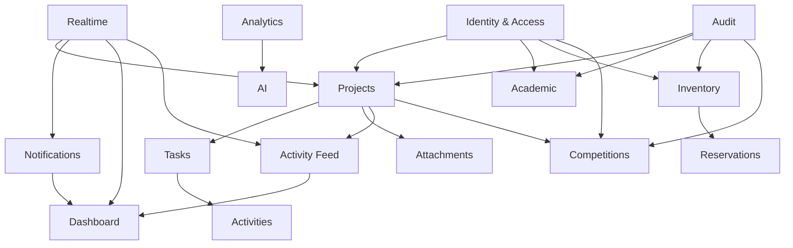

# 48_PRODUCT_VISION.md

# Aula Robótica Platform — Product Vision

## Parte 1 — Visión, propósito, contexto, usuarios, problemas, propuesta de valor y principios de producto

---

# 1. Propósito del documento

Este documento define la visión de producto de **Aula Robótica Platform**.

Su objetivo es establecer una referencia estratégica estable que permita responder:

```text
¿Por qué existe la plataforma?

¿Para quién existe?

¿Qué problemas debe resolver?

¿Qué valor debe proporcionar?

¿Qué tipo de producto queremos construir?

¿Qué principios deben guiar su evolución?
```

---

# 2. Product Vision

Aula Robótica Platform aspira a convertirse en la plataforma digital central para la gestión, coordinación y evolución de la actividad del Aula de Robótica.

Debe conectar en un mismo entorno:

```text
People

Projects

Tasks

Activities

Learning

Resources

Competitions

Knowledge
```

---

# 3. Visión resumida

La plataforma debe permitir que la comunidad del Aula de Robótica pueda:

```text
organizar

colaborar

aprender

construir

documentar

coordinar

medir

mejorar
```

desde un sistema coherente.

---

# 4. Visión a largo plazo

A largo plazo, Aula Robótica Platform debe evolucionar hacia:

```text
Robotics Education

+

Operations

+

Collaboration

+

Knowledge Platform
```

integrada progresivamente con el ecosistema institucional.

---

# 5. Product Vision Statement

> Construir una plataforma digital modular, segura y colaborativa que centralice la gestión académica, técnica y operativa del Aula de Robótica, facilite el trabajo entre estudiantes, docentes y coordinadores, preserve el conocimiento generado y permita evolucionar hacia un ecosistema institucional integrado.

---

# 6. Problema fundamental

La actividad de un Aula de Robótica genera información distribuida entre múltiples contextos:

- personas;
- proyectos;
- tareas;
- documentación;
- recursos físicos;
- actividades;
- talleres;
- competiciones;
- comunicaciones.

---

# 7. Fragmentación

Sin una plataforma común, esta información puede terminar repartida entre:

```text
spreadsheets

email

chat

shared drives

paper

personal notes

isolated applications
```

---

# 8. Consecuencia

La fragmentación provoca dificultades para responder preguntas básicas.

---

# 9. Pregunta — Proyectos

```text
¿Qué proyectos están activos?
```

---

# 10. Pregunta — Responsabilidad

```text
¿Quién está trabajando en cada proyecto?
```

---

# 11. Pregunta — Trabajo pendiente

```text
¿Qué tareas quedan por realizar?
```

---

# 12. Pregunta — Actividad

```text
¿Qué ha ocurrido recientemente?
```

---

# 13. Pregunta — Recursos

```text
¿Qué equipos tenemos y dónde están?
```

---

# 14. Pregunta — Disponibilidad

```text
¿Está disponible este robot o componente?
```

---

# 15. Pregunta — Formación

```text
¿Qué cursos, talleres o sesiones están activos?
```

---

# 16. Pregunta — Participación

```text
¿Qué estudiantes participan?
```

---

# 17. Pregunta — Competición

```text
¿Cómo avanza la preparación de una competición?
```

---

# 18. Pregunta — Historia

```text
¿Qué hicimos el año pasado y qué aprendimos?
```

---

# 19. Product Opportunity

La oportunidad consiste en transformar esa fragmentación en:

```text
shared operational context
```

---

# 20. Contexto compartido

La plataforma debe permitir que los usuarios autorizados compartan una visión coherente del estado del Aula.

---

# 21. No solo almacenamiento

El producto no debe limitarse a almacenar datos.

Debe ayudar a:

```text
understand

coordinate

act
```

---

# 22. No solo administración

La plataforma tampoco debe convertirse exclusivamente en un panel administrativo.

---

# 23. Collaboration First

Debe proporcionar valor a quienes trabajan diariamente dentro de Projects, Tasks, Activities y otros dominios.

---

# 24. Operational Awareness

El usuario debe poder comprender rápidamente:

```text
what is happening

what needs attention

what changed
```

---

# 25. Knowledge Continuity

El conocimiento generado por una generación de estudiantes o colaboradores no debería desaparecer cuando esas personas abandonan el Aula.

---

# 26. Institutional Memory

La plataforma debe contribuir a crear:

```text
institutional memory
```

---

# 27. Knowledge Sources

Esa memoria puede emerger de:

- Projects;
- Activities;
- Attachments;
- Tasks;
- Audit;
- Activity Feed;
- documentación;
- resultados.

---

# 28. Knowledge as By-product

Idealmente, parte de la documentación histórica debe generarse como consecuencia natural del trabajo cotidiano.

---

# 29. Example

Si un Project contiene:

```text
Tasks

Activities

Attachments

Timeline

Decisions
```

su historia puede reconstruirse posteriormente.

---

# 30. Product Mission

La misión del producto es:

> Reducir la fragmentación operativa y facilitar que las personas del Aula de Robótica puedan coordinar trabajo, compartir contexto y preservar conocimiento mediante una plataforma única y evolutiva.

---

# 31. Product Purpose

El propósito no consiste en digitalizar procesos por digitalizarlos.

---

# 32. Purpose Test

Cada funcionalidad importante debería poder responder:

```text
¿Qué problema humano u operativo estamos resolviendo?
```

---

# 33. User Value before Technology

La elección tecnológica debe estar subordinada al valor del producto.

---

# 34. Technology as Enabler

Tecnologías como:

```text
FastAPI

WebSockets

PWA

AI

containers
```

son medios.

No constituyen la visión.

---

# 35. Product Identity

Aula Robótica Platform debe posicionarse como:

```text
una plataforma de operaciones, colaboración y aprendizaje para un entorno de robótica educativa
```

---

# 36. Product Boundaries

La visión también debe definir qué no pretende ser el producto.

---

# 37. Not a Generic ERP

No pretende convertirse en un ERP universitario generalista.

---

# 38. Not a Full LMS

No pretende sustituir inicialmente plataformas completas de aprendizaje.

---

# 39. Not a Generic Project Manager

No pretende competir directamente con:

```text
Jira

Trello

Asana
```

como producto horizontal.

---

# 40. Not a File Drive

Attachments no pretende sustituir sistemas completos de almacenamiento documental.

---

# 41. Not an Institutional Identity Provider

La plataforma debe consumir identidad institucional cuando sea posible, no sustituirla.

---

# 42. Domain-specific Value

Su ventaja reside precisamente en conectar capacidades alrededor del contexto específico del Aula de Robótica.

---

# 43. Integrated Context

Ejemplo:

```text
Student

↓

Course

↓

Project

↓

Task

↓

Robot

↓

Competition
```

puede formar parte de una misma experiencia.

---

# 44. Core Product Domains

La visión se organiza alrededor de varios dominios principales.

---

# 45. Identity & Access

Responde:

```text
Who are you?

What can you do?
```

---

# 46. Projects

Responde:

```text
What are we building?
```

---

# 47. Tasks

Responde:

```text
What needs to be done?
```

---

# 48. Activities

Responde:

```text
What work has happened?
```

---

# 49. Attachments

Responde:

```text
What evidence or documentation belongs here?
```

---

# 50. Notifications

Responde:

```text
What requires my attention?
```

---

# 51. Dashboard

Responde:

```text
What should I know now?
```

---

# 52. Activity Feed

Responde:

```text
What changed recently?
```

---

# 53. Academic Domain

Responde:

```text
Who is learning what, when and in which context?
```

---

# 54. Inventory

Responde:

```text
What physical resources do we have?
```

---

# 55. Reservations

Responde:

```text
Who can use a resource and when?
```

---

# 56. Competitions

Responde:

```text
What are we preparing for and how are we progressing?
```

---

# 57. Audit

Responde:

```text
What happened, who did it and when?
```

---

# 58. Realtime

Responde:

```text
How do collaborators stay synchronized?
```

---

# 59. Analytics

Responde:

```text
What can we learn from accumulated operational data?
```

---

# 60. Knowledge

Responde:

```text
How do we preserve and rediscover what the Aula has learned?
```

---

# 61. Primary Users

La plataforma debe diseñarse alrededor de personas reales y sus responsabilidades.

Los grupos principales pueden incluir:

```text
Administrators

Coordinators

Instructors

Students

Project Members
```

---

# 62. Administrators

Responsables de mantener aspectos globales de la plataforma.

---

# 63. Administrator Needs

Necesitan:

- gestionar usuarios;
- gestionar roles;
- revisar auditoría;
- comprender estado del sistema;
- resolver incidencias administrativas.

---

# 64. Administrator Goal

```text
Maintain a controlled and understandable platform.
```

---

# 65. Administrator Pain Points

Sin herramientas adecuadas pueden aparecer:

- permisos difíciles de entender;
- falta de trazabilidad;
- cambios manuales;
- información dispersa.

---

# 66. Product Response

La plataforma debe proporcionar:

- administración centralizada;
- RBAC;
- Audit;
- dashboards;
- búsqueda;
- feedback claro.

---

# 67. Coordinators

Representan usuarios responsables de organizar actividad.

---

# 68. Coordinator Needs

Necesitan:

- crear Projects;
- organizar Tasks;
- coordinar miembros;
- revisar progreso;
- gestionar recursos;
- preparar actividades.

---

# 69. Coordinator Goal

```text
Know what is happening and keep work moving.
```

---

# 70. Coordinator Pain Points

Ejemplos:

- información repartida;
- dificultad para conocer estado;
- seguimiento manual;
- tareas sin responsable;
- recursos no coordinados.

---

# 71. Product Response

Debe proporcionar:

```text
Projects

Kanban

Activity Feed

Dashboard

Notifications

Inventory

Reservations
```

---

# 72. Instructors

Representan personas responsables de formación.

---

# 73. Instructor Needs

Pueden necesitar:

- organizar Courses;
- preparar Sessions;
- gestionar participantes;
- consultar asistencia;
- relacionar proyectos educativos;
- compartir documentación.

---

# 74. Instructor Goal

```text
Coordinate learning activities without administrative friction.
```

---

# 75. Instructor Pain Points

Pueden incluir:

- listas manuales;
- seguimiento fragmentado;
- materiales dispersos;
- poca visibilidad sobre proyectos.

---

# 76. Product Response

La evolución académica debe proporcionar:

```text
Courses

Sessions

Students

Attendance

Projects

Attachments
```

---

# 77. Students

Los estudiantes constituyen uno de los usuarios centrales de la visión futura.

---

# 78. Student Needs

Necesitan:

- comprender en qué participan;
- saber qué tareas tienen;
- acceder a documentación;
- colaborar;
- recibir avisos;
- consultar actividades.

---

# 79. Student Goal

```text
Know what to do, where to find information and how the team is progressing.
```

---

# 80. Student Experience

La interfaz para estudiantes no debería sentirse como un panel administrativo.

---

# 81. Student-first Views

Debe priorizar:

```text
My Projects

My Tasks

My Courses

Upcoming Activities

Notifications
```

---

# 82. Student Cognitive Load

La plataforma debe evitar mostrar información irrelevante.

---

# 83. Contextual UI

La interfaz debe adaptarse a:

- permisos;
- contexto;
- tarea actual.

---

# 84. Project Members

No todos los participantes tienen necesariamente un rol académico.

---

# 85. Collaborators

Pueden existir:

- investigadores;
- colaboradores externos;
- técnicos;
- mentores.

---

# 86. Flexible Identity

El modelo debe permitir participación sin forzar a todos los usuarios dentro del mismo perfil académico.

---

# 87. Secondary Stakeholders

Pueden existir stakeholders que no utilicen diariamente la plataforma.

---

# 88. Institutional Stakeholders

Pueden necesitar:

- reporting;
- indicadores;
- trazabilidad;
- integración.

---

# 89. Technical Maintainers

Necesitan:

- logs;
- metrics;
- health;
- deployment visibility;
- error diagnostics.

---

# 90. Product Vision Includes Maintainers

Una plataforma sostenible también debe proporcionar una experiencia operacional adecuada a quienes la mantienen.

---

# 91. User Hierarchy

La plataforma no debe asumir una jerarquía simple:

```text
Admin

↓

User
```

---

# 92. Contextual Responsibility

Una persona puede ser:

```text
Student globally

+

Coordinator in Project A

+

Member in Project B
```

---

# 93. Context-aware Product

Esta característica constituye una de las bases del producto.

---

# 94. Role ≠ Person Type

Los roles expresan capacidades dentro de contextos.

No deberían convertirse necesariamente en etiquetas rígidas sobre las personas.

---

# 95. Core User Problem 1 — Fragmentation

La información operativa se encuentra dispersa.

---

# 96. Desired Outcome 1

```text
One coherent operational context
```

---

# 97. Core User Problem 2 — Lack of Visibility

Es difícil conocer rápidamente el estado del trabajo.

---

# 98. Desired Outcome 2

```text
At-a-glance operational awareness
```

---

# 99. Core User Problem 3 — Coordination

Las personas necesitan coordinarse sin depender constantemente de comunicación manual.

---

# 100. Desired Outcome 3

```text
Shared state + notifications + realtime collaboration
```

---

# 101. Core User Problem 4 — Knowledge Loss

El conocimiento puede desaparecer cuando cambian las personas.

---

# 102. Desired Outcome 4

```text
Persistent institutional memory
```

---

# 103. Core User Problem 5 — Resource Visibility

Los recursos físicos pueden resultar difíciles de localizar o coordinar.

---

# 104. Desired Outcome 5

```text
Known inventory + availability + ownership
```

---

# 105. Core User Problem 6 — Academic Context

La actividad educativa necesita relacionarse con personas, sesiones y proyectos.

---

# 106. Desired Outcome 6

```text
Connected academic operations
```

---

# 107. Core User Problem 7 — Competition Coordination

Las competiciones implican trabajo, equipos, robots, documentación y deadlines.

---

# 108. Desired Outcome 7

```text
Competition operations connected to existing project workflows
```

---

# 109. Core User Problem 8 — Attention Management

El usuario necesita distinguir información relevante del ruido.

---

# 110. Desired Outcome 8

```text
Contextual notifications and focused dashboards
```

---

# 111. Core User Problem 9 — Traceability

Es necesario comprender qué cambió y quién realizó una operación.

---

# 112. Desired Outcome 9

```text
Auditable operations
```

---

# 113. Core User Problem 10 — Operational Diagnosis

Los mantenedores necesitan diagnosticar fallos.

---

# 114. Desired Outcome 10

```text
Observable platform
```

---

# 115. Product Value Proposition

La propuesta de valor puede resumirse como:

> Aula Robótica Platform reúne en un único entorno seguro y colaborativo la gestión de proyectos, trabajo, aprendizaje, recursos y actividad del Aula de Robótica, proporcionando contexto compartido, trazabilidad y continuidad del conocimiento.

---

# 116. Value Pillar 1 — Centralization

Centralizar no significa almacenar todo en una única tabla o sistema cerrado.

---

# 117. Centralization Meaning

Significa proporcionar:

```text
one coherent user experience
```

aunque algunos datos provengan de sistemas externos.

---

# 118. Value Pillar 2 — Context

Los datos aislados tienen menos valor.

---

# 119. Context Example

Una Task gana significado cuando conocemos:

```text
Project

Assignee

Priority

Activity

Attachments

History
```

---

# 120. Value Pillar 3 — Collaboration

El producto debe reducir el coste de coordinar trabajo.

---

# 121. Collaboration Components

Incluyen:

- shared Projects;
- Kanban;
- realtime;
- Activity Feed;
- Notifications.

---

# 122. Value Pillar 4 — Traceability

Debe ser posible reconstruir cambios relevantes.

---

# 123. Value Pillar 5 — Knowledge

La plataforma debe convertir actividad histórica en conocimiento recuperable.

---

# 124. Value Pillar 6 — Security

La información debe estar disponible para quien la necesita, no para cualquiera.

---

# 125. Value Pillar 7 — Extensibility

La arquitectura debe permitir añadir dominios sin destruir coherencia.

---

# 126. Value Pillar 8 — Institutional Integration

La plataforma debe poder formar parte de un ecosistema mayor.

---

# 127. Value Pillar 9 — Operational Excellence

El producto debe ser mantenible y observable.

---

# 128. Value Pillar 10 — User Focus

La complejidad interna no debe trasladarse innecesariamente al usuario.

---

# 129. Product Principles

La evolución debe respetar un conjunto estable de principios.

---

# 130. Principle 1 — User Value First

```text
Solve a real problem before adding a capability.
```

---

# 131. Consequence

Una tecnología interesante no justifica por sí sola una feature.

---

# 132. Principle 2 — Simplicity

```text
Prefer the simplest architecture that satisfies current needs.
```

---

# 133. Consequence

No introducir:

- microservices;
- brokers;
- complex workflows;

antes de necesitarlos.

---

# 134. Principle 3 — Modular by Design

Cada dominio debe mantener responsabilidades claras.

---

# 135. Consequence

Evitar módulos que conozcan detalles internos innecesarios de otros dominios.

---

# 136. Principle 4 — Reuse Capabilities

Antes de construir algo nuevo:

```text
Can an existing capability solve this?
```

---

# 137. Shared Capabilities

Especialmente:

```text
Attachments

Notifications

Audit

Tasks

Activity Feed

Realtime
```

---

# 138. Principle 5 — Server as Source of Truth

El estado persistente debe mantener autoridad sobre información crítica.

---

# 139. Consequence

Realtime mejora sincronización.

No reemplaza persistencia.

---

# 140. Principle 6 — Security by Design

La seguridad debe incorporarse durante el diseño.

---

# 141. Security Dimensions

Cada feature debe considerar:

```text
Authentication

Authorization

Validation

Privacy

Audit
```

---

# 142. Principle 7 — Least Privilege

Cada usuario, integración o automatización debe disponer únicamente de las capacidades necesarias.

---

# 143. Principle 8 — Contextual Authorization

Los permisos pueden depender del recurso y contexto.

---

# 144. Principle 9 — Privacy by Design

Los datos personales deben minimizarse.

---

# 145. Principle 10 — Progressive Enhancement

La estrategia frontend debe mantener:

```text
SSR baseline

+

JavaScript enhancement

+

Realtime enhancement
```

---

# 146. Consequence

No toda interacción necesita convertirse en SPA.

---

# 147. Principle 11 — Accessibility

La plataforma debe poder utilizarse mediante:

- teclado;
- tecnologías asistivas;
- navegación clara.

---

# 148. Accessibility as Quality

No debe tratarse como una corrección final.

---

# 149. Principle 12 — Explicit Feedback

Las operaciones deben comunicar claramente:

```text
loading

success

failure

conflict
```

---

# 150. Principle 13 — Recoverability

Los usuarios y el sistema deben poder recuperarse de fallos razonables.

---

# 151. Realtime Example

Una desconexión WebSocket no debe requerir recargar manualmente toda la aplicación para siempre.

---

# 152. Operational Example

Un deployment fallido debe disponer de rollback.

---

# 153. Principle 14 — Observability

Una feature importante debe poder diagnosticarse.

---

# 154. Principle 15 — Testability

La arquitectura debe facilitar testing.

---

# 155. Consequence

Debe evitarse lógica crítica escondida en:

- templates;
- inline JavaScript;
- framework hooks opacos.

---

# 156. Principle 16 — Explicit Contracts

Las fronteras deben utilizar contratos claros.

---

# 157. Contract Examples

```text
API schemas

event schemas

service interfaces

domain constraints
```

---

# 158. Principle 17 — Data Integrity

La base de datos debe proteger invariantes cuando sea posible.

---

# 159. Consequence

No confiar exclusivamente en validación UI.

---

# 160. Principle 18 — Audit Important Actions

Las operaciones relevantes deben dejar trazabilidad.

---

# 161. Audit Balance

No toda lectura necesita generar un Audit Event.

---

# 162. Principle 19 — Knowledge Preservation

El producto debe facilitar que decisiones y resultados permanezcan accesibles.

---

# 163. Principle 20 — Incremental Evolution

Las capacidades deben entregarse en vertical slices.

---

# 164. Vertical Slice Example

```text
Feature

↓

Domain

↓

Persistence

↓

Authorization

↓

UI

↓

Tests

↓

Observability
```

---

# 165. Principle 21 — Avoid Premature Generalization

No crear abstracciones universales para problemas que todavía solo tienen un caso concreto.

---

# 166. Principle 22 — Integrate before Duplicate

Si un sistema institucional ya es fuente de verdad:

```text
integrate
```

antes de recrearlo.

---

# 167. Principle 23 — Automation with Control

La automatización debe comenzar por procesos deterministas y de bajo riesgo.

---

# 168. Principle 24 — AI as Assistant

La IA debe:

```text
assist

not silently decide
```

en procesos importantes.

---

# 169. Principle 25 — Evidence-driven Evolution

Las decisiones futuras deben basarse progresivamente en:

- uso;
- feedback;
- telemetry;
- incidentes.

---

# 170. Product Experience Principles

Además de arquitectura, la visión necesita principios explícitos de experiencia.

---

# 171. UX Principle — Clarity

Cada pantalla debe dejar claro:

```text
Where am I?

What am I looking at?

What can I do?
```

---

# 172. UX Principle — Context

Las acciones deben aparecer cerca del recurso al que afectan.

---

# 173. UX Principle — Consistency

Acciones equivalentes deben comportarse de forma equivalente.

---

# 174. UX Principle — Predictability

El usuario debe poder anticipar qué ocurrirá al ejecutar una acción.

---

# 175. UX Principle — Feedback

Toda operación significativa debe producir feedback.

---

# 176. UX Principle — Forgiveness

Cuando sea viable, el producto debe permitir:

- cancelar;
- corregir;
- recuperar.

---

# 177. UX Principle — Focus

No mostrar todas las capacidades a todos los usuarios.

---

# 178. UX Principle — Progressive Disclosure

La complejidad avanzada puede mostrarse únicamente cuando sea necesaria.

---

# 179. UX Principle — Low Friction

Las operaciones frecuentes deben requerir pocos pasos.

---

# 180. UX Principle — Safe Friction

Las operaciones peligrosas sí pueden requerir confirmación adicional.

---

# 181. Example

```text
Move Task
```

debe ser rápido.

```text
Delete Project
```

debe ser deliberado.

---

# 182. UX Principle — Responsive

La plataforma debe funcionar adecuadamente en diferentes tamaños de pantalla.

---

# 183. UX Principle — Mobile Relevance

No todas las vistas necesitan replicar exactamente el desktop.

---

# 184. Mobile Priorities

Especialmente:

- My Tasks;
- Notifications;
- Inventory scan;
- Reservations;
- Activities.

---

# 185. UX Principle — Performance

La percepción de velocidad forma parte de la experiencia.

---

# 186. SSR Advantage

SSR permite entregar contenido útil rápidamente.

---

# 187. JavaScript Budget

El frontend debe evitar crecer hacia una SPA accidental.

---

# 188. Product Architecture Philosophy

La filosofía técnica del producto puede resumirse:

```text
Modular Monolith

+

SSR-first

+

Progressive Enhancement

+

Realtime where valuable

+

Relational Source of Truth
```

---

# 189. Modular Monolith

Debe permanecer como arquitectura principal mientras sea adecuada.

---

# 190. SSR-first

Debe mantener una base funcional renderizada por servidor.

---

# 191. Progressive Enhancement

JavaScript debe mejorar la experiencia donde aporte valor.

---

# 192. Realtime Selectively

No toda pantalla necesita WebSocket.

---

# 193. Relational Integrity

MariaDB debe continuar protegiendo relaciones e invariantes de datos.

---

# 194. API-ready

Aunque SSR sea el cliente principal, los Services y contratos deben permitir futuras APIs.

---

# 195. Integration-ready

Los sistemas externos deben integrarse mediante adapters claros.

---

# 196. Observability-ready

Los flujos importantes deben producir señales técnicas.

---

# 197. Scale-ready, Not Scale-obsessed

La arquitectura debe poder evolucionar sin diseñarse prematuramente para una escala inexistente.

---

# 198. Product Differentiator — Connected Domains

La principal fortaleza potencial no reside en cada módulo por separado.

---

# 199. Connected Value

El valor aparece al conectar:

```text
Student

+

Course

+

Project

+

Task

+

Activity

+

Inventory

+

Competition
```

---

# 200. Example Journey

Un estudiante puede:

```text
join Course

↓

participate in Project

↓

receive Task

↓

use reserved Robot

↓

register Activity

↓

prepare Competition

↓

preserve Documentation
```

---

# 201. Cross-domain Context

La plataforma puede proporcionar una visión que herramientas separadas difícilmente ofrecen sin integraciones complejas.

---

# 202. Product Differentiator — Contextual Authorization

La combinación de roles globales y contextuales permite adaptar capacidades al contexto real de colaboración.

---

# 203. Product Differentiator — Realtime Collaboration

Kanban, Notifications y Activity Feed pueden proporcionar una experiencia colaborativa integrada.

---

# 204. Product Differentiator — Institutional Memory

La relación entre actividad operativa y documentación permite preservar conocimiento.

---

# 205. Product Differentiator — Robotics Context

Inventory, Equipment y Competitions permiten especializar el producto para un Aula de Robótica.

---

# 206. Product Differentiator — Institutional Extensibility

La arquitectura de Identities y modularidad permite futura integración universitaria.

---

# 207. Product Promise

La plataforma debe intentar cumplir una promesa sencilla:

> La información necesaria para comprender y coordinar la actividad del Aula debe estar disponible, conectada y protegida en el lugar adecuado.

---

# 208. Product Trust

Para cumplir esa promesa, los usuarios deben confiar en:

- datos;
- permisos;
- disponibilidad;
- historial.

---

# 209. Data Trust

El usuario debe confiar en que el estado mostrado representa el estado real.

---

# 210. Permission Trust

Debe confiar en que información privada no se comparte accidentalmente.

---

# 211. Operational Trust

Debe confiar en que una acción confirmada se ha realizado o que el sistema informa claramente del fallo.

---

# 212. Historical Trust

Debe confiar en que la actividad relevante puede reconstruirse.

---

# 213. Realtime Trust

La interfaz no debe mostrar una falsa sensación de sincronización.

---

# 214. Reconciliation

Cuando exista incertidumbre, debe reconciliarse con la fuente de verdad.

---

# 215. Trust over Cleverness

Una interfaz ligeramente menos sofisticada pero predecible es preferible a una experiencia espectacular pero inconsistente.

---

# 216. Vision Success

La visión estará avanzando correctamente cuando la plataforma reduzca:

```text
fragmentation

coordination overhead

knowledge loss

resource uncertainty
```

---

# 217. Vision Success — Users

Los usuarios deben necesitar menos herramientas paralelas para comprender el trabajo.

---

# 218. Vision Success — Coordinators

Los coordinadores deben obtener una visión más rápida del estado de Projects y actividades.

---

# 219. Vision Success — Students

Los estudiantes deben comprender mejor:

- dónde participar;
- qué hacer;
- dónde encontrar recursos.

---

# 220. Vision Success — Instructors

Los instructores deben poder relacionar formación y proyectos con menor carga administrativa.

---

# 221. Vision Success — Maintainers

Los mantenedores deben poder desplegar y diagnosticar con mayor confianza.

---

# 222. Vision Success — Institution

La plataforma debe poder proporcionar información útil sin convertirse en un silo aislado.

---

# 223. Vision Guardrail — No Feature Accumulation

Más funcionalidades no implican automáticamente mejor producto.

---

# 224. Vision Guardrail — No Duplicate Systems

La plataforma no debe recrear herramientas institucionales sin necesidad.

---

# 225. Vision Guardrail — No Unnecessary Complexity

La sofisticación técnica debe justificar su coste.

---

# 226. Vision Guardrail — No Security Trade-off

La colaboración no debe conseguirse sacrificando aislamiento o privacidad.

---

# 227. Vision Guardrail — No AI for AI's Sake

Las capacidades de IA deben resolver problemas identificables.

---

# 228. Vision Guardrail — No Metrics without Purpose

Los dashboards deben responder preguntas reales.

---

# 229. Vision Guardrail — No Realtime Everywhere

Realtime debe utilizarse donde la frescura o colaboración aporte valor.

---

# 230. Vision Guardrail — No Mobile Clone

La experiencia móvil debe optimizar workflows relevantes.

---

# 231. Vision Guardrail — No Architecture Fashion

La arquitectura debe responder a necesidades del producto.

---

# 232. Vision Guardrail — No Loss of Human Context

La plataforma debe apoyar colaboración humana, no reducirla a métricas y estados.

---

# 233. Product North Star

La North Star conceptual del producto es:

```text
Shared Operational Understanding
```

---

# 234. Meaning

Las personas adecuadas deben poder comprender:

```text
what exists

what is happening

what needs attention

what comes next
```

---

# 235. Supporting Outcomes

Esta North Star depende de:

```text
Visibility

Coordination

Traceability

Knowledge

Trust
```

---

# 236. Visibility

La información relevante debe ser fácil de descubrir.

---

# 237. Coordination

Los usuarios deben poder organizar trabajo y recursos.

---

# 238. Traceability

Los cambios importantes deben poder reconstruirse.

---

# 239. Knowledge

La actividad debe generar memoria reutilizable.

---

# 240. Trust

La plataforma debe comportarse de manera segura y predecible.

---

# 241. Vision Horizon

La visión debe permanecer suficientemente estable para orientar varios ciclos de roadmap.

---

# 242. Roadmap Flexibility

Las features concretas pueden cambiar sin invalidar la visión.

---

# 243. Example

Puede cambiar la implementación de:

```text
Inventory Reservations
```

sin cambiar el objetivo:

```text
coordinate shared physical resources
```

---

# 244. Product Vision vs Roadmap

```text
Product Vision

=

destination and principles
```

```text
Product Roadmap

=

current route
```

---

# 245. Product Vision vs Backlog

```text
Vision

=

why
```

```text
Backlog

=

possible work
```

---

# 246. Product Vision vs Architecture

```text
Vision

defines desired outcomes

↓

Architecture

enables those outcomes
```

---

# 247. Architecture Must Serve Vision

La arquitectura no debe convertirse en objetivo independiente.

---

# 248. Vision Review

La visión debe revisarse con menor frecuencia que el roadmap.

---

# 249. Vision Change Trigger

Debe revisarse si cambia significativamente:

- misión del Aula;
- población objetivo;
- contexto institucional;
- responsabilidad del producto.

---

# 250. Vision Stability

Cambios semanales de prioridad no deberían modificar este documento.

---

# 251. Product Vision Summary

Aula Robótica Platform existe para convertir una actividad compleja y potencialmente fragmentada en un entorno operativo compartido.

Debe conectar:

```text
people

learning

projects

work

resources

competitions

knowledge
```

mediante una experiencia:

```text
secure

modular

collaborative

traceable

usable
```

---

# 252. Final de Parte 1

La **Parte 2** desarrollará la visión desde la perspectiva de:

- product outcomes;
- jobs to be done;
- user journeys;
- personas detalladas;
- escenarios de uso;
- experiencia por rol;
- information architecture;
- collaboration model;
- knowledge model;
- academic experience;
- robotics operations;
- inventory;
- competitions;
- notification philosophy;
- Dashboard;
- Activity Feed;
- realtime experience;
- mobile experience;
- accessibility;
- trust y seguridad percibida.

---

# 48_PRODUCT_VISION.md

# Aula Robótica Platform — Product Vision

## Parte 2 — Outcomes, Jobs to Be Done, journeys, experiencia por rol, colaboración, conocimiento y experiencia operacional

---

# 253. Product Outcomes

La visión debe traducirse en resultados observables para los usuarios.

Una funcionalidad solo aporta valor cuando modifica positivamente la forma en que una persona:

```text
understands

coordinates

decides

acts

learns
```

---

# 254. Outcome over Output

Debe distinguirse:

```text
Output

=

feature delivered
```

de:

```text
Outcome

=

problem reduced or behavior improved
```

---

# 255. Example — Tasks

Output:

```text
Kanban implemented
```

Outcome:

```text
team members understand task state and ownership faster
```

---

# 256. Example — Notifications

Output:

```text
notification center implemented
```

Outcome:

```text
users discover relevant changes without manually checking every project
```

---

# 257. Example — Inventory

Output:

```text
inventory module implemented
```

Outcome:

```text
users can determine whether required equipment exists and is available
```

---

# 258. Example — Realtime

Output:

```text
WebSocket broadcasting implemented
```

Outcome:

```text
collaborators see relevant changes without repeatedly refreshing pages
```

---

# 259. Primary Product Outcomes

La plataforma debe perseguir principalmente:

```text
Operational Visibility

Coordination Efficiency

Knowledge Continuity

Resource Awareness

Academic Context

Collaboration Confidence

Operational Trust
```

---

# 260. Outcome — Operational Visibility

Los usuarios deben comprender rápidamente el estado de aquello que les afecta.

---

# 261. Evidence

Puede observarse mediante:

- menor búsqueda manual;
- menor navegación innecesaria;
- mejor uso de Dashboard;
- mejor comprensión del estado de Projects.

---

# 262. Outcome — Coordination Efficiency

Debe reducirse el esfuerzo necesario para coordinar personas, Tasks y recursos.

---

# 263. Evidence

Ejemplos:

```text
fewer manual status requests

fewer conflicting reservations

clearer ownership

faster task assignment
```

---

# 264. Outcome — Knowledge Continuity

El conocimiento debe sobrevivir a cambios de participantes.

---

# 265. Evidence

Debe ser posible recuperar:

- documentación;
- decisiones;
- Activities;
- historial;
- resultados.

---

# 266. Outcome — Resource Awareness

Los usuarios deben saber qué recursos físicos existen y cuál es su situación.

---

# 267. Outcome — Academic Context

La plataforma debe conectar progresivamente aprendizaje, personas y proyectos.

---

# 268. Outcome — Collaboration Confidence

Los usuarios deben confiar en que están viendo un estado suficientemente actualizado y consistente.

---

# 269. Outcome — Operational Trust

Los mantenedores deben poder desplegar, observar y recuperar el sistema con confianza.

---

# 270. Jobs to Be Done

La visión puede expresarse mediante los trabajos que los usuarios necesitan realizar.

---

# 271. JTBD Structure

Formato conceptual:

```text
When...

I want to...

So that...
```

---

# 272. JTBD — Understand My Work

```text
When I start working,

I want to see what requires my attention,

so that I can decide what to do next.
```

---

# 273. Product Capabilities

Relacionadas:

```text
Dashboard

My Tasks

Notifications

Activity Feed
```

---

# 274. JTBD — Understand a Project

```text
When I open a project,

I want to understand its current state,

so that I can contribute without asking others for basic context.
```

---

# 275. Supporting Context

Debe incluir cuando proceda:

- status;
- members;
- Tasks;
- Activities;
- Attachments;
- recent changes.

---

# 276. JTBD — Coordinate Work

```text
When several people collaborate,

I want responsibilities and task states to be explicit,

so that work does not depend on memory or informal messages.
```

---

# 277. JTBD — Discover Changes

```text
When other people modify shared work,

I want to discover relevant changes,

so that I remain synchronized without continuously refreshing pages.
```

---

# 278. Supporting Capabilities

```text
Realtime

Activity Feed

Notifications
```

---

# 279. JTBD — Record Work

```text
When I complete meaningful work,

I want to record what happened,

so that the team and future participants can understand the project history.
```

---

# 280. Supporting Capabilities

```text
Activities

Attachments

Audit

Feed
```

---

# 281. JTBD — Find Documentation

```text
When I need technical or project information,

I want to find the relevant material in context,

so that I do not have to search through unrelated repositories or folders.
```

---

# 282. JTBD — Find Equipment

```text
When I need a robot, sensor or tool,

I want to know whether it exists, where it is and whether it is available,

so that I can plan my work.
```

---

# 283. JTBD — Reserve Equipment

```text
When I need shared equipment,

I want to reserve it for a known period,

so that I can rely on its availability.
```

---

# 284. JTBD — Organize Learning

```text
When I coordinate a course or workshop,

I want to manage participants, sessions and related work,

so that educational activity remains organized and traceable.
```

---

# 285. JTBD — Participate in Learning

```text
When I participate in a course or workshop,

I want to know what is happening and what is expected from me,

so that I can focus on learning and contributing.
```

---

# 286. JTBD — Prepare Competition

```text
When my team prepares a robotics competition,

I want projects, tasks, robots, documentation and deadlines connected,

so that preparation remains coordinated.
```

---

# 287. JTBD — Recover Knowledge

```text
When I join an existing project,

I want to understand previous work and decisions,

so that I do not repeat solved problems.
```

---

# 288. JTBD — Administer Safely

```text
When I perform an administrative operation,

I want clear permissions and traceability,

so that I can manage the platform safely.
```

---

# 289. JTBD — Diagnose Failure

```text
When something fails,

I want enough operational evidence,

so that I can identify the cause without guessing.
```

---

# 290. JTBD Hierarchy

Los Jobs pueden agruparse:

```text
Understand

Coordinate

Execute

Learn

Discover

Preserve

Administer

Operate
```

---

# 291. User Journey Philosophy

La plataforma debe diseñarse alrededor de journeys completos, no únicamente pantallas independientes.

---

# 292. Journey Structure

Un journey debe considerar:

```text
Entry

↓

Context

↓

Action

↓

Feedback

↓

Result

↓

Next step
```

---

# 293. Journey — Start the Day

Usuario:

```text
Project Member / Student / Coordinator
```

---

# 294. Start the Day — Entry

El usuario accede a la plataforma.

---

# 295. Start the Day — Expected Context

Debe encontrar una vista enfocada en:

```text
My Tasks

Notifications

Upcoming items

Recent relevant activity
```

---

# 296. Start the Day — Decision

Debe poder responder:

```text
¿Qué debería hacer ahora?
```

---

# 297. Start the Day — Anti-pattern

Obligar al usuario a abrir manualmente cinco Projects para descubrir cambios.

---

# 298. Journey — Continue Project Work

```text
Dashboard

↓

Project

↓

Task

↓

Action
```

---

# 299. Project Entry

Al abrir Project debe entender:

- objetivo;
- estado;
- miembros;
- trabajo pendiente;
- actividad reciente.

---

# 300. Task Entry

Al abrir Task debe conocer:

- qué se pide;
- estado;
- responsable;
- prioridad;
- contexto.

---

# 301. Task Action

Puede:

- modificar;
- mover;
- completar;
- documentar actividad.

---

# 302. Task Feedback

El sistema debe confirmar el resultado.

---

# 303. Collaborative Feedback

Otros usuarios relevantes pueden recibir el cambio mediante realtime.

---

# 304. Journey — Join Existing Project

Uno de los journeys más importantes para preservar conocimiento.

---

# 305. Initial Question

El nuevo miembro necesita responder:

```text
¿Qué es este proyecto?
```

---

# 306. Second Question

```text
¿Qué se ha hecho?
```

---

# 307. Third Question

```text
¿Qué falta?
```

---

# 308. Fourth Question

```text
¿Dónde está la documentación?
```

---

# 309. Fifth Question

```text
¿Quién conoce cada parte?
```

---

# 310. Product Response

La página de Project debe convertirse progresivamente en:

```text
project operational home
```

---

# 311. Journey — Record Activity

```text
Project

↓

Add Activity

↓

Describe work

↓

Optional attachment

↓

Save
```

---

# 312. Result

La Activity debe:

- quedar persistida;
- aparecer en contexto;
- poder alimentar Feed;
- permanecer recuperable.

---

# 313. Journey — Resource Discovery

```text
Need equipment

↓

Inventory search

↓

Asset

↓

Availability
```

---

# 314. Resource Search

Debe permitir encontrar recursos mediante términos naturales del dominio.

---

# 315. Asset Context

Debe mostrar:

- tipo;
- estado;
- ubicación;
- disponibilidad;
- documentación relevante.

---

# 316. Journey — Reserve Asset

```text
Asset

↓

Check availability

↓

Select period

↓

Request / reserve

↓

Confirmation
```

---

# 317. Reservation Conflict

Si existe conflicto:

```text
explain

not merely reject
```

---

# 318. Better Conflict Feedback

Ejemplo conceptual:

```text
Not available between 10:00 and 12:00.
Next available period: 12:00.
```

cuando la información exista.

---

# 319. Journey — Return Asset

```text
Active Reservation

↓

Return

↓

Confirm condition

↓

Asset available
```

---

# 320. Journey — Course Participation

```text
My Courses

↓

Course

↓

Upcoming Session

↓

Materials / Project / Activity
```

---

# 321. Course Context

El estudiante debe encontrar:

- descripción;
- calendario;
- participantes relevantes;
- materiales;
- proyectos relacionados.

---

# 322. Journey — Instructor Session

```text
Course

↓

Session

↓

Participants

↓

Attendance

↓

Activities
```

---

# 323. Instructor Efficiency

Registrar asistencia no debe requerir una secuencia administrativa excesiva.

---

# 324. Journey — Competition Preparation

```text
Competition

↓

Team

↓

Project

↓

Milestones / Tasks

↓

Robot / Resources

↓

Documentation
```

---

# 325. Competition Home

Debe proporcionar una visión consolidada de preparación.

---

# 326. Competition Deadline

Los deadlines importantes deben poder generar:

- Dashboard signals;
- Notifications;
- Feed events.

---

# 327. Journey — Administrative Investigation

```text
Reported issue

↓

User / Resource

↓

Audit

↓

Relevant event

↓

Resolution
```

---

# 328. Audit UX

Audit debe ser investigable, no únicamente una tabla enorme de eventos.

---

# 329. Journey — Operational Incident

```text
Alert

↓

Dashboard / Logs

↓

Trace / Error

↓

Affected flow

↓

Diagnosis

↓

Recovery
```

---

# 330. Personas

Las personas no deben convertirse en perfiles ficticios excesivamente detallados.

Deben representar patrones reales de necesidades.

---

# 331. Persona — Student Contributor

Contexto:

```text
Participates in courses and robotics projects.
```

---

# 332. Student Contributor Goals

Quiere:

- aprender;
- contribuir;
- encontrar tareas;
- acceder a materiales;
- conocer próximos eventos.

---

# 333. Student Contributor Needs

Necesita:

```text
focus

clarity

context

feedback
```

---

# 334. Student Contributor Friction

No debería necesitar comprender toda la estructura administrativa del sistema.

---

# 335. Student Contributor Home

Debe priorizar:

```text
My Tasks

My Projects

My Courses

Notifications
```

---

# 336. Persona — Project Coordinator

Contexto:

```text
Coordinates one or more robotics projects.
```

---

# 337. Coordinator Goals

Quiere:

- conocer progreso;
- repartir trabajo;
- detectar bloqueos;
- mantener documentación;
- coordinar recursos.

---

# 338. Coordinator Home

Debe priorizar:

```text
Project status

Critical Tasks

Recent Activity

Upcoming deadlines

Resource issues
```

---

# 339. Persona — Instructor

Contexto:

```text
Coordinates learning activities.
```

---

# 340. Instructor Goals

Quiere:

- organizar formación;
- gestionar participantes;
- preparar sesiones;
- relacionar proyectos.

---

# 341. Instructor Home

Puede priorizar:

```text
Upcoming Sessions

Active Courses

Student participation

Relevant Projects
```

---

# 342. Persona — Robotics Coordinator

Contexto:

```text
Coordinates equipment and operational activity.
```

---

# 343. Robotics Coordinator Goals

Quiere conocer:

- inventario;
- disponibilidad;
- reservas;
- incidencias;
- mantenimiento.

---

# 344. Robotics Coordinator Home

Puede priorizar:

```text
Reservations

Unavailable Assets

Maintenance

Low Stock
```

---

# 345. Persona — Competition Team Member

Puede coincidir con Student Contributor.

El contexto de competición cambia sus prioridades.

---

# 346. Competition Context

Necesita:

```text
deadline awareness

team tasks

robot readiness

documentation
```

---

# 347. Persona — Platform Administrator

Necesita controlar:

- Users;
- permissions;
- Audit;
- platform configuration.

---

# 348. Administrator UX

Debe optimizar precisión y seguridad antes que velocidad absoluta.

---

# 349. Persona — Maintainer

Responsable técnico de operación.

---

# 350. Maintainer Needs

Necesita:

```text
health

logs

metrics

deployments

errors

backups
```

---

# 351. Persona Overlap

Una persona real puede asumir varios perfiles.

---

# 352. Context Switching

La UI debe permitir cambiar de contexto sin obligar a cambiar de identidad.

---

# 353. Information Architecture

La arquitectura de información debe reflejar el modelo mental del usuario.

---

# 354. Primary Navigation

Debe priorizar capacidades principales, no detalles técnicos.

---

# 355. Candidate Navigation

Conceptualmente:

```text
Dashboard

Projects

Tasks

Activities

Learning

Resources

Competitions
```

---

# 356. Personal Areas

Elementos como:

```text
Notifications

Profile

Settings
```

pueden mantenerse como contexto personal.

---

# 357. Administrative Navigation

Las funciones administrativas pueden separarse claramente.

---

# 358. Avoid Navigation Overload

No todos los módulos futuros deben aparecer necesariamente en navegación primaria.

---

# 359. Progressive Navigation

La navegación puede depender de:

- role;
- permissions;
- enabled capabilities.

---

# 360. Resource-centered Navigation

Cuando el usuario entra en Project, debe aparecer navegación contextual del Project.

---

# 361. Project Context Navigation

Puede incluir:

```text
Overview

Tasks

Activities

Files

Members
```

---

# 362. Course Context Navigation

Puede incluir:

```text
Overview

Sessions

Participants

Projects

Materials
```

---

# 363. Inventory Context Navigation

Puede incluir:

```text
Assets

Consumables

Reservations

Maintenance
```

cuando esas capabilities existan.

---

# 364. Competition Context Navigation

Puede incluir:

```text
Overview

Teams

Projects

Robots

Documents

Results
```

---

# 365. Information Scent

Los nombres deben permitir anticipar qué contiene cada sección.

---

# 366. Domain Language

Debe utilizarse terminología del Aula antes que vocabulario técnico interno.

---

# 367. Example

El usuario debe ver:

```text
Projects
```

no:

```text
ProjectAggregateManagement
```

---

# 368. Search Vision

A medida que crezca la plataforma, la búsqueda se convertirá en capability transversal.

---

# 369. Search Goal

Permitir descubrir rápidamente:

```text
people

projects

tasks

resources

courses

documents
```

según permisos.

---

# 370. Search Security

Los resultados deben filtrarse antes de presentarse.

---

# 371. Search Scope

Puede comenzar con búsquedas por módulo.

---

# 372. Global Search

Debe incorporarse cuando el número de dominios haga costosa la navegación manual.

---

# 373. Search Result Context

Un resultado debe indicar:

```text
type

name

context
```

---

# 374. Example

```text
Task: Configure navigation stack
Project: Autonomous Robot 2027
```

---

# 375. Search Ranking

Debe priorizar relevancia y contexto antes que sofisticación algorítmica.

---

# 376. Knowledge Model

La plataforma debe tratar el conocimiento como resultado de múltiples dominios.

---

# 377. Knowledge Sources

```text
Projects

Activities

Attachments

Tasks

Courses

Competition history
```

---

# 378. Explicit Knowledge

Incluye:

- documentación;
- manuales;
- decisiones;
- informes.

---

# 379. Implicit Knowledge

Puede inferirse de:

- historial;
- secuencia de Tasks;
- Activities;
- resultados.

---

# 380. Knowledge Preservation Goal

Un futuro miembro debería poder aprender de trabajos anteriores sin depender exclusivamente de conversaciones con antiguos participantes.

---

# 381. Documentation in Context

La documentación debe aparecer junto al dominio al que pertenece.

---

# 382. Example

Un manual de robot debe ser accesible desde:

```text
Asset
```

y potencialmente desde Projects que utilizan ese Asset.

---

# 383. Knowledge Duplication

Debe evitarse copiar el mismo documento en múltiples módulos.

---

# 384. Shared References

Preferir referencias al mismo Attachment cuando el modelo lo permita.

---

# 385. Decision Records

Projects complejos pueden necesitar registrar decisiones importantes.

---

# 386. Future Project Decisions

Una capability futura podría representar:

```text
Decision

context

alternatives

result

reason
```

---

# 387. ADR Relationship

Los ADR técnicos del repositorio y las decisiones operativas del producto no son necesariamente el mismo concepto.

---

# 388. Search + Knowledge

La búsqueda futura debe convertirse en una puerta de acceso al conocimiento acumulado.

---

# 389. Semantic Search

Puede añadirse posteriormente como mejora.

---

# 390. Knowledge Quality

La plataforma no puede garantizar conocimiento útil simplemente almacenando más información.

---

# 391. Structured Context

Debe favorecer estructuras que faciliten interpretación.

---

# 392. Collaboration Model

La colaboración se basa en:

```text
Shared State

+

Explicit Ownership

+

Awareness

+

Communication Signals
```

---

# 393. Shared State

Todos los participantes autorizados deben consultar la misma fuente de verdad.

---

# 394. Explicit Ownership

Cuando proceda, debe conocerse quién es responsable.

---

# 395. Awareness

Los usuarios deben conocer cambios relevantes.

---

# 396. Communication Signals

Notifications y Feed proporcionan señales.

No pretenden sustituir completamente herramientas de comunicación humana.

---

# 397. No Chat-first Vision

La plataforma no necesita convertirse en una aplicación de mensajería generalista.

---

# 398. Why

Herramientas especializadas ya resuelven bien comunicación síncrona.

---

# 399. Platform Role

Debe proporcionar comunicación ligada al contexto del trabajo.

---

# 400. Future Comments

Si aparecen comentarios, deberían asociarse a recursos concretos:

```text
Task

Project

Activity
```

---

# 401. Contextual Communication

Esto preserva significado mejor que un chat global.

---

# 402. Collaboration Awareness

Realtime debe permitir conocer cambios importantes sin interrumpir constantemente.

---

# 403. Presence

Una capability futura podría mostrar presencia limitada.

---

# 404. Presence Use Case

Ejemplo:

```text
2 people viewing this board
```

---

# 405. Presence Privacy

No debe convertirse en seguimiento permanente de usuarios.

---

# 406. No Productivity Surveillance

La plataforma no debe utilizar presencia, Activities o métricas para construir vigilancia individual invasiva.

---

# 407. Collaboration Conflict

Cuando dos personas editan simultáneamente debe existir comportamiento definido.

---

# 408. Initial Conflict Strategy

Puede utilizar:

```text
server validation

+

latest authoritative state

+

reconciliation
```

---

# 409. Advanced Collaboration

Edición colaborativa compleja solo debe introducirse si existe necesidad real.

---

# 410. Academic Experience

El dominio académico debe complementar la actividad educativa.

---

# 411. Academic Product Goal

Conectar:

```text
Learning

with

Doing
```

---

# 412. Robotics Learning Context

En robótica, aprendizaje y proyectos pueden estar estrechamente relacionados.

---

# 413. Example

```text
Course: ROS 2 Fundamentals

↓

Session: Navigation

↓

Project: Autonomous Robot

↓

Task: Configure Nav2
```

---

# 414. Academic Experience Principle

La plataforma debe facilitar esta relación sin obligar a que todo Project pertenezca a un Course.

---

# 415. Student Experience

El estudiante debe percibir una continuidad entre:

```text
learning

practice

project contribution
```

---

# 416. Instructor Experience

El instructor debe poder conectar material educativo con actividad práctica.

---

# 417. Course Home

Debe responder:

```text
¿Qué es?

¿Cuándo ocurre?

¿Quién participa?

¿Qué materiales necesito?

¿Qué trabajo está relacionado?
```

---

# 418. Session Experience

Debe centrarse en la actividad concreta.

---

# 419. Attendance Experience

Debe ser rápida y comprensible.

---

# 420. Progress Experience

Si se incorpora, debe mostrar progreso útil, no gamificación arbitraria.

---

# 421. No Forced Gamification

Badges, puntos o rankings no forman parte de la visión central.

---

# 422. Gamification Gate

Solo deben incorporarse si existe un objetivo educativo validado.

---

# 423. Learning Evidence

Projects y Activities pueden actuar como evidencia natural de aprendizaje práctico.

---

# 424. Portfolio Potential

Una evolución futura podría permitir construir un portfolio de contribuciones.

---

# 425. Portfolio Privacy

El estudiante debe controlar qué información puede hacerse pública.

---

# 426. Robotics Operations Experience

El producto debe reconocer que la robótica implica recursos físicos.

---

# 427. Physical-digital Connection

Inventory conecta:

```text
digital platform

↔

physical laboratory
```

---

# 428. Asset Identity

Cada recurso relevante debe poder identificarse rápidamente.

---

# 429. QR Experience

Un QR puede convertir un objeto físico en punto de entrada digital.

---

# 430. Example

```text
Scan robot

↓

Open Asset

↓

See status

↓

Reserve

↓

Read manual
```

---

# 431. Physical Context

La interfaz móvil tiene especial importancia en este dominio.

---

# 432. Inventory Experience Principle

Encontrar un recurso debe ser más rápido que preguntar repetidamente dónde está.

---

# 433. Availability Clarity

Los estados deben ser comprensibles.

---

# 434. Bad Status

```text
STATE_4
```

---

# 435. Good Status

```text
Available

Reserved

In use

Maintenance
```

---

# 436. Reservation Experience

Debe proporcionar confianza sobre disponibilidad.

---

# 437. Reservation Promise

Cuando el sistema confirma una reserva válida, el usuario debe poder confiar en ella.

---

# 438. Conflict Prevention

La prevención de doble reserva constituye parte de la experiencia, no únicamente de la integridad técnica.

---

# 439. Maintenance Experience

Debe facilitar reportar problemas desde el propio Asset.

---

# 440. Example

```text
Robot does not power on

↓

Report issue

↓

Asset becomes unavailable / review required
```

según política.

---

# 441. Competition Experience

Las competiciones representan periodos de alta coordinación.

---

# 442. Competition Product Goal

Reducir fragmentación durante preparación.

---

# 443. Competition Context

Debe conectar:

```text
Team

Project

Tasks

Robot

Resources

Documents

Deadlines
```

---

# 444. Competition Home Question

```text
¿Estamos preparados?
```

---

# 445. Readiness

Puede expresarse mediante información real:

- milestones;
- critical Tasks;
- robot status;
- missing documents.

---

# 446. No Arbitrary Readiness Score

No debe generarse un porcentaje sin significado claro.

---

# 447. Competition Timeline

Puede mostrar:

```text
registration

technical deadlines

travel

matches

final milestones
```

---

# 448. Competition Stress

La interfaz debe reducir carga cognitiva especialmente cerca de deadlines.

---

# 449. Critical Information

Debe destacar:

```text
what blocks participation
```

---

# 450. Notification Philosophy

Notifications deben proteger la atención del usuario.

---

# 451. Notification Goal

```text
inform when action or awareness is useful
```

---

# 452. Notification Anti-goal

```text
notify every possible event
```

---

# 453. Notification Value Test

Antes de crear una categoría:

```text
Does the recipient need to know this?
```

---

# 454. Actionability

Las notificaciones de alta prioridad deberían ser accionables.

---

# 455. Example

```text
You were assigned Task X
```

debe permitir acceder directamente a Task X.

---

# 456. Notification Context

Debe indicar:

- qué ocurrió;
- dónde;
- por qué importa.

---

# 457. Notification Priority

Puede diferenciar:

```text
informational

important

urgent
```

solo si existe comportamiento distinto.

---

# 458. Notification Preferences

Los usuarios deben poder reducir categorías no esenciales.

---

# 459. Mandatory Notifications

Algunos eventos de seguridad pueden no ser desactivables.

---

# 460. Multi-channel Strategy

El mismo evento no debe generar automáticamente ruido en todos los canales.

---

# 461. Channel Selection

Debe depender de:

- urgencia;
- contexto;
- preferencia.

---

# 462. Dashboard Philosophy

Dashboard debe ser:

```text
decision surface
```

no colección decorativa de estadísticas.

---

# 463. Dashboard Question

Cada widget debe responder una pregunta.

---

# 464. Example

Widget:

```text
My Open Tasks
```

Pregunta:

```text
¿Qué trabajo tengo pendiente?
```

---

# 465. Bad Widget

Una métrica sin consecuencia ni interpretación.

---

# 466. Dashboard Personalization

Puede depender automáticamente del rol y contexto antes de introducir personalización manual compleja.

---

# 467. Student Dashboard

Puede priorizar:

```text
My Tasks

My Courses

Upcoming Sessions

Notifications
```

---

# 468. Coordinator Dashboard

Puede priorizar:

```text
Projects needing attention

Blocked Tasks

Upcoming deadlines

Recent activity
```

---

# 469. Robotics Dashboard

Puede priorizar:

```text
Reservations

Maintenance

Unavailable assets

Low stock
```

---

# 470. Admin Dashboard

Puede priorizar:

```text
administrative alerts

users

security-relevant activity

system state
```

---

# 471. Dashboard Density

Debe evitar exceso de widgets.

---

# 472. Progressive Detail

Dashboard resume.

Las páginas de dominio explican.

---

# 473. Activity Feed Philosophy

Activity Feed proporciona:

```text
ambient awareness
```

---

# 474. Feed Question

```text
¿Qué ha cambiado recientemente en aquello que me importa?
```

---

# 475. Feed Relevance

Debe filtrar por contexto y permisos.

---

# 476. Feed Event Quality

Un evento debe ser comprensible para humanos.

---

# 477. Bad Event

```text
ENTITY_UPDATE 4fbc3
```

---

# 478. Good Event

```text
Ana moved "Configure lidar" to In Progress in Autonomous Robot.
```

---

# 479. Feed Navigation

El evento debe permitir navegar al recurso cuando exista.

---

# 480. Feed Volume

Debe evitar que eventos técnicos menores oculten cambios significativos.

---

# 481. Feed vs Audit

```text
Feed

=

human awareness
```

```text
Audit

=

formal traceability
```

---

# 482. Realtime Experience

Realtime debe mejorar percepción de colaboración.

---

# 483. Realtime Goal

```text
fresh enough shared state
```

---

# 484. Realtime Non-goal

Garantizar mediante WebSocket toda consistencia del sistema.

---

# 485. Optimistic UX

Puede utilizarse selectivamente cuando el riesgo sea bajo.

---

# 486. Authoritative Confirmation

Las mutaciones críticas deben depender de confirmación del servidor.

---

# 487. Realtime Failure UX

Una desconexión debe ser comprensible.

---

# 488. Connection State

Puede mostrarse discretamente cuando afecte a la fiabilidad de la vista.

---

# 489. Reconnection

Debe producirse automáticamente cuando sea razonable.

---

# 490. Reconciliation after Reconnect

Debe recuperar estado autoritativo.

---

# 491. Duplicate Events

La UI debe tolerarlos.

---

# 492. Out-of-order Events

La arquitectura debe evitar asumir orden perfecto cuando no esté garantizado.

---

# 493. Realtime Scope

Los eventos deben enviarse únicamente a usuarios y contextos relevantes.

---

# 494. Realtime Privacy

Una conexión WebSocket no debe convertirse en bypass de autorización HTTP.

---

# 495. Mobile Experience

La experiencia móvil debe priorizar tareas realizadas físicamente dentro del Aula.

---

# 496. Mobile Primary Journeys

Candidatos:

```text
Check Tasks

Record Activity

Scan Asset

Reserve Asset

Check Notifications

Competition status
```

---

# 497. Mobile Navigation

Debe reducir profundidad innecesaria.

---

# 498. Touch Targets

Los controles deben ser utilizables mediante interacción táctil.

---

# 499. Mobile Forms

Deben evitar formularios excesivamente largos.

---

# 500. Camera Integration

Puede proporcionar valor especialmente para:

- QR;
- evidencias;
- incidencias.

---

# 501. Offline Awareness

Si la red falla, la aplicación debe comunicar claramente qué información puede estar desactualizada.

---

# 502. Accessibility Vision

La accesibilidad constituye una propiedad del producto.

---

# 503. Accessibility Baseline

Debe aspirar progresivamente a buenas prácticas compatibles con:

```text
WCAG 2.2 AA
```

como referencia de diseño.

---

# 504. Keyboard

Las operaciones principales deben ser accesibles mediante teclado.

---

# 505. Focus

El foco debe gestionarse correctamente en:

- dialogs;
- menus;
- dynamic updates.

---

# 506. Semantic HTML

Debe preferirse HTML semántico antes de recrear controles mediante `div`.

---

# 507. Forms

Cada campo debe disponer de:

- label;
- error understandable;
- state.

---

# 508. Color

El significado no debe depender únicamente del color.

---

# 509. Realtime Accessibility

Las actualizaciones dinámicas no deben producir ruido excesivo en lectores de pantalla.

---

# 510. Motion

Las animaciones deben ser moderadas y respetar preferencias de reducción de movimiento.

---

# 511. Trust & Perceived Security

La seguridad también tiene una dimensión visible.

---

# 512. Permission Clarity

El usuario debe comprender cuando una acción no está permitida.

---

# 513. Avoid Ambiguous Failure

No mostrar simplemente:

```text
Something went wrong
```

cuando el problema real es:

```text
You do not have permission to modify this project.
```

---

# 514. Sensitive Actions

Deben comunicar claramente su impacto.

---

# 515. Destructive Actions

Deben utilizar confirmación proporcional al riesgo.

---

# 516. Delete Confirmation

Una eliminación irreversible requiere mayor fricción que una operación reversible.

---

# 517. Security without Fear

La interfaz no debe utilizar mensajes alarmistas innecesarios.

---

# 518. Session Expiration

Debe informar claramente cuando sea necesario volver a autenticarse.

---

# 519. CSRF / Internal Security

Los mecanismos técnicos deben permanecer transparentes para el usuario mientras funcionan correctamente.

---

# 520. Audit Visibility

Cuando sea útil, ciertos recursos pueden mostrar un historial comprensible.

---

# 521. Data Freshness

La UI debe evitar presentar datos antiguos como si fueran actuales cuando conozca su estado.

---

# 522. External Integration State

Cuando un dato provenga de otro sistema, puede ser útil conocer:

```text
last synchronized
```

si la frescura es relevante.

---

# 523. Error Recovery

Los errores deben indicar:

```text
what happened

what remains safe

what can be done next
```

---

# 524. Example — Failed Upload

Debe quedar claro si:

- el archivo no se guardó;
- la entidad principal sí se guardó;
- puede reintentarse.

---

# 525. Example — Realtime Failure

La pérdida de WebSocket no debería implicar automáticamente que el trabajo guardado se haya perdido.

---

# 526. Product Consistency

La confianza crece cuando patrones equivalentes funcionan de forma equivalente.

---

# 527. Consistent Mutation Feedback

Crear, actualizar y eliminar deben compartir patrones reconocibles.

---

# 528. Consistent Empty States

Una lista vacía debe explicar:

```text
what this area is

why it may be empty

what can be done
```

cuando corresponda.

---

# 529. Consistent Errors

Los errores deben utilizar una taxonomía visual y semántica coherente.

---

# 530. Consistent Permissions

Las acciones no disponibles deben tratarse de forma consistente.

---

# 531. Product Experience Outcome

La experiencia global debe transmitir:

```text
clarity

control

context

confidence
```

---

# 532. Clarity

El usuario entiende el estado.

---

# 533. Control

El usuario comprende qué acciones puede realizar.

---

# 534. Context

El usuario comprende cómo se relaciona la información.

---

# 535. Confidence

El usuario confía en el resultado de sus acciones.

---

# 536. Product Experience Anti-pattern — Dashboard Dump

No colocar toda la información posible en Dashboard.

---

# 537. Product Experience Anti-pattern — Notification Flood

No convertir cualquier evento en Notification.

---

# 538. Product Experience Anti-pattern — Realtime Noise

No animar o actualizar visualmente elementos irrelevantes constantemente.

---

# 539. Product Experience Anti-pattern — Role-based Duplication

No construir aplicaciones completamente diferentes por cada rol si pueden compartir estructura.

---

# 540. Product Experience Anti-pattern — Hidden Context

No obligar al usuario a recordar desde qué Project o Course llegó.

---

# 541. Product Experience Anti-pattern — Dead Ends

Después de completar una acción debe existir un siguiente paso razonable.

---

# 542. Product Experience Anti-pattern — Technical Language

Los errores y estados no deben exponer detalles internos innecesarios.

---

# 543. Product Experience Anti-pattern — Permission Surprise

El usuario no debería completar un formulario entero para descubrir al final que carece de permisos.

---

# 544. Product Experience Anti-pattern — False Realtime

No mostrar estados locales como confirmados antes de saber que el servidor los aceptó cuando la operación sea crítica.

---

# 545. Product Experience Anti-pattern — Surveillance

No utilizar Activity Feed, presence o analytics como mecanismo invasivo de control individual.

---

# 546. Experience Validation

Las decisiones de UX deben validarse progresivamente con usuarios reales.

---

# 547. Validation Methods

Pueden incluir:

```text
observation

short interviews

task walkthroughs

usage analytics

support feedback
```

---

# 548. Lightweight Discovery

No es necesario un proceso pesado para cada mejora.

---

# 549. Critical Workflow Testing

Los workflows principales sí deben observarse cuidadosamente.

---

# 550. Candidate Validation Tasks

Ejemplos:

```text
Find your next task.

Find the documentation for a project.

Reserve a robot.

Find what changed yesterday.

Register attendance for a session.
```

---

# 551. Success Signal

El usuario debe poder completar el objetivo sin depender de instrucciones externas.

---

# 552. Friction Signal

Debe observarse:

- dudas;
- navegación repetida;
- errores;
- abandono;
- necesidad de ayuda.

---

# 553. Product Learning Loop

```text
Observe

↓

Understand

↓

Improve

↓

Measure

↓

Repeat
```

---

# 554. Experience Vision Summary

La experiencia de Aula Robótica Platform debe evitar convertirse en una colección de CRUDs independientes.

---

# 555. Connected Experience

Los dominios deben sentirse conectados mediante:

```text
shared navigation

shared components

shared context

shared capabilities
```

---

# 556. User-centered Experience

La organización interna del código no debe dictar necesariamente la organización de la interfaz.

---

# 557. Example

Aunque técnicamente:

```text
Notifications

Activities

Tasks
```

sean módulos diferentes, Dashboard puede combinarlos para responder:

```text
¿Qué necesita mi atención?
```

---

# 558. Domain Integrity + UX Integration

Debe mantenerse:

```text
strong domain boundaries

+

integrated user experience
```

---

# 559. Product Experience North Star

La experiencia ideal puede resumirse:

> Cada usuario debe poder comprender rápidamente su contexto, descubrir qué necesita atención, actuar con confianza y recuperar el conocimiento necesario sin tener que reconstruir manualmente la historia del Aula.

---

# 560. Final de Parte 2

La **Parte 3** completará `48_PRODUCT_VISION.md` con:

- strategic product pillars;
- product capabilities map;
- value streams;
- domain relationships;
- product maturity;
- institutional ecosystem;
- integration vision;
- analytics vision;
- automation vision;
- AI vision;
- data and privacy vision;
- product trust model;
- adoption strategy;
- product metrics;
- North Star metrics;
- success criteria;
- product risks;
- anti-goals;
- vision governance;
- vision validation;
- Definition of Product Success;
- visión objetivo a largo plazo;
- conclusiones.

---

# 48_PRODUCT_VISION.md

# Aula Robótica Platform — Product Vision

## Parte 3 — Pilares estratégicos, capability map, ecosistema institucional, datos, IA, adopción, métricas, riesgos y éxito de producto

---

# 561. Strategic Product Pillars

La visión de Aula Robótica Platform puede estructurarse alrededor de varios pilares estratégicos estables.

```text
Operational Clarity

Collaboration

Learning

Robotics Operations

Knowledge Continuity

Trust

Extensibility
```

---

# 562. Pillar — Operational Clarity

La plataforma debe permitir comprender rápidamente:

```text
what exists

what is happening

what needs attention
```

---

# 563. Operational Clarity Capabilities

Se apoya principalmente en:

- Dashboard;
- Projects;
- Tasks;
- Activity Feed;
- Notifications;
- search.

---

# 564. Pillar — Collaboration

La plataforma debe reducir el coste de coordinar trabajo entre varias personas.

---

# 565. Collaboration Capabilities

Incluye:

```text
Projects

Tasks

Assignments

Kanban

Realtime

Notifications

Activities
```

---

# 566. Pillar — Learning

La actividad educativa debe conectarse progresivamente con el trabajo práctico.

---

# 567. Learning Capabilities

Incluye:

```text
Students

Courses

Enrollments

Sessions

Attendance

Projects

Evidence
```

---

# 568. Pillar — Robotics Operations

Debe conectar software con los recursos físicos del Aula.

---

# 569. Robotics Operations Capabilities

Incluye:

```text
Inventory

Assets

Reservations

Maintenance

QR workflows

Competitions
```

---

# 570. Pillar — Knowledge Continuity

El conocimiento generado debe permanecer accesible.

---

# 571. Knowledge Capabilities

Incluye:

- Activities;
- Attachments;
- Feed;
- Project history;
- decisions futuras;
- search;
- semantic retrieval futura.

---

# 572. Pillar — Trust

Los usuarios deben confiar en:

```text
data

permissions

actions

history

availability
```

---

# 573. Trust Capabilities

Incluye:

- authentication;
- authorization;
- Audit;
- validation;
- testing;
- observability;
- backup;
- recovery.

---

# 574. Pillar — Extensibility

La plataforma debe poder crecer sin perder coherencia.

---

# 575. Extensibility Capabilities

Depende de:

```text
modular architecture

shared capabilities

explicit contracts

adapters

event-driven boundaries
```

---

# 576. Capability Map

La plataforma puede representarse mediante un mapa de capabilities.

---

# 577. Core Capabilities

```text
Identity & Access

Projects

Tasks

Activities

Attachments

Notifications

Dashboard

Activity Feed

Audit
```

---

# 578. Collaboration Capabilities

```text
Realtime

Kanban

Presence

Contextual Notifications
```

---

# 579. Academic Capabilities

```text
Students

Courses

Enrollments

Sessions

Attendance

Workshops
```

---

# 580. Robotics Capabilities

```text
Inventory

Assets

Reservations

Maintenance
```

---

# 581. Competition Capabilities

```text
Competitions

Teams

Robots

Milestones

Documents

Results
```

---

# 582. Platform Capabilities

```text
Testing

Security

Observability

CI/CD

Configuration

Backup

Recovery
```

---

# 583. Future Intelligence Capabilities

```text
Search

Analytics

AI Assistance

Automation
```

---

# 584. Capability Relationship



---

# 585. Shared Capabilities

Algunas capabilities deben ser reutilizadas por múltiples dominios.

---

# 586. Attachments as Shared Capability

Debe servir a:

```text
Projects

Tasks

Activities

Courses

Inventory

Competitions
```

---

# 587. Notifications as Shared Capability

Debe poder informar eventos procedentes de cualquier dominio.

---

# 588. Audit as Shared Capability

Debe registrar operaciones relevantes de todos los módulos.

---

# 589. Activity Feed as Shared Projection

Debe representar cambios humanos relevantes de diferentes dominios.

---

# 590. Realtime as Shared Infrastructure

Debe distribuir cambios sin convertirse en lógica de dominio.

---

# 591. Dashboard as Composition Layer

Debe combinar datos de distintos módulos para responder preguntas del usuario.

---

# 592. Search as Future Shared Capability

Debe respetar los boundaries de autorización de todos los dominios.

---

# 593. Value Streams

La plataforma puede entenderse mediante flujos de valor completos.

---

# 594. Value Stream — Project Work

```text
Create Project

↓

Add Members

↓

Create Tasks

↓

Execute Work

↓

Record Activities

↓

Attach Evidence

↓

Complete Project

↓

Preserve History
```

---

# 595. Value Stream — Learning

```text
Create Course

↓

Enroll Students

↓

Schedule Sessions

↓

Participate

↓

Work on Projects

↓

Record Evidence

↓

Complete Learning Activity
```

---

# 596. Value Stream — Equipment

```text
Register Asset

↓

Locate

↓

Reserve

↓

Use

↓

Return

↓

Maintain
```

---

# 597. Value Stream — Competition

```text
Create Competition

↓

Create Team

↓

Link Project

↓

Plan Work

↓

Prepare Robot

↓

Meet Deadlines

↓

Participate

↓

Record Results
```

---

# 598. Value Stream — Administration

```text
Provision User

↓

Assign Access

↓

Monitor Operations

↓

Investigate Changes

↓

Resolve Issues
```

---

# 599. Value Stream — Knowledge

```text
Work Happens

↓

Activity Recorded

↓

Documents Added

↓

History Preserved

↓

Search / Discovery

↓

Knowledge Reused
```

---

# 600. Value Stream Thinking

Las features deben evaluarse por su impacto dentro de estos flujos, no únicamente de forma aislada.

---

# 601. Domain Relationship Vision

Los dominios deben estar conectados pero no fusionados.

---

# 602. Identity Relationship

```text
User
```

es la base de identidad para múltiples contextos.

---

# 603. Project Relationship

Projects constituye uno de los principales hubs operativos.

---

# 604. Task Relationship

Tasks pertenece al contexto de trabajo.

No debe transformarse en entidad universal para cualquier concepto.

---

# 605. Academic Relationship

Courses pueden relacionarse con Projects sin convertir todos los Projects en cursos.

---

# 606. Inventory Relationship

Assets pueden relacionarse con Projects o Competitions sin depender estructuralmente de ellos.

---

# 607. Competition Relationship

Competitions puede reutilizar Projects como mecanismo de ejecución.

---

# 608. Knowledge Relationship

Attachments y Activities pueden atravesar múltiples contextos mediante relaciones explícitas.

---

# 609. Loose Coupling

Las relaciones deben ser suficientemente claras para permitir evolución independiente.

---

# 610. Product Maturity Vision

La evolución del producto puede visualizarse en niveles.

---

# 611. Level 1 — Administrative Foundation

Capacidades:

```text
Users

Roles

Authentication

Audit
```

---

# 612. Level 2 — Operational Management

Añade:

```text
Projects

Tasks

Activities

Attachments
```

---

# 613. Level 3 — Collaborative Operations

Añade:

```text
Dashboard

Notifications

Realtime

Activity Feed

Kanban
```

---

# 614. Level 4 — Robotics Education Platform

Añade:

```text
Students

Courses

Inventory

Reservations

Competitions
```

---

# 615. Level 5 — Institutional Ecosystem

Añade:

```text
SSO

External APIs

Analytics

PWA

Integrations
```

---

# 616. Level 6 — Intelligent Platform

Añade selectivamente:

```text
AI

Automation

Semantic Search

Advanced Analytics
```

---

# 617. Current Product Position

La plataforma se encuentra principalmente entre:

```text
Level 2

and

Level 3
```

---

# 618. Immediate Vision Target

Consolidar completamente:

```text
Collaborative Operations
```

---

# 619. Mid-Term Vision Target

Evolucionar hacia:

```text
Robotics Education Platform
```

---

# 620. Long-Term Vision Target

Convertirse progresivamente en:

```text
Institutional Robotics Ecosystem
```

si la adopción lo justifica.

---

# 621. Institutional Ecosystem Vision

La plataforma no debe vivir necesariamente como un sistema aislado.

---

# 622. Institutional Ecosystem Components

Puede relacionarse con:

```text
Identity Provider

Academic Systems

Calendar Systems

Institutional Reporting

Document Services

External APIs
```

---

# 623. Ecosystem Principle

Cada integración debe tener una razón funcional clara.

---

# 624. Institutional SSO Vision

El usuario debería poder acceder mediante su identidad institucional cuando esta capacidad esté disponible.

---

# 625. SSO User Experience

Idealmente:

```text
Open platform

↓

Institutional authentication

↓

Return authenticated

↓

Contextual landing page
```

---

# 626. SSO Transparency

El usuario no debería necesitar comprender JWT, SAML u OIDC.

---

# 627. Identity Continuity

Cambios en datos institucionales no deberían romper las relaciones históricas locales.

---

# 628. Provisioning Vision

La plataforma puede reducir administración manual mediante sincronización o JIT provisioning.

---

# 629. Provisioning Guardrail

Nunca debe conceder permisos elevados sin una policy explícita.

---

# 630. Academic Integration Vision

Puede sincronizar selectivamente:

- estudiantes;
- grupos;
- cursos;
- calendarios.

Solo cuando exista utilidad real.

---

# 631. Calendar Integration

Las Sessions, Workshops, Reservations o Competitions pueden beneficiarse de integración futura con calendarios.

---

# 632. Calendar Source of Truth

Debe definirse por cada tipo de evento.

---

# 633. Bidirectional Synchronization

Debe evitarse inicialmente salvo necesidad fuerte.

---

# 634. Why

La sincronización bidireccional añade:

- conflictos;
- loops;
- ownership ambiguo.

---

# 635. Integration API Vision

La plataforma debe poder exponer contratos estables para integraciones autorizadas.

---

# 636. Integration Philosophy

```text
stable contracts

+

least privilege

+

observable integrations
```

---

# 637. Integration Failure

Un sistema externo no crítico no debe necesariamente detener toda la plataforma.

---

# 638. Adapter Isolation

Cada dependencia externa debe estar aislada detrás de una interfaz.

---

# 639. Data Vision

La plataforma generará progresivamente un dataset operativo valioso.

---

# 640. Data as Product Asset

Los datos son valiosos cuando son:

```text
accurate

understandable

secure

usable
```

---

# 641. Data Quality

Debe protegerse mediante:

- constraints;
- validation;
- ownership;
- lifecycle;
- testing.

---

# 642. Data Ownership

Cada entidad debe tener un dominio responsable.

---

# 643. No Shared Ownership Ambiguity

Debe evitarse que varias capas modifiquen directamente los mismos datos sin reglas.

---

# 644. Data Lifecycle Vision

Debe definirse:

```text
creation

active use

archive

retention

deletion
```

---

# 645. Historical Data

No debe eliminarse automáticamente información histórica útil únicamente porque el recurso deje de estar activo.

---

# 646. Privacy Vision

La plataforma debe incorporar:

```text
data minimization

purpose limitation

access control

retention
```

---

# 647. Student Data

El dominio académico requiere especial cuidado.

---

# 648. Sensitive Information

Solo debe almacenarse si existe una necesidad concreta.

---

# 649. Privacy by Default

Las vistas no deben exponer información personal innecesaria.

---

# 650. Public vs Internal

La plataforma debe distinguir explícitamente contenido:

```text
internal

potentially publishable
```

---

# 651. Future Public Portfolio

Si se incorpora, debe existir consentimiento y control explícito.

---

# 652. Data Export Vision

Usuarios autorizados pueden necesitar exportar datos.

---

# 653. Export Context

Ejemplos:

- reporting;
- administration;
- interoperability.

---

# 654. Export Guardrail

Exportar datos no debe evitar controles de autorización.

---

# 655. Analytics Vision

Analytics debe ayudar a comprender sistemas y procesos.

---

# 656. Analytics Questions

Debe comenzar por preguntas reales.

---

# 657. Project Analytics Questions

```text
¿Cuántos proyectos están activos?

¿Qué proyectos tienen más tareas bloqueadas?

¿Cómo evoluciona el trabajo?
```

---

# 658. Academic Analytics Questions

```text
¿Qué sesiones tienen mayor participación?

¿Cuántos estudiantes completan un curso?
```

---

# 659. Inventory Analytics Questions

```text
¿Qué recursos se utilizan más?

¿Qué equipos pasan más tiempo en mantenimiento?
```

---

# 660. Reservation Analytics Questions

```text
¿Qué recursos tienen mayor demanda?

¿Cuándo aparecen más conflictos?
```

---

# 661. Competition Analytics Questions

```text
¿Dónde se concentran los blockers?

¿Qué milestones suelen retrasarse?
```

---

# 662. Operational Analytics Questions

```text
¿Qué errores son más frecuentes?

¿Qué operaciones son más lentas?
```

---

# 663. Analytics Principle

```text
question before metric
```

---

# 664. Analytics Anti-pattern

No construir decenas de charts simplemente porque existen datos.

---

# 665. Human Metrics Risk

Las métricas individuales deben tratarse con especial cuidado.

---

# 666. No Productivity Ranking

No debe construirse:

```text
employee/student productivity score
```

a partir de Tasks o Activities.

---

# 667. Context Matters

Un usuario con pocas Tasks puede estar realizando trabajo más complejo.

---

# 668. Aggregate First

Preferir análisis agregados cuando sea posible.

---

# 669. Analytics Transparency

Debe quedar claro qué mide cada indicador.

---

# 670. Future Analytics Architecture

Puede evolucionar:

```text
Operational DB

↓

Events / ETL

↓

Analytics Layer

↓

Dashboards
```

---

# 671. Analytics Isolation

Las consultas pesadas no deben degradar el sistema transaccional.

---

# 672. AI Vision

La IA puede ampliar la capacidad de descubrir y comprender información.

---

# 673. AI Strategic Role

Debe actuar principalmente como:

```text
knowledge and decision support layer
```

---

# 674. AI Capabilities Map

Candidatos:

```text
Semantic Search

Project Summaries

Knowledge Assistant

Task Assistance

Learning Assistance

Operational Diagnostics
```

---

# 675. AI — Semantic Search

Puede facilitar descubrimiento sobre información distribuida.

---

# 676. AI — Project Summaries

Puede resumir:

```text
recent changes

open blockers

important tasks

upcoming deadlines
```

---

# 677. AI — Knowledge Assistant

Puede responder sobre documentación interna mediante RAG.

---

# 678. AI — Task Assistance

Puede sugerir descomposición o clarificación.

---

# 679. AI — Learning Assistance

Puede ayudar a explicar conceptos relacionados con cursos y proyectos.

---

# 680. AI — Operational Diagnostics

Puede resumir:

- logs;
- traces;
- incidents;

para ayudar a mantenedores.

---

# 681. AI Trust Model

La IA debe operar bajo:

```text
grounding

authorization

transparency

human control
```

---

# 682. Grounding

Las respuestas basadas en conocimiento interno deben apoyarse en fuentes recuperadas.

---

# 683. Authorization

El modelo solo debe recibir información autorizada para el usuario.

---

# 684. Transparency

Debe diferenciar:

```text
known from platform

inference

suggestion
```

cuando sea relevante.

---

# 685. Human Control

Las acciones importantes requieren confirmación.

---

# 686. AI Non-goal

No delegar decisiones institucionales críticas automáticamente.

---

# 687. AI Non-goal — Authorization

Un LLM nunca debe decidir por sí mismo si un usuario tiene permiso.

---

# 688. AI Non-goal — Source of Truth

Un LLM no debe sustituir datos persistidos.

---

# 689. AI Non-goal — Autonomous Administration

No debe modificar:

- roles;
- permisos;
- usuarios;

sin flujo explícito y controlado.

---

# 690. AI Evaluation Vision

Cada feature debe evaluarse antes de considerarse productiva.

---

# 691. AI Evaluation Questions

```text
¿Es útil?

¿Está fundamentada?

¿Es segura?

¿Es suficientemente rápida?

¿Vale su coste?
```

---

# 692. AI Adoption

Debe comenzar con casos:

```text
low risk

high assistance value
```

---

# 693. Automation Vision

La automatización debe reducir tareas repetitivas.

---

# 694. Automation Value Stream

```text
Detect condition

↓

Evaluate rule

↓

Perform safe action

↓

Record result

↓

Notify if needed
```

---

# 695. Automation Candidates

Ejemplos:

- reminders;
- scheduled summaries;
- reservation expiration;
- stock alerts.

---

# 696. Automation Trust

El usuario debe saber cuándo una acción fue automática.

---

# 697. Automation Audit

Debe registrarse:

```text
automation identity

rule

result
```

---

# 698. Automation Failure

Los fallos deben ser observables.

---

# 699. Automation Escalation

Cuando no pueda resolver un caso, debe escalar a una persona en lugar de ocultarlo.

---

# 700. Agentic Vision

Los agentes autónomos solo deben introducirse después de consolidar:

- APIs;
- permissions;
- audit;
- observability.

---

# 701. Read-only Agents First

Primera etapa recomendada:

```text
query

summarize

recommend
```

---

# 702. Mutating Agents Later

Solo tras:

```text
scoped tools

approval

audit

rollback
```

---

# 703. Product Trust Model

La confianza del usuario depende de múltiples dimensiones.

---

# 704. Trust Dimensions

```text
Security Trust

Data Trust

Interaction Trust

Collaboration Trust

Operational Trust
```

---

# 705. Security Trust

El usuario cree que información y acciones están protegidas.

---

# 706. Data Trust

El usuario cree que los datos son correctos.

---

# 707. Interaction Trust

El usuario entiende el efecto de sus acciones.

---

# 708. Collaboration Trust

El usuario confía en que el estado compartido converge.

---

# 709. Operational Trust

El equipo técnico confía en la capacidad de detectar y recuperar fallos.

---

# 710. Trust Breakdown — Security

Ejemplo:

```text
User sees another project's notification.
```

Esto destruye confianza inmediatamente.

---

# 711. Trust Breakdown — Data

Ejemplo:

```text
Kanban says Done, refresh says Todo.
```

---

# 712. Trust Breakdown — Interaction

Ejemplo:

```text
Success toast shown despite failed operation.
```

---

# 713. Trust Breakdown — Collaboration

Ejemplo:

```text
Two users see permanently different board states.
```

---

# 714. Trust Breakdown — Operations

Ejemplo:

```text
Production fails and no useful logs exist.
```

---

# 715. Trust Priority

La confianza debe tener prioridad sobre pequeñas optimizaciones de conveniencia.

---

# 716. Adoption Strategy

La plataforma debe crecer mediante utilidad real.

---

# 717. Adoption Principle

```text
make important workflows better
```

antes de exigir que todos los usuarios migren todos sus procesos.

---

# 718. Incremental Adoption

Puede comenzar con:

```text
Projects + Tasks
```

y ampliar progresivamente.

---

# 719. Adoption by Value Stream

Cada nuevo dominio debe demostrar utilidad de forma independiente.

---

# 720. Pilot Groups

Nuevas capabilities importantes pueden probarse primero con grupos pequeños.

---

# 721. Pilot Benefits

Permite detectar:

- terminology issues;
- workflow friction;
- missing requirements.

---

# 722. Feature Rollout

Puede utilizarse:

```text
internal test

↓

pilot

↓

broader release
```

---

# 723. Feedback Capture

Debe facilitarse recoger feedback contextual.

---

# 724. Feedback Sources

Pueden incluir:

- conversaciones;
- support issues;
- usage patterns;
- surveys ligeras.

---

# 725. Feedback Interpretation

No toda petición debe convertirse directamente en feature.

---

# 726. Underlying Problem

Debe preguntarse:

```text
¿Qué problema hay detrás de esta petición?
```

---

# 727. Example

Petición:

```text
Necesito exportar todo a Excel.
```

Problema real puede ser:

```text
Necesito preparar un informe mensual.
```

---

# 728. Better Product Response

Puede ser:

- report;
- filtered export;
- dashboard;

dependiendo del caso.

---

# 729. Adoption Friction

Debe identificarse:

- duplicación de trabajo;
- dificultad de acceso;
- demasiados pasos;
- terminología.

---

# 730. Migration Friction

Si reemplaza procesos existentes, debe considerarse cómo migrar datos o hábitos.

---

# 731. Training

La interfaz debería minimizar necesidad de formación formal.

---

# 732. Documentation

Debe existir para tareas menos frecuentes o administrativas.

---

# 733. Onboarding

El primer acceso debe orientar al usuario hacia aquello que realmente puede hacer.

---

# 734. Empty Account Experience

Un usuario nuevo no debería encontrar únicamente páginas vacías sin explicación.

---

# 735. Contextual Empty States

Ejemplo:

```text
You are not participating in any project yet.
```

con siguiente paso adecuado.

---

# 736. Product Metrics Framework

La visión debe apoyarse en métricas sin convertirse en producto dirigido únicamente por números.

---

# 737. Metric Layers

```text
Adoption

Usage

Outcome

Quality

Reliability

Trust
```

---

# 738. Adoption Metrics

Ejemplos:

```text
active users

active projects

active courses

registered assets
```

---

# 739. Usage Metrics

Ejemplos:

```text
tasks managed

reservations processed

activities recorded
```

---

# 740. Outcome Metrics

Más importantes:

```text
time to find information

reservation conflict reduction

task ownership clarity
```

aunque pueden requerir investigación cualitativa.

---

# 741. Quality Metrics

Ejemplos:

- regressions;
- failed deployments;
- flaky tests.

---

# 742. Reliability Metrics

Ejemplos:

```text
availability

error rate

latency

realtime delivery
```

---

# 743. Trust Metrics

La confianza no se mide fácilmente con un único número.

Puede inferirse mediante:

- support issues;
- user feedback;
- repeated inconsistencies;
- security incidents.

---

# 744. North Star Metric Philosophy

No es imprescindible imponer una única North Star cuantitativa.

---

# 745. Conceptual North Star

La North Star permanece:

```text
Shared Operational Understanding
```

---

# 746. Supporting Signals

Puede observarse mediante:

```text
active collaborative work

successful task coordination

reliable resource management

knowledge reuse
```

---

# 747. Candidate Product Health Metrics

Un conjunto equilibrado puede incluir:

```text
Weekly Active Users

Active Projects

Task Completion Flow

Notification Action Rate

Reservation Success Rate

Critical Error Rate
```

---

# 748. WAU Caveat

Más usuarios activos no significa automáticamente más valor.

---

# 749. Task Completion Caveat

No debe utilizarse para comparar productividad individual.

---

# 750. Notification Action Rate

Puede ayudar a determinar si Notifications son relevantes.

---

# 751. Low Action Rate

Puede indicar:

- información meramente informativa;
- ruido;
- mala priorización.

---

# 752. Reservation Success Rate

Puede medir qué porcentaje de intentos válidos se completan sin conflicto inesperado.

---

# 753. Search Success

Una futura métrica puede estudiar si los usuarios encuentran resultados útiles.

---

# 754. Support Volume

Una disminución de preguntas repetitivas puede indicar mejora de claridad.

---

# 755. Product Success Criteria

El éxito no se define por completar todo el roadmap.

---

# 756. Success — User Value

Los usuarios resuelven problemas reales dentro de la plataforma.

---

# 757. Success — Adoption

Los workflows importantes se utilizan de forma natural.

---

# 758. Success — Trust

Los usuarios confían en:

- estado;
- permisos;
- resultados.

---

# 759. Success — Knowledge

La información histórica ayuda a trabajos posteriores.

---

# 760. Success — Coordination

Los equipos necesitan menos reconstrucción manual del estado.

---

# 761. Success — Robotics Operations

Los recursos físicos pueden encontrarse y coordinarse mejor.

---

# 762. Success — Academic Operations

La formación puede gestionarse sin crear carga administrativa desproporcionada.

---

# 763. Success — Technical Sustainability

El producto puede evolucionar sin que cada feature incremente exponencialmente la complejidad.

---

# 764. Product Risk Model

La visión debe reconocer riesgos estructurales.

---

# 765. Risk — Scope Explosion

La conexión de muchos dominios puede convertir el producto en algo demasiado amplio.

---

# 766. Mitigation

Mantener:

```text
clear outcomes

bounded modules

incremental delivery
```

---

# 767. Risk — Becoming Generic

Intentar resolver cualquier problema universitario diluiría el producto.

---

# 768. Mitigation

Mantener el foco:

```text
robotics education and operations
```

---

# 769. Risk — Administrative Bias

La plataforma puede terminar optimizada únicamente para administradores.

---

# 770. Mitigation

Priorizar journeys cotidianos de:

- estudiantes;
- coordinadores;
- instructores.

---

# 771. Risk — Tool Duplication

Puede duplicar capacidades de sistemas existentes.

---

# 772. Mitigation

Integrar cuando sea más adecuado.

---

# 773. Risk — Feature Bloat

Cada petición puede añadir otro módulo o configuración.

---

# 774. Mitigation

Favorecer capacidades reutilizables.

---

# 775. Risk — Realtime Complexity

Realtime puede introducir inconsistencias y fallos difíciles.

---

# 776. Mitigation

Mantener:

```text
server source of truth

+

reconciliation

+

testing
```

---

# 777. Risk — Security Complexity

Más dominios implican más superficies de autorización.

---

# 778. Mitigation

Contextual authorization como capability transversal.

---

# 779. Risk — Data Sensitivity

El dominio académico aumenta responsabilidad sobre datos personales.

---

# 780. Mitigation

Privacy by design y minimización.

---

# 781. Risk — AI Trust

Respuestas incorrectas pueden parecer autorizadas.

---

# 782. Mitigation

Grounding, evidence y human review.

---

# 783. Risk — Infrastructure Overengineering

El producto puede quedar subordinado a una arquitectura innecesariamente compleja.

---

# 784. Mitigation

```text
simple until complexity is justified
```

---

# 785. Risk — Low Adoption

Una buena arquitectura no garantiza uso.

---

# 786. Mitigation

Discovery, pilots y feedback temprano.

---

# 787. Product Anti-goals

La visión debe mantener anti-goals explícitos.

---

# 788. Anti-goal — Generic University ERP

No gestionar todos los procesos universitarios.

---

# 789. Anti-goal — Replace Every Institutional System

No duplicar servicios que ya tienen una fuente de verdad adecuada.

---

# 790. Anti-goal — Generic LMS

No implementar cada capability de aprendizaje existente en LMS generalistas.

---

# 791. Anti-goal — Generic Project Management SaaS

No competir horizontalmente con suites generalistas.

---

# 792. Anti-goal — Surveillance Platform

No convertir Activities, Presence o Analytics en mecanismos invasivos de vigilancia.

---

# 793. Anti-goal — Social Network

Activity Feed no debe evolucionar automáticamente hacia una red social.

---

# 794. Anti-goal — Chat Platform

No construir mensajería generalista sin una necesidad específica.

---

# 795. Anti-goal — AI-first Platform

La IA no debe definir la identidad del producto.

---

# 796. Anti-goal — Microservice Showcase

La arquitectura distribuida no es una feature de usuario.

---

# 797. Anti-goal — Dashboard of Everything

No convertir Dashboard en una colección infinita de indicadores.

---

# 798. Anti-goal — Configuration Everywhere

No hacer configurable cualquier detalle si existen defaults claros.

---

# 799. Anti-goal — Custom Workflow Engine Too Early

No construir un motor universal de procesos antes de tener múltiples workflows complejos reales.

---

# 800. Vision Governance

La visión necesita mecanismos de mantenimiento.

---

# 801. Vision Ownership

Debe existir responsabilidad clara sobre coherencia de:

```text
Product

Architecture

User Experience
```

aunque una misma persona asuma varios roles en un proyecto pequeño.

---

# 802. Vision Review Cadence

Debe revisarse con baja frecuencia.

Ejemplo:

```text
quarterly

or

major strategic milestone
```

---

# 803. Vision vs Roadmap Review

Roadmap:

```text
frequent
```

Vision:

```text
stable
```

---

# 804. Vision Change Criteria

Debe cambiar únicamente cuando cambie de forma sustancial:

- propósito;
- usuarios;
- problemas;
- contexto institucional.

---

# 805. Vision Consistency Test

Toda gran iniciativa debería responder:

```text
¿Contribuye a uno de nuestros pilares?
```

---

# 806. Feature Vision Fit

Una feature candidata puede evaluarse mediante:

```text
Problem Fit

User Fit

Strategic Fit

Capability Fit
```

---

# 807. Problem Fit

¿Resuelve un problema real?

---

# 808. User Fit

¿Existe un usuario concreto que obtiene valor?

---

# 809. Strategic Fit

¿Avanza la visión?

---

# 810. Capability Fit

¿Debe formar parte de esta plataforma?

---

# 811. Example — Useful but Wrong Product

Una herramienta completa de videoconferencia podría ser útil.

Pero probablemente:

```text
not capability fit
```

---

# 812. Better Response

Integrarse o enlazar con una herramienta existente.

---

# 813. Vision Validation

La visión debe contrastarse progresivamente con la realidad.

---

# 814. Validation Sources

- usuarios;
- comportamiento;
- soporte;
- incidents;
- operations;
- institutional constraints.

---

# 815. Qualitative Validation

Las entrevistas y observación permiten entender:

```text
why
```

---

# 816. Quantitative Validation

Analytics puede mostrar:

```text
what
```

---

# 817. Combine Both

Ninguna de las dos debe utilizarse de forma aislada para todas las decisiones.

---

# 818. Product Discovery Questions

Antes de una gran capability:

```text
Who needs it?

What happens today?

What is painful?

How often?

What outcome matters?
```

---

# 819. Prototype before Platform Complexity

Para features inciertas puede ser mejor probar una solución ligera antes de construir infraestructura permanente.

---

# 820. Example — Reservation Calendar

Antes de crear un motor complejo puede validarse:

```text
basic availability + reservation flow
```

---

# 821. Example — AI Assistant

Antes de crear agentes autónomos puede validarse:

```text
read-only knowledge assistant
```

---

# 822. Definition of Product Success

Aula Robótica Platform puede considerarse un producto exitoso cuando las personas del Aula la utilizan porque facilita su trabajo, no únicamente porque se les exige.

---

# 823. Success Condition — Operational Home

Projects relevantes utilizan la plataforma como punto principal de contexto operativo.

---

# 824. Success Condition — Work Clarity

Los miembros pueden encontrar fácilmente su trabajo pendiente.

---

# 825. Success Condition — Collaboration

Los cambios importantes llegan a las personas adecuadas.

---

# 826. Success Condition — Knowledge

Los Projects históricos siguen siendo comprensibles después de cambiar sus miembros.

---

# 827. Success Condition — Resource Management

Los equipos físicos pueden localizarse y reservarse de forma fiable.

---

# 828. Success Condition — Learning

La plataforma conecta formación y proyectos sin generar burocracia excesiva.

---

# 829. Success Condition — Competition

La preparación de competiciones puede coordinarse desde capacidades compartidas.

---

# 830. Success Condition — Trust

Los usuarios confían en permisos, datos y acciones.

---

# 831. Success Condition — Maintainability

El equipo técnico puede continuar desarrollando la plataforma sin quedar bloqueado por su propia complejidad.

---

# 832. Success Condition — Institutional Fit

La plataforma puede integrarse con sistemas universitarios sin perder el control de sus dominios propios.

---

# 833. Long-Term Product Experience

La experiencia objetivo debe sentirse como un sistema único aunque internamente existan múltiples módulos.

---

# 834. Unified Experience

El usuario no debería percibir:

```text
seven disconnected CRUD applications
```

---

# 835. Connected Navigation

Debe poder moverse naturalmente:

```text
Course

↓

Project

↓

Task

↓

Activity

↓

Attachment
```

---

# 836. Connected Robotics Journey

También:

```text
Competition

↓

Team Project

↓

Robot Asset

↓

Reservation

↓

Maintenance history
```

---

# 837. Unified Identity

Una identidad debe permitir operar en múltiples contextos.

---

# 838. Unified Attention

Dashboard y Notifications deben combinar señales relevantes de diferentes dominios.

---

# 839. Unified History

Activity Feed y Audit deben permitir comprender cambios desde perspectivas diferentes.

---

# 840. Unified Knowledge

Search y futura IA pueden atravesar dominios respetando autorización.

---

# 841. Vision Target — Day in the Life

Un usuario podría comenzar su jornada:

```text
Login

↓

Dashboard

↓

See priority Task

↓

Open Project

↓

Complete work

↓

Record Activity

↓

Use reserved Asset

↓

Receive team update

↓

Consult Course material

↓

Finish with current shared state
```

---

# 842. Vision Target — Coordinator

Un coordinador podría:

```text
Review Dashboard

↓

Detect blocker

↓

Open Project

↓

Reassign Task

↓

Check equipment availability

↓

Reserve Asset

↓

Review recent activity

↓

Prepare next workshop
```

---

# 843. Vision Target — Instructor

Un instructor podría:

```text
Open Course

↓

Review today's Session

↓

Register attendance

↓

Open related Project

↓

Review student work

↓

Attach material

↓

Notify participants
```

---

# 844. Vision Target — Competition Team

Un equipo podría:

```text
Open Competition

↓

Check readiness

↓

Review critical Tasks

↓

Verify Robot status

↓

Access documents

↓

Coordinate final work
```

---

# 845. Vision Target — Administrator

Un administrador podría:

```text
Review administrative Dashboard

↓

Manage identities

↓

Investigate permission issue

↓

Inspect Audit

↓

Resolve safely
```

---

# 846. Vision Target — Maintainer

Un mantenedor podría:

```text
Receive alert

↓

Open technical Dashboard

↓

Identify affected request

↓

Inspect logs / trace

↓

Mitigate

↓

Verify recovery
```

---

# 847. Vision Target — Future Knowledge Search

Un nuevo estudiante podría preguntar:

```text
¿Cómo resolvió el equipo anterior el problema de navegación autónoma?
```

y encontrar:

- Project;
- Tasks;
- Activities;
- Attachments;
- documentación;

para los que tenga acceso.

---

# 848. Vision Target — Future AI

Una capa asistiva podría resumir ese conocimiento sin alterar las fuentes originales.

---

# 849. Long-Term Vision Statement

La visión objetivo puede expresarse como:

> Aula Robótica Platform debe convertirse en el espacio digital compartido donde la comunidad del Aula de Robótica organiza proyectos, coordina trabajo, desarrolla aprendizaje práctico, gestiona recursos, prepara competiciones y conserva conocimiento, integrándose con el entorno institucional sin sacrificar simplicidad, seguridad ni autonomía.

---

# 850. Vision Architecture Statement

La arquitectura debe evolucionar de manera que:

```text
product complexity
```

no implique automáticamente:

```text
technical fragmentation
```

---

# 851. Vision Security Statement

Toda colaboración debe permanecer limitada por:

```text
explicit identity

explicit authorization

explicit scope
```

---

# 852. Vision Data Statement

Los datos deben existir porque aportan valor y deben tener un responsable y un ciclo de vida conocidos.

---

# 853. Vision Realtime Statement

Realtime debe proporcionar frescura y colaboración mientras el estado autoritativo permanece persistido y recuperable.

---

# 854. Vision AI Statement

La inteligencia artificial debe ayudar a comprender y utilizar el conocimiento, no sustituir silenciosamente la autoridad del sistema o de las personas.

---

# 855. Vision Integration Statement

La plataforma debe integrarse donde otros sistemas ya poseen la información o capability correcta.

---

# 856. Vision UX Statement

La interfaz debe ocultar complejidad innecesaria y presentar a cada usuario el contexto suficiente para actuar con confianza.

---

# 857. Vision Engineering Statement

Cada capability importante debe ser:

```text
secure

testable

observable

maintainable
```

---

# 858. Product Decision Checklist

Antes de incorporar una capability importante:

- [ ] Existe un problema identificable.
- [ ] Existe un usuario o stakeholder claro.
- [ ] El outcome esperado está definido.
- [ ] La capability encaja con la visión.
- [ ] No duplica innecesariamente otro sistema.
- [ ] Se han considerado alternativas más simples.
- [ ] El modelo de autorización está claro.
- [ ] Se han considerado datos y privacidad.
- [ ] Puede testearse.
- [ ] Puede operarse y observarse.

---

# 859. Product Experience Checklist

- [ ] El usuario entiende dónde está.
- [ ] Comprende qué puede hacer.
- [ ] La acción principal es clara.
- [ ] Existe feedback.
- [ ] Los errores son recuperables.
- [ ] Los permisos son consistentes.
- [ ] La vista es accesible.
- [ ] El contexto se conserva.
- [ ] No existe ruido innecesario.
- [ ] La experiencia móvil se considera cuando aporta valor.

---

# 860. Collaboration Checklist

- [ ] Existe una fuente de verdad.
- [ ] Ownership es comprensible.
- [ ] Los cambios relevantes generan awareness.
- [ ] Realtime no evita autorización.
- [ ] Los clientes pueden reconciliar.
- [ ] Los eventos duplicados son tolerables.
- [ ] Los cambios importantes quedan preservados.
- [ ] Presence respeta privacidad.
- [ ] Notifications son relevantes.
- [ ] Feed y Audit tienen responsabilidades distintas.

---

# 861. Academic Product Checklist

- [ ] User y Student permanecen conceptos diferenciados.
- [ ] Courses tienen propósito claro.
- [ ] Enrollments representan participación.
- [ ] Sessions representan actividad temporal.
- [ ] Attendance no añade complejidad innecesaria.
- [ ] Projects pueden conectarse con aprendizaje.
- [ ] Los datos académicos se minimizan.
- [ ] Las métricas no se convierten en vigilancia.
- [ ] La UI está orientada al estudiante/instructor.
- [ ] No se intenta replicar un LMS completo.

---

# 862. Robotics Operations Checklist

- [ ] Los Assets son identificables.
- [ ] La ubicación es comprensible.
- [ ] El estado es fiable.
- [ ] Reservations impiden conflictos.
- [ ] Los workflows móviles se consideran.
- [ ] QR no sustituye autorización.
- [ ] Maintenance puede evolucionar.
- [ ] Attachments reutiliza la capability común.
- [ ] Audit protege cambios relevantes.
- [ ] Analytics responde preguntas reales.

---

# 863. AI Product Checklist

- [ ] Existe un caso de uso real.
- [ ] La información está autorizada antes de retrieval.
- [ ] Existe grounding.
- [ ] Se conocen los datos enviados.
- [ ] Existe evaluación.
- [ ] El fallo no rompe el core.
- [ ] El coste es observable.
- [ ] Las acciones importantes requieren control humano.
- [ ] Existe trazabilidad cuando proceda.
- [ ] La IA no sustituye permisos ni datos autoritativos.

---

# 864. Vision Success Checklist

- [ ] La plataforma reduce fragmentación.
- [ ] Mejora visibilidad operativa.
- [ ] Reduce fricción de coordinación.
- [ ] Preserva conocimiento.
- [ ] Mejora gestión de recursos.
- [ ] Conecta progresivamente aprendizaje y proyectos.
- [ ] Mantiene confianza y seguridad.
- [ ] Se utiliza de forma natural.
- [ ] Puede integrarse institucionalmente.
- [ ] Sigue siendo técnicamente sostenible.

---

# 865. Vision Anti-pattern — Technology as Strategy

La visión no debe convertirse en:

```text
use Kafka

use AI

use Kubernetes
```

---

# 866. Correct Strategic Framing

Debe ser:

```text
solve coordination

preserve knowledge

manage shared resources

support learning
```

---

# 867. Vision Anti-pattern — Everything Platform

No debe asumir que toda necesidad del Aula debe resolverse internamente.

---

# 868. Vision Anti-pattern — Static Personas

Los usuarios reales pueden cambiar de rol según el contexto.

---

# 869. Vision Anti-pattern — Engagement Maximization

Una herramienta operativa no debe buscar mantener al usuario conectado el máximo tiempo posible.

---

# 870. Better Goal

```text
help users accomplish useful work efficiently
```

---

# 871. Vision Anti-pattern — Data Collection for Future Use

No recopilar datos personales simplemente porque podrían ser útiles algún día.

---

# 872. Vision Anti-pattern — AI without Evidence

No presentar respuestas generadas como conocimiento verificado cuando son inferencias.

---

# 873. Vision Anti-pattern — Realtime as Correctness

WebSocket no sustituye transacciones y constraints.

---

# 874. Vision Anti-pattern — Integration Coupling

No permitir que una API institucional invada directamente el dominio interno.

---

# 875. Vision Anti-pattern — Product by Committee

Las decisiones deben considerar feedback múltiple pero mantener coherencia de producto.

---

# 876. Final Principles

1. El producto existe para reducir fragmentación.
2. La claridad operativa es una prioridad central.
3. La colaboración debe estar contextualizada.
4. El conocimiento debe preservarse como parte del trabajo.
5. La experiencia debe adaptarse al usuario y al contexto.
6. La seguridad constituye una propiedad del producto.
7. Los datos deben minimizarse y tener propósito.
8. Realtime mejora frescura, no autoridad.
9. Las capabilities transversales deben reutilizarse.
10. La robótica física y el contexto digital deben conectarse.
11. Aprendizaje y práctica deben poder relacionarse.
12. La plataforma debe integrarse antes de duplicar.
13. Analytics debe comenzar por preguntas.
14. IA debe ser asistiva, autorizada y verificable.
15. La evolución debe permanecer incremental y basada en evidencia.

---

# 877. Product North Star Final

La visión completa se concentra en:

```text
Shared Operational Understanding
```

Entendido como la capacidad de que cada persona autorizada pueda comprender, dentro de su contexto:

```text
what exists

what changed

what matters

what can be done

what was learned
```

---

# 878. Final Vision

Aula Robótica Platform debe evolucionar hacia un sistema en el que la gestión operativa, el trabajo colaborativo, la formación, los recursos físicos, las competiciones y el conocimiento no existan como islas independientes.

Debe proporcionar una experiencia integrada donde los dominios estén conectados sin perder sus límites, la información permanezca protegida, el estado compartido sea fiable y las personas puedan actuar con menor fricción.

Su evolución tecnológica debe mantenerse subordinada a esta finalidad. SSR, WebSockets, observabilidad, PWA, APIs, IA o una futura arquitectura distribuida son capacidades que pueden ayudar a alcanzar la visión, pero ninguna de ellas constituye por sí sola el producto.

La plataforma debe ser suficientemente especializada para representar el contexto real de un Aula de Robótica, pero suficientemente modular para poder crecer junto con nuevas actividades, recursos y necesidades institucionales.

La aspiración final no consiste en construir el sistema con más funcionalidades, sino el sistema que permita a la comunidad responder con confianza:

```text
¿Qué estamos haciendo?

¿Quién participa?

¿Qué necesita atención?

¿Qué recursos tenemos?

¿Qué estamos aprendiendo?

¿Qué hemos aprendido antes?
```

Cuando Aula Robótica Platform pueda responder esas preguntas de forma clara, segura, conectada y útil, estará cumpliendo su visión de producto.
