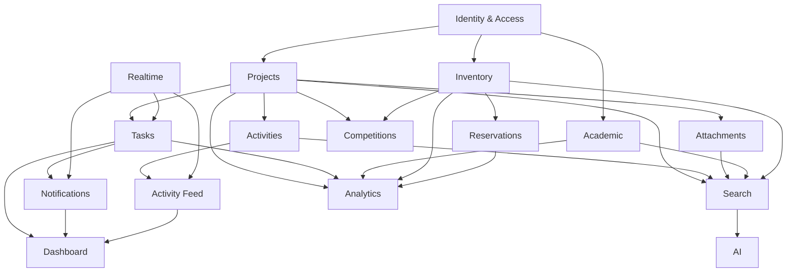
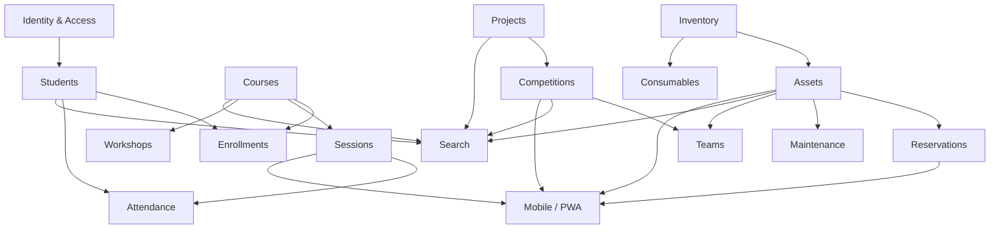
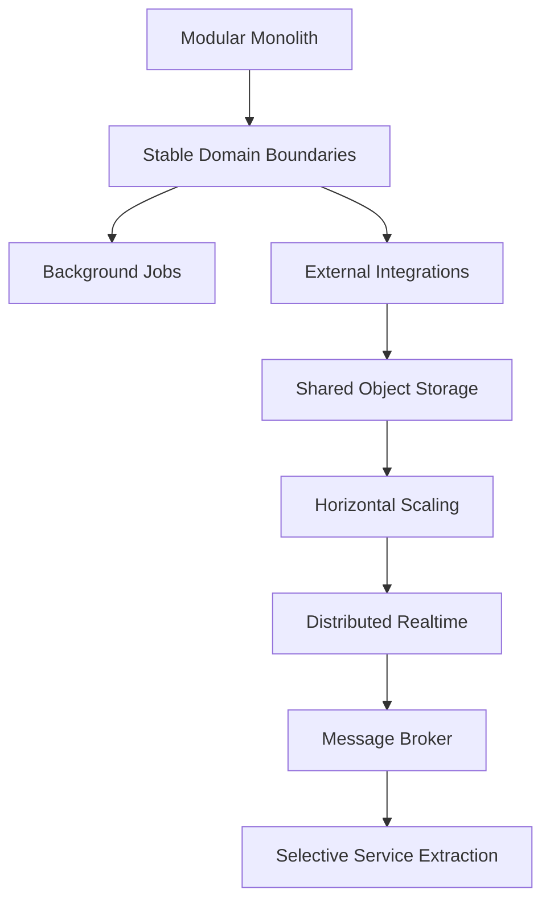
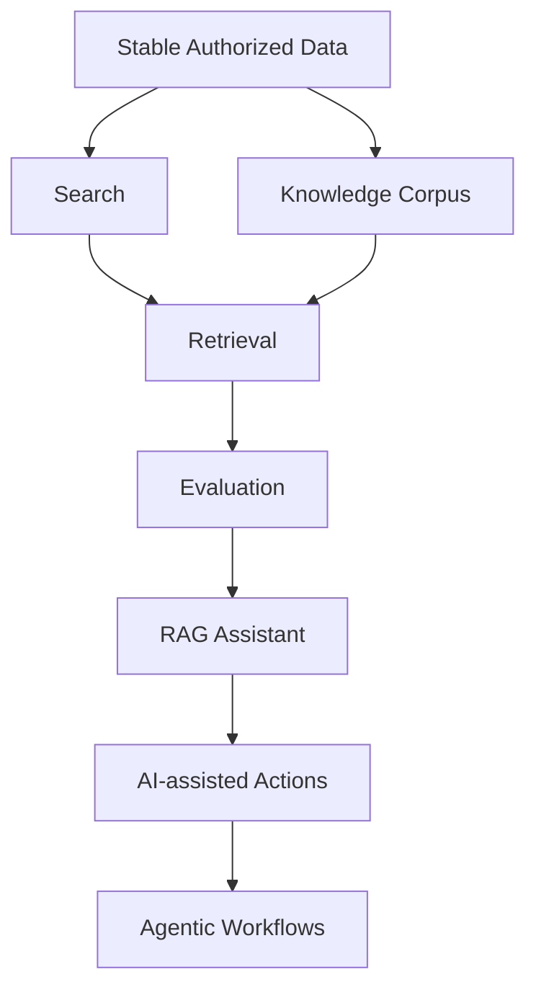
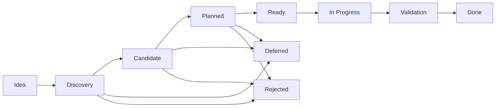
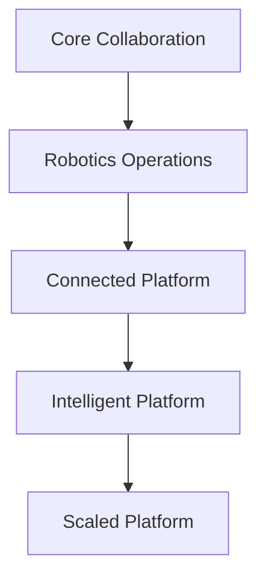

# 49_FEATURE_BACKLOG.md

# Aula Robótica Platform — Feature Backlog

## Parte 1 — Propósito, modelo de backlog, criterios de priorización y foundation/core product backlog

---

# 1. Propósito del documento

Este documento define el **Feature Backlog estratégico y funcional** de Aula Robótica Platform.

Su objetivo es mantener una visión estructurada de:

```text
implemented capabilities

planned capabilities

candidate capabilities

future opportunities

technical enablers

product dependencies
```

---

# 2. Relación con otros documentos

Este documento complementa:

```text
47_PRODUCT_ROADMAP.md

48_PRODUCT_VISION.md

50_WEEKLY_UPDATE.md
```

---

# 3. Product Vision

`48_PRODUCT_VISION.md` define:

```text
why
```

---

# 4. Product Roadmap

`47_PRODUCT_ROADMAP.md` define:

```text
where and when
```

---

# 5. Feature Backlog

Este documento define:

```text
what could be built
```

---

# 6. Weekly Update

`50_WEEKLY_UPDATE.md` permitirá reflejar:

```text
what is happening now
```

---

# 7. Backlog Philosophy

El backlog no constituye una promesa contractual de implementación.

Representa:

```text
prioritized product possibilities
```

---

# 8. Backlog ≠ Roadmap

Una feature puede existir en el backlog sin formar parte del roadmap actual.

---

# 9. Backlog ≠ Sprint

Este documento no sustituye un sprint backlog.

---

# 10. Backlog ≠ Issue Tracker

Los Issues pueden representar unidades concretas de ejecución.

El Feature Backlog mantiene una perspectiva de producto superior.

---

# 11. Product Backlog Hierarchy

La jerarquía conceptual puede representarse:

```text
Vision

↓

Strategic Pillar

↓

Capability

↓

Epic

↓

Feature

↓

Story / Task

↓

Implementation
```

---

# 12. Strategic Pillar

Representa una dirección estable del producto.

Ejemplos:

```text
Collaboration

Learning

Robotics Operations

Knowledge

Trust
```

---

# 13. Capability

Representa una capacidad reconocible del producto.

Ejemplo:

```text
Notifications
```

---

# 14. Epic

Agrupa trabajo significativo dentro de una capability.

Ejemplo:

```text
Notification Preferences
```

---

# 15. Feature

Representa comportamiento útil para el usuario.

Ejemplo:

```text
Mute non-critical project notifications.
```

---

# 16. Story

Describe una necesidad concreta desde perspectiva de usuario.

---

# 17. Technical Task

Representa trabajo necesario para soportar una feature.

---

# 18. Product Value

La priorización debe comenzar por valor de usuario.

---

# 19. Technical Value

También puede existir trabajo cuyo valor principal sea:

```text
reliability

security

maintainability

performance
```

---

# 20. Technical Enablers

El backlog debe hacer visibles estos trabajos.

---

# 21. Feature Status Model

Cada item puede utilizar uno de los siguientes estados conceptuales:

```text
IDEA

DISCOVERY

CANDIDATE

PLANNED

READY

IN_PROGRESS

VALIDATION

DONE

DEFERRED

REJECTED
```

---

# 22. IDEA

Existe una posibilidad todavía poco definida.

---

# 23. DISCOVERY

Se está investigando:

- problema;
- usuario;
- alternativas;
- alcance.

---

# 24. CANDIDATE

El problema parece válido, pero todavía no existe compromiso de ejecución.

---

# 25. PLANNED

La feature forma parte de una intención de roadmap.

---

# 26. READY

Dispone de suficiente definición para entrar en ejecución.

---

# 27. IN_PROGRESS

Existe trabajo activo.

---

# 28. VALIDATION

La implementación existe pero necesita:

- revisión;
- pruebas;
- aceptación.

---

# 29. DONE

La capability cumple su Definition of Done aplicable.

---

# 30. DEFERRED

Se mantiene registrada pero no se prioriza actualmente.

---

# 31. REJECTED

Se ha decidido explícitamente no continuar.

---

# 32. Why Keep Rejected Items

Mantener ciertos items rechazados evita reabrir decisiones sin contexto.

---

# 33. Priority Model

Puede utilizarse:

```text
P0 — Critical

P1 — High

P2 — Medium

P3 — Low

P4 — Opportunity
```

---

# 34. P0 — Critical

Trabajo necesario para:

- seguridad;
- integridad;
- producción;
- bloqueo crítico.

---

# 35. P1 — High

Trabajo con impacto directo sobre:

```text
core product value
```

---

# 36. P2 — Medium

Feature útil pero no imprescindible para el siguiente incremento.

---

# 37. P3 — Low

Mejora secundaria o de conveniencia.

---

# 38. P4 — Opportunity

Idea futura que merece conservarse.

---

# 39. Priority Is Relative

Una prioridad no representa importancia absoluta.

---

# 40. Priority Changes

Puede cambiar según:

- feedback;
- dependencias;
- riesgos;
- contexto institucional.

---

# 41. Product Value Score

Puede evaluarse cualitativamente:

```text
High

Medium

Low
```

---

# 42. User Reach

Puede evaluarse:

```text
Broad

Segment

Niche
```

---

# 43. Confidence

Puede expresarse:

```text
High

Medium

Low
```

---

# 44. Effort

Puede estimarse:

```text
XS

S

M

L

XL
```

---

# 45. Risk

Puede clasificarse:

```text
Low

Medium

High
```

---

# 46. Suggested Feature Metadata

Cada feature importante puede registrar:

```yaml
id:
title:
capability:
status:
priority:
value:
reach:
confidence:
effort:
risk:
dependencies:
```

---

# 47. Example

```yaml
id: FEAT-NOT-001
title: Notification preferences
capability: Notifications
status: CANDIDATE
priority: P2
value: High
reach: Broad
confidence: Medium
effort: M
risk: Low
dependencies:
  - Notifications Core
```

---

# 48. Backlog Identification

Los identificadores deberían ser estables.

---

# 49. Suggested Prefixes

```text
IAM   Identity & Access

PRJ   Projects

TSK   Tasks

ACT   Activities

ATT   Attachments

NOT   Notifications

DSH   Dashboard

FED   Activity Feed

AUD   Audit

RT    Realtime

ACA   Academic

INV   Inventory

RES   Reservations

CMP   Competitions

SEA   Search

ANA   Analytics

AI    Artificial Intelligence

AUT   Automation

PLT   Platform
```

---

# 50. Feature ID Example

```text
FEAT-PRJ-001
```

---

# 51. Backlog Ordering

Los items no deben ordenarse únicamente por módulo.

---

# 52. Product Ordering

Debe considerarse:

```text
value

dependency

risk

readiness
```

---

# 53. Prioritization Principle

```text
Value before novelty.
```

---

# 54. Prioritization Principle — Foundations First

Una feature visible puede depender de capacidades menos visibles.

---

# 55. Example

```text
AI Assistant
```

no debería adelantarse a:

```text
Authorization

Searchable Knowledge

Stable Data

Audit
```

---

# 56. Prioritization Principle — Complete Vertical Slices

Preferir:

```text
usable end-to-end capability
```

sobre múltiples features incompletas.

---

# 57. Prioritization Principle — Reduce Risk Early

Las incertidumbres importantes deben validarse antes de invertir demasiado.

---

# 58. Prioritization Principle — Reuse

Una capability compartida puede tener mayor valor que varias soluciones específicas.

---

# 59. Example

Mejorar Attachments puede beneficiar:

```text
Projects

Activities

Courses

Inventory

Competitions
```

---

# 60. Prioritization Principle — Operational Readiness

Una feature no está realmente terminada si no puede:

```text
run

fail safely

be diagnosed
```

---

# 61. Prioritization Principle — Security

Los controles de seguridad no son backlog opcional posterior.

---

# 62. Prioritization Principle — Accessibility

Los requisitos básicos de accesibilidad deben formar parte de la feature.

---

# 63. Prioritization Principle — Product Coherence

Una feature útil puede rechazarse si rompe la dirección del producto.

---

# 64. Feature Definition Template

Cada feature suficientemente madura debería responder:

```text
Problem

User

Outcome

Scope

Out of Scope

Dependencies

Acceptance Signals

Risks
```

---

# 65. Problem

¿Qué problema existe?

---

# 66. User

¿Quién lo experimenta?

---

# 67. Outcome

¿Qué debería mejorar?

---

# 68. Scope

¿Qué comportamiento incluye?

---

# 69. Out of Scope

¿Qué no incluye?

---

# 70. Dependencies

¿Qué debe existir previamente?

---

# 71. Acceptance Signals

¿Cómo sabremos que funciona?

---

# 72. Risks

¿Qué puede salir mal?

---

# 73. Definition of Ready

Una feature puede considerarse `READY` cuando:

- [ ] el problema está definido;
- [ ] existe usuario objetivo;
- [ ] el outcome está claro;
- [ ] el alcance es razonablemente comprensible;
- [ ] las dependencias están identificadas;
- [ ] los riesgos principales están conocidos;
- [ ] existen criterios de aceptación suficientes;
- [ ] no existen decisiones arquitectónicas críticas completamente abiertas.

---

# 74. Definition of Done

Una feature puede considerarse `DONE` cuando, según aplique:

- [ ] comportamiento implementado;
- [ ] autorización aplicada;
- [ ] validación implementada;
- [ ] tests relevantes;
- [ ] UI accesible;
- [ ] errores tratados;
- [ ] logging adecuado;
- [ ] métricas necesarias;
- [ ] documentación actualizada;
- [ ] migrations aplicadas;
- [ ] deployment validado.

---

# 75. Backlog Review

El backlog debe revisarse periódicamente.

---

# 76. Review Questions

```text
¿Sigue existiendo el problema?

¿Sigue encajando con la visión?

¿Ha cambiado la prioridad?

¿Existe una solución más simple?

¿Ha aparecido una dependencia?
```

---

# 77. Backlog Hygiene

Debe evitarse acumular indefinidamente features sin contexto.

---

# 78. Stale Items

Los items antiguos deben:

```text
revalidate

defer

or reject
```

---

# 79. Foundation Backlog

Las primeras capabilities protegen el funcionamiento del producto completo.

---

# 80. Capability — Identity & Access

Objetivo:

```text
Provide secure and contextual access to platform capabilities.
```

---

# 81. FEAT-IAM-001 — Authentication Core

**Status:** `DONE / EVOLVING`  
**Priority:** `P0`

Permitir autenticación segura de usuarios.

---

# 82. Authentication Scope

Incluye conceptualmente:

- login;
- logout;
- session handling;
- credential verification.

---

# 83. FEAT-IAM-002 — Global Roles

**Status:** `DONE / EVOLVING`  
**Priority:** `P0`

Gestionar capacidades administrativas globales.

---

# 84. FEAT-IAM-003 — Contextual Authorization

**Status:** `PLANNED`  
**Priority:** `P1`

Permitir que permisos dependan del recurso y contexto.

---

# 85. Problem

Los roles globales no representan adecuadamente situaciones como:

```text
Coordinator in Project A

Member in Project B
```

---

# 86. Expected Outcome

Autorización más cercana al modelo real de colaboración.

---

# 87. Dependencies

```text
Identity Core

Projects Membership
```

---

# 88. FEAT-IAM-004 — Permission-aware UI

**Status:** `PLANNED`  
**Priority:** `P1`

Ocultar o deshabilitar acciones que el usuario no puede ejecutar.

---

# 89. Security Rule

La UI nunca sustituye validación backend.

---

# 90. FEAT-IAM-005 — Institutional SSO

**Status:** `CANDIDATE`  
**Priority:** `P2`

Integrar autenticación institucional.

---

# 91. Dependencies

- Identity abstraction;
- institutional IdP information;
- protocol selection.

---

# 92. FEAT-IAM-006 — JIT User Provisioning

**Status:** `CANDIDATE`  
**Priority:** `P3`

Crear o actualizar perfiles locales durante autenticación institucional.

---

# 93. FEAT-IAM-007 — External Identity Mapping

**Status:** `CANDIDATE`  
**Priority:** `P2`

Relacionar identidad interna con proveedores externos.

---

# 94. FEAT-IAM-008 — User Deactivation

**Status:** `PLANNED`  
**Priority:** `P1`

Desactivar acceso sin destruir historial.

---

# 95. FEAT-IAM-009 — Session Security Improvements

**Status:** `PLANNED`  
**Priority:** `P1`

Mejorar:

- expiration;
- revocation;
- session lifecycle.

---

# 96. FEAT-IAM-010 — Security Events

**Status:** `CANDIDATE`  
**Priority:** `P2`

Registrar eventos relevantes como:

```text
login failure

account lock

privilege change
```

---

# 97. Capability — Projects

Objetivo:

```text
Provide the operational home for collaborative initiatives.
```

---

# 98. FEAT-PRJ-001 — Project CRUD

**Status:** `DONE`  
**Priority:** `P1`

Crear, consultar, actualizar y gestionar Projects.

---

# 99. FEAT-PRJ-002 — Project Status

**Status:** `DONE / EVOLVING`  
**Priority:** `P1`

Representar lifecycle mediante estados explícitos.

---

# 100. FEAT-PRJ-003 — Project Membership

**Status:** `DONE / EVOLVING`  
**Priority:** `P1`

Relacionar Users con Projects.

---

# 101. FEAT-PRJ-004 — Project Roles

**Status:** `PLANNED`  
**Priority:** `P1`

Distinguir responsabilidades dentro de Project.

---

# 102. Candidate Roles

```text
Owner

Coordinator

Member

Viewer
```

El modelo definitivo debe validarse.

---

# 103. FEAT-PRJ-005 — Project Overview

**Status:** `PLANNED`  
**Priority:** `P1`

Crear una vista consolidada con:

- estado;
- miembros;
- Tasks;
- Activities;
- Attachments;
- recent activity.

---

# 104. Product Outcome

Reducir tiempo necesario para comprender un Project.

---

# 105. FEAT-PRJ-006 — Project Timeline

**Status:** `CANDIDATE`  
**Priority:** `P2`

Representar cronológicamente eventos relevantes.

---

# 106. Reuse

Debe reutilizar Activity Feed cuando sea posible.

---

# 107. FEAT-PRJ-007 — Project Archive

**Status:** `PLANNED`  
**Priority:** `P2`

Cerrar Project sin eliminar su conocimiento.

---

# 108. Archive Principle

```text
inactive

≠

deleted
```

---

# 109. FEAT-PRJ-008 — Project Templates

**Status:** `CANDIDATE`  
**Priority:** `P3`

Crear Projects desde estructuras reutilizables.

---

# 110. Template Candidate Content

Puede incluir:

- default Tasks;
- milestones;
- documentation placeholders.

---

# 111. FEAT-PRJ-009 — Project Search

**Status:** `PLANNED`  
**Priority:** `P2`

Buscar Projects por:

- nombre;
- estado;
- miembro.

---

# 112. FEAT-PRJ-010 — Project Filters

**Status:** `PLANNED`  
**Priority:** `P2`

Permitir filtros persistentes o temporales.

---

# 113. FEAT-PRJ-011 — Project Deadlines

**Status:** `CANDIDATE`  
**Priority:** `P2`

Representar fechas relevantes de Project.

---

# 114. FEAT-PRJ-012 — Project Milestones

**Status:** `CANDIDATE`  
**Priority:** `P2`

Representar objetivos intermedios significativos.

---

# 115. Milestone Guardrail

No crear un motor complejo de planificación inicialmente.

---

# 116. FEAT-PRJ-013 — Related Resources

**Status:** `CANDIDATE`  
**Priority:** `P2`

Relacionar Project con:

```text
Assets

Courses

Competitions
```

---

# 117. FEAT-PRJ-014 — Project Knowledge Summary

**Status:** `FUTURE CANDIDATE`  
**Priority:** `P4`

Proporcionar resumen de contexto e historial.

---

# 118. Capability — Tasks

Objetivo:

```text
Make collaborative work explicit, assignable and trackable.
```

---

# 119. FEAT-TSK-001 — Task CRUD

**Status:** `DONE`  
**Priority:** `P1`

Gestionar Tasks dentro de Projects.

---

# 120. FEAT-TSK-002 — Task Status Workflow

**Status:** `DONE / EVOLVING`  
**Priority:** `P1`

Representar estado de trabajo.

---

# 121. FEAT-TSK-003 — Task Assignment

**Status:** `DONE / EVOLVING`  
**Priority:** `P1`

Asignar responsabilidad.

---

# 122. FEAT-TSK-004 — Task Priority

**Status:** `DONE / EVOLVING`  
**Priority:** `P2`

Representar importancia relativa.

---

# 123. FEAT-TSK-005 — Kanban Board

**Status:** `DONE / EVOLVING`  
**Priority:** `P1`

Visualizar y modificar Tasks mediante columnas.

---

# 124. Kanban Outcome

```text
shared understanding of work state
```

---

# 125. FEAT-TSK-006 — Drag & Drop

**Status:** `DONE / EVOLVING`  
**Priority:** `P2`

Mover Tasks entre estados mediante interacción directa.

---

# 126. FEAT-TSK-007 — Realtime Task Updates

**Status:** `DONE / EVOLVING`  
**Priority:** `P1`

Propagar cambios relevantes a colaboradores.

---

# 127. FEAT-TSK-008 — Task Due Dates

**Status:** `PLANNED`  
**Priority:** `P2`

Añadir deadline cuando sea relevante.

---

# 128. FEAT-TSK-009 — Task Filtering

**Status:** `PLANNED`  
**Priority:** `P2`

Filtrar por:

```text
status

assignee

priority

due date
```

---

# 129. FEAT-TSK-010 — My Tasks

**Status:** `PLANNED`  
**Priority:** `P1`

Crear una vista transversal de Tasks asignadas al usuario.

---

# 130. Product Outcome

Responder:

```text
¿Qué tengo que hacer?
```

sin navegar Project por Project.

---

# 131. FEAT-TSK-011 — Task Activity History

**Status:** `PLANNED`  
**Priority:** `P2`

Mostrar cambios relevantes de una Task.

---

# 132. FEAT-TSK-012 — Task Attachments

**Status:** `PLANNED`  
**Priority:** `P2`

Reutilizar Attachments dentro del contexto de Task.

---

# 133. FEAT-TSK-013 — Task Dependencies

**Status:** `CANDIDATE`  
**Priority:** `P3`

Representar dependencias simples.

---

# 134. Initial Dependency Model

```text
blocked by
```

puede ser suficiente inicialmente.

---

# 135. FEAT-TSK-014 — Blocked State

**Status:** `CANDIDATE`  
**Priority:** `P2`

Permitir expresar explícitamente blockers.

---

# 136. FEAT-TSK-015 — Task Comments

**Status:** `CANDIDATE`  
**Priority:** `P3`

Permitir comunicación contextual.

---

# 137. Comments Guardrail

No evolucionar automáticamente hacia chat generalista.

---

# 138. FEAT-TSK-016 — Task Templates

**Status:** `CANDIDATE`  
**Priority:** `P3`

Reutilizar estructuras frecuentes.

---

# 139. FEAT-TSK-017 — Bulk Task Operations

**Status:** `CANDIDATE`  
**Priority:** `P3`

Modificar múltiples Tasks de forma controlada.

---

# 140. FEAT-TSK-018 — Task Recurrence

**Status:** `IDEA`  
**Priority:** `P4`

Crear Tasks recurrentes cuando exista un caso real.

---

# 141. Recurrence Gate

No implementar hasta validar workflows recurrentes significativos.

---

# 142. FEAT-TSK-019 — AI Task Decomposition

**Status:** `IDEA`  
**Priority:** `P4`

Sugerir subtareas a partir de una descripción.

---

# 143. AI Constraint

La propuesta debe requerir confirmación humana.

---

# 144. Capability — Activities

Objetivo:

```text
Record meaningful work and preserve project history.
```

---

# 145. FEAT-ACT-001 — Activity CRUD

**Status:** `DONE`  
**Priority:** `P1`

Registrar Activities asociadas al trabajo.

---

# 146. FEAT-ACT-002 — Project Activities

**Status:** `DONE / EVOLVING`  
**Priority:** `P1`

Consultar Activities dentro del contexto de Project.

---

# 147. FEAT-ACT-003 — Activity Author

**Status:** `DONE / EVOLVING`  
**Priority:** `P1`

Mantener autoría explícita.

---

# 148. FEAT-ACT-004 — Activity Attachments

**Status:** `PLANNED`  
**Priority:** `P2`

Relacionar evidencia documental con Activities.

---

# 149. FEAT-ACT-005 — Activity Types

**Status:** `CANDIDATE`  
**Priority:** `P3`

Clasificar Activities cuando aporte valor.

---

# 150. Candidate Types

Ejemplos:

```text
Development

Research

Testing

Documentation

Meeting
```

---

# 151. Activity Type Guardrail

No imponer taxonomía compleja prematuramente.

---

# 152. FEAT-ACT-006 — Activity Timeline

**Status:** `PLANNED`  
**Priority:** `P2`

Mostrar Activities cronológicamente.

---

# 153. FEAT-ACT-007 — Activity Search

**Status:** `CANDIDATE`  
**Priority:** `P2`

Buscar actividad histórica.

---

# 154. FEAT-ACT-008 — Activity Filters

**Status:** `CANDIDATE`  
**Priority:** `P2`

Filtrar por:

- Project;
- author;
- date;
- type.

---

# 155. FEAT-ACT-009 — Activity from Task

**Status:** `CANDIDATE`  
**Priority:** `P2`

Permitir registrar Activity desde Task.

---

# 156. Outcome

Conservar relación entre:

```text
planned work

and

actual work
```

---

# 157. FEAT-ACT-010 — Activity Editing Policy

**Status:** `PLANNED`  
**Priority:** `P2`

Definir cuándo y cómo una Activity histórica puede modificarse.

---

# 158. Historical Integrity

Las correcciones no deben destruir trazabilidad relevante.

---

# 159. FEAT-ACT-011 — Activity Export

**Status:** `CANDIDATE`  
**Priority:** `P3`

Exportar actividad para reporting cuando exista necesidad.

---

# 160. FEAT-ACT-012 — Activity Summary

**Status:** `IDEA`  
**Priority:** `P4`

Generar resúmenes de actividad por Project o periodo.

---

# 161. AI Candidate

La IA podría asistir posteriormente en estos resúmenes.

---

# 162. Capability — Attachments

Objetivo:

```text
Provide contextual evidence and documentation across domains.
```

---

# 163. FEAT-ATT-001 — File Upload

**Status:** `DONE / EVOLVING`  
**Priority:** `P1`

Permitir subir archivos de forma controlada.

---

# 164. FEAT-ATT-002 — File Download

**Status:** `DONE / EVOLVING`  
**Priority:** `P1`

Permitir descargar archivos autorizados.

---

# 165. FEAT-ATT-003 — Attachment Metadata

**Status:** `DONE / EVOLVING`  
**Priority:** `P1`

Mantener:

```text
filename

content type

size

owner/context

created time
```

---

# 166. FEAT-ATT-004 — Project Attachments

**Status:** `DONE / EVOLVING`  
**Priority:** `P1`

Relacionar archivos con Projects.

---

# 167. FEAT-ATT-005 — Activity Attachments

**Status:** `PLANNED`  
**Priority:** `P2`

Reutilizar la capability en Activities.

---

# 168. FEAT-ATT-006 — Task Attachments

**Status:** `PLANNED`  
**Priority:** `P2`

Reutilizarla en Tasks.

---

# 169. FEAT-ATT-007 — Course Attachments

**Status:** `CANDIDATE`  
**Priority:** `P2`

Reutilizar Attachments para material académico.

---

# 170. FEAT-ATT-008 — Asset Attachments

**Status:** `CANDIDATE`  
**Priority:** `P2`

Asociar:

- manuals;
- datasheets;
- maintenance evidence.

---

# 171. FEAT-ATT-009 — Competition Attachments

**Status:** `CANDIDATE`  
**Priority:** `P2`

Asociar documentación de competición.

---

# 172. FEAT-ATT-010 — Upload Validation

**Status:** `PLANNED`  
**Priority:** `P0`

Validar:

```text
size

type

filename

storage constraints
```

---

# 173. FEAT-ATT-011 — Secure Download Authorization

**Status:** `PLANNED`  
**Priority:** `P0`

Comprobar autorización sobre el recurso antes de servir contenido.

---

# 174. FEAT-ATT-012 — Malware Scanning

**Status:** `CANDIDATE`  
**Priority:** `P2`

Analizar archivos cuando el contexto de despliegue lo justifique.

---

# 175. FEAT-ATT-013 — Attachment Preview

**Status:** `CANDIDATE`  
**Priority:** `P3`

Previsualizar formatos compatibles.

---

# 176. FEAT-ATT-014 — Attachment Search

**Status:** `CANDIDATE`  
**Priority:** `P2`

Buscar por metadatos.

---

# 177. FEAT-ATT-015 — Storage Abstraction

**Status:** `PLANNED`  
**Priority:** `P2`

Permitir evolucionar entre:

```text
local storage

object storage
```

sin acoplar dominio.

---

# 178. FEAT-ATT-016 — Orphan Cleanup

**Status:** `PLANNED`  
**Priority:** `P2`

Detectar y gestionar archivos sin referencia válida.

---

# 179. FEAT-ATT-017 — Attachment Lifecycle

**Status:** `CANDIDATE`  
**Priority:** `P2`

Definir:

```text
active

archived

deleted
```

cuando sea necesario.

---

# 180. FEAT-ATT-018 — File Versioning

**Status:** `IDEA`  
**Priority:** `P4`

Mantener versiones cuando exista un caso real.

---

# 181. Versioning Guardrail

No convertir Attachments en un document management system completo.

---

# 182. Capability — Notifications

Objetivo:

```text
Deliver relevant attention signals without creating noise.
```

---

# 183. FEAT-NOT-001 — Notification Core

**Status:** `DONE / EVOLVING`  
**Priority:** `P1`

Crear y persistir Notifications.

---

# 184. FEAT-NOT-002 — Notification Center

**Status:** `DONE / EVOLVING`  
**Priority:** `P1`

Proporcionar una vista personal de Notifications.

---

# 185. FEAT-NOT-003 — Read / Unread State

**Status:** `DONE / EVOLVING`  
**Priority:** `P1`

Permitir gestionar estado de lectura.

---

# 186. FEAT-NOT-004 — Notification Links

**Status:** `PLANNED`  
**Priority:** `P1`

Permitir navegar al recurso que originó la Notification.

---

# 187. FEAT-NOT-005 — Realtime Notifications

**Status:** `DONE / EVOLVING`  
**Priority:** `P1`

Entregar nuevas Notifications mediante realtime.

---

# 188. FEAT-NOT-006 — Notification Categories

**Status:** `PLANNED`  
**Priority:** `P2`

Clasificar eventos según significado.

---

# 189. Candidate Categories

```text
Assignment

Project

Deadline

Reservation

Security

System
```

---

# 190. FEAT-NOT-007 — Notification Preferences

**Status:** `CANDIDATE`  
**Priority:** `P2`

Permitir configurar categorías no obligatorias.

---

# 191. FEAT-NOT-008 — Mandatory Security Notifications

**Status:** `CANDIDATE`  
**Priority:** `P1`

Mantener determinados avisos no desactivables.

---

# 192. FEAT-NOT-009 — Mark All as Read

**Status:** `PLANNED`  
**Priority:** `P2`

Facilitar gestión de grandes listas.

---

# 193. FEAT-NOT-010 — Notification Grouping

**Status:** `CANDIDATE`  
**Priority:** `P3`

Agrupar eventos repetitivos relacionados.

---

# 194. Example

```text
5 tasks changed in Project X
```

cuando sea más útil que cinco avisos independientes.

---

# 195. FEAT-NOT-011 — Notification Retention

**Status:** `PLANNED`  
**Priority:** `P2`

Definir cuánto tiempo deben conservarse.

---

# 196. FEAT-NOT-012 — Email Notifications

**Status:** `CANDIDATE`  
**Priority:** `P3`

Enviar eventos seleccionados mediante email.

---

# 197. Email Guardrail

No duplicar todas las Notifications automáticamente.

---

# 198. FEAT-NOT-013 — Digest Notifications

**Status:** `IDEA`  
**Priority:** `P4`

Crear resúmenes periódicos.

---

# 199. FEAT-NOT-014 — Deadline Reminders

**Status:** `CANDIDATE`  
**Priority:** `P2`

Generar recordatorios antes de fechas relevantes.

---

# 200. FEAT-NOT-015 — Reservation Notifications

**Status:** `CANDIDATE`  
**Priority:** `P2`

Informar sobre:

- confirmation;
- upcoming reservation;
- expiration;
- cancellation.

---

# 201. FEAT-NOT-016 — Notification Delivery Metrics

**Status:** `CANDIDATE`  
**Priority:** `P3`

Medir funcionamiento técnico de entrega.

---

# 202. FEAT-NOT-017 — Notification Relevance Analytics

**Status:** `IDEA`  
**Priority:** `P4`

Analizar de forma agregada si ciertas categorías generan ruido.

---

# 203. Capability — Dashboard

Objetivo:

```text
Provide role-aware operational awareness and decision support.
```

---

# 204. FEAT-DSH-001 — Dashboard Core

**Status:** `DONE / EVOLVING`  
**Priority:** `P1`

Proporcionar landing operacional tras autenticación.

---

# 205. FEAT-DSH-002 — Project Summary

**Status:** `DONE / EVOLVING`  
**Priority:** `P1`

Mostrar información resumida de Projects.

---

# 206. FEAT-DSH-003 — Task Summary

**Status:** `DONE / EVOLVING`  
**Priority:** `P1`

Mostrar información relevante de Tasks.

---

# 207. FEAT-DSH-004 — Recent Activity

**Status:** `DONE / EVOLVING`  
**Priority:** `P1`

Incluir actividad reciente relevante.

---

# 208. FEAT-DSH-005 — Notification Summary

**Status:** `PLANNED`  
**Priority:** `P1`

Mostrar avisos que necesitan atención.

---

# 209. FEAT-DSH-006 — My Tasks Widget

**Status:** `PLANNED`  
**Priority:** `P1`

Priorizar trabajo asignado al usuario.

---

# 210. FEAT-DSH-007 — Upcoming Deadlines

**Status:** `PLANNED`  
**Priority:** `P2`

Mostrar fechas próximas relevantes.

---

# 211. FEAT-DSH-008 — Role-aware Dashboard

**Status:** `CANDIDATE`  
**Priority:** `P2`

Adaptar composición al contexto.

---

# 212. Candidate Contexts

```text
Student

Coordinator

Instructor

Robotics Coordinator

Administrator
```

---

# 213. FEAT-DSH-009 — Dashboard Empty States

**Status:** `PLANNED`  
**Priority:** `P2`

Ofrecer orientación cuando todavía no existe contenido.

---

# 214. FEAT-DSH-010 — Inventory Signals

**Status:** `CANDIDATE`  
**Priority:** `P3`

Mostrar:

- unavailable assets;
- maintenance;
- reservations.

---

# 215. FEAT-DSH-011 — Academic Signals

**Status:** `CANDIDATE`  
**Priority:** `P3`

Mostrar:

- upcoming sessions;
- active courses.

---

# 216. FEAT-DSH-012 — Competition Signals

**Status:** `CANDIDATE`  
**Priority:** `P3`

Mostrar deadlines y blockers de competiciones.

---

# 217. FEAT-DSH-013 — Custom Dashboard

**Status:** `IDEA`  
**Priority:** `P4`

Permitir configuración manual de widgets.

---

# 218. Customization Gate

No priorizar hasta validar que la composición automática es insuficiente.

---

# 219. FEAT-DSH-014 — Dashboard Performance Budget

**Status:** `PLANNED`  
**Priority:** `P2`

Evitar que agregaciones conviertan Dashboard en una página costosa.

---

# 220. Capability — Activity Feed

Objetivo:

```text
Provide human-readable awareness of relevant platform changes.
```

---

# 221. FEAT-FED-001 — Feed Core

**Status:** `DONE / EVOLVING`  
**Priority:** `P1`

Mostrar eventos relevantes.

---

# 222. FEAT-FED-002 — Project Feed

**Status:** `DONE / EVOLVING`  
**Priority:** `P1`

Mostrar eventos relacionados con un Project.

---

# 223. FEAT-FED-003 — Personal Feed

**Status:** `PLANNED`  
**Priority:** `P2`

Agregar actividad relevante para el usuario.

---

# 224. FEAT-FED-004 — Human-readable Events

**Status:** `PLANNED`  
**Priority:** `P1`

Presentar eventos con lenguaje comprensible.

---

# 225. FEAT-FED-005 — Event Navigation

**Status:** `PLANNED`  
**Priority:** `P1`

Permitir navegar al recurso afectado.

---

# 226. FEAT-FED-006 — Feed Filtering

**Status:** `CANDIDATE`  
**Priority:** `P2`

Filtrar por:

```text
Project

event type

date
```

---

# 227. FEAT-FED-007 — Realtime Feed

**Status:** `DONE / EVOLVING`  
**Priority:** `P2`

Actualizar Feed mediante eventos realtime.

---

# 228. FEAT-FED-008 — Feed Pagination

**Status:** `PLANNED`  
**Priority:** `P2`

Evitar cargar historial ilimitado.

---

# 229. FEAT-FED-009 — Feed Retention

**Status:** `CANDIDATE`  
**Priority:** `P2`

Definir política de conservación.

---

# 230. FEAT-FED-010 — Event Aggregation

**Status:** `CANDIDATE`  
**Priority:** `P3`

Combinar cambios repetitivos cuando mejore legibilidad.

---

# 231. FEAT-FED-011 — Feed Relevance

**Status:** `CANDIDATE`  
**Priority:** `P2`

Reducir eventos de bajo valor.

---

# 232. FEAT-FED-012 — Feed Privacy Validation

**Status:** `PLANNED`  
**Priority:** `P0`

Garantizar que ningún evento revela información de recursos no autorizados.

---

# 233. Capability — Audit

Objetivo:

```text
Provide reliable traceability for relevant operations.
```

---

# 234. FEAT-AUD-001 — Audit Core

**Status:** `DONE / EVOLVING`  
**Priority:** `P0`

Registrar operaciones relevantes.

---

# 235. FEAT-AUD-002 — Actor Tracking

**Status:** `DONE / EVOLVING`  
**Priority:** `P0`

Identificar quién realizó la operación.

---

# 236. FEAT-AUD-003 — Resource Tracking

**Status:** `DONE / EVOLVING`  
**Priority:** `P0`

Identificar recurso afectado.

---

# 237. FEAT-AUD-004 — Audit Timestamp

**Status:** `DONE`  
**Priority:** `P0`

Mantener tiempo fiable del evento.

---

# 238. FEAT-AUD-005 — Audit Search

**Status:** `PLANNED`  
**Priority:** `P1`

Permitir localizar eventos relevantes.

---

# 239. FEAT-AUD-006 — Audit Filters

**Status:** `PLANNED`  
**Priority:** `P1`

Filtrar por:

- actor;
- action;
- resource;
- date.

---

# 240. FEAT-AUD-007 — Audit Detail

**Status:** `PLANNED`  
**Priority:** `P2`

Mostrar información suficiente para investigación.

---

# 241. FEAT-AUD-008 — Sensitive Data Redaction

**Status:** `PLANNED`  
**Priority:** `P0`

Evitar registrar:

```text
passwords

tokens

secrets

sensitive payloads
```

---

# 242. FEAT-AUD-009 — Audit Retention

**Status:** `CANDIDATE`  
**Priority:** `P1`

Definir política explícita.

---

# 243. FEAT-AUD-010 — Administrative Audit View

**Status:** `PLANNED`  
**Priority:** `P1`

Proporcionar interfaz útil para investigación.

---

# 244. FEAT-AUD-011 — Security Event Integration

**Status:** `CANDIDATE`  
**Priority:** `P2`

Relacionar eventos de seguridad cuando proceda.

---

# 245. FEAT-AUD-012 — Automation Actor

**Status:** `FUTURE CANDIDATE`  
**Priority:** `P3`

Distinguir acciones realizadas por automatizaciones.

---

# 246. Capability — Realtime

Objetivo:

```text
Keep collaborative views sufficiently synchronized without replacing authoritative persistence.
```

---

# 247. FEAT-RT-001 — WebSocket Core

**Status:** `DONE / EVOLVING`  
**Priority:** `P1`

Mantener canal realtime autenticado.

---

# 248. FEAT-RT-002 — Task Events

**Status:** `DONE / EVOLVING`  
**Priority:** `P1`

Propagar cambios de Tasks.

---

# 249. FEAT-RT-003 — Notification Events

**Status:** `DONE / EVOLVING`  
**Priority:** `P1`

Propagar nuevas Notifications.

---

# 250. FEAT-RT-004 — Feed Events

**Status:** `DONE / EVOLVING`  
**Priority:** `P2`

Actualizar Activity Feed.

---

# 251. FEAT-RT-005 — Reconnection

**Status:** `PLANNED`  
**Priority:** `P1`

Reconectar automáticamente tras fallos transitorios.

---

# 252. FEAT-RT-006 — State Reconciliation

**Status:** `PLANNED`  
**Priority:** `P1`

Recuperar estado autoritativo después de reconectar.

---

# 253. FEAT-RT-007 — Duplicate Event Handling

**Status:** `PLANNED`  
**Priority:** `P1`

Garantizar que duplicados no corrompan UI.

---

# 254. FEAT-RT-008 — Event Versioning

**Status:** `CANDIDATE`  
**Priority:** `P2`

Versionar contratos realtime cuando la evolución lo requiera.

---

# 255. FEAT-RT-009 — Authorization Scope

**Status:** `PLANNED`  
**Priority:** `P0`

Garantizar que eventos solo llegan a usuarios autorizados.

---

# 256. FEAT-RT-010 — Connection Status UX

**Status:** `CANDIDATE`  
**Priority:** `P2`

Mostrar discretamente pérdida de sincronización cuando afecte al usuario.

---

# 257. FEAT-RT-011 — Presence

**Status:** `IDEA`  
**Priority:** `P4`

Mostrar presencia limitada dentro de contextos colaborativos.

---

# 258. Presence Guardrail

No utilizar como sistema de vigilancia.

---

# 259. FEAT-RT-012 — Horizontal Realtime Scaling

**Status:** `DEFERRED`  
**Priority:** `P4`

Introducir Redis Pub/Sub u otra solución únicamente cuando múltiples instancias lo requieran.

---

# 260. Architecture Gate

No introducir infraestructura distribuida sin necesidad operacional demostrada.

---

# 261. Foundation Cross-cutting Backlog

Existen features que afectan a todos los módulos.

---

# 262. FEAT-PLT-001 — Consistent Error Model

**Status:** `PLANNED`  
**Priority:** `P1`

Unificar errores de dominio y presentación.

---

# 263. Expected Result

Los usuarios deben recibir errores:

```text
understandable

actionable

consistent
```

---

# 264. FEAT-PLT-002 — Global Validation Strategy

**Status:** `PLANNED`  
**Priority:** `P1`

Mantener validación coherente entre:

```text
UI

application

domain

database
```

---

# 265. FEAT-PLT-003 — Pagination Standard

**Status:** `PLANNED`  
**Priority:** `P2`

Unificar comportamiento para colecciones grandes.

---

# 266. FEAT-PLT-004 — Filtering Standard

**Status:** `PLANNED`  
**Priority:** `P2`

Definir patrones consistentes.

---

# 267. FEAT-PLT-005 — Sorting Standard

**Status:** `PLANNED`  
**Priority:** `P2`

Evitar implementaciones diferentes por módulo.

---

# 268. FEAT-PLT-006 — Empty State Standard

**Status:** `PLANNED`  
**Priority:** `P2`

Definir patrón UX común.

---

# 269. FEAT-PLT-007 — Loading State Standard

**Status:** `PLANNED`  
**Priority:** `P2`

Definir feedback coherente.

---

# 270. FEAT-PLT-008 — Success Feedback Standard

**Status:** `PLANNED`  
**Priority:** `P2`

Unificar confirmaciones de acciones.

---

# 271. FEAT-PLT-009 — Confirmation Pattern

**Status:** `PLANNED`  
**Priority:** `P2`

Aplicar confirmación proporcional al riesgo.

---

# 272. FEAT-PLT-010 — Responsive Baseline

**Status:** `PLANNED`  
**Priority:** `P1`

Garantizar comportamiento adecuado en diferentes tamaños de pantalla.

---

# 273. FEAT-PLT-011 — Accessibility Baseline

**Status:** `PLANNED`  
**Priority:** `P1`

Establecer requisitos mínimos alineados progresivamente con:

```text
WCAG 2.2 AA
```

---

# 274. FEAT-PLT-012 — Keyboard Navigation

**Status:** `PLANNED`  
**Priority:** `P1`

Garantizar acceso mediante teclado a workflows principales.

---

# 275. FEAT-PLT-013 — Focus Management

**Status:** `PLANNED`  
**Priority:** `P2`

Gestionar correctamente:

- dialogs;
- menus;
- dynamic content.

---

# 276. FEAT-PLT-014 — Semantic HTML Review

**Status:** `PLANNED`  
**Priority:** `P2`

Reducir controles custom innecesarios.

---

# 277. FEAT-PLT-015 — Design System Consolidation

**Status:** `PLANNED`  
**Priority:** `P2`

Consolidar patrones visuales reutilizables.

---

# 278. FEAT-PLT-016 — Navigation Architecture

**Status:** `PLANNED`  
**Priority:** `P1`

Mantener navegación global y contextual coherente.

---

# 279. FEAT-PLT-017 — Breadcrumbs

**Status:** `CANDIDATE`  
**Priority:** `P2`

Preservar contexto en navegación profunda.

---

# 280. FEAT-PLT-018 — Mobile Navigation

**Status:** `CANDIDATE`  
**Priority:** `P2`

Optimizar acceso desde dispositivos móviles.

---

# 281. FEAT-PLT-019 — Timezone Strategy

**Status:** `PLANNED`  
**Priority:** `P1`

Definir manejo consistente de:

```text
storage

display

user timezone
```

---

# 282. FEAT-PLT-020 — Localization Foundation

**Status:** `CANDIDATE`  
**Priority:** `P3`

Preparar textos para futura internacionalización cuando sea necesaria.

---

# 283. FEAT-PLT-021 — Global Search Entry Point

**Status:** `CANDIDATE`  
**Priority:** `P2`

Preparar navegación hacia búsqueda transversal.

---

# 284. FEAT-PLT-022 — Feature Flags

**Status:** `CANDIDATE`  
**Priority:** `P3`

Permitir rollout selectivo de features complejas.

---

# 285. Feature Flag Guardrail

No introducir un sistema sofisticado hasta necesitar múltiples rollouts controlados.

---

# 286. Security Foundation Backlog

La seguridad debe permanecer visible dentro del backlog.

---

# 287. FEAT-PLT-SEC-001 — Authorization Review

**Status:** `PLANNED`  
**Priority:** `P0`

Revisar autorización de todos los endpoints y workflows.

---

# 288. FEAT-PLT-SEC-002 — CSRF Protection Review

**Status:** `PLANNED`  
**Priority:** `P0`

Validar protección de mutaciones SSR.

---

# 289. FEAT-PLT-SEC-003 — WebSocket Authorization Review

**Status:** `PLANNED`  
**Priority:** `P0`

Validar autenticación y autorización realtime.

---

# 290. FEAT-PLT-SEC-004 — Attachment Security Review

**Status:** `PLANNED`  
**Priority:** `P0`

Revisar upload, storage y download.

---

# 291. FEAT-PLT-SEC-005 — Secrets Management

**Status:** `PLANNED`  
**Priority:** `P0`

Eliminar secretos del código y configuración insegura.

---

# 292. FEAT-PLT-SEC-006 — Security Headers

**Status:** `PLANNED`  
**Priority:** `P1`

Aplicar headers HTTP apropiados.

---

# 293. FEAT-PLT-SEC-007 — Rate Limiting

**Status:** `CANDIDATE`  
**Priority:** `P2`

Proteger endpoints sensibles.

---

# 294. FEAT-PLT-SEC-008 — Login Abuse Protection

**Status:** `CANDIDATE`  
**Priority:** `P1`

Reducir intentos automatizados.

---

# 295. FEAT-PLT-SEC-009 — Dependency Security Scanning

**Status:** `PLANNED`  
**Priority:** `P1`

Detectar vulnerabilidades conocidas.

---

# 296. FEAT-PLT-SEC-010 — Container Security Scanning

**Status:** `CANDIDATE`  
**Priority:** `P2`

Analizar imágenes antes de despliegue.

---

# 297. FEAT-PLT-SEC-011 — Security Incident Procedure

**Status:** `PLANNED`  
**Priority:** `P1`

Definir respuesta ante incidentes.

---

# 298. FEAT-PLT-SEC-012 — Data Privacy Review

**Status:** `PLANNED`  
**Priority:** `P1`

Revisar datos personales antes de ampliar el dominio académico.

---

# 299. Testing Foundation Backlog

La estrategia de testing constituye una capability de producto indirecta.

---

# 300. FEAT-PLT-TST-001 — Unit Test Baseline

**Status:** `IN_PROGRESS / EVOLVING`  
**Priority:** `P1`

Mantener tests sobre lógica de dominio y servicios.

---

# 301. FEAT-PLT-TST-002 — Integration Test Baseline

**Status:** `PLANNED`  
**Priority:** `P1`

Validar integración con persistencia y componentes internos.

---

# 302. FEAT-PLT-TST-003 — Repository Tests

**Status:** `PLANNED`  
**Priority:** `P1`

Validar queries y constraints relevantes.

---

# 303. FEAT-PLT-TST-004 — HTTP Integration Tests

**Status:** `PLANNED`  
**Priority:** `P1`

Validar workflows HTTP principales.

---

# 304. FEAT-PLT-TST-005 — UI Smoke Tests

**Status:** `PLANNED`  
**Priority:** `P1`

Cubrir journeys críticos.

---

# 305. FEAT-PLT-TST-006 — Authentication E2E

**Status:** `PLANNED`  
**Priority:** `P0`

Validar login/logout y acceso protegido.

---

# 306. FEAT-PLT-TST-007 — Project Workflow E2E

**Status:** `PLANNED`  
**Priority:** `P1`

Cubrir workflow principal de Projects.

---

# 307. FEAT-PLT-TST-008 — Kanban E2E

**Status:** `PLANNED`  
**Priority:** `P1`

Validar movimientos y persistencia.

---

# 308. FEAT-PLT-TST-009 — Realtime E2E

**Status:** `PLANNED`  
**Priority:** `P1`

Validar colaboración entre múltiples clientes.

---

# 309. FEAT-PLT-TST-010 — Attachment E2E

**Status:** `PLANNED`  
**Priority:** `P1`

Validar:

```text
upload

authorization

download
```

---

# 310. FEAT-PLT-TST-011 — Accessibility Tests

**Status:** `PLANNED`  
**Priority:** `P2`

Automatizar checks básicos.

---

# 311. FEAT-PLT-TST-012 — Performance Tests

**Status:** `CANDIDATE`  
**Priority:** `P2`

Establecer baseline para endpoints críticos.

---

# 312. FEAT-PLT-TST-013 — Load Tests

**Status:** `CANDIDATE`  
**Priority:** `P3`

Validar capacidad cuando exista un modelo de carga realista.

---

# 313. FEAT-PLT-TST-014 — Realtime Load Tests

**Status:** `CANDIDATE`  
**Priority:** `P3`

Evaluar conexiones concurrentes cuando sea relevante.

---

# 314. FEAT-PLT-TST-015 — Migration Tests

**Status:** `PLANNED`  
**Priority:** `P1`

Verificar evolución del schema.

---

# 315. FEAT-PLT-TST-016 — Backup Restore Test

**Status:** `PLANNED`  
**Priority:** `P0`

Comprobar periódicamente que los backups pueden restaurarse.

---

# 316. Observability Foundation Backlog

La observabilidad permite operar el producto con confianza.

---

# 317. FEAT-PLT-OBS-001 — Structured Logging

**Status:** `PLANNED`  
**Priority:** `P1`

Producir logs estructurados.

---

# 318. FEAT-PLT-OBS-002 — Request Correlation

**Status:** `PLANNED`  
**Priority:** `P1`

Relacionar logs de una misma request.

---

# 319. FEAT-PLT-OBS-003 — Health Endpoint

**Status:** `PLANNED`  
**Priority:** `P0`

Exponer estado básico del servicio.

---

# 320. FEAT-PLT-OBS-004 — Readiness Check

**Status:** `PLANNED`  
**Priority:** `P0`

Determinar si la instancia puede recibir tráfico.

---

# 321. FEAT-PLT-OBS-005 — Metrics Endpoint

**Status:** `PLANNED`  
**Priority:** `P1`

Exponer métricas técnicas.

---

# 322. FEAT-PLT-OBS-006 — HTTP Metrics

**Status:** `PLANNED`  
**Priority:** `P1`

Medir:

```text
requests

latency

errors
```

---

# 323. FEAT-PLT-OBS-007 — Database Metrics

**Status:** `CANDIDATE`  
**Priority:** `P2`

Observar:

- pool;
- query latency;
- failures.

---

# 324. FEAT-PLT-OBS-008 — WebSocket Metrics

**Status:** `PLANNED`  
**Priority:** `P1`

Observar:

```text
connections

disconnects

delivery errors
```

---

# 325. FEAT-PLT-OBS-009 — Error Tracking

**Status:** `PLANNED`  
**Priority:** `P1`

Centralizar errores relevantes.

---

# 326. FEAT-PLT-OBS-010 — Technical Dashboard

**Status:** `CANDIDATE`  
**Priority:** `P2`

Visualizar salud operacional.

---

# 327. FEAT-PLT-OBS-011 — Alerting

**Status:** `CANDIDATE`  
**Priority:** `P1`

Notificar condiciones operativas críticas.

---

# 328. FEAT-PLT-OBS-012 — Distributed Tracing

**Status:** `DEFERRED`  
**Priority:** `P4`

Introducir cuando exista suficiente complejidad para justificarlo.

---

# 329. Deployment Foundation Backlog

---

# 330. FEAT-PLT-DEP-001 — Reproducible Container Build

**Status:** `PLANNED`  
**Priority:** `P0`

Construir artefactos reproducibles.

---

# 331. FEAT-PLT-DEP-002 — Production Configuration

**Status:** `PLANNED`  
**Priority:** `P0`

Separar configuración de producción.

---

# 332. FEAT-PLT-DEP-003 — Database Migration Pipeline

**Status:** `PLANNED`  
**Priority:** `P0`

Ejecutar migrations de forma controlada.

---

# 333. FEAT-PLT-DEP-004 — Automated Deployment

**Status:** `PLANNED`  
**Priority:** `P1`

Automatizar despliegue cuando el pipeline sea estable.

---

# 334. FEAT-PLT-DEP-005 — Rollback Procedure

**Status:** `PLANNED`  
**Priority:** `P0`

Permitir recuperar una versión estable.

---

# 335. FEAT-PLT-DEP-006 — Backup Automation

**Status:** `PLANNED`  
**Priority:** `P0`

Crear backups periódicos.

---

# 336. FEAT-PLT-DEP-007 — Restore Procedure

**Status:** `PLANNED`  
**Priority:** `P0`

Documentar y validar recuperación.

---

# 337. FEAT-PLT-DEP-008 — Staging Environment

**Status:** `CANDIDATE`  
**Priority:** `P2`

Disponer de entorno previo a producción.

---

# 338. FEAT-PLT-DEP-009 — Zero-downtime Deployment

**Status:** `DEFERRED`  
**Priority:** `P4`

Considerar cuando exista necesidad real de disponibilidad.

---

# 339. FEAT-PLT-DEP-010 — Horizontal Scaling

**Status:** `DEFERRED`  
**Priority:** `P4`

Escalar únicamente cuando las métricas lo indiquen.

---

# 340. Foundation Backlog Principle

Estas capabilities técnicas deben priorizarse proporcionalmente al riesgo real.

---

# 341. No Infrastructure Checklist Development

No es necesario implementar todas las herramientas posibles antes de entregar valor.

---

# 342. Product Core Consolidation

El siguiente objetivo del backlog debe ser consolidar completamente:

```text
Projects

Tasks

Activities

Attachments

Notifications

Dashboard

Activity Feed

Realtime
```

---

# 343. Why Core Consolidation

Estos dominios forman el núcleo operativo sobre el que se apoyarán:

```text
Academic

Inventory

Competitions

Analytics

AI
```

---

# 344. Core Consolidation — Projects

Debe alcanzar:

- contextual authorization;
- strong overview;
- membership;
- lifecycle;
- search.

---

# 345. Core Consolidation — Tasks

Debe alcanzar:

- My Tasks;
- filtering;
- due dates;
- reliable realtime;
- activity history.

---

# 346. Core Consolidation — Activities

Debe alcanzar:

- attachments;
- timeline;
- filtering;
- historical integrity.

---

# 347. Core Consolidation — Attachments

Debe alcanzar:

- secure upload;
- secure download;
- reusable contexts;
- lifecycle.

---

# 348. Core Consolidation — Notifications

Debe alcanzar:

- actionable links;
- categories;
- retention;
- useful realtime.

---

# 349. Core Consolidation — Dashboard

Debe alcanzar:

```text
role-relevant operational awareness
```

---

# 350. Core Consolidation — Activity Feed

Debe alcanzar:

```text
relevant human-readable awareness
```

---

# 351. Core Consolidation — Realtime

Debe alcanzar:

```text
reconnection

reconciliation

authorization

testing
```

---

# 352. Core Consolidation Exit Criteria

El núcleo puede considerarse consolidado cuando:

- [ ] los workflows principales son completos;
- [ ] autorización contextual está aplicada;
- [ ] realtime se recupera de desconexiones;
- [ ] los errores tienen feedback consistente;
- [ ] los tests cubren journeys críticos;
- [ ] existe observabilidad suficiente;
- [ ] las vistas funcionan razonablemente en móvil;
- [ ] las capabilities compartidas son reutilizables.

---

# 353. Product Backlog Dependency Graph



---

# 354. Dependency Interpretation

El diagrama representa dependencias conceptuales, no necesariamente imports técnicos.

---

# 355. Important Dependency — AI

AI aparece tarde deliberadamente.

---

# 356. AI Requires Knowledge

Antes debe existir:

```text
good data

searchable content

authorization

stable domain models
```

---

# 357. Important Dependency — Competitions

Competitions puede reutilizar:

```text
Projects

Tasks

Inventory

Attachments
```

---

# 358. Important Dependency — Reservations

Reservations requiere Inventory estable.

---

# 359. Important Dependency — Dashboard

Dashboard depende de dominios fuente.

---

# 360. Dashboard Rule

No debe convertirse en propietario de los datos que presenta.

---

# 361. Important Dependency — Activity Feed

Feed depende de eventos producidos por otros módulos.

---

# 362. Feed Rule

No debe convertirse en fuente autoritativa del estado.

---

# 363. Important Dependency — Search

Search necesita autorización transversal estable.

---

# 364. Search Rule

No indexar información que luego no pueda filtrarse de forma segura.

---

# 365. Backlog Value Streams Summary

```text
Core Collaboration

Identity
Projects
Tasks
Activities
Attachments
Notifications
Dashboard
Feed
Realtime

↓

Robotics Education

Academic
Inventory
Reservations
Competitions

↓

Platform Intelligence

Search
Analytics
Automation
AI
```

---

# 366. Delivery Principle

La secuencia preferente es:

```text
stabilize

↓

connect

↓

expand

↓

intelligently augment
```

---

# 367. Stabilize

Consolidar seguridad, tests y funcionamiento del core.

---

# 368. Connect

Mejorar integración entre módulos existentes.

---

# 369. Expand

Añadir dominios académicos y de robótica.

---

# 370. Intelligently Augment

Incorporar analytics, automation e IA sobre una base fiable.

---

# 371. Feature Backlog Part 1 Summary

La primera parte del backlog establece:

```text
Backlog Governance

+

Core Product

+

Shared Capabilities

+

Technical Foundations
```

---

# 372. Core Product Priority

La prioridad estratégica inmediata debe permanecer:

```text
Identity

Projects

Tasks

Activities

Attachments

Notifications

Dashboard

Activity Feed

Realtime
```

---

# 373. Foundation Priority

Paralelamente deben madurar:

```text
Security

Testing

Observability

Deployment
```

---

# 374. Expansion Gate

Los grandes dominios nuevos deben incorporarse cuando el core disponga de una base suficientemente estable.

---

# 375. Final de Parte 1

La **Parte 2** continuará `49_FEATURE_BACKLOG.md` con el backlog detallado de:

- Academic;
- Students;
- Courses;
- Enrollments;
- Sessions;
- Attendance;
- Workshops;
- Inventory;
- Assets;
- Consumables;
- Reservations;
- Maintenance;
- QR workflows;
- Competitions;
- Teams;
- Robots;
- milestones;
- competition documentation;
- Search;
- PWA y experiencia móvil.

---

# 49_FEATURE_BACKLOG.md

# Aula Robótica Platform — Feature Backlog

## Parte 2 — Academic, Inventory, Reservations, Competitions, Search, PWA y experiencia móvil

---

# 376. Capability — Academic

Objetivo:

```text
Connect learning activity with people, sessions, projects and evidence without turning the platform into a generic LMS.
```

---

# 377. Academic Strategic Outcome

El dominio académico debe permitir comprender:

```text
who is learning

what they are participating in

when activities occur

how learning connects to projects
```

---

# 378. Academic Guardrail

No debe intentarse reproducir desde el inicio:

```text
full LMS functionality
```

---

# 379. Academic Core Dependencies

```text
Identity & Access

Projects

Attachments

Notifications

Audit
```

---

# 380. Academic Backlog Structure

Se divide inicialmente en:

```text
Students

Courses

Enrollments

Sessions

Attendance

Workshops

Progress

Evidence
```

---

# 381. Capability — Students

Objetivo:

```text
Represent the academic context of participants without duplicating identity management.
```

---

# 382. FEAT-ACA-STU-001 — Student Profile

**Status:** `PLANNED`  
**Priority:** `P1`

Crear un perfil académico asociado opcionalmente a un User.

---

# 383. User vs Student

Debe mantenerse:

```text
User

=

identity and platform access
```

```text
Student

=

academic context
```

---

# 384. FEAT-ACA-STU-002 — Student Without Account

**Status:** `CANDIDATE`  
**Priority:** `P2`

Permitir registrar estudiantes todavía sin acceso activo a la plataforma.

---

# 385. Outcome

Facilitar preparación de cursos o talleres antes del provisioning de cuenta.

---

# 386. FEAT-ACA-STU-003 — Institutional Identifier

**Status:** `PLANNED`  
**Priority:** `P1`

Mantener identificador académico externo cuando exista.

---

# 387. Identifier Rule

Debe ser:

```text
stable

unique

not used as authorization by itself
```

---

# 388. FEAT-ACA-STU-004 — Student Status

**Status:** `PLANNED`  
**Priority:** `P2`

Representar lifecycle académico.

---

# 389. Candidate Status

```text
ACTIVE

INACTIVE

ALUMNI
```

solo si las reglas reales lo requieren.

---

# 390. FEAT-ACA-STU-005 — Student List

**Status:** `PLANNED`  
**Priority:** `P1`

Proporcionar listado administrativo.

---

# 391. FEAT-ACA-STU-006 — Student Search

**Status:** `PLANNED`  
**Priority:** `P1`

Buscar por:

- nombre;
- identificador;
- estado.

---

# 392. FEAT-ACA-STU-007 — Student Detail

**Status:** `PLANNED`  
**Priority:** `P1`

Mostrar contexto académico relevante.

---

# 393. Student Detail Candidate Content

Puede incluir:

```text
Courses

Projects

Workshops

Participation

Recent academic activity
```

---

# 394. FEAT-ACA-STU-008 — Student Edit

**Status:** `PLANNED`  
**Priority:** `P1`

Permitir modificación de datos gestionados localmente.

---

# 395. External Data Rule

Los campos cuya fuente de verdad sea institucional no deberían modificarse localmente sin una policy explícita.

---

# 396. FEAT-ACA-STU-009 — Student Deactivation

**Status:** `PLANNED`  
**Priority:** `P2`

Desactivar contexto académico sin eliminar historial.

---

# 397. FEAT-ACA-STU-010 — Student Import

**Status:** `CANDIDATE`  
**Priority:** `P2`

Importar estudiantes mediante:

```text
CSV
```

como primera opción simple.

---

# 398. FEAT-ACA-STU-011 — Institutional Student Sync

**Status:** `DEFERRED`  
**Priority:** `P3`

Sincronizar desde API institucional futura.

---

# 399. Dependency

Requiere:

```text
Institutional Integration Layer
```

---

# 400. FEAT-ACA-STU-012 — Student Privacy Controls

**Status:** `PLANNED`  
**Priority:** `P0`

Definir qué información puede consultar cada rol.

---

# 401. FEAT-ACA-STU-013 — Student Audit

**Status:** `PLANNED`  
**Priority:** `P1`

Auditar cambios administrativos relevantes.

---

# 402. FEAT-ACA-STU-014 — Student Export

**Status:** `CANDIDATE`  
**Priority:** `P3`

Exportar información autorizada para necesidades administrativas.

---

# 403. Export Guardrail

Debe respetar:

```text
authorization

privacy

audit
```

---

# 404. FEAT-ACA-STU-015 — Student Project History

**Status:** `CANDIDATE`  
**Priority:** `P2`

Mostrar Projects en los que ha participado.

---

# 405. Portfolio Potential

Puede actuar como base futura para un portfolio académico privado.

---

# 406. FEAT-ACA-STU-016 — Public Student Portfolio

**Status:** `IDEA`  
**Priority:** `P4`

Permitir publicar contribuciones seleccionadas.

---

# 407. Privacy Gate

Debe requerir:

```text
explicit consent

explicit visibility
```

---

# 408. Capability — Courses

Objetivo:

```text
Represent structured educational activities and their participants.
```

---

# 409. FEAT-ACA-CRS-001 — Course CRUD

**Status:** `PLANNED`  
**Priority:** `P1`

Crear y gestionar Courses.

---

# 410. FEAT-ACA-CRS-002 — Course Lifecycle

**Status:** `PLANNED`  
**Priority:** `P1`

Gestionar estados del Course.

---

# 411. Candidate Lifecycle

```text
DRAFT

PLANNED

ACTIVE

COMPLETED

ARCHIVED
```

---

# 412. FEAT-ACA-CRS-003 — Course Coordinator

**Status:** `PLANNED`  
**Priority:** `P1`

Asignar responsabilidad principal.

---

# 413. FEAT-ACA-CRS-004 — Multiple Instructors

**Status:** `CANDIDATE`  
**Priority:** `P2`

Permitir múltiples responsables docentes.

---

# 414. FEAT-ACA-CRS-005 — Course Participants

**Status:** `PLANNED`  
**Priority:** `P1`

Relacionar Students mediante Enrollment.

---

# 415. FEAT-ACA-CRS-006 — Course Overview

**Status:** `PLANNED`  
**Priority:** `P1`

Crear home de Course.

---

# 416. Course Overview Content

Debe poder responder:

```text
What is this course?

Who participates?

What happens next?

What projects/materials are related?
```

---

# 417. FEAT-ACA-CRS-007 — Course Materials

**Status:** `PLANNED`  
**Priority:** `P2`

Reutilizar Attachments para materiales.

---

# 418. FEAT-ACA-CRS-008 — Related Projects

**Status:** `PLANNED`  
**Priority:** `P2`

Relacionar Course con Projects.

---

# 419. Relationship Rule

Un Project puede existir independientemente del Course.

---

# 420. FEAT-ACA-CRS-009 — Course Search

**Status:** `PLANNED`  
**Priority:** `P2`

Buscar por nombre, estado o instructor.

---

# 421. FEAT-ACA-CRS-010 — Course Filters

**Status:** `PLANNED`  
**Priority:** `P2`

Filtrar por:

- status;
- period;
- coordinator.

---

# 422. FEAT-ACA-CRS-011 — Course Archive

**Status:** `PLANNED`  
**Priority:** `P2`

Preservar histórico tras finalizar.

---

# 423. FEAT-ACA-CRS-012 — Course Duplication

**Status:** `CANDIDATE`  
**Priority:** `P3`

Crear nueva edición a partir de una anterior.

---

# 424. Duplication Scope

Podría copiar:

```text
structure

materials references

session templates
```

sin copiar automáticamente participantes.

---

# 425. FEAT-ACA-CRS-013 — Course Notifications

**Status:** `CANDIDATE`  
**Priority:** `P2`

Generar Notifications sobre eventos relevantes.

---

# 426. Candidate Events

```text
enrollment

session change

course start

course completion
```

---

# 427. FEAT-ACA-CRS-014 — Course Activity Feed

**Status:** `CANDIDATE`  
**Priority:** `P3`

Mostrar actividad académica relevante.

---

# 428. FEAT-ACA-CRS-015 — Course Dashboard Widget

**Status:** `CANDIDATE`  
**Priority:** `P3`

Mostrar Courses relevantes en Dashboard.

---

# 429. Capability — Enrollments

Objetivo:

```text
Represent a student's participation in a course as a first-class relationship.
```

---

# 430. FEAT-ACA-ENR-001 — Enrollment Core

**Status:** `PLANNED`  
**Priority:** `P1`

Crear relación explícita:

```text
Student

↔

Course
```

---

# 431. FEAT-ACA-ENR-002 — Enrollment Status

**Status:** `PLANNED`  
**Priority:** `P1`

Gestionar lifecycle de participación.

---

# 432. Candidate Status

```text
ENROLLED

ACTIVE

COMPLETED

WITHDRAWN
```

---

# 433. FEAT-ACA-ENR-003 — Enrollment Date

**Status:** `PLANNED`  
**Priority:** `P2`

Registrar inicio de participación.

---

# 434. FEAT-ACA-ENR-004 — Enrollment Completion

**Status:** `CANDIDATE`  
**Priority:** `P2`

Registrar finalización.

---

# 435. FEAT-ACA-ENR-005 — Bulk Enrollment

**Status:** `CANDIDATE`  
**Priority:** `P2`

Añadir múltiples Students de forma eficiente.

---

# 436. FEAT-ACA-ENR-006 — Enrollment Import

**Status:** `CANDIDATE`  
**Priority:** `P3`

Importar matrículas desde fuente externa.

---

# 437. FEAT-ACA-ENR-007 — Enrollment Audit

**Status:** `PLANNED`  
**Priority:** `P1`

Auditar altas, bajas y cambios relevantes.

---

# 438. FEAT-ACA-ENR-008 — Enrollment Notification

**Status:** `CANDIDATE`  
**Priority:** `P2`

Informar al Student cuando corresponda.

---

# 439. FEAT-ACA-ENR-009 — Enrollment Capacity Validation

**Status:** `CANDIDATE`  
**Priority:** `P2`

Aplicar límites de capacidad cuando existan.

---

# 440. Capability — Sessions

Objetivo:

```text
Represent scheduled teaching or learning events within a course.
```

---

# 441. FEAT-ACA-SES-001 — Session CRUD

**Status:** `PLANNED`  
**Priority:** `P1`

Crear Sessions asociadas a Course.

---

# 442. FEAT-ACA-SES-002 — Session Schedule

**Status:** `PLANNED`  
**Priority:** `P1`

Mantener:

```text
starts_at

ends_at
```

---

# 443. FEAT-ACA-SES-003 — Session Location

**Status:** `PLANNED`  
**Priority:** `P2`

Representar ubicación física o virtual.

---

# 444. FEAT-ACA-SES-004 — Session Status

**Status:** `PLANNED`  
**Priority:** `P2`

Estados candidatos:

```text
SCHEDULED

ACTIVE

COMPLETED

CANCELLED
```

---

# 445. FEAT-ACA-SES-005 — Session Detail

**Status:** `PLANNED`  
**Priority:** `P1`

Mostrar:

- schedule;
- participants;
- materials;
- attendance.

---

# 446. FEAT-ACA-SES-006 — Session Materials

**Status:** `CANDIDATE`  
**Priority:** `P2`

Relacionar Attachments.

---

# 447. FEAT-ACA-SES-007 — Session Project Context

**Status:** `CANDIDATE`  
**Priority:** `P2`

Relacionar una Session con uno o más Projects cuando tenga sentido.

---

# 448. FEAT-ACA-SES-008 — Session Reminder

**Status:** `CANDIDATE`  
**Priority:** `P2`

Generar Notification previa.

---

# 449. FEAT-ACA-SES-009 — Session Calendar View

**Status:** `CANDIDATE`  
**Priority:** `P2`

Visualizar Sessions temporalmente.

---

# 450. FEAT-ACA-SES-010 — External Calendar Integration

**Status:** `DEFERRED`  
**Priority:** `P4`

Integrar con calendario institucional.

---

# 451. Capability — Attendance

Objetivo:

```text
Record participation in scheduled academic sessions with minimal administrative friction.
```

---

# 452. FEAT-ACA-ATTN-001 — Attendance Core

**Status:** `PLANNED`  
**Priority:** `P2`

Registrar asistencia por Student y Session.

---

# 453. FEAT-ACA-ATTN-002 — Attendance Status

**Status:** `PLANNED`  
**Priority:** `P2`

Posibles estados:

```text
PRESENT

ABSENT

JUSTIFIED

LATE
```

solo si son funcionalmente necesarios.

---

# 454. FEAT-ACA-ATTN-003 — Bulk Attendance Entry

**Status:** `PLANNED`  
**Priority:** `P2`

Permitir registrar un grupo rápidamente.

---

# 455. UX Goal

Evitar editar Student por Student mediante múltiples páginas.

---

# 456. FEAT-ACA-ATTN-004 — Attendance Correction

**Status:** `CANDIDATE`  
**Priority:** `P2`

Permitir corregir errores con Audit.

---

# 457. FEAT-ACA-ATTN-005 — Attendance History

**Status:** `CANDIDATE`  
**Priority:** `P3`

Consultar participación histórica.

---

# 458. FEAT-ACA-ATTN-006 — Attendance Summary

**Status:** `CANDIDATE`  
**Priority:** `P3`

Mostrar agregados por Course.

---

# 459. Analytics Guardrail

No convertir asistencia en un indicador aislado de rendimiento académico.

---

# 460. Capability — Workshops

Objetivo:

```text
Support shorter or more flexible learning activities without forcing the full course model.
```

---

# 461. FEAT-ACA-WKS-001 — Workshop CRUD

**Status:** `CANDIDATE`  
**Priority:** `P2`

Crear Workshops.

---

# 462. FEAT-ACA-WKS-002 — Workshop Schedule

**Status:** `CANDIDATE`  
**Priority:** `P2`

Mantener fecha y duración.

---

# 463. FEAT-ACA-WKS-003 — Workshop Capacity

**Status:** `CANDIDATE`  
**Priority:** `P2`

Definir máximo de participantes.

---

# 464. FEAT-ACA-WKS-004 — Workshop Registration

**Status:** `CANDIDATE`  
**Priority:** `P2`

Permitir inscripción.

---

# 465. FEAT-ACA-WKS-005 — Workshop Attendance

**Status:** `CANDIDATE`  
**Priority:** `P3`

Reutilizar Attendance cuando el modelo lo permita.

---

# 466. FEAT-ACA-WKS-006 — Workshop Materials

**Status:** `CANDIDATE`  
**Priority:** `P3`

Reutilizar Attachments.

---

# 467. FEAT-ACA-WKS-007 — Workshop Waiting List

**Status:** `IDEA`  
**Priority:** `P4`

Gestionar lista de espera si existe demanda.

---

# 468. FEAT-ACA-WKS-008 — Workshop Notifications

**Status:** `CANDIDATE`  
**Priority:** `P3`

Notificar:

- registration;
- schedule changes;
- reminders.

---

# 469. Academic Advanced Backlog

No debería priorizarse hasta consolidar Students, Courses y Sessions.

---

# 470. FEAT-ACA-ADV-001 — Learning Progress

**Status:** `IDEA`  
**Priority:** `P4`

Representar progreso ligero.

---

# 471. Progress Guardrail

No construir un sistema complejo de evaluación inicialmente.

---

# 472. FEAT-ACA-ADV-002 — Learning Evidence

**Status:** `CANDIDATE`  
**Priority:** `P3`

Relacionar Projects, Activities y Attachments como evidencia.

---

# 473. FEAT-ACA-ADV-003 — Instructor Feedback

**Status:** `IDEA`  
**Priority:** `P4`

Añadir feedback contextual.

---

# 474. FEAT-ACA-ADV-004 — Lightweight Completion Criteria

**Status:** `IDEA`  
**Priority:** `P4`

Definir criterios simples de finalización.

---

# 475. FEAT-ACA-ADV-005 — Student Portfolio

**Status:** `IDEA`  
**Priority:** `P4`

Consolidar contribuciones seleccionadas.

---

# 476. FEAT-ACA-ADV-006 — Academic Analytics

**Status:** `DEFERRED`  
**Priority:** `P4`

Analizar participación y operación académica.

---

# 477. Academic Foundation Exit Criteria

El dominio académico inicial se considera consolidado cuando:

- [ ] Student y User tienen responsabilidades separadas;
- [ ] Course lifecycle está definido;
- [ ] Enrollment es explícito;
- [ ] Sessions pueden programarse;
- [ ] permisos académicos están definidos;
- [ ] existe Audit;
- [ ] las vistas principales son utilizables;
- [ ] existe cobertura de tests;
- [ ] los datos personales están minimizados.

---

# 478. Capability — Inventory

Objetivo:

```text
Provide a reliable digital representation of physical robotics resources.
```

---

# 479. Inventory Strategic Outcome

Responder con confianza:

```text
What do we have?

Where is it?

What state is it in?

Can I use it?
```

---

# 480. Inventory Model Decision

Debe evaluarse la separación entre:

```text
Asset

Consumable
```

---

# 481. Asset

Representa recurso individual identificable.

---

# 482. Consumable

Representa stock cuantitativo.

---

# 483. FEAT-INV-001 — Inventory Catalog

**Status:** `PLANNED`  
**Priority:** `P1`

Crear catálogo central.

---

# 484. FEAT-INV-002 — Asset Core

**Status:** `PLANNED`  
**Priority:** `P1`

Representar recursos individualizados.

---

# 485. Asset Examples

```text
Robot

Laptop

3D Printer

Oscilloscope

Development Kit
```

---

# 486. FEAT-INV-003 — Asset Category

**Status:** `PLANNED`  
**Priority:** `P1`

Clasificar recursos.

---

# 487. Candidate Categories

```text
ROBOT

KIT

BOARD

SENSOR

ACTUATOR

TOOL

COMPUTER

OTHER
```

---

# 488. Category Evolution

Debe permitir cambios razonables sin hardcode excesivo.

---

# 489. FEAT-INV-004 — Asset Status

**Status:** `PLANNED`  
**Priority:** `P1`

Representar disponibilidad operacional.

---

# 490. Candidate Asset Status

```text
AVAILABLE

RESERVED

IN_USE

MAINTENANCE

DAMAGED

RETIRED
```

---

# 491. FEAT-INV-005 — Asset Location

**Status:** `PLANNED`  
**Priority:** `P1`

Registrar ubicación.

---

# 492. Location Initial Model

Puede ser:

```text
controlled text
```

antes de introducir un módulo de Locations.

---

# 493. FEAT-INV-006 — Asset Detail

**Status:** `PLANNED`  
**Priority:** `P1`

Mostrar:

- state;
- location;
- documentation;
- reservation state;
- history.

---

# 494. FEAT-INV-007 — Asset Search

**Status:** `PLANNED`  
**Priority:** `P1`

Buscar por:

```text
name

category

identifier

location
```

---

# 495. FEAT-INV-008 — Asset Filters

**Status:** `PLANNED`  
**Priority:** `P2`

Filtrar por:

- category;
- status;
- location.

---

# 496. FEAT-INV-009 — Asset Attachments

**Status:** `PLANNED`  
**Priority:** `P2`

Reutilizar Attachments.

---

# 497. Asset Attachment Examples

```text
manual

datasheet

photo

purchase documentation
```

---

# 498. FEAT-INV-010 — Asset Ownership / Custodian

**Status:** `CANDIDATE`  
**Priority:** `P2`

Indicar responsable operativo cuando proceda.

---

# 499. Ownership Guardrail

No debe confundirse con propiedad legal del recurso.

---

# 500. FEAT-INV-011 — Asset Serial Number

**Status:** `CANDIDATE`  
**Priority:** `P2`

Registrar identificador fabricante.

---

# 501. FEAT-INV-012 — Internal Asset Code

**Status:** `PLANNED`  
**Priority:** `P1`

Mantener identificador interno estable.

---

# 502. FEAT-INV-013 — Asset QR Code

**Status:** `CANDIDATE`  
**Priority:** `P2`

Generar QR vinculado al recurso.

---

# 503. QR Payload

Debe contener preferiblemente:

```text
opaque identifier / URL
```

---

# 504. QR Security

El QR nunca concede acceso por sí solo.

---

# 505. FEAT-INV-014 — QR Scan Workflow

**Status:** `CANDIDATE`  
**Priority:** `P2`

Escanear mediante dispositivo móvil.

---

# 506. QR Journey

```text
Scan

↓

Authenticate if required

↓

Authorize

↓

Asset detail
```

---

# 507. FEAT-INV-015 — Asset History

**Status:** `CANDIDATE`  
**Priority:** `P2`

Mostrar:

- status changes;
- reservations;
- maintenance.

---

# 508. FEAT-INV-016 — Inventory Audit

**Status:** `PLANNED`  
**Priority:** `P1`

Auditar modificaciones relevantes.

---

# 509. FEAT-INV-017 — Inventory Dashboard

**Status:** `CANDIDATE`  
**Priority:** `P2`

Mostrar señales operativas.

---

# 510. Candidate Signals

```text
available assets

maintenance

damaged

reserved
```

---

# 511. FEAT-INV-018 — Asset Project Relationship

**Status:** `CANDIDATE`  
**Priority:** `P2`

Relacionar recursos usados por un Project.

---

# 512. FEAT-INV-019 — Asset Course Relationship

**Status:** `IDEA`  
**Priority:** `P3`

Relacionar recursos frecuentes de un Course.

---

# 513. FEAT-INV-020 — Asset Competition Relationship

**Status:** `CANDIDATE`  
**Priority:** `P2`

Relacionar recursos usados por un Competition Team.

---

# 514. Capability — Consumables

Objetivo:

```text
Track quantity-based resources where individual serial tracking provides little value.
```

---

# 515. FEAT-INV-CON-001 — Consumable Core

**Status:** `CANDIDATE`  
**Priority:** `P2`

Gestionar recursos por cantidad.

---

# 516. Consumable Examples

```text
screws

cables

connectors

electronic components
```

---

# 517. FEAT-INV-CON-002 — Stock Quantity

**Status:** `CANDIDATE`  
**Priority:** `P2`

Mantener cantidad disponible.

---

# 518. FEAT-INV-CON-003 — Minimum Stock

**Status:** `CANDIDATE`  
**Priority:** `P3`

Definir nivel mínimo.

---

# 519. FEAT-INV-CON-004 — Low Stock Alert

**Status:** `CANDIDATE`  
**Priority:** `P3`

Generar Notification cuando el stock alcance umbral.

---

# 520. FEAT-INV-CON-005 — Stock Adjustment

**Status:** `CANDIDATE`  
**Priority:** `P2`

Registrar entradas y salidas.

---

# 521. FEAT-INV-CON-006 — Stock History

**Status:** `CANDIDATE`  
**Priority:** `P2`

Mantener trazabilidad de ajustes.

---

# 522. FEAT-INV-CON-007 — Consumption by Project

**Status:** `IDEA`  
**Priority:** `P4`

Relacionar consumo con Project.

---

# 523. Inventory Scope Guardrail

No construir inicialmente un ERP completo de compras y almacén.

---

# 524. Procurement

La gestión avanzada de:

```text
suppliers

purchase orders

invoices
```

queda fuera del core salvo necesidad futura.

---

# 525. Capability — Reservations

Objetivo:

```text
Coordinate exclusive or constrained use of shared resources.
```

---

# 526. FEAT-RES-001 — Reservation Core

**Status:** `PLANNED`  
**Priority:** `P1`

Reservar Assets por periodo.

---

# 527. FEAT-RES-002 — Reservation Start / End

**Status:** `PLANNED`  
**Priority:** `P1`

Definir ventana temporal.

---

# 528. FEAT-RES-003 — Reservation User

**Status:** `PLANNED`  
**Priority:** `P1`

Registrar usuario responsable.

---

# 529. FEAT-RES-004 — Reservation Project

**Status:** `CANDIDATE`  
**Priority:** `P2`

Relacionar reserva con Project.

---

# 530. FEAT-RES-005 — Reservation Course / Session

**Status:** `CANDIDATE`  
**Priority:** `P3`

Relacionar con actividad académica.

---

# 531. FEAT-RES-006 — Reservation Status

**Status:** `PLANNED`  
**Priority:** `P1`

Gestionar lifecycle.

---

# 532. Candidate Reservation Status

```text
PENDING

APPROVED

ACTIVE

COMPLETED

CANCELLED

REJECTED
```

---

# 533. FEAT-RES-007 — Automatic Approval

**Status:** `CANDIDATE`  
**Priority:** `P2`

Permitir aprobación automática para ciertos recursos.

---

# 534. FEAT-RES-008 — Manual Approval

**Status:** `CANDIDATE`  
**Priority:** `P2`

Requerir aprobación para Assets restringidos.

---

# 535. FEAT-RES-009 — Conflict Detection

**Status:** `PLANNED`  
**Priority:** `P0`

Impedir reservas incompatibles.

---

# 536. Critical Invariant

```text
One exclusive Asset

cannot have overlapping active reservations.
```

---

# 537. FEAT-RES-010 — Concurrency-safe Reservation

**Status:** `PLANNED`  
**Priority:** `P0`

Proteger frente a dos reservas simultáneas.

---

# 538. Database Requirement

La integridad debe protegerse mediante transacciones y mecanismos apropiados de persistencia.

---

# 539. FEAT-RES-011 — Availability View

**Status:** `PLANNED`  
**Priority:** `P1`

Mostrar disponibilidad temporal.

---

# 540. FEAT-RES-012 — Reservation Calendar

**Status:** `CANDIDATE`  
**Priority:** `P2`

Representar reservas en calendario/timeline.

---

# 541. FEAT-RES-013 — My Reservations

**Status:** `PLANNED`  
**Priority:** `P1`

Mostrar reservas del usuario.

---

# 542. FEAT-RES-014 — Reservation Cancellation

**Status:** `PLANNED`  
**Priority:** `P1`

Cancelar según reglas.

---

# 543. FEAT-RES-015 — Reservation Modification

**Status:** `CANDIDATE`  
**Priority:** `P2`

Modificar periodo cuando no cree conflicto.

---

# 544. FEAT-RES-016 — Reservation Reminder

**Status:** `CANDIDATE`  
**Priority:** `P2`

Notificar antes del inicio.

---

# 545. FEAT-RES-017 — Reservation Expiration

**Status:** `CANDIDATE`  
**Priority:** `P2`

Detectar fin del periodo.

---

# 546. FEAT-RES-018 — Return Confirmation

**Status:** `CANDIDATE`  
**Priority:** `P2`

Confirmar devolución del Asset.

---

# 547. FEAT-RES-019 — Return Condition

**Status:** `IDEA`  
**Priority:** `P3`

Registrar condición tras uso.

---

# 548. Candidate Condition

```text
OK

DAMAGED

REVIEW_REQUIRED
```

---

# 549. FEAT-RES-020 — Reservation Notifications

**Status:** `CANDIDATE`  
**Priority:** `P2`

Informar sobre cambios relevantes.

---

# 550. FEAT-RES-021 — Reservation Audit

**Status:** `PLANNED`  
**Priority:** `P1`

Auditar lifecycle.

---

# 551. FEAT-RES-022 — Reservation Analytics

**Status:** `DEFERRED`  
**Priority:** `P4`

Analizar demanda y uso.

---

# 552. Reservation Exit Criteria

La primera versión se considera completa cuando:

- [ ] puede reservarse un Asset;
- [ ] no existen overlaps inválidos;
- [ ] la concurrencia está protegida;
- [ ] el usuario puede ver disponibilidad;
- [ ] puede cancelar;
- [ ] existe autorización;
- [ ] existe Audit;
- [ ] existen tests de conflicto.

---

# 553. Capability — Maintenance

Objetivo:

```text
Track the operational health and maintenance lifecycle of physical assets.
```

---

# 554. FEAT-INV-MNT-001 — Maintenance Record

**Status:** `CANDIDATE`  
**Priority:** `P2`

Registrar intervenciones.

---

# 555. FEAT-INV-MNT-002 — Maintenance Status

**Status:** `CANDIDATE`  
**Priority:** `P2`

Relacionar mantenimiento con disponibilidad.

---

# 556. FEAT-INV-MNT-003 — Report Asset Issue

**Status:** `CANDIDATE`  
**Priority:** `P2`

Permitir registrar incidencias.

---

# 557. FEAT-INV-MNT-004 — Maintenance Assignment

**Status:** `IDEA`  
**Priority:** `P3`

Asignar responsable.

---

# 558. FEAT-INV-MNT-005 — Maintenance Attachments

**Status:** `CANDIDATE`  
**Priority:** `P3`

Adjuntar:

- photos;
- reports;
- invoices.

---

# 559. FEAT-INV-MNT-006 — Maintenance History

**Status:** `CANDIDATE`  
**Priority:** `P2`

Consultar intervenciones previas.

---

# 560. FEAT-INV-MNT-007 — Preventive Maintenance

**Status:** `IDEA`  
**Priority:** `P4`

Programar mantenimiento periódico.

---

# 561. Maintenance Automation Gate

No introducir scheduling complejo hasta validar necesidades.

---

# 562. FEAT-INV-MNT-008 — Maintenance Notifications

**Status:** `IDEA`  
**Priority:** `P3`

Generar recordatorios o avisos.

---

# 563. Capability — Competitions

Objetivo:

```text
Coordinate robotics competition preparation by reusing existing project and resource capabilities.
```

---

# 564. Competition Principle

No crear sistemas paralelos para:

- Tasks;
- files;
- activity;
- notifications.

---

# 565. FEAT-CMP-001 — Competition Core

**Status:** `CANDIDATE`  
**Priority:** `P2`

Crear y gestionar Competition.

---

# 566. FEAT-CMP-002 — Competition Lifecycle

**Status:** `CANDIDATE`  
**Priority:** `P2`

Estados candidatos:

```text
PLANNED

REGISTRATION

ACTIVE

COMPLETED

ARCHIVED
```

---

# 567. FEAT-CMP-003 — Competition Dates

**Status:** `CANDIDATE`  
**Priority:** `P2`

Registrar inicio y fin.

---

# 568. FEAT-CMP-004 — Competition Location

**Status:** `CANDIDATE`  
**Priority:** `P3`

Registrar ubicación.

---

# 569. FEAT-CMP-005 — Competition Overview

**Status:** `CANDIDATE`  
**Priority:** `P2`

Crear home operacional.

---

# 570. Competition Overview Questions

Debe responder:

```text
What are we preparing?

Who participates?

What is blocking us?

What are the deadlines?

Are the robots/resources ready?
```

---

# 571. FEAT-CMP-006 — Competition Team

**Status:** `CANDIDATE`  
**Priority:** `P2`

Representar equipo participante.

---

# 572. FEAT-CMP-007 — Team Members

**Status:** `CANDIDATE`  
**Priority:** `P2`

Relacionar usuarios/Students.

---

# 573. FEAT-CMP-008 — Team Project

**Status:** `CANDIDATE`  
**Priority:** `P1`

Relacionar Team con Project.

---

# 574. Strategic Reuse

Esto permite reutilizar:

```text
Tasks

Activities

Kanban

Attachments

Feed
```

---

# 575. FEAT-CMP-009 — Multiple Team Projects

**Status:** `IDEA`  
**Priority:** `P4`

Permitir varios Projects cuando exista necesidad.

---

# 576. FEAT-CMP-010 — Competition Robot

**Status:** `CANDIDATE`  
**Priority:** `P2`

Relacionar robot con Team.

---

# 577. FEAT-CMP-011 — Inventory Robot Link

**Status:** `CANDIDATE`  
**Priority:** `P2`

Relacionar Competition Robot con Asset.

---

# 578. FEAT-CMP-012 — External Robot

**Status:** `CANDIDATE`  
**Priority:** `P3`

Permitir robot no registrado en Inventory.

---

# 579. FEAT-CMP-013 — Competition Documents

**Status:** `CANDIDATE`  
**Priority:** `P2`

Reutilizar Attachments.

---

# 580. Competition Document Examples

```text
rules

technical specifications

registration documents

travel information
```

---

# 581. FEAT-CMP-014 — Competition Deadlines

**Status:** `CANDIDATE`  
**Priority:** `P1`

Registrar deadlines críticos.

---

# 582. FEAT-CMP-015 — Competition Milestones

**Status:** `CANDIDATE`  
**Priority:** `P2`

Representar hitos.

---

# 583. Milestone Examples

```text
robot chassis complete

software integration

homologation ready

travel documentation ready
```

---

# 584. FEAT-CMP-016 — Deadline Notifications

**Status:** `CANDIDATE`  
**Priority:** `P2`

Generar avisos contextuales.

---

# 585. FEAT-CMP-017 — Competition Feed

**Status:** `CANDIDATE`  
**Priority:** `P3`

Mostrar cambios relevantes.

---

# 586. FEAT-CMP-018 — Competition Dashboard Widget

**Status:** `CANDIDATE`  
**Priority:** `P3`

Mostrar readiness y próximos deadlines.

---

# 587. FEAT-CMP-019 — Competition Readiness View

**Status:** `CANDIDATE`  
**Priority:** `P2`

Consolidar estado de preparación.

---

# 588. Readiness Guardrail

No generar:

```text
arbitrary readiness percentage
```

sin una definición verificable.

---

# 589. FEAT-CMP-020 — Critical Blockers

**Status:** `CANDIDATE`  
**Priority:** `P2`

Mostrar Tasks bloqueantes.

---

# 590. FEAT-CMP-021 — Match Core

**Status:** `IDEA`  
**Priority:** `P4`

Representar partidos/rondas.

---

# 591. FEAT-CMP-022 — Match Schedule

**Status:** `IDEA`  
**Priority:** `P4`

Registrar horarios.

---

# 592. FEAT-CMP-023 — Match Result

**Status:** `IDEA`  
**Priority:** `P4`

Registrar resultados.

---

# 593. FEAT-CMP-024 — Competition Result Summary

**Status:** `IDEA`  
**Priority:** `P4`

Mostrar resultados finales.

---

# 594. FEAT-CMP-025 — Eurobot Extension

**Status:** `IDEA`  
**Priority:** `P4`

Añadir comportamiento específico de Eurobot.

---

# 595. Eurobot Principle

Preferir:

```text
Competition Core

+

Eurobot Extension
```

---

# 596. FEAT-CMP-026 — Homologation Tracking

**Status:** `IDEA`  
**Priority:** `P4`

Gestionar requisitos de homologación cuando corresponda.

---

# 597. FEAT-CMP-027 — Travel / Logistics Checklist

**Status:** `IDEA`  
**Priority:** `P4`

Registrar aspectos operativos si existe necesidad real.

---

# 598. Competition Scope Guardrail

No construir un sistema universal de competiciones antes de conocer necesidades concretas.

---

# 599. Competition Core Exit Criteria

La primera versión se considera suficiente cuando:

- [ ] Competition tiene lifecycle;
- [ ] Teams están representados;
- [ ] Teams pueden relacionarse con Projects;
- [ ] existen deadlines;
- [ ] se pueden asociar documentos;
- [ ] existe autorización;
- [ ] existe Audit;
- [ ] se reutilizan capabilities existentes.

---

# 600. Capability — Search

Objetivo:

```text
Help authorized users discover relevant platform information quickly.
```

---

# 601. Search Strategic Outcome

Reducir dependencia de recordar:

```text
where something was stored
```

---

# 602. Search Security Principle

Debe cumplirse:

```text
authorization before result exposure
```

---

# 603. FEAT-SEA-001 — Project Search

**Status:** `PLANNED`  
**Priority:** `P2`

Buscar Projects.

---

# 604. FEAT-SEA-002 — Task Search

**Status:** `CANDIDATE`  
**Priority:** `P2`

Buscar Tasks autorizadas.

---

# 605. FEAT-SEA-003 — Activity Search

**Status:** `CANDIDATE`  
**Priority:** `P2`

Buscar Activities.

---

# 606. FEAT-SEA-004 — Student Search

**Status:** `PLANNED`  
**Priority:** `P2`

Buscar Students según permisos.

---

# 607. FEAT-SEA-005 — Inventory Search

**Status:** `PLANNED`  
**Priority:** `P1`

Encontrar recursos físicos.

---

# 608. FEAT-SEA-006 — Competition Search

**Status:** `CANDIDATE`  
**Priority:** `P3`

Buscar Competitions.

---

# 609. FEAT-SEA-007 — Attachment Metadata Search

**Status:** `CANDIDATE`  
**Priority:** `P2`

Buscar archivos por metadatos.

---

# 610. FEAT-SEA-008 — Global Search

**Status:** `CANDIDATE`  
**Priority:** `P2`

Ofrecer un único punto de búsqueda.

---

# 611. Global Search Result Types

Puede incluir:

```text
Project

Task

Course

Asset

Competition

Document
```

---

# 612. FEAT-SEA-009 — Search Type Filters

**Status:** `CANDIDATE`  
**Priority:** `P2`

Filtrar resultados por dominio.

---

# 613. FEAT-SEA-010 — Search Context

**Status:** `CANDIDATE`  
**Priority:** `P2`

Mostrar contexto del resultado.

---

# 614. Example

```text
Task
Configure Nav2

Project
Autonomous Robot 2027
```

---

# 615. FEAT-SEA-011 — Search Ranking

**Status:** `CANDIDATE`  
**Priority:** `P3`

Mejorar relevancia.

---

# 616. Initial Ranking

Puede comenzar con:

```text
exact match

prefix

recent/relevant context
```

---

# 617. FEAT-SEA-012 — Search Highlighting

**Status:** `IDEA`  
**Priority:** `P4`

Destacar términos coincidentes.

---

# 618. FEAT-SEA-013 — Search History

**Status:** `IDEA`  
**Priority:** `P4`

No priorizar hasta existir una necesidad demostrada.

---

# 619. FEAT-SEA-014 — Saved Search

**Status:** `IDEA`  
**Priority:** `P4`

Guardar consultas frecuentes.

---

# 620. FEAT-SEA-015 — Semantic Search

**Status:** `DEFERRED`  
**Priority:** `P4`

Buscar por significado mediante embeddings u otra tecnología.

---

# 621. Semantic Search Dependencies

Requiere:

```text
stable knowledge corpus

authorization model

indexing strategy

evaluation
```

---

# 622. FEAT-SEA-016 — Document Content Search

**Status:** `DEFERRED`  
**Priority:** `P4`

Indexar contenido de documentos autorizados.

---

# 623. Content Extraction Risk

Debe considerar:

- parsing;
- malware;
- unsupported formats;
- sensitive content.

---

# 624. FEAT-SEA-017 — Search Analytics

**Status:** `IDEA`  
**Priority:** `P4`

Analizar términos sin resultados para identificar gaps.

---

# 625. Search Privacy

Las queries de usuario también pueden contener información sensible.

---

# 626. Search Logging

No deben registrarse indiscriminadamente en logs operativos.

---

# 627. Search Exit Criteria

La primera búsqueda transversal será suficiente cuando:

- [ ] encuentra recursos relevantes;
- [ ] respeta autorización;
- [ ] indica tipo y contexto;
- [ ] tiene rendimiento razonable;
- [ ] no expone información mediante counts o snippets.

---

# 628. Capability — Mobile / PWA

Objetivo:

```text
Support high-value operational workflows on mobile devices without duplicating the product into a separate application.
```

---

# 629. Mobile Strategy

Primero:

```text
responsive web
```

Después, si aporta valor:

```text
PWA
```

---

# 630. FEAT-PLT-MOB-001 — Responsive Core UI

**Status:** `PLANNED`  
**Priority:** `P1`

Garantizar funcionamiento móvil de las vistas principales.

---

# 631. Priority Views

```text
Dashboard

Projects

Tasks

Notifications

Inventory
```

---

# 632. FEAT-PLT-MOB-002 — Mobile Navigation

**Status:** `PLANNED`  
**Priority:** `P2`

Proporcionar navegación eficiente en pantallas pequeñas.

---

# 633. FEAT-PLT-MOB-003 — Touch-friendly Controls

**Status:** `PLANNED`  
**Priority:** `P2`

Garantizar targets adecuados.

---

# 634. FEAT-PLT-MOB-004 — Mobile Forms

**Status:** `PLANNED`  
**Priority:** `P2`

Optimizar formularios frecuentes.

---

# 635. FEAT-PLT-MOB-005 — Mobile Kanban

**Status:** `CANDIDATE`  
**Priority:** `P2`

Definir experiencia adecuada para board.

---

# 636. Kanban Mobile Options

Puede utilizar:

```text
horizontal scroll

column tabs

list mode
```

La elección debe validarse.

---

# 637. FEAT-PLT-MOB-006 — Mobile Activity Entry

**Status:** `CANDIDATE`  
**Priority:** `P2`

Facilitar registro rápido de Activity.

---

# 638. FEAT-PLT-MOB-007 — Camera Attachment Capture

**Status:** `CANDIDATE`  
**Priority:** `P3`

Permitir capturar evidencia desde cámara.

---

# 639. FEAT-PLT-MOB-008 — QR Scanner

**Status:** `CANDIDATE`  
**Priority:** `P2`

Escanear Assets desde móvil.

---

# 640. FEAT-PLT-MOB-009 — Mobile Reservation

**Status:** `CANDIDATE`  
**Priority:** `P2`

Reservar un Asset después de escanearlo.

---

# 641. FEAT-PLT-MOB-010 — Installable PWA

**Status:** `CANDIDATE`  
**Priority:** `P3`

Permitir instalación como aplicación web.

---

# 642. FEAT-PLT-MOB-011 — PWA Manifest

**Status:** `CANDIDATE`  
**Priority:** `P3`

Definir metadata necesaria.

---

# 643. FEAT-PLT-MOB-012 — Service Worker Foundation

**Status:** `DEFERRED`  
**Priority:** `P4`

Introducir caching controlado.

---

# 644. Service Worker Risk

Puede provocar:

```text
stale authenticated content

deployment inconsistencies
```

si se diseña incorrectamente.

---

# 645. FEAT-PLT-MOB-013 — Static Asset Offline Cache

**Status:** `DEFERRED`  
**Priority:** `P4`

Cachear únicamente recursos seguros inicialmente.

---

# 646. FEAT-PLT-MOB-014 — Offline State Indicator

**Status:** `CANDIDATE`  
**Priority:** `P3`

Informar cuando la conectividad se pierde.

---

# 647. FEAT-PLT-MOB-015 — Offline Read

**Status:** `IDEA`  
**Priority:** `P4`

Permitir ciertos datos cached.

---

# 648. FEAT-PLT-MOB-016 — Offline Mutations

**Status:** `DEFERRED`  
**Priority:** `P4`

No priorizar por complejidad de sincronización.

---

# 649. Offline Mutation Requirements

Necesitaría:

```text
local queue

conflict resolution

replay

authorization revalidation

user feedback
```

---

# 650. FEAT-PLT-MOB-017 — Web Push Notifications

**Status:** `DEFERRED`  
**Priority:** `P4`

Añadir push cuando exista una política clara de atención.

---

# 651. Push Permission

Debe ser:

```text
opt-in
```

salvo requisitos especiales justificados.

---

# 652. FEAT-PLT-MOB-018 — Push Preferences

**Status:** `DEFERRED`  
**Priority:** `P4`

Configurar categorías enviadas.

---

# 653. FEAT-PLT-MOB-019 — Mobile Competition View

**Status:** `IDEA`  
**Priority:** `P3`

Mostrar deadlines y readiness en contexto móvil.

---

# 654. FEAT-PLT-MOB-020 — Mobile Maintenance Report

**Status:** `IDEA`  
**Priority:** `P3`

Escanear Asset y registrar incidencia.

---

# 655. Mobile Product Principle

No debe intentarse reproducir cada vista desktop exactamente.

---

# 656. Mobile Priority

Priorizar:

```text
quick actions

context

physical workflows
```

---

# 657. Academic + Mobile Opportunity

Casos:

```text
attendance

session material

student tasks
```

---

# 658. Inventory + Mobile Opportunity

Casos:

```text
scan

locate

reserve

report issue
```

---

# 659. Competition + Mobile Opportunity

Casos:

```text
deadlines

checklists

robot state

documents
```

---

# 660. Mobile Exit Criteria

La experiencia móvil básica se considera adecuada cuando:

- [ ] navegación principal funciona;
- [ ] Tasks pueden consultarse;
- [ ] Notifications pueden gestionarse;
- [ ] formularios críticos son utilizables;
- [ ] no existe overflow accidental;
- [ ] controles son táctiles;
- [ ] Dialogs funcionan en viewport pequeño.

---

# 661. Expansion Dependency Graph



---

# 662. Expansion Sequence

La secuencia recomendada es:

```text
Academic Foundation

↓

Inventory Foundation

↓

Reservations

↓

Competition Core

↓

Cross-domain Search

↓

Mobile Enhancement
```

---

# 663. Parallel Work

No significa que todos los dominios deban implementarse estrictamente uno después de otro.

---

# 664. Architectural Dependencies

Sí deben respetarse relaciones críticas.

---

# 665. Example — Reservations

No priorizar Reservations antes de disponer de un modelo estable de Assets.

---

# 666. Example — Attendance

No priorizar Attendance antes de Sessions y Students.

---

# 667. Example — Competition Robots

Puede esperar hasta disponer de Inventory si se desea integración completa.

---

# 668. Example — Global Search

Aporta más valor cuando existen suficientes dominios.

---

# 669. Example — PWA

Tiene más valor cuando existen workflows físicos/móviles reales.

---

# 670. Expansion Priorities

Orden conceptual:

```text
P1
Students
Courses
Inventory Assets
Reservations Core

P2
Sessions
Attendance
Competitions
Search

P3
Workshops
Maintenance
PWA
Advanced Competition

P4
Advanced Academic
Offline
Semantic Search
Eurobot specialization
```

---

# 671. Product Expansion Guardrail

No deben iniciarse simultáneamente demasiados vertical slices.

---

# 672. WIP Limit

Una política recomendable:

```text
few capabilities in active development
```

aunque el backlog pueda ser grande.

---

# 673. Academic Discovery Items

Antes de desarrollo intensivo debe validarse:

- Student fields;
- Course lifecycle;
- instructor roles;
- Enrollment rules;
- attendance need.

---

# 674. Inventory Discovery Items

Debe validarse:

- Asset categories;
- locations;
- serialized vs consumable;
- ownership;
- reservation policy.

---

# 675. Reservation Discovery Items

Debe validarse:

- which resources require approval;
- maximum duration;
- cancellation;
- conflict rules.

---

# 676. Competition Discovery Items

Debe validarse:

- competition types;
- team structure;
- Project relationship;
- robot representation;
- deadlines.

---

# 677. Search Discovery Items

Debe validarse:

```text
what users fail to find today
```

---

# 678. Mobile Discovery Items

Debe observarse qué acciones se realizan realmente mientras el usuario se encuentra físicamente en el Aula.

---

# 679. Vertical Slice Example — Student

```text
Student entity

↓

Migration

↓

Repository

↓

Service

↓

Authorization

↓

SSR list/detail

↓

Audit

↓

Tests
```

---

# 680. Vertical Slice Example — Asset

```text
Asset entity

↓

Status + Location

↓

Repository

↓

Service

↓

Search

↓

Detail UI

↓

Audit

↓

Tests
```

---

# 681. Vertical Slice Example — Reservation

```text
Reservation entity

↓

Conflict rules

↓

Concurrency protection

↓

Service

↓

Availability

↓

UI

↓

Notifications

↓

Tests
```

---

# 682. Vertical Slice Example — Competition

```text
Competition

↓

Team

↓

Project linking

↓

Overview

↓

Deadlines

↓

Audit

↓

Tests
```

---

# 683. Feature Splitting Rule

Una feature demasiado grande debe dividirse por valor usable.

---

# 684. Bad Split

```text
Create all database tables

then

build all services

then

build all UI
```

para cinco módulos simultáneamente.

---

# 685. Better Split

```text
one usable Student flow

then

one usable Course flow
```

---

# 686. Data Migration Consideration

Los nuevos módulos pueden necesitar datos iniciales.

---

# 687. Seed Data

Debe distinguirse:

```text
development seed

production reference data
```

---

# 688. Production Seed

Debe gestionarse cuidadosamente mediante migration/configuration.

---

# 689. Initial Import

Students e Inventory pueden beneficiarse de importación inicial.

---

# 690. Import Validation

Debe producir:

```text
accepted rows

rejected rows

reasons
```

---

# 691. Import Transaction Strategy

Debe definirse si:

```text
all-or-nothing
```

o:

```text
partial valid import
```

según caso.

---

# 692. Bulk Operation Audit

Las operaciones masivas relevantes deben dejar trazabilidad.

---

# 693. Cross-domain Authorization

La expansión aumenta casos como:

```text
Student belongs to Course

User belongs to Project

Asset belongs to Reservation
```

---

# 694. Authorization Rule

No deben inferirse permisos únicamente porque dos entidades estén relacionadas.

---

# 695. Explicit Policy

Cada acción debe tener policy propia.

---

# 696. Cross-domain Notification Policy

No todo evento de dominio debe generar Notification.

---

# 697. Example

Registrar asistencia de 30 estudiantes no debería necesariamente generar 30 Notifications instantáneas.

---

# 698. Cross-domain Feed Policy

Activity Feed debe seleccionar eventos con valor humano.

---

# 699. Cross-domain Audit Policy

Audit puede ser más detallado que Feed.

---

# 700. Expansion Testing Strategy

Cada nuevo dominio debe incorporar:

```text
unit

service

repository/integration

authorization

SSR/UI
```

---

# 701. Reservations Testing

Además requiere:

```text
concurrency
```

---

# 702. QR Testing

Debe cubrir:

```text
invalid identifier

unauthorized user

missing asset
```

---

# 703. Competition Testing

Debe comprobar reutilización correcta de Project permissions.

---

# 704. Academic Privacy Testing

Debe verificar que información académica no se expone fuera del scope correcto.

---

# 705. Search Testing

Debe incluir:

```text
authorized result

unauthorized result absent
```

---

# 706. Mobile Testing

Debe incorporar:

- responsive;
- keyboard where applicable;
- touch interactions;
- viewport testing.

---

# 707. Expansion Observability

Cada dominio debe definir señales operativas mínimas.

---

# 708. Academic Observability

Prioridad:

- errors;
- imports;
- enrollment failures.

---

# 709. Inventory Observability

Prioridad:

- failed updates;
- inconsistent states.

---

# 710. Reservations Observability

Prioridad:

- conflicts;
- failed transitions;
- reminder jobs.

---

# 711. Competition Observability

Principalmente errores funcionales y workflows críticos.

---

# 712. Search Observability

Puede medir:

- latency;
- errors;
- zero-results aggregate.

---

# 713. Mobile Observability

Puede observar:

- frontend errors;
- PWA failures futuras.

---

# 714. Expansion Security

El crecimiento funcional no debe degradar:

```text
least privilege
```

---

# 715. Student Security

Debe priorizar minimización y acceso contextual.

---

# 716. Inventory Security

Puede ser menos sensible personalmente, pero sigue requiriendo autorización para modificar.

---

# 717. Reservation Security

Un usuario no debe modificar reservas ajenas sin capability.

---

# 718. Competition Security

Debe respetar miembros y coordinadores.

---

# 719. Search Security

Es especialmente crítico porque puede revelar existencia de recursos.

---

# 720. Search Side-channel

Incluso:

```text
result count
```

puede revelar información de recursos no autorizados.

---

# 721. Mobile Security

La interfaz móvil no debe introducir endpoints menos protegidos.

---

# 722. PWA Storage Security

No almacenar tokens sensibles en storage accesible desde JavaScript si puede evitarse.

---

# 723. PWA Cached Data

Debe evaluarse cuidadosamente para información privada.

---

# 724. Expansion UX Principle

Los nuevos dominios deben integrarse visualmente con el sistema existente.

---

# 725. No Module Islands

Students, Inventory o Competitions no deben sentirse como productos completamente distintos.

---

# 726. Shared UI Patterns

Reutilizar:

```text
cards

tables

detail layouts

dialogs

toasts

filters

empty states
```

---

# 727. Domain-specific UX

La reutilización no significa forzar exactamente la misma pantalla para todos los dominios.

---

# 728. Example — Inventory

Puede necesitar:

```text
status + location + QR
```

que no existe en Course.

---

# 729. Example — Attendance

Necesita una interacción bulk específica.

---

# 730. Example — Competition

Necesita una vista de readiness.

---

# 731. Expansion Product Outcomes

El éxito debe medirse mediante outcomes.

---

# 732. Academic Outcome

```text
Educational activities become easier to coordinate and understand.
```

---

# 733. Inventory Outcome

```text
Users can reliably find and understand physical resources.
```

---

# 734. Reservation Outcome

```text
Shared equipment conflicts are reduced.
```

---

# 735. Competition Outcome

```text
Preparation becomes less fragmented.
```

---

# 736. Search Outcome

```text
Users spend less time locating known information.
```

---

# 737. Mobile Outcome

```text
Physical workflows can be completed conveniently where they happen.
```

---

# 738. Part 2 Strategic Summary

La segunda parte del backlog expande la plataforma desde:

```text
collaborative operations
```

hacia:

```text
robotics education

+

physical resource operations
```

---

# 739. Expansion Order Principle

Debe seguir:

```text
model reality first

automate second

optimize third
```

---

# 740. Model Reality First

Crear entidades y relaciones que representen correctamente el dominio.

---

# 741. Automate Second

Añadir:

- reminders;
- imports;
- sync;
- workflows.

---

# 742. Optimize Third

Añadir:

- analytics;
- semantic search;
- automation avanzada.

---

# 743. Final de Parte 2

La **Parte 3** completará `49_FEATURE_BACKLOG.md` con:

- Analytics;
- reporting;
- automation;
- AI / RAG;
- semantic search avanzada;
- integrations;
- institutional SSO;
- public API;
- webhooks;
- DevOps;
- CI/CD;
- observability;
- performance;
- security advanced backlog;
- architecture evolution;
- horizontal scaling;
- distributed realtime;
- technical debt;
- prioritization matrix;
- backlog governance;
- release gates;
- roadmap mapping;
- Definition of Done;
- conclusiones.

---

# 49_FEATURE_BACKLOG.md

# Aula Robótica Platform — Feature Backlog

## Parte 3 — Analytics, Automation, AI, Integrations, Platform Evolution, Technical Debt, Prioritization y Backlog Governance

---

# 744. Capability — Analytics

Objetivo:

```text
Transform reliable operational data into useful decision-support information.
```

---

# 745. Analytics Principle

Analytics debe construirse sobre datos suficientemente:

```text
stable

understood

authorized

trustworthy
```

---

# 746. Analytics ≠ Dashboard

Dashboard responde principalmente:

```text
What needs attention now?
```

Analytics responde:

```text
What patterns can we learn from?
```

---

# 747. Analytics Guardrail

No crear métricas únicamente porque los datos existen.

---

# 748. Metric Requirement

Cada métrica debe responder:

```text
What decision could this metric improve?
```

---

# 749. FEAT-ANA-001 — Analytics Foundation

**Status:** `CANDIDATE`  
**Priority:** `P2`

Establecer una capa básica para agregaciones analíticas.

---

# 750. FEAT-ANA-002 — Project Analytics

**Status:** `CANDIDATE`  
**Priority:** `P3`

Analizar actividad de Projects.

---

# 751. Candidate Project Metrics

```text
active projects

completed projects

task distribution

blocked tasks

activity volume
```

---

# 752. FEAT-ANA-003 — Task Analytics

**Status:** `CANDIDATE`  
**Priority:** `P3`

Analizar flujo de trabajo.

---

# 753. Candidate Task Metrics

```text
created tasks

completed tasks

blocked tasks

cycle time

overdue tasks
```

---

# 754. FEAT-ANA-004 — Inventory Analytics

**Status:** `CANDIDATE`  
**Priority:** `P2`

Analizar utilización de Assets.

---

# 755. Candidate Inventory Metrics

```text
availability

reservation frequency

maintenance frequency

unused assets
```

---

# 756. FEAT-ANA-005 — Reservation Analytics

**Status:** `CANDIDATE`  
**Priority:** `P3`

Analizar patrones de uso.

---

# 757. Candidate Reservation Metrics

```text
reservation count

conflicts

cancellations

utilization

peak periods
```

---

# 758. FEAT-ANA-006 — Academic Analytics

**Status:** `DEFERRED`  
**Priority:** `P4`

Analizar operación académica.

---

# 759. Academic Analytics Guardrail

No utilizar métricas simplistas para inferir:

```text
student ability

motivation

performance
```

sin contexto pedagógico suficiente.

---

# 760. FEAT-ANA-007 — Competition Analytics

**Status:** `IDEA`  
**Priority:** `P4`

Analizar preparación y resultados cuando exista suficiente historial.

---

# 761. FEAT-ANA-008 — Platform Usage Analytics

**Status:** `CANDIDATE`  
**Priority:** `P3`

Entender uso funcional agregado.

---

# 762. Privacy Principle

Evitar convertir analytics en seguimiento individual innecesario.

---

# 763. FEAT-ANA-009 — Operational Metrics

**Status:** `PLANNED`  
**Priority:** `P1`

Exponer métricas necesarias para operar la plataforma.

---

# 764. Operational vs Product Analytics

Deben mantenerse conceptualmente separados:

```text
Operational Analytics

=

Is the system healthy?
```

```text
Product Analytics

=

Is the product useful?
```

---

# 765. FEAT-ANA-010 — Analytics Date Range

**Status:** `CANDIDATE`  
**Priority:** `P2`

Permitir análisis por periodos.

---

# 766. FEAT-ANA-011 — Analytics Filters

**Status:** `CANDIDATE`  
**Priority:** `P2`

Aplicar filtros contextuales autorizados.

---

# 767. FEAT-ANA-012 — Analytics Export

**Status:** `CANDIDATE`  
**Priority:** `P3`

Exportar datasets agregados autorizados.

---

# 768. FEAT-ANA-013 — Analytics Visualization

**Status:** `CANDIDATE`  
**Priority:** `P3`

Mostrar gráficos únicamente cuando mejoren comprensión.

---

# 769. Visualization Rule

Preferir:

```text
clear interpretation
```

sobre:

```text
visual complexity
```

---

# 770. Capability — Reporting

Objetivo:

```text
Produce reproducible human-readable summaries for operational, academic and institutional needs.
```

---

# 771. FEAT-ANA-REP-001 — Project Report

**Status:** `CANDIDATE`  
**Priority:** `P3`

Generar resumen de Project.

---

# 772. Candidate Project Report Content

```text
status

members

tasks

activities

milestones

attachments
```

---

# 773. FEAT-ANA-REP-002 — Inventory Report

**Status:** `CANDIDATE`  
**Priority:** `P3`

Generar estado de Inventory.

---

# 774. FEAT-ANA-REP-003 — Reservation Report

**Status:** `IDEA`  
**Priority:** `P4`

Generar resumen de utilización.

---

# 775. FEAT-ANA-REP-004 — Course Report

**Status:** `IDEA`  
**Priority:** `P4`

Generar resumen académico autorizado.

---

# 776. FEAT-ANA-REP-005 — Competition Report

**Status:** `IDEA`  
**Priority:** `P4`

Consolidar preparación y resultados.

---

# 777. FEAT-ANA-REP-006 — PDF Export

**Status:** `CANDIDATE`  
**Priority:** `P3`

Exportar determinados reports en PDF.

---

# 778. FEAT-ANA-REP-007 — CSV Export

**Status:** `CANDIDATE`  
**Priority:** `P3`

Exportar datos tabulares autorizados.

---

# 779. FEAT-ANA-REP-008 — Scheduled Reports

**Status:** `DEFERRED`  
**Priority:** `P4`

Generar reports periódicamente.

---

# 780. Reporting Guardrail

No construir un motor genérico de Business Intelligence.

---

# 781. Capability — Automation

Objetivo:

```text
Reduce repetitive operational work while preserving explicit control and traceability.
```

---

# 782. Automation Principle

Automatizar únicamente procesos:

```text
understood

repeatable

observable
```

---

# 783. Automation Guardrail

No automatizar una regla de negocio todavía ambigua.

---

# 784. FEAT-AUT-001 — Automation Foundation

**Status:** `CANDIDATE`  
**Priority:** `P3`

Crear infraestructura mínima para jobs programados.

---

# 785. FEAT-AUT-002 — Deadline Reminder Job

**Status:** `CANDIDATE`  
**Priority:** `P2`

Generar recordatorios.

---

# 786. FEAT-AUT-003 — Reservation Reminder Job

**Status:** `CANDIDATE`  
**Priority:** `P2`

Avisar de próximas reservas.

---

# 787. FEAT-AUT-004 — Reservation Expiration Job

**Status:** `CANDIDATE`  
**Priority:** `P2`

Procesar reservas expiradas.

---

# 788. FEAT-AUT-005 — Attachment Cleanup Job

**Status:** `CANDIDATE`  
**Priority:** `P2`

Gestionar archivos huérfanos según policy.

---

# 789. FEAT-AUT-006 — Notification Cleanup Job

**Status:** `CANDIDATE`  
**Priority:** `P3`

Aplicar retention.

---

# 790. FEAT-AUT-007 — Audit Retention Job

**Status:** `CANDIDATE`  
**Priority:** `P3`

Aplicar política de conservación cuando exista.

---

# 791. FEAT-AUT-008 — Preventive Maintenance Reminders

**Status:** `IDEA`  
**Priority:** `P4`

Generar mantenimiento planificado.

---

# 792. FEAT-AUT-009 — Course Lifecycle Automation

**Status:** `IDEA`  
**Priority:** `P4`

Automatizar ciertas transiciones cuando sean deterministas.

---

# 793. FEAT-AUT-010 — Competition Deadline Reminders

**Status:** `CANDIDATE`  
**Priority:** `P3`

Generar avisos antes de hitos críticos.

---

# 794. FEAT-AUT-011 — Job Execution History

**Status:** `CANDIDATE`  
**Priority:** `P2`

Registrar:

```text
job

started

finished

result

error
```

---

# 795. FEAT-AUT-012 — Job Retry Policy

**Status:** `CANDIDATE`  
**Priority:** `P2`

Reintentar fallos transitorios de forma controlada.

---

# 796. Retry Guardrail

Los retries deben considerar:

```text
idempotency
```

---

# 797. FEAT-AUT-013 — Failed Job Visibility

**Status:** `CANDIDATE`  
**Priority:** `P2`

Hacer visibles fallos operativos.

---

# 798. FEAT-AUT-014 — Automation Actor

**Status:** `CANDIDATE`  
**Priority:** `P2`

Representar acciones automáticas en Audit.

---

# 799. Capability — Artificial Intelligence

Objetivo:

```text
Augment human work with contextual assistance while keeping humans in control of consequential actions.
```

---

# 800. AI Product Principle

La IA debe:

```text
assist

not silently decide
```

---

# 801. AI Foundation Gate

Antes de implementar capacidades avanzadas deberían existir:

- datos estables;
- permisos fiables;
- documentación útil;
- búsqueda;
- observabilidad;
- evaluación.

---

# 802. FEAT-AI-001 — AI Assistant Discovery

**Status:** `DISCOVERY`  
**Priority:** `P3`

Identificar casos concretos de alto valor.

---

# 803. Candidate AI Use Cases

```text
project summarization

knowledge retrieval

task decomposition

documentation assistance

inventory troubleshooting
```

---

# 804. FEAT-AI-002 — Contextual Project Summary

**Status:** `IDEA`  
**Priority:** `P4`

Resumir estado de Project.

---

# 805. Summary Inputs

Podría utilizar:

```text
Project

Tasks

Activities

Milestones

Feed
```

---

# 806. AI Summary Constraint

Debe distinguir:

```text
facts

inferences

unknowns
```

---

# 807. FEAT-AI-003 — Task Decomposition Assistant

**Status:** `IDEA`  
**Priority:** `P4`

Sugerir subtareas.

---

# 808. Human Confirmation

Las Tasks sugeridas no deben crearse automáticamente sin confirmación.

---

# 809. FEAT-AI-004 — Documentation Assistant

**Status:** `IDEA`  
**Priority:** `P4`

Ayudar a estructurar documentación técnica.

---

# 810. FEAT-AI-005 — Robotics Knowledge Assistant

**Status:** `IDEA`  
**Priority:** `P4`

Responder preguntas usando conocimiento autorizado.

---

# 811. FEAT-AI-006 — Inventory Troubleshooting Assistant

**Status:** `IDEA`  
**Priority:** `P4`

Ayudar a consultar:

```text
manuals

datasheets

maintenance history
```

---

# 812. FEAT-AI-007 — Competition Preparation Assistant

**Status:** `IDEA`  
**Priority:** `P4`

Ayudar a identificar:

- blockers;
- deadlines;
- missing documentation.

---

# 813. FEAT-AI-008 — Course Material Assistant

**Status:** `IDEA`  
**Priority:** `P4`

Ayudar a localizar y explicar materiales autorizados.

---

# 814. FEAT-AI-009 — Activity Summary

**Status:** `IDEA`  
**Priority:** `P4`

Resumir actividad de un periodo.

---

# 815. FEAT-AI-010 — Weekly Project Summary

**Status:** `IDEA`  
**Priority:** `P4`

Generar borrador semanal.

---

# 816. AI Generated Content Rule

El contenido generado debe poder identificarse como:

```text
AI-assisted
```

cuando sea relevante.

---

# 817. Capability — RAG

Objetivo:

```text
Ground AI responses in authorized platform knowledge.
```

---

# 818. FEAT-AI-RAG-001 — Knowledge Corpus

**Status:** `DEFERRED`  
**Priority:** `P4`

Definir qué información puede formar parte del corpus.

---

# 819. Candidate Corpus

```text
Project documentation

Course materials

Robot manuals

Competition rules

Technical references
```

---

# 820. FEAT-AI-RAG-002 — Document Extraction

**Status:** `DEFERRED`  
**Priority:** `P4`

Extraer contenido de documentos compatibles.

---

# 821. FEAT-AI-RAG-003 — Chunking Strategy

**Status:** `DEFERRED`  
**Priority:** `P4`

Dividir contenido conservando contexto.

---

# 822. FEAT-AI-RAG-004 — Embedding Pipeline

**Status:** `DEFERRED`  
**Priority:** `P4`

Generar representaciones vectoriales.

---

# 823. FEAT-AI-RAG-005 — Vector Store

**Status:** `DEFERRED`  
**Priority:** `P4`

Persistir embeddings.

---

# 824. Technology Decision

La tecnología debe elegirse cuando existan:

```text
volume

query patterns

deployment constraints
```

reales.

---

# 825. FEAT-AI-RAG-006 — Authorization-aware Retrieval

**Status:** `DEFERRED`  
**Priority:** `P4`

Filtrar conocimiento según permisos.

---

# 826. Critical RAG Invariant

```text
The model must not receive content the user is not authorized to access.
```

---

# 827. FEAT-AI-RAG-007 — Source Attribution

**Status:** `DEFERRED`  
**Priority:** `P4`

Mostrar fuentes utilizadas.

---

# 828. FEAT-AI-RAG-008 — Retrieval Evaluation

**Status:** `DEFERRED`  
**Priority:** `P4`

Medir calidad de recuperación.

---

# 829. FEAT-AI-RAG-009 — Answer Evaluation

**Status:** `DEFERRED`  
**Priority:** `P4`

Evaluar:

```text
groundedness

relevance

correctness
```

---

# 830. FEAT-AI-RAG-010 — Knowledge Reindexing

**Status:** `DEFERRED`  
**Priority:** `P4`

Actualizar índice cuando cambian documentos.

---

# 831. FEAT-AI-RAG-011 — Deleted Knowledge Removal

**Status:** `DEFERRED`  
**Priority:** `P4`

Eliminar contenido indexado cuando deje de ser accesible.

---

# 832. FEAT-AI-RAG-012 — Local Model Evaluation

**Status:** `IDEA`  
**Priority:** `P4`

Evaluar modelos locales cuando privacidad o coste lo justifiquen.

---

# 833. FEAT-AI-RAG-013 — External Model Provider

**Status:** `IDEA`  
**Priority:** `P4`

Evaluar proveedores externos.

---

# 834. Provider Decision Criteria

```text
privacy

cost

quality

latency

deployment

data policy
```

---

# 835. AI Security

Los prompts y retrieved documents deben tratarse como datos potencialmente sensibles.

---

# 836. Prompt Injection

El sistema debe considerar documentos maliciosos o instrucciones incrustadas.

---

# 837. AI Authorization

El modelo no debe decidir permisos.

---

# 838. Authorization Source

Los permisos deben resolverse mediante lógica determinista de aplicación.

---

# 839. AI Audit

Las acciones relevantes asistidas por IA pueden requerir trazabilidad.

---

# 840. AI Cost Observability

Debe medirse:

```text
requests

tokens

latency

errors

estimated cost
```

si se utiliza un proveedor por consumo.

---

# 841. AI Privacy

No enviar datos a proveedores externos sin conocer y aceptar sus condiciones de tratamiento.

---

# 842. AI Evaluation Gate

Una demo técnicamente funcional no equivale a una feature lista para producción.

---

# 843. AI Production Gate

Debe existir:

- evaluation dataset;
- failure analysis;
- authorization validation;
- privacy review;
- observability;
- fallback.

---

# 844. Capability — Integrations

Objetivo:

```text
Connect Aula Robótica Platform with external systems through explicit, maintainable boundaries.
```

---

# 845. Integration Principle

No acoplar dominio directamente a APIs externas.

---

# 846. FEAT-PLT-INT-001 — Integration Layer

**Status:** `CANDIDATE`  
**Priority:** `P2`

Definir adapters externos.

---

# 847. FEAT-PLT-INT-002 — Institutional Identity Provider

**Status:** `CANDIDATE`  
**Priority:** `P2`

Integrar SSO.

---

# 848. Candidate Protocols

Según infraestructura institucional:

```text
OIDC

OAuth 2.0

SAML
```

---

# 849. FEAT-PLT-INT-003 — Institutional Student Source

**Status:** `DEFERRED`  
**Priority:** `P3`

Importar o sincronizar Students.

---

# 850. FEAT-PLT-INT-004 — Calendar Integration

**Status:** `DEFERRED`  
**Priority:** `P4`

Sincronizar Sessions o Reservations seleccionadas.

---

# 851. FEAT-PLT-INT-005 — Email Provider

**Status:** `CANDIDATE`  
**Priority:** `P3`

Enviar Notifications seleccionadas.

---

# 852. FEAT-PLT-INT-006 — Object Storage

**Status:** `CANDIDATE`  
**Priority:** `P2`

Mover Attachments a almacenamiento compatible.

---

# 853. Candidate Technologies

Podrían incluir:

```text
S3-compatible storage
```

sin comprometer proveedor todavía.

---

# 854. FEAT-PLT-INT-007 — Git Repository Integration

**Status:** `IDEA`  
**Priority:** `P4`

Relacionar Projects con repositorios de código.

---

# 855. FEAT-PLT-INT-008 — GitHub / GitLab Metadata

**Status:** `IDEA`  
**Priority:** `P4`

Mostrar información seleccionada.

---

# 856. Integration Guardrail

No duplicar funcionalidades completas de GitHub/GitLab.

---

# 857. Capability — Public API

Objetivo:

```text
Expose stable platform capabilities to trusted external consumers when a real integration need exists.
```

---

# 858. FEAT-PLT-API-001 — Public API Discovery

**Status:** `DEFERRED`  
**Priority:** `P4`

Identificar consumidores reales.

---

# 859. FEAT-PLT-API-002 — API Versioning Strategy

**Status:** `DEFERRED`  
**Priority:** `P4`

Definir evolución compatible.

---

# 860. FEAT-PLT-API-003 — API Authentication

**Status:** `DEFERRED`  
**Priority:** `P4`

Definir credenciales apropiadas para integraciones.

---

# 861. FEAT-PLT-API-004 — API Authorization

**Status:** `DEFERRED`  
**Priority:** `P4`

Aplicar least privilege.

---

# 862. FEAT-PLT-API-005 — API Rate Limiting

**Status:** `DEFERRED`  
**Priority:** `P4`

Proteger recursos.

---

# 863. FEAT-PLT-API-006 — API Documentation

**Status:** `DEFERRED`  
**Priority:** `P4`

Documentar contratos.

---

# 864. FEAT-PLT-API-007 — OpenAPI Specification

**Status:** `DEFERRED`  
**Priority:** `P4`

Publicar contrato machine-readable cuando corresponda.

---

# 865. FEAT-PLT-API-008 — API Deprecation Policy

**Status:** `DEFERRED`  
**Priority:** `P4`

Definir retirada de versiones.

---

# 866. Public API Gate

No exponer API pública únicamente porque internamente existan endpoints JSON.

---

# 867. Capability — Webhooks

Objetivo:

```text
Notify external systems about selected platform events.
```

---

# 868. FEAT-PLT-WHK-001 — Webhook Foundation

**Status:** `DEFERRED`  
**Priority:** `P4`

Registrar endpoints externos autorizados.

---

# 869. FEAT-PLT-WHK-002 — Event Subscription

**Status:** `DEFERRED`  
**Priority:** `P4`

Seleccionar eventos.

---

# 870. FEAT-PLT-WHK-003 — Signed Webhooks

**Status:** `DEFERRED`  
**Priority:** `P4`

Firmar payloads.

---

# 871. FEAT-PLT-WHK-004 — Webhook Retry

**Status:** `DEFERRED`  
**Priority:** `P4`

Reintentar entregas.

---

# 872. FEAT-PLT-WHK-005 — Webhook Delivery History

**Status:** `DEFERRED`  
**Priority:** `P4`

Mantener trazabilidad.

---

# 873. FEAT-PLT-WHK-006 — Webhook Secret Rotation

**Status:** `DEFERRED`  
**Priority:** `P4`

Rotar secretos de firma.

---

# 874. Webhook Security

Debe protegerse frente a:

```text
SSRF

secret leakage

replay

unbounded retries
```

---

# 875. Capability — CI/CD

Objetivo:

```text
Deliver changes safely, reproducibly and with fast feedback.
```

---

# 876. FEAT-PLT-CICD-001 — Continuous Integration

**Status:** `PLANNED`  
**Priority:** `P0`

Ejecutar validaciones automáticas por cambio.

---

# 877. CI Baseline

Debe incluir progresivamente:

```text
build

tests

static checks
```

---

# 878. FEAT-PLT-CICD-002 — Backend Test Pipeline

**Status:** `PLANNED`  
**Priority:** `P0`

Ejecutar tests backend.

---

# 879. FEAT-PLT-CICD-003 — Frontend Test Pipeline

**Status:** `PLANNED`  
**Priority:** `P1`

Ejecutar tests frontend.

---

# 880. FEAT-PLT-CICD-004 — UI Test Pipeline

**Status:** `PLANNED`  
**Priority:** `P1`

Ejecutar smoke/E2E críticos.

---

# 881. FEAT-PLT-CICD-005 — Security Scan Pipeline

**Status:** `PLANNED`  
**Priority:** `P1`

Analizar dependencias y artefactos.

---

# 882. FEAT-PLT-CICD-006 — Container Build

**Status:** `PLANNED`  
**Priority:** `P0`

Construir imagen desplegable.

---

# 883. FEAT-PLT-CICD-007 — Immutable Artifact

**Status:** `PLANNED`  
**Priority:** `P1`

Promover el mismo artefacto validado.

---

# 884. FEAT-PLT-CICD-008 — Automated Deployment

**Status:** `CANDIDATE`  
**Priority:** `P1`

Automatizar despliegue.

---

# 885. FEAT-PLT-CICD-009 — Deployment Approval

**Status:** `CANDIDATE`  
**Priority:** `P2`

Añadir aprobación manual cuando el entorno lo requiera.

---

# 886. FEAT-PLT-CICD-010 — Post-deployment Smoke Test

**Status:** `PLANNED`  
**Priority:** `P1`

Validar funcionamiento básico tras deploy.

---

# 887. FEAT-PLT-CICD-011 — Release Versioning

**Status:** `PLANNED`  
**Priority:** `P1`

Identificar releases claramente.

---

# 888. FEAT-PLT-CICD-012 — Changelog Automation

**Status:** `CANDIDATE`  
**Priority:** `P3`

Automatizar parcialmente release notes.

---

# 889. FEAT-PLT-CICD-013 — Rollback Automation

**Status:** `CANDIDATE`  
**Priority:** `P2`

Reducir tiempo de recuperación.

---

# 890. CI/CD Principle

```text
Automate confidence

not ceremony
```

---

# 891. Capability — Performance

Objetivo:

```text
Keep user-facing operations responsive under realistic workloads.
```

---

# 892. FEAT-PLT-PERF-001 — Performance Baseline

**Status:** `PLANNED`  
**Priority:** `P2`

Medir endpoints críticos.

---

# 893. FEAT-PLT-PERF-002 — Slow Query Detection

**Status:** `CANDIDATE`  
**Priority:** `P2`

Detectar queries costosas.

---

# 894. FEAT-PLT-PERF-003 — Query Optimization

**Status:** `CANDIDATE`  
**Priority:** `P2`

Optimizar basándose en evidencia.

---

# 895. FEAT-PLT-PERF-004 — Index Review

**Status:** `PLANNED`  
**Priority:** `P2`

Revisar índices según queries reales.

---

# 896. FEAT-PLT-PERF-005 — N+1 Detection

**Status:** `PLANNED`  
**Priority:** `P2`

Detectar acceso repetitivo a persistencia.

---

# 897. FEAT-PLT-PERF-006 — Pagination Enforcement

**Status:** `PLANNED`  
**Priority:** `P1`

Evitar colecciones sin límites.

---

# 898. FEAT-PLT-PERF-007 — Dashboard Query Optimization

**Status:** `PLANNED`  
**Priority:** `P2`

Optimizar agregaciones.

---

# 899. FEAT-PLT-PERF-008 — Search Performance

**Status:** `CANDIDATE`  
**Priority:** `P2`

Mantener latencia adecuada.

---

# 900. FEAT-PLT-PERF-009 — Frontend Asset Optimization

**Status:** `CANDIDATE`  
**Priority:** `P3`

Optimizar recursos estáticos.

---

# 901. FEAT-PLT-PERF-010 — Load Testing Baseline

**Status:** `CANDIDATE`  
**Priority:** `P3`

Definir escenarios realistas.

---

# 902. Performance Guardrail

No optimizar prematuramente basándose únicamente en intuición.

---

# 903. Capability — Advanced Security

Objetivo:

```text
Continuously reduce security risk as platform exposure and data sensitivity increase.
```

---

# 904. FEAT-PLT-SEC-013 — Threat Modeling

**Status:** `PLANNED`  
**Priority:** `P1`

Modelar amenazas de workflows críticos.

---

# 905. Priority Threat Models

```text
Authentication

Authorization

Attachments

Realtime

Reservations

AI/RAG
```

---

# 906. FEAT-PLT-SEC-014 — CSP

**Status:** `CANDIDATE`  
**Priority:** `P1`

Definir Content Security Policy.

---

# 907. FEAT-PLT-SEC-015 — Secure Cookie Review

**Status:** `PLANNED`  
**Priority:** `P0`

Validar flags de sesión.

---

# 908. FEAT-PLT-SEC-016 — Authorization Regression Tests

**Status:** `PLANNED`  
**Priority:** `P0`

Crear suite específica.

---

# 909. FEAT-PLT-SEC-017 — File Content Validation

**Status:** `PLANNED`  
**Priority:** `P1`

No confiar únicamente en extensión.

---

# 910. FEAT-PLT-SEC-018 — Dependency Update Policy

**Status:** `PLANNED`  
**Priority:** `P1`

Mantener dependencias de forma controlada.

---

# 911. FEAT-PLT-SEC-019 — Secret Rotation Procedure

**Status:** `PLANNED`  
**Priority:** `P1`

Definir rotación.

---

# 912. FEAT-PLT-SEC-020 — Backup Encryption

**Status:** `CANDIDATE`  
**Priority:** `P1`

Proteger backups según sensibilidad.

---

# 913. FEAT-PLT-SEC-021 — Audit Integrity

**Status:** `CANDIDATE`  
**Priority:** `P1`

Reducir posibilidad de manipulación no autorizada.

---

# 914. FEAT-PLT-SEC-022 — Security Review Gate

**Status:** `PLANNED`  
**Priority:** `P1`

Revisar features sensibles antes de release.

---

# 915. Capability — Architecture Evolution

Objetivo:

```text
Allow architecture to evolve when demonstrated product or operational needs justify additional complexity.
```

---

# 916. Architecture Principle

```text
Complexity must be earned.
```

---

# 917. FEAT-PLT-ARC-001 — Modular Boundary Review

**Status:** `PLANNED`  
**Priority:** `P2`

Revisar límites entre módulos.

---

# 918. FEAT-PLT-ARC-002 — Dependency Direction Review

**Status:** `PLANNED`  
**Priority:** `P2`

Evitar dependencias circulares.

---

# 919. FEAT-PLT-ARC-003 — Domain Event Consolidation

**Status:** `CANDIDATE`  
**Priority:** `P2`

Formalizar eventos internos cuando el acoplamiento lo requiera.

---

# 920. FEAT-PLT-ARC-004 — Background Job Abstraction

**Status:** `CANDIDATE`  
**Priority:** `P3`

Separar scheduling de lógica de negocio.

---

# 921. FEAT-PLT-ARC-005 — Storage Abstraction

**Status:** `PLANNED`  
**Priority:** `P2`

Desacoplar Attachments del backend físico.

---

# 922. FEAT-PLT-ARC-006 — Search Abstraction

**Status:** `CANDIDATE`  
**Priority:** `P3`

Permitir evolución desde búsqueda SQL hacia motor especializado.

---

# 923. FEAT-PLT-ARC-007 — Notification Delivery Abstraction

**Status:** `CANDIDATE`  
**Priority:** `P3`

Separar Notification de delivery channels.

---

# 924. FEAT-PLT-ARC-008 — External Integration Adapters

**Status:** `CANDIDATE`  
**Priority:** `P2`

Aislar sistemas externos.

---

# 925. FEAT-PLT-ARC-009 — Cache Layer

**Status:** `DEFERRED`  
**Priority:** `P4`

Introducir únicamente tras identificar bottlenecks.

---

# 926. FEAT-PLT-ARC-010 — Message Broker

**Status:** `DEFERRED`  
**Priority:** `P4`

Evaluar Kafka/RabbitMQ u otra tecnología solo ante necesidades reales.

---

# 927. Message Broker Triggers

Puede justificarse por:

```text
high asynchronous workload

integration decoupling

event durability

multi-service architecture
```

---

# 928. FEAT-PLT-ARC-011 — Service Extraction

**Status:** `DEFERRED`  
**Priority:** `P4`

Extraer servicios únicamente si el monolito modular deja de ser adecuado.

---

# 929. Service Extraction Criteria

Debe existir evidencia de:

```text
independent scaling

independent lifecycle

team ownership

operational isolation
```

---

# 930. Microservices Guardrail

No adoptar microservices por tendencia tecnológica.

---

# 931. Capability — Horizontal Scaling

Objetivo:

```text
Scale application instances when measured demand requires it.
```

---

# 932. FEAT-PLT-SCL-001 — Stateless Application Review

**Status:** `CANDIDATE`  
**Priority:** `P3`

Reducir estado local incompatible con múltiples instancias.

---

# 933. FEAT-PLT-SCL-002 — Shared Session Strategy

**Status:** `DEFERRED`  
**Priority:** `P4`

Definir estrategia si las sesiones lo requieren.

---

# 934. FEAT-PLT-SCL-003 — Load Balancer

**Status:** `DEFERRED`  
**Priority:** `P4`

Distribuir tráfico.

---

# 935. FEAT-PLT-SCL-004 — Shared Object Storage

**Status:** `DEFERRED`  
**Priority:** `P3`

Evitar Attachments locales por instancia.

---

# 936. FEAT-PLT-SCL-005 — Distributed Realtime

**Status:** `DEFERRED`  
**Priority:** `P4`

Distribuir eventos WebSocket entre instancias.

---

# 937. Candidate Distributed Realtime Architecture

```text
Instance A ─┐
            ├── Shared Pub/Sub
Instance B ─┘
```

---

# 938. FEAT-PLT-SCL-006 — Redis Pub/Sub Evaluation

**Status:** `DEFERRED`  
**Priority:** `P4`

Evaluar cuando exista más de una instancia.

---

# 939. FEAT-PLT-SCL-007 — Distributed Job Coordination

**Status:** `DEFERRED`  
**Priority:** `P4`

Evitar ejecución duplicada de jobs.

---

# 940. FEAT-PLT-SCL-008 — Database Connection Scaling

**Status:** `DEFERRED`  
**Priority:** `P4`

Gestionar crecimiento del pool.

---

# 941. FEAT-PLT-SCL-009 — Read Replica Evaluation

**Status:** `DEFERRED`  
**Priority:** `P4`

Solo si las lecturas justifican complejidad.

---

# 942. Scaling Principle

```text
measure

↓

identify bottleneck

↓

scale the bottleneck
```

---

# 943. Technical Debt Backlog

La deuda técnica debe tratarse como trabajo explícito.

---

# 944. Technical Debt Definition

Se considera deuda cuando existe una diferencia consciente entre:

```text
current implementation

and

desired sustainable implementation
```

---

# 945. Debt Is Not Automatically Bad

Puede aceptarse temporalmente cuando:

```text
known

documented

bounded
```

---

# 946. FEAT-DEBT-001 — Authorization Debt Review

**Status:** `PLANNED`  
**Priority:** `P0`

Localizar controles inconsistentes.

---

# 947. FEAT-DEBT-002 — Validation Debt Review

**Status:** `PLANNED`  
**Priority:** `P1`

Eliminar validación duplicada o ausente.

---

# 948. FEAT-DEBT-003 — Error Handling Review

**Status:** `PLANNED`  
**Priority:** `P1`

Unificar tratamiento de errores.

---

# 949. FEAT-DEBT-004 — Database Constraint Review

**Status:** `PLANNED`  
**Priority:** `P1`

Verificar invariantes.

---

# 950. FEAT-DEBT-005 — Index Review

**Status:** `PLANNED`  
**Priority:** `P2`

Revisar índices.

---

# 951. FEAT-DEBT-006 — Test Coverage Gaps

**Status:** `PLANNED`  
**Priority:** `P1`

Identificar journeys sin protección.

---

# 952. FEAT-DEBT-007 — UI Consistency Review

**Status:** `PLANNED`  
**Priority:** `P2`

Consolidar patrones.

---

# 953. FEAT-DEBT-008 — Accessibility Debt

**Status:** `PLANNED`  
**Priority:** `P1`

Corregir barreras.

---

# 954. FEAT-DEBT-009 — Logging Cleanup

**Status:** `PLANNED`  
**Priority:** `P2`

Eliminar logs:

```text
noisy

sensitive

inconsistent
```

---

# 955. FEAT-DEBT-010 — Dependency Cleanup

**Status:** `PLANNED`  
**Priority:** `P2`

Eliminar dependencias innecesarias.

---

# 956. FEAT-DEBT-011 — Dead Code Cleanup

**Status:** `CANDIDATE`  
**Priority:** `P3`

Eliminar código sin uso confirmado.

---

# 957. FEAT-DEBT-012 — Documentation Drift

**Status:** `PLANNED`  
**Priority:** `P2`

Detectar diferencias entre documentación e implementación.

---

# 958. FEAT-DEBT-013 — Migration Cleanup

**Status:** `CANDIDATE`  
**Priority:** `P3`

Mantener migrations comprensibles sin reescribir historia aplicada.

---

# 959. FEAT-DEBT-014 — Configuration Cleanup

**Status:** `PLANNED`  
**Priority:** `P1`

Separar configuración por entorno.

---

# 960. FEAT-DEBT-015 — Realtime Reliability Debt

**Status:** `PLANNED`  
**Priority:** `P1`

Completar:

```text
reconnection

reconciliation

duplicate handling
```

---

# 961. Debt Prioritization

La deuda debe priorizarse por:

```text
risk

frequency

change cost

product impact
```

---

# 962. Debt Smell

Si cada nueva feature necesita workarounds alrededor del mismo problema, la deuda ha dejado de ser secundaria.

---

# 963. Backlog Prioritization Matrix

Puede utilizarse una matriz ligera.

---

# 964. Dimension — User Value

```text
1 — Low

2 — Medium

3 — High
```

---

# 965. Dimension — Strategic Alignment

```text
1 — Peripheral

2 — Supporting

3 — Core
```

---

# 966. Dimension — Risk Reduction

```text
0 — None

1 — Moderate

2 — Significant
```

---

# 967. Dimension — Confidence

```text
1 — Low

2 — Medium

3 — High
```

---

# 968. Dimension — Effort

```text
1 — XS/S

2 — M

3 — L

4 — XL
```

---

# 969. Lightweight Priority Score

Puede utilizarse orientativamente:

```text
Value
+
Strategic Alignment
+
Risk Reduction
+
Confidence
-
Effort
```

---

# 970. Score Guardrail

El resultado no debe sustituir criterio de producto.

---

# 971. Example

```yaml
feature: Contextual Authorization

value: 3
strategic_alignment: 3
risk_reduction: 2
confidence: 3
effort: 3

score: 8
```

---

# 972. High-value / Low-effort

Normalmente buenos candidatos para ejecución temprana.

---

# 973. High-value / High-effort

Necesitan:

```text
decomposition

discovery

staged delivery
```

---

# 974. Low-value / High-effort

Normalmente deben:

```text
defer

or reject
```

---

# 975. Priority Override

P0 puede ignorar scoring cuando existe:

```text
security vulnerability

data integrity risk

production blocker
```

---

# 976. Backlog Portfolio

Debe mantenerse equilibrio entre categorías.

---

# 977. Suggested Portfolio Categories

```text
Product Value

Reliability

Security

Technical Debt

Discovery
```

---

# 978. Portfolio Risk

Un backlog compuesto únicamente por features visibles degrada sostenibilidad.

---

# 979. Opposite Risk

Un backlog compuesto únicamente por infraestructura deja de entregar valor.

---

# 980. Recommended Balance

No requiere porcentajes rígidos.

---

# 981. Balance Principle

Cada ciclo debería preguntarse:

```text
Are we improving the product

and

our ability to safely evolve it?
```

---

# 982. Roadmap Mapping

Los items del backlog pueden mapearse a horizontes.

---

# 983. Horizon 1 — Consolidate

Foco:

```text
Core Collaboration

Security

Testing

Deployment

Observability
```

---

# 984. Horizon 2 — Expand

Foco:

```text
Academic

Inventory

Reservations

Competitions
```

---

# 985. Horizon 3 — Connect

Foco:

```text
Search

Mobile

Integrations

Analytics
```

---

# 986. Horizon 4 — Augment

Foco:

```text
Automation

AI

RAG

Advanced Analytics
```

---

# 987. Horizon 5 — Scale

Foco condicional:

```text
Horizontal Scaling

Distributed Realtime

Service Extraction
```

---

# 988. Horizon Rule

Los horizontes no equivalen necesariamente a fechas rígidas.

---

# 989. Roadmap Promotion

Un item pasa del backlog al roadmap cuando:

- existe problema validado;
- encaja estratégicamente;
- existen dependencias razonables;
- hay capacidad para ejecutarlo.

---

# 990. Roadmap Removal

Una feature puede volver al backlog si cambia el contexto.

---

# 991. Backlog Governance

El backlog necesita mantenimiento explícito.

---

# 992. Backlog Owner

Debe existir responsabilidad clara sobre:

```text
prioritization

clarity

status

removal
```

---

# 993. Governance Principle

El backlog no debe convertirse en:

```text
an archaeological archive of every idea ever mentioned
```

---

# 994. Backlog Review Cadence

Puede realizarse:

```text
weekly lightweight review

monthly strategic review
```

según ritmo del proyecto.

---

# 995. Weekly Review

Revisar:

- active items;
- blockers;
- readiness;
- dependencies;
- priority changes.

---

# 996. Monthly Review

Revisar:

- strategic alignment;
- stale items;
- roadmap candidates;
- rejected/deferred items;
- technical debt.

---

# 997. Stale Candidate Policy

Una feature en `CANDIDATE` durante mucho tiempo debe revalidarse.

---

# 998. Stale Idea Policy

Las ideas sin evidencia pueden eliminarse o mantenerse únicamente si aportan contexto estratégico.

---

# 999. Rejected Item Record

Debe conservar:

```text
reason

decision date

reconsideration trigger
```

cuando la decisión sea significativa.

---

# 1000. Example Rejected Item

```yaml
status: REJECTED
reason: Duplicates GitHub capabilities without product value.
reconsider_if: Repository integration requirements materially change.
```

---

# 1001. Backlog Entry Quality

Un item de backlog debe describir:

```text
problem

outcome
```

no únicamente una tecnología.

---

# 1002. Weak Entry

```text
Add Redis
```

---

# 1003. Better Entry

```text
Distribute realtime events across multiple application instances.
```

---

# 1004. Technology Selection

Redis puede ser una solución posterior.

---

# 1005. Weak Entry

```text
Add Kafka
```

---

# 1006. Better Entry

```text
Provide durable asynchronous event delivery between independently evolving components.
```

---

# 1007. Weak Entry

```text
Add AI
```

---

# 1008. Better Entry

```text
Help users locate and understand authorized robotics documentation.
```

---

# 1009. Feature Discovery

Los items complejos pueden necesitar una fase explícita de discovery.

---

# 1010. Discovery Output

Debe producir suficiente información para decidir:

```text
build

change

defer

reject
```

---

# 1011. Discovery Is Work

Debe ser visible cuando reduce incertidumbre significativa.

---

# 1012. Discovery Timeboxing

Evitar investigación indefinida.

---

# 1013. Spike

Puede utilizarse un spike técnico para responder una pregunta concreta.

---

# 1014. Good Spike

```text
Can PostgreSQL enforce our reservation overlap invariant efficiently?
```

---

# 1015. Weak Spike

```text
Research databases.
```

---

# 1016. Architecture Decision Trigger

Una feature puede requerir ADR cuando introduce:

- nueva infraestructura;
- nueva boundary;
- external provider;
- security model change;
- persistence strategy change.

---

# 1017. Backlog Dependency Management

Las dependencias deben ser explícitas.

---

# 1018. Dependency Types

```text
Product

Technical

Security

Data

Operational
```

---

# 1019. Product Dependency

Ejemplo:

```text
Attendance

requires

Sessions
```

---

# 1020. Technical Dependency

Ejemplo:

```text
Distributed Realtime

requires

multi-instance deployment
```

---

# 1021. Security Dependency

Ejemplo:

```text
Global Search

requires

cross-domain authorization
```

---

# 1022. Data Dependency

Ejemplo:

```text
AI Assistant

requires

usable knowledge corpus
```

---

# 1023. Operational Dependency

Ejemplo:

```text
Automated deployment

requires

reliable CI
```

---

# 1024. Dependency Guardrail

No crear cadenas artificiales que bloqueen trabajo independiente.

---

# 1025. Release Gates

Las features deben cumplir gates proporcionales al riesgo.

---

# 1026. Gate — Functional

```text
Acceptance criteria satisfied
```

---

# 1027. Gate — Testing

```text
Relevant automated tests pass
```

---

# 1028. Gate — Security

```text
Authorization and security requirements reviewed
```

---

# 1029. Gate — Data

```text
Migration and integrity validated
```

---

# 1030. Gate — UX

```text
Primary workflow usable and accessible
```

---

# 1031. Gate — Observability

```text
Critical failures diagnosable
```

---

# 1032. Gate — Deployment

```text
Feature can be safely deployed
```

---

# 1033. Gate — Documentation

```text
Relevant technical/product documentation updated
```

---

# 1034. Risk-based Gates

No todas las features necesitan exactamente el mismo nivel de revisión.

---

# 1035. Example — CSS Adjustment

Puede necesitar:

```text
UI review

regression check
```

---

# 1036. Example — Authorization Change

Necesita:

```text
security tests

authorization review

audit considerations
```

---

# 1037. Example — Database Migration

Necesita:

```text
migration validation

backup awareness

rollback strategy
```

---

# 1038. Example — AI Feature

Necesita:

```text
evaluation

privacy

security

cost

fallback
```

---

# 1039. Definition of Ready — Extended

Una feature está preparada para ejecución cuando:

- [ ] existe problema;
- [ ] usuario/contexto está identificado;
- [ ] outcome está definido;
- [ ] scope está delimitado;
- [ ] out-of-scope está claro;
- [ ] dependencias están identificadas;
- [ ] principales reglas de negocio están conocidas;
- [ ] principales riesgos están identificados;
- [ ] acceptance criteria existen;
- [ ] decisiones arquitectónicas bloqueantes están resueltas;
- [ ] existe una estrategia de testing razonable.

---

# 1040. Definition of Done — Extended

Una feature está terminada cuando, según aplique:

- [ ] código implementado;
- [ ] code review completado;
- [ ] tests unitarios;
- [ ] tests de integración;
- [ ] tests UI/E2E;
- [ ] autorización;
- [ ] validación;
- [ ] errores;
- [ ] Audit;
- [ ] logging;
- [ ] metrics;
- [ ] migration;
- [ ] responsive;
- [ ] accessibility;
- [ ] documentación;
- [ ] deployment;
- [ ] post-deployment validation.

---

# 1041. Done Means Usable

```text
merged
```

no equivale automáticamente a:

```text
done
```

---

# 1042. Done Means Operable

Una feature debe poder diagnosticarse cuando falla.

---

# 1043. Done Means Secure

Una feature no está terminada si depende únicamente de ocultar acciones en UI.

---

# 1044. Done Means Sustainable

Debe existir suficiente claridad para mantenerla.

---

# 1045. Backlog Status Transition

Flujo conceptual:

```text
IDEA

↓

DISCOVERY

↓

CANDIDATE

↓

PLANNED

↓

READY

↓

IN_PROGRESS

↓

VALIDATION

↓

DONE
```

---

# 1046. Alternative Transitions

Desde cualquier etapa puede ocurrir:

```text
→ DEFERRED

→ REJECTED
```

---

# 1047. Reopening

Un item `DONE` puede generar una nueva feature.

---

# 1048. Reopening Guardrail

No cambiar indefinidamente el significado histórico del item original.

---

# 1049. Feature Evolution Example

```text
FEAT-RES-001
Reservation Core

DONE
```

puede originar:

```text
FEAT-RES-023
Recurring Reservations
```

---

# 1050. Backlog Traceability

Cuando sea útil:

```text
Feature

↓

Issue

↓

Pull Request

↓

Release
```

---

# 1051. Traceability Metadata

Puede mantenerse mediante:

```text
feature ID

issue references

release references
```

---

# 1052. GitHub Issue Mapping

Una feature puede mapearse a:

```text
one issue
```

o:

```text
epic + multiple issues
```

según tamaño.

---

# 1053. Issue Rule

Los Issues deben ser suficientemente pequeños para ejecutar y revisar.

---

# 1054. Backlog Rule

El Feature Backlog puede conservar un nivel superior.

---

# 1055. Milestone Mapping

GitHub Milestones pueden representar:

```text
release

sprint

delivery objective
```

según governance elegida.

---

# 1056. Label Mapping

Etiquetas recomendables:

```text
type:feature

type:enhancement

type:technical-debt

type:security

type:documentation

type:discovery
```

---

# 1057. Area Labels

Ejemplos:

```text
area:projects

area:tasks

area:academic

area:inventory

area:platform

area:ai
```

---

# 1058. Priority Labels

```text
priority:p0

priority:p1

priority:p2

priority:p3
```

---

# 1059. Label Guardrail

No crear un sistema de labels tan complejo que requiera mantenimiento constante.

---

# 1060. Backlog Risk Register Relationship

Los riesgos importantes pueden generar trabajo de backlog.

---

# 1061. Example

Riesgo:

```text
attachment uploads could expose malicious content
```

puede generar:

```text
FEAT-ATT-012
Malware Scanning
```

---

# 1062. Security Finding Relationship

Una vulnerabilidad debe generar trabajo prioritario cuando sea accionable.

---

# 1063. Observability Finding Relationship

Una incidencia difícil de diagnosticar puede generar una mejora de observabilidad.

---

# 1064. Production Incident Relationship

Un incidente puede originar:

```text
bug fix

test

monitoring

architecture improvement
```

---

# 1065. Feedback Relationship

Feedback repetido puede elevar prioridad.

---

# 1066. Feedback Guardrail

Una petición individual no implica automáticamente prioridad alta.

---

# 1067. Evidence Types

Puede utilizarse:

```text
user feedback

observed workflow

incident

analytics

institutional requirement

technical constraint
```

---

# 1068. Feature Evidence

Los items maduros deberían poder indicar qué evidencia respalda el problema.

---

# 1069. Product Outcome Tracking

Después de entregar una feature debe preguntarse:

```text
Did it improve the intended outcome?
```

---

# 1070. Output vs Outcome

```text
Output:
QR scanner implemented.
```

```text
Outcome:
Users identify assets faster and with fewer errors.
```

---

# 1071. Feature Success Signal

Debe definirse cuando sea útil.

---

# 1072. Example — Inventory Search

Success signal:

```text
Users can locate a known asset without browsing multiple categories.
```

---

# 1073. Example — My Tasks

Success signal:

```text
Users can understand their current work from one view.
```

---

# 1074. Example — Reservation

Success signal:

```text
Conflicting equipment bookings are prevented.
```

---

# 1075. Example — AI Knowledge Assistant

Success signal:

```text
Users receive grounded answers with useful sources and no unauthorized information.
```

---

# 1076. Feature Kill Criteria

Algunas features deberían definir cuándo abandonarlas.

---

# 1077. Example — AI Assistant

Reconsiderar si:

```text
retrieval quality remains insufficient

cost is disproportionate

privacy requirements cannot be met
```

---

# 1078. Example — PWA Offline

Reconsiderar si:

```text
real users rarely need offline operation
```

---

# 1079. Example — Microservices

No iniciar si:

```text
modular monolith remains operationally sufficient
```

---

# 1080. Architecture Evolution Map



---

# 1081. Architecture Map Interpretation

El diagrama no representa un roadmap obligatorio.

---

# 1082. Architecture Trigger

Cada transición requiere una necesidad concreta.

---

# 1083. AI Evolution Map



---

# 1084. Agentic Workflows

Los agentes autónomos quedan deliberadamente al final.

---

# 1085. FEAT-AI-AGT-001 — Read-only Agent

**Status:** `DEFERRED`  
**Priority:** `P4`

Explorar agentes que únicamente consulten información autorizada.

---

# 1086. FEAT-AI-AGT-002 — Suggestion Agent

**Status:** `DEFERRED`  
**Priority:** `P4`

Proponer acciones sin ejecutarlas.

---

# 1087. FEAT-AI-AGT-003 — Human-approved Action Agent

**Status:** `DEFERRED`  
**Priority:** `P4`

Ejecutar acciones únicamente tras aprobación explícita.

---

# 1088. FEAT-AI-AGT-004 — Autonomous Agent

**Status:** `REJECTED FOR CURRENT ROADMAP`  
**Priority:** `P4`

No priorizar ejecución autónoma general.

---

# 1089. Agent Security Requirements

Antes de cualquier agente con acciones deben existir:

```text
least privilege

action allowlist

human approval

audit

rate limits

rollback/failure handling
```

---

# 1090. Agent Principle

```text
More autonomy

requires

more control.
```

---

# 1091. Strategic Backlog Layers

El backlog completo puede visualizarse en cuatro capas.

---

# 1092. Layer 1 — Product Core

```text
Identity

Projects

Tasks

Activities

Attachments

Notifications

Dashboard

Activity Feed

Realtime
```

---

# 1093. Layer 2 — Robotics Operations

```text
Academic

Inventory

Reservations

Maintenance

Competitions
```

---

# 1094. Layer 3 — Intelligence & Connectivity

```text
Search

Analytics

Reporting

Automation

Integrations

Mobile
```

---

# 1095. Layer 4 — Advanced Platform

```text
AI

RAG

Public API

Webhooks

Horizontal Scaling

Distributed Architecture
```

---

# 1096. Strategic Layer Rule

Las capas superiores deben aprovechar las inferiores.

---

# 1097. Avoid Parallel Reinvention

Ejemplo:

Competition no debería crear su propio:

```text
task system

file system

notification system
```

---

# 1098. Shared Capability Strategy

Preferir:

```text
one strong shared capability

+

domain-specific integration
```

---

# 1099. Backlog Priority Snapshot — P0

Los principales candidatos P0 incluyen:

```text
Authentication security

Authorization

Attachment security

Realtime authorization

Database integrity

Reservation concurrency

Backup/restore

CI baseline
```

---

# 1100. Backlog Priority Snapshot — P1

Incluye principalmente:

```text
Core product consolidation

Students/Courses foundations

Inventory Assets

Reservations

Testing

Observability

Deployment

Accessibility
```

---

# 1101. Backlog Priority Snapshot — P2

Incluye principalmente:

```text
Academic sessions

Attendance

Competitions

Search

Maintenance

Mobile workflows

Selected analytics
```

---

# 1102. Backlog Priority Snapshot — P3

Incluye:

```text
PWA

advanced reporting

integrations

automation improvements

product analytics
```

---

# 1103. Backlog Priority Snapshot — P4

Incluye:

```text
AI

RAG

semantic search

offline mutations

public API

webhooks

distributed architecture

agentic workflows
```

---

# 1104. Priority Snapshot Guardrail

Estas prioridades representan orientación estratégica actual.

---

# 1105. Priority Reassessment

Deben cambiar si aparece:

```text
new evidence

new user need

new institutional requirement

new risk
```

---

# 1106. Recommended Near-term Backlog

Una secuencia razonable sería:

```text
1. Core authorization consolidation

2. Testing consolidation

3. Realtime reliability

4. Attachment security

5. Deployment / observability baseline

6. Student foundation

7. Course foundation

8. Inventory Asset foundation

9. Reservation core

10. Search foundation
```

---

# 1107. Recommended Mid-term Backlog

```text
Sessions

Attendance

Maintenance

Competition Core

Mobile QR workflows

Cross-domain Search

Operational Analytics
```

---

# 1108. Recommended Long-term Backlog

```text
Institutional integrations

Automation

Advanced Analytics

RAG

AI Assistant

Selective scaling
```

---

# 1109. Feature Backlog Anti-patterns

Debe evitarse:

```text
technology-driven backlog

infinite idea accumulation

everything P1

features without users

features without outcomes

hidden technical debt

premature infrastructure
```

---

# 1110. Anti-pattern — Everything Is Critical

Si todo es P0/P1:

```text
nothing is prioritized
```

---

# 1111. Anti-pattern — Architecture Astronautics

Diseñar infraestructura para una escala hipotética puede retrasar el producto real.

---

# 1112. Anti-pattern — AI-first

Añadir IA antes de disponer de conocimiento y autorización fiables produce una demo frágil.

---

# 1113. Anti-pattern — Feature Factory

Medir éxito únicamente por número de features entregadas.

---

# 1114. Anti-pattern — Backlog Cemetery

Conservar cientos de ideas que nadie volverá a revisar.

---

# 1115. Anti-pattern — Invisible Reliability Work

No registrar:

```text
security

tests

observability

maintenance
```

hace parecer que ese trabajo no existe.

---

# 1116. Anti-pattern — Domain Duplication

Crear soluciones distintas para el mismo concepto en cada módulo.

---

# 1117. Anti-pattern — Premature Generalization

Crear frameworks internos genéricos antes de tener varios casos reales.

---

# 1118. Backlog Quality Checklist

Antes de promover una feature:

- [ ] ¿Existe un problema claro?
- [ ] ¿Existe un usuario/contexto?
- [ ] ¿Está alineada con Product Vision?
- [ ] ¿Reutiliza capabilities existentes?
- [ ] ¿Conocemos dependencias?
- [ ] ¿Conocemos riesgos?
- [ ] ¿Podemos dividirla?
- [ ] ¿Existe un outcome?
- [ ] ¿Sabemos cómo validarla?

---

# 1119. Technical Feature Checklist

Para technical enablers:

- [ ] ¿Qué problema técnico resuelve?
- [ ] ¿Qué riesgo reduce?
- [ ] ¿Qué feature desbloquea?
- [ ] ¿Existe evidencia?
- [ ] ¿Es la solución más simple?

---

# 1120. AI Feature Checklist

Antes de priorizar IA:

- [ ] caso de uso concreto;
- [ ] ventaja frente a solución determinista;
- [ ] datos disponibles;
- [ ] permisos resueltos;
- [ ] privacidad revisada;
- [ ] evaluación definida;
- [ ] coste aceptable;
- [ ] fallback;
- [ ] human control.

---

# 1121. Integration Checklist

Antes de integrar sistema externo:

- [ ] owner externo identificado;
- [ ] contrato conocido;
- [ ] authentication conocida;
- [ ] rate limits conocidos;
- [ ] failure behavior definido;
- [ ] timeout definido;
- [ ] retry definido;
- [ ] observability definida;
- [ ] fallback definido.

---

# 1122. Release Candidate Checklist

Antes de incluir una feature en release:

- [ ] status `VALIDATION`;
- [ ] acceptance criteria completos;
- [ ] tests verdes;
- [ ] security review aplicable;
- [ ] migration validada;
- [ ] documentación actualizada;
- [ ] observability preparada;
- [ ] deployment probado;
- [ ] rollback conocido.

---

# 1123. Post-release Checklist

Después de release:

- [ ] smoke test;
- [ ] errores revisados;
- [ ] métricas revisadas;
- [ ] feedback observado;
- [ ] outcome validado cuando sea posible.

---

# 1124. Backlog Documentation Rule

Este archivo debe permanecer:

```text
strategic

readable

actionable
```

---

# 1125. What Does Not Belong Here

No deberían incluirse detalles exhaustivos como:

```text
method signatures

SQL statements

CSS selectors

implementation line numbers
```

---

# 1126. Where Implementation Details Belong

Según el caso:

```text
module documentation

ADR

Issue

Pull Request

code
```

---

# 1127. Backlog Synchronization

Cambios importantes de dirección deberían reflejarse también en:

```text
47_PRODUCT_ROADMAP.md

48_PRODUCT_VISION.md
```

cuando afecten estrategia.

---

# 1128. Weekly Synchronization

El trabajo activo puede reflejarse en:

```text
50_WEEKLY_UPDATE.md
```

---

# 1129. Source of Truth Principle

Cada documento debe tener una responsabilidad clara.

---

# 1130. Product Vision

```text
Why does the product exist?
```

---

# 1131. Product Roadmap

```text
Where are we going?
```

---

# 1132. Feature Backlog

```text
What capabilities could or should we build?
```

---

# 1133. Weekly Update

```text
What changed this week?
```

---

# 1134. Backlog Lifecycle Summary



---

# 1135. Product Evolution Summary



---

# 1136. Core Collaboration

Incluye:

```text
Identity

Projects

Tasks

Activities

Attachments

Notifications

Dashboard

Feed

Realtime
```

---

# 1137. Robotics Operations

Incluye:

```text
Academic

Inventory

Reservations

Maintenance

Competitions
```

---

# 1138. Connected Platform

Incluye:

```text
Search

Mobile

Integrations

Analytics

Automation
```

---

# 1139. Intelligent Platform

Incluye:

```text
Semantic Search

RAG

AI Assistance
```

---

# 1140. Scaled Platform

Puede incluir, si llega a ser necesario:

```text
Horizontal Scaling

Distributed Realtime

Message Broker

Selective Service Extraction
```

---

# 1141. Strategic Principle — Product Before Infrastructure

```text
Build infrastructure because the product needs it.
```

No:

```text
Build product around infrastructure we want to try.
```

---

# 1142. Strategic Principle — Domain Before AI

```text
Good AI

depends on

good domain knowledge.
```

---

# 1143. Strategic Principle — Authorization Before Search

```text
Discoverability

must not bypass

confidentiality.
```

---

# 1144. Strategic Principle — Inventory Before Reservations

```text
You cannot reliably reserve

what you cannot reliably identify.
```

---

# 1145. Strategic Principle — Sessions Before Attendance

```text
Attendance needs

a meaningful scheduled context.
```

---

# 1146. Strategic Principle — Projects Before Competitions

Competition preparation should reuse collaboration capabilities.

---

# 1147. Strategic Principle — Observability Before Scale

```text
Do not scale what you cannot measure.
```

---

# 1148. Strategic Principle — Reliability Before Automation

```text
Automating an unreliable process

automates failure.
```

---

# 1149. Strategic Principle — Evaluation Before AI Production

```text
If quality cannot be measured,

quality cannot be managed.
```

---

# 1150. Strategic Principle — Human Control

Consequential actions should remain understandable and controllable.

---

# 1151. Product North Star

Aula Robótica Platform debe evolucionar hacia:

```text
a coherent operational and knowledge platform
for robotics education and collaborative projects
```

---

# 1152. What the Product Should Become

Una plataforma capaz de conectar:

```text
people

learning

projects

robots

resources

knowledge
```

---

# 1153. What the Product Should Not Become

No debe convertirse accidentalmente en:

```text
generic LMS

generic ERP

generic project manager

generic file manager

generic chat platform
```

---

# 1154. Differentiation

Su valor aparece en la integración contextual de capacidades alrededor del Aula de Robótica.

---

# 1155. Backlog Success

El backlog será útil si ayuda a decidir:

```text
what to build

what not to build

what to build first

what must exist before something else
```

---

# 1156. Backlog Is Dynamic

Este documento debe evolucionar con:

```text
product learning

technical learning

user feedback

institutional context
```

---

# 1157. Backlog Is Not Commitment

La presencia de una feature no garantiza implementación.

---

# 1158. Backlog Is Not Specification

Las features seleccionadas necesitarán refinamiento antes de implementación.

---

# 1159. Backlog Is Not Architecture

Puede expresar necesidades técnicas, pero las decisiones arquitectónicas relevantes pertenecen a documentación específica y ADRs.

---

# 1160. Backlog Is Not History

El historial detallado pertenece a:

```text
Git

Issues

Pull Requests

CHANGELOG
```

---

# 1161. Backlog Is Product Memory

Sí debe conservar:

```text
important possibilities

important decisions

important dependencies
```

---

# 1162. Maintenance Rule

Cada revisión estratégica debería poder eliminar o simplificar items.

---

# 1163. Simplicity Rule

```text
A smaller validated backlog

is better than

a huge speculative backlog.
```

---

# 1164. Recommended Immediate Focus

Mientras el producto continúe en fase de consolidación:

```text
secure the core

test the core

observe the core

deploy the core reliably
```

---

# 1165. Recommended Expansion Focus

Después:

```text
Students

Courses

Inventory

Reservations
```

---

# 1166. Recommended Differentiation Focus

Después:

```text
Competitions

Robotics workflows

QR/mobile operations

knowledge search
```

---

# 1167. Recommended Intelligence Focus

Finalmente:

```text
automation

analytics

RAG

AI assistance
```

---

# 1168. Recommended Scaling Focus

Solo cuando exista evidencia:

```text
horizontal scaling

distributed realtime

message broker

service extraction
```

---

# 1169. Final Backlog Model

```text
Vision
  ↓
Roadmap
  ↓
Feature Backlog
  ↓
Discovery / Refinement
  ↓
Issues
  ↓
Implementation
  ↓
Validation
  ↓
Release
  ↓
Feedback
  ↓
Backlog
```

---

# 1170. Continuous Product Loop

El backlog forma parte de un ciclo:

```text
Observe

↓

Understand

↓

Prioritize

↓

Build

↓

Validate

↓

Learn

↓

Repeat
```

---

# 1171. Final Principle

```text
Build the smallest coherent capability
that creates real value
without compromising the platform's ability to evolve.
```

---

# 1172. Estado del Feature Backlog

Este documento representa un backlog estratégico vivo.

No todos los items tienen el mismo nivel de certeza.

---

# 1173. Status Interpretation

```text
DONE / EVOLVING
```

indica una capability existente que todavía puede madurar.

```text
PLANNED
```

indica una intención relativamente cercana.

```text
CANDIDATE
```

indica una posibilidad razonable pendiente de priorización.

```text
IDEA
```

indica una oportunidad todavía exploratoria.

```text
DEFERRED
```

indica una capacidad deliberadamente aplazada.

---

# 1174. Current Strategic Direction

La dirección general puede resumirse:

```text
Consolidate Core

↓

Expand Robotics Domain

↓

Connect Knowledge

↓

Automate Repetition

↓

Augment with Intelligence

↓

Scale Only When Necessary
```

---

# 1175. Relationship with Product Roadmap

`47_PRODUCT_ROADMAP.md` debe seleccionar del presente backlog las capacidades que pasan a formar parte de horizontes de entrega.

---

# 1176. Relationship with Product Vision

`48_PRODUCT_VISION.md` actúa como filtro estratégico.

Una feature que no contribuya a esa visión debe justificar claramente su existencia.

---

# 1177. Relationship with Weekly Update

`50_WEEKLY_UPDATE.md` debe reflejar el trabajo real en curso sin intentar reproducir este backlog completo.

---

# 1178. Final Feature Backlog Statement

Aula Robótica Platform debe crecer mediante una secuencia deliberada:

```text
reliable foundations

+

coherent domain capabilities

+

carefully selected integrations

+

measured automation

+

responsible intelligence
```

El backlog debe proteger esa secuencia frente a:

```text
feature sprawl

premature complexity

technology-driven development

uncontrolled scope growth
```

---

# 1179. End of Document

**Aula Robótica Platform — Feature Backlog**

```text
Core first.

Robotics domain second.

Intelligence when useful.

Scale when necessary.
```
