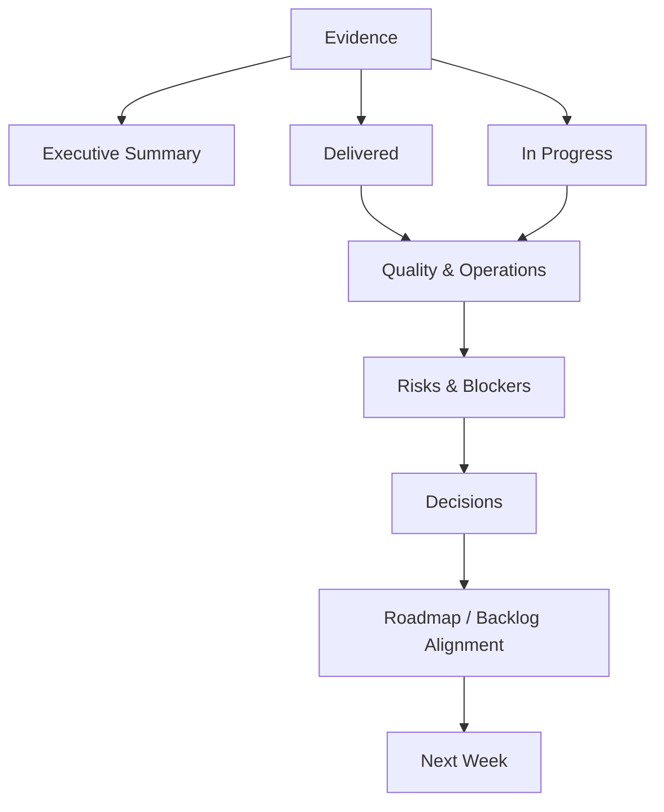

# 50_WEEKLY_UPDATE.md

# Aula Robótica Platform — Weekly Update

## Parte 1 — Propósito, modelo operativo, estructura, estado ejecutivo, delivery, producto y arquitectura

---

# 1. Propósito

Este documento define el modelo de **Weekly Update** de Aula Robótica Platform.

Su objetivo es proporcionar una visión periódica, compacta pero suficientemente rigurosa, del estado real del proyecto.

Debe responder principalmente:

```text
Where are we?

What changed?

What was completed?

What is currently in progress?

What is blocked?

What changed technically?

What comes next?
```

---

# 2. Naturaleza del documento

`50_WEEKLY_UPDATE.md` es un documento operacional.

No sustituye a:

```text
Product Vision

Product Roadmap

Feature Backlog

Architecture Documentation

CHANGELOG
```

---

# 3. Rol documental

La relación principal es:

```text
48_PRODUCT_VISION.md
        ↓
47_PRODUCT_ROADMAP.md
        ↓
49_FEATURE_BACKLOG.md
        ↓
Delivery
        ↓
50_WEEKLY_UPDATE.md
```

---

# 4. Pregunta principal

El Weekly Update debe permitir responder rápidamente:

> ¿Cuál es el estado real de Aula Robótica Platform esta semana?

---

# 5. Audiencia

El documento debe ser comprensible para:

- maintainer;
- developer;
- technical reviewer;
- product stakeholder;
- collaborator;
- future contributor.

---

# 6. Principio de síntesis

El Weekly Update debe ser:

```text
concise enough to scan

+

detailed enough to trust
```

---

# 7. No es un diario

No debe registrar cada acción realizada.

---

# 8. No es un commit log

No debe convertirse en:

```text
commit A

commit B

commit C
```

---

# 9. No es un CHANGELOG

El CHANGELOG registra evolución entregada del producto.

El Weekly Update registra:

```text
current delivery state
```

---

# 10. No es un backlog

No debe reproducir cientos de features pendientes.

---

# 11. No es una retrospectiva completa

Puede incluir aprendizajes, pero no sustituye una retrospectiva específica.

---

# 12. No es un informe ejecutivo genérico

Debe conservar suficiente contenido técnico para ser útil al desarrollo.

---

# 13. Weekly Update Principle

```text
Report outcomes

not activity volume.
```

---

# 14. Weak Update

```text
Worked on backend.

Updated some templates.

Fixed several bugs.

Continued testing.
```

---

# 15. Better Update

```text
Completed the project activity feed integration.

Added authorization coverage for task mutations.

Validated WebSocket reconnection after temporary disconnects.

Started attachment upload hardening.
```

---

# 16. Unidad temporal

La unidad recomendada es:

```text
one week
```

---

# 17. Period Identifier

Cada actualización debe identificar:

```text
week

start date

end date
```

---

# 18. Recommended Header

```yaml
week: YYYY-Www
period:
  from: YYYY-MM-DD
  to: YYYY-MM-DD
```

---

# 19. Example

```yaml
week: 2026-W33
period:
  from: 2026-08-10
  to: 2026-08-16
```

---

# 20. Update Date

También debe registrarse:

```yaml
updated_at: YYYY-MM-DD
```

---

# 21. Ownership

Debe existir una persona o rol responsable de consolidar la actualización.

---

# 22. Ownership Principle

La responsabilidad editorial no implica que todo el trabajo haya sido realizado por esa persona.

---

# 23. Source of Truth

El Weekly Update debe construirse a partir de evidencia real.

---

# 24. Candidate Sources

```text
Git history

Pull Requests

Issues

Milestones

tests

CI/CD

deployment state

documentation changes

product decisions
```

---

# 25. Evidence Rule

No declarar una feature como completada únicamente porque:

```text
implementation started
```

---

# 26. Completion Rule

Debe distinguirse:

```text
implemented

validated

merged

released
```

---

# 27. Status Vocabulary

Se recomienda un vocabulario pequeño y consistente.

---

# 28. Suggested Status

```text
PLANNED

READY

IN_PROGRESS

BLOCKED

VALIDATION

DONE

DEFERRED
```

---

# 29. Weekly Status Vocabulary

Para el resumen ejecutivo puede simplificarse a:

```text
ON_TRACK

AT_RISK

BLOCKED
```

---

# 30. ON_TRACK

Significa:

```text
Current objectives remain achievable without material intervention.
```

---

# 31. AT_RISK

Significa:

```text
An identified issue may affect expected delivery or quality.
```

---

# 32. BLOCKED

Significa:

```text
Meaningful progress cannot continue without resolving an external or internal dependency.
```

---

# 33. Status Guardrail

No utilizar `ON_TRACK` automáticamente por ausencia de incidentes.

---

# 34. Evidence-based Status

El estado debe considerar:

- delivery;
- blockers;
- quality;
- security;
- deployment;
- dependencies.

---

# 35. Weekly Update Structure

La estructura recomendada es:

```text
Metadata

Executive Summary

Weekly Objectives

Delivered

In Progress

Product

Architecture

Backend

Frontend

Realtime

Data

Security

Testing

DevOps

Observability

Documentation

Risks

Blockers

Decisions

Metrics

Next Week

References
```

---

# 36. Structure Flexibility

No todas las secciones necesitan contenido cada semana.

---

# 37. Empty Section Rule

Si una sección no tuvo cambios significativos puede indicarse:

```text
No material changes this week.
```

---

# 38. Avoid Artificial Content

No añadir contenido únicamente para llenar todas las secciones.

---

# 39. Metadata Section

Formato recomendado:

```yaml
project: Aula Robótica Platform
document: Weekly Update
week: YYYY-Www
period:
  from: YYYY-MM-DD
  to: YYYY-MM-DD
status: ON_TRACK
updated_at: YYYY-MM-DD
```

---

# 40. Optional Metadata

Puede añadirse:

```yaml
release_target: null
milestone: null
branch: main
```

---

# 41. Metadata Guardrail

No incluir metadata que nadie utilice.

---

# 42. Executive Summary

Debe ofrecer una lectura del estado general en pocos párrafos.

---

# 43. Executive Summary Questions

Debe responder:

```text
What was the most important outcome?

What is the current focus?

Is anything materially at risk?
```

---

# 44. Executive Summary Length

Recomendación:

```text
3–6 bullets

or

2–4 short paragraphs
```

---

# 45. Example Executive Summary

```markdown
## Executive Summary

- Completed the first end-to-end task activity workflow.
- Consolidated authorization checks for project-scoped task operations.
- Realtime reliability remains under validation after reconnect scenarios were added.
- Attachment security hardening is the next major platform task.
- No release-blocking issues are currently open.
```

---

# 46. Executive Summary Guardrail

No incluir detalles de implementación de bajo nivel.

---

# 47. Weekly Objectives

Debe registrar qué se pretendía conseguir durante el periodo.

---

# 48. Objective Format

Formato recomendado:

```markdown
| Objective | Status | Outcome |
|---|---|---|
| Complete task activity flow | DONE | End-to-end flow validated |
| Validate realtime reconnect | VALIDATION | Core scenarios passing |
| Harden attachment uploads | IN_PROGRESS | Validation layer started |
```

---

# 49. Objective Quality

Los objetivos deben expresar outcomes verificables.

---

# 50. Weak Objective

```text
Work on testing.
```

---

# 51. Better Objective

```text
Add integration coverage for project-scoped task authorization.
```

---

# 52. Objective Scope

Una semana no debería contener demasiados objetivos principales.

---

# 53. WIP Principle

Preferir:

```text
few completed objectives
```

frente a:

```text
many partially started objectives
```

---

# 54. Objective Carry-over

Si un objetivo continúa:

```text
carry-over
```

debe quedar visible.

---

# 55. Carry-over Reason

Debe indicarse brevemente:

```text
scope increased

dependency blocked

validation pending

priority changed
```

---

# 56. Delivered Section

Debe contener outcomes completados durante el periodo.

---

# 57. Delivered Definition

Un elemento pertenece aquí cuando ha alcanzado el estado considerado terminado para su scope.

---

# 58. Delivered Categories

Puede agruparse por:

```text
Product

Platform

Quality

Documentation
```

---

# 59. Delivered Item Format

Formato recomendado:

```markdown
### Task Activity Flow

**Status:** `DONE`

Delivered:

- activity creation;
- project association;
- authorization;
- activity feed integration;
- automated coverage.
```

---

# 60. Delivered Evidence

Cuando sea útil puede incluir:

```text
Issue

PR

commit

release

test evidence
```

---

# 61. Evidence Guardrail

No saturar el cuerpo principal con identificadores.

---

# 62. Reference Placement

Los detalles de trazabilidad pueden concentrarse al final.

---

# 63. Delivered ≠ Released

Debe indicarse si existe diferencia.

---

# 64. Example

```text
Implementation:
DONE

Release:
PENDING
```

---

# 65. Release Visibility

Esto evita afirmar que un usuario dispone de una feature que todavía no está desplegada.

---

# 66. In Progress Section

Debe reflejar únicamente trabajo activo relevante.

---

# 67. In Progress Format

```markdown
### Attachment Security Hardening

**Status:** `IN_PROGRESS`

Current scope:

- MIME validation;
- upload limits;
- filename normalization;
- authorization review.

Remaining:

- malware scanning decision;
- integration tests;
- operational logging.
```

---

# 68. Progress Rule

Evitar porcentajes arbitrarios como:

```text
75% complete
```

si no existe una base objetiva.

---

# 69. Better Progress Description

Preferir:

```text
Completed

Remaining

Blocked
```

---

# 70. In Progress Scope

No listar cada Issue abierto.

---

# 71. Product Section

Debe registrar cambios relevantes en comportamiento o alcance del producto.

---

# 72. Product Questions

```text
Did user-facing behavior change?

Was scope clarified?

Was a feature accepted, deferred or rejected?

Did priorities change?
```

---

# 73. Product Update Example

```markdown
## Product

### Inventory

The initial Inventory scope remains focused on individually identifiable assets.

Consumables remain outside the first delivery slice.

### Reservations

Conflict prevention has been confirmed as a P0 invariant before reservation UI expansion.
```

---

# 74. Product Decision

Las decisiones significativas deben reflejarse explícitamente.

---

# 75. Product Decision Example

```text
Decision:
Student identity remains separate from authentication identity.
```

---

# 76. Decision Reason

Debe incluirse una justificación breve cuando aporte contexto.

---

# 77. Product Drift Detection

El Weekly Update puede revelar desviaciones entre:

```text
what the roadmap says

and

what development is actually doing
```

---

# 78. Drift Rule

Si existe desviación material debe hacerse visible.

---

# 79. Example Drift

```text
Roadmap focus:
Inventory

Actual focus:
Realtime reliability
```

---

# 80. Drift Explanation

Puede ser válida si:

```text
reliability issue became release-critical
```

---

# 81. Architecture Section

Debe registrar evolución arquitectónica significativa.

---

# 82. Architecture Scope

Incluye cambios en:

- boundaries;
- dependency direction;
- persistence;
- communication;
- storage;
- deployment;
- integration.

---

# 83. Architecture Update Example

```markdown
## Architecture

- Realtime events remain in-process for the current single-instance deployment.
- No distributed pub/sub layer is required at the current scale.
- Attachment storage continues behind the storage abstraction to preserve future S3-compatible migration.
```

---

# 84. Architecture Guardrail

No repetir la documentación arquitectónica completa.

---

# 85. Architecture Decision Reference

Si existe ADR:

```text
summarize decision

+

reference ADR
```

---

# 86. Architecture Stability

También puede ser útil indicar que no hubo cambios.

---

# 87. Example

```text
No architectural boundary changes were introduced this week.
```

---

# 88. Architecture Risk

Los riesgos descubiertos deben pasar a Risks o Technical Debt.

---

# 89. Backend Section

Debe resumir cambios relevantes en lógica server-side.

---

# 90. Backend Categories

Puede incluir:

```text
domain

application services

authorization

persistence

API

background jobs
```

---

# 91. Backend Example

```markdown
## Backend

- Added project-scoped authorization to task mutation services.
- Consolidated activity creation through the application service layer.
- Added pagination to project activity queries.
- Introduced validation for attachment ownership before association.
```

---

# 92. Backend Guardrail

No listar clases modificadas salvo que sean relevantes para comprender el cambio.

---

# 93. API Changes

Los cambios de contrato deben destacarse.

---

# 94. API Change Types

```text
new endpoint

changed request

changed response

deprecated endpoint

removed endpoint
```

---

# 95. Breaking API Change

Debe señalarse explícitamente.

---

# 96. Persistence Changes

Las migrations importantes deben aparecer.

---

# 97. Persistence Example

```text
Added database constraint preventing duplicate project memberships.
```

---

# 98. Data Integrity Changes

Tienen prioridad sobre detalles internos menores.

---

# 99. Background Jobs

Debe indicarse cualquier nuevo job o modificación de comportamiento programado.

---

# 100. Frontend Section

Debe resumir cambios de experiencia e interacción.

---

# 101. Frontend Categories

```text
navigation

views

forms

feedback

responsive

accessibility

realtime UX
```

---

# 102. Frontend Example

```markdown
## Frontend

- Added project activity timeline.
- Improved empty states for project task views.
- Added explicit loading and error states to notification actions.
- Updated mobile task navigation for narrow viewports.
```

---

# 103. Frontend Guardrail

No listar cambios puramente cosméticos sin impacto relevante.

---

# 104. UX Behavior Changes

Sí deben registrarse cuando afectan workflows.

---

# 105. Accessibility Changes

Deben aparecer cuando mejoran interacción significativa.

---

# 106. Example Accessibility Update

```text
Added keyboard navigation and focus management to modal dialogs.
```

---

# 107. Realtime Section

Debe registrar estado del comportamiento realtime.

---

# 108. Realtime Questions

```text
What events were added?

What reliability work changed?

What reconnect behavior was validated?

Were authorization rules changed?
```

---

# 109. Realtime Example

```markdown
## Realtime

- Task status changes now update authorized project subscribers.
- Reconnect scenarios were added to the validation suite.
- Client reconciliation remains under validation after temporary disconnects.
```

---

# 110. Realtime Reliability

Debe distinguir:

```text
event delivery

state correctness
```

---

# 111. Event Delivery

Que un mensaje llegue no garantiza que el estado final sea correcto.

---

# 112. Reconciliation

Debe mencionarse cuando exista trabajo sobre recuperación del estado.

---

# 113. Duplicate Events

Si se detectan o corrigen duplicados debe indicarse.

---

# 114. Realtime Authorization

Cualquier cambio debe considerarse security-relevant.

---

# 115. Data Section

Debe resumir cambios importantes en modelo o persistencia.

---

# 116. Data Categories

```text
schema

migration

constraints

indexes

seed data

retention
```

---

# 117. Data Example

```markdown
## Data

- Added a unique constraint for project membership.
- Added an index supporting task queries by project and status.
- No destructive migrations were introduced.
```

---

# 118. Migration Risk

Las migrations destructivas o complejas deben aparecer en Risks.

---

# 119. Data Migration Classification

Puede utilizarse:

```text
ADDITIVE

TRANSFORMATIVE

DESTRUCTIVE
```

---

# 120. ADDITIVE

Ejemplos:

```text
new nullable column

new table

new index
```

---

# 121. TRANSFORMATIVE

Ejemplos:

```text
data backfill

column semantic change

relationship migration
```

---

# 122. DESTRUCTIVE

Ejemplos:

```text
column removal

table removal

irreversible transformation
```

---

# 123. Destructive Migration Rule

Debe requerir atención explícita.

---

# 124. Database Constraint Visibility

Las nuevas invariantes de integridad deben registrarse.

---

# 125. Index Visibility

No es necesario listar todos los índices.

---

# 126. Index Reporting Rule

Mencionar únicamente índices relevantes por:

```text
performance

integrity

major query support
```

---

# 127. Weekly Architecture Health

Puede incluir una pequeña evaluación.

---

# 128. Suggested Architecture Health

```yaml
architecture_health:
  modularity: stable
  coupling: stable
  persistence: stable
  realtime: validation
  external_dependencies: stable
```

---

# 129. Health Vocabulary

Puede utilizarse:

```text
stable

improving

attention

at_risk
```

---

# 130. Health Guardrail

No convertir esta evaluación en scoring artificial.

---

# 131. Product Health Snapshot

Puede utilizarse un resumen similar.

---

# 132. Example Product Health

```yaml
product_health:
  core_collaboration: stable
  notifications: improving
  realtime: attention
  academic: planned
  inventory: planned
```

---

# 133. Delivery Health Snapshot

Puede resumir:

```yaml
delivery_health:
  implementation: on_track
  validation: on_track
  deployment: stable
  blockers: none
```

---

# 134. Health Snapshot Purpose

Facilitar lectura rápida, no reemplazar el análisis.

---

# 135. Weekly Delta

Una sección opcional puede mostrar:

```text
Previous week

→

Current week
```

---

# 136. Example Weekly Delta

```markdown
## Weekly Delta

| Area | Previous | Current |
|---|---|---|
| Task activity | IN_PROGRESS | DONE |
| Realtime reconnect | PLANNED | VALIDATION |
| Attachment hardening | READY | IN_PROGRESS |
| Inventory foundation | PLANNED | PLANNED |
```

---

# 137. Delta Benefit

Permite detectar movimiento real.

---

# 138. Delta Guardrail

No incluir decenas de filas.

---

# 139. Milestone Progress

Cuando exista Milestone activo debe aparecer.

---

# 140. Milestone Example

```yaml
milestone:
  name: Core Reliability
  status: IN_PROGRESS
  completed_items: 7
  remaining_items: 3
```

---

# 141. Milestone Percentage

Puede calcularse únicamente cuando:

```text
items have comparable meaning
```

---

# 142. Percentage Guardrail

No interpretar automáticamente:

```text
7 / 10 items complete

=

70% of effort complete
```

---

# 143. Release Target

Si existe release activa:

```yaml
release:
  target: v0.x.x
  status: VALIDATION
```

---

# 144. Release Content

Debe resumirse por outcomes.

---

# 145. Release Example

```markdown
### Release Target — v0.x.x

Expected scope:

- task activity integration;
- authorization hardening;
- realtime reconnect reliability;
- attachment validation improvements.
```

---

# 146. Release Risk

Debe indicarse si existe algo que pueda impedirla.

---

# 147. Release Readiness

Puede utilizarse:

```text
NOT_READY

AT_RISK

READY
```

---

# 148. Release Readiness Criteria

Debe considerar:

- scope complete;
- tests;
- security;
- migrations;
- deployment;
- known blockers.

---

# 149. Release Readiness Guardrail

No marcar `READY` únicamente porque el código esté merged.

---

# 150. Delivery Pipeline View

El Weekly Update puede resumir el flujo:

```text
Backlog

↓

Ready

↓

Development

↓

Validation

↓

Release
```

---

# 151. Weekly Delivery Flow

Debe mostrar dónde se concentra actualmente el trabajo.

---

# 152. Example

```yaml
delivery_flow:
  ready: 3
  in_progress: 2
  validation: 1
  blocked: 0
```

---

# 153. Flow Metric Guardrail

Los counts sirven como señal, no como medida de productividad.

---

# 154. Productivity Principle

No medir productividad por:

```text
commits

lines of code

number of tickets
```

---

# 155. Better Delivery Signals

Preferir:

```text
completed outcomes

reduced risk

validated behavior

resolved blockers
```

---

# 156. Scope Change

Los cambios de scope deben registrarse.

---

# 157. Scope Change Format

```markdown
### Scope Change

**Change:** Malware scanning moved out of the current attachment hardening slice.

**Reason:** Provider and deployment strategy require additional discovery.

**Impact:** MIME validation, size limits and authorization remain in the current delivery.
```

---

# 158. Scope Reduction

No debe interpretarse automáticamente como fallo.

---

# 159. Scope Discipline

Reducir scope puede mejorar entrega cuando preserva el outcome principal.

---

# 160. Scope Increase

Debe justificarse si introduce riesgo significativo.

---

# 161. Unplanned Work

Debe hacerse visible cuando desplaza objetivos.

---

# 162. Unplanned Work Categories

```text
production issue

security finding

dependency failure

critical bug

urgent institutional requirement
```

---

# 163. Unplanned Work Example

```markdown
### Unplanned Work

A realtime authorization regression was discovered during validation.

The issue was prioritized above planned Inventory work because it could expose project events to unauthorized subscribers.
```

---

# 164. Unplanned Work Value

Permite explicar por qué el roadmap visible no avanzó según lo esperado.

---

# 165. Weekly Technical Outcome

Debe existir al menos una respuesta clara a:

```text
How did the platform become technically safer or stronger this week?
```

---

# 166. Weekly Product Outcome

Debe existir respuesta a:

```text
How did the product become more useful this week?
```

cuando hubo delivery funcional.

---

# 167. Weekly Learning Outcome

También puede responder:

```text
What important thing did we learn?
```

---

# 168. Learning Example

```text
WebSocket reconnect alone is insufficient; the client requires state reconciliation after missed events.
```

---

# 169. Learning Value

Un aprendizaje puede ser un resultado válido incluso si descarta una implementación.

---

# 170. Discovery Outcome

Ejemplo:

```text
Redis is not currently required because production remains single-instance.
```

---

# 171. Avoid Solution Bias

El Weekly Update debe reflejar decisiones de no construir cuando sean relevantes.

---

# 172. Example

```text
Decision:
Do not introduce a message broker for the current realtime architecture.

Reason:
No durability or multi-instance requirement currently justifies the operational complexity.
```

---

# 173. Documentation Synchronization

Si una decisión cambia arquitectura o producto, deben actualizarse los documentos fuente correspondientes.

---

# 174. Weekly Update Is Not Source of Truth for Architecture

Debe apuntar a la decisión estable, no reemplazarla.

---

# 175. Weekly Update Is Not Source of Truth for Product Vision

Debe reflejar cambios aprobados.

---

# 176. Weekly Update Is Not Source of Truth for Backlog

Debe resumir qué elementos se movieron o cambiaron.

---

# 177. Traceability Principle

```text
Weekly Update

summarizes

source-of-truth artifacts
```

---

# 178. Recommended Writing Style

Debe utilizar:

```text
short paragraphs

clear headings

explicit statuses

concrete outcomes
```

---

# 179. Avoid

```text
vague language

marketing language

unverifiable claims

excessive implementation detail
```

---

# 180. Preferred Tone

```text
technical

neutral

evidence-based

decision-oriented
```

---

# 181. Example — Weak Tone

```text
We made amazing progress on many exciting improvements.
```

---

# 182. Example — Better Tone

```text
Project-scoped task authorization is now covered by integration tests and validated for create, update and delete operations.
```

---

# 183. Confidence Language

Cuando algo no está validado debe indicarse.

---

# 184. Useful Terms

```text
implemented

under validation

observed

confirmed

suspected

planned
```

---

# 185. Avoid False Certainty

No utilizar:

```text
fixed
```

si únicamente se ha modificado código pero no validado.

---

# 186. Better

```text
A fix was implemented and is awaiting regression validation.
```

---

# 187. Current-State Snapshot Template

```markdown
## Current State

| Area | Status | Current Focus |
|---|---|---|
| Core collaboration | ON_TRACK | Authorization consolidation |
| Realtime | AT_RISK | Reconnect reconciliation |
| Attachments | IN_PROGRESS | Upload hardening |
| Academic | PLANNED | Domain discovery |
| Inventory | PLANNED | Asset model |
```

---

# 188. Current-State Scope

Debe limitarse a áreas relevantes.

---

# 189. Current Focus

Debe representar el trabajo real.

---

# 190. Status Change

Si un área cambia a `AT_RISK`, debe explicarse posteriormente.

---

# 191. Weekly Update Minimal Version

Para semanas con poca actividad:

```markdown
# Weekly Update — YYYY-Www

## Executive Summary

## Delivered

## In Progress

## Risks / Blockers

## Next Week
```

---

# 192. Weekly Update Full Version

Para semanas con actividad significativa:

```text
Metadata
Executive Summary
Objectives
Current State
Delivered
In Progress
Product
Architecture
Backend
Frontend
Realtime
Data
Security
Testing
DevOps
Observability
Documentation
Risks
Blockers
Decisions
Metrics
Next Week
References
```

---

# 193. Template Selection

La profundidad debe adaptarse a la cantidad de cambio real.

---

# 194. Historical Updates

Existen dos estrategias válidas.

---

# 195. Strategy A — Rolling Document

`50_WEEKLY_UPDATE.md` contiene únicamente la semana actual.

---

# 196. Strategy B — Historical Document

El archivo acumula varias semanas.

---

# 197. Recommended Strategy

Preferencia:

```text
current weekly update

+

Git history
```

---

# 198. Reason

Evita crecimiento indefinido del archivo.

---

# 199. Historical Snapshot

Si se necesitan snapshots explícitos pueden archivarse.

---

# 200. Candidate Archive Structure

```text
docs/
└── updates/
    ├── 2026/
    │   ├── 2026-W31.md
    │   ├── 2026-W32.md
    │   └── 2026-W33.md
```

---

# 201. Archive Decision

No crear esta estructura hasta que exista valor real en consultar snapshots semanales independientes.

---

# 202. Git History

Para un proyecto pequeño puede ser suficiente.

---

# 203. Weekly Update Maintenance

La actualización debería realizarse cerca del cierre del periodo.

---

# 204. Recommended Workflow

```text
Review objectives

↓

Review merged work

↓

Review validation

↓

Review blockers

↓

Review decisions

↓

Update next-week focus
```

---

# 205. Evidence Collection

No depender exclusivamente de memoria.

---

# 206. Evidence Sources Review

Revisar cuando aplique:

```text
git log

GitHub Issues

Pull Requests

Milestone

CI

deployment

test results
```

---

# 207. Delivery Evidence

Debe diferenciar:

```text
code exists

code merged

code deployed
```

---

# 208. Weekly Update Completion

La actualización está completa cuando una persona externa al trabajo diario puede comprender:

```text
current state

recent outcomes

current risk

next focus
```

---

# 209. Weekly Update Quality Gate

Antes de publicar:

- [ ] periodo correcto;
- [ ] estado general justificado;
- [ ] outcomes claros;
- [ ] trabajo activo real;
- [ ] blockers visibles;
- [ ] decisiones importantes registradas;
- [ ] next steps concretos;
- [ ] referencias válidas;
- [ ] sin afirmaciones no verificadas.

---

# 210. Part 1 Summary

La primera parte establece:

```text
purpose

scope

operating model

document structure

executive reporting

delivery reporting

product reporting

architecture reporting
```

---

# 211. Continuation

La **Parte 2/3** continúa con:

```text
Security

Testing

UI Testing

Realtime Testing

DevOps

CI/CD

Deployment

Monitoring

Logging

Observability

Documentation

Metrics

Risks

Blockers

Technical Debt

Decisions
```

---

# 50_WEEKLY_UPDATE.md

# Aula Robótica Platform — Weekly Update

## Parte 2 — Security, Testing, DevOps, Observability, Documentation, Metrics, Risks, Blockers, Technical Debt y Decisions

---

# 212. Security Section

La sección `Security` debe registrar cambios que afecten a la postura de seguridad de la plataforma.

---

# 213. Security Scope

Puede incluir:

```text
authentication

authorization

session management

input validation

file security

dependency security

secret management

security headers

auditability
```

---

# 214. Security Reporting Principle

El Weekly Update debe centrarse en:

```text
risk changed

control added

finding discovered

finding resolved
```

---

# 215. Security Example

```markdown
## Security

- Added authorization regression coverage for project-scoped task mutations.
- Attachment uploads now validate configured size limits before persistence.
- Dependency scanning reported no new critical vulnerabilities.
- WebSocket subscription authorization remains under validation.
```

---

# 216. Security Finding Status

Puede utilizarse:

```text
OPEN

MITIGATED

RESOLVED

ACCEPTED

DEFERRED
```

---

# 217. OPEN

Existe un riesgo identificado que todavía requiere tratamiento.

---

# 218. MITIGATED

Se ha reducido el riesgo, pero puede quedar trabajo pendiente.

---

# 219. RESOLVED

El riesgo ha sido tratado y validado según el alcance definido.

---

# 220. ACCEPTED

El riesgo se mantiene conscientemente.

---

# 221. Risk Acceptance

Una aceptación significativa debería registrar:

```text
reason

impact

owner

review trigger
```

---

# 222. DEFERRED

El tratamiento se aplaza deliberadamente.

---

# 223. Deferred Security Work

Debe quedar visible si puede afectar decisiones futuras.

---

# 224. Security Severity

Cuando sea útil:

```text
CRITICAL

HIGH

MEDIUM

LOW
```

---

# 225. Severity Guardrail

No asignar severidad arbitrariamente.

---

# 226. Vulnerability Reporting

No incluir detalles explotables innecesarios en documentación pública.

---

# 227. Sensitive Security Information

Evitar publicar:

```text
secrets

tokens

internal credentials

private endpoints

exploit instructions
```

---

# 228. Security Delta

Puede mostrarse:

```markdown
| Control | Previous | Current |
|---|---|---|
| Task authorization tests | Partial | Covered |
| Attachment MIME validation | Missing | Implemented |
| Realtime authorization | Partial | Validation |
```

---

# 229. Authentication Update

Registrar únicamente cambios significativos.

---

# 230. Authentication Example

```text
Session expiration handling was aligned between backend and frontend.
```

---

# 231. Authorization Update

Tiene especial relevancia porque afecta acceso a dominio.

---

# 232. Authorization Example

```text
Project membership is now checked server-side before task updates.
```

---

# 233. UI Authorization Guardrail

Ocultar botones no debe reportarse como control de autorización.

---

# 234. Authorization Source

Debe quedar claro que el enforcement relevante ocurre en backend.

---

# 235. Attachment Security

Puede incluir:

```text
file size

content type

filename normalization

authorization

storage

malware scanning
```

---

# 236. Dependency Security

Registrar:

```text
critical findings

major upgrades

security-driven dependency changes
```

---

# 237. Routine Dependency Updates

No necesitan ocupar el Weekly Update salvo impacto relevante.

---

# 238. Secret Management

Cualquier incidente o cambio importante debe reflejarse sin revelar el secreto.

---

# 239. Security Review

Una feature sensible puede indicar:

```text
Security review:
PASSED
```

---

# 240. Security Review Guardrail

`PASSED` debe implicar criterios conocidos, no una impresión informal.

---

# 241. Testing Section

Debe explicar cómo cambió la confianza en el comportamiento del sistema.

---

# 242. Testing Principle

```text
Report confidence

not test quantity.
```

---

# 243. Weak Testing Update

```text
Added 35 tests.
```

---

# 244. Better Testing Update

```text
Added integration coverage for project-scoped authorization and task lifecycle transitions.
```

---

# 245. Testing Scope

Puede incluir:

```text
unit

integration

API

UI

E2E

realtime

security

performance
```

---

# 246. Testing Example

```markdown
## Testing

- Added integration tests for task authorization boundaries.
- Added regression coverage for duplicate project membership.
- Added reconnect scenarios to the realtime test suite.
- Critical project and task journeys remain green.
```

---

# 247. Test Status Vocabulary

Puede utilizarse:

```text
PASSING

FAILING

FLAKY

NOT_COVERED

UNDER_VALIDATION
```

---

# 248. Critical Journey Reporting

Debe priorizar journeys importantes.

---

# 249. Candidate Critical Journeys

```text
login

project access

task lifecycle

attachment upload

notification read

realtime update
```

---

# 250. Future Critical Journeys

Podrán incluir:

```text
student enrollment

course session

asset reservation

maintenance workflow

competition registration
```

---

# 251. Test Count

Puede incluirse como información secundaria.

---

# 252. Test Count Guardrail

Un aumento del número de tests no implica automáticamente mayor calidad.

---

# 253. Coverage Percentage

Puede utilizarse con cautela.

---

# 254. Coverage Guardrail

```text
high coverage

≠

high confidence
```

---

# 255. More Useful Question

```text
Are important behaviors protected?
```

---

# 256. Regression Testing

Debe registrarse cuando una incidencia genera protección permanente.

---

# 257. Regression Example

```text
Added regression coverage reproducing unauthorized task mutation discovered during validation.
```

---

# 258. Flaky Tests

Deben hacerse visibles cuando reducen confianza en CI.

---

# 259. Flaky Test Example

```markdown
### Flaky Test

Realtime reconnect E2E remains intermittently unstable under CI timing conditions.

**Impact:** Medium.

**Action:** Replace fixed waits with event/state-based synchronization.
```

---

# 260. Test Debt

La ausencia conocida de cobertura puede convertirse en Technical Debt.

---

# 261. UI Testing Section

Puede integrarse dentro de Testing o separarse cuando exista trabajo relevante.

---

# 262. UI Testing Scope

Debe centrarse en journeys de usuario.

---

# 263. UI Testing Example

```markdown
### UI Testing

Validated:

- project creation;
- task creation;
- task status update;
- notification read state;
- mobile navigation.

Pending:

- attachment error recovery;
- realtime reconnect state reconciliation.
```

---

# 264. UI Test Priority

Preferir:

```text
critical user journeys
```

sobre:

```text
every visual detail
```

---

# 265. UI Test Stability

Los tests deben usar:

```text
stable selectors

deterministic state

explicit synchronization
```

---

# 266. UI Testing Anti-pattern

No debe celebrarse una suite grande si falla aleatoriamente.

---

# 267. E2E Scope

El Weekly Update puede indicar qué journeys completos están protegidos.

---

# 268. Example E2E Status

```yaml
e2e:
  authentication: passing
  projects: passing
  tasks: passing
  attachments: partial
  notifications: passing
  realtime: validation
```

---

# 269. Realtime Testing Section

Debe aparecer cuando se modifique comportamiento realtime o su fiabilidad.

---

# 270. Realtime Testing Dimensions

```text
connection

subscription

authorization

delivery

ordering

duplication

reconnection

reconciliation
```

---

# 271. Connection Tests

Validan establecimiento y cierre.

---

# 272. Subscription Tests

Validan que el cliente recibe únicamente canales/eventos adecuados.

---

# 273. Authorization Tests

Validan que un usuario no accede a eventos fuera de su scope.

---

# 274. Delivery Tests

Validan llegada de eventos esperados.

---

# 275. Ordering Tests

Solo son necesarios cuando el orden afecta comportamiento.

---

# 276. Duplicate Tests

Validan tolerancia frente a eventos repetidos cuando corresponda.

---

# 277. Reconnection Tests

Validan recuperación de conexión.

---

# 278. Reconciliation Tests

Validan recuperación del estado correcto después de pérdida temporal de eventos.

---

# 279. Realtime Testing Example

```markdown
### Realtime Testing

Passing:

- authenticated connection;
- authorized project subscription;
- task update delivery;
- disconnect/reconnect.

Under validation:

- state reconciliation after missed events;
- duplicate event tolerance.
```

---

# 280. Realtime Quality Principle

```text
Connected

does not mean

consistent.
```

---

# 281. Realtime Release Gate

Una feature realtime crítica no debería considerarse lista si:

```text
reconnect works

but

state recovery is undefined
```

---

# 282. DevOps Section

Debe reflejar cambios en capacidad de construir, validar y desplegar.

---

# 283. DevOps Scope

```text
CI

CD

containers

environments

configuration

deployment

rollback

backups
```

---

# 284. DevOps Example

```markdown
## DevOps

- Backend tests remain mandatory in CI.
- Frontend validation was added to the pull request pipeline.
- Deployment smoke checks now run after application startup.
- No infrastructure topology changes were introduced.
```

---

# 285. CI/CD Section

Puede separarse si existe actividad relevante.

---

# 286. CI Questions

```text
Did validation become stronger?

Did feedback become faster?

Did reliability change?

Are there pipeline blockers?
```

---

# 287. CI Example

```markdown
### CI/CD

- Added frontend tests to pull request validation.
- Dependency scanning remains mandatory.
- Container build now occurs only after test stages succeed.
```

---

# 288. Pipeline Status

Puede resumirse:

```yaml
ci:
  backend_tests: passing
  frontend_tests: passing
  security_scan: passing
  container_build: passing
  ui_tests: validation
```

---

# 289. Pipeline Failure

Un fallo debe indicar:

```text
cause

impact

current action
```

---

# 290. Pipeline Failure Example

```markdown
### CI Issue

**Status:** `RESOLVED`

Container publication failed because registry credentials were unavailable to the protected branch pipeline.

Credential configuration was corrected and publication was revalidated.
```

---

# 291. Pipeline Noise

Los fallos no relacionados con cambios funcionales también importan si reducen confianza.

---

# 292. CI Reliability

Una pipeline frecuentemente roja por causas espurias debe considerarse deuda.

---

# 293. Build Reproducibility

Debe señalarse cualquier mejora significativa.

---

# 294. Example

```text
Container builds now use pinned runtime versions to reduce environment drift.
```

---

# 295. Deployment Section

Debe indicar cambios en capacidad o estado de despliegue.

---

# 296. Deployment Scope

```text
environment

artifact

configuration

migration

startup

health

rollback
```

---

# 297. Deployment Example

```markdown
## Deployment

- Current release candidate deployed successfully to the validation environment.
- Database migrations completed without manual intervention.
- Post-deployment smoke tests passed.
- Rollback procedure remains unchanged.
```

---

# 298. Environment Vocabulary

Puede utilizarse:

```text
LOCAL

DEVELOPMENT

TEST

STAGING

PRODUCTION
```

según entornos reales.

---

# 299. Environment Guardrail

No documentar entornos hipotéticos como si existieran.

---

# 300. Deployment Status

```text
NOT_DEPLOYED

DEPLOYED

VALIDATING

FAILED

ROLLED_BACK
```

---

# 301. Deployment Evidence

Puede incluir:

```text
pipeline

release

health check

smoke test
```

---

# 302. Deployment Failure

Debe hacerse visible incluso si finalmente se resolvió durante la semana.

---

# 303. Rollback

Si fue necesario:

```text
why

what was restored

what follow-up exists
```

---

# 304. Rollback Example

```markdown
### Rollback

The release candidate was rolled back after attachment downloads returned authorization errors.

The previous artifact was restored successfully.

A regression test was added before the next deployment attempt.
```

---

# 305. Deployment Safety

Debe distinguirse entre:

```text
deployment succeeded

and

application validated
```

---

# 306. Post-deployment Validation

Puede incluir:

```text
health

login

critical API

database connectivity

critical UI journey
```

---

# 307. Configuration Changes

Los cambios significativos deben registrarse.

---

# 308. Configuration Guardrail

Nunca incluir valores secretos.

---

# 309. Backup Section

Puede incluirse dentro de DevOps cuando exista actividad.

---

# 310. Backup Reporting

Debe centrarse en:

```text
backup success

restore validation

retention

failure
```

---

# 311. Backup Principle

```text
A backup is not trusted until restoration is validated.
```

---

# 312. Restore Test

Si se realiza debe destacarse.

---

# 313. Example

```text
Database restore was validated successfully using the latest scheduled backup.
```

---

# 314. Monitoring Section

Debe reflejar cambios en detección de problemas.

---

# 315. Monitoring Scope

```text
availability

latency

errors

resources

dependencies

business-critical signals
```

---

# 316. Monitoring Example

```markdown
## Monitoring

- Added API error-rate monitoring for critical endpoints.
- Added database pool saturation visibility.
- No new availability alerts were triggered during the period.
```

---

# 317. Monitoring Principle

```text
Monitor symptoms users care about

and

signals operators can act on.
```

---

# 318. Monitoring Anti-pattern

Evitar alertas por cada métrica disponible.

---

# 319. Alert Quality

Una alerta útil debe ser:

```text
actionable

meaningful

appropriately urgent
```

---

# 320. Alert Noise

Debe registrarse si alertas excesivas están reduciendo utilidad.

---

# 321. Alert Change Example

```text
Raised the sustained error-rate window to reduce false-positive alerts caused by isolated failures.
```

---

# 322. Monitoring Gap

Una incidencia no detectada automáticamente puede revelar un gap.

---

# 323. Example Monitoring Gap

```markdown
### Monitoring Gap

Attachment storage exhaustion was discovered manually.

**Follow-up:** Add storage capacity monitoring before the next release.
```

---

# 324. Logging Section

Debe reflejar cambios en capacidad de diagnóstico mediante logs.

---

# 325. Logging Scope

```text
structure

context

correlation

severity

privacy

retention
```

---

# 326. Logging Example

```markdown
## Logging

- Added correlation IDs to request and realtime event logs.
- Removed attachment filenames from INFO-level logging.
- Reduced duplicate authentication failure logs.
```

---

# 327. Logging Principle

```text
Logs should explain behavior

without exposing sensitive data.
```

---

# 328. Sensitive Logging

Debe evitar:

```text
passwords

tokens

session identifiers

personal data

attachment contents
```

---

# 329. Log Level Review

Cambios importantes pueden registrarse.

---

# 330. Example

```text
Expected validation failures were moved from ERROR to WARN to reduce operational noise.
```

---

# 331. Correlation

Debe destacarse cuando mejora diagnóstico entre componentes.

---

# 332. Correlation Example

```text
HTTP requests and resulting realtime events can now be traced using the same correlation identifier.
```

---

# 333. Observability Section

Debe ofrecer una visión más amplia que Monitoring o Logging.

---

# 334. Observability Scope

```text
logs

metrics

traces

events

diagnostic context
```

---

# 335. Observability Question

Debe responder:

```text
Can we understand why the system behaves this way?
```

---

# 336. Observability Example

```markdown
## Observability

- Request correlation now propagates into application service logs.
- Realtime delivery metrics expose successful and failed broadcasts.
- Dashboard query latency is now measurable independently.
```

---

# 337. Observability Maturity

Puede resumirse por áreas.

---

# 338. Example

```yaml
observability:
  logs: stable
  metrics: improving
  traces: planned
  realtime: improving
  background_jobs: planned
```

---

# 339. Observability Guardrail

No introducir distributed tracing únicamente por sofisticación técnica.

---

# 340. Trace Adoption Trigger

Puede justificarse cuando:

```text
request paths cross enough components

that logs and metrics no longer explain failures efficiently
```

---

# 341. Metrics Reporting

Las métricas deben seleccionarse por utilidad.

---

# 342. Technical Metrics

Ejemplos:

```text
request latency

error rate

deployment failures

test reliability

job failures
```

---

# 343. Product Metrics

Ejemplos:

```text
active projects

task completion

asset utilization

reservation conflicts
```

---

# 344. Metric Separation

No mezclar sin contexto:

```text
system health

product usage
```

---

# 345. Weekly Metric Snapshot

Puede utilizarse:

```markdown
## Metrics

| Metric | Current | Previous | Trend |
|---|---:|---:|---|
| Critical CI failures | 0 | 2 | Improving |
| Open P0 defects | 0 | 1 | Improving |
| Flaky critical tests | 1 | 1 | Stable |
```

---

# 346. Metric Trend

Puede utilizar:

```text
Improving

Stable

Worsening
```

---

# 347. Metric Guardrail

No inventar números para completar el informe.

---

# 348. Unknown Metrics

Si no existe medición:

```text
Not currently measured.
```

---

# 349. Baseline

Las primeras semanas pueden dedicarse a establecer baseline.

---

# 350. Baseline Principle

No evaluar tendencia sin suficientes datos comparables.

---

# 351. Performance Metrics

Cuando existan:

```text
p50

p95

p99
```

pueden ser más útiles que el promedio.

---

# 352. Performance Reporting Guardrail

No incluir percentiles si todavía no existe instrumentación fiable.

---

# 353. Error Metrics

Debe distinguirse cuando sea posible:

```text
expected client errors

unexpected server errors
```

---

# 354. Availability Metrics

Solo deben declararse si existe medición real.

---

# 355. SLO Reporting

Puede incorporarse cuando existan SLOs definidos.

---

# 356. SLO Guardrail

No inventar objetivos de disponibilidad sin contexto operativo.

---

# 357. Documentation Section

Debe registrar documentación creada o actualizada cuando afecta mantenimiento o producto.

---

# 358. Documentation Scope

```text
architecture

modules

testing

operations

product

governance

ADRs
```

---

# 359. Documentation Example

```markdown
## Documentation

Updated:

- `44_TESTING_STRATEGY.md`
- `45_UI_TESTING.md`
- `46_REALTIME_TESTING.md`
- `49_FEATURE_BACKLOG.md`

The documentation now reflects the current testing and product evolution model.
```

---

# 360. Documentation Guardrail

No listar cada corrección tipográfica.

---

# 361. Documentation Outcome

Preferir explicar qué conocimiento quedó consolidado.

---

# 362. Documentation Drift

Debe señalarse si documentación relevante está desactualizada.

---

# 363. Example Documentation Debt

```text
The deployment guide still reflects the previous environment configuration and requires synchronization.
```

---

# 364. ADR Reporting

Las nuevas decisiones arquitectónicas deben mencionarse.

---

# 365. ADR Example

```text
ADR-012 accepted: retain in-process realtime delivery while production remains single-instance.
```

---

# 366. Documentation as Deliverable

Una mejora documental puede ser un outcome completo cuando elimina ambigüedad significativa.

---

# 367. Risks Section

Debe registrar incertidumbres que puedan afectar objetivos futuros.

---

# 368. Risk Definition

Un riesgo es:

```text
a possible future event or condition
that could negatively affect the project
```

---

# 369. Risk ≠ Issue

```text
Risk:
might happen
```

```text
Issue:
is happening
```

---

# 370. Risk Format

Formato recomendado:

```markdown
### RISK-001 — Realtime reconciliation

**Probability:** Medium  
**Impact:** High  
**Status:** OPEN

The current reconnect flow may leave the client with stale state after missed events.

**Mitigation:** Add authoritative state reconciliation after reconnect.
```

---

# 371. Risk Dimensions

Puede utilizarse:

```text
Probability

Impact
```

---

# 372. Risk Values

```text
Low

Medium

High
```

---

# 373. Risk Score

No es obligatorio.

---

# 374. Risk Scoring Guardrail

Evitar falsa precisión.

---

# 375. Risk Categories

```text
Product

Technical

Security

Data

Operational

Dependency

Schedule
```

---

# 376. Product Risk

Ejemplo:

```text
Inventory workflows may become too generic if robotics-specific requirements are not validated.
```

---

# 377. Technical Risk

Ejemplo:

```text
Realtime state recovery may become unreliable as event volume grows.
```

---

# 378. Security Risk

Ejemplo:

```text
Attachment content validation may be insufficient for untrusted uploads.
```

---

# 379. Data Risk

Ejemplo:

```text
Reservation concurrency could allow conflicting bookings without database-level protection.
```

---

# 380. Operational Risk

Ejemplo:

```text
Restore procedures have not yet been validated against production-like data volume.
```

---

# 381. Dependency Risk

Ejemplo:

```text
Institutional SSO integration depends on external identity-provider availability and configuration.
```

---

# 382. Schedule Risk

Ejemplo:

```text
Unplanned security hardening may delay Inventory foundation work.
```

---

# 383. Risk Owner

Cuando el equipo crezca puede añadirse:

```text
owner
```

---

# 384. Risk Mitigation

Debe ser concreta.

---

# 385. Weak Mitigation

```text
Monitor the situation.
```

---

# 386. Better Mitigation

```text
Add reconciliation tests and reload authoritative task state after WebSocket reconnect.
```

---

# 387. Risk Trigger

Puede definirse una señal que eleve el riesgo.

---

# 388. Example

```text
Trigger:
production deployment expands beyond one application instance.
```

---

# 389. Risk Closure

Un riesgo puede cerrarse cuando:

```text
condition no longer applies

or

mitigation reduces it sufficiently
```

---

# 390. Blockers Section

Debe registrar problemas que impiden progreso significativo.

---

# 391. Blocker Definition

```text
A blocker prevents meaningful progress on committed work.
```

---

# 392. Blocker Example

```markdown
### BLOCKER-001 — Institutional SSO credentials

**Status:** `OPEN`

Integration testing cannot continue until the test identity-provider configuration is available.

**Impact:** SSO validation blocked.

**Unblocked work:** Core authentication and authorization tests can continue independently.
```

---

# 393. Blocker Quality

Debe indicar:

```text
what is blocked

why

what can continue
```

---

# 394. Blocker Guardrail

No llamar blocker a cualquier dificultad.

---

# 395. Dependency Waiting

Puede ser:

```text
WAITING
```

sin ser necesariamente `BLOCKED`.

---

# 396. Example

```text
Waiting for UX review while backend implementation continues.
```

---

# 397. Blocker Age

Si persiste varias semanas debe hacerse visible.

---

# 398. Blocker Escalation

Un blocker antiguo puede requerir:

```text
scope change

alternative solution

priority change
```

---

# 399. Resolved Blockers

Puede registrarse durante la semana.

---

# 400. Example

```markdown
### Resolved

CI container publication was unblocked after correcting registry permissions.
```

---

# 401. Technical Debt Section

Debe registrar deuda nueva, reducida o priorizada.

---

# 402. Technical Debt Principle

```text
Debt should be visible before it becomes architecture.
```

---

# 403. Technical Debt Example

```markdown
## Technical Debt

### Reduced

- Consolidated duplicated task authorization logic.
- Removed obsolete notification event handling.

### Added / Accepted

- Realtime delivery remains process-local while deployment is single-instance.
- Malware scanning is deferred from the first attachment security slice.
```

---

# 404. Accepted Debt

No toda deuda requiere corrección inmediata.

---

# 405. Debt Acceptance Conditions

Debe ser:

```text
known

bounded

documented

revisitable
```

---

# 406. Debt Trigger

Puede indicar cuándo reconsiderarla.

---

# 407. Example

```text
Revisit process-local realtime delivery when horizontal scaling becomes necessary.
```

---

# 408. Debt Categories

```text
Architecture

Testing

Security

Data

UI

Operations

Documentation
```

---

# 409. Architecture Debt

Ejemplo:

```text
Notification delivery remains coupled to the current channel implementation.
```

---

# 410. Testing Debt

Ejemplo:

```text
Attachment failure recovery lacks end-to-end coverage.
```

---

# 411. Security Debt

Ejemplo:

```text
Malware scanning has not yet been introduced.
```

---

# 412. Data Debt

Ejemplo:

```text
Historical activity retention policy remains undefined.
```

---

# 413. UI Debt

Ejemplo:

```text
Some modal workflows still lack consistent keyboard focus management.
```

---

# 414. Operations Debt

Ejemplo:

```text
Restore testing is still manual.
```

---

# 415. Documentation Debt

Ejemplo:

```text
Deployment documentation does not yet cover rollback verification.
```

---

# 416. Debt Trend

Puede resumirse:

```text
Increasing

Stable

Reducing
```

---

# 417. Debt Trend Guardrail

Debe basarse en elementos significativos, no en conteo bruto.

---

# 418. Decisions Section

Debe registrar decisiones relevantes tomadas durante la semana.

---

# 419. Decision Scope

Incluye decisiones:

```text
product

architecture

security

delivery

scope
```

---

# 420. Decision Format

```markdown
### DEC-001 — Keep realtime delivery in-process

**Decision:** Retain the current in-process delivery model.

**Reason:** The deployed architecture remains single-instance and does not currently require distributed pub/sub.

**Revisit when:** Horizontal scaling becomes a real requirement.

**ADR:** ADR-012
```

---

# 421. Decision Principle

Registrar:

```text
what

why

when to reconsider
```

---

# 422. Decision Guardrail

No convertir cada detalle de implementación en una decisión formal.

---

# 423. Product Decision Example

```markdown
### DEC-002 — Consumables outside Inventory v1

**Decision:** The first Inventory slice manages individually identifiable assets only.

**Reason:** Consumables require different quantity and stock semantics.

**Revisit when:** Asset workflows are stable.
```

---

# 424. Security Decision Example

```markdown
### DEC-003 — Backend authorization remains authoritative

**Decision:** UI visibility rules will not be treated as authorization controls.

**Reason:** Security boundaries must remain enforceable independently of the client.
```

---

# 425. Delivery Decision Example

```markdown
### DEC-004 — Split attachment hardening

**Decision:** Deliver validation and authorization before malware scanning.

**Reason:** Malware scanning requires additional infrastructure discovery.

**Impact:** Core upload hardening can proceed without blocking the entire feature.
```

---

# 426. Rejected Decision

También puede registrarse una alternativa descartada.

---

# 427. Example

```markdown
### Rejected — Introduce Kafka for realtime events

**Reason:** Current requirements do not need durable cross-service event distribution.

**Reconsider if:** The architecture evolves toward independently deployed services.
```

---

# 428. Decision Traceability

Cuando exista ADR, Issue o PR relevante debe referenciarse.

---

# 429. Decision Drift

Si una decisión anterior deja de ser válida debe actualizarse en su fuente de verdad.

---

# 430. Weekly Decision Summary

Puede utilizarse una tabla:

```markdown
| Decision | Area | Result |
|---|---|---|
| Keep realtime in-process | Architecture | Accepted |
| Defer malware scanning | Security | Accepted |
| Keep consumables outside Inventory v1 | Product | Accepted |
```

---

# 431. Decision Count Guardrail

No medir progreso por cantidad de decisiones.

---

# 432. Cross-cutting Changes

Algunos cambios afectan varias áreas.

---

# 433. Example — Attachment Validation

Puede afectar:

```text
Backend

Security

Testing

Observability
```

---

# 434. Reporting Rule

No es necesario duplicar todo el contenido.

---

# 435. Primary Section Rule

Describir el cambio principalmente donde tenga más sentido.

---

# 436. Cross-reference

Las demás secciones pueden referenciarlo brevemente.

---

# 437. Weekly Quality Signals

Puede existir un resumen:

```yaml
quality:
  critical_tests: passing
  security_findings: none_blocking
  migrations: validated
  ci: stable
  deployment: stable
  observability: improving
```

---

# 438. Quality Signal Vocabulary

Preferir términos comprensibles frente a scores artificiales.

---

# 439. Release Quality Gate

Antes de declarar una release preparada deberían estar claros:

```text
tests

security

data

deployment

observability
```

---

# 440. Security Gate

Preguntar:

```text
Are authorization boundaries validated?
```

---

# 441. Data Gate

Preguntar:

```text
Are migrations and integrity constraints validated?
```

---

# 442. Testing Gate

Preguntar:

```text
Are critical journeys protected?
```

---

# 443. Deployment Gate

Preguntar:

```text
Can the artifact be safely deployed and recovered?
```

---

# 444. Observability Gate

Preguntar:

```text
Can critical failures be detected and diagnosed?
```

---

# 445. Weekly Risk Snapshot

Formato compacto opcional:

```yaml
risk_snapshot:
  critical: 0
  high: 1
  medium: 2
  blockers: 0
```

---

# 446. Risk Count Guardrail

Los números no sustituyen la descripción de riesgos importantes.

---

# 447. Weekly Technical Debt Snapshot

Formato opcional:

```yaml
technical_debt:
  trend: stable
  newly_accepted: 1
  reduced: 2
  escalated: 0
```

---

# 448. Debt Count Guardrail

No todas las deudas tienen peso comparable.

---

# 449. Weekly Decision Snapshot

Formato opcional:

```yaml
decisions:
  product: 1
  architecture: 1
  security: 1
```

---

# 450. Decision Snapshot Purpose

Solo facilitar navegación.

---

# 451. Incident Reporting

Si ocurre un incidente significativo debe aparecer.

---

# 452. Incident Scope

Debe resumir:

```text
impact

cause

resolution

follow-up
```

---

# 453. Incident Example

```markdown
### Incident — Attachment download authorization

**Impact:** Authorized users temporarily received access errors after deployment.

**Cause:** Authorization context was not propagated correctly to the storage adapter.

**Resolution:** Release rolled back and propagation corrected.

**Follow-up:**

- regression test added;
- deployment smoke test expanded;
- authorization logging improved.
```

---

# 454. Incident Guardrail

No publicar datos sensibles o detalles que aumenten riesgo.

---

# 455. Incident Learning

El Weekly Update debe capturar el aprendizaje operativo.

---

# 456. Incident Follow-up

Un incidente importante debería generar, según corresponda:

```text
bug

test

monitor

documentation

architecture improvement
```

---

# 457. Reliability Section

Puede existir separadamente cuando la semana esté centrada en estabilidad.

---

# 458. Reliability Scope

```text
failures

recovery

timeouts

retries

idempotency

reconciliation
```

---

# 459. Reliability Example

```markdown
## Reliability

- Realtime reconnect now restores the transport connection successfully.
- State reconciliation remains under validation.
- Attachment upload retries are intentionally disabled for non-idempotent requests.
```

---

# 460. Reliability Principle

```text
Recovery behavior

is part of feature behavior.
```

---

# 461. Timeout Changes

Deben registrarse cuando resuelven o introducen comportamiento relevante.

---

# 462. Retry Changes

Deben considerar idempotencia.

---

# 463. Retry Guardrail

No describir un retry como mejora si puede duplicar efectos.

---

# 464. Operational Readiness

Puede resumirse antes de release.

---

# 465. Operational Readiness Checklist

```markdown
### Operational Readiness

- [x] Health endpoint available
- [x] Critical logs available
- [x] Error metrics available
- [x] Deployment procedure validated
- [x] Database migration validated
- [ ] Restore procedure validated
```

---

# 466. Checklist Guardrail

Solo marcar elementos realmente comprobados.

---

# 467. Security Readiness Checklist

```markdown
### Security Readiness

- [x] Authentication validated
- [x] Authorization validated
- [x] Input validation covered
- [x] Secrets externalized
- [ ] Malware scanning available
```

---

# 468. Security Checklist Context

Un elemento pendiente no implica automáticamente bloqueo.

---

# 469. Release Blocking Criteria

Debe depender del riesgo y scope.

---

# 470. Testing Readiness Checklist

```markdown
### Testing Readiness

- [x] Unit tests
- [x] Integration tests
- [x] Critical API tests
- [x] Critical UI journeys
- [ ] Realtime reconciliation
```

---

# 471. Observability Readiness Checklist

```markdown
### Observability Readiness

- [x] Structured application logs
- [x] Request correlation
- [x] Critical error metrics
- [ ] Background job metrics
- [ ] Distributed tracing
```

---

# 472. Optional Capabilities

No marcar como fallo capacidades no necesarias para el release actual.

---

# 473. Weekly Confidence

Puede resumirse cualitativamente.

---

# 474. Example

```yaml
confidence:
  product_behavior: high
  security: high
  realtime_reliability: medium
  deployment: high
```

---

# 475. Confidence Guardrail

Debe reflejar evidencia.

---

# 476. Confidence ≠ Optimism

```text
Confidence

comes from

validation.
```

---

# 477. Evidence Matrix

Opcionalmente:

```markdown
| Area | Evidence |
|---|---|
| Authorization | Integration tests |
| Realtime | Integration + E2E |
| Deployment | Pipeline + smoke test |
| Migration | Integration environment |
```

---

# 478. Evidence Matrix Purpose

Mostrar por qué existe confianza.

---

# 479. Known Unknowns

Puede existir una sección para incertidumbres relevantes.

---

# 480. Example

```markdown
## Known Unknowns

- Real-world reservation concurrency volume is not yet known.
- Institutional SSO requirements have not yet been confirmed.
- Expected attachment storage growth is not yet measured.
```

---

# 481. Known Unknowns Value

Evita convertir supuestos en hechos.

---

# 482. Assumptions

Los supuestos relevantes pueden hacerse explícitos.

---

# 483. Example

```text
Assumption:
Initial production deployment remains single-instance.
```

---

# 484. Assumption Trigger

Debe reconsiderarse si cambia el contexto.

---

# 485. Assumption vs Decision

```text
Assumption:
belief about context
```

```text
Decision:
chosen course of action
```

---

# 486. Assumption vs Risk

Un supuesto incierto puede generar un riesgo.

---

# 487. Example

```text
Assumption:
Single-instance deployment.

Risk:
If multiple instances are introduced, realtime events will not propagate between them.
```

---

# 488. Weekly Update Consistency

Los estados deben ser coherentes entre secciones.

---

# 489. Inconsistency Example

No debe ocurrir:

```text
Executive Summary:
No blockers.

Blockers:
SSO integration completely blocked.
```

---

# 490. Status Reconciliation

Antes de finalizar debe revisarse el documento de arriba abajo.

---

# 491. Terminology Consistency

Utilizar nombres de módulos consistentes:

```text
Projects

Tasks

Activities

Attachments

Notifications

Dashboard

Activity Feed
```

---

# 492. Domain Terminology

Mantener igualmente:

```text
Students

Courses

Inventory

Reservations

Competitions
```

cuando existan.

---

# 493. Technical Terminology

No alternar innecesariamente términos para el mismo concepto.

---

# 494. Weekly Update as Review Tool

El documento también sirve para detectar:

```text
scope drift

hidden blockers

missing tests

documentation drift

technical debt
```

---

# 495. Weekly Update as Planning Input

La siguiente planificación debe partir del estado real documentado.

---

# 496. Feedback Loop

```text
Weekly Update

↓

Review

↓

Prioritize

↓

Next Week

↓

Delivery

↓

Weekly Update
```

---

# 497. Part 2 Summary

Esta segunda parte establece el modelo para:

```text
Security

Testing

UI Testing

Realtime Testing

DevOps

CI/CD

Deployment

Monitoring

Logging

Observability

Documentation

Metrics

Risks

Blockers

Technical Debt

Decisions

Incidents

Reliability

Operational Readiness
```

---

# 498. Continuation

La **Parte 3/3** completa `50_WEEKLY_UPDATE.md` con:

```text
Next Week

Priorities

Carry-over

Dependencies

Milestones

Roadmap Alignment

Backlog Movement

Weekly Review

Templates

Complete Example

Governance

Maintenance

Anti-patterns

Checklists

Final Weekly Update Model
```

---

# 50_WEEKLY_UPDATE.md

# Aula Robótica Platform — Weekly Update

## Parte 3 — Next Week, prioridades, carry-over, dependencias, milestones, roadmap alignment, backlog movement, templates, governance y checklists

---

# 499. Next Week Section

La sección `Next Week` debe traducir el estado actual en foco de trabajo inmediato.

---

# 500. Next Week Principle

Debe responder:

```text
What matters most next?
```

---

# 501. Next Week Scope

No debe convertirse en una copia completa del backlog.

---

# 502. Recommended Size

Preferir:

```text
3–5 primary objectives
```

---

# 503. Example

```markdown
## Next Week

1. Complete attachment upload hardening.
2. Validate realtime state reconciliation after reconnect.
3. Close remaining authorization coverage gaps.
4. Prepare the first Inventory Asset vertical slice.
```

---

# 504. Objective Ordering

El orden debe expresar prioridad real.

---

# 505. Priority Meaning

El primer objetivo debería ser aquello que más importa si solo puede completarse una cosa.

---

# 506. Next Week Outcome

Los objetivos deben expresar un resultado observable.

---

# 507. Weak Next Week Item

```text
Continue working on realtime.
```

---

# 508. Better Next Week Item

```text
Validate authoritative task state recovery after WebSocket reconnect.
```

---

# 509. Carry-over

El trabajo no completado debe hacerse visible.

---

# 510. Carry-over Section

Formato recomendado:

```markdown
## Carry-over

### Realtime reconciliation

**Previous status:** `VALIDATION`  
**Current status:** `IN_PROGRESS`

**Reason:** Additional missed-event scenarios exposed incomplete client state recovery.

**Next action:** Complete server-authoritative board reconciliation.
```

---

# 511. Carry-over Principle

Un carry-over no representa automáticamente una desviación negativa.

---

# 512. Valid Carry-over Reasons

```text
scope clarified

quality validation expanded

dependency changed

risk discovered

priority intentionally shifted
```

---

# 513. Weak Carry-over Reason

```text
Did not have time.
```

---

# 514. Better Carry-over Reason

```text
Validation revealed that reconnect restored transport but not missed task state, requiring an additional reconciliation path.
```

---

# 515. Repeated Carry-over

Un elemento que se arrastra varias semanas requiere revisión.

---

# 516. Repeated Carry-over Questions

```text
Is the scope too large?

Is a blocker being hidden?

Is the priority still valid?

Should the feature be split?
```

---

# 517. Carry-over Escalation

Después de varias semanas puede necesitar:

```text
scope reduction

decomposition

reprioritization

defer
```

---

# 518. Priorities Section

Puede utilizarse una sección explícita para distinguir:

```text
Must

Should

Could
```

---

# 519. Alternative Priority Model

También puede mantenerse:

```text
P0

P1

P2
```

---

# 520. Weekly Priority Guardrail

No crear una segunda taxonomía si el proyecto ya utiliza prioridades claras.

---

# 521. Recommended Weekly Priority Format

```markdown
## Priorities

### P0

- Complete authorization regression coverage.
- Resolve realtime cross-project isolation issue.

### P1

- Finish attachment upload hardening.
- Prepare Inventory Asset model.

### P2

- Improve dashboard empty states.
```

---

# 522. Priority Discipline

Debe evitarse:

```text
ten P0 items
```

---

# 523. Critical Work

P0 debe reservarse para:

- security;
- integrity;
- blocker;
- release-critical work.

---

# 524. Priority Changes

Si una prioridad cambia materialmente, debe explicarse.

---

# 525. Example Priority Change

```text
Inventory foundation moved from P1 to P2 for the current week because realtime authorization became release-critical.
```

---

# 526. Dependency Section

Debe registrar dependencias que afectan al trabajo inmediato.

---

# 527. Dependency Categories

```text
Internal

External

Technical

Product

Institutional
```

---

# 528. Internal Dependency

Ejemplo:

```text
Reservations depends on stable Asset lifecycle semantics.
```

---

# 529. External Dependency

Ejemplo:

```text
SSO integration depends on identity-provider configuration.
```

---

# 530. Technical Dependency

Ejemplo:

```text
Realtime multi-instance testing depends on a distributed pub/sub implementation.
```

---

# 531. Product Dependency

Ejemplo:

```text
Attendance depends on Session lifecycle being defined.
```

---

# 532. Institutional Dependency

Ejemplo:

```text
Student synchronization depends on institutional data access approval.
```

---

# 533. Dependency Format

```markdown
## Dependencies

| Dependency | Type | Impact | Status |
|---|---|---|---|
| Asset lifecycle definition | Product | Blocks Reservations | OPEN |
| Institutional IdP test config | External | Blocks SSO validation | WAITING |
```

---

# 534. Dependency Status

Puede utilizarse:

```text
OPEN

WAITING

AVAILABLE

RESOLVED
```

---

# 535. Dependency vs Blocker

Una dependencia puede existir sin bloquear.

---

# 536. Example

```text
Object storage provider selection is a dependency for future migration, but local attachment storage remains sufficient for current delivery.
```

---

# 537. Dependency Visibility

La principal utilidad es anticipar futuros bloqueos.

---

# 538. Milestone Section

Si existe un Milestone activo debe resumirse.

---

# 539. Milestone Purpose

Debe expresar:

```text
what outcome is being pursued
```

---

# 540. Milestone Example

```markdown
## Milestone

### Core Reliability

**Status:** `IN_PROGRESS`

Completed:

- project authorization;
- task regression tests;
- structured error handling.

Remaining:

- realtime reconciliation;
- attachment hardening;
- restore validation.
```

---

# 541. Milestone Completion

No debe medirse únicamente por número de Issues.

---

# 542. Milestone Exit Criteria

Debe tener condiciones claras.

---

# 543. Example Exit Criteria

```text
Critical authorization paths validated.

Realtime reconnect recovers authoritative state.

Attachment upload/download security validated.

Critical CI pipeline stable.
```

---

# 544. Milestone Health

Puede utilizarse:

```text
ON_TRACK

AT_RISK

BLOCKED
```

---

# 545. Milestone Risk

Debe explicarse cuando sea `AT_RISK`.

---

# 546. Milestone Drift

Si el trabajo real deja de contribuir al Milestone, debe revisarse.

---

# 547. Roadmap Alignment Section

Debe explicar cómo el trabajo semanal contribuye a `47_PRODUCT_ROADMAP.md`.

---

# 548. Roadmap Alignment Example

```markdown
## Roadmap Alignment

Current work remains aligned with the Near-Term Consolidation horizon.

This week primarily advanced:

- Testing Expansion;
- Security Hardening;
- Realtime Hardening;
- Initial Observability.

Academic and Inventory expansion remains intentionally secondary until the core reliability gate is met.
```

---

# 549. Roadmap Alignment Purpose

Evitar que trabajo local acumulado desvíe silenciosamente la estrategia.

---

# 550. Roadmap Drift

Debe hacerse explícito cuando exista.

---

# 551. Example Roadmap Drift

```markdown
### Roadmap Drift

Inventory development did not start as originally planned.

Reason:

A realtime authorization regression required immediate remediation.

Impact:

Inventory moves one delivery cycle later.

Strategic impact:

Low; core security remains the higher-priority roadmap objective.
```

---

# 552. Valid Drift

No toda desviación es negativa.

---

# 553. Drift Categories

Puede deberse a:

```text
risk

new evidence

external dependency

scope correction

strategic reprioritization
```

---

# 554. Backlog Movement Section

Debe resumir cambios relevantes en `49_FEATURE_BACKLOG.md`.

---

# 555. Backlog Movement Types

```text
promoted

started

validated

completed

deferred

rejected

reprioritized
```

---

# 556. Example

```markdown
## Backlog Movement

### Promoted to READY

- FEAT-ATT-010 — Upload Validation
- FEAT-RT-006 — State Reconciliation

### Started

- FEAT-PLT-OBS-001 — Structured Logging

### Deferred

- FEAT-ATT-012 — Malware Scanning

### Reprioritized

- FEAT-INV-001 — Inventory Catalog: P1 → P2 for the current delivery cycle
```

---

# 557. Backlog Movement Guardrail

No listar todos los items sin cambios.

---

# 558. Movement Purpose

Mostrar únicamente evolución real del portfolio.

---

# 559. Done Movement

Cuando una feature llega a `DONE`, debe existir evidencia suficiente.

---

# 560. Rejected Movement

Debe incluir una razón si la decisión es significativa.

---

# 561. Product Decision Synchronization

Una decisión que modifica backlog debe mantenerse coherente con:

```text
49_FEATURE_BACKLOG.md
```

---

# 562. Roadmap Decision Synchronization

Una repriorización estratégica debe reflejarse también en:

```text
47_PRODUCT_ROADMAP.md
```

cuando corresponda.

---

# 563. Weekly Review Section

Puede existir una pequeña reflexión sobre el periodo.

---

# 564. Weekly Review Purpose

Capturar:

```text
what worked

what did not

what was learned
```

---

# 565. Example

```markdown
## Weekly Review

### Worked well

- Authorization regression tests exposed scope errors early.
- Smaller vertical slices reduced validation complexity.

### Needs improvement

- Realtime E2E tests still rely on unstable timing in one scenario.

### Learned

- Reconnect without authoritative reconciliation is insufficient for collaborative state.
```

---

# 566. Weekly Review Guardrail

No convertirlo en una retrospectiva extensa.

---

# 567. Learning Quality

Preferir aprendizajes que cambien comportamiento futuro.

---

# 568. Weak Learning

```text
Testing is important.
```

---

# 569. Better Learning

```text
Realtime tests must wait for domain state rather than transport-level message timing to avoid false confidence.
```

---

# 570. Process Improvement

Puede generar una acción concreta.

---

# 571. Example

```text
Action:
Replace remaining fixed waits in realtime browser tests with condition-based synchronization.
```

---

# 572. Process Actions

Deben ser pocas y accionables.

---

# 573. Next Week Planning

La planificación debe derivarse de:

```text
remaining work

risks

dependencies

roadmap

capacity
```

---

# 574. Capacity Principle

No comprometer trabajo muy por encima de capacidad real.

---

# 575. WIP Limit

Debe mantenerse un número pequeño de iniciativas activas.

---

# 576. WIP Anti-pattern

```text
10 features IN_PROGRESS
```

normalmente indica falta de foco.

---

# 577. Better

```text
2 active features

1 validation item

1 discovery item
```

según contexto.

---

# 578. Weekly Scope Rule

Debe existir un resultado mínimo que seguiría aportando valor aunque el resto se retrase.

---

# 579. Example

```text
Must:
Authorization regression complete.

Should:
Attachment hardening complete.

Could:
Inventory data model discovery.
```

---

# 580. Weekly Success Definition

Antes de comenzar la semana debe poder responderse:

```text
What would make this week successful?
```

---

# 581. Example

```text
The week is successful if the critical project/task authorization boundary is fully validated and no known cross-project realtime leak remains.
```

---

# 582. Weekly Failure Definition

También puede ser útil saber qué condición representaría una desviación grave.

---

# 583. Example

```text
Release remains blocked if state reconciliation cannot recover missed task updates.
```

---

# 584. References Section

Debe mantener trazabilidad hacia artefactos reales.

---

# 585. Candidate References

```text
GitHub Issues

Pull Requests

Milestones

ADRs

Documentation

Releases
```

---

# 586. Reference Format

```markdown
## References

### Issues

- #123 — Realtime state reconciliation
- #127 — Attachment upload hardening

### ADRs

- ADR-012 — Realtime delivery model

### Documentation

- `46_REALTIME_TESTING.md`
- `49_FEATURE_BACKLOG.md`
```

---

# 587. Reference Guardrail

No incluir referencias irrelevantes.

---

# 588. Commit References

Solo deberían utilizarse cuando realmente ayuden.

---

# 589. PR References

Son especialmente útiles para trazabilidad de outcomes.

---

# 590. Release References

Deben incluirse cuando el trabajo ya forma parte de una release.

---

# 591. Links

En el repositorio real pueden utilizarse enlaces relativos o GitHub URLs según convention.

---

# 592. Weekly Update Template

La siguiente estructura puede utilizarse como plantilla operativa.

---

# 593. Full Template

```markdown
# Weekly Update — YYYY-Www

## Metadata

```yaml
project: Aula Robótica Platform
week: YYYY-Www
period:
  from: YYYY-MM-DD
  to: YYYY-MM-DD
status: ON_TRACK
updated_at: YYYY-MM-DD
```

## Executive Summary

- ...
- ...
- ...

## Weekly Objectives

| Objective | Status | Outcome |
|---|---|---|
| ... | ... | ... |

## Current State

| Area | Status | Current Focus |
|---|---|---|
| ... | ... | ... |

## Delivered

### ...

**Status:** `DONE`

- ...

## In Progress

### ...

**Status:** `IN_PROGRESS`

Completed:

- ...

Remaining:

- ...

## Product

- ...

## Architecture

- ...

## Backend

- ...

## Frontend

- ...

## Realtime

- ...

## Data

- ...

## Security

- ...

## Testing

- ...

## DevOps

- ...

## Monitoring

- ...

## Logging

- ...

## Observability

- ...

## Documentation

- ...

## Risks

### RISK-001 — ...

**Probability:** Medium  
**Impact:** High  
**Status:** OPEN

...

## Blockers

- None.

## Technical Debt

### Reduced

- ...

### Accepted

- ...

## Decisions

### DEC-001 — ...

**Decision:** ...

**Reason:** ...

**Revisit when:** ...

## Metrics

| Metric | Current | Previous | Trend |
|---|---:|---:|---|
| ... | ... | ... | ... |

## Carry-over

- ...

## Roadmap Alignment

- ...

## Backlog Movement

- ...

## Weekly Review

### Worked well

- ...

### Needs improvement

- ...

### Learned

- ...

## Next Week

1. ...
2. ...
3. ...

## Dependencies

| Dependency | Type | Impact | Status |
|---|---|---|---|
| ... | ... | ... | ... |

## References

### Issues

- ...

### Pull Requests

- ...

### Documentation

- ...
```

---

# 594. Nested Code Block Note

Cuando se copie la plantilla literalmente en Markdown real, deben ajustarse los fences internos para evitar romper el bloque exterior.

---

# 595. Compact Template

Para semanas con menor actividad:

```markdown
# Weekly Update — YYYY-Www

## Executive Summary

- ...

## Delivered

- ...

## In Progress

- ...

## Risks / Blockers

- ...

## Decisions

- ...

## Next Week

1. ...
2. ...
3. ...
```

---

# 596. Template Selection Rule

Usar:

```text
minimum structure

that preserves useful context
```

---

# 597. Complete Example

El siguiente ejemplo muestra cómo podría verse una actualización suficientemente completa.

---

# 598. Example Header

```markdown
# Weekly Update — 2026-W33
```

---

# 599. Example Metadata

```yaml
project: Aula Robótica Platform
week: 2026-W33
period:
  from: 2026-08-10
  to: 2026-08-16
status: ON_TRACK
updated_at: 2026-08-16
```

---

# 600. Example Executive Summary

```markdown
## Executive Summary

- Completed contextual authorization coverage for core Project and Task mutations.
- Realtime reconnect now restores transport successfully; authoritative state reconciliation remains under validation.
- Attachment security hardening advanced with file-size, MIME and ownership validation.
- Structured logging and request correlation were introduced in the main HTTP flow.
- Inventory remains the next product expansion area after the current core reliability gate.
```

---

# 601. Example Weekly Objectives

```markdown
## Weekly Objectives

| Objective | Status | Outcome |
|---|---|---|
| Consolidate Task authorization | DONE | Core mutations protected and tested |
| Validate realtime reconnect | VALIDATION | Transport recovery passing; state reconciliation pending |
| Harden Attachment uploads | IN_PROGRESS | Validation and ownership controls implemented |
| Introduce request correlation | DONE | Request IDs available in application logs |
```

---

# 602. Example Current State

```markdown
## Current State

| Area | Status | Current Focus |
|---|---|---|
| Core collaboration | ON_TRACK | Authorization and reliability |
| Realtime | AT_RISK | State reconciliation |
| Attachments | ON_TRACK | Security hardening |
| Observability | ON_TRACK | Structured logging |
| Inventory | PLANNED | Asset foundation |
```

---

# 603. Example Delivered

```markdown
## Delivered

### Contextual Task Authorization

**Status:** `DONE`

- Project membership is validated before protected Task mutations.
- Unauthorized cross-project mutation scenarios are covered by regression tests.
- UI visibility remains supplemental; backend authorization is authoritative.

### Request Correlation

**Status:** `DONE`

- HTTP requests receive a correlation identifier.
- Application service logs preserve the same identifier.
```

---

# 604. Example In Progress

```markdown
## In Progress

### Realtime State Reconciliation

**Status:** `VALIDATION`

Completed:

- transport reconnect;
- authenticated resubscription;
- Project channel restoration.

Remaining:

- missed-event state recovery;
- duplicate event handling;
- multi-client validation.

### Attachment Security Hardening

**Status:** `IN_PROGRESS`

Completed:

- file-size validation;
- MIME validation;
- resource ownership checks.

Remaining:

- negative integration cases;
- operational logging review;
- malware-scanning decision.
```

---

# 605. Example Product

```markdown
## Product

- Inventory v1 remains focused on individually identifiable Assets.
- Consumables remain outside the first slice.
- Reservation conflict prevention remains a P0 invariant for the later Reservations module.
```

---

# 606. Example Architecture

```markdown
## Architecture

- Realtime delivery remains in-process while deployment is single-instance.
- No message broker is currently justified.
- Attachment storage remains behind an abstraction to preserve future object-storage migration.
```

---

# 607. Example Backend

```markdown
## Backend

- Consolidated Task mutation authorization.
- Added explicit validation for Attachment resource ownership.
- Added correlation context to core request handling.
```

---

# 608. Example Frontend

```markdown
## Frontend

- Improved forbidden-state feedback for Task operations.
- Added consistent error feedback for Attachment validation failures.
- No major navigation changes were introduced.
```

---

# 609. Example Realtime

```markdown
## Realtime

- Automatic reconnect passes core connection scenarios.
- Authorized Project subscriptions are restored after reconnect.
- State convergence after missed events remains under validation.
```

---

# 610. Example Data

```markdown
## Data

- No destructive migrations were introduced.
- Existing Project and Task constraints remain unchanged.
```

---

# 611. Example Security

```markdown
## Security

- Cross-project Task mutations are now covered by authorization regression tests.
- Attachment validation rejects unsupported MIME types and oversized files.
- No new critical dependency vulnerabilities were identified.
```

---

# 612. Example Testing

```markdown
## Testing

- Added authorization integration coverage for Project and Task boundaries.
- Added realtime reconnect scenarios.
- Added negative Attachment validation cases.
- One realtime state-convergence scenario remains under validation.
```

---

# 613. Example DevOps

```markdown
## DevOps

- CI remains stable.
- Backend tests continue to block merge on failure.
- No deployment topology changes were introduced.
```

---

# 614. Example Observability

```markdown
## Observability

- Request correlation is available in structured application logs.
- Realtime connection failures remain visible through existing logging.
- WebSocket delivery metrics are still planned.
```

---

# 615. Example Documentation

```markdown
## Documentation

Updated:

- `44_TESTING_STRATEGY.md`
- `45_UI_TESTING.md`
- `46_REALTIME_TESTING.md`
- `47_PRODUCT_ROADMAP.md`
- `48_PRODUCT_VISION.md`
- `49_FEATURE_BACKLOG.md`
- `50_WEEKLY_UPDATE.md`
```

---

# 616. Example Risk

```markdown
## Risks

### RISK-001 — Realtime stale state after reconnect

**Probability:** Medium  
**Impact:** High  
**Status:** OPEN

A client may reconnect successfully while still missing state changes that occurred during disconnection.

**Mitigation:** Re-fetch authoritative state after reconnect and validate convergence through multi-client tests.
```

---

# 617. Example Blockers

```markdown
## Blockers

No release-blocking dependencies are currently open.
```

---

# 618. Example Technical Debt

```markdown
## Technical Debt

### Reduced

- Removed duplicated Task authorization checks from route handlers.

### Accepted

- Realtime remains process-local.

**Revisit when:** Multi-instance deployment becomes necessary.
```

---

# 619. Example Decisions

```markdown
## Decisions

### DEC-001 — Keep realtime delivery process-local

**Decision:** Retain the current in-memory realtime routing architecture.

**Reason:** Current deployment remains single-instance.

**Revisit when:** Horizontal scaling becomes necessary.

### DEC-002 — Defer malware scanning

**Decision:** Exclude malware scanning from the current Attachment hardening slice.

**Reason:** The capability requires deployment and provider discovery beyond current scope.

**Impact:** MIME, size and authorization controls remain in delivery.
```

---

# 620. Example Metrics

```markdown
## Metrics

| Metric | Current | Previous | Trend |
|---|---:|---:|---|
| Open P0 defects | 0 | 1 | Improving |
| Critical CI failures | 0 | 0 | Stable |
| Known flaky critical tests | 1 | 1 | Stable |
```

---

# 621. Example Carry-over

```markdown
## Carry-over

### Realtime reconciliation

The item continues from the previous week because validation demonstrated that reconnect alone does not guarantee state convergence.
```

---

# 622. Example Roadmap Alignment

```markdown
## Roadmap Alignment

The week remained aligned with the Near-Term Consolidation horizon.

Primary progress:

- Security Hardening;
- Testing Expansion;
- Realtime Hardening;
- Initial Observability.

Inventory expansion remains intentionally behind the core reliability gate.
```

---

# 623. Example Backlog Movement

```markdown
## Backlog Movement

### Completed

- FEAT-IAM-003 — Contextual Authorization

### Advanced to VALIDATION

- FEAT-RT-006 — State Reconciliation

### Advanced to IN_PROGRESS

- FEAT-ATT-010 — Upload Validation

### Deferred

- FEAT-ATT-012 — Malware Scanning
```

---

# 624. Example Weekly Review

```markdown
## Weekly Review

### Worked well

- Regression-driven authorization testing identified missing boundaries early.
- Attachment hardening remained small enough to validate incrementally.

### Needs improvement

- One realtime test still depends too heavily on timing.

### Learned

- Transport recovery and application-state recovery must be tested as separate concerns.
```

---

# 625. Example Next Week

```markdown
## Next Week

1. Complete realtime state reconciliation.
2. Finish Attachment hardening validation.
3. Add WebSocket delivery metrics.
4. Begin Inventory Asset foundation if the reliability gate closes.
```

---

# 626. Example Dependencies

```markdown
## Dependencies

| Dependency | Type | Impact | Status |
|---|---|---|---|
| Realtime state reconciliation | Technical | Blocks reliability gate | OPEN |
| Asset model validation | Product | Required before Reservations | READY |
```

---

# 627. Example References

```markdown
## References

### Documentation

- `46_REALTIME_TESTING.md`
- `47_PRODUCT_ROADMAP.md`
- `49_FEATURE_BACKLOG.md`
```

---

# 628. Weekly Update Governance

El documento debe mantenerse coherente con la governance general del proyecto.

---

# 629. Governance Principle

```text
Document what is true

not what was intended to be true.
```

---

# 630. Status Honesty

Un objetivo previsto no debe aparecer como progreso si nunca comenzó.

---

# 631. Partial Completion

Debe describirse exactamente.

---

# 632. Example

No:

```text
Inventory completed.
```

si solo se creó el modelo inicial.

---

# 633. Better

```text
Inventory Asset model drafted; service and UI layers remain pending.
```

---

# 634. Weekly Update Ownership

Puede ser mantenido por:

```text
project maintainer

technical lead

product owner

or combined role
```

---

# 635. Review

Cuando el equipo crezca, puede revisarse antes de considerarse final.

---

# 636. Single-maintainer Project

Una revisión personal estructurada puede ser suficiente.

---

# 637. Update Timing

Debe cerrarse:

```text
end of week

or

start of next week
```

---

# 638. Late Update

Una actualización escrita demasiado tarde pierde valor.

---

# 639. Historical Accuracy

No debería reescribirse retrospectivamente una semana antigua para cambiar su narrativa.

---

# 640. Corrections

Sí pueden corregirse errores factuales.

---

# 641. Correction Transparency

Si el cambio es importante puede indicarse.

---

# 642. Git History

Proporciona trazabilidad suficiente para cambios editoriales normales.

---

# 643. Weekly Archive

Si se adopta:

```text
current update

↓

archive after period closes

↓

start next update
```

---

# 644. Archive Naming

Formato recomendado:

```text
YYYY-Www.md
```

---

# 645. Archive Metadata

Debe conservar fechas absolutas.

---

# 646. Why ISO Week

Facilita:

```text
ordering

year boundaries

automation
```

---

# 647. Year Boundary

La semana ISO puede pertenecer técnicamente al año siguiente/anterior alrededor de enero.

---

# 648. Automation Potential

Una futura automatización puede preparar un borrador desde:

```text
merged PRs

Issues

CI results

roadmap changes
```

---

# 649. Automation Principle

El borrador puede automatizarse.

La interpretación debe revisarse.

---

# 650. AI-assisted Weekly Update

Una futura capability podría resumir cambios.

---

# 651. AI Inputs

Podría utilizar:

- commits;
- PRs;
- Issues;
- documentation changes;
- CI status.

---

# 652. AI Constraint

No debe declarar:

```text
feature done
```

únicamente porque detecte un commit.

---

# 653. Human Validation

La clasificación de:

```text
DONE

BLOCKED

AT_RISK
```

requiere contexto suficiente.

---

# 654. AI Opportunity

Puede ayudar a:

- agrupar commits;
- detectar backlog movements;
- resumir PRs;
- comparar semanas.

---

# 655. AI Risk

Puede confundir:

```text
code change

with

product outcome
```

---

# 656. Weekly Update Automation Future

Flujo conceptual:

```text
Repository Events

↓

Draft Generator

↓

Human Review

↓

Weekly Update
```

---

# 657. Metrics Automation

Las métricas pueden obtenerse automáticamente cuando exista instrumentación.

---

# 658. Manual Metric Risk

Copiar números manualmente cada semana puede introducir errores.

---

# 659. Automated Metric Principle

Preferir:

```text
linked or generated evidence
```

cuando sea viable.

---

# 660. Weekly Update Anti-patterns

El documento debe evitar patrones recurrentes de baja calidad.

---

# 661. Anti-pattern — Activity Dump

```text
Monday changed CSS.

Tuesday added test.

Wednesday fixed route.
```

---

# 662. Better

Agrupar por outcome.

---

# 663. Anti-pattern — Commit Dump

No copiar `git log`.

---

# 664. Anti-pattern — Issue Dump

No copiar todos los Issues.

---

# 665. Anti-pattern — Everything Done

No declarar una feature terminada antes de validación real.

---

# 666. Anti-pattern — Everything On Track

No ocultar riesgos para mantener una narrativa positiva.

---

# 667. Anti-pattern — Everything Blocked

No utilizar `BLOCKED` para cualquier dificultad normal.

---

# 668. Anti-pattern — Arbitrary Percentages

Evitar:

```text
Project 82% complete.
```

sin una definición objetiva.

---

# 669. Anti-pattern — Vanity Metrics

Evitar:

```text
300 commits

20,000 LOC

150 tests
```

como indicadores primarios de progreso.

---

# 670. Anti-pattern — No Risks

Un proyecto complejo raramente carece permanentemente de riesgos.

---

# 671. Anti-pattern — Endless Risks

Tampoco mantener riesgos antiguos que ya no son relevantes.

---

# 672. Anti-pattern — Hidden Debt

No presentar workarounds conscientes como arquitectura definitiva.

---

# 673. Anti-pattern — No Decisions

Las decisiones importantes no deberían quedar únicamente en conversaciones.

---

# 674. Anti-pattern — Duplicate Source of Truth

No copiar grandes secciones de Roadmap o Backlog dentro del Weekly Update.

---

# 675. Anti-pattern — Stale Update

Un Weekly Update antiguo presentado como estado actual pierde valor.

---

# 676. Anti-pattern — Marketing Language

Evitar:

```text
massive improvement

game-changing feature

incredible progress
```

---

# 677. Anti-pattern — Technical Noise

No incluir:

```text
renamed variable

moved helper

formatted file
```

salvo efecto relevante.

---

# 678. Anti-pattern — Missing User Impact

No reportar únicamente cambios de código.

---

# 679. Anti-pattern — Missing Technical Risk

Tampoco reportar únicamente features visibles.

---

# 680. Anti-pattern — Unverified Security Claim

No escribir:

```text
The platform is secure.
```

---

# 681. Better Security Language

```text
No open critical findings are known within the validated scope.
```

cuando sea cierto.

---

# 682. Anti-pattern — Unverified Performance Claim

No escribir:

```text
Performance improved significantly.
```

sin medición.

---

# 683. Better Performance Language

```text
Dashboard p95 response time decreased from X to Y in the validation environment.
```

si existe evidencia.

---

# 684. Anti-pattern — Future as Present

No escribir features planificadas dentro de Delivered.

---

# 685. Weekly Update Checklist — Metadata

- [ ] Semana identificada.
- [ ] Periodo correcto.
- [ ] Fecha de actualización.
- [ ] Estado general.
- [ ] Release/Milestone si aplica.

---

# 686. Checklist — Executive Summary

- [ ] Principal outcome visible.
- [ ] Current focus visible.
- [ ] Riesgo principal visible.
- [ ] No exceso de detalle.
- [ ] Sin claims no verificadas.

---

# 687. Checklist — Objectives

- [ ] Objetivos limitados.
- [ ] Outcomes verificables.
- [ ] Status real.
- [ ] Carry-over visible.
- [ ] Scope changes visibles.

---

# 688. Checklist — Delivered

- [ ] Realmente completado.
- [ ] Validación conocida.
- [ ] Released/deployed diferenciado.
- [ ] Evidencia disponible.
- [ ] Impacto comprensible.

---

# 689. Checklist — In Progress

- [ ] Solo trabajo realmente activo.
- [ ] Completed vs Remaining claro.
- [ ] Blockers explícitos.
- [ ] No porcentajes artificiales.
- [ ] Próxima acción clara.

---

# 690. Checklist — Product

- [ ] Cambios de comportamiento.
- [ ] Scope decisions.
- [ ] Priority changes.
- [ ] User impact.
- [ ] Roadmap drift si existe.

---

# 691. Checklist — Architecture

- [ ] Cambios estructurales.
- [ ] ADRs referenciados.
- [ ] Technical debt aceptada visible.
- [ ] Dependencias importantes.
- [ ] Sin repetir documentación completa.

---

# 692. Checklist — Backend

- [ ] Reglas relevantes.
- [ ] Authorization changes.
- [ ] API contract changes.
- [ ] Persistence changes.
- [ ] Background jobs si aplica.

---

# 693. Checklist — Frontend

- [ ] UX changes.
- [ ] Error states.
- [ ] Responsive.
- [ ] Accessibility.
- [ ] Realtime UX.

---

# 694. Checklist — Realtime

- [ ] Nuevos eventos.
- [ ] Authorization.
- [ ] Delivery.
- [ ] Reconnection.
- [ ] Reconciliation.

---

# 695. Checklist — Data

- [ ] Migration type.
- [ ] Constraints.
- [ ] Destructive changes.
- [ ] Important indexes.
- [ ] Data migration risks.

---

# 696. Checklist — Security

- [ ] Findings.
- [ ] Controls.
- [ ] Authorization.
- [ ] Attachment security.
- [ ] Dependency security.
- [ ] No secrets.

---

# 697. Checklist — Testing

- [ ] Critical journeys.
- [ ] Regression tests.
- [ ] Failing tests.
- [ ] Flaky tests.
- [ ] Known gaps.

---

# 698. Checklist — DevOps

- [ ] CI state.
- [ ] Build state.
- [ ] Deployment.
- [ ] Rollback.
- [ ] Backup/restore.

---

# 699. Checklist — Observability

- [ ] Logs.
- [ ] Metrics.
- [ ] Alerts.
- [ ] Correlation.
- [ ] Known visibility gaps.

---

# 700. Checklist — Risks

- [ ] Riesgos actuales.
- [ ] Probability.
- [ ] Impact.
- [ ] Mitigation.
- [ ] Closed risks removed.

---

# 701. Checklist — Blockers

- [ ] Bloqueo real.
- [ ] Impacto.
- [ ] Dependencia.
- [ ] Unblocked work.
- [ ] Next action.

---

# 702. Checklist — Technical Debt

- [ ] New debt.
- [ ] Reduced debt.
- [ ] Accepted debt.
- [ ] Revisit trigger.
- [ ] Priority if escalated.

---

# 703. Checklist — Decisions

- [ ] What.
- [ ] Why.
- [ ] Impact.
- [ ] Revisit trigger.
- [ ] ADR/reference if applicable.

---

# 704. Checklist — Metrics

- [ ] Métricas reales.
- [ ] Comparables.
- [ ] Tendencia útil.
- [ ] No vanity metrics.
- [ ] No datos inventados.

---

# 705. Checklist — Next Week

- [ ] 3–5 objetivos.
- [ ] Orden real.
- [ ] Outcome-oriented.
- [ ] Carry-over incluido.
- [ ] Dependencies considered.

---

# 706. Checklist — Roadmap Alignment

- [ ] Horizonte actual identificado.
- [ ] Trabajo alineado.
- [ ] Drift explicado.
- [ ] Repriorización visible.
- [ ] No duplicación de Roadmap.

---

# 707. Checklist — Backlog Movement

- [ ] Promoted items.
- [ ] Started items.
- [ ] Completed items.
- [ ] Deferred/rejected items.
- [ ] Priority changes.

---

# 708. Checklist — References

- [ ] Issues relevantes.
- [ ] PRs relevantes.
- [ ] ADRs relevantes.
- [ ] Docs relevantes.
- [ ] Release si aplica.

---

# 709. Weekly Update Definition of Ready

La actualización puede comenzar cuando existe suficiente evidencia sobre:

```text
delivery

validation

risks

current focus
```

---

# 710. Weekly Update Definition of Done

Se considera finalizada cuando:

- [ ] representa el estado real;
- [ ] outcomes principales están claros;
- [ ] trabajo activo está identificado;
- [ ] riesgos y blockers están visibles;
- [ ] decisiones relevantes están registradas;
- [ ] Roadmap alignment está claro;
- [ ] next-week focus está definido;
- [ ] referencias son correctas;
- [ ] no contiene información sensible.

---

# 711. Weekly Update Quality Dimensions

Puede evaluarse mediante:

```text
Accuracy

Clarity

Traceability

Relevance

Actionability
```

---

# 712. Accuracy

Lo escrito debe reflejar el estado real.

---

# 713. Clarity

Una persona externa al trabajo diario debe entenderlo.

---

# 714. Traceability

Los outcomes importantes deben poder rastrearse.

---

# 715. Relevance

Solo debe aparecer aquello que afecta comprensión del estado.

---

# 716. Actionability

Debe quedar claro qué ocurre después.

---

# 717. Weekly Update Maturity Model

Puede evolucionar progresivamente.

---

# 718. Level 0 — Informal

```text
memory-based summary
```

---

# 719. Level 1 — Structured

```text
Delivered

In Progress

Next Week
```

---

# 720. Level 2 — Evidence-based

Añade:

```text
Issues

PRs

Tests

Decisions
```

---

# 721. Level 3 — Risk-aware

Añade:

```text
Risks

Blockers

Technical Debt

Roadmap Alignment
```

---

# 722. Level 4 — Operational

Añade:

```text
CI

Deployment

Observability

Metrics
```

---

# 723. Level 5 — Automated Support

Parte de la evidencia se recopila automáticamente.

---

# 724. Desired Maturity

Para Aula Robótica Platform, una meta razonable es:

```text
Level 3 → Level 4
```

a medida que CI/CD y observabilidad maduren.

---

# 725. Weekly Update and Product Governance

El documento conecta estrategia y ejecución.

---

# 726. Governance Flow

```text
Product Vision

↓

Roadmap

↓

Feature Backlog

↓

Execution

↓

Weekly Update

↓

Learning

↓

Roadmap / Backlog Review
```

---

# 727. Weekly Update as Feedback

No es únicamente una salida documental.

También proporciona entrada a planificación.

---

# 728. Learning Loop

La información acumulada debe permitir detectar:

- carry-over repetido;
- deuda creciente;
- riesgos recurrentes;
- features difíciles de validar.

---

# 729. Trend Recognition

Varias semanas pueden revelar problemas invisibles en una sola.

---

# 730. Example Trend

```text
Week 1:
Realtime reconciliation carry-over.

Week 2:
Still validation.

Week 3:
Still validation.
```

---

# 731. Trend Interpretation

Puede indicar:

- scope demasiado amplio;
- architecture issue;
- unstable tests;
- insufficient ownership.

---

# 732. Corrective Action

El Weekly Update debe provocar una decisión, no únicamente repetir el estado.

---

# 733. Long-term Historical Value

Los Weekly Updates pueden ayudar a reconstruir:

```text
why priorities changed

when risks appeared

how architecture evolved
```

---

# 734. Historical Value Guardrail

No deben sustituir ADRs ni CHANGELOG.

---

# 735. Product History

El historial semanal captura contexto operativo.

---

# 736. Architecture History

Los ADRs capturan decisiones estructurales.

---

# 737. Release History

CHANGELOG captura comportamiento entregado.

---

# 738. Source Responsibility Matrix

| Information | Primary Source |
|---|---|
| Product direction | `48_PRODUCT_VISION.md` |
| Strategic sequence | `47_PRODUCT_ROADMAP.md` |
| Candidate capabilities | `49_FEATURE_BACKLOG.md` |
| Weekly operational state | `50_WEEKLY_UPDATE.md` |
| Architectural decisions | ADRs |
| Released changes | CHANGELOG |
| Execution detail | Issues / Pull Requests |

---

# 739. Documentation Consistency Rule

Cuando dos documentos discrepan:

```text
resolve the source of truth
```

No mantener versiones contradictorias indefinidamente.

---

# 740. Weekly Update Maintenance Rule

Debe revisarse:

```text
remove stale information

update states

preserve decisions
```

---

# 741. No Historical Accumulation in Current Sections

No mantener:

```text
this week

last week

two weeks ago

three weeks ago
```

dentro de cada sección.

---

# 742. Historical Comparison

Utilizar únicamente cuando aporta tendencia.

---

# 743. Weekly Update Future Automation

Una futura pipeline podría:

```text
collect evidence

↓

generate structured draft

↓

require review

↓

publish
```

---

# 744. Automation Data Sources

Podrían incluir:

```text
GitHub

CI

Monitoring

Backlog metadata

Release metadata
```

---

# 745. Automated Claims Guardrail

Los sistemas automáticos deben evitar inferir outcomes sin contexto humano.

---

# 746. Example

Un PR merged puede significar:

```text
implementation merged
```

pero no necesariamente:

```text
feature released
```

---

# 747. Automated Classification

Puede sugerir:

```text
candidate delivered items
```

para revisión.

---

# 748. Weekly Summary Generation

Puede combinar:

- PR titles;
- issue labels;
- milestone state;
- test results.

---

# 749. Human Editorial Layer

Debe garantizar:

```text
accuracy

priority

context

decision meaning
```

---

# 750. Final Weekly Update Model

La estructura completa puede resumirse:



---

# 751. Evidence

Proviene de:

```text
code

tests

CI

deployment

Issues

decisions

metrics
```

---

# 752. Executive Summary

Transforma evidencia en comprensión rápida.

---

# 753. Delivered

Explica outcomes completados.

---

# 754. In Progress

Explica el trabajo activo.

---

# 755. Quality & Operations

Explica si el producto puede confiarse y operarse.

---

# 756. Risks & Blockers

Explica qué puede impedir el siguiente paso.

---

# 757. Decisions

Explica por qué cambia la dirección local.

---

# 758. Roadmap Alignment

Mantiene coherencia estratégica.

---

# 759. Next Week

Convierte el estado en acción.

---

# 760. Final Principles

1. El Weekly Update debe reflejar el estado real.
2. Debe priorizar outcomes sobre actividad.
3. Debe diferenciar implementado, validado y desplegado.
4. Debe registrar riesgos y blockers sin dramatizarlos.
5. Debe hacer visible Technical Debt significativa.
6. Debe registrar decisiones importantes.
7. Debe mantener alineación con Roadmap y Backlog.
8. Debe incluir calidad, seguridad y operación.
9. No debe convertirse en commit log.
10. No debe utilizar vanity metrics.
11. No debe inventar porcentajes.
12. No debe ocultar carry-over.
13. Debe distinguir dependency de blocker.
14. Debe mostrar qué cambia la próxima semana.
15. Debe ser suficientemente corto para revisarse realmente.

---

# 761. Final Weekly Update Principle

```text
Tell the truth about the current state

in a form that helps decide what to do next.
```

---

# 762. Weekly Update North Star

El documento debe permitir que cualquier colaborador pueda responder en pocos minutos:

```text
What changed?

What is working?

What is not finished?

What is risky?

What is blocked?

What did we decide?

What happens next?
```

---

# 763. Success Criterion

El Weekly Update cumple su propósito cuando reduce la necesidad de reconstruir el estado del proyecto mediante:

```text
Git history

Issue browsing

memory

multiple conversations
```

---

# 764. Final Relationship

```text
Product Vision

defines direction

↓

Product Roadmap

defines strategic movement

↓

Feature Backlog

defines candidate work

↓

Weekly Update

defines current reality
```

---

# 765. Final Statement

`50_WEEKLY_UPDATE.md` debe actuar como la capa operacional del sistema documental de Aula Robótica Platform.

Su valor no reside en registrar exhaustivamente todo lo ocurrido durante una semana, sino en transformar evidencia dispersa en una visión fiable del estado del producto.

Debe hacer visibles simultáneamente:

```text
delivery

quality

risk

decisions

direction
```

y mantener una conexión explícita entre el trabajo técnico diario y la evolución estratégica de Aula Robótica Platform.

Un buen Weekly Update no necesita demostrar que se hizo mucho trabajo.

Necesita demostrar que sabemos:

```text
where the product is

why it is there

and

what should happen next.
```

---

# 766. End of Document

**Aula Robótica Platform — Weekly Update**

```text
Evidence.

State.

Risk.

Decision.

Next.
```
