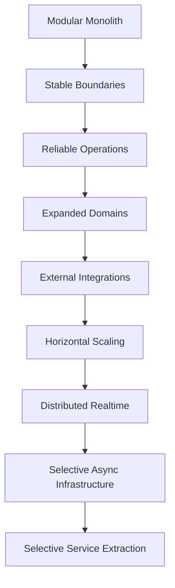
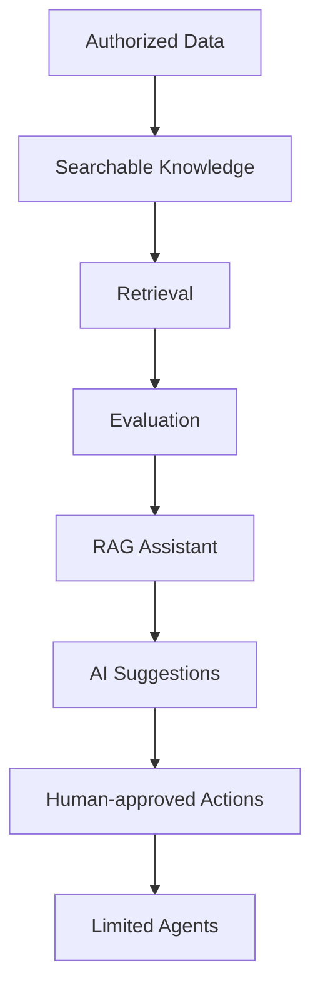

# 52_ARCHITECTURAL_DECISIONS.md

# Aula Robótica Platform — Architectural Decisions

## Parte 1 — Marco de decisiones, principios arquitectónicos, arquitectura modular, backend, persistencia y contratos

---

# 1. Propósito

Este documento recoge las principales decisiones arquitectónicas de **Aula Robótica Platform**.

Su objetivo es proporcionar una referencia estable para comprender:

```text
what was decided

why it was decided

which alternatives were considered

which consequences were accepted

when the decision should be revisited
```

---

# 2. Objetivo

La arquitectura debe permitir desarrollar una plataforma:

- modular;
- mantenible;
- segura;
- testeable;
- observable;
- desplegable;
- evolutiva;
- suficientemente simple para el estado actual del producto.

---

# 3. Architectural Decision Principle

```text
Architecture is the set of decisions

that are expensive to change later.
```

---

# 4. Decisiones explícitas

Las decisiones importantes no deben depender únicamente de:

```text
tribal knowledge

current implementation

developer memory
```

---

# 5. Architectural Knowledge

La arquitectura debe poder reconstruirse mediante:

```text
Architecture documentation

+

Architectural Decisions

+

ADRs

+

Code
```

---

# 6. Alcance

Este documento cubre decisiones transversales sobre:

```text
Application Architecture

Modularity

Backend

Frontend

SSR

JavaScript

Persistence

Authentication

Authorization

Realtime

Files

Notifications

Activity Feed

Audit

Testing

Observability

Deployment

Evolution
```

---

# 7. Relación con ADR

Este documento mantiene una visión consolidada.

Los ADR futuros registrarán decisiones individuales significativas.

---

# 8. Relationship

```text
52_ARCHITECTURAL_DECISIONS.md

→ current architectural baseline

ADR

→ history and rationale of a specific decision
```

---

# 9. ADR Principle

```text
This document tells us where we are.

ADRs tell us how and why we got there.
```

---

# 10. Cuándo crear un ADR

Debe considerarse cuando una decisión:

- afecta varios módulos;
- modifica una frontera arquitectónica;
- introduce infraestructura significativa;
- cambia persistencia;
- cambia estrategia de autenticación;
- cambia estrategia realtime;
- introduce un nuevo runtime;
- implica un trade-off relevante;
- resulta costosa de revertir.

---

# 11. Cuándo no crear un ADR

Normalmente no es necesario para:

```text
minor refactor

CSS adjustment

small endpoint

variable rename

local implementation detail
```

---

# 12. Decision Status

Las decisiones pueden clasificarse como:

```text
Proposed

Accepted

Superseded

Deprecated
```

---

# 13. Accepted

Representa la arquitectura vigente.

---

# 14. Superseded

Una decisión posterior la reemplaza.

---

# 15. Deprecated

Sigue existiendo temporalmente, pero está destinada a desaparecer.

---

# 16. Proposed

Está en evaluación y no constituye todavía arquitectura obligatoria.

---

# 17. Decision Record Structure

Cada decisión de este documento utiliza conceptualmente:

```text
Decision

Status

Context

Rationale

Consequences

Alternatives

Revisit Triggers
```

---

# 18. Architectural Priorities

La arquitectura prioriza:

```text
Correctness

Security

Simplicity

Maintainability

Testability

Observability

Performance

Scalability
```

en ese orden aproximado para el estado actual del producto.

---

# 19. Priority Guardrail

El orden no es absoluto.

---

# 20. Example

Una vulnerabilidad de seguridad puede justificar mayor complejidad.

---

# 21. Scalability Principle

```text
Design for evolution.

Do not deploy complexity before it is needed.
```

---

# 22. Architecture Style

## AD-001 — Modular Monolith

**Status:** Accepted

---

# 23. Decision

Aula Robótica Platform se implementará inicialmente como:

```text
Modular Monolith
```

---

# 24. Context

La plataforma contiene múltiples dominios:

```text
Users

Roles

Identities

Projects

Tasks

Activities

Attachments

Notifications

Dashboard

Audit
```

y podrá incorporar:

```text
Students

Courses

Inventory

Reservations

Competitions
```

---

# 25. Requirement

Necesitamos separación funcional sin asumir todavía necesidades operativas de microservicios.

---

# 26. Rationale

Un Modular Monolith proporciona:

- deployment sencillo;
- transacciones locales;
- debugging más simple;
- menor coste operacional;
- refactoring transversal más sencillo;
- boundaries explícitos;
- posibilidad de extracción futura.

---

# 27. Alternative — Unstructured Monolith

Descartada.

---

# 28. Reason

Una estructura sin módulos claros produciría:

```text
cross-domain coupling

large services

unclear ownership

difficult evolution
```

---

# 29. Alternative — Microservices

No adoptada actualmente.

---

# 30. Reason

Introduciría prematuramente:

```text
network boundaries

distributed transactions

service discovery

distributed tracing

deployment coordination

eventual consistency

additional infrastructure
```

---

# 31. Consequence

Los módulos deben mantener boundaries internos aunque compartan runtime y database.

---

# 32. Important Consequence

```text
Monolith does not mean

everything may depend on everything.
```

---

# 33. Revisit Trigger

Reconsiderar extracción cuando exista evidencia de:

- necesidad de escalado independiente;
- ownership independiente por equipos;
- deployment independiente;
- aislamiento de disponibilidad;
- requirements tecnológicos incompatibles;
- límites operativos demostrados.

---

# 34. Non-trigger

No extraer un microservicio simplemente porque un módulo haya crecido.

---

# 35. Architecture Boundary

```text
A large module

is not automatically

a microservice candidate.
```

---

# 36. Module Organization

## AD-002 — Domain-oriented Modules

**Status:** Accepted

---

# 37. Decision

El código debe organizarse principalmente por dominio/capability.

---

# 38. Conceptual Structure

```text
modules/
├── users/
├── roles/
├── identities/
├── projects/
├── tasks/
├── activities/
├── attachments/
├── notifications/
├── dashboard/
└── audit/
```

---

# 39. Rationale

Agrupar por dominio mejora:

```text
cohesion

ownership

discoverability

future extraction

testing
```

---

# 40. Alternative — Technical Layer First

Ejemplo:

```text
models/

routers/

services/

schemas/
```

como única organización global.

---

# 41. Problem

A medida que crece el producto, una feature requiere navegar múltiples directorios globales.

---

# 42. Decision Detail

Cada módulo puede contener sus propias capas.

---

# 43. Example

```text
tasks/
├── model.py
├── schemas.py
├── service.py
├── policies.py
├── router.py
└── templates/
```

según necesidad.

---

# 44. Guardrail

No todos los módulos necesitan exactamente la misma estructura.

---

# 45. Revisit Trigger

Revisar si:

```text
modules become too tightly coupled

or

a different bounded-context structure emerges
```

---

# 46. Internal Layering

## AD-003 — Thin HTTP Layer + Service Layer

**Status:** Accepted

---

# 47. Decision

La lógica se separará conceptualmente:

```text
Router

↓

Service

↓

Persistence / Domain
```

---

# 48. Router Responsibility

El router gestiona:

```text
HTTP

dependencies

request parsing

response construction

redirects

template selection
```

---

# 49. Service Responsibility

El service gestiona:

```text
use cases

business rules

contextual authorization

transactions

application side effects
```

---

# 50. Persistence Responsibility

Los modelos y queries gestionan:

```text
persistent state

relationships

database interaction
```

---

# 51. Rationale

Esto permite reutilizar casos de uso desde:

```text
SSR

API

background jobs

future CLI
```

---

# 52. Consequence

Los Services no deben depender normalmente de:

```python
Request
HTTPException
TemplateResponse
RedirectResponse
```

---

# 53. Alternative — Fat Routers

Descartada.

---

# 54. Reason

Dificultan:

```text
testing

reuse

authorization consistency

transaction management
```

---

# 55. Alternative — Full Clean Architecture

No adoptada como requisito general.

---

# 56. Reason

Una arquitectura completa de:

```text
entities

use cases

ports

adapters

repositories

presenters
```

añadiría abstracción superior a la necesidad actual.

---

# 57. Architectural Position

```text
Use separation where it creates value.

Avoid ceremonial layers.
```

---

# 58. Revisit Trigger

Si la lógica de dominio aumenta significativamente o aparecen múltiples adapters por boundary.

---

# 59. Repository Layer

## AD-004 — No Mandatory Generic Repository Layer

**Status:** Accepted

---

# 60. Decision

No se obliga a introducir una capa Repository genérica sobre SQLAlchemy.

---

# 61. Rationale

SQLAlchemy ya proporciona una abstracción suficientemente potente.

---

# 62. Problem with Generic CRUD

Una API como:

```python
repository.find_all()
repository.save()
repository.delete()
```

puede ocultar semántica de dominio sin aportar aislamiento real.

---

# 63. Preferred Approach

Los Services pueden utilizar:

```text
SQLAlchemy

+

domain-specific query helpers
```

---

# 64. Example

Preferir:

```python
list_accessible_projects(...)
```

frente a:

```python
project_repository.find_all(...)
```

cuando existe semántica de acceso.

---

# 65. Repository Adoption Trigger

Puede introducirse una abstracción cuando exista:

- persistencia alternativa;
- queries suficientemente complejas;
- necesidad fuerte de aislamiento;
- boundary externo;
- mejora demostrable de testabilidad.

---

# 66. Guardrail

```text
Repository is an architectural tool.

Not a mandatory folder.
```

---

# 67. Application Framework

## AD-005 — FastAPI as Backend Framework

**Status:** Accepted

---

# 68. Decision

El backend se construye sobre:

```text
FastAPI
```

---

# 69. Responsibilities

FastAPI proporciona:

```text
HTTP routing

dependency injection

request validation integration

API support

WebSocket support

ASGI runtime compatibility
```

---

# 70. Rationale

Encaja con una plataforma Python que necesita:

```text
SSR

APIs

WebSockets

async-capable infrastructure
```

---

# 71. Architectural Constraint

FastAPI no debe convertirse en el dominio.

---

# 72. Framework Boundary

Las reglas de negocio deben poder comprenderse sin depender de semántica HTTP.

---

# 73. Consequence

La migración futura de framework sería costosa, pero la lógica principal debe permanecer suficientemente desacoplada.

---

# 74. Revisit Trigger

Solo reconsiderar si:

```text
framework limitations become material

or

runtime requirements change fundamentally
```

---

# 75. Application Runtime

## AD-006 — ASGI-compatible Runtime

**Status:** Accepted

---

# 76. Decision

La aplicación mantiene compatibilidad con un runtime:

```text
ASGI
```

---

# 77. Rationale

Es necesario para combinar:

```text
HTTP

+

WebSockets
```

en el mismo backend.

---

# 78. Consequence

Las integraciones futuras deben considerar compatibilidad con el modelo de ejecución.

---

# 79. Async Guardrail

ASGI no implica que todo el código deba convertirse automáticamente en `async`.

---

# 80. Decision Detail

```text
Use async where the dependency and workload benefit from it.
```

---

# 81. Async Anti-pattern

No convertir funciones CPU-bound o APIs sync a `async` únicamente por estilo.

---

# 82. Blocking Work

El trabajo bloqueante significativo debe evitar bloquear el event loop.

---

# 83. Revisit Trigger

Si aparecen:

```text
heavy background workloads

CPU-intensive processing

high concurrency external I/O
```

puede requerirse arquitectura adicional.

---

# 84. Data Persistence

## AD-007 — Relational Database as Primary System of Record

**Status:** Accepted

---

# 85. Decision

El estado autoritativo principal se almacena en una:

```text
relational database
```

---

# 86. Rationale

El dominio contiene numerosas relaciones e invariantes:

```text
Users

Projects

Memberships

Tasks

Activities

Attachments

Notifications

Audit Events
```

---

# 87. Relational Benefits

```text
transactions

foreign keys

constraints

joins

mature tooling
```

---

# 88. Source of Truth

```text
Database

=

authoritative business state
```

---

# 89. Consequence

Ni:

```text
browser state

WebSocket state

cache

filesystem metadata
```

deben sustituir accidentalmente al estado autoritativo.

---

# 90. Alternative — Document Database

No adoptada para el core transaccional.

---

# 91. Reason

No existe actualmente un requirement que compense perder simplicidad relacional.

---

# 92. Future Polyglot Persistence

Puede añadirse almacenamiento especializado para necesidades concretas sin reemplazar necesariamente la base relacional.

---

# 93. Candidate Future Stores

Solo si existe necesidad:

```text
object storage

search engine

cache

vector database
```

---

# 94. Revisit Trigger

Cuando un workload específico no pueda resolverse razonablemente mediante el almacenamiento actual.

---

# 95. ORM

## AD-008 — SQLAlchemy as Persistence Mapping Layer

**Status:** Accepted

---

# 96. Decision

SQLAlchemy será la capa ORM/persistencia del backend.

---

# 97. Rationale

Permite:

```text
explicit relationships

transaction management

query composition

database portability

mature ecosystem
```

---

# 98. ORM Principle

```text
ORM is a persistence tool.

It is not the domain architecture.
```

---

# 99. Consequence

No exponer indiscriminadamente modelos ORM a todas las fronteras.

---

# 100. ORM Leakage

Debe evitarse especialmente hacia:

```text
public API contracts

realtime payloads

external integrations
```

---

# 101. Relationship Loading

La estrategia debe elegirse por caso de uso.

---

# 102. No Global Eager Loading

No cargar todas las relaciones automáticamente.

---

# 103. Query Principle

```text
Load what the use case needs.
```

---

# 104. Schema Evolution

## AD-009 — Versioned Database Migrations

**Status:** Accepted

---

# 105. Decision

La evolución de schema debe ser:

```text
versioned

reproducible

reviewable
```

mediante migrations.

---

# 106. Rationale

Los cambios manuales producen divergencia entre:

```text
development

testing

staging

production
```

---

# 107. Migration Ownership

Toda modificación persistente del schema debe acompañarse de migration cuando corresponda.

---

# 108. Destructive Changes

Deben revisarse especialmente.

---

# 109. Preferred Evolution

Cuando sea posible:

```text
add

↓

backfill / migrate

↓

switch application

↓

remove legacy later
```

---

# 110. Revisit Trigger

No aplica como cambio de arquitectura salvo sustitución completa del mecanismo de persistence.

---

# 111. Database Integrity

## AD-010 — Critical Invariants Protected at Database Level

**Status:** Accepted

---

# 112. Decision

Las invariantes persistentes críticas deben protegerse mediante:

```text
Foreign Keys

UNIQUE

NOT NULL

CHECK
```

cuando sea apropiado.

---

# 113. Rationale

La validación application-side puede fallar bajo:

```text
concurrency

bugs

alternative write paths
```

---

# 114. Layered Validation

La arquitectura acepta:

```text
Schema Validation

+

Business Validation

+

Database Integrity
```

---

# 115. Duplication Clarification

Esto no se considera duplicación accidental.

---

# 116. Each Layer

```text
Schema

→ valid input structure

Service

→ valid business operation

Database

→ valid persistent state
```

---

# 117. Example

Project Membership única:

```text
Service

→ friendly duplicate validation

Database

→ UNIQUE(project_id, user_id)
```

---

# 118. Consequence

Los Services deben poder transformar errores de constraint relevantes en errores de aplicación comprensibles.

---

# 119. Transactions

## AD-011 — Service-owned Transaction Boundaries

**Status:** Accepted

---

# 120. Decision

Los Services controlan normalmente la transacción del caso de uso.

---

# 121. Rationale

Una operación puede implicar:

```text
entity mutation

related entity creation

audit

notification
```

---

# 122. Example

```text
Update Task

↓

Create Activity

↓

Create Notification

↓

Commit
```

---

# 123. Transaction Principle

```text
One logical operation

should have one intentional transaction boundary.
```

---

# 124. Consequence

Los helpers internos no deberían llamar indiscriminadamente:

```python
db.commit()
```

---

# 125. Flush

Puede utilizarse para obtener IDs o ejecutar constraints antes del commit final.

---

# 126. External Side Effects

No todos los efectos pueden formar parte de la transacción DB.

---

# 127. Example

```text
database

+

WebSocket
```

no forman una transacción distribuida.

---

# 128. Architectural Policy

La persistencia autoritativa tiene prioridad.

---

# 129. Flow

```text
Database commit

↓

secondary delivery
```

---

# 130. Future Reliability

Si ciertos side effects requieren entrega garantizada, deberá evaluarse un patrón adicional.

---

# 131. Candidate Future Pattern

```text
Transactional Outbox
```

---

# 132. Current Status

No adoptado mientras no exista requirement de entrega garantizada.

---

# 133. Revisit Trigger

Cuando perder un evento secundario tras un commit sea funcionalmente inaceptable.

---

# 134. Data Contracts

## AD-012 — Pydantic for Boundary Validation

**Status:** Accepted

---

# 135. Decision

Los contratos de datos Python en boundaries apropiados utilizarán:

```text
Pydantic
```

---

# 136. Rationale

Proporciona:

```text
typed contracts

validation

serialization

FastAPI integration
```

---

# 137. Architectural Boundary

Pydantic no sustituye business rules.

---

# 138. Input Validation

Adecuado para:

```text
required fields

types

lengths

formats

enums
```

---

# 139. Business Validation

Permanece en:

```text
service / domain policy
```

---

# 140. Input / Output Separation

Cuando los contratos difieran, deben utilizar schemas distintos.

---

# 141. Security Consequence

Esto reduce riesgo de:

```text
mass assignment

internal field exposure
```

---

# 142. Protected Fields

Campos como:

```text
created_by

owner_id

audit metadata

privileged state
```

deben derivarse server-side cuando corresponda.

---

# 143. API Contract

## AD-013 — Explicit Public Contracts

**Status:** Accepted

---

# 144. Decision

Las fronteras públicas no dependerán accidentalmente de la estructura interna del ORM.

---

# 145. Public Boundaries

Incluyen:

```text
REST APIs

WebSocket events

external integrations

future public SDK contracts
```

---

# 146. Rationale

Permite evolucionar persistencia sin romper consumidores.

---

# 147. Consequence

Un modelo:

```python
Task
```

no equivale automáticamente al contrato:

```text
TaskResponse
```

---

# 148. Contract Evolution

Los cambios incompatibles deben tratarse explícitamente.

---

# 149. Internal SSR Boundary

SSR puede trabajar más directamente con objetos internos cuando:

```text
security

maintainability

session lifecycle
```

se mantengan correctamente.

---

# 150. Guardrail

Incluso en SSR no deben exponerse datos internos innecesarios.

---

# 151. API Strategy

## AD-014 — SSR-first, API-capable Backend

**Status:** Accepted

---

# 152. Decision

La plataforma no será API-first para todas las funcionalidades.

---

# 153. Primary Interaction

La interacción web principal utiliza:

```text
Server-Side Rendering
```

---

# 154. API Capability

FastAPI permite añadir APIs cuando exista consumidor o caso de uso real.

---

# 155. Rationale

Evita construir dos interfaces completas:

```text
REST API

+

SSR web
```

para cada feature sin necesidad.

---

# 156. Consequence

No todo Service necesita inmediatamente un endpoint `/api`.

---

# 157. Future Consumers

Una API puede justificarse para:

```text
mobile application

external integration

automation

robot clients
```

---

# 158. API Introduction Rule

```text
Build APIs for consumers,

not for architectural symmetry.
```

---

# 159. API Versioning

No introducir versionado complejo hasta que exista contrato externo estable que lo necesite.

---

# 160. Future Versioning

Cuando exista:

```text
/api/v1/
```

puede adoptarse como boundary estable.

---

# 161. Revisit Trigger

Cuando la plataforma tenga consumidores externos independientes del frontend SSR.

---

# 162. Identifier Strategy

## AD-015 — Internal Relational IDs with External Identifier Flexibility

**Status:** Accepted

---

# 163. Decision

Las entidades pueden utilizar identificadores relacionales internos simples.

---

# 164. External Exposure

No se asume que el mismo ID sea siempre la mejor identidad pública.

---

# 165. Rationale

Los IDs numéricos son eficientes y simples internamente.

---

# 166. Security Clarification

```text
Unpredictable IDs are not authorization.
```

---

# 167. Consequence

Aunque se utilicen UUID:

```text
authorization remains mandatory
```

---

# 168. Future Public IDs

Pueden introducirse:

```text
UUID

ULID

slug
```

cuando exista necesidad.

---

# 169. Revisit Trigger

Cuando:

- IDs se expongan ampliamente fuera de la plataforma;
- exista sincronización distribuida;
- creación offline;
- necesidad de generación descentralizada;
- UX requiera slugs.

---

# 170. Time Strategy

## AD-016 — Consistent Timestamp Strategy

**Status:** Accepted

---

# 171. Decision

El sistema debe utilizar una política temporal coherente para persistencia.

---

# 172. Canonical Principle

```text
Persist canonical time.

Format for the user at presentation boundaries.
```

---

# 173. Preferred Canonical Time

UTC es la referencia preferida para timestamps persistidos cuando el stack y esquema lo soporten.

---

# 174. Presentation

La UI puede mostrar tiempo según timezone relevante.

---

# 175. Temporal Fields

Incluyen:

```text
created_at

updated_at

completed_at

read_at

occurred_at
```

---

# 176. Timezone Guardrail

No mezclar silenciosamente:

```text
naive datetime

timezone-aware datetime
```

---

# 177. Server Local Time

No depender de timezone del servidor como significado de negocio implícito.

---

# 178. Future Scheduling

Reservas y planificación pueden requerir conservar:

```text
local time

timezone

UTC instant
```

según semántica.

---

# 179. Revisit Trigger

Cuando se implementen scheduling y reservas multi-timezone.

---

# 180. Configuration

## AD-017 — Environment-driven Runtime Configuration

**Status:** Accepted

---

# 181. Decision

La configuración dependiente del entorno se proporciona externamente.

---

# 182. Candidate Configuration

```text
database URL

secret keys

storage configuration

runtime environment

observability endpoints
```

---

# 183. Rationale

El mismo código debe poder ejecutarse en diferentes entornos.

---

# 184. Twelve-factor Influence

La arquitectura adopta principios útiles de externalized configuration sin exigir dogmáticamente toda la metodología Twelve-Factor.

---

# 185. Secrets

Nunca deben formar parte del repositorio.

---

# 186. Required Configuration

La aplicación debe fallar claramente al startup si falta configuración crítica.

---

# 187. Development Defaults

Pueden existir para entorno local cuando sean seguros y explícitos.

---

# 188. Production Defaults

No proporcionar defaults inseguros para secretos.

---

# 189. Dependency Injection

## AD-018 — Lightweight Dependency Injection

**Status:** Accepted

---

# 190. Decision

Utilizar la dependency injection proporcionada por FastAPI para concerns HTTP apropiados.

---

# 191. Examples

```text
database session

current user

request-scoped context
```

---

# 192. Service Construction

No introducir actualmente un contenedor DI empresarial independiente.

---

# 193. Rationale

La complejidad actual no lo justifica.

---

# 194. Guardrail

Las dependencies de FastAPI no deben convertirse en lugar oculto para business logic.

---

# 195. Revisit Trigger

Si la construcción de Services e infraestructura adquiere múltiples implementaciones y lifecycle complejo.

---

# 196. Shared Infrastructure

## AD-019 — Explicit Infrastructure Boundaries

**Status:** Accepted

---

# 197. Decision

Las integraciones técnicas externas deben tener boundaries identificables.

---

# 198. Candidate Infrastructure

```text
storage

email

future AI providers

future messaging

external APIs
```

---

# 199. Rationale

Evita que detalles externos se dispersen por Services.

---

# 200. Example

En lugar de:

```text
multiple services calling provider SDK directly
```

preferir una integración central cuando exista reutilización real.

---

# 201. Infrastructure Abstraction

Debe introducirse cuando exista valor.

---

# 202. Guardrail

No crear interfaces para cada library estándar sin necesidad.

---

# 203. Example

Una abstracción:

```text
AttachmentStorage
```

puede tener sentido si se prevé:

```text
local storage

→ object storage
```

como evolución real.

---

# 204. Infrastructure Failure

Los Services deben recibir errores significativos sin depender innecesariamente de detalles específicos del proveedor.

---

# 205. Filesystem Role

## AD-020 — Database Metadata + External File Content

**Status:** Accepted

---

# 206. Decision

Para Attachments:

```text
database

→ metadata and relationships

storage layer

→ binary content
```

---

# 207. Rationale

Los binarios no deben convertirse automáticamente en columnas DB para el modelo actual.

---

# 208. Metadata

Puede incluir:

```text
original filename

storage key

content type

size

uploader

related resource

created_at
```

---

# 209. Storage Key

Debe ser independiente del filename proporcionado por usuario.

---

# 210. Initial Storage

El almacenamiento local puede utilizarse inicialmente.

---

# 211. Architecture Requirement

El código debe evitar acoplamiento innecesario al path local.

---

# 212. Future Evolution

Debe poder evolucionar hacia:

```text
S3-compatible object storage
```

u otro backend cuando exista necesidad.

---

# 213. Alternative — Database BLOB

No adoptada por defecto.

---

# 214. Reason

Complicaría:

```text
database size

backup behavior

binary delivery
```

sin necesidad actual.

---

# 215. Alternative — Object Storage Immediately

No obligatorio inicialmente.

---

# 216. Reason

Añade infraestructura innecesaria para entornos pequeños.

---

# 217. Revisit Trigger

Cuando exista:

- despliegue multi-instance;
- almacenamiento persistente desacoplado;
- gran volumen;
- CDN;
- requisitos de durabilidad;
- escalado horizontal.

---

# 218. File Security Consequence

Todo download sigue pasando por autorización apropiada.

---

# 219. Direct Public Paths

No asumir que el directorio de Attachments puede exponerse públicamente.

---

# 220. Storage Abstraction Trigger

Debe introducirse antes de que múltiples módulos dependan directamente del filesystem.

---

# 221. Background Processing

## AD-021 — No Distributed Job Queue Initially

**Status:** Accepted

---

# 222. Decision

No introducir inicialmente:

```text
Celery

RQ

Kafka consumers

distributed workers
```

sin workload que lo requiera.

---

# 223. Rationale

La mayoría de casos de uso actuales son request-driven y suficientemente pequeños.

---

# 224. Candidate Future Workloads

Pueden justificar background processing:

```text
large report generation

bulk imports

image processing

email batches

AI workloads

robot telemetry processing
```

---

# 225. FastAPI Background Tasks

Pueden utilizarse únicamente para tareas simples y no críticas cuando sus garantías sean suficientes.

---

# 226. Durability Warning

Un task process-local no equivale a una cola durable.

---

# 227. Critical Work

No utilizar background tasks no durables para operaciones cuya pérdida sea inaceptable.

---

# 228. Revisit Trigger

Cuando aparezca necesidad de:

```text
retry

durability

scheduling

worker scaling

long-running tasks
```

---

# 229. Event-driven Architecture

## AD-022 — Application Events without Mandatory Message Broker

**Status:** Accepted

---

# 230. Decision

Los módulos pueden utilizar eventos conceptuales de aplicación sin requerir inicialmente infraestructura distribuida.

---

# 231. Example

```text
task.updated

activity.created

notification.created
```

---

# 232. Purpose

Permiten desacoplar:

```text
domain mutation

from

secondary reactions
```

cuando aporte valor.

---

# 233. Current Delivery

Puede ser:

```text
in-process
```

mientras la arquitectura sea single-instance y las garantías requeridas sean limitadas.

---

# 234. Event Guardrail

No convertir cada función en evento.

---

# 235. Event Candidate

Un evento tiene sentido cuando representa:

```text
meaningful fact

with one or more independent reactions
```

---

# 236. Alternative — Kafka

No adoptada actualmente.

---

# 237. Reason

Kafka introduciría:

```text
broker operations

schema management

consumer coordination

delivery semantics

distributed debugging
```

sin requirement actual.

---

# 238. Alternative — Redis Pub/Sub

Tampoco se requiere para el baseline single-instance.

---

# 239. Revisit Trigger

Cuando existan:

```text
multiple application instances

distributed consumers

durable event processing

independent services
```

---

# 240. Event Delivery Guarantee

Actualmente no se asume exactamente-once.

---

# 241. Architectural Principle

```text
Exactly-once should never be assumed implicitly.
```

---

# 242. Idempotent Consumers

Los consumidores deben tender a tolerar duplicados cuando sea razonable.

---

# 243. Contract Ownership

El módulo productor es responsable del significado del evento.

---

# 244. Consumer Independence

El productor no debería conocer detalles internos de todos los consumidores.

---

# 245. Dashboard Architecture

## AD-023 — Dashboard as Read Composition Layer

**Status:** Accepted

---

# 246. Decision

Dashboard no será propietario del estado de otros dominios.

---

# 247. Dashboard Role

Compone información procedente de:

```text
Projects

Tasks

Activities

Notifications
```

según permisos.

---

# 248. Rationale

Dashboard representa:

```text
read experience
```

no un nuevo sistema de verdad.

---

# 249. Consequence

No duplicar persistentemente datos de otros módulos únicamente para Dashboard sin necesidad.

---

# 250. Initial Strategy

Puede consultar Services/query helpers de los dominios correspondientes.

---

# 251. Performance Evolution

Si la composición resulta costosa, podrá evaluarse:

```text
optimized queries

read models

materialized views

cache
```

---

# 252. Revisit Trigger

Solo después de medir.

---

# 253. Read Model

Un read model futuro no cambia automáticamente la autoridad del dominio original.

---

# 254. Search Architecture

## AD-024 — Database-backed Search Initially

**Status:** Accepted

---

# 255. Decision

Las búsquedas iniciales utilizarán capacidades de la base relacional cuando sean suficientes.

---

# 256. Rationale

Evita introducir:

```text
Elasticsearch

OpenSearch

Meilisearch
```

sin necesidad.

---

# 257. Search Evolution Trigger

Considerar motor especializado si aparecen:

- full-text avanzado;
- ranking complejo;
- fuzzy search;
- grandes volúmenes;
- múltiples dominios indexados;
- requisitos de latencia no satisfechos.

---

# 258. Search Security

Un motor de búsqueda futuro deberá preservar authorization scope.

---

# 259. Search Index Principle

```text
Searchability must not bypass visibility rules.
```

---

# 260. Caching Architecture

## AD-025 — No Mandatory Distributed Cache Initially

**Status:** Accepted

---

# 261. Decision

No introducir Redis u otro cache distribuido como dependencia base.

---

# 262. Rationale

El sistema todavía no ha demostrado una necesidad que compense:

```text
cache invalidation

additional state

operational dependency
```

---

# 263. Cache Candidate

Puede evaluarse para:

```text
expensive read models

rate limiting

sessions

distributed coordination
```

cuando exista requirement.

---

# 264. Cache Rule

```text
Cache is an optimization.

Not a source of truth.
```

---

# 265. Revisit Trigger

Performance medida o requirement distribuido concreto.

---

# 266. Pagination Architecture

## AD-026 — Bounded Collections

**Status:** Accepted

---

# 267. Decision

Las colecciones con crecimiento potencialmente indefinido deben soportar acceso acotado.

---

# 268. Candidates

```text
Activities

Notifications

Audit Events

Tasks

future telemetry
```

---

# 269. Rationale

Evita:

```text
large DB reads

large HTML responses

memory growth

slow rendering
```

---

# 270. Initial Pagination

Puede utilizar:

```text
offset / limit
```

cuando el volumen sea moderado.

---

# 271. Future Cursor Pagination

Puede adoptarse para streams grandes o alta concurrencia.

---

# 272. Revisit Trigger

Cuando offset pagination produzca:

```text
performance issues

unstable navigation

large offsets
```

---

# 273. Ordering

Toda paginación requiere ordering determinista.

---

# 274. Soft Delete

## AD-027 — Soft Delete Only Where Domain Requires It

**Status:** Accepted

---

# 275. Decision

No aplicar `deleted_at` automáticamente a todas las entidades.

---

# 276. Rationale

Soft delete añade complejidad:

```text
query filtering

uniqueness

relationships

restoration

audit semantics
```

---

# 277. Use Cases

Puede justificarse para:

```text
recoverable business records

regulatory retention

user-facing archive behavior
```

---

# 278. Hard Delete

Puede seguir siendo válido para datos que realmente deben desaparecer.

---

# 279. Archive ≠ Delete

Cuando el dominio tiene concepto:

```text
Archived
```

debe modelarse explícitamente.

---

# 280. Revisit Per Entity

La decisión debe evaluarse por dominio.

---

# 281. Domain Status

## AD-028 — Explicit Domain States

**Status:** Accepted

---

# 282. Decision

Los estados funcionales importantes deben representarse explícitamente.

---

# 283. Example

```text
TaskStatus

ProjectStatus
```

---

# 284. Rationale

Evita representar estado mediante combinaciones ambiguas de booleanos.

---

# 285. Boolean Explosion

Evitar:

```text
is_started

is_finished

is_cancelled

is_archived
```

si representan una única state machine.

---

# 286. Preferred

```text
status
```

con valores válidos.

---

# 287. Transition Rules

Las transiciones relevantes deben validarse en Service/domain.

---

# 288. Example

```text
TODO

→ IN_PROGRESS

→ DONE
```

según reglas reales.

---

# 289. State Machine Library

No introducir una library específica hasta que la complejidad lo justifique.

---

# 290. Revisit Trigger

Cuando:

```text
transitions

guards

side effects

parallel states
```

formen una máquina de estados suficientemente compleja.

---

# 291. Cross-module Communication

## AD-029 — Explicit Cross-module Collaboration

**Status:** Accepted

---

# 292. Decision

Las dependencias entre módulos deben representar colaboración explícita.

---

# 293. Preferred Mechanisms

Según el caso:

```text
public service function

query interface/helper

application event
```

---

# 294. Avoid

Acceder directamente a internals de otro módulo.

---

# 295. Example

`tasks` no debería depender de:

```text
notifications._internal_helper
```

---

# 296. Public Module Surface

Los módulos deben evolucionar hacia una superficie pública identificable cuando su complejidad lo requiera.

---

# 297. Circular Dependencies

Deben evitarse.

---

# 298. Circular Dependency Interpretation

Puede indicar:

```text
incorrect ownership

missing shared concept

boundary problem
```

---

# 299. Shared Kernel

Código realmente transversal puede residir en una zona compartida pequeña.

---

# 300. Shared Kernel Guardrail

No convertir:

```text
shared/
```

en un segundo monolito sin ownership.

---

# 301. Domain Ownership

## AD-030 — Single Owner for Business Rules

**Status:** Accepted

---

# 302. Decision

Cada regla funcional debe tener un módulo propietario principal.

---

# 303. Example

```text
Task transition rules

→ Tasks module
```

---

# 304. Consumer Rule

Otros módulos deben utilizar la interfaz del owner.

---

# 305. Duplication Guardrail

No recrear la misma regla en:

```text
Dashboard

Notifications

Activities
```

---

# 306. Presentation Duplication

La representación visual puede variar, pero la regla funcional no.

---

# 307. Consequence

Esto reduce divergencia entre módulos.

---

# 308. Data Ownership

Aunque exista una única database física:

```text
logical ownership remains modular
```

---

# 309. Direct Table Access

Debe limitarse cuando rompe ownership.

---

# 310. Pragmatic Exception

En un Modular Monolith pueden existir joins cross-module cuando sean claramente útiles.

---

# 311. Guardrail

La eficiencia no debe destruir boundaries sin análisis.

---

# 312. Architecture Evolution

## AD-031 — Evolutionary Architecture

**Status:** Accepted

---

# 313. Decision

La arquitectura evolucionará mediante cambios incrementales.

---

# 314. Principle

```text
Solve today's known requirements

without blocking tomorrow's plausible requirements.
```

---

# 315. Avoid Future-proofing

No construir infraestructura para escenarios puramente hipotéticos.

---

# 316. Evolution Mechanisms

```text
clear boundaries

explicit contracts

migrations

ADRs

tests

observability
```

---

# 317. Reversibility

Preferir decisiones reversibles cuando dos alternativas sean equivalentes.

---

# 318. Irreversible Decisions

Requieren mayor análisis.

---

# 319. Examples

```text
public API contract

persistent data model

authentication architecture

distributed topology
```

---

# 320. Architecture Fitness

La arquitectura debe evaluarse periódicamente contra requisitos reales.

---

# 321. Fitness Questions

```text
Can features still be added safely?

Are module boundaries holding?

Are tests becoming harder?

Are deployments becoming fragile?

Are performance limits appearing?

Is operational complexity justified?
```

---

# 322. Architecture Smell

Un aumento de complejidad accidental debe investigarse antes de añadir otra capa.

---

# 323. Architectural Debt

Debe registrarse cuando una decisión temporal comience a superar su contexto original.

---

# 324. Decision Review

Las decisiones no son permanentes.

---

# 325. Review Principle

```text
Accepted does not mean eternal.

It means current baseline.
```

---

# 326. Part 1 Summary

Esta primera parte establece la arquitectura base:

```text
Modular Monolith

Domain-oriented Modules

Thin HTTP Layer

Service Layer

FastAPI

ASGI

Relational Database

SQLAlchemy

Versioned Migrations

Database Constraints

Service-owned Transactions

Pydantic Contracts

SSR-first / API-capable Backend

Canonical Time Strategy

Environment Configuration

Lightweight Dependency Injection

Infrastructure Boundaries

Attachment Storage Boundary

No Premature Job Queue

Application Events

Dashboard Read Composition

Database-backed Search

No Premature Distributed Cache

Bounded Collections

Explicit Domain States

Cross-module Ownership

Evolutionary Architecture
```

---

# 327. Continuation

La **Parte 2/3** continúa con las decisiones sobre:

```text
SSR Architecture

Jinja2

Progressive Enhancement

JavaScript

Design System

Authentication

Authorization

RBAC

Contextual Access

Security Boundaries

CSRF

Attachments Security

WebSockets

Realtime Architecture

Notifications

Activity Feed

Audit

Dashboard Realtime

Failure and Reconciliation Strategies
```

---

# 52_ARCHITECTURAL_DECISIONS.md

# Aula Robótica Platform — Architectural Decisions

## Parte 2 — SSR, Jinja2, Progressive Enhancement, Authentication, Authorization, Security, Realtime, Notifications, Activity Feed y Audit

---

# 328. SSR Architecture

## AD-032 — Server-Side Rendering as Primary Web Delivery Model

**Status:** Accepted

---

# 329. Decision

La experiencia web principal se construirá mediante:

```text
Server-Side Rendering
```

utilizando FastAPI y Jinja2.

---

# 330. Rationale

El modelo SSR encaja con:

- navegación basada en recursos;
- formularios tradicionales;
- autorización server-side;
- menor complejidad cliente;
- progresive enhancement;
- integración directa con FastAPI.

---

# 331. Primary Rendering Flow

```text
Browser Request

↓

FastAPI Router

↓

Service

↓

Database

↓

Template Context

↓

Jinja2 Render

↓

HTML Response
```

---

# 332. Architectural Principle

```text
The server owns page composition.

The browser enhances interaction.
```

---

# 333. Consequence

No es necesario mantener un frontend SPA independiente para cada capability.

---

# 334. Alternative — SPA-first Architecture

No adoptada actualmente.

---

# 335. Reason

Una SPA completa introduciría:

```text
client routing

global state

API duplication

frontend authentication state

additional build complexity

more synchronization concerns
```

sin necesidad demostrada.

---

# 336. SPA Revisit Trigger

Podría reconsiderarse si aparecen:

- interacción cliente extremadamente compleja;
- offline-first real;
- múltiples clientes consumiendo la misma API;
- navegación altamente dinámica;
- requirements que SSR dificulte significativamente.

---

# 337. SSR Is Not Static

SSR no significa ausencia de interacción dinámica.

---

# 338. Enhancement Layer

La arquitectura admite:

```text
JavaScript

WebSockets

partial DOM updates

dialogs

drag and drop
```

sobre la base SSR.

---

# 339. Failure Degradation

Cuando una mejora JavaScript secundaria falla, el sistema debería conservar el flujo esencial cuando sea razonable.

---

# 340. Jinja2

## AD-033 — Jinja2 as Server-side Template Engine

**Status:** Accepted

---

# 341. Decision

Jinja2 será el motor principal de templates SSR.

---

# 342. Rationale

Proporciona:

```text
template inheritance

includes

macros

escaping

FastAPI compatibility
```

---

# 343. Template Responsibility

Los templates representan:

```text
presentation state
```

---

# 344. Template Boundary

No deben convertirse en:

```text
business rule engine

authorization engine

query layer
```

---

# 345. Permission Rendering

Las capabilities de UI deben prepararse previamente.

---

# 346. Example

Preferir:

```jinja2

```

frente a recalcular reglas complejas dentro del template.

---

# 347. Context Principle

```text
Templates receive prepared context.

They do not discover application state.
```

---

# 348. Template Reuse

Los patrones repetidos deben reutilizar:

```text
base templates

partials

macros

shared components
```

cuando exista valor real.

---

# 349. Template Component Guardrail

No fragmentar cada pequeño elemento HTML en un include independiente.

---

# 350. Jinja Security

El autoescaping debe permanecer habilitado.

---

# 351. `safe`

El uso de:

```jinja2
|safe
```

debe ser excepcional.

---

# 352. Trusted HTML

Solo debe utilizarse con contenido:

```text
trusted

controlled

or safely sanitized
```

---

# 353. Progressive Enhancement

## AD-034 — Progressive Enhancement over Client-heavy Rendering

**Status:** Accepted

---

# 354. Decision

JavaScript complementará la experiencia SSR.

---

# 355. Baseline

La arquitectura parte de:

```text
HTML rendered by server
```

---

# 356. Enhancement Examples

JavaScript puede añadir:

```text
dialogs

toasts

inline updates

drag and drop

realtime refresh

interactive filters
```

---

# 357. Rationale

Reduce:

```text
client complexity

duplicated business state

frontend dependency footprint
```

---

# 358. Architectural Principle

```text
Use JavaScript for interaction.

Do not use it merely to reproduce server rendering.
```

---

# 359. Client State

Debe permanecer:

```text
local

minimal

replaceable
```

mientras sea posible.

---

# 360. Global Client Store

No se adoptará inicialmente.

---

# 361. Alternative — Redux-like Global State

No justificada actualmente.

---

# 362. Revisit Trigger

Cuando múltiples componentes complejos dependan de estado cliente compartido difícil de derivar del servidor.

---

# 363. DOM as View State

El DOM representa:

```text
current client-side projection
```

---

# 364. DOM Is Not Source of Truth

Manipular el DOM no debe sustituir la persistencia server-side.

---

# 365. JavaScript Architecture

## AD-035 — Modular Vanilla JavaScript First

**Status:** Accepted

---

# 366. Decision

Las interacciones cliente se implementarán inicialmente con:

```text
modern modular JavaScript
```

sin framework frontend obligatorio.

---

# 367. Rationale

La complejidad actual puede resolverse con:

- ES modules;
- DOM APIs;
- Fetch;
- WebSocket;
- event listeners.

---

# 368. Benefits

```text
small dependency surface

low build complexity

easy SSR integration

progressive enhancement
```

---

# 369. Framework Guardrail

No introducir React, Vue, Angular u otro framework únicamente por comodidad del desarrollador.

---

# 370. Framework Revisit Trigger

Puede evaluarse si:

- el estado cliente crece significativamente;
- hay widgets altamente interactivos;
- la UI necesita composición compleja;
- vanilla JS comienza a generar arquitectura difícil de mantener.

---

# 371. Incremental Adoption

Si se adopta un framework futuro, puede introducirse primero en:

```text
isolated islands
```

sin reemplazar necesariamente todo SSR.

---

# 372. JS Module Ownership

Los módulos JavaScript deben alinearse con:

```text
components

or

domain capabilities
```

---

# 373. Avoid Global Namespace

No utilizar `window` como store general.

---

# 374. Frontend Events

Los eventos internos del navegador pueden utilizarse cuando desacoplen componentes reales.

---

# 375. Frontend Event Guardrail

No convertir toda interacción simple en event bus.

---

# 376. Fetch Architecture

## AD-036 — Fetch for Incremental HTTP Interactions

**Status:** Accepted

---

# 377. Decision

Las mutaciones o consultas dinámicas que no requieran una navegación completa pueden utilizar:

```text
Fetch API
```

---

# 378. Rationale

Está disponible nativamente y evita una dependencia HTTP adicional.

---

# 379. Fetch Responsibilities

Una capa compartida ligera puede gestionar:

```text
credentials

CSRF

response parsing

common errors
```

---

# 380. Guardrail

No esconder por completo la semántica HTTP detrás de una abstracción genérica.

---

# 381. Fetch Failure Behavior

Debe existir:

```text
loading

success

failure

recovery
```

---

# 382. HTTP Source of Truth

Tras una mutación compleja, puede ser preferible volver a consultar estado al servidor.

---

# 383. Design System

## AD-037 — Shared UI Patterns without Heavy Component Framework

**Status:** Accepted

---

# 384. Decision

La plataforma utilizará un conjunto coherente de patrones visuales y componentes reutilizables.

---

# 385. Candidate Shared Components

```text
buttons

forms

dialogs

toasts

badges

tables

cards

empty states

pagination
```

---

# 386. Rationale

Mejora:

```text
consistency

accessibility

maintainability

development speed
```

---

# 387. Framework Position

No se requiere inicialmente una librería UI pesada.

---

# 388. Component Ownership

Un componente compartido debe existir cuando represente un patrón transversal real.

---

# 389. Domain-specific Components

Pueden permanecer en su módulo.

---

# 390. Accessibility Consequence

Los componentes compartidos deben resolver correctamente comportamiento accesible una sola vez cuando sea posible.

---

# 391. Authentication Architecture

## AD-038 — Centralized Authentication Boundary

**Status:** Accepted

---

# 392. Decision

La autenticación debe resolverse mediante una estrategia central.

---

# 393. Purpose

Determinar:

```text
who the actor is
```

antes de ejecutar acciones protegidas.

---

# 394. Current Identity Flow

Conceptualmente:

```text
Request

↓

Authentication Context

↓

Current User

↓

Authorization
```

---

# 395. Authentication Ownership

El módulo Identity/Auth es responsable de:

```text
credential verification

session/token interpretation

current-user resolution
```

---

# 396. Domain Modules

No deben reimplementar autenticación.

---

# 397. Consequence

Projects, Tasks o Inventory deben recibir un actor ya identificado.

---

# 398. Authentication vs Domain Profile

La identidad de acceso permanece separada de perfiles de dominio futuros.

---

# 399. Example

```text
User

≠

Student
```

---

# 400. Institutional Authentication

La arquitectura debe permitir futura integración SSO sin obligar a modificar todos los módulos.

---

# 401. Revisit Trigger

Cuando se integre un Identity Provider institucional.

---

# 402. Session Architecture

## AD-039 — Secure Cookie-based Browser Authentication Compatible with SSR

**Status:** Accepted

---

# 403. Decision

La autenticación del navegador debe utilizar un mecanismo compatible con:

```text
SSR

server-side authorization

secure browser session semantics
```

---

# 404. Security Requirements

La configuración debe considerar:

```text
HttpOnly

Secure

SameSite

expiration
```

según entorno.

---

# 405. Rationale

Evita exponer credenciales sensibles innecesariamente al JavaScript de aplicación.

---

# 406. Token Exposure Principle

```text
Browser JavaScript should not need direct access
to long-lived authentication secrets.
```

---

# 407. Alternative — localStorage Authentication Token

No preferida para el frontend SSR.

---

# 408. Reason

Incrementa impacto potencial de XSS.

---

# 409. Future Native Client

Una app móvil futura podría utilizar un flujo diferente manteniendo el mismo backend de identidad.

---

# 410. Authorization Architecture

## AD-040 — Server-side Authorization as Authoritative Control

**Status:** Accepted

---

# 411. Decision

Toda operación protegida debe autorizarse en backend.

---

# 412. Principle

```text
UI permissions improve UX.

Server permissions enforce security.
```

---

# 413. Consequence

Ocultar:

```text
Edit

Delete

Assign
```

no protege el endpoint.

---

# 414. Authorization Inputs

Una policy puede considerar:

```text
actor

global role

permission

membership

ownership

resource

resource state
```

---

# 415. Reuse

Las reglas comunes deben centralizarse.

---

# 416. Alternative — Router-local Authorization

Descartada como estrategia general.

---

# 417. Reason

Produce:

```text
duplication

inconsistency

security gaps

harder testing
```

---

# 418. Authorization Testing

Las policies críticas deben probar:

```text
allow

deny

cross-resource access
```

---

# 419. Global RBAC

## AD-041 — RBAC for Global Platform Capabilities

**Status:** Accepted

---

# 420. Decision

Los roles globales se utilizarán para responsabilidades globales.

---

# 421. Example

```text
Administrator
```

puede disponer de capabilities globales.

---

# 422. Permission Model

El sistema puede modelar:

```text
Role

↓

Permissions
```

---

# 423. Rationale

Es adecuado para operaciones como:

```text
user administration

global audit

platform configuration
```

---

# 424. RBAC Limitation

RBAC global no representa bien todo el contexto colaborativo.

---

# 425. Example

Una persona puede ser:

```text
Coordinator in Project A

Member in Project B
```

---

# 426. Contextual Authorization

## AD-042 — Resource-scoped Authorization for Collaborative Domains

**Status:** Accepted

---

# 427. Decision

Los dominios colaborativos deben poder aplicar permisos según el recurso.

---

# 428. Candidate Contexts

```text
Project Membership

Course Enrollment

Competition Team Membership

Reservation Ownership
```

---

# 429. Rationale

Representa mejor las relaciones reales del producto.

---

# 430. Hybrid Model

La plataforma utilizará conceptualmente:

```text
Global Authorization

+

Contextual Authorization
```

---

# 431. Example

```text
Global:
projects:create

Contextual:
can update Project 42
```

---

# 432. Policy Ownership

El módulo del recurso debe controlar las reglas contextuales principales.

---

# 433. Revisit Trigger

Cuando la cantidad de policies justifique una capa más formal de policy engine.

---

# 434. External Policy Engine

No adoptado actualmente.

---

# 435. Reason

Herramientas como motores externos de policy añadirían complejidad prematura.

---

# 436. Least Privilege

## AD-043 — Least Privilege as Authorization Baseline

**Status:** Accepted

---

# 437. Decision

El sistema concede únicamente capabilities necesarias para cada contexto.

---

# 438. Default Position

```text
deny unless allowed
```

---

# 439. Rationale

Reduce exposición accidental.

---

# 440. Consequence

Añadir un nuevo endpoint requiere evaluar explícitamente su autorización.

---

# 441. Permission-aware UI

La UI debe derivar acciones del mismo modelo conceptual.

---

# 442. Authorization Failure

Debe producir una respuesta consistente.

---

# 443. Information Disclosure

La arquitectura puede utilizar:

```text
403

or

404
```

según sensibilidad y policy del recurso.

---

# 444. Decision Requirement

Debe mantenerse coherente dentro de un dominio.

---

# 445. Security Boundary

## AD-044 — Browser as Untrusted Boundary

**Status:** Accepted

---

# 446. Decision

Todos los datos procedentes del navegador se consideran no confiables.

---

# 447. Includes

```text
forms

JSON

query parameters

path parameters

cookies

headers

WebSocket messages

hidden inputs
```

---

# 448. Rationale

La interfaz puede modificarse manualmente.

---

# 449. Consequence

El backend valida:

```text
structure

identity

authorization

business rules
```

independientemente del comportamiento esperado del frontend.

---

# 450. Mass Assignment

La arquitectura debe evitar copia indiscriminada de inputs sobre modelos persistentes.

---

# 451. Protected Fields

Campos controlados por servidor no deben confiarse al cliente.

---

# 452. CSRF Architecture

## AD-045 — CSRF Protection for Cookie-authenticated Mutations

**Status:** Accepted

---

# 453. Decision

Las mutaciones autenticadas mediante cookies deben incorporar protección CSRF adecuada.

---

# 454. Context

El navegador envía cookies automáticamente.

---

# 455. Security Principle

```text
Authenticated request

does not necessarily mean

intentional request.
```

---

# 456. Protected Operations

Incluye:

```text
POST

PUT

PATCH

DELETE
```

o equivalentes mutantes.

---

# 457. GET

Debe mantenerse libre de side effects de negocio.

---

# 458. SSR Forms

Deben enviar token CSRF según estrategia adoptada.

---

# 459. Fetch Mutations

También deben incorporar el token.

---

# 460. Alternative — SameSite only

No debe asumirse suficiente por sí solo como estrategia general.

---

# 461. XSS Architecture

## AD-046 — Escaped Output by Default

**Status:** Accepted

---

# 462. Decision

Todo contenido dinámico debe escapar HTML por defecto.

---

# 463. Server Rendering

Jinja2 autoescaping permanece activo.

---

# 464. Client Rendering

JavaScript debe preferir:

```text
textContent
```

para contenido textual no confiable.

---

# 465. Unsafe HTML

Solo se permitirá cuando exista:

```text
trusted source

or

safe sanitization
```

---

# 466. CSP Direction

La arquitectura debe facilitar una futura Content Security Policy estricta.

---

# 467. Consequence

Preferir:

```text
external/module scripts

event listeners
```

sobre handlers inline.

---

# 468. File Security Architecture

## AD-047 — Attachments as Protected Resources

**Status:** Accepted

---

# 469. Decision

Un Attachment es un recurso protegido por autorización.

---

# 470. Implication

Conocer:

```text
attachment ID

storage key

filename
```

no concede acceso.

---

# 471. Upload Flow

```text
Actor

↓

Authorize target resource

↓

Validate metadata/content

↓

Generate safe storage key

↓

Persist metadata/content
```

---

# 472. Download Flow

```text
Request Attachment

↓

Load metadata

↓

Authorize actor

↓

Resolve storage

↓

Stream content
```

---

# 473. Direct Static Exposure

Los archivos privados no deben exponerse mediante un directorio web público sin control.

---

# 474. Filename Strategy

El filename proporcionado por usuario es:

```text
display metadata
```

no storage authority.

---

# 475. Internal Storage Key

Debe generarse de forma controlada.

---

# 476. Upload Validation

Debe considerar:

```text
size

type

extension

filename

storage boundaries
```

según política.

---

# 477. Malware Scanning

No es requisito arquitectónico obligatorio inicial.

---

# 478. Revisit Trigger

Debe evaluarse cuando:

- uploads sean menos confiables;
- la plataforma se abra a más usuarios;
- el riesgo institucional lo requiera;
- existan proveedores adecuados.

---

# 479. Realtime Architecture

## AD-048 — WebSockets for Targeted Realtime Collaboration

**Status:** Accepted

---

# 480. Decision

La plataforma utiliza WebSockets para actualizaciones realtime relevantes.

---

# 481. Primary Use Cases

```text
Task board updates

Notifications

Activity Feed

selected dashboard signals
```

---

# 482. Rationale

Permite:

```text
lower latency

shared awareness

reduced manual refresh
```

---

# 483. Realtime Non-goal

No pretende sustituir:

```text
database transactions

HTTP reads

persistent state
```

---

# 484. Source of Truth

```text
Database

remains authoritative.
```

---

# 485. Event Flow

```text
Mutation

↓

Commit

↓

Realtime Event

↓

Authorized Subscribers
```

---

# 486. Commit-before-Broadcast

## AD-049 — Persist Before Realtime Broadcast

**Status:** Accepted

---

# 487. Decision

Un cambio solo se emite como hecho confirmado después de persistirse correctamente.

---

# 488. Rationale

Evita anunciar:

```text
state that later rolls back
```

---

# 489. Consequence

Un fallo de broadcast posterior no revierte automáticamente la operación de negocio.

---

# 490. Delivery Semantics

Realtime se considera inicialmente:

```text
best-effort freshness
```

---

# 491. Delivery Guarantee

No existe garantía de delivery durable.

---

# 492. Reconciliation

Los clientes deben poder recuperar estado autoritativo.

---

# 493. Revisit Trigger

Si perder determinados eventos deja de ser aceptable.

---

# 494. Candidate Future Solution

```text
Transactional Outbox

+

durable message delivery
```

---

# 495. WebSocket Authentication

## AD-050 — Authenticated WebSocket Connections

**Status:** Accepted

---

# 496. Decision

Toda conexión realtime protegida debe asociarse a una identidad autenticada.

---

# 497. Anonymous Connections

Solo podrían existir para channels explícitamente públicos futuros.

---

# 498. Connection Context

Debe mantener:

```text
actor identity

connection lifecycle
```

---

# 499. Authentication Failure

Debe cerrar o rechazar la conexión de forma controlada.

---

# 500. WebSocket Authorization

## AD-051 — Authorization at Subscription / Room Boundaries

**Status:** Accepted

---

# 501. Decision

Un cliente no puede suscribirse arbitrariamente a recursos.

---

# 502. Example

Solicitar:

```text
project:123
```

requiere acceso a Project 123.

---

# 503. Room Identifier

No constituye seguridad.

---

# 504. Authorization Rule

```text
requested scope

↓

server validation

↓

subscription
```

---

# 505. Broadcast Authorization

Los recipients deben estar ya agrupados según scope autorizado.

---

# 506. Revalidation

Puede requerirse si los permisos cambian durante una conexión larga.

---

# 507. Initial Strategy

Puede resolverse mediante:

```text
disconnect / resubscribe

or

scope validation on relevant operations
```

según implementation.

---

# 508. Revisit Trigger

Si las conexiones de larga duración y cambios de permisos hacen insuficiente el modelo inicial.

---

# 509. WebSocket Contract

## AD-052 — Explicit Versionable Realtime Event Contracts

**Status:** Accepted

---

# 510. Decision

Los mensajes realtime deben tener tipos explícitos.

---

# 511. Candidate Envelope

```json
{
  "type": "task.updated",
  "version": 1,
  "payload": {}
}
```

---

# 512. Rationale

Evita depender de estructuras implícitas.

---

# 513. Event Naming

Debe expresar hechos:

```text
task.updated

notification.created

activity.created
```

---

# 514. Contract Evolution

La versión se incrementará cuando exista una incompatibilidad real.

---

# 515. Payload Principle

```text
Send enough data for the use case.

Not the entire internal model.
```

---

# 516. Realtime Reconnection

## AD-053 — Automatic Reconnection with Bounded Backoff

**Status:** Accepted

---

# 517. Decision

El cliente debe intentar recuperar conexiones perdidas.

---

# 518. Retry Strategy

Utilizar:

```text
bounded backoff
```

en lugar de reconnect agresivo continuo.

---

# 519. Rationale

Reduce:

```text
server pressure

network storms

client resource waste
```

---

# 520. Jitter

Puede incorporarse si existe alta concurrencia.

---

# 521. UX

La pérdida de conexión puede indicarse discretamente cuando afecta fiabilidad.

---

# 522. Realtime Reconciliation

## AD-054 — Authoritative State Reconciliation after Reconnect

**Status:** Accepted

---

# 523. Decision

Recuperar la conexión de transporte no es suficiente.

---

# 524. Required Flow

```text
Reconnect

↓

Reauthenticate / Revalidate

↓

Resubscribe

↓

Fetch authoritative state

↓

Resume realtime updates
```

---

# 525. Rationale

Durante la desconexión pueden haberse perdido eventos.

---

# 526. Alternative — Replay Every Missed Event

No adoptada como baseline.

---

# 527. Reason

Requiere:

```text
durable event history

sequence tracking

consumer offsets
```

---

# 528. Current Preference

Para vistas operativas:

```text
state reconciliation
```

es más simple y robusta.

---

# 529. Revisit Trigger

Cuando existan casos donde el historial completo de eventos sea necesario.

---

# 530. Duplicate Realtime Events

## AD-055 — Client Handlers Must Tolerate Duplicate Events

**Status:** Accepted

---

# 531. Decision

Los handlers deben ser idempotentes cuando sea razonable.

---

# 532. Rationale

La entrega realtime futura puede generar:

```text
retries

duplicates

reconnect overlap
```

---

# 533. Example

Recibir dos veces:

```text
notification.read
```

no debe romper el estado.

---

# 534. Event Ordering

No se asumirá orden global perfecto.

---

# 535. Ordering Requirement

Si un flujo necesita orden estricto deberá modelarlo explícitamente.

---

# 536. Notifications Architecture

## AD-056 — Persistent Notifications + Optional Realtime Delivery

**Status:** Accepted

---

# 537. Decision

Las Notifications relevantes se almacenan persistentemente.

---

# 538. Realtime Role

WebSocket puede:

```text
notify arrival
```

pero no constituye su almacenamiento.

---

# 539. Rationale

El usuario puede:

- estar desconectado;
- cerrar el navegador;
- leer posteriormente.

---

# 540. Notification Source

Debe originarse desde lógica de aplicación significativa.

---

# 541. Notification Recipient

Debe calcularse en servidor.

---

# 542. Notification State

Campos como:

```text
read

read_at
```

forman parte del estado persistente.

---

# 543. Realtime Loss

Si el delivery realtime falla, la Notification sigue existiendo.

---

# 544. Notification Navigation

Puede almacenar referencia navegable al recurso cuando sea apropiado.

---

# 545. Link Security

La autorización del recurso se vuelve a comprobar al acceder.

---

# 546. Notification Channels

## AD-057 — In-app Notifications First

**Status:** Accepted

---

# 547. Decision

El canal inicial es:

```text
in-app
```

---

# 548. Email

Se considera una extensión futura.

---

# 549. Push

También queda fuera del baseline.

---

# 550. Rationale

Evita crear prematuramente:

```text
multi-channel delivery orchestration
```

---

# 551. Future Channel Architecture

Si aparecen varios canales, deberá separarse:

```text
Notification

from

Delivery
```

---

# 552. Revisit Trigger

Cuando existan necesidades reales de:

```text
email

push

scheduled digest
```

---

# 553. Activity Feed Architecture

## AD-058 — Activity Feed as Human-readable Projection

**Status:** Accepted

---

# 554. Decision

Activity Feed representa cambios relevantes para comprensión humana.

---

# 555. Feed Is Not Audit

No debe usarse como sistema formal de trazabilidad.

---

# 556. Feed Is Not Raw Event Log

No debe mostrar todos los eventos técnicos.

---

# 557. Rationale

Su objetivo es:

```text
awareness
```

---

# 558. Event Sources

Puede derivar de eventos funcionales como:

```text
task updated

member joined

activity created
```

---

# 559. Feed Content

Debe poder representarse con lenguaje humano.

---

# 560. Example

```text
Fran completed "Configure lidar".
```

---

# 561. Authorization

El Feed debe respetar visibilidad del recurso.

---

# 562. Pagination

El historial debe ser bounded.

---

# 563. Retention

Puede definirse independientemente de Audit.

---

# 564. Feed Persistence

Puede almacenarse como proyección persistente si simplifica lectura.

---

# 565. Alternative

También puede derivarse de eventos existentes mientras el coste sea razonable.

---

# 566. Revisit Trigger

Cuando volumen o performance indiquen necesidad de read model específico.

---

# 567. Audit Architecture

## AD-059 — Dedicated Audit Trail Separate from Application Logs

**Status:** Accepted

---

# 568. Decision

Audit y logs operativos son conceptos distintos.

---

# 569. Audit Purpose

Responder:

```text
Who did what

to which resource

and when?
```

---

# 570. Logging Purpose

Responder:

```text
Why did the runtime behave this way?
```

---

# 571. Audit Event

Puede registrar:

```text
actor

action

resource

timestamp

relevant metadata
```

---

# 572. Audit Persistence

Debe almacenarse de forma estructurada.

---

# 573. Sensitive Data

Debe minimizarse.

---

# 574. Audit Consistency

Los eventos relevantes deberían generarse dentro de la misma operación lógica cuando sea posible.

---

# 575. Audit Mutability

Los registros de Audit no deben tratarse como contenido editable ordinario.

---

# 576. Audit Access

Debe estar protegido mediante autorización específica.

---

# 577. Audit Retention

Se definirá según necesidad institucional y operacional.

---

# 578. Revisit Trigger

Cuando existan requisitos regulatorios o institucionales específicos.

---

# 579. Dashboard Realtime

## AD-060 — Dashboard Realtime Only for Actionable Freshness

**Status:** Accepted

---

# 580. Decision

Dashboard no debe actualizar en realtime cualquier métrica disponible.

---

# 581. Realtime Candidates

Solo señales donde la frescura aporte valor:

```text
new notification

important task change

relevant activity
```

---

# 582. Rationale

Evita:

```text
visual noise

unnecessary events

expensive recomputation
```

---

# 583. Aggregated Widgets

Algunos widgets pueden actualizarse mediante:

```text
re-fetch
```

en lugar de patch incremental.

---

# 584. Dashboard Source of Truth

Permanece en los dominios fuente.

---

# 585. Failure Handling

## AD-061 — Graceful Degradation for Secondary Capabilities

**Status:** Accepted

---

# 586. Decision

Un fallo de una capability secundaria no debe invalidar una operación principal cuando no exista dependencia funcional fuerte.

---

# 587. Example — Realtime

```text
Task updated successfully

+

WebSocket broadcast failed
```

Resultado:

```text
Task remains updated.
```

---

# 588. Example — Analytics

Un fallo en analytics no debe impedir consultar un Project.

---

# 589. Example — Notification

La criticidad depende del caso.

---

# 590. Secondary vs Critical

La clasificación debe ser explícita por workflow.

---

# 591. Rationale

Evita acoplar disponibilidad del core a servicios auxiliares.

---

# 592. Failure Visibility

La degradación no debe ser silenciosa operacionalmente.

---

# 593. Logs / Metrics

El fallo debe ser observable.

---

# 594. User Feedback

Solo debe mostrarse si afecta a su experiencia o resultado.

---

# 595. Error Propagation

## AD-062 — Layered Error Translation

**Status:** Accepted

---

# 596. Decision

Los errores pueden traducirse entre capas.

---

# 597. Example

```text
Database Constraint Error

↓

Application Conflict Error

↓

HTTP 409 / SSR feedback
```

---

# 598. Rationale

Evita filtrar detalles de infraestructura.

---

# 599. Domain Error

Debe expresar significado funcional.

---

# 600. HTTP Layer

Debe mapearlo a respuesta apropiada.

---

# 601. User Message

Debe explicar el problema en términos comprensibles.

---

# 602. Operational Log

Puede mantener detalles técnicos seguros.

---

# 603. Stack Trace

No debe mostrarse al usuario.

---

# 604. Correlation ID

Puede utilizarse para relacionar error visible con logs.

---

# 605. Retry Architecture

## AD-063 — Retries Only for Safe and Understood Failure Modes

**Status:** Accepted

---

# 606. Decision

No se aplicarán retries automáticos genéricos a todas las operaciones.

---

# 607. Rationale

Un retry puede duplicar side effects.

---

# 608. Candidate Retry

Adecuado para:

```text
transient external read

idempotent delivery

reconnect
```

---

# 609. Dangerous Retry

Ejemplo:

```text
POST create resource
```

sin idempotency.

---

# 610. Requirement

Antes de añadir retry debe conocerse:

```text
failure type

idempotency

retry limit

backoff
```

---

# 611. Idempotency Architecture

## AD-064 — Idempotency Applied Selectively

**Status:** Accepted

---

# 612. Decision

No se requiere idempotency key para cada request.

---

# 613. Candidate Use Cases

Puede introducirse en:

```text
external callbacks

retryable commands

payment-like operations

future robot commands

distributed jobs
```

cuando sea necesario.

---

# 614. Current Simplicity

El baseline utiliza constraints y diseño de casos de uso para evitar duplicaciones relevantes.

---

# 615. Revisit Trigger

Cuando un mismo comando pueda repetirse legítimamente por:

```text
network retry

external system

distributed processing
```

---

# 616. Concurrency Architecture

## AD-065 — Database-backed Protection for Critical Concurrent Invariants

**Status:** Accepted

---

# 617. Decision

Las invariantes susceptibles a races deben protegerse mediante mecanismos transaccionales adecuados.

---

# 618. Example — Membership

La unicidad no debe depender solo de:

```text
check then insert
```

---

# 619. Example — Future Reservations

La prevención de overlapping reservations requiere protección concurrency-safe.

---

# 620. Candidate Mechanisms

```text
UNIQUE constraints

transaction isolation

locking

exclusion constraints

optimistic concurrency
```

según caso.

---

# 621. Rationale

La aplicación por sí sola no puede garantizar atomicidad bajo múltiples requests concurrentes.

---

# 622. Optimistic Concurrency

No se adopta globalmente.

---

# 623. Revisit Trigger

Si aparecen:

```text
lost updates

frequent concurrent edits

version conflicts
```

---

# 624. Realtime Consistency Model

## AD-066 — Eventual UI Convergence over Strong Client Synchronization

**Status:** Accepted

---

# 625. Decision

La UI colaborativa debe converger hacia el estado autoritativo.

---

# 626. No Distributed Locking

No se implementará locking cliente global para edición ordinaria.

---

# 627. Rationale

Sería excesivamente complejo para los casos actuales.

---

# 628. Current Model

```text
server validates mutation

↓

persisted state changes

↓

realtime informs others

↓

clients converge
```

---

# 629. Conflict

Si una mutación ya no es válida, el servidor debe rechazarla.

---

# 630. Client Recovery

El cliente vuelve al estado autoritativo.

---

# 631. Future Collaborative Editing

Document editing concurrente estilo Google Docs queda fuera del scope actual.

---

# 632. Revisit Trigger

Cuando exista un caso real de edición simultánea sobre el mismo contenido rico.

---

# 633. Security Events

## AD-067 — Security-relevant Operations Can Produce Dedicated Signals

**Status:** Accepted

---

# 634. Decision

Determinadas acciones pueden generar:

```text
Audit Event

+

Security Log
```

con responsabilidades distintas.

---

# 635. Candidate Actions

```text
authentication failure

privilege change

account deactivation

authorization anomaly
```

---

# 636. Guardrail

No duplicar indiscriminadamente todos los eventos.

---

# 637. Security Monitoring

Puede añadirse alerting sobre patrones relevantes.

---

# 638. Revisit Trigger

Cuando el despliegue y threat model requieran monitorización más avanzada.

---

# 639. Rate Limiting

## AD-068 — Rate Limiting Introduced by Risk, Not by Default Everywhere

**Status:** Accepted

---

# 640. Decision

No se aplicará el mismo rate limit global a todos los endpoints.

---

# 641. Candidate Endpoints

Prioridad futura:

```text
login

password recovery

file upload

expensive search

public APIs
```

---

# 642. Rationale

El riesgo y coste difieren por endpoint.

---

# 643. Distributed Rate Limiting

No debe introducirse antes de necesitar múltiples instancias.

---

# 644. Revisit Trigger

Cuando exista exposición pública o abuso observable.

---

# 645. Security Headers Architecture

## AD-069 — Centralized HTTP Security Headers

**Status:** Accepted

---

# 646. Decision

Los headers de seguridad deben configurarse centralmente.

---

# 647. Candidate Headers

```text
Content-Security-Policy

X-Content-Type-Options

Referrer-Policy

Permissions-Policy
```

según compatibilidad.

---

# 648. Rationale

Evita divergencia por endpoint.

---

# 649. CSP Evolution

La arquitectura frontend debe evitar decisiones que hagan imposible endurecer CSP posteriormente.

---

# 650. Inline Code Consequence

Debe minimizarse progresivamente:

```text
inline JavaScript

inline style
```

cuando sea viable.

---

# 651. External Integrations Security

## AD-070 — External Integrations behind Explicit Adapters

**Status:** Accepted

---

# 652. Decision

Los futuros proveedores externos se encapsulan tras boundaries propios.

---

# 653. Candidate Examples

```text
institutional identity

email

object storage

AI provider

calendar
```

---

# 654. Security Benefit

Permite centralizar:

```text
credentials

timeouts

validation

logging

data exposure
```

---

# 655. Domain Isolation

El dominio no debería conocer detalles innecesarios del SDK externo.

---

# 656. Failure Isolation

Un proveedor secundario no debe acoplar innecesariamente disponibilidad del core.

---

# 657. External Data Validation

Todo dato recibido desde una integración también debe considerarse input externo.

---

# 658. Revisit Trigger

No aplica; se mantiene como principio transversal.

---

# 659. Part 2 Summary

Esta segunda parte consolida las decisiones sobre:

```text
Server-Side Rendering

Jinja2

Progressive Enhancement

Vanilla JavaScript

Fetch

Shared UI Patterns

Authentication

Secure Browser Sessions

Server-side Authorization

RBAC

Contextual Authorization

Least Privilege

Browser Trust Boundary

CSRF

XSS

Attachment Security

WebSockets

Authenticated Realtime

Subscription Authorization

Realtime Contracts

Reconnection

State Reconciliation

Duplicate Events

Persistent Notifications

Activity Feed

Audit

Dashboard Realtime

Graceful Degradation

Error Translation

Retries

Idempotency

Concurrency

UI Convergence

Security Signals

Rate Limiting

Security Headers

External Integration Adapters
```

---

# 660. Continuation

La **Parte 3/3** completa `52_ARCHITECTURAL_DECISIONS.md` con:

```text
Testing Architecture

UI Testing

Realtime Testing

Observability

Logging

Monitoring

Metrics

Tracing

CI/CD

Containers

Deployment

Backups

Recovery

Performance

Scaling

Distributed Realtime

Message Brokers

Microservices

Search Evolution

PWA

Institutional Integrations

Analytics

AI / RAG

Automation

Architecture Governance

ADR Lifecycle

Decision Matrix

Revisit Triggers

Final Architecture Principles
```

---

# 52_ARCHITECTURAL_DECISIONS.md

# Aula Robótica Platform — Architectural Decisions

## Parte 3 — Testing, Observability, CI/CD, Deployment, Scaling, Integrations, Analytics, AI, Architecture Governance y ADR Lifecycle

---

# 661. Testing Architecture

## AD-071 — Layered Testing Strategy

**Status:** Accepted

---

# 662. Decision

La estrategia de testing combinará distintas capas según el tipo de riesgo.

---

# 663. Test Layers

```text
Unit

Integration

HTTP / API

UI / E2E

Realtime

Security

Performance
```

---

# 664. Rationale

Cada nivel detecta clases de defectos diferentes.

---

# 665. Unit Tests

Adecuados para:

```text
domain rules

policies

pure functions

transformations
```

---

# 666. Integration Tests

Adecuados para:

```text
services

database

constraints

transactions

cross-module collaboration
```

---

# 667. HTTP Tests

Validan:

```text
routing

authentication

authorization

validation

response semantics
```

---

# 668. UI Tests

Cubren journeys críticos desde perspectiva de usuario.

---

# 669. Realtime Tests

Cubren sincronización entre múltiples clientes.

---

# 670. Security Tests

Cubren boundaries y casos de acceso no autorizado.

---

# 671. Performance Tests

Se incorporan sobre workflows cuya latencia o capacidad sea relevante.

---

# 672. Architectural Principle

```text
Test at the lowest layer

that can provide meaningful confidence.
```

---

# 673. Alternative — E2E-heavy Strategy

No adoptada.

---

# 674. Reason

Una suite principalmente E2E sería:

```text
slow

fragile

expensive to diagnose
```

---

# 675. Alternative — Unit-only Strategy

Tampoco es suficiente.

---

# 676. Reason

No validaría adecuadamente:

```text
database

routing

authorization integration

realtime

browser behavior
```

---

# 677. Test Distribution

No se impone un porcentaje rígido por capa.

---

# 678. Revisit Trigger

Cuando el perfil real de defectos indique que alguna capa necesita mayor cobertura.

---

# 679. Database Testing

## AD-072 — Real Database Behavior for Persistence-critical Tests

**Status:** Accepted

---

# 680. Decision

Los comportamientos dependientes de SQL, constraints o transacciones deben probarse contra una base de datos real compatible.

---

# 681. Rationale

Mocks no pueden reproducir correctamente:

```text
foreign keys

unique constraints

transaction semantics

query behavior

locking
```

---

# 682. Test Database

Debe ser reproducible y aislada.

---

# 683. SQLite Guardrail

No debe asumirse que SQLite reproduce todas las garantías de la base de producción si existen diferencias relevantes.

---

# 684. Production Compatibility

Para casos críticos debe utilizarse un motor suficientemente equivalente al de producción.

---

# 685. Revisit Trigger

Cuando cambie el motor principal de persistencia.

---

# 686. UI Testing Architecture

## AD-073 — Browser Tests for Critical User Journeys

**Status:** Accepted

---

# 687. Decision

La plataforma mantendrá UI/E2E tests para workflows de alto valor.

---

# 688. Candidate Journeys

```text
login

project access

task lifecycle

attachment workflow

notifications

future reservations
```

---

# 689. Rationale

Permiten validar la integración completa:

```text
browser

+

SSR

+

JavaScript

+

backend

+

database
```

---

# 690. Coverage Guardrail

No intentar automatizar cada detalle visual mediante E2E.

---

# 691. Stable Selectors

Los tests deben utilizar selectors resistentes a cambios puramente estéticos.

---

# 692. Candidate Selectors

```text
data-testid

data-action

semantic roles
```

según estrategia.

---

# 693. Fixed Waits

No se consideran mecanismo de sincronización adecuado.

---

# 694. Preferred Synchronization

```text
visible state

network completion

DOM condition

domain outcome
```

---

# 695. Realtime Testing Architecture

## AD-074 — Multi-client Realtime Validation

**Status:** Accepted

---

# 696. Decision

Los workflows colaborativos importantes deben validarse con múltiples clientes.

---

# 697. Rationale

Un único navegador no puede probar adecuadamente:

```text
broadcast routing

cross-user visibility

realtime isolation

state convergence
```

---

# 698. Required Scenarios

Según capability:

```text
authorized recipient receives event

unauthorized recipient does not

sender state remains correct

receiver converges

reconnect recovers state
```

---

# 699. Realtime Test Principle

```text
Test final shared state,

not only message arrival.
```

---

# 700. Reconnect Validation

Debe incluir:

```text
disconnect

mutation while disconnected

reconnect

reconcile

verify convergence
```

---

# 701. Duplicate Validation

Debe considerarse cuando el handler deba ser idempotente.

---

# 702. Revisit Trigger

Si la arquitectura incorpora broker o delivery durable.

---

# 703. Test Data Architecture

## AD-075 — Deterministic Isolated Test Data

**Status:** Accepted

---

# 704. Decision

Cada test debe controlar explícitamente su estado.

---

# 705. Rationale

Reduce:

```text
order dependency

flakiness

hidden coupling
```

---

# 706. Fixtures

Se permiten para estado reutilizable.

---

# 707. Factories

Pueden introducirse cuando faciliten variaciones frecuentes.

---

# 708. Global Shared State

Debe evitarse.

---

# 709. Random Data

Debe controlarse cuando afecte reproducibilidad.

---

# 710. Time-dependent Tests

Deben utilizar una estrategia controlada cuando el tiempo forme parte del comportamiento.

---

# 711. Observability Architecture

## AD-076 — Logs, Metrics and Traces as Complementary Signals

**Status:** Accepted

---

# 712. Decision

La observabilidad se construirá progresivamente mediante:

```text
Logs

Metrics

Traces
```

---

# 713. Rationale

Ninguna señal aislada responde todas las preguntas operativas.

---

# 714. Logs

Explican eventos específicos.

---

# 715. Metrics

Explican tendencias y salud agregada.

---

# 716. Traces

Explican el recorrido de una operación a través de múltiples componentes.

---

# 717. Current Priority

El orden inicial es:

```text
structured logs

↓

operational metrics

↓

tracing when justified
```

---

# 718. Distributed Tracing

No es obligatorio inicialmente.

---

# 719. Revisit Trigger

Cuando una request atraviese suficientes boundaries como para que logs y metrics no permitan diagnosticar eficientemente.

---

# 720. Structured Logging

## AD-077 — Structured Application Logging

**Status:** Accepted

---

# 721. Decision

Los logs operativos deben evolucionar hacia un formato estructurado.

---

# 722. Candidate Context

```text
timestamp

level

request_id

operation

resource_type

resource_id
```

cuando sea seguro.

---

# 723. Rationale

Facilita:

```text
search

filtering

correlation

aggregation
```

---

# 724. Sensitive Data

No debe incluir:

```text
passwords

tokens

cookies

secrets

raw file contents
```

---

# 725. PII

Debe minimizarse.

---

# 726. Log Levels

Se utilizarán con semántica consistente.

---

# 727. ERROR

No debe utilizarse para validaciones normales del usuario.

---

# 728. Duplicate Logging

La misma excepción no debe registrarse en cada capa.

---

# 729. Request Correlation

## AD-078 — Request Correlation Identifiers

**Status:** Accepted

---

# 730. Decision

Las requests importantes deben poder correlacionarse en logs.

---

# 731. Rationale

Permite reconstruir:

```text
incoming request

↓

service behavior

↓

database interaction

↓

secondary effects
```

---

# 732. Correlation Propagation

Debe mantenerse dentro del scope de la operación.

---

# 733. Realtime Correlation

Cuando sea útil, un evento secundario puede conservar referencia al contexto que lo originó.

---

# 734. External Exposure

Un correlation ID puede mostrarse en errores operativos para soporte.

---

# 735. Security Guardrail

No debe contener datos sensibles.

---

# 736. Metrics Architecture

## AD-079 — Low-cardinality Operational Metrics

**Status:** Accepted

---

# 737. Decision

Las métricas deben evitar dimensiones con cardinalidad no controlada.

---

# 738. Good Labels

```text
route

method

status

event_type
```

---

# 739. Bad Labels

```text
user_id

task_id

project_id
```

en métricas generales.

---

# 740. Rationale

La cardinalidad alta puede degradar significativamente el sistema de métricas.

---

# 741. Candidate Core Metrics

```text
request count

request latency

error rate

database pool

WebSocket connections

delivery failures
```

---

# 742. Product Metrics

Deben mantenerse conceptualmente separadas de telemetry técnica.

---

# 743. Monitoring Architecture

## AD-080 — Actionable Monitoring over Metric Exhaustion

**Status:** Accepted

---

# 744. Decision

El sistema de monitoring debe centrarse en condiciones que requieran acción.

---

# 745. Rationale

Más alertas no significan mayor observabilidad.

---

# 746. Alert Principle

```text
Every alert should have an expected response.
```

---

# 747. Candidate Alerts

```text
service unavailable

sustained server error rate

database unavailable

critical storage exhaustion

repeated job failure
```

---

# 748. Alert Noise

Debe revisarse cuando produzca falsos positivos frecuentes.

---

# 749. Logging ≠ Monitoring

Los logs no sustituyen alertas sobre síntomas operativos importantes.

---

# 750. Health Checks

## AD-081 — Separate Liveness and Readiness Semantics

**Status:** Accepted

---

# 751. Decision

La plataforma debe distinguir conceptualmente:

```text
Liveness

Readiness
```

---

# 752. Liveness

Responde:

```text
Is the process alive?
```

---

# 753. Readiness

Responde:

```text
Can the instance safely serve traffic?
```

---

# 754. Readiness Dependencies

Puede considerar:

```text
database connectivity

critical configuration
```

según arquitectura.

---

# 755. Guardrail

No convertir health checks en operaciones pesadas.

---

# 756. CI Architecture

## AD-082 — Continuous Integration as Mandatory Validation Boundary

**Status:** Accepted

---

# 757. Decision

Todo cambio relevante debe pasar validaciones automáticas antes de integrarse.

---

# 758. Candidate CI Stages

```text
lint

static analysis

unit tests

integration tests

security checks

UI tests

build
```

---

# 759. Rationale

Reduce dependencia de validación manual.

---

# 760. Fail-fast Strategy

Los checks rápidos deben ejecutarse antes que suites costosas cuando sea práctico.

---

# 761. Local Reproducibility

Los comandos principales de CI deberían poder ejecutarse localmente.

---

# 762. Merge Protection

Las verificaciones críticas deben poder bloquear integración.

---

# 763. CI Security

Los secrets deben gestionarse mediante el proveedor CI.

---

# 764. Immutable Artifacts

## AD-083 — Build Once, Promote the Same Artifact

**Status:** Accepted

---

# 765. Decision

Una release debe promover, cuando sea posible, el mismo artefacto validado entre entornos.

---

# 766. Rationale

Evita diferencias causadas por rebuilds.

---

# 767. Conceptual Flow

```text
Source

↓

Build

↓

Validate

↓

Artifact

↓

Deploy
```

---

# 768. Artifact Identity

Debe poder rastrearse mediante:

```text
version

commit

image tag
```

---

# 769. Rebuild Guardrail

No reconstruir una release diferente para producción si puede reutilizarse el artefacto ya validado.

---

# 770. Container Architecture

## AD-084 — Containers as Primary Deployment Packaging

**Status:** Accepted

---

# 771. Decision

La aplicación se empaquetará mediante contenedor para despliegues reproducibles.

---

# 772. Rationale

Reduce drift entre entornos.

---

# 773. Container Responsibilities

La imagen debe contener:

```text
application

runtime

declared dependencies
```

---

# 774. Runtime Configuration

No debe contener secrets específicos del entorno.

---

# 775. Container Principle

```text
Image is immutable.

Configuration is external.
```

---

# 776. Base Images

Deben mantenerse:

```text
maintained

minimal enough

compatible
```

---

# 777. Root User

Debe evitarse cuando no sea necesario.

---

# 778. Dependency Installation

Debe ser reproducible.

---

# 779. Multi-stage Builds

Pueden utilizarse si reducen tamaño o separan build/runtime.

---

# 780. Deployment Architecture

## AD-085 — Simple Deployment Topology First

**Status:** Accepted

---

# 781. Decision

La plataforma debe desplegarse inicialmente con la topología más simple que satisfaga disponibilidad y seguridad necesarias.

---

# 782. Initial Model

Conceptualmente:

```text
Reverse Proxy

↓

Application Instance

↓

Relational Database

+

Persistent File Storage
```

---

# 783. Rationale

Reduce:

```text
operational complexity

distributed failure modes

cost
```

---

# 784. Horizontal Scaling

No constituye requirement inicial.

---

# 785. Revisit Trigger

Cuando existan métricas de:

```text
capacity saturation

availability requirement

deployment constraints
```

que una instancia no pueda satisfacer.

---

# 786. HTTPS

Debe terminarse de forma segura en la infraestructura adoptada.

---

# 787. Reverse Proxy

Puede gestionar:

```text
TLS

routing

compression

headers
```

según deployment.

---

# 788. Database Migration Deployment

## AD-086 — Controlled Schema Migration during Delivery

**Status:** Accepted

---

# 789. Decision

Las migrations deben formar parte explícita del proceso de delivery.

---

# 790. Rationale

Evita depender de cambios manuales.

---

# 791. Migration Order

Debe ser compatible con la release desplegada.

---

# 792. Backward Compatibility

Las migrations complejas pueden requerir despliegue por fases.

---

# 793. Example

```text
Add new column

↓

Deploy compatible application

↓

Backfill

↓

Switch usage

↓

Remove old column later
```

---

# 794. Migration Failure

Debe detener el rollout cuando comprometa integridad.

---

# 795. Backup Architecture

## AD-087 — Automated Backups with Verified Restore Capability

**Status:** Accepted

---

# 796. Decision

Los datos persistentes deben disponer de backups periódicos.

---

# 797. Backup Scope

Incluye según deployment:

```text
database

attachment storage

critical configuration metadata
```

---

# 798. Backup Principle

```text
A backup that has never been restored

is an assumption.
```

---

# 799. Restore Validation

Debe probarse periódicamente.

---

# 800. Backup Retention

Debe definirse según:

```text
data importance

storage cost

institutional requirements
```

---

# 801. Encryption

Debe considerarse según sensibilidad.

---

# 802. Recovery Architecture

## AD-088 — Explicit Recovery Procedures

**Status:** Accepted

---

# 803. Decision

La plataforma debe poder recuperarse de fallos previsibles mediante procedimientos documentados.

---

# 804. Candidate Recovery Scenarios

```text
bad deployment

database failure

corrupt migration

storage failure

configuration error
```

---

# 805. Rollback

Debe existir procedimiento para volver a una versión estable cuando sea técnicamente posible.

---

# 806. Data Rollback

No debe asumirse trivial.

---

# 807. Forward Fix

Algunas migrations pueden requerir:

```text
forward correction
```

en lugar de rollback destructivo.

---

# 808. RTO / RPO

No se fijan valores arbitrarios sin contexto institucional.

---

# 809. Revisit Trigger

Cuando existan requisitos formales de continuidad de servicio.

---

# 810. Performance Architecture

## AD-089 — Evidence-driven Performance Optimization

**Status:** Accepted

---

# 811. Decision

Las optimizaciones significativas deben basarse en medición.

---

# 812. Priority Performance Risks

```text
database queries

dashboard aggregation

large collections

attachment delivery

realtime fan-out
```

---

# 813. Rationale

La optimización prematura puede:

```text
increase complexity

reduce maintainability

solve the wrong bottleneck
```

---

# 814. Baseline First

Antes de optimizar debe conocerse:

```text
current latency

query count

resource usage
```

---

# 815. Indexes

Se añaden según patrones de query reales y constraints.

---

# 816. Cache

Se introduce solo después de identificar un bottleneck adecuado.

---

# 817. Query Optimization

Debe preferirse antes de introducir infraestructura nueva cuando sea suficiente.

---

# 818. Scaling Architecture

## AD-090 — Vertical Simplicity before Horizontal Distribution

**Status:** Accepted

---

# 819. Decision

La plataforma intentará primero resolver capacidad mediante:

```text
efficient code

appropriate database configuration

reasonable instance sizing
```

antes de introducir distribución.

---

# 820. Rationale

Horizontal scaling afecta:

```text
sessions

WebSockets

file storage

background jobs

caches

deployment
```

---

# 821. Scale Trigger

Solo cuando exista demanda medida.

---

# 822. Scaling Guardrail

```text
Do not solve hypothetical scale.
```

---

# 823. Horizontal Scaling

## AD-091 — Stateless HTTP Layer as Evolution Goal

**Status:** Accepted

---

# 824. Decision

Las nuevas features deberían evitar estado HTTP local innecesario que impida futuras múltiples instancias.

---

# 825. Rationale

Facilita escalar cuando sea necesario.

---

# 826. Persisted State

Debe mantenerse principalmente en stores compartidos adecuados.

---

# 827. Exceptions

El registry WebSocket process-local es una excepción aceptada mientras exista una sola instancia.

---

# 828. Revisit Trigger

Antes de desplegar una segunda instancia.

---

# 829. Distributed Realtime

## AD-092 — Shared Pub/Sub Required before Multi-instance WebSocket Delivery

**Status:** Accepted

---

# 830. Decision

Si existen múltiples instancias con conexiones WebSocket, deberá existir coordinación entre ellas.

---

# 831. Problem

```text
Client A

→ Instance 1

Client B

→ Instance 2
```

Un evento conocido solo por Instance 1 no alcanzaría automáticamente a Client B.

---

# 832. Candidate Solution

```text
Redis Pub/Sub

message broker

or equivalent
```

según requirements.

---

# 833. Current Status

No implementado porque el baseline es single-instance.

---

# 834. Architecture Trigger

```text
second application instance
```

activa revisión obligatoria de realtime distribution.

---

# 835. Pub/Sub vs Durable Messaging

Debe distinguirse.

---

# 836. Pub/Sub

Adecuado para:

```text
ephemeral fan-out
```

---

# 837. Durable Broker

Adecuado cuando se necesita:

```text
persistence

consumer recovery

retry

event history
```

---

# 838. Message Broker

## AD-093 — Message Broker Only for Demonstrated Asynchronous Requirements

**Status:** Accepted

---

# 839. Decision

No adoptar Kafka, RabbitMQ u otra plataforma como infraestructura base actualmente.

---

# 840. Adoption Criteria

Debe existir al menos uno de:

```text
durable asynchronous processing

independent consumers

high-volume event streams

service decoupling

retry requirements

ordered partitions
```

---

# 841. Technology Selection

La herramienta concreta se decidirá cuando exista el workload.

---

# 842. Kafka Guardrail

No elegir Kafka únicamente porque sea una tecnología valiosa profesionalmente.

---

# 843. RabbitMQ Guardrail

Tampoco introducir una queue si una ejecución local segura resuelve el problema.

---

# 844. Microservices Architecture

## AD-094 — No Microservices without Independent Operational Need

**Status:** Accepted

---

# 845. Decision

El Modular Monolith sigue siendo la arquitectura preferida.

---

# 846. Service Extraction Criteria

Un módulo podría extraerse si existe necesidad clara de:

```text
independent scaling

independent deployment

failure isolation

different runtime

separate ownership
```

---

# 847. Boundary Requirement

Antes de extracción:

```text
module boundary should already be healthy inside the monolith
```

---

# 848. Important Principle

```text
A distributed monolith

is worse than

a modular monolith.
```

---

# 849. Database per Service

No se introduce hasta existir servicios reales independientes.

---

# 850. Shared Database Guardrail

Si se extraen servicios futuros, el ownership de datos deberá revisarse explícitamente.

---

# 851. Search Evolution

## AD-095 — Specialized Search Engine only after Relational Search Limits

**Status:** Accepted

---

# 852. Decision

El motor relacional seguirá siendo la primera opción para búsqueda.

---

# 853. Specialized Search Trigger

Puede justificarse por:

```text
advanced full-text

fuzzy matching

ranking

large indexed corpus

semantic search
```

---

# 854. Search Index

Un índice especializado será una proyección derivada.

---

# 855. Source of Truth

El motor de búsqueda no reemplaza la base transaccional.

---

# 856. Index Consistency

Debe existir mecanismo de actualización y reconstrucción.

---

# 857. Authorization

Debe aplicarse antes de exponer resultados.

---

# 858. PWA Architecture

## AD-096 — Responsive Web before PWA Complexity

**Status:** Accepted

---

# 859. Decision

La prioridad móvil inicial es:

```text
responsive web
```

---

# 860. PWA

Puede incorporarse posteriormente.

---

# 861. Candidate PWA Capabilities

```text
installability

static caching

push

limited offline support
```

---

# 862. Service Worker Risk

Puede crear:

```text
stale application shell

stale authenticated data

deployment inconsistency
```

---

# 863. Offline Mutations

No se consideran baseline.

---

# 864. Reason

Requieren:

```text
local queue

conflict resolution

authorization revalidation

replay semantics
```

---

# 865. PWA Trigger

Cuando QR, Inventory o trabajo físico móvil demuestre valor suficiente.

---

# 866. Institutional Integration

## AD-097 — Institutional Systems Remain External Sources of Truth Where Appropriate

**Status:** Accepted

---

# 867. Decision

La plataforma no duplicará automáticamente información cuya autoridad corresponda a sistemas institucionales.

---

# 868. Candidate External Authorities

```text
institutional identity

official student registry

calendar

academic records
```

---

# 869. Local Domain State

La plataforma puede mantener información propia necesaria para sus workflows.

---

# 870. Synchronization

Debe definir por campo o entidad:

```text
source of truth

ownership

sync direction
```

---

# 871. Bidirectional Sync

No será la opción inicial.

---

# 872. Rationale

Produce:

```text
conflicts

loops

ownership ambiguity
```

---

# 873. SSO Architecture

## AD-098 — Standards-based Institutional SSO when Available

**Status:** Proposed

---

# 874. Decision

La futura autenticación institucional deberá utilizar protocolos estándar compatibles con el IdP disponible.

---

# 875. Candidate Standards

```text
OpenID Connect

OAuth 2.0 where appropriate

SAML
```

---

# 876. Protocol Selection

No se fija hasta conocer infraestructura institucional.

---

# 877. Local Identity

La plataforma debe conservar un identificador interno estable.

---

# 878. External Mapping

La identidad institucional se relacionará mediante mapping explícito.

---

# 879. Authorization Independence

La autenticación institucional no debe conceder automáticamente privilegios internos.

---

# 880. Provisioning

Puede utilizarse:

```text
JIT provisioning
```

cuando exista policy clara.

---

# 881. Analytics Architecture

## AD-099 — Transactional Database First, Analytical Separation When Needed

**Status:** Accepted

---

# 882. Decision

Las necesidades analíticas iniciales pueden resolverse sobre la base principal si su coste es razonable.

---

# 883. Heavy Analytics

No deben degradar el workload transaccional.

---

# 884. Evolution Path

```text
Operational Database

↓

ETL / Events

↓

Analytical Store

↓

Analytics
```

solo cuando sea necesario.

---

# 885. Read Replica

Puede ser un paso intermedio si las lecturas analíticas lo justifican.

---

# 886. Data Warehouse

No forma parte del baseline.

---

# 887. Metric Ownership

Las definiciones analíticas deben estar documentadas para evitar métricas ambiguas.

---

# 888. Privacy

Analytics debe minimizar tracking individual innecesario.

---

# 889. AI Architecture

## AD-100 — AI as Optional Assistance Layer

**Status:** Accepted

---

# 890. Decision

La IA no formará parte del core transaccional obligatorio.

---

# 891. Architectural Role

Debe actuar como:

```text
optional assistance layer
```

---

# 892. Suitable Cases

```text
summarization

knowledge retrieval

task assistance

documentation assistance
```

---

# 893. Unsuitable Authority

La IA no debe ser fuente autoritativa de:

```text
permissions

persistent state

critical institutional decisions
```

---

# 894. Failure Isolation

Una indisponibilidad del proveedor AI no debe impedir workflows principales.

---

# 895. Provider Abstraction

Las integraciones AI deben quedar tras un adapter explícito.

---

# 896. Rationale

Permite cambiar entre:

```text
external provider

local model

different model families
```

sin contaminar dominio.

---

# 897. AI Adoption Trigger

Cada feature necesita caso de uso y evaluación.

---

# 898. RAG Architecture

## AD-101 — Retrieval before Generation for Internal Knowledge Assistance

**Status:** Proposed

---

# 899. Decision

Las futuras respuestas sobre conocimiento interno deberían utilizar grounding mediante retrieval cuando sea posible.

---

# 900. Conceptual Flow

```text
User Query

↓

Authorization Context

↓

Authorized Retrieval

↓

Relevant Sources

↓

LLM

↓

Grounded Response
```

---

# 901. Critical Principle

```text
Authorization happens before model exposure.
```

---

# 902. Vector Store

No se selecciona todavía.

---

# 903. Candidate Options

Podrían incluir:

```text
PostgreSQL + pgvector

specialized vector database
```

según volumen y deployment.

---

# 904. Technology Selection Trigger

Cuando exista:

```text
corpus size

query volume

evaluation dataset

privacy requirements
```

suficientemente definidos.

---

# 905. RAG Index

Es una proyección derivada.

---

# 906. Source of Truth

Los documentos originales permanecen autoritativos.

---

# 907. Reindexing

Debe existir capacidad de actualizar y eliminar embeddings.

---

# 908. Deleted Access

Cuando un documento deja de ser accesible, el retrieval debe dejar de exponerlo.

---

# 909. Source Attribution

Las respuestas deberían poder indicar fuentes cuando el caso lo requiera.

---

# 910. Prompt Injection

Debe considerarse como amenaza en documentos recuperados.

---

# 911. AI Evaluation Architecture

## AD-102 — Explicit Evaluation before AI Production Use

**Status:** Accepted

---

# 912. Decision

Una feature AI no se considera lista únicamente porque produzca respuestas plausibles.

---

# 913. Evaluation Dimensions

```text
relevance

groundedness

correctness

authorization

latency

cost
```

---

# 914. Evaluation Dataset

Debe existir un conjunto representativo de casos.

---

# 915. Regression

Cambios de modelo o prompt deben poder compararse.

---

# 916. Human Review

Sigue siendo necesaria para casos de riesgo elevado.

---

# 917. AI Observability

Debe medir según proveedor:

```text
latency

errors

token usage

estimated cost
```

---

# 918. Privacy

Debe conocerse qué datos salen de la infraestructura propia.

---

# 919. Local Models

## AD-103 — Local Model Deployment only when Privacy or Economics Justify It

**Status:** Proposed

---

# 920. Decision

No desplegar modelos locales únicamente para evitar servicios externos.

---

# 921. Rationale

Un modelo local añade:

```text
GPU/CPU requirements

model serving

updates

monitoring

security

evaluation
```

---

# 922. Adoption Criteria

Puede justificarse por:

```text
privacy

offline requirement

cost at scale

latency

institutional constraints
```

---

# 923. Automation Architecture

## AD-104 — Deterministic Automation before Agentic Automation

**Status:** Accepted

---

# 924. Decision

La automatización comenzará mediante reglas deterministas.

---

# 925. Candidate Cases

```text
deadline reminders

reservation expiration

notification cleanup

maintenance reminders
```

---

# 926. Rationale

Son:

```text
predictable

testable

auditable
```

---

# 927. AI Agents

No se consideran baseline.

---

# 928. Evolution

```text
Deterministic Jobs

↓

AI Suggestions

↓

Human-approved AI Actions

↓

Limited Agents
```

---

# 929. Agentic Trigger

Solo después de disponer de:

```text
stable APIs

authorization

audit

tool scoping

observability

approval mechanisms
```

---

# 930. Agent Principle

```text
More autonomy requires more control.
```

---

# 931. Background Job Architecture

## AD-105 — Jobs Must Be Observable and Idempotent Where Retried

**Status:** Accepted

---

# 932. Decision

Los jobs futuros deben registrar ejecución y resultado.

---

# 933. Candidate Metadata

```text
job type

started_at

finished_at

status

error
```

---

# 934. Retry

Cuando exista retry:

```text
idempotency
```

debe analizarse explícitamente.

---

# 935. Multi-instance

Antes de escalar horizontalmente debe evitarse que un job programado se ejecute duplicadamente sin intención.

---

# 936. Candidate Coordination

Puede requerir:

```text
database lock

distributed lock

scheduler ownership

queue
```

según arquitectura futura.

---

# 937. Architecture Governance

## AD-106 — Architectural Decisions Are Versioned Project Knowledge

**Status:** Accepted

---

# 938. Decision

Las decisiones relevantes forman parte de la documentación mantenida del proyecto.

---

# 939. Rationale

Evita arquitectura basada exclusivamente en memoria.

---

# 940. Governance Sources

```text
Architecture docs

52_ARCHITECTURAL_DECISIONS.md

ADRs

Code

Tests
```

---

# 941. Documentation Priority

Cuando exista contradicción:

```text
latest accepted architectural decision
```

debe prevalecer y los documentos inconsistentes deben actualizarse.

---

# 942. Architecture Owner

Debe existir responsabilidad explícita sobre coherencia arquitectónica.

---

# 943. Small-team Context

Una misma persona puede desempeñar:

```text
architect

maintainer

developer
```

sin eliminar necesidad de documentar decisiones.

---

# 944. ADR Lifecycle

## AD-107 — Immutable ADR History with Superseding Decisions

**Status:** Accepted

---

# 945. Decision

Un ADR aceptado no debe reescribirse para fingir que la decisión histórica fue diferente.

---

# 946. Correction

Errores editoriales pueden corregirse.

---

# 947. Changed Decision

Cuando la arquitectura cambia:

```text
new ADR

supersedes old ADR
```

---

# 948. Rationale

Preserva contexto histórico.

---

# 949. ADR Status Transition

```text
Proposed

↓

Accepted

↓

Superseded
```

o:

```text
Proposed

↓

Rejected
```

---

# 950. ADR Naming

Formato recomendado:

```text
ADR-001-short-title.md
```

---

# 951. ADR Structure

Puede utilizar:

```text
Title

Status

Date

Context

Decision

Consequences

Alternatives

Revisit Triggers

References
```

---

# 952. ADR Scope

Un ADR debería abordar:

```text
one coherent architectural decision
```

---

# 953. ADR Granularity Guardrail

No crear un ADR por cada implementación pequeña.

---

# 954. Decision Evidence

## AD-108 — Architecture Changes Require Evidence Proportional to Cost

**Status:** Accepted

---

# 955. Decision

Cuanto más costosa o irreversible sea una decisión, mayor evidencia debe requerirse.

---

# 956. Low-cost Decision

Puede decidirse con:

```text
local reasoning

existing conventions
```

---

# 957. High-cost Decision

Debe considerar:

```text
benchmark

prototype

threat model

load test

operational impact

migration cost
```

según caso.

---

# 958. Example

Cambiar una utility:

```text
low-cost
```

---

# 959. Example

Migrar a microservices:

```text
high-cost
```

---

# 960. Architecture Spike

Puede utilizarse para reducir incertidumbre.

---

# 961. Spike Output

Debe responder una pregunta concreta.

---

# 962. Good Spike

```text
Can PostgreSQL enforce non-overlapping reservations atomically?
```

---

# 963. Weak Spike

```text
Research databases.
```

---

# 964. Technology Adoption

## AD-109 — Technologies Must Solve Product or Operational Problems

**Status:** Accepted

---

# 965. Decision

La incorporación de tecnología debe responder a una necesidad concreta.

---

# 966. Rejected Motivation

No es suficiente:

```text
it is popular

it is modern

it looks good on the CV
```

---

# 967. Acceptable Motivation

```text
solves measured scaling issue

provides required durability

reduces operational risk

enables validated feature
```

---

# 968. Technology Evaluation Dimensions

```text
fit

complexity

security

operations

maintainability

cost

team knowledge

exit cost
```

---

# 969. Architecture Simplicity

## AD-110 — Complexity Budget

**Status:** Accepted

---

# 970. Decision

Cada nueva capability técnica consume un presupuesto de complejidad.

---

# 971. Examples

```text
Redis

Kafka

Celery

Elasticsearch

Kubernetes

Vector Database
```

cada una añade:

```text
deployment

monitoring

security

failure modes

maintenance
```

---

# 972. Principle

```text
Infrastructure is never free.
```

---

# 973. Adoption Test

Preguntar:

```text
Is the problem harder than the complexity introduced by the solution?
```

---

# 974. Remove Unused Complexity

Las tecnologías que dejan de aportar valor deben poder retirarse.

---

# 975. Architecture Fitness Functions

## AD-111 — Automated Enforcement Where Practical

**Status:** Accepted

---

# 976. Decision

Las propiedades arquitectónicas verificables automáticamente deben trasladarse a tooling cuando resulte fiable.

---

# 977. Candidate Enforcement

```text
linting

static analysis

tests

dependency rules

security scanning

migration validation
```

---

# 978. Human-only Concerns

No pueden automatizarse completamente:

```text
domain correctness

architecture fit

UX quality

business value
```

---

# 979. Architecture Testing

Pueden añadirse tests para evitar dependencias no permitidas entre módulos cuando el proyecto lo necesite.

---

# 980. Revisit Trigger

Cuando el crecimiento haga frecuentes las violaciones de boundary.

---

# 981. Architecture Review Cadence

## AD-112 — Architecture Reviewed by Trigger, Not by Ceremony Alone

**Status:** Accepted

---

# 982. Decision

La arquitectura debe revisarse cuando existan señales de cambio real.

---

# 983. Review Triggers

```text
new major domain

new external system

scaling requirement

security incident

persistent performance bottleneck

deployment complexity

repeated boundary violations
```

---

# 984. Periodic Review

Una revisión periódica ligera también puede detectar drift.

---

# 985. Anti-pattern

No rediseñar la arquitectura completa en cada sprint.

---

# 986. Architecture Debt

## AD-113 — Temporary Architectural Debt Requires Revisit Triggers

**Status:** Accepted

---

# 987. Decision

Una solución temporal aceptada debe indicar cuándo deja de ser válida.

---

# 988. Example

```text
Decision:
Realtime remains process-local.

Revisit when:
more than one application instance is deployed.
```

---

# 989. Rationale

Evita que una decisión contextual se convierta en arquitectura permanente por inercia.

---

# 990. Debt Tracking

Puede registrarse en:

```text
Feature Backlog

Issues

Architectural Decisions
```

según importancia.

---

# 991. Architecture Decision Matrix

Las nuevas decisiones importantes pueden evaluarse mediante varias dimensiones.

---

# 992. Dimension — Product Fit

```text
Does it support a real product requirement?
```

---

# 993. Dimension — Simplicity

```text
Is this the simplest adequate solution?
```

---

# 994. Dimension — Security

```text
Does it preserve or improve trust boundaries?
```

---

# 995. Dimension — Maintainability

```text
Can the team understand and evolve it?
```

---

# 996. Dimension — Testability

```text
Can behavior be validated reliably?
```

---

# 997. Dimension — Operability

```text
Can it be deployed, observed and recovered?
```

---

# 998. Dimension — Reversibility

```text
How difficult is it to change later?
```

---

# 999. Dimension — Cost

```text
What infrastructure and maintenance cost does it introduce?
```

---

# 1000. Dimension — Scalability

```text
Does it meet known scale requirements?
```

---

# 1001. Matrix Guardrail

No convertir la decisión arquitectónica en una fórmula matemática automática.

---

# 1002. Decision Checklist

Antes de aceptar una decisión importante:

- [ ] El problema está definido.
- [ ] El requirement es real.
- [ ] Se conocen alternativas.
- [ ] Se entienden trade-offs.
- [ ] Se ha considerado seguridad.
- [ ] Se ha considerado testing.
- [ ] Se ha considerado operación.
- [ ] Se ha considerado migration.
- [ ] Existen revisit triggers.
- [ ] Se ha documentado si es necesario.

---

# 1003. Infrastructure Checklist

Antes de añadir infraestructura:

- [ ] Existe un problema medido.
- [ ] La solución simple actual es insuficiente.
- [ ] Se conocen failure modes.
- [ ] Existe estrategia de observabilidad.
- [ ] Existe estrategia de backup/recovery si aplica.
- [ ] Se conocen requisitos de seguridad.
- [ ] Se conoce coste operativo.
- [ ] El equipo puede mantenerla.
- [ ] Existe alternativa de retirada/migración.

---

# 1004. Microservice Extraction Checklist

- [ ] Boundary de dominio estable.
- [ ] Ownership de datos claro.
- [ ] Necesidad de deployment independiente.
- [ ] Necesidad de scaling independiente.
- [ ] Contratos claros.
- [ ] Failure semantics conocidos.
- [ ] Observabilidad distribuida preparada.
- [ ] CI/CD independiente preparado.
- [ ] El coste distribuido está justificado.

---

# 1005. Realtime Scaling Checklist

Antes de desplegar varias instancias:

- [ ] HTTP state suficientemente stateless.
- [ ] Storage compartido.
- [ ] WebSocket pub/sub distribuido.
- [ ] Session strategy compatible.
- [ ] Job duplication resuelta.
- [ ] Load balancer configurado.
- [ ] Metrics por instancia.
- [ ] Reconciliation validada.

---

# 1006. AI Architecture Checklist

Antes de producción:

- [ ] Caso de uso validado.
- [ ] Fuente de datos definida.
- [ ] Authorization-aware retrieval.
- [ ] Privacy review.
- [ ] Prompt injection considered.
- [ ] Evaluation dataset.
- [ ] Quality baseline.
- [ ] Cost observability.
- [ ] Failure fallback.
- [ ] Human control donde corresponda.

---

# 1007. RAG Checklist

- [ ] Corpus definido.
- [ ] Ownership documental.
- [ ] Parsing seguro.
- [ ] Chunking evaluado.
- [ ] Embedding lifecycle.
- [ ] Index deletion.
- [ ] Authorization filter.
- [ ] Source attribution.
- [ ] Retrieval evaluation.
- [ ] Reindexing strategy.

---

# 1008. Deployment Checklist

- [ ] Artefacto identificable.
- [ ] Configuración externa.
- [ ] Secrets protegidos.
- [ ] Migration validada.
- [ ] Health checks.
- [ ] Logs disponibles.
- [ ] Metrics disponibles.
- [ ] Smoke tests.
- [ ] Rollback conocido.
- [ ] Backup disponible.

---

# 1009. Architectural Anti-pattern — Distributed Monolith

Separar deployment sin separar ownership ni datos adecuadamente.

---

# 1010. Architectural Anti-pattern — Premature Microservices

Añadir red y operaciones antes de necesitarlas.

---

# 1011. Architectural Anti-pattern — Shared Everything

Todos los módulos acceden directamente a todos los internals.

---

# 1012. Architectural Anti-pattern — Framework-driven Domain

Las reglas de negocio dependen de FastAPI, Jinja o WebSocket.

---

# 1013. Architectural Anti-pattern — Database as Integration Bus

Módulos o futuros servicios se coordinan modificando tablas ajenas sin contrato.

---

# 1014. Architectural Anti-pattern — Generic Repository Ceremony

Añadir interfaces sin variabilidad ni beneficio.

---

# 1015. Architectural Anti-pattern — Cache as State

El sistema depende de información que solo existe en cache.

---

# 1016. Architectural Anti-pattern — WebSocket as Database

El cliente cree estado que nunca se confirmó server-side.

---

# 1017. Architectural Anti-pattern — Broadcast before Commit

Se anuncian mutaciones que pueden revertirse.

---

# 1018. Architectural Anti-pattern — Event Everything

Cada llamada interna genera múltiples eventos sin necesidad.

---

# 1019. Architectural Anti-pattern — Broker for Fashion

Se introduce Kafka/RabbitMQ sin requirement asíncrono.

---

# 1020. Architectural Anti-pattern — Kubernetes by Default

No desplegar orquestación compleja si una topología simple satisface el producto.

---

# 1021. Architectural Anti-pattern — Search Engine Too Early

Introducir Elasticsearch para búsquedas simples.

---

# 1022. Architectural Anti-pattern — Data Warehouse Too Early

Separar analytics antes de que el workload transaccional lo requiera.

---

# 1023. Architectural Anti-pattern — AI as Business Authority

Delegar reglas deterministas o permisos a un LLM.

---

# 1024. Architectural Anti-pattern — RAG without Authorization

Indexar y recuperar documentos sin respetar scopes.

---

# 1025. Architectural Anti-pattern — AI without Evaluation

Desplegar prompts por percepción subjetiva de calidad.

---

# 1026. Architectural Anti-pattern — Offline-first without Need

Añadir conflict resolution y local persistence para usuarios permanentemente conectados.

---

# 1027. Architectural Anti-pattern — Monitoring Everything

Crear alertas que nadie sabe interpretar.

---

# 1028. Architectural Anti-pattern — Logs as Audit

Usar logs rotativos como única trazabilidad de acciones.

---

# 1029. Architectural Anti-pattern — Backups without Restore Tests

Asumir recuperabilidad.

---

# 1030. Architectural Anti-pattern — Environment-specific Code

Branches o lógica de negocio distinta por entorno sin necesidad.

---

# 1031. Architectural Anti-pattern — Secret in Source Control

Nunca aceptable como estrategia.

---

# 1032. Architectural Anti-pattern — Massive Shared Module

`common` o `shared` absorbe todos los domains.

---

# 1033. Architectural Anti-pattern — Architecture for Resume

Elegir tecnologías por visibilidad profesional en lugar de fit.

---

# 1034. Architecture Baseline Summary

La arquitectura actual puede resumirse:

```text
Modular Monolith

+

FastAPI / ASGI

+

Relational Database

+

SQLAlchemy

+

Jinja2 SSR

+

Progressive Enhancement

+

Targeted WebSockets

+

Server-side Authorization

+

Versioned Migrations

+

Layered Testing

+

Incremental Observability

+

Containerized Deployment
```

---

# 1035. Data Architecture Summary

```text
Relational Database

=

Transactional Source of Truth
```

---

# 1036. UI Architecture Summary

```text
SSR

=

Baseline

JavaScript

=

Enhancement

WebSocket

=

Freshness
```

---

# 1037. Security Architecture Summary

```text
Authenticate actor

↓

Authorize action + resource

↓

Validate input

↓

Execute transaction

↓

Audit when required
```

---

# 1038. Realtime Architecture Summary

```text
Persist

↓

Commit

↓

Broadcast

↓

Reconcile if uncertain
```

---

# 1039. Testing Architecture Summary

```text
Unit

+

Integration

+

UI

+

Realtime

+

Security
```

según riesgo.

---

# 1040. Operations Architecture Summary

```text
Container

+

External Configuration

+

CI

+

Health Checks

+

Logs

+

Metrics

+

Backups
```

---

# 1041. Scaling Architecture Summary

```text
Optimize first

↓

Measure

↓

Scale vertically if sufficient

↓

Scale horizontally when justified

↓

Add distributed coordination only then
```

---

# 1042. Intelligence Architecture Summary

```text
Reliable Data

↓

Search

↓

Authorized Retrieval

↓

Evaluation

↓

AI Assistance
```

---

# 1043. Architecture Evolution Path



---

# 1044. Evolution Diagram Rule

El diagrama representa:

```text
possible evolution
```

no una obligación.

---

# 1045. Intelligence Evolution Path



---

# 1046. Architecture Revisit Triggers

Las decisiones deben revisarse ante cambios como:

```text
multi-instance deployment

high data volume

high concurrency

institutional integration

public APIs

offline requirements

new security constraints

new team boundaries

significant AI adoption
```

---

# 1047. Trigger — Multi-instance

Revisar:

```text
WebSockets

sessions

storage

jobs

cache

rate limiting
```

---

# 1048. Trigger — High Data Volume

Revisar:

```text
pagination

indexes

search

analytics separation

storage
```

---

# 1049. Trigger — High Concurrency

Revisar:

```text
transactions

locking

optimistic concurrency

reservation invariants
```

---

# 1050. Trigger — Institutional Integration

Revisar:

```text
identity mapping

data ownership

sync semantics

privacy
```

---

# 1051. Trigger — Public API

Revisar:

```text
versioning

authentication

rate limiting

documentation

compatibility policy
```

---

# 1052. Trigger — Offline Requirement

Revisar:

```text
client storage

sync

conflicts

idempotency

authorization revalidation
```

---

# 1053. Trigger — AI Production

Revisar:

```text
provider boundaries

privacy

authorization

evaluation

cost

audit
```

---

# 1054. Trigger — Larger Team

Revisar:

```text
module ownership

CODEOWNERS

service boundaries

release coordination
```

---

# 1055. Architecture Decision Priority

Cuando varias decisiones compitan, priorizar:

```text
security

correctness

data integrity

operability

maintainability

performance

novelty
```

---

# 1056. Architecture Rule — Security

```text
No architectural convenience

overrides a required security boundary.
```

---

# 1057. Architecture Rule — Data

```text
Persistent invariants belong at the strongest practical layer.
```

---

# 1058. Architecture Rule — Realtime

```text
Freshness must never be confused with authority.
```

---

# 1059. Architecture Rule — Scaling

```text
Scale the measured bottleneck,

not the imagined system.
```

---

# 1060. Architecture Rule — Integration

```text
Integrate with external authority

instead of duplicating it without reason.
```

---

# 1061. Architecture Rule — AI

```text
AI may assist decisions.

It does not replace deterministic authority.
```

---

# 1062. Architecture Rule — Operations

```text
If a system cannot be recovered,

it is not production-ready.
```

---

# 1063. Architecture Rule — Testing

```text
Architecture must remain testable at its boundaries.
```

---

# 1064. Architecture Rule — Observability

```text
Complexity that cannot be observed

cannot be safely operated.
```

---

# 1065. Architecture Rule — Simplicity

```text
Every new architectural component

must justify its permanent operational cost.
```

---

# 1066. Architecture Rule — Evolution

```text
Prepare boundaries for change.

Do not implement the change before it is needed.
```

---

# 1067. Architecture Rule — Modularity

```text
Shared runtime

does not imply

shared responsibility.
```

---

# 1068. Architecture Rule — Transactions

```text
Keep strongly consistent operations local

while they can remain local.
```

---

# 1069. Architecture Rule — Events

```text
Emit meaningful facts,

not implementation noise.
```

---

# 1070. Architecture Rule — Infrastructure

```text
Infrastructure exists to serve product requirements.
```

---

# 1071. Architecture Rule — Reversibility

```text
Prefer reversible decisions

when alternatives provide similar value.
```

---

# 1072. Architecture Rule — Documentation

```text
Important architectural intent must survive beyond the current implementation.
```

---

# 1073. Definition of Architectural Health

La arquitectura puede considerarse saludable cuando:

- [ ] los módulos tienen ownership claro;
- [ ] los cambios permanecen localizables;
- [ ] no proliferan dependencias circulares;
- [ ] autorización es consistente;
- [ ] la persistencia protege invariantes;
- [ ] las migrations son reproducibles;
- [ ] los tests permiten refactor seguro;
- [ ] los fallos pueden diagnosticarse;
- [ ] el despliegue sigue siendo comprensible;
- [ ] la complejidad añadida responde a necesidades reales.

---

# 1074. Architectural Health Warning Signs

Requieren revisión:

```text
services importing internals from many modules

large shared utilities

frequent circular imports

authorization duplicated everywhere

database state bypassing services

growing flaky test suite

manual deployment-only knowledge

unknown failure causes

new infrastructure without metrics
```

---

# 1075. Architecture Governance Checklist

- [ ] Las decisiones importantes están documentadas.
- [ ] Las decisiones superseded se conservan históricamente.
- [ ] Los ADR tienen status.
- [ ] Existen revisit triggers.
- [ ] La documentación coincide con implementación.
- [ ] Technical Debt arquitectónica está visible.
- [ ] Nuevas tecnologías tienen rationale.
- [ ] Los trade-offs están explícitos.
- [ ] La arquitectura sigue alineada con Product Vision.

---

# 1076. Architectural Decision Checklist

Para cada nueva decisión:

```text
What problem exists?

Why is architecture involved?

What is the simplest adequate solution?

What alternatives exist?

What complexity is introduced?

What security changes?

What data changes?

How will it be tested?

How will it be operated?

When should it be reconsidered?
```

---

# 1077. Architecture Definition of Done

Una decisión significativa está completa cuando:

- [ ] contexto definido;
- [ ] decisión explícita;
- [ ] rationale registrado;
- [ ] alternativas relevantes consideradas;
- [ ] consecuencias entendidas;
- [ ] seguridad considerada;
- [ ] operación considerada;
- [ ] testing considerado;
- [ ] migration considerada si aplica;
- [ ] revisit triggers definidos;
- [ ] documentación sincronizada.

---

# 1078. Final Architectural Principles

1. Mantener un Modular Monolith mientras siga siendo suficiente.
2. Organizar por dominio y capability.
3. Separar HTTP de lógica de aplicación.
4. Mantener una base relacional como fuente transaccional autoritativa.
5. Proteger invariantes críticas en DB cuando sea posible.
6. Mantener Services como boundary de casos de uso y transacciones.
7. Utilizar SSR como baseline de experiencia web.
8. Añadir JavaScript mediante Progressive Enhancement.
9. Mantener autorización en backend.
10. Combinar RBAC global y policies contextuales.
11. Tratar Attachments como recursos protegidos.
12. Utilizar WebSockets para frescura, no para autoridad.
13. Persistir antes de emitir eventos.
14. Reconciliar estado tras desconexiones.
15. Mantener Notifications persistentes.
16. Separar Feed, Audit y Logs.
17. Aplicar testing por capas.
18. Introducir observabilidad progresivamente.
19. Construir artefactos reproducibles.
20. Validar backups mediante restore.
21. Medir antes de optimizar.
22. Escalar horizontalmente solo cuando sea necesario.
23. Introducir brokers únicamente ante requirements asíncronos reales.
24. Extraer microservicios solo ante necesidades operativas independientes.
25. Mantener integraciones detrás de adapters.
26. Mantener Analytics fuera del camino crítico cuando crezca.
27. Mantener IA como capability asistiva.
28. Aplicar authorization antes de RAG retrieval.
29. Evaluar IA antes de producción.
30. Tratar cada componente de infraestructura como coste permanente.

---

# 1079. Core Architecture Statement

La arquitectura de Aula Robótica Platform puede expresarse como:

```text
A modular server-rendered platform

with explicit domain boundaries,

relational transactional state,

progressive client enhancement,

targeted realtime collaboration,

strong server-side authorization,

and evolutionary infrastructure.
```

---

# 1080. Architecture North Star

La arquitectura debe maximizar:

```text
the ability to evolve the product safely
```

sin maximizar innecesariamente:

```text
the number of technologies involved.
```

---

# 1081. Architectural Position

Aula Robótica Platform no busca demostrar:

```text
how many architectural patterns can coexist
```

sino demostrar:

```text
how appropriate architecture

can support a growing real product.
```

---

# 1082. Final Decision Model

```text
Requirement

↓

Context

↓

Simplest Adequate Architecture

↓

Explicit Trade-offs

↓

Implementation

↓

Measurement

↓

Revisit when Evidence Changes
```

---

# 1083. Final Architecture Statement

La arquitectura debe permanecer suficientemente simple para que pueda ser comprendida, desarrollada, desplegada y mantenida por el equipo actual, pero suficientemente estructurada para permitir que nuevos dominios y necesidades aparezcan sin convertir el sistema en una colección de dependencias accidentales.

La evolución hacia tecnologías adicionales —Redis, brokers, motores de búsqueda, object storage, PWA, analytics separados, RAG, modelos locales, agentes o microservicios— debe producirse únicamente cuando un requisito de producto, seguridad, escala u operación demuestre que la arquitectura actual ha alcanzado un límite concreto.

El objetivo no es evitar complejidad para siempre.

El objetivo es introducirla:

```text
at the right boundary

for the right reason

at the right time.
```

---

# 1084. End of Document

**Aula Robótica Platform — Architectural Decisions**

```text
Simple where possible.

Explicit where important.

Secure by boundary.

Observable in operation.

Distributed only when justified.

Evolutionary by design.
```
