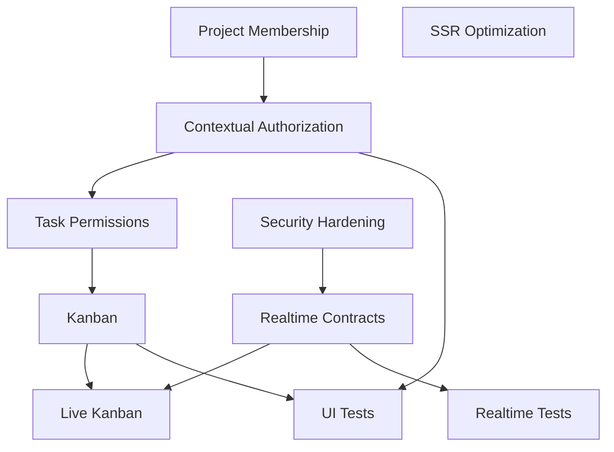

# 53_CURRENT_TASKS.md

# Aula Robótica Platform — Current Tasks & Operational Status

## Parte 1 — Estado actual, madurez, capacidades implementadas y baseline arquitectónico

---

# 1. Propósito

Este documento mantiene una visión operativa del estado actual de **Aula Robótica Platform**.

Su función principal es responder:

```text
Where are we now?

What is already implemented?

What is partially implemented?

What are the current priorities?

What should be worked on next?

What architectural constraints affect that work?
```

---

# 2. Nature of this Document

`53_CURRENT_TASKS.md` no es:

```text
a generic backlog

a product vision

a release changelog

a technical debt registry

a future wishlist
```

Es:

```text
the current operational snapshot
of the project.
```

---

# 3. Scope

El documento integra información operativa sobre:

```text
Current Product State

Implemented Capabilities

Architecture Maturity

Current Priorities

Active Technical Work

Security Improvements

Realtime Evolution

Testing Expansion

Technical Debt Dependencies
```

---

# 4. Related Documents

Este documento debe interpretarse junto con:

```text
47_PRODUCT_ROADMAP.md

48_PRODUCT_VISION.md

49_FEATURE_BACKLOG.md

50_WEEKLY_UPDATE.md

51_CODING_RULES.md

52_ARCHITECTURAL_DECISIONS.md

54_KNOWN_ISSUES.md

55_CHANGELOG.md

56_TECHNICAL_DEBT.md
```

---

# 5. Document Responsibilities

La separación conceptual es:

```text
PRODUCT_VISION

→ where the product wants to go


PRODUCT_ROADMAP

→ major evolution path


FEATURE_BACKLOG

→ candidate product work


CURRENT_TASKS

→ what matters operationally now


KNOWN_ISSUES

→ known defects and limitations


CHANGELOG

→ what changed


TECHNICAL_DEBT

→ structural compromises to address
```

---

# 6. Source of Operational Truth

Este documento debe reflejar:

```text
actual repository state

+

validated implementation status

+

current development priorities
```

Cuando exista conflicto entre:

```text
design documentation

and

verified implementation
```

el estado operativo debe basarse en:

```text
verified implementation.
```

---

# 7. Status Integrity

No debe marcarse una capability como:

```text
Completed
```

si únicamente:

```text
has been designed

appears in roadmap

has documentation

has a partial prototype
```

Del mismo modo:

```text
detailed architecture documentation

≠

implemented capability
```

---

# 8. Status Model

Las capacidades pueden clasificarse como:

```text
Planned

In Progress

Functional

Advanced

Mature

Needs Hardening

Future

Conditional
```

---

# 9. Planned

Existe intención o diseño, pero todavía no constituye funcionalidad operativa completa.

---

# 10. In Progress

Existe implementación parcial y trabajo activo pendiente.

---

# 11. Functional

La capability principal funciona, aunque pueda necesitar mejoras.

---

# 12. Advanced

Dispone de:

```text
reusable architecture

integration

security

tests

or advanced UX
```

más allá de una implementación básica.

---

# 13. Mature

La capability dispone de un nivel elevado de:

```text
functional completeness

architectural consistency

security

reuse

operational confidence
```

La clasificación:

```text
Mature
```

debe reservarse para capacidades cuyo comportamiento operativo y límites estén suficientemente consolidados.

---

# 14. Needs Hardening

La funcionalidad existe, pero necesita reforzar aspectos como:

```text
security

testing

performance

reliability

maintainability
```

---

# 15. Future

La capability:

```text
is not part of the current implementation
```

aunque pueda existir:

```text
design documentation

architectural preparation

roadmap consideration

or future integration strategy
```

---

# 16. Conditional

La capability únicamente debe introducirse si aparece un trigger técnico o de producto que justifique su coste.

Ejemplos:

```text
Redis

Kubernetes

microservices

distributed realtime infrastructure

object storage
```

---

# 17. Current Project Position

Aula Robótica Platform ha evolucionado más allá de un CRUD educativo convencional.

Actualmente combina:

```text
SSR Platform

+

Advanced IAM

+

RBAC

+

Context-aware Authorization Foundations

+

Reusable UI Architecture

+

Partial Realtime Capabilities

+

Modular Backend Architecture
```

---

# 18. Current Architectural Character

La plataforma puede describirse actualmente como:

```text
Modular SSR application

with reusable UI components,

centralized security,

MariaDB relational persistence,

audit capabilities,

notifications,

and progressively expanding realtime behavior.
```

---

# 19. Current Product Stage

El proyecto se encuentra en una fase donde el objetivo principal ya no es demostrar únicamente:

```text
CRUD functionality
```

sino consolidar:

```text
domain architecture

authorization

collaboration

reusability

realtime behavior

testing

operational maturity
```

---

# 20. Current Engineering Focus

El foco técnico actual se desplaza progresivamente desde:

```text
Can the platform do this?
```

hacia:

```text
Can the platform do this

securely,

consistently,

reusably,

and at maintainable scale?
```

---

# 21. Current Maturity Overview

| Área | Estado actual | Observación |
| :--- | :--- | :--- |
| IAM | Advanced / Needs Hardening | Authentication, JWT access/refresh, HTTPOnly cookies, identities, roles y workflows operativos; quedan mejoras de hardening |
| RBAC | Mature | Roles y permisos globales consolidados |
| Contextual Authorization | Functional / In Progress | Existe base funcional; la autorización completa por proyecto sigue siendo prioridad |
| Users | Mature | Gestión administrativa disponible |
| Roles | Mature | Gestión RBAC disponible |
| Identities | Mature | Gestión de identidades disponible |
| Projects | Functional | CRUD, detalle, relaciones y métricas |
| Tasks | Functional / Advanced | Workflow funcional e integración con realtime/audit |
| Activities | Advanced | Uno de los módulos funcionalmente más desarrollados |
| Attachments | Functional | Upload, metadata, download y ownership |
| Notifications | Advanced | Persistencia e integración realtime/UI |
| Dashboard | Advanced | Métricas, charts, feeds y actualizaciones dinámicas |
| Activity Feed | Advanced | Integración con actividad funcional y realtime |
| Audit | Mature | Integración transversal significativa |
| UI Architecture | Advanced | Macros, layouts, dialogs, actions y JS modular |
| Realtime | In Progress | Varias capabilities operativas, pero arquitectura aún parcial |
| Testing | Functional | Automatización existente; falta expansión UI/realtime |
| CI/CD | Functional | GitHub Actions y controles de calidad |
| Security Hardening | In Progress | Persisten mejoras específicas de CSRF, token hardening y WebSockets |

---

# 22. Maturity Interpretation

La tabla anterior representa:

```text
current implementation maturity
```

y no:

```text
final product completeness.
```

---

# 23. Important Distinction

Un módulo puede estar:

```text
Mature
```

desde perspectiva arquitectónica actual y seguir recibiendo nuevas features.

También puede estar:

```text
Functional
```

aunque determinadas capacidades de hardening todavía estén pendientes.

---

# 24. IAM Capability

## Status

```text
Advanced / Needs Hardening
```

---

# 25. IAM Implemented Capabilities

Actualmente se dispone de:

```text
JWT access tokens

JWT refresh tokens

HTTPOnly cookies

SessionMiddleware

SSR login

SSR logout

explicit refresh endpoint

automatic access-token refresh

refresh-token validation

RBAC

granular permissions

contextual authorization foundations

integrated audit
```

---

# 26. Refresh Token Current State

El refresh-token workflow forma parte de la implementación actual.

El flujo existente permite:

```text
authenticate user

↓

issue access token

+

issue refresh token

↓

store tokens in HTTPOnly cookies

↓

validate access token

↓

use refresh token when access token renewal is required

↓

issue a new access token

↓

continue authenticated interaction
```

---

# 27. Refresh Token Implementation Boundary

La existencia del refresh-token workflow no implica que todo el lifecycle de seguridad esté completamente consolidado.

Debe distinguirse:

```text
Refresh Token Support
    CURRENT

Refresh Token Validation
    CURRENT

Explicit Refresh Endpoint
    CURRENT

Automatic Access Refresh
    CURRENT

Refresh Token Security Hardening
    IN PROGRESS
```

---

# 28. Refresh Token Hardening

Las mejoras todavía relevantes pueden incluir:

```text
consistent cookie security policy

refresh-token rotation

revocation strategy

reuse detection

session/device visibility

token lifecycle observability
```

según las necesidades reales de seguridad.

---

# 29. Cookie Policy Consistency

La creación y renovación de cookies debe utilizar una política consistente entre:

```text
login

explicit refresh

automatic middleware refresh

logout
```

Especialmente deben mantenerse de forma coherente:

```text
HttpOnly

Secure

SameSite

Path

expiration
```

según entorno.

---

# 30. SAML Status

SAML no forma parte de la implementación actual.

Su estado es:

```text
SAML 2.0

→ FUTURE / PLANNED INTEGRATION CAPABILITY
```

La existencia de arquitectura preparada o documentación específica sobre SAML no debe interpretarse como:

```text
SAML implemented.
```

---

# 31. Authentication Architecture

La autenticación ya no constituye una implementación aislada de login.

Forma parte de una arquitectura que relaciona:

```text
Identity

↓

Authentication

↓

Session / Token Context

↓

User

↓

Role / Permission

↓

Contextual Authorization
```

---

# 32. IAM Operational Importance

IAM constituye una dependencia transversal de:

```text
administration

projects

tasks

activities

attachments

notifications

audit

realtime
```

---

# 33. IAM Current Direction

El trabajo inmediato no consiste en reemplazar la arquitectura actual, sino en:

```text
security hardening

+

contextual authorization expansion

+

token lifecycle hardening

+

cookie-policy consistency
```

---

# 34. Administrative Management

## Status

```text
Mature
```

---

# 35. Implemented Administrative Modules

Actualmente están implementados:

```text
Users CRUD

Roles CRUD

Identities CRUD

Permission Management

RBAC Relationship Management
```

---

# 36. Administrative Architecture

Estos módulos constituyen la capa administrativa de IAM y gobierno de acceso.

---

# 37. Administrative Security

Las acciones administrativas deben permanecer protegidas mediante:

```text
authentication

+

global permissions

+

server-side authorization
```

---

# 38. Projects Module

## Status

```text
Functional
```

---

# 39. Implemented Project Capabilities

Actualmente dispone de:

```text
Project CRUD

Project detail views

advanced detail layouts

task relationships

activity feeds

dashboard metrics
```

---

# 40. Project Architectural Role

Projects constituye uno de los principales contextos agregadores de la plataforma.

---

# 41. Project Relationships

Conceptualmente:

```text
Project

├── Tasks
├── Activities
├── Attachments
├── Members
├── Notifications
└── Activity Feed
```

con algunas relaciones todavía en evolución.

---

# 42. Project Membership Status

Debe distinguirse entre:

```text
existing project-related user context
```

y:

```text
fully consolidated ProjectMembership architecture.
```

La arquitectura madura de:

```text
ProjectMembership

+

Project-scoped Roles

+

Contextual Capabilities
```

continúa siendo una evolución en consolidación y no debe describirse como completamente finalizada.

---

# 43. Current Project Limitation

La autorización contextual por proyecto todavía constituye una prioridad arquitectónica.

---

# 44. Current Direction

La evolución prevista es:

```text
Project

↓

Project Membership

↓

Contextual Role

↓

Resource Permissions
```

---

# 45. Tasks Module

## Status

```text
Functional / Advanced
```

---

# 46. Implemented Task Capabilities

Actualmente dispone de:

```text
Task CRUD

status management

assigned_to

priorities

detail layouts

audit integration

realtime timeline behavior
```

---

# 47. Task Domain Role

Task constituye una entidad operativa central dentro de Project.

---

# 48. Current Task Relationships

```text
Project

↓

Task

├── Assignee
├── Activities
├── Attachments
├── Audit
└── Realtime Events
```

---

# 49. Task State

El estado de Task ya forma parte del comportamiento funcional.

---

# 50. Current Evolution

El siguiente salto funcional importante es:

```text
Task List

↓

Kanban Board
```

---

# 51. Kanban Dependency

El Kanban depende especialmente de:

```text
Task Status

Contextual Authorization

Realtime

Frontend Interaction
```

---

# 52. Kanban Status

Debe mantenerse explícitamente:

```text
Kanban Board

→ PLANNED / NEXT CAPABILITY
```

La existencia de:

```text
Task status

Realtime infrastructure

Frontend interaction patterns
```

proporciona una base para su desarrollo, pero no equivale a:

```text
Kanban implemented.
```

---

# 53. Activities Module

## Status

```text
Advanced
```

---

# 54. Current Position

Activities es uno de los módulos funcionalmente más maduros de la plataforma.

---

# 55. Implemented Activity Capabilities

Actualmente dispone de:

```text
Activity CRUD

Task → Activity relationship

status

hours tracking

advanced detail layouts

contextual actions

attachment integration
```

---

# 56. Activity Architecture

Conceptualmente:

```text
Project

↓

Task

↓

Activity
```

---

# 57. Activity UI

El módulo utiliza patrones avanzados de:

```text
detail layout

contextual actions

reusable components

timeline-oriented presentation
```

---

# 58. Activity Integration

Activities participa en:

```text
Task context

Attachments

Audit

Activity Feed

Realtime
```

según workflow.

---

# 59. Attachments Module

## Status

```text
Functional
```

---

# 60. Implemented Attachment Capabilities

Actualmente dispone de:

```text
file upload

persistent metadata

download

delete

ownership

detail integration

MIME validation

persistent storage
```

---

# 61. Attachment Architecture

El módulo separa conceptualmente:

```text
Attachment Metadata

↓

MariaDB


Binary Content

↓

Persistent File Storage
```

---

# 62. Attachment Security

El acceso debe continuar protegido mediante:

```text
authentication

resource authorization

ownership/context validation
```

---

# 63. Attachment Current Direction

Las mejoras futuras pueden incluir hardening adicional de:

```text
storage abstraction

file validation

security scanning

object storage readiness
```

cuando exista necesidad.

---

# 64. Attachment Storage Status

El almacenamiento actual debe distinguirse de posibles evoluciones futuras:

```text
CURRENT

Persistent file storage


FUTURE / CONDITIONAL

Object storage
S3-compatible storage
external storage services
```

No debe introducirse infraestructura adicional sin una necesidad operativa demostrada.

---

# 65. Notifications Module

## Status

```text
Advanced
```

---

# 66. Implemented Notification Capabilities

Actualmente dispone de:

```text
in-app notifications

persistent notification state

realtime delivery

unread counter

WebSocket integration

contextual rendering

navbar integration
```

---

# 67. Notification Architecture

Conceptualmente:

```text
Application Event

↓

Notification Creation

↓

Persistent State

↓

Optional Realtime Delivery

↓

UI Update
```

---

# 68. Persistence Principle

Realtime no sustituye la persistencia de Notifications.

La relación correcta es:

```text
Persistent State

=

authoritative notification state


Realtime

=

delivery / freshness mechanism
```

---

# 69. Current Notification Direction

La evolución inmediata debe priorizar:

```text
reliability

authorization

realtime consistency
```

antes de incorporar canales adicionales.

---

# 70. Future Notification Channels

Capacidades como:

```text
email delivery

push notifications

notification digests

advanced preference routing
```

no deben considerarse parte del baseline actual salvo implementación verificada.

Su estado general es:

```text
FUTURE / CONDITIONAL
```

---

# 71. Dashboard Module

## Status

```text
Advanced
```

---

# 72. Implemented Dashboard Capabilities

Actualmente dispone de:

```text
dynamic metrics

reusable metric cards

Chart.js charts

recent activity

audit feed

realtime updates
```

---

# 73. Dashboard Architecture

Dashboard funciona principalmente como:

```text
read composition layer
```

sobre datos procedentes de otros módulos.

---

# 74. Dashboard Data Sources

Puede combinar:

```text
Projects

Tasks

Activities

Notifications

Audit
```

---

# 75. Dashboard Ownership

Dashboard no debe convertirse en propietario de los datos de esos dominios.

---

# 76. Current Dashboard Direction

Las mejoras futuras deben centrarse en:

```text
query efficiency

context-aware metrics

realtime selectivity

reusable widgets
```

---

# 77. Activity Feed

## Status

```text
Advanced
```

---

# 78. Implemented Role

El Activity Feed proporciona una representación humana de actividad relevante.

---

# 79. Feed Inputs

Puede recibir información procedente de:

```text
Projects

Tasks

Activities

Membership changes

other meaningful domain events
```

cuando esos eventos formen parte del workflow implementado.

---

# 80. Feed vs Audit

Debe mantenerse la separación:

```text
Activity Feed

→ human collaboration awareness


Audit

→ formal traceability
```

---

# 81. Feed Current Direction

Las mejoras deben centrarse en:

```text
authorization scope

event consistency

pagination

realtime delivery

reconnection consistency
```

---

# 82. Audit System

## Status

```text
Mature
```

---

# 83. Current Audit Integration

La auditoría está integrada en múltiples operaciones relevantes.

---

# 84. Audit Purpose

Permite reconstruir:

```text
actor

action

resource

timestamp

relevant context
```

---

# 85. Audit Architecture

Audit permanece separado de:

```text
application logging

notifications

activity feed
```

---

# 86. Audit Current Direction

La prioridad no es aumentar indiscriminadamente el volumen de eventos, sino mejorar:

```text
coverage consistency

event semantics

access control

operational usefulness
```

---

# 87. UI Architecture

## Status

```text
Advanced
```

---

# 88. Implemented UI Foundations

Actualmente existen patrones reutilizables para:

```text
macros

actions

rows

detail layouts

toasts

confirmation dialogs

contextual rendering

cards

timelines
```

---

# 89. JavaScript Architecture

La UI utiliza JavaScript modular para comportamiento interactivo.

---

# 90. UI Architectural Direction

La arquitectura sigue el principio:

```text
SSR

+

Progressive Enhancement
```

---

# 91. Reusable-first Principle

Cuando un patrón aparece repetidamente debe evaluarse su extracción como componente reutilizable.

---

# 92. Reuse Guardrail

No convertir cada fragmento pequeño en una abstracción.

La reutilización debe responder a:

```text
real repetition

+

clear semantic ownership

+

maintenance value
```

---

# 93. Native Dialog Legacy

La arquitectura moderna debe sustituir progresivamente usos restantes de:

```javascript
alert()
confirm()
```

por componentes consistentes.

---

# 94. Realtime Architecture

## Status

```text
In Progress
```

---

# 95. Implemented Realtime Capabilities

Actualmente existen:

```text
WebSocket Manager

Dashboard Updates

Realtime Notifications

Audit Timeline Updates

Activity Feed Updates
```

---

# 96. Realtime Maturity

Realtime es funcional en varias áreas, pero todavía no constituye una arquitectura completamente consolidada.

Debe distinguirse:

```text
WebSocket Transport
    CURRENT

Realtime Features
    CURRENT

Realtime Reliability Hardening
    IN PROGRESS

Distributed Realtime
    FUTURE / CONDITIONAL
```

---

# 97. Current Realtime Limitation

Existe fragmentación parcial entre handlers y workflows.

También permanecen áreas de evolución relacionadas con:

```text
reconnection

state reconciliation

subscription authorization

connection security

event consistency
```

---

# 98. Current Realtime Direction

La evolución debe orientarse hacia:

```text
explicit events

consistent payloads

authorized scopes

shared handlers

reconnection

state reconciliation
```

---

# 99. Future Realtime Capability

Una de las siguientes extensiones principales será:

```text
Live Kanban
```

cuando:

```text
Kanban functionality

+

contextual authorization

+

realtime reliability
```

dispongan de una base suficientemente consolidada.

---

# 100. Realtime Source of Truth

Debe mantenerse:

```text
MariaDB

=

authoritative persistent state
```

---

# 101. Realtime Role

```text
WebSocket

=

freshness and collaboration signal
```

Por tanto:

```text
WebSocket state

must not replace

persistent authoritative state.
```

---

# 102. Distributed Realtime Status

Infraestructura como:

```text
Redis

message brokers

distributed connection coordination
```

no forma parte del baseline actual.

Su estado es:

```text
CONDITIONAL
```

y únicamente debe introducirse si aparecen necesidades como:

```text
multiple application instances

cross-instance realtime delivery

distributed ephemeral coordination
```

---

# 103. Quality Engineering

## Status

```text
Functional / Expanding
```

---

# 104. Implemented Quality Tooling

Actualmente existen:

```text
automated tests

GitHub Actions

SonarCloud

linting

modular project structure

uv package management
```

---

# 105. CI Role

CI proporciona una frontera automática para validar cambios antes de integración.

---

# 106. Current Testing Limitation

La cobertura necesita evolucionar especialmente en:

```text
WebSockets

Realtime workflows

JavaScript interaction

UI regression

negative authorization scenarios

cross-project isolation
```

---

# 107. Current Testing Direction

La evolución debe seguir una estrategia:

```text
Unit

+

Integration

+

HTTP

+

UI

+

Realtime
```

según riesgo.

---

# 108. Testing Interpretation

La existencia de tests para una capability no debe interpretarse automáticamente como:

```text
complete test coverage.
```

Debe distinguirse:

```text
functionality validated

from

risk coverage complete.
```

---

# 109. Backend Architecture Baseline

La arquitectura backend actual utiliza:

```text
modular organization

routers

services

models

dependencies

reusable helpers
```

---

# 110. Backend Direction

El objetivo es mantener:

```text
thin HTTP layer

+

service-owned business behavior
```

evitando trasladar lógica de negocio a:

```text
routers

templates

JavaScript

or transport-specific handlers.
```

---

# 111. Dependency Injection

Actualmente existe integración mediante dependencies para diferentes aspectos del request lifecycle.

---

# 112. DI Direction

Debe utilizarse donde simplifique:

```text
authentication context

database lifecycle

request context

authorization context
```

sin introducir abstracción innecesaria.

---

# 113. Frontend Architecture Baseline

La arquitectura frontend combina:

```text
SSR

reusable Jinja components

modular JavaScript

realtime enhancement
```

---

# 114. Frontend Direction

La evolución prevista es:

```text
SSR

↓

Progressive Enhancement

↓

Selective Interactive Components
```

---

# 115. Frontend Non-goal

No existe actualmente requirement para migrar toda la aplicación a una SPA.

Una migración de este tipo requeriría:

```text
clear product need

+

measurable architectural benefit

+

acceptable operational cost
```

---

# 116. Security Architecture Baseline

La seguridad utiliza múltiples capas.

---

# 117. Security Flow

```text
Authentication

↓

Global Authorization

↓

Contextual Authorization

↓

Business Validation

↓

Persistence
```

---

# 118. UI Security Principle

```text
Contextual UI

improves UX.

Backend authorization

enforces security.
```

La ocultación de una acción en UI:

```text
must never be treated

as the security boundary.
```

---

# 119. Security Current Direction

Las mejoras prioritarias incluyen:

```text
formal CSRF protection

refresh-token security hardening

cookie-policy consistency

WebSocket authentication hardening

WebSocket subscription authorization

contextual project authorization
```

---

# 120. Refresh Token Security Interpretation

No debe describirse:

```text
refresh-token implementation
```

como pendiente.

La implementación existe.

Lo pendiente es:

```text
refresh-token hardening
```

incluyendo, cuando resulte necesario:

```text
rotation

revocation

reuse protection

consistent cookie security

session lifecycle controls
```

---

# 121. SAML Security Interpretation

SAML debe permanecer fuera del baseline actual.

Estado:

```text
CURRENT AUTHENTICATION

JWT Access Token

+

JWT Refresh Token

+

HTTPOnly Cookies
```

frente a:

```text
FUTURE IDENTITY INTEGRATION

SAML 2.0
```

---

# 122. Current Database Baseline

La base de datos relacional actualmente utilizada por Aula Robótica Platform es:

```text
MariaDB
```

Por tanto:

```text
MariaDB

→ CURRENT
```

---

# 123. PostgreSQL Status

PostgreSQL no forma parte de la implementación actual.

Aunque haya sido considerado como posible evolución tecnológica:

```text
PostgreSQL

→ FUTURE / MIGRATION CANDIDATE
```

La migración:

```text
MariaDB → PostgreSQL
```

no se ha ejecutado.

---

# 124. Database Documentation Guardrail

Ningún documento de estado actual debe describir PostgreSQL como:

```text
current

established

authoritative current database

standardized current persistence engine

completed migration
```

mientras la plataforma continúe operando sobre MariaDB.

---

# 125. Current Architectural Baseline

El estado técnico consolidado puede representarse como:

```text
FastAPI

+

SSR / Jinja2

+

Modular Backend

+

MariaDB

+

SQLAlchemy

+

IAM / RBAC

+

JWT Access + Refresh Tokens

+

HTTPOnly Cookies

+

Contextual Authorization Foundations

+

Reusable UI

+

WebSockets

+

Audit

+

Notifications

+

Automated Quality Controls
```

---

# 126. Current Infrastructure Baseline

La infraestructura actual se apoya en:

```text
Docker

+

Docker Compose

+

Nginx

+

Ubuntu

+

Hetzner VPS

+

MariaDB
```

según el entorno de despliegue documentado.

---

# 127. Infrastructure Non-baseline

No forman parte del baseline actual:

```text
Kubernetes

Redis

distributed message broker

microservices

object storage

multi-region infrastructure
```

Estas tecnologías permanecen:

```text
FUTURE

or

CONDITIONAL
```

según necesidad.

---

# 128. Current Engineering Baseline

La plataforma dispone ya de suficiente infraestructura para que las siguientes iteraciones deban priorizar:

```text
consolidation

integration

hardening

collaboration

testing

performance
```

sobre la creación indiscriminada de nuevos subsistemas.

---

# 129. Current Product Capability Map

```text
Aula Robótica Platform
│
├── Identity & Access
│   ├── Users
│   ├── Roles
│   ├── Permissions
│   ├── Identities
│   ├── JWT Access Tokens
│   ├── JWT Refresh Tokens
│   ├── HTTPOnly Cookies
│   └── Sessions / Authentication Context
│
├── Collaboration
│   ├── Projects
│   ├── Tasks
│   ├── Activities
│   └── Attachments
│
├── Awareness
│   ├── Notifications
│   ├── Activity Feed
│   ├── Audit
│   └── Dashboard
│
├── Interaction
│   ├── SSR
│   ├── Reusable UI
│   ├── Modular JavaScript
│   └── WebSockets
│
├── Persistence
│   ├── SQLAlchemy
│   └── MariaDB
│
└── Engineering
    ├── Tests
    ├── GitHub Actions
    ├── SonarCloud
    ├── Linting
    └── uv
```

---

# 130. Capabilities Outside Current Product Map

Las siguientes capacidades no deben representarse como implementadas actualmente:

```text
SAML

PostgreSQL

Redis

Kubernetes

microservices

object storage

PWA

AI / RAG

multi-instance realtime infrastructure
```

Su presencia en documentos de arquitectura o evolución debe estar acompañada por estados como:

```text
PLANNED

FUTURE

CONDITIONAL

EXPERIMENTAL
```

según corresponda.

---

# 131. Current Architectural Strengths

Las principales fortalezas actuales son:

```text
strong IAM foundation

access + refresh token workflow

advanced reusable UI

clear SSR direction

audit integration

functional domain modules

growing realtime capabilities

automated quality tooling

explicit relational persistence
```

---

# 132. Current Architectural Gaps

Las principales áreas todavía incompletas son:

```text
project-scoped authorization

realtime consolidation

Kanban collaboration

formal CSRF hardening

refresh-token security hardening

cookie-policy consistency

WebSocket security hardening

WebSocket subscription authorization

UI/realtime testing

SSR query optimization
```

---

# 133. Operational Interpretation

Estas áreas deben considerarse:

```text
current evolution priorities
```

y no evidencia de que la arquitectura existente deba reemplazarse.

---

# 134. Architecture Stability

Las decisiones consolidadas sobre:

```text
SSR-first

modularity

backend authorization

reusable UI

MariaDB relational persistence

SQLAlchemy

JWT authentication

HTTPOnly cookies

WebSockets
```

continúan siendo válidas para el baseline actual.

---

# 135. Architecture Evolution Guardrail

Una tecnología futura no debe sustituir documentalmente al baseline antes de que exista:

```text
implemented migration

+

validated deployment

+

updated operational configuration

+

verified production behavior
```

---

# 136. Evolution Strategy

La estrategia inmediata es:

```text
Strengthen existing architecture

↓

Complete contextual collaboration

↓

Expand realtime safely

↓

Improve interaction

↓

Optimize measured bottlenecks

↓

Expand product domains
```

---

# 137. Current Phase Summary

El proyecto se encuentra en una fase de:

```text
Architectural Consolidation

+

Collaborative Capability Expansion

+

Security Hardening

+

Realtime Maturation
```

---

# 138. Current vs Target Architecture

Este documento distingue expresamente:

```text
CURRENT

→ verified implementation


TARGET

→ accepted architectural direction


PLANNED

→ intended work


FUTURE

→ possible later capability


CONDITIONAL

→ capability introduced only after a trigger
```

---

# 139. Normative Documentation Guardrail

En otros documentos pueden aparecer expresiones como:

```text
should

must

recommended

target architecture

reference architecture
```

Estas expresiones definen:

```text
architectural intent
```

y no constituyen por sí mismas evidencia de:

```text
current implementation.
```

---

# 140. Current State Authority

Para resolver contradicciones sobre el estado actual debe utilizarse este orden de evidencia:

```text
1. Verified application code

2. Verified runtime/deployment configuration

3. Current automated tests

4. Current operational documentation

5. Architecture documentation

6. Roadmap / future-evolution documentation
```

---

# 141. Part 1 Summary

El baseline actual puede resumirse como:

```text
IAM                 → Advanced / Needs Hardening

JWT Access Token    → Current

JWT Refresh Token   → Current

HTTPOnly Cookies    → Current

SAML                → Future

RBAC                → Mature

Contextual Auth     → Functional / In Progress

Projects            → Functional

Tasks               → Functional / Advanced

Activities          → Advanced

Attachments         → Functional

Notifications       → Advanced

Dashboard           → Advanced

Activity Feed       → Advanced

Audit               → Mature

UI Architecture     → Advanced

Realtime            → In Progress

Testing             → Functional / Expanding

Security Hardening  → In Progress

MariaDB             → Current

PostgreSQL          → Future / Migration Candidate

Redis               → Conditional

Kubernetes          → Conditional

Microservices       → Conditional
```

---

# 142. Current Baseline Invariant

Hasta que la implementación real cambie, debe preservarse:

```text
DATABASE

MariaDB
    CURRENT

PostgreSQL
    FUTURE / CANDIDATE


AUTHENTICATION

JWT Access Token
    CURRENT

JWT Refresh Token
    CURRENT

HTTPOnly Cookies
    CURRENT

SAML
    FUTURE


REALTIME

FastAPI WebSockets
    CURRENT

Realtime Features
    CURRENT

Reconnect / Reconciliation Hardening
    IN PROGRESS

Redis / Distributed Realtime
    CONDITIONAL


STORAGE

Persistent File Storage
    CURRENT

Object Storage
    FUTURE / CONDITIONAL


DEPLOYMENT

Docker
    CURRENT

Docker Compose
    CURRENT

Nginx
    CURRENT

Ubuntu
    CURRENT

Hetzner VPS
    CURRENT

Kubernetes
    CONDITIONAL


PRODUCT EVOLUTION

PWA
    FUTURE

AI / RAG
    FUTURE / EXPERIMENTAL

Multi-tenancy
    FUTURE / CONDITIONAL

Microservices
    CONDITIONAL
```

---

# 143. Continuation

La **Parte 2/3** continúa con:

```text
Current Priorities

Priority 1 — Project Context Authorization

Priority 2 — Kanban Architecture

Priority 3 — Realtime Expansion

Priority 4 — Frontend Evolution

Priority 5 — Context Caching

Priority 6 — Enterprise Security

Priority 7 — Testing Expansion

Detailed Tasks

Dependencies

Acceptance Criteria

Priority Relationships

Execution Order
```

---

# 53_CURRENT_TASKS.md

# Aula Robótica Platform — Current Tasks & Operational Status

## Parte 2 — Prioridades actuales, tareas técnicas, dependencias, criterios de aceptación y orden de ejecución

---

# 144. Current Priority Model

Las prioridades actuales deben responder a una combinación de:

```text
Product Value

+

Architectural Dependency

+

Security Risk

+

Technical Risk

+

Implementation Readiness
```

---

# 145. Priority Classification

Se utiliza conceptualmente:

```text
P0 — Critical

P1 — High

P2 — Medium

P3 — Low
```

---

# 146. P0 — Critical

Trabajo necesario para resolver:

```text
security vulnerability

data integrity risk

production-blocking defect

critical architectural failure
```

---

# 147. P1 — High

Trabajo que desbloquea capacidades relevantes o consolida un boundary arquitectónico importante.

---

# 148. P2 — Medium

Trabajo valioso que mejora:

```text
quality

UX

maintainability

performance
```

sin bloquear inmediatamente el producto.

---

# 149. P3 — Low

Mejoras diferibles que no afectan significativamente al funcionamiento actual.

---

# 150. Current Priority Stack

El orden operativo actual es:

```text
1. Project Context Authorization

2. Kanban Architecture

3. Realtime Expansion

4. Frontend Evolution

5. Context Caching

6. Enterprise Security Hardening

7. Testing Expansion

8. SSR Query Optimization
```

---

# 151. Dependency Principle

El orden anterior no significa que todas las tareas deban ejecutarse estrictamente de forma secuencial.

---

# 152. Parallel Work

Puede existir trabajo paralelo cuando:

```text
boundaries are independent

+

acceptance criteria are clear

+

integration risk is controlled
```

---

# 153. Critical Dependency Chain

La principal cadena de dependencia actual es:

```text
Project Membership

↓

Contextual Authorization

↓

Task Permissions

↓

Kanban Actions

↓

Realtime Collaboration
```

---

# 154. Priority 1 — Project Context Authorization

## Priority

```text
P1 — High
```

---

# 155. Objective

Completar una arquitectura de autorización contextual basada en pertenencia a Project.

---

# 156. Problem

El RBAC global no representa adecuadamente casos como:

```text
User A

→ Coordinator in Project 1

→ Member in Project 2
```

---

# 157. Required Capability

La plataforma necesita poder responder:

```text
Can this actor perform this action

on this resource

inside this project?
```

---

# 158. Target Model

Conceptualmente:

```text
User

↓

ProjectMembership

↓

Project Role

↓

Contextual Capabilities
```

---

# 159. Candidate Project Roles

El modelo puede incluir roles como:

```text
Owner

Coordinator

Member

Viewer
```

si el dominio final los necesita.

---

# 160. Role Naming Guardrail

Los nombres concretos deben reflejar el dominio real y no copiarse automáticamente de otros productos.

---

# 161. Membership Entity

La arquitectura objetivo contempla una relación explícita equivalente a:

```text
ProjectMembership
```

Este modelo debe considerarse:

```text
TARGET / IN CONSOLIDATION
```

hasta que su implementación completa haya sido verificada.

---

# 162. Candidate Membership Data

```text
project_id

user_id

role

created_at
```

con los campos adicionales realmente necesarios.

---

# 163. Membership Constraint

La implementación final debe impedir una duplicación no intencionada de:

```text
same user

+

same project
```

---

# 164. Database Protection

Cuando el modelo de membership esté consolidado, la unicidad debe protegerse mediante constraint persistente cuando corresponda.

---

# 165. Membership Service

La lógica de membership debe permanecer fuera de templates y routers.

---

# 166. Candidate Use Cases

```text
add member

remove member

change project role

list members

check membership

resolve contextual capabilities
```

---

# 167. Authorization Policy

Debe existir una capa reutilizable capaz de resolver permisos contextuales.

---

# 168. Example Policy

Conceptualmente:

```text
can_edit_project(actor, project)

can_manage_members(actor, project)

can_create_task(actor, project)

can_update_task(actor, task)

can_delete_task(actor, task)
```

---

# 169. Policy Principle

Las policies deben expresar:

```text
business authorization semantics
```

y no detalles de HTML.

---

# 170. Router Responsibility

El router puede:

```text
resolve request

authenticate actor

invoke authorization

call service

map response
```

---

# 171. Router Non-responsibility

No debe contener reglas complejas como:

```text
if user.role == ...
and project.owner_id == ...
and task.assigned_to == ...
```

repetidas por endpoint.

---

# 172. Template Integration

Los templates deben recibir capabilities ya preparadas.

---

# 173. Example

```python
can_edit_project = ...
can_manage_members = ...
can_create_task = ...
```

---

# 174. Template Rendering

Conceptualmente:

```jinja2

    ...

```

---

# 175. UI Is Not Enforcement

Aunque una acción no aparezca en pantalla, el endpoint debe volver a autorizarla.

---

# 176. Nested Resource Authorization

Una Task perteneciente a Project debe validar correctamente el contexto.

---

# 177. Cross-project Attack Scenario

Debe impedirse:

```text
authorized user in Project A

↓

manually sends Task ID from Project B

↓

operation succeeds
```

---

# 178. Required Test

Este escenario debe disponer de test explícito.

---

# 179. Membership Removal

Cuando exista un modelo explícito de membership, eliminar una membership debe retirar acceso contextual según policy.

---

# 180. Ownership Transfer

Si existe concepto de Project Owner, debe definirse qué ocurre cuando:

```text
owner leaves

owner is deactivated

project is archived
```

---

# 181. Authorization Acceptance Criteria

- [ ] Existe modelo explícito de membership.
- [ ] Existe constraint de unicidad adecuado.
- [ ] Las policies contextuales están centralizadas.
- [ ] Projects utiliza autorización contextual.
- [ ] Tasks utiliza contexto de Project.
- [ ] Activities hereda correctamente el contexto aplicable.
- [ ] Attachments respetan autorización del recurso padre.
- [ ] Los templates reciben capabilities preparadas.
- [ ] Los endpoints revalidan permisos.
- [ ] Existen tests allow/deny.
- [ ] Existen tests cross-project.
- [ ] Audit registra cambios relevantes de membership.

---

# 182. Definition of Done — Project Authorization

```text
A user's effective access to a project resource

can be derived consistently

from global + contextual authorization

without duplicating rules across endpoints.
```

---

# 183. Priority 2 — Kanban Architecture

## Priority

```text
P1 — High
```

---

# 184. Objective

Construir una representación Kanban de Tasks integrada con Project.

---

# 185. Kanban Purpose

Kanban debe proporcionar una vista operativa de:

```text
Task Workflow
```

---

# 186. Kanban Source of Truth

El estado persistido de Task continúa siendo autoritativo.

---

# 187. Kanban Is a Projection

```text
Task State

↓

Kanban Column
```

---

# 188. Candidate Mapping

Por ejemplo:

```text
TODO

↓

To Do


IN_PROGRESS

↓

In Progress


DONE

↓

Done
```

---

# 189. Mapping Guardrail

La UI no debe inventar estados que el dominio no pueda representar.

---

# 190. Kanban Read Model

El backend debe proporcionar los datos necesarios de forma eficiente.

---

# 191. Candidate Data

Cada card puede necesitar:

```text
task id

title

status

priority

assignee

deadline

project context
```

según diseño final.

---

# 192. Card Payload Guardrail

No enviar toda la entidad si la vista solo necesita un subconjunto.

---

# 193. Initial Kanban Delivery

La primera versión puede renderizarse mediante:

```text
SSR
```

---

# 194. Enhancement

Posteriormente:

```text
Drag and Drop

+

Fetch

+

WebSocket
```

---

# 195. Progressive Enhancement Strategy

```text
SSR Board

↓

Interactive Move

↓

Server Validation

↓

Persistent Update

↓

Realtime Broadcast
```

---

# 196. Drag-and-drop Principle

Mover una card visualmente no constituye una actualización confirmada.

---

# 197. Mutation Flow

```text
User moves Task

↓

Client requests status transition

↓

Server authenticates

↓

Server authorizes

↓

Server validates transition

↓

Database commit

↓

Server responds

↓

Realtime event emitted
```

---

# 198. Invalid Transition

Si la transición es inválida:

```text
server rejects
```

y la UI debe volver al estado autoritativo.

---

# 199. Authorization Dependency

Kanban depende directamente de:

```text
Project Context Authorization
```

---

# 200. Realtime Dependency

La colaboración multiusuario depende de:

```text
Realtime Event Architecture
```

---

# 201. Accessibility

Drag and drop no debe ser la única forma de cambiar estado.

---

# 202. Alternative Interaction

Debe existir una alternativa operable mediante:

```text
keyboard

status selector

or equivalent accessible control
```

---

# 203. Kanban Acceptance Criteria

- [ ] Existe vista Kanban por Project.
- [ ] Las columnas derivan de estados reales.
- [ ] Las Tasks se renderizan en columna correcta.
- [ ] El backend autoriza cada transición.
- [ ] El backend valida cada transición.
- [ ] La persistencia ocurre antes del broadcast.
- [ ] Los errores restauran estado coherente.
- [ ] Existe interacción accesible alternativa.
- [ ] Dos clientes pueden converger al mismo estado.
- [ ] No se exponen Tasks de Projects no autorizados.
- [ ] Los cambios relevantes quedan auditados.
- [ ] Existen tests del workflow principal.

---

# 204. Definition of Done — Kanban

```text
A project member can safely change

an authorized task state from the board,

and all relevant clients converge

to the persisted server state.
```

---

# 205. Priority 3 — Realtime Expansion

## Priority

```text
P1 — High
```

---

# 206. Objective

Consolidar las capabilities realtime existentes bajo contratos y lifecycle coherentes.

---

# 207. Current Realtime Surface

Actualmente existen actualizaciones relacionadas con:

```text
Dashboard

Notifications

Audit Timeline

Activity Feed
```

---

# 208. Problem

La evolución incremental puede producir:

```text
duplicated handlers

different payload shapes

inconsistent reconnect behavior

unclear subscription scopes

authorization gaps
```

---

# 209. Target Event Model

Los eventos deben converger hacia un contrato explícito.

---

# 210. Candidate Envelope

```json
{
  "type": "task.updated",
  "resource_id": 123,
  "project_id": 10,
  "payload": {},
  "timestamp": "..."
}
```

---

# 211. Event Naming Convention

Los nombres deberían seguir una convención consistente como:

```text
resource.action
```

Ejemplos:

```text
task.created

task.updated

task.deleted

activity.created

notification.created
```

---

# 212. Event Naming Guardrail

El nombre debe expresar:

```text
what happened
```

y no:

```text
what a specific UI component should do.
```

---

# 213. Realtime Scope

Cada conexión o subscription debe disponer de un scope explícito.

---

# 214. Candidate Scopes

```text
user

project

administrative

global
```

según caso de uso.

---

# 215. Subscription Authorization

El servidor debe decidir:

```text
whether the authenticated actor

may subscribe to the requested scope.
```

---

# 216. Project Channel

Un usuario no debe poder suscribirse arbitrariamente a:

```text
Project X
```

sin autorización contextual.

---

# 217. Notification Channel

Las notificaciones deben permanecer limitadas al usuario destinatario o audiencia autorizada.

---

# 218. Administrative Channel

Los eventos administrativos requieren permisos explícitos.

---

# 219. Realtime Authentication

La identidad debe derivarse de credenciales verificadas por el servidor.

---

# 220. Authentication Failure

Una conexión no autenticada debe rechazarse o limitarse según el endpoint concreto.

---

# 221. Connection Lifecycle

Debe existir comportamiento definido para:

```text
connect

authenticate

subscribe

receive

disconnect

reconnect
```

---

# 222. Reconnection

El cliente debe aplicar una estrategia controlada de reconexión.

---

# 223. Reconciliation

Tras reconectar:

```text
client should refresh authoritative state
```

cuando exista posibilidad de haber perdido eventos.

---

# 224. Why Reconciliation Matters

WebSocket no garantiza que un cliente desconectado reciba todo lo ocurrido durante la desconexión.

---

# 225. Event Idempotency

Cuando sea relevante, recibir un evento duplicado no debe corromper el estado de UI.

---

# 226. Event Ordering

No debe asumirse un ordering global que la arquitectura no garantice.

---

# 227. Persist-before-broadcast

Para mutaciones autoritativas:

```text
validate

↓

persist

↓

commit

↓

broadcast
```

---

# 228. Broadcast Failure

Si el broadcast falla después del commit:

```text
persistent state remains authoritative.
```

---

# 229. Recovery

Los clientes pueden recuperar consistencia mediante:

```text
re-fetch

or

reconciliation
```

---

# 230. Realtime Acceptance Criteria

- [ ] Los eventos tienen naming consistente.
- [ ] Los payloads tienen contratos definidos.
- [ ] Las conexiones se autentican.
- [ ] Las subscriptions se autorizan.
- [ ] Los scopes están definidos.
- [ ] Persistencia precede al broadcast.
- [ ] Existe reconnect strategy.
- [ ] Existe reconciliation strategy.
- [ ] Los handlers son reutilizables cuando corresponde.
- [ ] Se toleran duplicados relevantes.
- [ ] Existen tests multi-client.
- [ ] Existen tests de subscription denial.

---

# 231. Definition of Done — Realtime Consolidation

```text
Realtime behavior is explicit,

authorized,

recoverable,

and consistent with persistent state.
```

---

# 232. Priority 4 — Frontend Evolution

## Priority

```text
P2 — Medium
```

---

# 233. Objective

Consolidar el frontend SSR como una arquitectura interactiva modular y mantenible.

---

# 234. Current Strength

Ya existen:

```text
reusable Jinja components

shared dialogs

toast feedback

contextual actions

modular JavaScript patterns

realtime handlers
```

---

# 235. Current Risk

El crecimiento incremental puede producir:

```text
duplicated listeners

global functions

inline JavaScript

inconsistent Fetch handling

native dialog remnants

inconsistent loading states
```

---

# 236. Target Direction

```text
SSR

+

Reusable Components

+

Modular JavaScript

+

Shared Async Infrastructure

+

Selective Realtime
```

---

# 237. JavaScript Module Principle

Cada módulo debe tener una responsabilidad clara.

---

# 238. Candidate Module Types

```text
dialog

toast

fetch

realtime

kanban

notifications

forms
```

---

# 239. Global JavaScript

Debe minimizarse el crecimiento de funciones globales.

---

# 240. `window` Usage

Solo cuando exista una necesidad explícita de interoperabilidad.

---

# 241. Native Dialog Migration

Usos restantes de:

```javascript
alert()
confirm()
```

deben migrarse cuando formen parte de flujos relevantes.

---

# 242. Replacement

```text
Reusable Confirmation Dialog

+

Toast / Inline Feedback
```

---

# 243. Fetch Wrapper

Debe evaluarse una infraestructura compartida para:

```text
headers

CSRF

JSON parsing

error mapping

authentication handling
```

---

# 244. Fetch Wrapper Guardrail

No construir un framework frontend propio innecesariamente.

---

# 245. Loading State

Las acciones async relevantes deben proporcionar feedback.

---

# 246. Double Submission

Debe evitarse cuando una acción no sea idempotente.

---

# 247. Accessibility

Los componentes interactivos deben considerar:

```text
keyboard

focus

labels

semantic structure

error feedback
```

---

# 248. Frontend Acceptance Criteria

- [ ] Los módulos JS tienen ownership claro.
- [ ] Se reducen handlers duplicados.
- [ ] Los dialogs compartidos sustituyen patrones nativos relevantes.
- [ ] Existe manejo consistente de errores Fetch.
- [ ] Las acciones async muestran estado.
- [ ] Se evita doble submit cuando aplica.
- [ ] Se mantienen controles accesibles.
- [ ] No se desplaza autorización al navegador.
- [ ] SSR continúa funcionando como baseline.

---

# 249. Definition of Done — Frontend Evolution

```text
Interactive behavior is modular,

accessible,

server-authorized,

and consistent across the platform.
```

---

# 250. Priority 5 — Context Caching

## Priority

```text
P2 — Medium
```

---

# 251. Objective

Reducir trabajo repetitivo de request cuando exista evidencia de coste relevante.

---

# 252. Candidate Repeated Context

Ejemplos:

```text
current user

permissions

notification counters

navigation context

project capabilities
```

---

# 253. Important Distinction

No todo valor repetido necesita:

```text
shared distributed cache.
```

---

# 254. First Optimization Layer

Antes de Redis debe evaluarse:

```text
request-scoped reuse

query optimization

relationship loading

small local computations
```

---

# 255. Rationale

Introducir Redis añade:

```text
infrastructure

failure modes

invalidation

monitoring

deployment complexity
```

---

# 256. Measurement Requirement

No implementar caching sin conocer:

```text
what is expensive

how often

for whom

and why
```

---

# 257. Cache Adoption Trigger

Un cache compartido solo debe introducirse cuando exista evidencia de beneficio suficiente.

---

# 258. Authorization Cache Risk

Cachear permisos requiere especial cuidado.

---

# 259. Invalidation Requirement

Cambios como:

```text
role update

membership removal

permission change

account deactivation
```

deben invalidar cualquier cache relevante.

---

# 260. Notification Counter

Puede optimizarse si existe evidencia de query repetitiva costosa.

---

# 261. Context Caching Acceptance Criteria

- [ ] Se mide antes.
- [ ] Se identifica coste real.
- [ ] Se optimiza query antes de cachear cuando sea posible.
- [ ] Existe estrategia de invalidación.
- [ ] No se cachean permisos de forma insegura.
- [ ] Se mide después.
- [ ] La infraestructura adicional está justificada.

---

# 262. Definition of Done — Context Optimization

```text
Repeated request context is cheaper

without sacrificing authorization correctness

or introducing unjustified infrastructure.
```

---

# 263. Priority 6 — Enterprise Security Hardening

## Priority

```text
P1 — High
```

---

# 264. Objective

Cerrar gaps de seguridad identificados sobre una base de autenticación y autorización ya funcional.

---

# 265. Security Workstreams

```text
CSRF

Refresh Token Hardening

Cookie Policy Consistency

WebSocket Authentication

WebSocket Authorization

Security Headers

Negative Security Testing
```

---

# 266. CSRF Task

Implementar protección CSRF formal para mutaciones basadas en cookies cuando corresponda.

---

# 267. CSRF Coverage

Debe incluir:

```text
SSR forms

Fetch POST

PUT

PATCH

DELETE
```

según superficie real.

---

# 268. GET Safety

GET no debe utilizarse para mutaciones.

---

# 269. CSRF Acceptance Criteria

- [ ] Existe estrategia documentada.
- [ ] Forms están protegidos.
- [ ] Fetch mutations están protegidas.
- [ ] Token inválido se rechaza.
- [ ] Token ausente se rechaza cuando aplica.
- [ ] Existen tests.

---

# 270. Refresh Token Hardening

El refresh token ya está implementado.

Por tanto, esta línea de trabajo no consiste en:

```text
implement refresh tokens
```

sino en revisar y reforzar su lifecycle de seguridad.

---

# 271. Current Refresh Flow

La aplicación dispone actualmente de:

```text
access token issuance

+

refresh token issuance

+

HTTPOnly cookie storage

+

explicit refresh endpoint

+

automatic access-token refresh

+

refresh-token validation
```

---

# 272. Refresh Token Rotation

Debe evaluarse si el nivel de riesgo del producto justifica:

```text
rotation on use

+

refresh-token replacement

+

reuse detection
```

---

# 273. Candidate Hardened Flow

Si se adopta rotación:

```text
Refresh Token A

↓

Validated

↓

Access Token B

+

Refresh Token B

↓

Refresh Token A invalidated
```

---

# 274. Replay Risk

Si un refresh token robado continúa siendo válido durante toda su vida útil, existe mayor ventana de replay.

La estrategia final debe corresponder al riesgo real del producto.

---

# 275. Token Storage

Debe revisarse de forma consistente:

```text
HttpOnly

Secure

SameSite

expiration

Path
```

en todos los puntos donde se creen o renueven cookies.

---

# 276. Cookie Policy Consistency

Login, refresh explícito y refresh automático deben compartir una política de cookies coherente con el entorno.

No debe existir una ruta de renovación que degrade accidentalmente atributos como:

```text
Secure

SameSite
```

respecto de la política utilizada durante login.

---

# 277. Logout

Debe invalidar el contexto local de autenticación de forma coherente.

Si en el futuro existe revocación server-side, deberá integrarse también en el logout.

---

# 278. WebSocket Authentication Hardening

Debe revisarse:

```text
credential source

token validation

expiry

refresh interaction

disconnect behavior
```

---

# 279. Client-supplied Identity

No confiar en:

```text
user_id

project_id

role
```

enviado por cliente sin validación server-side.

---

# 280. WebSocket Authorization

La conexión autenticada no implica acceso a todos los canales.

---

# 281. Security Headers

Debe centralizarse la política relevante.

---

# 282. Candidate Headers

```text
Content-Security-Policy

X-Content-Type-Options

Referrer-Policy

Permissions-Policy

Strict-Transport-Security
```

según entorno.

---

# 283. CSP Readiness

Antes de una CSP estricta debe reducirse dependencia de inline scripts cuando sea necesario.

---

# 284. Security Acceptance Criteria

- [ ] CSRF cubre mutaciones relevantes.
- [ ] Refresh token workflow sigue siendo funcional.
- [ ] La política de cookies es consistente entre login y refresh.
- [ ] Se ha evaluado rotation/revocation según riesgo.
- [ ] WebSockets autentican server-side.
- [ ] Subscriptions autorizan server-side.
- [ ] No se confía en identidad suministrada por cliente.
- [ ] Security headers están centralizados.
- [ ] Existen tests negativos.
- [ ] Logout mantiene semántica coherente.

---

# 285. Definition of Done — Security Hardening

```text
The existing authentication architecture

is hardened against realistic cookie,

token,

authorization,

and realtime attack paths

without misrepresenting already implemented capabilities as missing.
```

---

# 286. Priority 7 — Testing Expansion

## Priority

```text
P1 / P2
```

dependiendo del área.

---

# 287. Objective

Expandir cobertura donde el riesgo arquitectónico ha crecido.

---

# 288. Current Priority Testing Areas

```text
Contextual Authorization

Cross-project Isolation

Realtime

Kanban

JavaScript

UI Journeys

Security Negative Paths
```

---

# 289. Authorization Tests

Cada capability contextual relevante debe probar:

```text
allowed actor

denied actor

unauthenticated actor

cross-project actor
```

---

# 290. Negative Testing

Los tests de seguridad no deben limitarse a happy path.

---

# 291. Cross-resource Tests

Ejemplo:

```text
User belongs to Project A

Task belongs to Project B

User attempts mutation

↓

Denied
```

---

# 292. Realtime Tests

Deben probar múltiples clientes cuando el comportamiento dependa de broadcast.

---

# 293. Candidate Scenario

```text
Client A

changes Task

↓

Server commits

↓

Client B

receives event

↓

Client B state converges
```

---

# 294. Unauthorized Realtime Scenario

```text
Client without Project access

attempts subscription

↓

Denied
```

---

# 295. Disconnect Scenario

```text
Client disconnects

↓

State changes

↓

Client reconnects

↓

Client reconciles authoritative state
```

---

# 296. JavaScript Tests

Deben priorizar módulos con lógica significativa.

---

# 297. Candidate JS Targets

```text
dialogs

Kanban

Fetch wrapper

realtime handlers

notification state
```

---

# 298. UI Tests

Deben cubrir journeys críticos.

---

# 299. Candidate UI Journeys

```text
login

project access

task creation

task transition

activity update

attachment upload

notification interaction

logout
```

---

# 300. Flakiness Rule

Un test UI inestable no debe aceptarse como normal.

---

# 301. Fixed Sleep

Evitar:

```text
sleep(5)
```

como estrategia primaria de sincronización.

---

# 302. Testing Acceptance Criteria

- [ ] Existe matriz de autorización.
- [ ] Existen tests cross-project.
- [ ] Existen tests WebSocket.
- [ ] Existen tests multi-client.
- [ ] Existen tests de reconnection cuando aplica.
- [ ] Existen tests JS para módulos críticos.
- [ ] Existen UI journeys principales.
- [ ] CI ejecuta suites relevantes.
- [ ] Los tests inestables se corrigen.

---

# 303. Definition of Done — Testing Expansion

```text
Critical product and architecture risks

have automated regression protection.
```

---

# 304. Priority 8 — SSR Query Optimization

## Priority

```text
P2 — Medium
```

---

# 305. Objective

Reducir queries redundantes en páginas SSR de mayor complejidad.

---

# 306. Candidate Hotspots

```text
Dashboard

Project Detail

Task Detail

Activity Detail

navigation context
```

---

# 307. Optimization Principle

```text
Measure first.
```

---

# 308. Query Inspection

Debe conocerse:

```text
query count

duplicated queries

N+1 patterns

latency
```

---

# 309. Candidate Techniques

```text
relationship loading strategy

query composition

aggregation queries

request-scoped context reuse

pagination
```

---

# 310. N+1

Debe tratarse cuando aparezca en rutas relevantes.

---

# 311. Eager Loading Guardrail

No cargar todas las relaciones por defecto.

---

# 312. Dashboard Aggregation

Las métricas pueden requerir queries agregadas específicas.

---

# 313. Pagination

Colecciones potencialmente grandes deben paginarse.

---

# 314. Caching

Solo después de optimizar queries cuando siga existiendo necesidad.

---

# 315. SSR Optimization Acceptance Criteria

- [ ] Se identifican rutas objetivo.
- [ ] Existe baseline.
- [ ] Se inspeccionan queries.
- [ ] Se corrigen N+1 relevantes.
- [ ] Las colecciones grandes están bounded.
- [ ] No se sobrecargan relaciones innecesarias.
- [ ] Se compara antes/después.
- [ ] No se degrada corrección funcional.

---

# 316. Current Dependency Graph



---

# 317. Primary Execution Path

La secuencia recomendada es:

```text
1. Project Membership

2. Contextual Authorization

3. Security Boundary Hardening

4. Realtime Contract Consolidation

5. Kanban SSR

6. Kanban Interactive Mutation

7. Live Kanban

8. Multi-client Testing

9. UI Regression Coverage

10. Measured SSR Optimization
```

---

# 318. Why Membership Comes First

Porque define:

```text
who belongs to the collaborative context
```

---

# 319. Why Authorization Comes Second

Porque define:

```text
what those members can do
```

---

# 320. Why Security Hardening Precedes Realtime Expansion

Porque ampliar canales realtime sin una boundary sólida incrementa superficie de ataque.

---

# 321. Why SSR Kanban Precedes Live Kanban

Porque primero debe funcionar correctamente:

```text
without realtime complexity
```

---

# 322. Why Testing Expands Alongside Features

Testing no debe reservarse para el final.

---

# 323. Vertical Slice Principle

Cada capability debería avanzar como:

```text
Model

↓

Service

↓

Authorization

↓

HTTP

↓

SSR/UI

↓

Tests

↓

Realtime if needed
```

---

# 324. Current Task Sizing

Las tareas deben ser suficientemente pequeñas para permitir:

```text
review

testing

rollback

incremental delivery
```

---

# 325. Oversized Task Signal

Una tarea probablemente debe dividirse si mezcla:

```text
schema migration

new authorization model

large UI redesign

realtime architecture

and infrastructure change
```

simultáneamente.

---

# 326. Recommended Task Breakdown — Project Membership

```text
TASK-PROJECT-01
Create membership model and migration

TASK-PROJECT-02
Implement membership service

TASK-PROJECT-03
Implement contextual policies

TASK-PROJECT-04
Integrate Project endpoints

TASK-PROJECT-05
Integrate nested resources

TASK-PROJECT-06
Add membership UI

TASK-PROJECT-07
Add audit events

TASK-PROJECT-08
Add authorization test matrix
```

---

# 327. Recommended Task Breakdown — Realtime

```text
TASK-RT-01
Define event envelope

TASK-RT-02
Normalize event names

TASK-RT-03
Authenticate connections

TASK-RT-04
Authorize subscriptions

TASK-RT-05
Implement shared reconnect client

TASK-RT-06
Implement reconciliation strategy

TASK-RT-07
Normalize handlers

TASK-RT-08
Add multi-client tests
```

---

# 328. Recommended Task Breakdown — Kanban

```text
TASK-KANBAN-01
Create SSR board

TASK-KANBAN-02
Map task states to columns

TASK-KANBAN-03
Implement authorized status mutation

TASK-KANBAN-04
Add accessible status interaction

TASK-KANBAN-05
Add drag and drop

TASK-KANBAN-06
Add optimistic visual behavior

TASK-KANBAN-07
Add server reconciliation

TASK-KANBAN-08
Add realtime events

TASK-KANBAN-09
Add E2E tests
```

---

# 329. Recommended Task Breakdown — Security

```text
TASK-SEC-01
Implement CSRF token lifecycle

TASK-SEC-02
Protect SSR forms

TASK-SEC-03
Protect Fetch mutations

TASK-SEC-04
Review refresh-token rotation and revocation strategy

TASK-SEC-05
Unify cookie policy across login and refresh flows

TASK-SEC-06
Harden WebSocket authentication

TASK-SEC-07
Harden subscription authorization

TASK-SEC-08
Centralize security headers

TASK-SEC-09
Add negative security tests
```

---

# 330. Recommended Task Breakdown — Frontend

```text
TASK-UI-01
Inventory native dialogs

TASK-UI-02
Consolidate confirmation dialog

TASK-UI-03
Consolidate toast feedback

TASK-UI-04
Create shared Fetch helper

TASK-UI-05
Normalize async action states

TASK-UI-06
Review keyboard accessibility

TASK-UI-07
Review focus management

TASK-UI-08
Remove obsolete duplicated handlers
```

---

# 331. Recommended Task Breakdown — Performance

```text
TASK-PERF-01
Identify SSR hotspots

TASK-PERF-02
Measure query counts

TASK-PERF-03
Detect N+1

TASK-PERF-04
Optimize Project detail

TASK-PERF-05
Optimize Dashboard queries

TASK-PERF-06
Review navigation context

TASK-PERF-07
Measure results

TASK-PERF-08
Evaluate cache only if still necessary
```

---

# 332. Current Work Acceptance Standard

Una tarea no debe considerarse completa únicamente porque:

```text
the happy path works locally.
```

---

# 333. Minimum Completion Expectations

Según el tipo de tarea debe considerar:

```text
implementation

authorization

validation

error handling

tests

documentation impact

observability impact
```

---

# 334. Security-sensitive Definition of Done

Para tareas de seguridad:

- [ ] Happy path.
- [ ] Unauthorized path.
- [ ] Unauthenticated path.
- [ ] Cross-resource path.
- [ ] Tampered input.
- [ ] Relevant audit behavior.
- [ ] Automated tests.

---

# 335. Realtime Definition of Done

Para tareas realtime:

- [ ] Persisted source of truth.
- [ ] Explicit event.
- [ ] Authorized audience.
- [ ] Correct sender behavior.
- [ ] Correct receiver behavior.
- [ ] Disconnect behavior.
- [ ] Reconnect behavior.
- [ ] Duplicate tolerance where relevant.
- [ ] Multi-client test.

---

# 336. UI Definition of Done

Para tareas UI:

- [ ] SSR baseline remains functional.
- [ ] JavaScript enhancement works.
- [ ] Error state exists.
- [ ] Loading state exists where required.
- [ ] Keyboard path considered.
- [ ] Authorization remains server-side.
- [ ] Reusable patterns used where appropriate.

---

# 337. Database Definition of Done

Para cambios persistentes sobre el baseline actual de MariaDB:

- [ ] Migration exists.
- [ ] Upgrade path works.
- [ ] Constraints are explicit.
- [ ] Existing data considered.
- [ ] Transaction behavior considered.
- [ ] MariaDB compatibility is verified.
- [ ] Integration tests cover critical behavior.

Una posible migración futura a PostgreSQL constituye una iniciativa independiente y no forma parte del Definition of Done de los cambios persistentes actuales.

---

# 338. Current Task Risk Categories

Cada tarea relevante puede etiquetarse conceptualmente con:

```text
SECURITY

DATA

REALTIME

UI

PERFORMANCE

ARCHITECTURE

OPERATIONS
```

---

# 339. High-risk Combination

Una tarea que combine:

```text
SECURITY + DATA + REALTIME
```

debe dividirse o revisarse especialmente.

---

# 340. Current Task Blocking Rule

Una tarea está:

```text
Blocked
```

cuando depende de una decisión o implementación no disponible.

---

# 341. Blocked Is Not In Progress

No debe mantenerse artificialmente como trabajo activo si no puede avanzar.

---

# 342. Dependency Documentation

El bloqueo debe indicar:

```text
blocked by

reason

unblock condition
```

---

# 343. Example

```text
Live Kanban

Blocked by:

- contextual task authorization
- normalized realtime contracts
```

---

# 344. Current Execution Principle

```text
Secure the context

↓

build the workflow

↓

add collaboration

↓

measure

↓

optimize
```

---

# 345. Part 2 Summary

Las prioridades operativas actuales son:

```text
P1

Project Context Authorization

Enterprise Security Hardening

Realtime Consolidation

Kanban Core

High-risk Testing


P2

Frontend Consolidation

Context Optimization

UI Testing Expansion

SSR Query Optimization
```

---

# 346. Current Critical Path

```text
Project Membership

↓

Contextual Authorization

↓

Task Authorization

↓

Kanban

↓

Realtime Kanban

↓

Multi-client Validation
```

---

# 347. Current Parallel Hardening Path

```text
CSRF

+

Refresh Token Hardening

+

Cookie Policy Consistency

+

WebSocket Authentication

+

Security Headers

+

Negative Security Testing
```

El bloque:

```text
Refresh Token Hardening
```

no significa implementar refresh tokens desde cero.

El flujo de refresh ya pertenece al baseline actual; esta línea representa únicamente la consolidación de:

```text
rotation / revocation strategy

reuse protection

cookie-policy consistency

session lifecycle security
```

cuando corresponda.

---

# 348. Current Quality Path

```text
Authorization Tests

↓

Realtime Tests

↓

JavaScript Tests

↓

UI Journeys

↓

Performance Baselines
```

---

# 349. Current Execution Guardrail

Las prioridades descritas en esta parte representan:

```text
current recommended execution direction
```

y no deben utilizarse para afirmar que una capability objetivo ya existe.

En particular:

```text
ProjectMembership
    TARGET / IN CONSOLIDATION

Kanban
    PLANNED / NEXT CAPABILITY

Realtime Reliability Hardening
    IN PROGRESS

Refresh Token Workflow
    CURRENT

Refresh Token Hardening
    IN PROGRESS

PostgreSQL Migration
    FUTURE / CANDIDATE
```

---

# 350. Continuation

La **Parte 3/3** completa `53_CURRENT_TASKS.md` con:

```text
Operational Task Registry

Task Status Matrix

Immediate / Next / Later Work

Blockers

Known Dependencies

Risk Register

Technical Debt Interaction

Monitoring of Progress

Weekly Review Model

Completion Rules

Update Protocol

Archiving Rules

Current Execution Snapshot
```

---

# 53_CURRENT_TASKS.md

# Aula Robótica Platform — Current Tasks & Operational Status

## Parte 3 — Registro operativo, estados, riesgos, dependencias, gobernanza y cierre

---

# 351. Operational Task Registry

El registro operativo convierte las prioridades arquitectónicas en unidades de trabajo trazables.

Cada tarea debe responder como mínimo:

```text
What needs to change?

Why does it matter?

What does it depend on?

What risk does it address?

How do we know it is complete?
```

---

# 352. Task Identifier Convention

Las tareas pueden identificarse mediante:

```text
CT-XXX
```

donde:

```text
CT

=

Current Task
```

---

# 353. Task Status Model

Los estados operativos son:

```text
READY

IN_PROGRESS

BLOCKED

VALIDATION

DONE

DEFERRED
```

---

# 354. READY

La tarea:

```text
is sufficiently understood

and

can be started
```

sin dependencias bloqueantes conocidas.

---

# 355. IN_PROGRESS

Existe trabajo activo sobre la tarea.

---

# 356. BLOCKED

La tarea no puede avanzar hasta resolver una dependencia explícita.

---

# 357. VALIDATION

La implementación principal está terminada, pero todavía necesita:

```text
tests

review

integration validation

or acceptance verification
```

---

# 358. DONE

La tarea cumple su Definition of Done y no mantiene trabajo pendiente necesario para considerarla completada.

---

# 359. DEFERRED

La tarea se ha pospuesto deliberadamente.

No significa:

```text
forgotten
```

sino:

```text
not justified now.
```

---

# 360. Current Task Matrix

| ID | Task | Priority | Status | Main Dependency |
| :--- | :--- | :--- | :--- | :--- |
| CT-001 | Project Membership Model | P1 | READY | Domain validation |
| CT-002 | Contextual Authorization Policies | P1 | BLOCKED | CT-001 |
| CT-003 | Cross-project Authorization Tests | P1 | BLOCKED | CT-002 |
| CT-004 | Formal CSRF Protection | P1 | READY | Frontend mutation inventory |
| CT-005 | Refresh Token Security Hardening | P1 | READY | Current refresh-token workflow |
| CT-006 | Cookie Policy Consistency | P1 | READY | Current login/refresh implementation |
| CT-007 | WebSocket Authentication Hardening | P1 | READY | Realtime inventory |
| CT-008 | WebSocket Subscription Authorization | P1 | BLOCKED | CT-002, CT-007 |
| CT-009 | Realtime Event Contract | P1 | READY | Event inventory |
| CT-010 | Reconnect Strategy | P1 | BLOCKED | CT-009 |
| CT-011 | State Reconciliation | P1 | BLOCKED | CT-010 |
| CT-012 | Kanban SSR Board | P1 | BLOCKED | CT-002 |
| CT-013 | Kanban Status Mutation | P1 | BLOCKED | CT-012 |
| CT-014 | Kanban Drag & Drop | P2 | BLOCKED | CT-013 |
| CT-015 | Live Kanban | P1 | BLOCKED | CT-009, CT-013 |
| CT-016 | Shared Fetch Infrastructure | P2 | READY | CSRF strategy |
| CT-017 | Native Dialog Migration | P2 | READY | UI inventory |
| CT-018 | Realtime Test Expansion | P1 | BLOCKED | CT-009 |
| CT-019 | UI Test Expansion | P2 | READY | Critical journey inventory |
| CT-020 | SSR Query Optimization | P2 | READY | Performance baseline |

---

# 361. Matrix Interpretation

La tabla anterior representa:

```text
current recommended work state
```

y no necesariamente:

```text
an external issue tracker state.
```

Si existe un tracker operativo real, éste debe prevalecer para determinar:

```text
assignee

sprint

dates

actual work-in-progress
```

---

# 362. CT-001 — Project Membership Model

## Objective

Formalizar el contexto de pertenencia de User a Project.

## Priority

```text
P1
```

## Status

```text
READY
```

---

# 363. CT-001 Scope

Incluye:

```text
domain model

relationship semantics

constraints

migration

service boundary

tests
```

---

# 364. CT-001 Guardrail

No asumir automáticamente que:

```text
ProjectMembership
```

ya constituye un modelo completamente consolidado en la implementación actual.

Esta tarea representa precisamente su formalización.

---

# 365. CT-001 Acceptance

```text
User ↔ Project relationship

has explicit persistence semantics

and can support contextual authorization.
```

---

# 366. CT-002 — Contextual Authorization Policies

## Status

```text
BLOCKED
```

por:

```text
CT-001
```

---

# 367. CT-002 Objective

Centralizar reglas de autorización dependientes del contexto Project.

---

# 368. CT-002 Acceptance

```text
Global RBAC

+

Project Context

=

Effective Capability
```

de forma reutilizable y testeable.

---

# 369. CT-003 — Cross-project Authorization Tests

## Status

```text
BLOCKED
```

por:

```text
CT-002
```

---

# 370. CT-003 Objective

Proteger explícitamente contra acceso horizontal entre Projects.

---

# 371. CT-003 Critical Scenario

```text
User authorized in Project A

attempts to access resource in Project B

↓

DENIED
```

---

# 372. CT-004 — Formal CSRF Protection

## Status

```text
READY
```

---

# 373. CT-004 Objective

Proteger mutaciones autenticadas mediante cookies frente a CSRF.

---

# 374. CT-004 Scope

```text
SSR forms

Fetch mutations

POST

PUT

PATCH

DELETE
```

según endpoints reales.

---

# 375. CT-004 Acceptance

Las mutaciones relevantes requieren prueba válida de intención y los tests verifican rechazo de requests inválidas.

---

# 376. CT-005 — Refresh Token Security Hardening

## Status

```text
READY
```

---

# 377. CT-005 Current Baseline

El refresh-token workflow ya está implementado.

Actualmente existen:

```text
refresh-token issuance

refresh-token HTTPOnly cookie

refresh-token validation

explicit refresh endpoint

automatic access-token renewal
```

Por tanto, CT-005:

```text
does not implement refresh tokens.
```

---

# 378. CT-005 Objective

Reforzar el lifecycle de seguridad del mecanismo existente.

---

# 379. CT-005 Candidate Scope

```text
rotation strategy

revocation strategy

reuse detection

session lifecycle

expiry policy review

security observability
```

según el nivel de riesgo y complejidad justificado.

---

# 380. CT-005 Acceptance

Como mínimo debe existir una decisión explícita sobre:

```text
rotation

revocation

reuse

expiry

logout semantics
```

aunque algunas capacidades puedan quedar deliberadamente diferidas.

---

# 381. CT-006 — Cookie Policy Consistency

## Status

```text
READY
```

---

# 382. CT-006 Problem

Los diferentes puntos de emisión o renovación de cookies deben aplicar una política de seguridad consistente.

---

# 383. CT-006 Scope

Revisar:

```text
login

explicit refresh

automatic middleware refresh

logout
```

---

# 384. CT-006 Security Attributes

Debe verificarse coherencia de:

```text
HttpOnly

Secure

SameSite

Path

Max-Age / Expires
```

según entorno.

---

# 385. CT-006 Known Implementation Concern

La renovación automática del access token no debe degradar atributos de seguridad respecto de la configuración utilizada durante login.

---

# 386. CT-006 Acceptance

```text
all authentication cookie writers

share an environment-aware security policy.
```

---

# 387. CT-007 — WebSocket Authentication Hardening

## Status

```text
READY
```

---

# 388. CT-007 Objective

Asegurar que toda conexión realtime sensible tenga identidad verificada server-side.

---

# 389. CT-007 Scope

```text
credential extraction

token validation

expiry behavior

connection rejection

identity derivation
```

---

# 390. CT-007 Acceptance

Una conexión no puede asumir una identidad simplemente a partir de información controlada por el cliente.

---

# 391. CT-008 — WebSocket Subscription Authorization

## Status

```text
BLOCKED
```

por:

```text
CT-002

CT-007
```

---

# 392. CT-008 Objective

Autorizar el scope solicitado por cada conexión o subscription.

---

# 393. CT-008 Acceptance

```text
authenticated

≠

authorized for every channel
```

---

# 394. CT-009 — Realtime Event Contract

## Status

```text
READY
```

---

# 395. CT-009 Objective

Normalizar eventos realtime existentes.

---

# 396. CT-009 Candidate Contract

```json
{
  "type": "resource.action",
  "resource_id": 123,
  "project_id": 10,
  "payload": {},
  "timestamp": "..."
}
```

---

# 397. CT-009 Acceptance

Los principales eventos realtime utilizan:

```text
consistent naming

consistent envelope

explicit scope

documented payload
```

---

# 398. CT-010 — Reconnect Strategy

## Status

```text
BLOCKED
```

por:

```text
CT-009
```

---

# 399. CT-010 Objective

Definir comportamiento consistente después de una desconexión no intencionada.

---

# 400. CT-010 Acceptance

El cliente:

```text
detects disconnect

↓

retries with controlled backoff

↓

restores subscriptions

↓

triggers reconciliation when required
```

---

# 401. CT-011 — State Reconciliation

## Status

```text
BLOCKED
```

por:

```text
CT-010
```

---

# 402. CT-011 Objective

Garantizar que un cliente pueda recuperar el estado autoritativo después de perder eventos.

---

# 403. CT-011 Principle

```text
reconnect

≠

state synchronized
```

---

# 404. CT-011 Acceptance

Tras una interrupción, el cliente puede volver a converger con MariaDB mediante los endpoints/read models correspondientes.

---

# 405. CT-012 — Kanban SSR Board

## Status

```text
BLOCKED
```

por:

```text
CT-002
```

---

# 406. CT-012 Objective

Crear la primera versión del board sin depender de drag-and-drop ni realtime.

---

# 407. CT-012 Acceptance

```text
authorized project tasks

are rendered

in columns derived from persistent task state.
```

---

# 408. CT-013 — Kanban Status Mutation

## Status

```text
BLOCKED
```

por:

```text
CT-012
```

---

# 409. CT-013 Objective

Permitir transiciones de estado autorizadas desde el board.

---

# 410. CT-013 Acceptance

```text
authorize

↓

validate transition

↓

persist

↓

respond
```

---

# 411. CT-014 — Kanban Drag & Drop

## Status

```text
BLOCKED
```

por:

```text
CT-013
```

---

# 412. CT-014 Objective

Añadir interacción drag-and-drop como progressive enhancement.

---

# 413. CT-014 Accessibility Requirement

Debe existir una alternativa funcional sin drag-and-drop.

---

# 414. CT-015 — Live Kanban

## Status

```text
BLOCKED
```

por:

```text
CT-009

CT-013
```

---

# 415. CT-015 Objective

Propagar cambios de Task a otros clientes autorizados.

---

# 416. CT-015 Acceptance

```text
Client A mutates

↓

Server authorizes

↓

MariaDB commits

↓

Event broadcasts

↓

Client B converges
```

---

# 417. CT-016 — Shared Fetch Infrastructure

## Status

```text
READY
```

con dependencia conceptual de la estrategia CSRF.

---

# 418. CT-016 Objective

Normalizar operaciones Fetch repetitivas.

---

# 419. CT-016 Scope

Puede centralizar:

```text
CSRF integration

JSON parsing

error normalization

authentication failures

request defaults
```

---

# 420. CT-016 Guardrail

No crear un framework frontend innecesario.

---

# 421. CT-017 — Native Dialog Migration

## Status

```text
READY
```

---

# 422. CT-017 Objective

Eliminar progresivamente usos relevantes de:

```javascript
alert()
confirm()
```

---

# 423. CT-017 Acceptance

Las acciones críticas utilizan feedback UI consistente y reutilizable.

---

# 424. CT-018 — Realtime Test Expansion

## Status

```text
BLOCKED
```

por:

```text
CT-009
```

para la cobertura contractual completa.

---

# 425. CT-018 Objective

Añadir protección de regresión sobre:

```text
connection

authentication

subscription

broadcast

disconnect

reconnect

reconciliation
```

---

# 426. CT-019 — UI Test Expansion

## Status

```text
READY
```

---

# 427. CT-019 Objective

Cubrir journeys críticos de usuario.

---

# 428. CT-019 Initial Scope

```text
authentication

project navigation

task workflow

activity workflow

attachments

notifications

logout
```

---

# 429. CT-020 — SSR Query Optimization

## Status

```text
READY
```

---

# 430. CT-020 Objective

Optimizar únicamente bottlenecks medidos.

---

# 431. CT-020 Guardrail

```text
No speculative optimization.
```

---

# 432. Immediate Work

La ventana inmediata debe centrarse en:

```text
CT-001 Project Membership

CT-004 CSRF

CT-005 Refresh Token Security Hardening

CT-006 Cookie Policy Consistency

CT-007 WebSocket Authentication

CT-009 Realtime Contract
```

---

# 433. Why These Can Progress Together

Representan boundaries diferentes:

```text
Domain / Authorization

Security

Authentication Hardening

Realtime
```

y pueden avanzar parcialmente en paralelo.

---

# 434. Next Work

Después de los primeros desbloqueos:

```text
CT-002 Contextual Authorization

CT-003 Cross-project Tests

CT-008 Subscription Authorization

CT-010 Reconnect

CT-012 Kanban SSR
```

---

# 435. Later Work

Una vez consolidadas las bases:

```text
CT-011 Reconciliation

CT-013 Kanban Mutation

CT-014 Drag & Drop

CT-015 Live Kanban

CT-018 Realtime Testing
```

---

# 436. Parallel Quality Work

Pueden avanzar cuando exista capacidad:

```text
CT-017 Native Dialog Migration

CT-019 UI Testing

CT-020 SSR Optimization
```

---

# 437. Deferred Architecture

No deben convertirse en current tasks sin trigger explícito:

```text
Redis

Kubernetes

microservices

distributed broker

object storage migration

full SPA migration

multi-region deployment
```

---

# 438. PostgreSQL Migration Status

La migración:

```text
MariaDB

↓

PostgreSQL
```

no forma parte del trabajo operativo actual.

Estado:

```text
FUTURE / CANDIDATE
```

Solo debe convertirse en current task si existe una decisión explícita y justificada de ejecutar la migración.

---

# 439. SAML Status

SAML no forma parte del baseline actual ni de las tareas inmediatas descritas aquí.

Estado:

```text
FUTURE / PLANNED INTEGRATION CAPABILITY
```

Su documentación arquitectónica representa preparación para una posible integración futura.

---

# 440. Refresh Token Status

A diferencia de SAML:

```text
Refresh Token

=

CURRENT IMPLEMENTED CAPABILITY
```

Por tanto:

```text
CT-005
```

debe interpretarse exclusivamente como:

```text
security hardening of an existing capability.
```

---

# 441. PWA Status

```text
FUTURE
```

No constituye prioridad inmediata.

---

# 442. AI / RAG Status

```text
FUTURE / EXPERIMENTAL
```

Debe requerir un caso de uso concreto antes de introducir infraestructura específica.

---

# 443. Multi-tenancy Status

```text
FUTURE / CONDITIONAL
```

No debe inferirse automáticamente de la existencia de Projects.

---

# 444. Microservices Status

```text
CONDITIONAL / NOT CURRENT
```

La arquitectura actual continúa siendo:

```text
Modular Monolith
```

---

# 445. Kubernetes Status

```text
CONDITIONAL / NOT CURRENT
```

La infraestructura actual continúa basada en:

```text
Docker

Docker Compose

Nginx

Ubuntu

Hetzner VPS
```

---

# 446. Redis Status

```text
CONDITIONAL / NOT CURRENT
```

El Connection Manager realtime actual puede permanecer in-memory mientras la topología de despliegue lo permita.

---

# 447. Object Storage Status

```text
FUTURE / CONDITIONAL
```

El almacenamiento persistente actual no necesita reemplazarse únicamente para anticipar escala hipotética.

---

# 448. Current Blockers

Los principales blockers arquitectónicos son:

```text
contextual authorization depends on membership semantics

Kanban depends on contextual authorization

subscription authorization depends on contextual authorization

reconnect consistency depends on normalized realtime contracts

live Kanban depends on Kanban mutation + realtime contracts
```

---

# 449. Non-blocking Hardening

Algunas tareas pueden progresar sin esperar a esos blockers:

```text
CSRF

refresh-token hardening

cookie-policy consistency

WebSocket authentication

UI cleanup

performance measurement
```

---

# 450. Known Dependency — MariaDB

Todas las tareas persistentes actuales deben diseñarse y validarse contra:

```text
MariaDB
```

como motor relacional vigente.

---

# 451. Future Database Migration Guardrail

Una posible migración futura a PostgreSQL deberá tratarse como una iniciativa explícita que incluya:

```text
compatibility analysis

schema migration

data migration

driver/configuration changes

Docker changes

deployment changes

backup/restore changes

tests

rollback strategy

documentation update
```

Hasta entonces:

```text
MariaDB remains CURRENT.
```

---

# 452. Technical Debt Interaction

Una current task puede depender de deuda técnica existente.

---

# 453. Debt Handling Rule

No toda deuda encontrada durante una tarea debe resolverse inmediatamente.

---

# 454. Fix Now

Debe resolverse dentro de la tarea cuando:

```text
blocks correctness

creates security risk

prevents testing

or makes implementation unsafe
```

---

# 455. Register Separately

Debe registrarse como deuda independiente cuando:

```text
it is real

but unrelated to current acceptance criteria.
```

---

# 456. Avoid Opportunistic Rewrite

No convertir una tarea localizada en una reescritura arquitectónica sin necesidad.

---

# 457. Known Issues Interaction

Si una tarea descubre un defecto reproducible:

```text
register or update

54_KNOWN_ISSUES.md
```

cuando corresponda.

---

# 458. Changelog Interaction

Cuando una capability se complete realmente:

```text
55_CHANGELOG.md
```

debe registrar el cambio efectivo.

---

# 459. Changelog Integrity

No registrar como historia completada:

```text
planned architecture

future integration

reference design

or candidate migration.
```

---

# 460. Roadmap Interaction

Si una current task altera significativamente la secuencia de producto:

```text
47_PRODUCT_ROADMAP.md
```

debe actualizarse.

---

# 461. Backlog Interaction

Las ideas no activadas deben permanecer en:

```text
49_FEATURE_BACKLOG.md
```

y no convertirse automáticamente en current tasks.

---

# 462. Architecture Decision Interaction

Un cambio de alto impacto puede requerir actualización de:

```text
52_ARCHITECTURAL_DECISIONS.md
```

o del registro de decisiones correspondiente.

---

# 463. Current Task Review Cadence

El documento debe revisarse:

```text
at meaningful delivery boundaries

or

when current priorities materially change.
```

---

# 464. Review Trigger

Actualizar cuando:

```text
a blocker disappears

a task becomes active

a capability is completed

a new critical issue appears

an architectural decision changes priorities
```

---

# 465. Avoid Cosmetic Churn

No actualizar estados simplemente para producir actividad documental.

---

# 466. Current Task Aging

Una tarea que permanece:

```text
READY
```

durante mucho tiempo debe revisarse.

---

# 467. Possible Outcomes

```text
still relevant

↓

keep


not currently valuable

↓

defer


obsolete

↓

remove/archive


blocked implicitly

↓

document blocker
```

---

# 468. BLOCKED Review

Una tarea bloqueada debe revisarse cuando cambie su dependencia.

---

# 469. DONE Removal

Las tareas DONE no deben permanecer indefinidamente en Current Tasks.

---

# 470. DONE Flow

```text
Current Task

↓

Completed

↓

Changelog / History

↓

Removed from active registry
```

---

# 471. Current Tasks Is Not History

El documento no debe convertirse en archivo histórico acumulativo.

---

# 472. Historical Truth

La historia debe vivir principalmente en:

```text
55_CHANGELOG.md

57_PROJECT_EVOLUTION.md

59_IMPLEMENTATION_TIMELINE.md
```

siempre que esos documentos reflejen únicamente cambios realmente ejecutados o etiqueten claramente lo futuro.

---

# 473. Weekly Update Relationship

`50_WEEKLY_UPDATE.md` puede registrar contexto temporal de trabajo.

`53_CURRENT_TASKS.md` mantiene el mapa operativo más estable.

---

# 474. Operational Review Questions

En cada revisión preguntar:

```text
What changed?

What is blocked?

What became ready?

What is no longer relevant?

What risk increased?

What risk decreased?

What should be next?
```

---

# 475. Security Review Questions

```text
Did authorization boundaries change?

Did authentication behavior change?

Did cookie behavior change?

Did a new WebSocket scope appear?

Did a new mutation endpoint appear?

Are negative tests required?
```

---

# 476. Data Review Questions

```text
Did schema change?

Did constraints change?

Did transaction boundaries change?

Did query patterns change?

Did backup/restore assumptions change?
```

---

# 477. Realtime Review Questions

```text
Did a new event appear?

Who can receive it?

What is its source of truth?

What happens on disconnect?

What happens on duplicate?

What happens after reconnect?
```

---

# 478. UI Review Questions

```text
Does SSR still work?

Is JavaScript required or enhancement?

What happens on failure?

Is keyboard interaction possible?

Is server authorization preserved?
```

---

# 479. Testing Review Questions

```text
What regression risk was introduced?

Which layer should test it?

Does it require negative tests?

Does it require multiple clients?

Does it require browser-level validation?
```

---

# 480. Operational Risk Register

| Risk | Current Level | Main Mitigation |
| :--- | :--- | :--- |
| Cross-project authorization leakage | High | CT-001, CT-002, CT-003 |
| CSRF on cookie-authenticated mutations | High | CT-004 |
| Refresh-token lifecycle hardening gaps | Medium | CT-005 |
| Authentication cookie-policy inconsistency | High | CT-006 |
| WebSocket identity weakness | High | CT-007 |
| Unauthorized subscriptions | High | CT-008 |
| Realtime contract fragmentation | Medium | CT-009 |
| Stale state after reconnect | Medium | CT-010, CT-011 |
| Kanban concurrency inconsistency | Medium | CT-013, CT-015 |
| UI regression | Medium | CT-019 |
| SSR query growth | Medium | CT-020 |

---

# 481. Risk Interpretation

Los niveles anteriores representan prioridad de ingeniería relativa, no una certificación formal de riesgo.

---

# 482. Refresh-token Risk Interpretation

El riesgo identificado no es:

```text
refresh tokens are missing
```

sino:

```text
an implemented refresh-token lifecycle
may require additional security hardening.
```

---

# 483. Security Before Convenience

Cuando exista conflicto entre:

```text
faster implementation

and

authorization correctness
```

debe prevalecer:

```text
authorization correctness.
```

---

# 484. Data Before Realtime

Cuando exista conflicto entre:

```text
visual realtime state

and

persisted state
```

debe prevalecer:

```text
persisted MariaDB state.
```

---

# 485. Server Before Client

Cuando exista conflicto entre:

```text
client assumption

and

server validation
```

debe prevalecer:

```text
server validation.
```

---

# 486. Verified Implementation Before Documentation Assumption

Cuando exista conflicto entre:

```text
architecture document

and

verified application code
```

debe prevalecer:

```text
verified application code
```

para describir el estado actual.

---

# 487. Example — Refresh Tokens

El código actual demuestra:

```text
JWT refresh-token workflow

=

CURRENT
```

Por tanto, cualquier documento que lo describa como:

```text
not implemented
```

debe corregirse.

---

# 488. Example — PostgreSQL

La documentación estratégica puede describir PostgreSQL como posible evolución.

Pero la plataforma real utiliza:

```text
MariaDB
```

Por tanto:

```text
PostgreSQL

≠

CURRENT
```

---

# 489. Example — SAML

Existe diseño documental para una futura integración SAML.

Eso significa:

```text
architecture prepared
```

y no:

```text
SAML implemented.
```

---

# 490. Example — Redis

La arquitectura realtime puede evolucionar hacia coordinación distribuida.

Eso no significa:

```text
Redis is part of the current stack.
```

---

# 491. Example — ProjectMembership

Un modelo detallado en documentación puede representar:

```text
target domain design
```

hasta que su implementación real esté consolidada.

---

# 492. Current Technical Principles

El trabajo actual debe preservar:

```text
Server-side authorization

MariaDB as current relational source of truth

SQLAlchemy persistence abstraction

Service Layer

Modular Monolith

SSR-first UI

Progressive Enhancement

Persistent state before realtime

Risk-based testing

Evidence-based optimization
```

---

# 493. Current Non-goals

No constituyen objetivos inmediatos:

```text
rewrite to SPA

rewrite to microservices

adopt Kubernetes

introduce Redis without trigger

migrate to PostgreSQL without explicit decision

replace local storage without need

introduce AI without use case
```

---

# 494. Current Architecture Preservation

Las nuevas tareas deben evolucionar la plataforma sin destruir innecesariamente:

```text
existing SSR

current authentication

MariaDB persistence

reusable UI

current deployment model

working realtime capabilities
```

---

# 495. Reversibility

Los cambios de mayor impacto deben preservar reversibilidad cuando sea razonable.

---

# 496. Migration Safety

Especialmente:

```text
database changes

authorization changes

token lifecycle changes

realtime contract changes
```

deben permitir validación incremental.

---

# 497. Documentation Update Rule

Una tarea que cambia una capability documentada debe identificar qué documentos quedan afectados.

---

# 498. Candidate Documentation Impact

```text
Architecture

Security

Backend

Frontend

Realtime

Database

Testing

Operations

Status

Changelog
```

---

# 499. No Silent Architectural Change

Una tarea no debe introducir silenciosamente:

```text
new infrastructure

new persistence technology

new authentication mechanism

new distributed dependency
```

sin documentar la decisión.

---

# 500. Operational Observability

Las tareas relevantes deben considerar si necesitan:

```text
structured logs

audit events

metrics

health indicators

error reporting
```

---

# 501. Logging Is Not Audit

Debe mantenerse:

```text
Logs

≠

Audit
```

---

# 502. Realtime Errors

Los fallos de broadcast secundarios no deben ocultar el resultado de una mutación ya confirmada.

---

# 503. Secondary Failure Visibility

Aunque una operación principal haya tenido éxito, un fallo secundario debe ser observable.

---

# 504. Graceful Degradation

La plataforma debe poder seguir funcionando cuando fallen capabilities secundarias siempre que sea seguro.

Ejemplo:

```text
MariaDB commit succeeds

WebSocket broadcast fails

↓

persistent operation remains successful

+

failure is logged/observed

+

clients recover by reconciliation
```

---

# 505. Security Failure Behavior

Los fallos de:

```text
authentication

authorization

CSRF validation
```

deben:

```text
fail closed.
```

---

# 506. Current Success Metrics

La evolución actual debe medirse mediante señales como:

```text
fewer duplicated authorization rules

fewer cross-project risks

consistent realtime contracts

reliable reconnect behavior

higher critical-path test coverage

fewer duplicated frontend handlers

measured query reduction
```

---

# 507. Avoid Vanity Metrics

No utilizar únicamente:

```text
lines of code

number of files

number of abstractions

number of technologies
```

como medida de progreso.

---

# 508. Architecture Complexity Budget

Cada nueva dependencia debe justificar:

```text
problem solved

benefit

operational cost

failure modes

maintenance burden
```

---

# 509. Redis Complexity Budget

Redis debe adoptarse solo cuando la arquitectura actual no pueda satisfacer de forma razonable una necesidad real.

---

# 510. Kubernetes Complexity Budget

Kubernetes debe adoptarse solo si existen necesidades operativas que Docker Compose ya no resuelva adecuadamente.

---

# 511. Microservices Complexity Budget

Un módulo no debe extraerse a microservicio únicamente porque:

```text
it is conceptually separate.
```

---

# 512. PostgreSQL Migration Budget

Una migración MariaDB → PostgreSQL debe justificarse por beneficios concretos y no por preferencia tecnológica abstracta.

---

# 513. AI Complexity Budget

AI/RAG debe introducirse únicamente para un caso de uso definido y evaluable.

---

# 514. Current Product Expansion Rule

Antes de abrir nuevos dominios importantes debe consolidarse suficiente estabilidad en:

```text
authorization

realtime

testing

operations
```

---

# 515. Future Domains

Capacidades futuras como:

```text
Academic

Inventory

Reservations

Competition
```

deben integrarse incrementalmente.

---

# 516. Domain Expansion Guardrail

No convertir el core actual en una arquitectura genérica excesivamente abstracta para anticipar dominios todavía no implementados.

---

# 517. Current Task Completion Flow

```text
READY

↓

IN_PROGRESS

↓

VALIDATION

↓

DONE

↓

CHANGELOG / HISTORY
```

---

# 518. Blocked Flow

```text
READY

↓

BLOCKED

↓

dependency resolved

↓

READY / IN_PROGRESS
```

---

# 519. Deferred Flow

```text
candidate work

↓

insufficient current value

↓

DEFERRED

↓

future trigger

↓

re-evaluate
```

---

# 520. Task Promotion Rule

Una idea pasa de backlog a Current Tasks cuando:

```text
priority is accepted

+

dependencies are understood

+

work is actionable
```

---

# 521. Task Demotion Rule

Una current task puede volver a backlog/deferred si:

```text
priority changed

dependency disappeared

product need changed

or cost no longer justifies work
```

---

# 522. Current Task Ownership

Cada tarea activa debería disponer, cuando exista gestión operativa real, de:

```text
owner

status

acceptance criteria

dependencies
```

---

# 523. Current Task Documentation

No es necesario duplicar todos los detalles de un issue tracker.

Este documento conserva:

```text
architectural and operational intent.
```

---

# 524. External Tracker Relationship

Si se utiliza GitHub Issues u otro sistema:

```text
Issue Tracker

→ execution detail


CURRENT_TASKS

→ architectural operational map
```

---

# 525. Current Snapshot Integrity

La información que ya no representa el presente debe:

```text
move

be reclassified

or be removed
```

en lugar de mantenerse como current por razones históricas.

---

# 526. Current Snapshot Size

El documento debe seguir siendo suficientemente navegable para identificar:

```text
baseline

priorities

blockers

risks

next actions
```

---

# 527. Detailed Architecture Location

El detalle exhaustivo de cada subsistema debe permanecer en su manual especializado.

---

# 528. Current Tasks Principle

```text
Current Tasks should be detailed enough

to guide execution,

but small enough

to understand what matters now.
```

---

# 529. Audit Correction Rule

Cuando una auditoría documental detecte que una capability fue promovida erróneamente de:

```text
FUTURE
```

a:

```text
CURRENT
```

debe restaurarse el estado real.

---

# 530. Reverse Audit Rule

También debe corregirse el caso inverso.

Si el código demuestra que una capability existe, no debe mantenerse como:

```text
NOT IMPLEMENTED
```

solo porque documentación anterior haya quedado desactualizada.

---

# 531. Confirmed Reverse Audit — Refresh Token

El refresh-token workflow constituye un caso confirmado de:

```text
implementation ahead of stale documentation.
```

Su estado correcto es:

```text
CURRENT
```

---

# 532. Confirmed Audit — SAML

SAML constituye el caso contrario:

```text
detailed future design

was interpreted as

implemented capability.
```

Su estado correcto es:

```text
FUTURE
```

---

# 533. Confirmed Audit — Database

La persistencia actual utiliza:

```text
MariaDB
```

La posible evolución hacia PostgreSQL no llegó a ejecutarse.

Por tanto:

```text
MariaDB      CURRENT

PostgreSQL   FUTURE / CANDIDATE
```

---

# 534. Documentation Semantics

A partir de esta revisión deben utilizarse de forma consistente:

```text
CURRENT

PARTIAL

TARGET

PLANNED

FUTURE

CONDITIONAL

DEFERRED
```

---

# 535. CURRENT

```text
Verified current implementation.
```

---

# 536. PARTIAL

```text
Implemented in part,
with meaningful behavior still incomplete.
```

---

# 537. TARGET

```text
Accepted architectural direction,
not necessarily implemented.
```

---

# 538. PLANNED

```text
Intended implementation,
not current capability.
```

---

# 539. FUTURE

```text
Possible later evolution.
```

---

# 540. CONDITIONAL

```text
Introduced only after an explicit trigger.
```

---

# 541. DEFERRED

```text
Known work deliberately postponed.
```

---

# 542. Current Operational Baseline

La baseline consolidada después de la auditoría es:

```text
APPLICATION

FastAPI
    CURRENT

Modular Monolith
    CURRENT

Service Layer
    CURRENT

SQLAlchemy
    CURRENT


DATABASE

MariaDB
    CURRENT

PostgreSQL
    FUTURE / CANDIDATE


FRONTEND

Jinja2 SSR
    CURRENT

Bootstrap / AdminLTE
    CURRENT

Modular JavaScript
    CURRENT

SPA migration
    NOT CURRENT / CONDITIONAL


AUTHENTICATION

JWT Access Token
    CURRENT

JWT Refresh Token
    CURRENT

HTTPOnly Cookies
    CURRENT

Automatic Access Refresh
    CURRENT

Refresh Security Hardening
    IN PROGRESS / CURRENT PRIORITY

SAML
    FUTURE


AUTHORIZATION

RBAC
    CURRENT

Contextual Authorization
    PARTIAL / IN PROGRESS

ProjectMembership
    TARGET / IN CONSOLIDATION


REALTIME

FastAPI WebSockets
    CURRENT

Realtime Features
    CURRENT

Reconnect Hardening
    IN PROGRESS

Reconciliation
    IN PROGRESS

Distributed Realtime
    CONDITIONAL

Redis
    CONDITIONAL


STORAGE

Persistent File Storage
    CURRENT

Object Storage
    FUTURE / CONDITIONAL


OPERATIONS

Docker
    CURRENT

Docker Compose
    CURRENT

Nginx
    CURRENT

Ubuntu
    CURRENT

Hetzner VPS
    CURRENT

Kubernetes
    CONDITIONAL


QUALITY

Automated Tests
    CURRENT

GitHub Actions
    CURRENT

SonarCloud
    CURRENT

UI / Realtime Coverage
    EXPANDING


PRODUCT EVOLUTION

Kanban
    PLANNED / NEXT

PWA
    FUTURE

AI / RAG
    FUTURE / EXPERIMENTAL

Multi-tenancy
    FUTURE / CONDITIONAL

Microservices
    CONDITIONAL
```

---

# 543. Immediate Execution Snapshot

La siguiente ventana de trabajo recomendada es:

```text
DOMAIN

CT-001
Project Membership


SECURITY

CT-004
CSRF

CT-005
Refresh Token Security Hardening

CT-006
Cookie Policy Consistency

CT-007
WebSocket Authentication


REALTIME

CT-009
Event Contract


QUALITY

prepare authorization and realtime test coverage
```

---

# 544. Next Execution Snapshot

Tras los primeros desbloqueos:

```text
CT-002
Contextual Authorization

CT-003
Cross-project Tests

CT-008
Subscription Authorization

CT-010
Reconnect Strategy

CT-012
Kanban SSR
```

---

# 545. Subsequent Execution Snapshot

Posteriormente:

```text
CT-011
State Reconciliation

CT-013
Kanban Status Mutation

CT-014
Drag & Drop

CT-015
Live Kanban

CT-018
Realtime Test Expansion
```

---

# 546. Deferred Technology Snapshot

Mantener fuera del current execution plan:

```text
PostgreSQL migration

Redis

Kubernetes

microservices

object storage migration

full SPA migration

PWA

AI / RAG

multi-tenancy
```

hasta que exista trigger explícito.

---

# 547. Operational Definition of Success

La fase actual puede considerarse consolidada cuando:

```text
project authorization is contextual and tested

+

security hardening closes the main known gaps

+

realtime behavior is explicit and recoverable

+

Kanban is secure and consistent

+

critical UI/realtime journeys have regression protection

+

performance work is evidence-based
```

---

# 548. Final Current Task Principle

```text
Do not confuse

what exists,

what is being improved,

what is planned,

and what might exist someday.
```

La utilidad de `53_CURRENT_TASKS.md` depende precisamente de mantener esas fronteras explícitas.

---

# 549. Conclusion

Aula Robótica Platform dispone actualmente de una base funcional y arquitectónica significativa:

```text
FastAPI

+

Modular Monolith

+

MariaDB

+

SQLAlchemy

+

JWT Access + Refresh Tokens

+

HTTPOnly Cookies

+

RBAC

+

Contextual Authorization Foundations

+

SSR / Jinja2

+

Reusable UI

+

WebSockets

+

Notifications

+

Audit

+

Automated Quality Controls
```

La prioridad actual no es reemplazar esta base.

Es:

```text
consolidate authorization

↓

harden security

↓

normalize realtime

↓

expand collaboration

↓

strengthen testing

↓

optimize measured bottlenecks
```

Las tecnologías y capacidades futuras deben permanecer claramente separadas del estado implementado:

```text
SAML

PostgreSQL

Redis

Kubernetes

microservices

object storage

PWA

AI / RAG

multi-tenancy
```

hasta que una decisión, implementación y validación reales cambien su estado.

`53_CURRENT_TASKS.md` debe conservarse como la referencia operativa que responde con claridad a una pregunta fundamental:

```text
What actually matters now?
```
