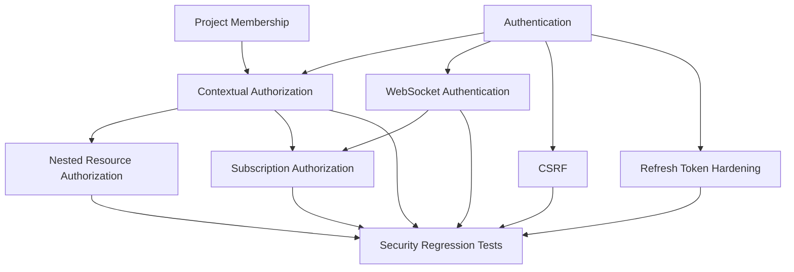
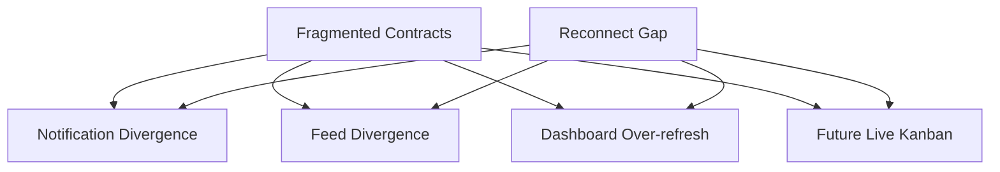
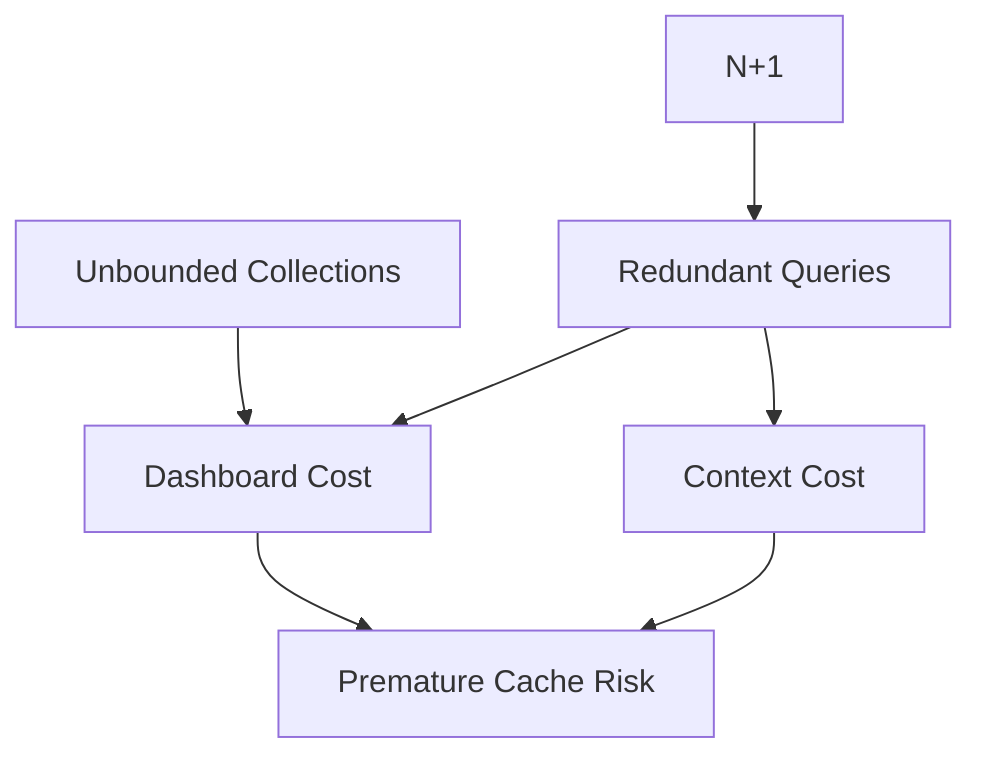
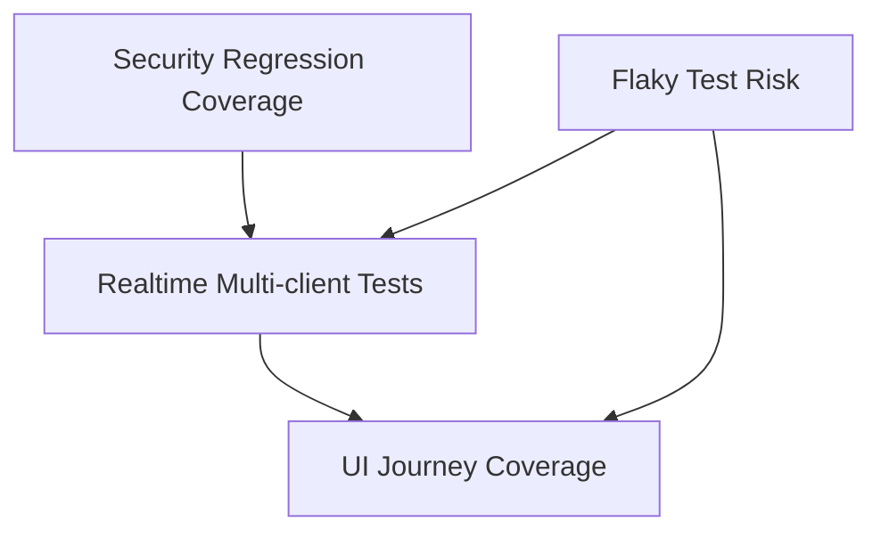
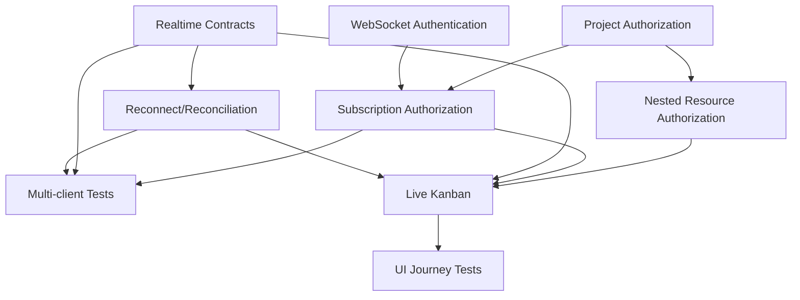
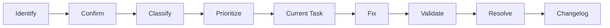

# 54_KNOWN_ISSUES.md

# Aula Robótica Platform — Known Issues & Limitations

## Parte 1 — Propósito, modelo de gestión, clasificación, severidad y registro de issues de seguridad y autorización

---

# 1. Propósito

Este documento mantiene el registro oficial de:

```text
known defects

known limitations

known inconsistencies

known reliability risks

known security gaps

known UX problems

known operational constraints
```

de **Aula Robótica Platform**.

---

# 2. Primary Objective

El objetivo es disponer de una visión explícita y mantenible de aquello que:

```text
is known

is not behaving ideally

or

requires corrective work
```

sin confundirlo con:

```text
future features

technical debt

current implementation tasks

architectural decisions
```

---

# 3. Nature of this Document

`54_KNOWN_ISSUES.md` es:

```text
an active issue and limitation registry
```

---

# 4. It Is Not

No debe utilizarse como:

```text
general backlog

roadmap

feature wishlist

release history

architectural decision log

technical debt dump
```

---

# 5. Core Question

Este documento debe responder:

```text
What problems or limitations do we currently know about?
```

---

# 6. Related Documents

Debe mantenerse alineado con:

```text
44_TESTING_STRATEGY.md

45_UI_TESTING.md

46_REALTIME_TESTING.md

47_PRODUCT_ROADMAP.md

49_FEATURE_BACKLOG.md

50_WEEKLY_UPDATE.md

51_CODING_RULES.md

52_ARCHITECTURAL_DECISIONS.md

53_CURRENT_TASKS.md

55_CHANGELOG.md

56_TECHNICAL_DEBT.md
```

---

# 7. Conceptual Separation

La separación entre documentos es:

```text
KNOWN_ISSUES

→ what is currently wrong or limited


CURRENT_TASKS

→ what is currently being worked on


TECHNICAL_DEBT

→ structural compromises increasing future cost


FEATURE_BACKLOG

→ candidate capabilities


CHANGELOG

→ delivered changes
```

---

# 8. Issue vs Technical Debt

Un Known Issue representa:

```text
observable problem

or

known functional / operational limitation
```

---

# 9. Technical Debt

Technical Debt representa:

```text
implementation compromise

or

architectural maintenance cost
```

que puede existir incluso sin producir todavía un defecto visible.

---

# 10. Example — Known Issue

```text
A WebSocket client can temporarily display stale state
after reconnecting.
```

---

# 11. Example — Technical Debt

```text
Realtime handlers use partially duplicated payload logic.
```

---

# 12. Relationship

Un Technical Debt puede causar varios Known Issues.

---

# 13. Example Relationship

```text
Duplicated realtime handlers
        │
        ├── inconsistent reconnect behavior
        │
        └── inconsistent UI updates
```

---

# 14. Issue vs Feature

No disponer todavía de una capability planificada no implica necesariamente un Known Issue.

---

# 15. Example

```text
Kanban has not been implemented yet.
```

Es:

```text
planned capability
```

no necesariamente:

```text
known defect
```

---

# 16. Limitation Exception

Puede documentarse una feature ausente como limitation cuando:

```text
current behavior is materially constrained by its absence
```

y resulta importante comunicarlo.

---

# 17. Issue Lifecycle

El lifecycle recomendado es:

```text
IDENTIFIED

↓

CONFIRMED

↓

PRIORITIZED

↓

IN_PROGRESS

↓

VALIDATION

↓

RESOLVED
```

---

# 18. Alternative Lifecycle

Un issue también puede pasar a:

```text
ACCEPTED

DEFERRED

DUPLICATE

NOT_REPRODUCIBLE

WONT_FIX
```

cuando exista justificación.

---

# 19. IDENTIFIED

Existe una observación inicial que todavía necesita validación suficiente.

---

# 20. CONFIRMED

El comportamiento ha sido reproducido o existe evidencia suficiente.

---

# 21. PRIORITIZED

El issue ha sido seleccionado para resolución.

---

# 22. IN_PROGRESS

Existe trabajo activo sobre la solución.

---

# 23. VALIDATION

Existe una corrección candidata y está siendo verificada.

---

# 24. RESOLVED

La causa o limitation definida ha sido corregida dentro del scope establecido.

---

# 25. ACCEPTED

El problema se conoce, pero se acepta conscientemente.

---

# 26. DEFERRED

La resolución se aplaza deliberadamente.

---

# 27. DUPLICATE

El issue ya está representado por otro registro.

---

# 28. NOT_REPRODUCIBLE

No ha podido confirmarse con evidencia suficiente.

---

# 29. WONT_FIX

Se decide no corregirlo por razones explícitas.

---

# 30. WONT_FIX Guardrail

No utilizar:

```text
WONT_FIX
```

como sustituto de:

```text
low priority

lack of time

unclear ownership
```

---

# 31. Resolution Integrity

Un issue no debe marcarse:

```text
RESOLVED
```

únicamente porque:

```text
a commit exists

a branch exists

a local workaround exists
```

---

# 32. Resolution Requirement

Debe existir validación adecuada al riesgo.

---

# 33. Issue Identification Model

Cada issue debería incluir:

```text
ID

Title

Area

Severity

Priority

Status

Impact

Evidence

Expected Behavior

Current Behavior

Workaround

Root Cause

Dependencies

Resolution Criteria
```

cuando resulte aplicable.

---

# 34. Issue ID Convention

Formato recomendado:

```text
KI-XXX
```

Ejemplo:

```text
KI-001
KI-002
KI-003
```

---

# 35. Stable IDs

El ID no debe cambiar cuando:

```text
severity changes

priority changes

ownership changes

status changes
```

---

# 36. Issue Area

Cada issue debe pertenecer principalmente a un área.

---

# 37. Candidate Areas

```text
SECURITY

AUTHORIZATION

IAM

PROJECTS

TASKS

ACTIVITIES

ATTACHMENTS

NOTIFICATIONS

DASHBOARD

AUDIT

REALTIME

UI

DATABASE

PERFORMANCE

TESTING

OPERATIONS
```

---

# 38. Multiple Areas

Puede indicarse más de un área cuando el problema cruza boundaries importantes.

---

# 39. Primary Area

Aun así debe existir una primary area para facilitar ownership.

---

# 40. Severity Model

La severidad representa:

```text
impact if the issue occurs
```

---

# 41. Severity Levels

```text
S0 — Critical

S1 — High

S2 — Medium

S3 — Low
```

---

# 42. S0 — Critical

Problema capaz de producir:

```text
critical security compromise

major data loss

system-wide outage

irrecoverable corruption

critical authorization bypass
```

---

# 43. S0 Response

Un issue S0 debe desplazar normalmente el trabajo no crítico.

---

# 44. S1 — High

Problema con impacto significativo sobre:

```text
security

core workflows

data integrity

availability

authorization
```

---

# 45. S2 — Medium

Problema que degrada:

```text
UX

reliability

performance

maintainability

non-critical workflow
```

sin bloquear normalmente el core completo.

---

# 46. S3 — Low

Problema menor como:

```text
cosmetic inconsistency

minor accessibility issue

non-blocking UI defect

small operational inconvenience
```

---

# 47. Severity vs Priority

No son equivalentes.

---

# 48. Severity

```text
How bad is the issue?
```

---

# 49. Priority

```text
How soon should we address it?
```

---

# 50. Priority Levels

```text
P0 — Immediate

P1 — High

P2 — Medium

P3 — Low
```

---

# 51. Example

Un issue:

```text
S2
```

puede ser:

```text
P1
```

si bloquea una capability importante.

---

# 52. Another Example

Un issue:

```text
S1
```

podría ser temporalmente:

```text
P2
```

solo si:

```text
the affected capability is disabled

+

a reliable mitigation exists

+

risk is explicitly accepted
```

---

# 53. Security Severity

Los issues de seguridad deben considerar:

```text
exploitability

scope

required privileges

data exposure

persistence

detectability
```

---

# 54. Authorization Severity

Un authorization bypass debe considerarse de alto impacto.

---

# 55. Cross-project Leakage

Acceder a recursos de otro Project sin permiso constituye una categoría especialmente sensible.

---

# 56. Realtime Severity

Los problemas realtime deben diferenciar:

```text
stale UI

missed event

duplicated event

unauthorized event

incorrect persisted state
```

---

# 57. Persisted State vs UI State

Un error únicamente visual suele tener menor severidad que un error que altera persistencia incorrectamente.

---

# 58. Issue Evidence

Todo issue debería disponer de evidencia suficiente.

---

# 59. Candidate Evidence

```text
reproduction steps

test failure

screenshot

log

trace

HTTP response

WebSocket event

database state
```

---

# 60. Evidence Principle

```text
Describe what happened.

Do not infer more than the evidence supports.
```

---

# 61. Reproduction

Cuando sea posible debe incluirse:

```text
Preconditions

Steps

Expected

Actual
```

---

# 62. Minimal Reproduction

Preferir la reproducción más pequeña capaz de demostrar el problema.

---

# 63. Expected Behavior

Debe derivar de:

```text
business rule

security policy

documented behavior

accepted architecture
```

---

# 64. Current Behavior

Debe describir únicamente el comportamiento observado.

---

# 65. Root Cause

No debe completarse hasta existir evidencia suficiente.

---

# 66. Unknown Root Cause

Es válido indicar:

```text
Root Cause: Unknown
```

---

# 67. Avoid Premature Diagnosis

No convertir una hipótesis en causa confirmada.

---

# 68. Workaround

Debe documentarse únicamente cuando:

```text
safe

repeatable

understood
```

---

# 69. Unsafe Workaround

No documentar como workaround recomendado una acción que:

```text
disables authorization

weakens security

risks data loss

corrupts state
```

---

# 70. Temporary Mitigation

Puede diferenciarse:

```text
Workaround

→ user/operator action


Mitigation

→ system or operational risk reduction
```

---

# 71. Resolution Criteria

Cada issue prioritario debería indicar qué significa realmente resolverlo.

---

# 72. Example

```text
The issue is resolved when unauthorized users
cannot subscribe to project-scoped realtime events
and negative tests prove the boundary.
```

---

# 73. Regression Test

Todo issue significativo debería generar un regression test cuando sea viable.

---

# 74. Security Regression Rule

Para issues de seguridad:

```text
fix without regression test

=

incomplete remediation
```

salvo imposibilidad técnica documentada.

---

# 75. Current Issue Categories

Los Known Issues actuales se concentran principalmente en:

```text
Security Hardening

Contextual Authorization

Realtime Reliability

Frontend Consistency

Testing Coverage

SSR Performance
```

---

# 76. Current Risk Profile

La plataforma no presenta únicamente issues de tipo:

```text
broken functionality
```

sino también limitations derivadas de una arquitectura en proceso de maduración.

---

# 77. Important Interpretation

Algunos registros representan:

```text
known architectural limitations
```

que todavía no producen un fallo constante.

---

# 78. Current Issue Overview

| ID | Área | Resumen | Severidad | Prioridad | Estado |
| :--- | :--- | :--- | :--- | :--- | :--- |
| KI-001 | Authorization | Project-scoped authorization todavía no está completamente consolidada | S1 | P1 | CONFIRMED |
| KI-002 | Authorization | Riesgo de validación inconsistente en nested resources | S1 | P1 | CONFIRMED |
| KI-003 | Security | Protección CSRF formal pendiente de consolidación | S1 | P1 | CONFIRMED |
| KI-004 | IAM | Refresh-token lifecycle requiere hardening adicional | S1 | P1 | CONFIRMED |
| KI-005 | Realtime | WebSocket authentication requiere hardening | S1 | P1 | CONFIRMED |
| KI-006 | Realtime | Subscription authorization necesita consolidación | S1 | P1 | CONFIRMED |
| KI-007 | Realtime | Reconnect puede dejar temporalmente estado cliente desactualizado | S2 | P1 | CONFIRMED |
| KI-008 | Realtime | Contratos de eventos parcialmente fragmentados | S2 | P1 | CONFIRMED |
| KI-009 | UI | Persisten algunos patrones de interacción nativos/inconsistentes | S3 | P2 | CONFIRMED |
| KI-010 | Testing | Cobertura realtime multi-client incompleta | S2 | P1 | CONFIRMED |
| KI-011 | Testing | Cobertura UI de journeys críticos todavía parcial | S2 | P2 | CONFIRMED |
| KI-012 | Performance | Algunas vistas SSR pueden acumular consultas redundantes | S2 | P2 | CONFIRMED |

---

# 79. Registry Integrity

Los registros anteriores representan:

```text
known current limitations
```

y no necesariamente bugs reproducibles en cada ejecución.

---

# 80. KI-001 — Incomplete Project-scoped Authorization

## Area

```text
AUTHORIZATION
```

## Severity

```text
S1 — High
```

## Priority

```text
P1 — High
```

## Status

```text
CONFIRMED
```

---

# 81. Description

La plataforma dispone de:

```text
authentication

+

global RBAC

+

contextual authorization foundations
```

pero la autorización específica por Project todavía no está completamente consolidada como boundary transversal.

---

# 82. Impact

Puede producir reglas inconsistentes entre:

```text
Projects

Tasks

Activities

Attachments

Realtime subscriptions
```

---

# 83. Expected Behavior

El sistema debe poder determinar de forma consistente:

```text
whether actor X

may perform action Y

on resource Z

inside Project P
```

---

# 84. Current Limitation

La base de autorización contextual existe, pero necesita una representación y policy de membership más explícita y homogénea.

---

# 85. Risk Scenario

```text
User has global access to a resource type

but should not automatically have access

to every Project containing that resource type.
```

---

# 86. Security Impact

El riesgo principal es:

```text
horizontal authorization failure
```

---

# 87. Required Direction

```text
Project Membership

↓

Contextual Role

↓

Policy

↓

Resource Authorization
```

---

# 88. Mitigation

Hasta consolidar el modelo:

```text
all project-related mutations

must explicitly validate resource context
```

---

# 89. Resolution Criteria

- [ ] Existe membership explícita.
- [ ] Existen contextual policies centralizadas.
- [ ] Project endpoints utilizan esas policies.
- [ ] Nested resources utilizan esas policies.
- [ ] Los endpoints no dependen de UI visibility.
- [ ] Existen tests allow/deny.
- [ ] Existen tests cross-project.

---

# 90. Regression Scenario

```text
Member of Project A

attempts to modify Task belonging to Project B

↓

403 / equivalent denial
```

---

# 91. Related Current Tasks

```text
CT-001

CT-002

CT-003

CT-014
```

---

# 92. Related Architecture

```text
52_ARCHITECTURAL_DECISIONS.md
```

debe seguir siendo la referencia para el modelo de autorización.

---

# 93. KI-002 — Nested Resource Authorization Inconsistency Risk

## Area

```text
AUTHORIZATION
```

## Severity

```text
S1 — High
```

## Priority

```text
P1 — High
```

## Status

```text
CONFIRMED
```

---

# 94. Description

Los recursos anidados pueden requerir autorización derivada del recurso padre.

---

# 95. Example Hierarchy

```text
Project

↓

Task

↓

Activity

↓

Attachment
```

---

# 96. Problem

Una autorización basada únicamente en:

```text
resource ID
```

sin validar su chain contextual puede permitir inconsistencias.

---

# 97. Example Attack

```text
User belongs to Project A

↓

User knows Activity ID from Project B

↓

User manually requests mutation endpoint
```

---

# 98. Expected Behavior

El backend debe reconstruir o validar:

```text
Activity

↓

Task

↓

Project

↓

Actor Membership
```

según la policy correspondiente.

---

# 99. UI Limitation

Ocultar la acción en la UI no mitiga este issue.

---

# 100. Potentially Affected Resources

```text
Tasks

Activities

Attachments

future Comments

future Kanban mutations
```

---

# 101. Required Direction

Crear policies capaces de resolver ownership/context de forma reutilizable.

---

# 102. Resolution Criteria

- [ ] Cada nested mutation resuelve contexto padre.
- [ ] IDs manipulados no permiten escapar del Project autorizado.
- [ ] Attachments validan resource ownership/context.
- [ ] Las APIs devuelven denial consistente.
- [ ] Existen regression tests cross-project.

---

# 103. Regression Matrix

| Actor | Resource | Expected |
| :--- | :--- | :--- |
| Authorized member | Same Project | Allow according to role |
| Unauthorized member | Other Project | Deny |
| Non-member | Project resource | Deny |
| Anonymous | Protected resource | Authentication required |
| Admin | Project resource | According to explicit admin policy |

---

# 104. Admin Guardrail

No asumir automáticamente que:

```text
admin

=

unrestricted contextual access
```

si la policy final no lo define así.

---

# 105. Related Issues

```text
KI-001
```

---

# 106. KI-003 — Formal CSRF Protection Not Fully Consolidated

## Area

```text
SECURITY
```

## Severity

```text
S1 — High
```

## Priority

```text
P1 — High
```

## Status

```text
CONFIRMED
```

---

# 107. Description

La plataforma utiliza browser authentication con cookies en workflows SSR.

Las mutaciones autenticadas mediante cookies requieren una estrategia CSRF explícita y uniforme.

---

# 108. Affected Surface

Potencialmente:

```text
POST

PUT

PATCH

DELETE
```

cuando la autenticación browser pueda adjuntarse automáticamente.

---

# 109. Expected Behavior

Una request state-changing debe demostrar:

```text
authenticated identity

+

authorized action

+

valid request intent
```

---

# 110. CSRF Role

CSRF protege principalmente:

```text
request intent
```

---

# 111. CSRF Does Not Replace

No sustituye:

```text
authentication

authorization

validation
```

---

# 112. SSR Forms

Los formularios state-changing deben incorporar protección.

---

# 113. JavaScript Mutations

Las llamadas `fetch()` equivalentes también deben utilizar el mecanismo definido.

---

# 114. Unsafe GET

Las rutas GET no deben modificar estado de negocio.

---

# 115. Risk Scenario

```text
Authenticated browser

↓

malicious external page

↓

forged state-changing request

↓

browser automatically includes credentials
```

---

# 116. Required Direction

```text
CSRF token generation

↓

client/form propagation

↓

server validation

↓

request rejection when invalid
```

---

# 117. Failure Behavior

Una request sin token válido debe ser rechazada sin ejecutar la mutación.

---

# 118. Resolution Criteria

- [ ] Existe estrategia CSRF documentada.
- [ ] Los SSR forms relevantes están protegidos.
- [ ] Fetch mutations están protegidas.
- [ ] GET permanece side-effect free.
- [ ] Tokens inválidos son rechazados.
- [ ] Tokens ausentes son rechazados.
- [ ] Existen regression tests.

---

# 119. Required Negative Tests

```text
missing token

invalid token

token from wrong context if applicable

valid token + unauthorized actor

valid token + invalid payload
```

---

# 120. Related Current Task

```text
CT-004
```

---

# 121. KI-004 — Refresh-token Lifecycle Requires Additional Hardening

## Area

```text
IAM / SECURITY
```

## Severity

```text
S1 — High
```

## Priority

```text
P1 — High
```

## Status

```text
CONFIRMED
```

---

# 122. Description

El workflow de refresh tokens existe, pero el lifecycle debe continuar endureciéndose frente a:

```text
replay

stolen token reuse

logout consistency

long-lived session risk
```

---

# 123. Expected Behavior

El refresh mechanism debe permitir renovar autenticación sin convertir un token comprometido en acceso persistente indefinido.

---

# 124. Target Direction

Conceptualmente:

```text
Refresh Token N

↓

validated

↓

rotated / invalidated

↓

Refresh Token N+1
```

---

# 125. Replay Scenario

```text
Token N is legitimately used

↓

Token N is rotated

↓

attacker tries Token N again
```

El comportamiento debe estar explícitamente definido.

---

# 126. Logout Scenario

Tras logout debe quedar claro qué credenciales:

```text
expire

are removed

are invalidated

or remain technically valid
```

---

# 127. Token Storage

No debe persistirse material sensible de forma innecesariamente recuperable.

---

# 128. Logging

No registrar:

```text
raw access tokens

raw refresh tokens

authentication secrets
```

---

# 129. Resolution Criteria

- [ ] Refresh lifecycle está formalmente definido.
- [ ] Rotation está implementada si forma parte de la estrategia.
- [ ] Reuse behavior está definido.
- [ ] Logout behavior está definido.
- [ ] Expiration está controlada.
- [ ] Sensitive token material no aparece en logs.
- [ ] Existen tests de lifecycle.
- [ ] Existen negative tests.

---

# 130. Related Current Task

```text
CT-005
```

---

# 131. KI-005 — WebSocket Authentication Hardening Required

## Area

```text
REALTIME / SECURITY
```

## Severity

```text
S1 — High
```

## Priority

```text
P1 — High
```

## Status

```text
CONFIRMED
```

---

# 132. Description

Las capabilities WebSocket existen, pero la autenticación debe consolidarse como boundary equivalente a la autenticación HTTP.

---

# 133. Core Principle

```text
A WebSocket connection

must never trust client-declared identity.
```

---

# 134. Risk Scenario

Un cliente no debe poder enviar:

```json
{
  "user_id": 42
}
```

y convertirse por ello en:

```text
User 42
```

---

# 135. Expected Behavior

La identidad debe derivarse de un mecanismo validado por el servidor.

---

# 136. Authentication Flow

Conceptualmente:

```text
Connection Request

↓

Authentication Context

↓

Server Validation

↓

Authenticated Actor

↓

Connection Registration
```

---

# 137. Invalid Authentication

Debe producir:

```text
connection rejection

or

immediate controlled close
```

---

# 138. Expired Authentication

El comportamiento ante credenciales expiradas debe estar definido.

---

# 139. Long-lived Connection Risk

Una conexión puede sobrevivir durante más tiempo que una request HTTP.

---

# 140. Therefore

Debe considerarse:

```text
credential expiry

session invalidation

user deactivation

permission changes
```

---

# 141. Resolution Criteria

- [ ] Identity es server-validated.
- [ ] Client-provided identity no es autoridad.
- [ ] Anonymous protected connections son rechazadas.
- [ ] Expired credentials tienen comportamiento definido.
- [ ] Deactivated users no mantienen acceso indefinido.
- [ ] Tests cubren conexión válida e inválida.

---

# 142. Related Current Task

```text
CT-006
```

---

# 143. KI-006 — WebSocket Subscription Authorization Needs Consolidation

## Area

```text
REALTIME / AUTHORIZATION
```

## Severity

```text
S1 — High
```

## Priority

```text
P1 — High
```

## Status

```text
CONFIRMED
```

---

# 144. Description

Autenticar una conexión no implica autorizar acceso a todos los eventos.

---

# 145. Example

```text
Authenticated User A

requests subscription:

project:42
```

El servidor debe comprobar:

```text
Can User A access Project 42?
```

---

# 146. Risk

Sin autorización explícita podría existir:

```text
cross-project information leakage
```

---

# 147. Candidate Protected Scopes

```text
user:{id}

project:{id}

task:{id}

admin

notification:{recipient}
```

según arquitectura final.

---

# 148. User-scoped Events

Un usuario no debe suscribirse arbitrariamente a eventos personales de otro usuario.

---

# 149. Project-scoped Events

Debe validarse membership/capability antes de registrar la subscription.

---

# 150. Administrative Events

Requieren permisos administrativos explícitos.

---

# 151. Subscription Lifecycle

La autorización debe considerarse en:

```text
subscribe

resubscribe

reconnect
```

---

# 152. Permission Changes

Debe definirse qué ocurre si:

```text
user loses Project membership

while connection remains open
```

---

# 153. Recommended Direction

El servidor debe poder:

```text
reject subscription

remove subscription

or close affected scope
```

según el modelo final.

---

# 154. Resolution Criteria

- [ ] Los scopes están definidos.
- [ ] Cada protected scope tiene policy.
- [ ] Project subscription valida membership.
- [ ] User subscription valida ownership.
- [ ] Admin subscription valida permission.
- [ ] Reconnect vuelve a autorizar.
- [ ] Membership removal tiene comportamiento definido.
- [ ] Existen negative tests.
- [ ] Existen tests de cross-project leakage.

---

# 155. Related Current Tasks

```text
CT-002

CT-007

CT-014
```

---

# 156. Relationship Between KI-005 and KI-006

Estos issues son diferentes.

---

# 157. KI-005

Pregunta:

```text
Who is this connection?
```

---

# 158. KI-006

Pregunta:

```text
What may this connection receive?
```

---

# 159. Security Boundary

La arquitectura correcta requiere ambas:

```text
Authentication

↓

Authorization
```

---

# 160. Security Issue Dependency Map



---

# 161. Current Security Issue Priority

La prioridad recomendada es:

```text
1. Project Membership / Contextual Authorization

2. CSRF Protection

3. WebSocket Authentication

4. Subscription Authorization

5. Refresh-token Hardening

6. Comprehensive Negative Tests
```

El orden puede ajustarse si aparece evidencia de riesgo más urgente.

---

# 162. Security Fix Principle

No resolver estos issues únicamente mediante:

```text
frontend restrictions

hidden buttons

JavaScript checks

client-side roles
```

---

# 163. Enforcement Location

La enforcement definitiva debe permanecer:

```text
server-side
```

---

# 164. Security Issue Testing Matrix

| Scenario | Authentication | Authorization | Expected |
| :--- | :--- | :--- | :--- |
| Valid user + valid project | Valid | Allowed | Success |
| Valid user + foreign project | Valid | Denied | Reject |
| Anonymous user | Missing | N/A | Reject |
| Expired credential | Invalid | N/A | Reject |
| Forged user identity | Invalid | N/A | Reject |
| Valid connection + unauthorized channel | Valid | Denied | Reject subscription |
| Valid CSRF + unauthorized action | Valid | Denied | Reject |
| Missing CSRF + otherwise valid action | Valid | Potentially allowed | Reject |

---

# 165. Issue Remediation Evidence

Para cerrar issues de esta categoría debe existir evidencia como:

```text
automated test

+

implementation

+

validated behavior
```

---

# 166. Security Issue Closure

No cerrar basándose únicamente en:

```text
manual happy-path verification
```

---

# 167. Security Issue Regression Requirement

La corrección debe quedar protegida contra regresión futura.

---

# 168. Current Security Limitation Summary

Actualmente las foundations de seguridad son avanzadas, pero requieren completar especialmente:

```text
Project context

CSRF intent protection

refresh-token lifecycle

WebSocket identity

WebSocket scope authorization
```

---

# 169. Current Authorization Limitation Summary

El reto principal no es:

```text
whether the platform has permissions
```

sino:

```text
whether those permissions are consistently contextualized
for every nested resource and realtime channel.
```

---

# 170. Security Hardening Goal

El objetivo final de esta fase es que cualquier operación relevante pueda responder explícitamente:

```text
Who is the actor?

What action is requested?

On which resource?

Inside which context?

Is the actor allowed?

Is the request legitimate?

Should the action be audited?
```

---

# 171. Security Resolution Gate

La fase de security hardening puede considerarse suficientemente consolidada cuando:

- [ ] Project membership es explícita.
- [ ] Contextual policies están centralizadas.
- [ ] Nested resources están protegidos.
- [ ] Cross-project tests pasan.
- [ ] CSRF está aplicado.
- [ ] Refresh-token lifecycle está endurecido.
- [ ] WebSocket identity está validada.
- [ ] Subscriptions están autorizadas.
- [ ] Negative security tests forman parte de CI.

---

# 172. Part 1 Summary

Los Known Issues prioritarios de esta primera sección son:

```text
KI-001
Incomplete Project-scoped Authorization

KI-002
Nested Resource Authorization Inconsistency Risk

KI-003
Formal CSRF Protection Not Fully Consolidated

KI-004
Refresh-token Lifecycle Requires Additional Hardening

KI-005
WebSocket Authentication Hardening Required

KI-006
WebSocket Subscription Authorization Needs Consolidation
```

---

# 173. Risk Concentration

Estos issues comparten una misma evolución arquitectónica:

```text
Identity

↓

Context

↓

Authorization

↓

Request / Connection Intent

↓

Resource Access

↓

Audit
```

---

# 174. Immediate Operational Relationship

Se relacionan directamente con:

```text
53_CURRENT_TASKS.md

CT-001

CT-002

CT-003

CT-004

CT-005

CT-006

CT-007

CT-014
```

---

# 175. Continuation

La **Parte 2/3** continúa con:

```text
KI-007 — Reconnect State Reconciliation

KI-008 — Realtime Event Contract Fragmentation

Notification Realtime Consistency

Activity Feed Realtime Consistency

Dashboard Realtime Behavior

UI Interaction Inconsistencies

Native Dialog Legacy

Async Feedback

Accessibility Limitations

SSR Performance Risks

Query Duplication

N+1 Risk

Pagination / Large Collections

Operational and Observability Limitations
```

---

# 54_KNOWN_ISSUES.md

# Aula Robótica Platform — Known Issues & Limitations

## Parte 2 — Realtime reliability, UI consistency, accessibility, performance, queries y observability

---

# 176. KI-007 — Reconnect Can Leave Client State Temporarily Stale

## Area

```text
REALTIME
```

## Severity

```text
S2 — Medium
```

## Priority

```text
P1 — High
```

## Status

```text
CONFIRMED
```

---

# 177. Description

La reconexión de transporte WebSocket puede completarse correctamente sin garantizar que el estado visible del cliente refleje todas las mutaciones ocurridas durante la desconexión.

---

# 178. Core Problem

Actualmente debe distinguirse entre:

```text
connection recovered
```

y:

```text
application state recovered
```

---

# 179. Example Scenario

```text
Client B disconnects

↓

Client A moves Task to Done

↓

Client B reconnects

↓

WebSocket is connected again

↓

Client B still displays previous Task state
```

---

# 180. Expected Behavior

Tras una desconexión relevante:

```text
Reconnect

↓

Reauthenticate / Revalidate

↓

Resubscribe

↓

Fetch authoritative state

↓

Re-render / reconcile

↓

Resume realtime
```

---

# 181. Source of Truth

La reconciliación debe utilizar:

```text
server-authoritative persisted state
```

---

# 182. Incorrect Assumption

No debe asumirse:

```text
successful WebSocket reconnect

=

state consistency
```

---

# 183. Impact

Puede provocar:

```text
stale Kanban cards

incorrect counters

outdated activity views

outdated dashboard information
```

---

# 184. Data Integrity

Este issue afecta principalmente a:

```text
client consistency
```

y no necesariamente a:

```text
persisted database state
```

---

# 185. Risk Escalation

La severidad aumenta si una UI desactualizada permite realizar una segunda acción sobre premisas incorrectas.

---

# 186. Mitigation

Hasta consolidar reconciliation:

```text
manual page refresh
```

puede recuperar el estado autoritativo.

---

# 187. Workaround Limitation

La recarga manual no constituye una solución arquitectónica suficiente para workflows colaborativos avanzados.

---

# 188. Required Direction

Debe existir una estrategia compartida de:

```text
reconnect

+

state reconciliation
```

---

# 189. Reconciliation Granularity

Puede realizarse a nivel de:

```text
page

project

resource collection

specific widget
```

según coste y complejidad.

---

# 190. Preferred Initial Strategy

Para estados complejos:

```text
re-fetch authoritative representation
```

es preferible a intentar reconstruir manualmente todos los eventos perdidos.

---

# 191. Event Replay

No se requiere inicialmente.

---

# 192. Why

Replay durable exigiría:

```text
event persistence

ordering

offset tracking

delivery semantics
```

que todavía no están justificadas.

---

# 193. Resolution Criteria

- [ ] Existe reconnect con backoff.
- [ ] Resubscribe ocurre correctamente.
- [ ] Las subscriptions vuelven a autorizarse.
- [ ] Se recupera estado autoritativo.
- [ ] La UI converge tras missed events.
- [ ] No se duplican handlers tras reconnect.
- [ ] Existen tests multi-client.
- [ ] Existe test de mutation during disconnect.

---

# 194. Regression Scenario

```text
Client B disconnects

↓

Client A mutates resource

↓

Client B reconnects

↓

Client B displays current persisted state
```

---

# 195. Related Current Task

```text
CT-009
```

---

# 196. Related Architectural Decision

```text
AD-054
Authoritative State Reconciliation after Reconnect
```

---

# 197. KI-008 — Realtime Event Contracts Are Partially Fragmented

## Area

```text
REALTIME / ARCHITECTURE
```

## Severity

```text
S2 — Medium
```

## Priority

```text
P1 — High
```

## Status

```text
CONFIRMED
```

---

# 198. Description

Las capabilities realtime han evolucionado de forma incremental y pueden utilizar estructuras, nombres o handlers parcialmente diferentes entre módulos.

---

# 199. Potentially Affected Areas

```text
Dashboard

Notifications

Audit Timeline

Activity Feed

Tasks

future Kanban
```

---

# 200. Problem

La fragmentación puede provocar:

```text
duplicated client handlers

different payload conventions

different reconnect behavior

harder testing

greater coupling
```

---

# 201. Expected Direction

Los eventos deben converger hacia un contrato compartido.

---

# 202. Candidate Envelope

```json
{
  "type": "task.updated",
  "version": 1,
  "payload": {}
}
```

---

# 203. Candidate Extended Envelope

Cuando aporte valor:

```json
{
  "type": "task.updated",
  "version": 1,
  "event_id": "uuid",
  "occurred_at": "2026-08-16T18:00:00Z",
  "payload": {}
}
```

---

# 204. Event Type Principle

Debe representar:

```text
a meaningful fact
```

---

# 205. Preferred Names

```text
task.updated

notification.created

activity.created

project.member_added
```

---

# 206. Avoid

```text
refresh

update_ui

event1

dashboard_update_2
```

---

# 207. Payload Ownership

El producer debe definir el significado del evento.

---

# 208. Consumer Rule

Los consumidores no deberían necesitar conocer internals del producer.

---

# 209. Payload Minimization

No serializar automáticamente la entidad ORM completa.

---

# 210. Security Impact

La normalización también facilita revisar:

```text
which data leaves the server

to which audience
```

---

# 211. Versioning

No es necesario incrementar versiones por cambios compatibles menores.

---

# 212. Breaking Contract

Una modificación incompatible debe ser explícita.

---

# 213. Handler Consolidation

Los handlers de comportamiento común deberían reutilizar:

```text
connection lifecycle

message parsing

error handling

reconnect

dispatch
```

---

# 214. Domain Handlers

La lógica específica puede permanecer por módulo.

---

# 215. Resolution Criteria

- [ ] Existe naming convention única.
- [ ] Existe envelope común.
- [ ] Los principales eventos están catalogados.
- [ ] Los payloads contienen solo datos necesarios.
- [ ] Existe parser/dispatcher coherente.
- [ ] Reconnect utiliza la misma infraestructura.
- [ ] Los módulos no duplican lifecycle logic innecesariamente.
- [ ] Los tests utilizan contratos estables.

---

# 216. Related Current Task

```text
CT-008
```

---

# 217. Related Architectural Decision

```text
AD-052
Explicit Versionable Realtime Event Contracts
```

---

# 218. KI-009 — Notification Realtime Consistency Can Diverge from Persistent State

## Area

```text
NOTIFICATIONS / REALTIME
```

## Severity

```text
S2 — Medium
```

## Priority

```text
P2 — Medium
```

## Status

```text
CONFIRMED
```

---

# 219. Description

Notification utiliza persistencia y realtime.

La UI debe mantenerse consistente cuando:

```text
notification creation succeeds

but realtime delivery fails
```

o:

```text
duplicate realtime delivery occurs.
```

---

# 220. Architectural Truth

```text
Persistent Notification

=

authoritative
```

---

# 221. Realtime Role

```text
Realtime

=

immediate awareness
```

---

# 222. Potential Symptoms

```text
counter temporarily incorrect

duplicate toast

notification not appearing until reload

read-state mismatch
```

---

# 223. Expected Behavior

Un fallo de delivery realtime no debe eliminar la Notification persistente.

---

# 224. Counter Recovery

El unread counter debe poder reconstruirse desde estado persistente.

---

# 225. Read Idempotency

Marcar como leída una Notification ya leída debe ser seguro.

---

# 226. Duplicate Delivery

No debe aumentar dos veces el unread counter si representa la misma Notification.

---

# 227. Missing Delivery

Una reload o reconciliation debe mostrarla.

---

# 228. Resolution Criteria

- [ ] Notification se persiste antes del broadcast.
- [ ] Counter puede recalcularse desde DB.
- [ ] Duplicates no incrementan incorrectamente estado.
- [ ] Read mutation es idempotente.
- [ ] Reconnect recupera Notifications perdidas.
- [ ] Tests cubren delivery failure y duplicate event.

---

# 229. Related Issues

```text
KI-007

KI-008
```

---

# 230. KI-010 — Activity Feed Realtime Consistency Requires Consolidation

## Area

```text
ACTIVITY_FEED / REALTIME
```

## Severity

```text
S2 — Medium
```

## Priority

```text
P2 — Medium
```

## Status

```text
CONFIRMED
```

---

# 231. Description

Activity Feed representa hechos funcionales orientados a usuarios.

Las actualizaciones realtime deben mantenerse alineadas con el estado que puede recuperarse posteriormente.

---

# 232. Feed Principle

```text
Feed is a human-readable projection.
```

---

# 233. Potential Inconsistency

Puede ocurrir que:

```text
event displayed live

but

not represented after reload
```

o lo contrario.

---

# 234. Expected Behavior

La vista realtime y la vista recuperada posteriormente deben converger.

---

# 235. Event Duplication

Un mismo hecho funcional no debería aparecer repetido por:

```text
multiple technical events
```

---

# 236. Event Ordering

El Feed debe mantener ordering determinista cuando se recarga.

---

# 237. Realtime Ordering

No debe depender únicamente del momento en que el navegador recibe eventos.

---

# 238. Security

El Feed debe filtrar:

```text
resource visibility

project scope

actor permissions
```

---

# 239. Resolution Criteria

- [ ] Los Feed events representan hechos persistibles/reconstruibles.
- [ ] Reload y realtime convergen.
- [ ] Duplicates técnicos no aparecen como hechos duplicados.
- [ ] Ordering es determinista.
- [ ] El scope autorizado está protegido.
- [ ] Reconnect recupera eventos relevantes.

---

# 240. Related Issues

```text
KI-007

KI-008
```

---

# 241. KI-011 — Dashboard Realtime Updates May Become Overly Broad

## Area

```text
DASHBOARD / REALTIME
```

## Severity

```text
S3 — Low
```

## Priority

```text
P2 — Medium
```

## Status

```text
CONFIRMED
```

---

# 242. Description

Dashboard integra múltiples fuentes y puede recibir actualizaciones dinámicas.

Sin una política clara, podría evolucionar hacia:

```text
refresh too many widgets

for too many events
```

---

# 243. Impact

Puede provocar:

```text
unnecessary server queries

DOM churn

visual noise

higher WebSocket traffic
```

---

# 244. Expected Direction

Solo deben actualizarse en realtime widgets donde:

```text
freshness creates meaningful user value.
```

---

# 245. Candidate Realtime Widgets

```text
unread notification count

recent activity

high-priority task signal
```

---

# 246. Candidate Non-realtime Widgets

Métricas históricas o agregadas pueden actualizarse mediante:

```text
page reload

scheduled refresh

manual refresh
```

si no necesitan inmediatez.

---

# 247. Re-fetch vs Patch

Para widgets agregados, una re-fetch pequeña puede ser más robusta que replicar lógica de agregación en JavaScript.

---

# 248. Resolution Criteria

- [ ] Cada realtime widget tiene razón explícita.
- [ ] Los eventos actualizan solo widgets afectados.
- [ ] Las queries no se disparan indiscriminadamente.
- [ ] Reconnect recupera valores actuales.
- [ ] No se duplica lógica agregada crítica en cliente.

---

# 249. Related Architectural Decision

```text
AD-060
Dashboard Realtime Only for Actionable Freshness
```

---

# 250. Realtime Issue Relationship



---

# 251. Realtime Remediation Order

Una secuencia razonable es:

```text
1. Normalize contracts

2. Harden authentication

3. Harden authorization

4. Consolidate reconnect

5. Add reconciliation

6. Normalize domain handlers

7. Expand multi-client tests

8. Add Live Kanban
```

---

# 252. Realtime Issue Closure Gate

Antes de considerar realtime suficientemente consolidado:

- [ ] conexión autenticada;
- [ ] subscriptions autorizadas;
- [ ] event envelope consistente;
- [ ] reconnect controlado;
- [ ] reconciliation disponible;
- [ ] duplicate handling definido;
- [ ] multi-client tests;
- [ ] no cross-project leakage.

---

# 253. KI-012 — Native Browser Dialogs Still Exist in Some Workflows

## Area

```text
UI
```

## Severity

```text
S3 — Low
```

## Priority

```text
P2 — Medium
```

## Status

```text
CONFIRMED
```

---

# 254. Description

Algunos workflows pueden conservar usos de:

```javascript
alert()

confirm()
```

u otros patrones nativos que no siguen el sistema visual reutilizable de la plataforma.

---

# 255. Impact

Provoca:

```text
inconsistent UX

limited styling

reduced contextual information

inconsistent accessibility control
```

---

# 256. Expected Direction

Utilizar:

```text
shared confirmation dialogs

+

shared toast / inline feedback
```

---

# 257. Migration Priority

No es necesario sustituir todos los usos de forma masiva.

---

# 258. Preferred Strategy

Migrar primero:

```text
high-frequency workflows

destructive actions

newly modified modules
```

---

# 259. Confirmation Guardrail

No reemplazar un `confirm()` por un modal si la acción no necesita confirmación.

---

# 260. Resolution Criteria

- [ ] Se inventarían los usos restantes.
- [ ] Los workflows prioritarios usan dialog reutilizable.
- [ ] Focus management funciona.
- [ ] Escape funciona cuando corresponde.
- [ ] Focus vuelve al trigger.
- [ ] Las acciones destructivas muestran contexto suficiente.

---

# 261. Related Current Task

```text
CT-016
```

---

# 262. KI-013 — Async Interaction Feedback Is Not Fully Uniform

## Area

```text
UI / JAVASCRIPT
```

## Severity

```text
S3 — Low
```

## Priority

```text
P2 — Medium
```

## Status

```text
CONFIRMED
```

---

# 263. Description

Los workflows JavaScript pueden utilizar patrones diferentes para:

```text
loading

success

error

button disable

retry
```

---

# 264. Impact

Produce una experiencia menos predecible y aumenta duplicación.

---

# 265. Expected Behavior

Una mutación async debería tener un lifecycle reconocible:

```text
Idle

↓

Pending

↓

Success

or

Error

↓

Usable State
```

---

# 266. Loading

Debe hacerse visible cuando la espera sea perceptible.

---

# 267. Double Submit

Durante una mutación sensible puede ser necesario impedir ejecución repetida.

---

# 268. Error

El control debe volver a un estado usable.

---

# 269. Success

El usuario debe saber qué ocurrió cuando no sea evidente visualmente.

---

# 270. Shared Infrastructure

Puede existir un helper ligero para:

```text
fetch

CSRF

response errors

common state restoration
```

---

# 271. Guardrail

No convertir el helper en un framework frontend propio.

---

# 272. Resolution Criteria

- [ ] Los workflows críticos tienen lifecycle uniforme.
- [ ] Buttons se recuperan tras error.
- [ ] Errores HTTP no se interpretan como success.
- [ ] Double submit está controlado donde importa.
- [ ] Toasts/inline feedback siguen patrones comunes.
- [ ] No quedan handlers duplicados significativos.

---

# 273. Related Current Task

```text
CT-015
```

---

# 274. KI-014 — Some Dynamic Interactions Need Stronger Accessibility Validation

## Area

```text
UI / ACCESSIBILITY
```

## Severity

```text
S2 — Medium
```

## Priority

```text
P2 — Medium
```

## Status

```text
CONFIRMED
```

---

# 275. Description

Los componentes dinámicos y futuras interacciones avanzadas necesitan validar sistemáticamente:

```text
keyboard operation

focus management

screen-reader feedback

non-pointer alternatives
```

---

# 276. Candidate Affected Components

```text
dialogs

toasts

dynamic actions

realtime updates

future Kanban drag and drop
```

---

# 277. Kanban Risk

Drag and drop es especialmente relevante porque puede excluir usuarios que:

```text
do not use a mouse

cannot perform precise pointer movement
```

---

# 278. Required Alternative

Debe existir una forma equivalente mediante:

```text
keyboard

status action

menu

select
```

u otro mecanismo accesible.

---

# 279. Dialog Risk

Debe validarse:

```text
initial focus

focus trap

escape

focus restoration
```

---

# 280. Toast Risk

Los mensajes dinámicos deben anunciarse sin producir ruido excesivo.

---

# 281. Realtime Risk

No anunciar mediante live region cada evento de colaboración si no requiere atención inmediata.

---

# 282. Resolution Criteria

- [ ] Los componentes críticos son utilizables con teclado.
- [ ] Focus visible permanece disponible.
- [ ] Dialog lifecycle de foco está validado.
- [ ] Kanban dispone de alternativa a drag and drop.
- [ ] Dynamic messages utilizan live regions apropiadas.
- [ ] Estado no depende solo del color.
- [ ] Tests manuales/automáticos cubren journeys prioritarios.

---

# 283. Accessibility Principle

```text
Realtime and dynamic

must not mean

inaccessible.
```

---

# 284. KI-015 — UI Permission Rendering Can Drift from Backend Authorization

## Area

```text
UI / AUTHORIZATION
```

## Severity

```text
S2 — Medium
```

## Priority

```text
P2 — Medium
```

## Status

```text
CONFIRMED
```

---

# 285. Description

La UI utiliza contextual rendering para mostrar u ocultar acciones.

A medida que la autorización se vuelve más contextual, existe riesgo de divergencia entre:

```text
what UI thinks is allowed

and

what backend actually allows.
```

---

# 286. Security Interpretation

La divergencia no debe generar un bypass si backend es autoritativo.

---

# 287. UX Impact

Sí puede provocar:

```text
visible action → 403

or

hidden action → operation actually allowed
```

---

# 288. Expected Direction

Los templates deberían recibir capabilities calculadas a partir de las mismas policies conceptuales utilizadas por el backend.

---

# 289. Avoid

Duplicar lógica como:

```jinja2

```

---

# 290. Prefer

```jinja2

```

---

# 291. Resolution Criteria

- [ ] Capabilities se calculan server-side.
- [ ] Las policies tienen ownership central.
- [ ] Templates no recrean lógica compleja.
- [ ] Backend revalida siempre.
- [ ] Existen tests de rendering contextual.
- [ ] Existen tests de endpoint authorization.

---

# 292. Related Issues

```text
KI-001

KI-002
```

---

# 293. UI Issue Summary

Las principales limitations UI actuales pueden agruparse en:

```text
interaction consistency

authorization rendering

accessibility

async lifecycle
```

---

# 294. UI Remediation Principle

No se recomienda una reescritura completa.

---

# 295. Preferred Direction

```text
incremental consolidation

around shared components and behaviors
```

---

# 296. KI-016 — SSR Views May Perform Redundant Queries

## Area

```text
PERFORMANCE / DATABASE
```

## Severity

```text
S2 — Medium
```

## Priority

```text
P2 — Medium
```

## Status

```text
CONFIRMED
```

---

# 297. Description

Las vistas SSR complejas pueden construir su contexto mediante múltiples Services o dependencies que consultan información relacionada repetidamente.

---

# 298. Candidate Hotspots

```text
Dashboard

Project Detail

Task Detail

Activity Detail

global navigation context
```

---

# 299. Potential Symptoms

```text
high query count

duplicated SELECTs

slower response time

increased database load
```

---

# 300. Root Cause Status

La causa exacta debe determinarse mediante medición.

---

# 301. Avoid Premature Conclusion

No asumir automáticamente:

```text
we need Redis
```

---

# 302. Expected Investigation

```text
measure request

↓

inspect queries

↓

identify duplicates / N+1

↓

optimize query or request context

↓

measure again
```

---

# 303. Candidate Remediations

```text
better relationship loading

aggregation queries

request-scoped context reuse

pagination

query helper consolidation
```

---

# 304. Cache

Solo debe evaluarse después si sigue existiendo bottleneck.

---

# 305. Resolution Criteria

- [ ] Existe baseline por ruta prioritaria.
- [ ] Se conocen query counts.
- [ ] Se identifican queries repetidas.
- [ ] Se corrigen N+1 relevantes.
- [ ] Se aplica bounded loading.
- [ ] Se compara performance antes/después.
- [ ] No se introduce cache sin evidencia.

---

# 306. Related Current Tasks

```text
CT-017

CT-018

CT-019
```

---

# 307. KI-017 — N+1 Query Risk in Relationship-rich Views

## Area

```text
DATABASE / PERFORMANCE
```

## Severity

```text
S2 — Medium
```

## Priority

```text
P2 — Medium
```

## Status

```text
CONFIRMED
```

---

# 308. Description

Los dominios poseen relaciones crecientes.

---

# 309. Example

```text
Project

↓

Tasks

↓

Assignees

↓

Activities
```

---

# 310. Risk Pattern

```text
load N Tasks

↓

access related Assignee for each

↓

execute N additional queries
```

---

# 311. Expected Direction

Utilizar la estrategia de loading apropiada al use case.

---

# 312. Guardrail

No configurar eager loading global de todas las relaciones.

---

# 313. Why

Puede producir el problema opuesto:

```text
large joins

unnecessary data

memory cost
```

---

# 314. Resolution Criteria

- [ ] Las rutas críticas se inspeccionan.
- [ ] N+1 real se confirma antes de corregirlo.
- [ ] La estrategia se aplica por use case.
- [ ] Tests funcionales siguen pasando.
- [ ] Performance mejora o permanece razonable.

---

# 315. KI-018 — Some Growing Collections Need Explicit Bounding

## Area

```text
PERFORMANCE / DATA
```

## Severity

```text
S2 — Medium
```

## Priority

```text
P2 — Medium
```

## Status

```text
CONFIRMED
```

---

# 316. Candidate Collections

```text
Activity Feed

Notifications

Audit Events

Tasks

future historical datasets
```

---

# 317. Risk

Una query como:

```text
load all historical items
```

degrada progresivamente con el uso.

---

# 318. Expected Direction

Aplicar:

```text
pagination

limit

filtering

date range
```

según workflow.

---

# 319. Deterministic Ordering

Toda colección paginada debe tener ordering estable.

---

# 320. Candidate Ordering

```text
created_at DESC

+

id DESC
```

cuando sea apropiado.

---

# 321. Offset Pagination

Es suficiente inicialmente para volúmenes moderados.

---

# 322. Cursor Pagination

Puede evaluarse cuando el volumen lo justifique.

---

# 323. Resolution Criteria

- [ ] Las colecciones crecientes están identificadas.
- [ ] No se cargan historiales completos innecesariamente.
- [ ] Ordering es determinista.
- [ ] Pagination mantiene autorización.
- [ ] La UX permite navegar los datos necesarios.

---

# 324. Performance Issue Relationship



---

# 325. Performance Remediation Order

```text
1. Measure

2. Bound collections

3. Remove duplicated queries

4. Fix N+1

5. Optimize aggregations

6. Reuse request context

7. Evaluate cache only if needed
```

---

# 326. KI-019 — Request Context May Be Recomputed Multiple Times

## Area

```text
PERFORMANCE / ARCHITECTURE
```

## Severity

```text
S3 — Low
```

## Priority

```text
P2 — Medium
```

## Status

```text
CONFIRMED
```

---

# 327. Description

Datos transversales pueden solicitarse varias veces durante la construcción de una misma página.

---

# 328. Candidate Context

```text
current user

permissions

navigation capabilities

unread count

project context
```

---

# 329. Preferred First Solution

```text
request-scoped reuse
```

---

# 330. Why

Evita introducir infraestructura de cache distribuida.

---

# 331. Security Constraint

Los datos de autorización deben corresponder al actor y request correctos.

---

# 332. Cross-request Cache Risk

Mantener permissions demasiado tiempo puede producir:

```text
stale authorization
```

---

# 333. Resolution Criteria

- [ ] Se identifica contexto repetido.
- [ ] Se mide el coste.
- [ ] Se reutiliza dentro de request cuando conviene.
- [ ] No se comparte contexto entre actores.
- [ ] Cambios de permisos no quedan stale de forma insegura.

---

# 334. KI-020 — Observability Coverage Is Uneven Across Realtime and Secondary Effects

## Area

```text
OBSERVABILITY / REALTIME
```

## Severity

```text
S2 — Medium
```

## Priority

```text
P2 — Medium
```

## Status

```text
CONFIRMED
```

---

# 335. Description

La plataforma dispone de logging y audit avanzados, pero algunos workflows secundarios pueden resultar más difíciles de diagnosticar que las requests HTTP principales.

---

# 336. Candidate Areas

```text
WebSocket connect/disconnect

subscription failure

broadcast failure

reconnect

notification delivery

feed updates
```

---

# 337. Problem

Un usuario puede observar:

```text
the page did not update
```

sin que resulte inmediatamente evidente si falló:

```text
domain mutation

broadcast

subscription

connection

client handler
```

---

# 338. Expected Direction

Debe existir suficiente señal para distinguir las capas.

---

# 339. Candidate Signals

```text
connection logs

subscription logs

delivery metrics

reconnect metrics

correlation identifiers

client-side error reporting
```

---

# 340. Logging Guardrail

No registrar payloads sensibles completos.

---

# 341. Metric Candidate

```text
active websocket connections

failed subscriptions

broadcast failures

reconnect attempts
```

---

# 342. Metric Cardinality

No utilizar:

```text
user_id

project_id
```

como labels generales de alta cardinalidad.

---

# 343. Resolution Criteria

- [ ] Los fallos de conexión son observables.
- [ ] Los fallos de subscription son distinguibles.
- [ ] Los fallos de delivery son medibles o registrables.
- [ ] Reconnect dispone de señal.
- [ ] Los logs evitan datos sensibles.
- [ ] Existe correlation suficiente para diagnosticar workflows relevantes.

---

# 344. KI-021 — Client-side Errors Are Not Yet Centrally Observable

## Area

```text
OBSERVABILITY / UI
```

## Severity

```text
S3 — Low
```

## Priority

```text
P3 — Low
```

## Status

```text
CONFIRMED
```

---

# 345. Description

Los errores JavaScript pueden permanecer limitados a:

```text
browser console
```

sin llegar a observabilidad central.

---

# 346. Current Impact

En una plataforma pequeña puede ser aceptable temporalmente.

---

# 347. Future Impact

A medida que crezcan:

```text
Kanban

realtime

dynamic dialogs

interactive workflows
```

los errores cliente serán más relevantes.

---

# 348. Candidate Future Solution

Un sistema de frontend error reporting puede capturar:

```text
uncaught errors

unhandled promise rejections

selected interaction failures
```

---

# 349. Privacy Requirement

No debe enviar:

```text
form contents

tokens

personal data

sensitive URLs
```

innecesariamente.

---

# 350. Adoption Trigger

Priorizar cuando:

```text
client-side complexity materially grows

or

production diagnosis becomes difficult.
```

---

# 351. Current Status

No constituye un blocker inmediato.

---

# 352. KI-022 — Monitoring and Alerting Are Not Yet Fully Mature

## Area

```text
OPERATIONS / OBSERVABILITY
```

## Severity

```text
S2 — Medium
```

## Priority

```text
P2 — Medium
```

## Status

```text
CONFIRMED
```

---

# 353. Description

La observabilidad técnica puede existir sin una capa completa de alerting operacional.

---

# 354. Difference

```text
Metrics

→ something can be measured


Alert

→ someone is informed when action may be required
```

---

# 355. Candidate Future Alerts

```text
application unavailable

sustained 5xx rate

database unavailable

storage capacity critical

repeated realtime delivery failure
```

---

# 356. Alert Quality Requirement

Cada alerta debería responder:

```text
What action should an operator take?
```

---

# 357. Alert Noise Risk

Crear demasiadas alertas prematuramente puede reducir confianza.

---

# 358. Resolution Criteria

- [ ] Se identifican síntomas críticos.
- [ ] Existen métricas fiables.
- [ ] Se definen thresholds basados en comportamiento real.
- [ ] Cada alerta es accionable.
- [ ] Se documenta response básica.
- [ ] Se revisan falsos positivos.

---

# 359. KI-023 — Health Checks May Need Greater Operational Separation

## Area

```text
OPERATIONS
```

## Severity

```text
S3 — Low
```

## Priority

```text
P2 — Medium
```

## Status

```text
CONFIRMED
```

---

# 360. Description

A medida que el deployment madure, debe distinguirse claramente entre:

```text
process alive

and

instance ready to serve traffic.
```

---

# 361. Target Model

```text
Liveness

→ process health


Readiness

→ service readiness
```

---

# 362. Candidate Readiness Dependencies

```text
database connectivity

critical configuration

required storage access
```

según deployment real.

---

# 363. Guardrail

No incluir dependencias secundarias no críticas que provoquen reinicios innecesarios.

---

# 364. Resolution Criteria

- [ ] Semántica liveness está definida.
- [ ] Semántica readiness está definida.
- [ ] Checks son ligeros.
- [ ] El deployment utiliza cada uno correctamente.
- [ ] Dependencias críticas están identificadas.

---

# 365. Current UI / Performance / Observability Issue Snapshot

| Issue | Área | Severity | Priority |
| :--- | :--- | :--- | :--- |
| KI-012 | UI | S3 | P2 |
| KI-013 | UI / JS | S3 | P2 |
| KI-014 | Accessibility | S2 | P2 |
| KI-015 | UI / Authorization | S2 | P2 |
| KI-016 | SSR Performance | S2 | P2 |
| KI-017 | Database / N+1 | S2 | P2 |
| KI-018 | Large Collections | S2 | P2 |
| KI-019 | Request Context | S3 | P2 |
| KI-020 | Realtime Observability | S2 | P2 |
| KI-021 | Client Observability | S3 | P3 |
| KI-022 | Monitoring | S2 | P2 |
| KI-023 | Health Checks | S3 | P2 |

---

# 366. Current Realtime Issue Snapshot

| Issue | Area | Severity | Priority |
| :--- | :--- | :--- | :--- |
| KI-007 | Reconnect | S2 | P1 |
| KI-008 | Event Contracts | S2 | P1 |
| KI-009 | Notifications | S2 | P2 |
| KI-010 | Activity Feed | S2 | P2 |
| KI-011 | Dashboard | S3 | P2 |

---

# 367. Priority Interpretation

Aunque muchos issues sean `S2`, algunos son `P1` porque bloquean:

```text
Live Kanban

reliable collaboration

multi-client testing
```

---

# 368. Realtime Root Theme

La principal limitation no es:

```text
WebSockets do not work
```

sino:

```text
realtime needs stronger contract,
recovery and consistency guarantees.
```

---

# 369. UI Root Theme

La principal limitation no es:

```text
the frontend needs a rewrite
```

sino:

```text
interactive behavior needs consolidation
around shared patterns.
```

---

# 370. Performance Root Theme

La principal limitation no es:

```text
the platform is proven slow
```

sino:

```text
complex SSR views need measurement
before their data access patterns grow further.
```

---

# 371. Observability Root Theme

La principal limitation no es:

```text
there are no logs
```

sino:

```text
secondary and realtime workflows
need stronger end-to-end diagnostic visibility.
```

---

# 372. Remediation Philosophy

La estrategia recomendada es:

```text
consolidate existing capabilities

before adding new infrastructure.
```

---

# 373. No Premature Cache

Los performance issues no justifican automáticamente Redis.

---

# 374. No Premature Frontend Framework

Los UI issues no justifican automáticamente migrar a React/Vue/Angular.

---

# 375. No Premature Broker

Los realtime issues no justifican automáticamente Kafka o RabbitMQ.

---

# 376. No Premature Tracing

Los observability issues no requieren necesariamente distributed tracing todavía.

---

# 377. Preferred Approach

```text
measure

normalize

test

observe

then evolve architecture if evidence requires it
```

---

# 378. Part 2 Summary

Esta segunda parte incorpora los Known Issues relacionados con:

```text
KI-007
Reconnect State Reconciliation

KI-008
Realtime Event Contract Fragmentation

KI-009
Notification Realtime Consistency

KI-010
Activity Feed Realtime Consistency

KI-011
Dashboard Realtime Breadth

KI-012
Native Dialog Legacy

KI-013
Async Interaction Feedback

KI-014
Dynamic Accessibility

KI-015
UI / Backend Authorization Drift

KI-016
SSR Redundant Queries

KI-017
N+1 Risk

KI-018
Unbounded Collections

KI-019
Request Context Recalculation

KI-020
Realtime Observability

KI-021
Frontend Error Observability

KI-022
Monitoring / Alerting Maturity

KI-023
Health Check Separation
```

---

# 379. Continuation

La **Parte 3/3** completa `54_KNOWN_ISSUES.md` con:

```text
Testing Limitations

UI Test Coverage

Realtime Multi-client Coverage

Flaky Test Risks

Database / Migration Limitations

Attachment Limitations

Deployment / Backup / Recovery Issues

Issue Prioritization

Issue Dependencies

Issue → Current Task Promotion

Resolution Workflow

Regression Policy

Known Limitations vs Technical Debt

Operational Review

Archiving

Complete Issue Template

Issue Governance

Anti-patterns

Final Known Issues Checklist
```

---

# 54_KNOWN_ISSUES.md

# Aula Robótica Platform — Known Issues & Limitations

## Parte 3 — Testing, database, attachments, operations, issue governance, resolución, plantillas y checklists

---

# 380. KI-024 — Multi-client Realtime Test Coverage Is Incomplete

## Area

```text
TESTING / REALTIME
```

## Severity

```text
S2 — Medium
```

## Priority

```text
P1 — High
```

## Status

```text
CONFIRMED
```

---

# 381. Description

Las capabilities realtime necesitan pruebas con más de un cliente para validar correctamente:

```text
broadcast routing

authorization

isolation

delivery

reconnect

state convergence
```

---

# 382. Current Limitation

Los tests convencionales de un único cliente no demuestran suficientemente que:

```text
the right client receives the event

and

the wrong client does not.
```

---

# 383. Critical Scenarios

Deben existir escenarios como:

```text
Client A
authorized sender

Client B
authorized recipient

Client C
unauthorized observer
```

---

# 384. Expected Flow

```text
Client A performs mutation

↓

Server authorizes and commits

↓

Client B receives relevant event

↓

Client C receives nothing

↓

Client B converges to persisted state
```

---

# 385. Reconnect Scenario

También debe cubrirse:

```text
Client B disconnects

↓

Client A mutates state

↓

Client B reconnects

↓

Client B reconciles

↓

Both clients converge
```

---

# 386. Security Value

Estos tests protegen especialmente frente a:

```text
cross-project event leakage
```

---

# 387. Reliability Value

También protegen frente a:

```text
lost state

duplicate handlers

stale UI

incorrect resubscription
```

---

# 388. Test Isolation

Cada escenario debe utilizar:

```text
controlled users

controlled projects

deterministic memberships
```

---

# 389. Timing

No deben depender principalmente de:

```text
fixed sleeps
```

---

# 390. Preferred Synchronization

Utilizar:

```text
specific event

observable state

authoritative persisted result
```

---

# 391. Resolution Criteria

- [ ] Existe infraestructura de test multi-client.
- [ ] Authorized recipient recibe eventos.
- [ ] Unauthorized recipient no recibe eventos.
- [ ] Cross-project isolation está probada.
- [ ] Disconnect/reconnect está probado.
- [ ] Reconciliation está probada.
- [ ] Duplicate delivery relevante está probado.
- [ ] Los tests son deterministas.
- [ ] CI puede ejecutar la suite.

---

# 392. Related Current Task

```text
CT-013
```

---

# 393. Related Issues

```text
KI-005

KI-006

KI-007

KI-008
```

---

# 394. KI-025 — Critical UI Journey Coverage Is Still Partial

## Area

```text
TESTING / UI
```

## Severity

```text
S2 — Medium
```

## Priority

```text
P2 — Medium
```

## Status

```text
CONFIRMED
```

---

# 395. Description

La plataforma dispone de automatización de tests, pero no todos los journeys críticos están todavía protegidos mediante browser-level validation.

---

# 396. Candidate Critical Journeys

```text
login

logout

project access

task lifecycle

activity lifecycle

attachment upload

attachment download

notifications

future Kanban
```

---

# 397. UI Test Purpose

Debe validar integración entre:

```text
browser

SSR

JavaScript

backend

database
```

---

# 398. Non-goal

No se pretende comprobar mediante E2E cada detalle visual.

---

# 399. Priority Journeys

Deben priorizarse aquellos con:

```text
business criticality

security boundaries

complex interaction

high regression risk
```

---

# 400. Authorization Journey

Ejemplo:

```text
Project member opens Task

↓

allowed action visible

↓

mutation succeeds
```

---

# 401. Unauthorized Journey

Ejemplo:

```text
non-member attempts direct navigation

↓

resource is denied
```

---

# 402. Attachment Journey

Debe considerar:

```text
upload

validation

successful persistence

download

authorization
```

---

# 403. Notification Journey

Debe considerar:

```text
new notification

unread state

mark as read

counter update
```

---

# 404. Future Kanban Journey

Debe cubrir:

```text
load board

move task

server acceptance

visual convergence
```

---

# 405. Resolution Criteria

- [ ] Critical journeys están identificados.
- [ ] Los workflows P1 tienen cobertura E2E.
- [ ] Authentication path está cubierto.
- [ ] Authorization denial está cubierto.
- [ ] Attachment workflow está cubierto.
- [ ] Notification workflow está cubierto.
- [ ] Kanban se incorpora cuando exista.
- [ ] Los tests no dependen de selectores puramente visuales.
- [ ] La suite es estable en CI.

---

# 406. Related Current Task

```text
CT-020
```

---

# 407. KI-026 — Flaky Test Risk Will Increase with Realtime and UI Complexity

## Area

```text
TESTING
```

## Severity

```text
S2 — Medium
```

## Priority

```text
P2 — Medium
```

## Status

```text
CONFIRMED
```

---

# 408. Description

A medida que crecen:

```text
WebSockets

async interactions

browser tests

multi-client scenarios
```

aumenta el riesgo de tests dependientes de timing.

---

# 409. Common Causes

```text
fixed sleeps

race conditions

shared test state

slow CI

non-deterministic event order

duplicate initialization
```

---

# 410. Impact

Una suite flaky degrada:

```text
trust in CI

developer feedback

debugging speed
```

---

# 411. Dangerous Outcome

El equipo puede empezar a:

```text
rerun until green
```

en lugar de investigar defectos reales.

---

# 412. Expected Direction

Los tests deben sincronizarse mediante:

```text
state

events

explicit conditions
```

---

# 413. Shared State

Debe eliminarse dependencia entre tests.

---

# 414. Test Order

Un test debe funcionar independientemente de su posición.

---

# 415. Retry Guardrail

No utilizar retry automático como solución principal de flakiness.

---

# 416. Resolution Criteria

- [ ] No existen fixed sleeps innecesarios.
- [ ] Los tests tienen estado aislado.
- [ ] Los waits se basan en condiciones.
- [ ] Los escenarios multi-client son deterministas.
- [ ] Los failures producen información diagnóstica.
- [ ] Los tests flaky conocidos se registran y priorizan.

---

# 417. KI-027 — Regression Coverage for Security-sensitive Workflows Is Not Yet Uniform

## Area

```text
TESTING / SECURITY
```

## Severity

```text
S1 — High
```

## Priority

```text
P1 — High
```

## Status

```text
CONFIRMED
```

---

# 418. Description

La arquitectura de seguridad es avanzada, pero debe garantizarse cobertura consistente sobre todas las boundaries críticas.

---

# 419. Required Security Dimensions

```text
authentication

global authorization

contextual authorization

CSRF

token lifecycle

WebSocket authentication

subscription authorization
```

---

# 420. Allow Case

Debe probarse el caso autorizado.

---

# 421. Deny Case

Debe probarse el caso no autorizado.

---

# 422. Cross-resource Case

Debe probarse manipulación de IDs.

---

# 423. Anonymous Case

Debe probarse ausencia de autenticación.

---

# 424. Tampered Input

Debe probarse payload manipulado cuando sea relevante.

---

# 425. CSRF Case

Debe probarse request sin protección válida.

---

# 426. WebSocket Case

Debe probarse conexión y subscription ilegítima.

---

# 427. Resolution Criteria

- [ ] Existe matriz de seguridad.
- [ ] Cada boundary crítica tiene positive test.
- [ ] Cada boundary crítica tiene negative test.
- [ ] Cross-project access está cubierto.
- [ ] CSRF está cubierto.
- [ ] WebSocket auth está cubierto.
- [ ] Subscription auth está cubierto.
- [ ] Los tests forman parte de CI.

---

# 428. Relationship

Este issue funciona como quality gate transversal para:

```text
KI-001

KI-002

KI-003

KI-004

KI-005

KI-006
```

---

# 429. Testing Issue Relationship



---

# 430. Testing Remediation Order

```text
1. Security boundaries

2. Contextual authorization

3. Realtime multi-client

4. Reconnect / reconciliation

5. Critical UI journeys

6. Broader regression coverage
```

---

# 431. KI-028 — Migration Safety Needs Continued Validation as the Data Model Grows

## Area

```text
DATABASE / OPERATIONS
```

## Severity

```text
S2 — Medium
```

## Priority

```text
P2 — Medium
```

## Status

```text
CONFIRMED
```

---

# 432. Description

El crecimiento de módulos como:

```text
Project Membership

future Academic

Inventory

Reservations
```

incrementará el número y complejidad de migrations.

---

# 433. Current Risk

Una migration aparentemente simple puede afectar:

```text
existing rows

nullability

constraints

indexes

relationships
```

---

# 434. Expected Direction

Toda migration relevante debe validarse como parte del delivery.

---

# 435. Additive-first Strategy

Cuando sea posible:

```text
Add

↓

Backfill

↓

Switch

↓

Remove later
```

---

# 436. Existing Data

No asumir que todas las tablas están vacías.

---

# 437. Constraint Introduction

Añadir:

```text
NOT NULL

UNIQUE

CHECK
```

puede fallar sobre datos existentes.

---

# 438. Migration Test

Debe verificarse:

```text
upgrade path
```

y, cuando aporte valor:

```text
rollback / forward-fix implications
```

---

# 439. Resolution Criteria

- [ ] CI valida migrations.
- [ ] Las migrations consideran datos existentes.
- [ ] Los cambios destructivos están identificados.
- [ ] El deployment order está definido.
- [ ] Los constraints se introducen de forma segura.
- [ ] Existen backups antes de cambios de riesgo.

---

# 440. KI-029 — Future Project Membership Migration Must Preserve Existing Access Semantics

## Area

```text
DATABASE / AUTHORIZATION
```

## Severity

```text
S1 — High
```

## Priority

```text
P1 — High
```

## Status

```text
IDENTIFIED
```

---

# 441. Description

La introducción de una entidad explícita de Project Membership puede requerir migrar relaciones o supuestos existentes sobre acceso.

---

# 442. Risk

Una migration incorrecta puede:

```text
remove legitimate access

or

grant unintended access
```

---

# 443. Expected Direction

Antes de activar las nuevas policies debe existir:

```text
membership population strategy
```

---

# 444. Candidate Migration Questions

```text
Who becomes Owner?

Who becomes Member?

How are existing task assignees handled?

What happens to users currently seeing projects?

How are orphan records handled?
```

---

# 445. Data Migration

Debe ser:

```text
deterministic

reviewable

testable
```

---

# 446. Authorization Cutover

No cambiar simultáneamente reglas y datos sin validación adecuada.

---

# 447. Preferred Evolution

```text
Create membership model

↓

Populate existing memberships

↓

Validate data

↓

Integrate read policies

↓

Integrate mutation policies

↓

Remove legacy access assumptions
```

---

# 448. Resolution Criteria

- [ ] Existing access semantics están inventariadas.
- [ ] Mapping está definido.
- [ ] Migration es reproducible.
- [ ] No existen duplicate memberships.
- [ ] Owners válidos están definidos.
- [ ] Cross-project tests pasan.
- [ ] Legacy authorization se retira únicamente tras validación.

---

# 449. Related Current Tasks

```text
CT-001

CT-002
```

---

# 450. KI-030 — Attachment Storage Is Not Yet Fully Abstracted for Multi-instance Deployment

## Area

```text
ATTACHMENTS / OPERATIONS
```

## Severity

```text
S2 — Medium
```

## Priority

```text
P3 — Low
```

## Status

```text
ACCEPTED
```

---

# 451. Description

El almacenamiento persistente actual es adecuado para una topología simple, pero una evolución a múltiples instancias requeriría storage compartido.

---

# 452. Current Assumption

```text
single application instance

or

shared persistent filesystem
```

---

# 453. Future Problem

Con múltiples instancias:

```text
Upload handled by Instance A

↓

File stored locally on A

↓

Download request reaches Instance B

↓

File unavailable
```

---

# 454. Expected Future Direction

Antes de horizontal scaling debe evaluarse:

```text
shared filesystem

or

S3-compatible object storage
```

---

# 455. Current Impact

No constituye un defecto mientras la topología actual respete la assumption.

---

# 456. Why It Is a Known Limitation

Porque condiciona explícitamente una futura decisión de scaling.

---

# 457. Mitigation

Mantener la topología de deployment compatible con el storage actual.

---

# 458. Resolution Trigger

```text
multi-instance deployment
```

---

# 459. Resolution Criteria

- [ ] Storage abstraction existe.
- [ ] Binary content es accesible por todas las instancias.
- [ ] Authorization permanece server-controlled.
- [ ] Migration de objetos está definida.
- [ ] Backup/restore cubre el storage.

---

# 460. Related Architectural Decision

```text
AD-020
Database Metadata + External File Content
```

---

# 461. KI-031 — Attachment Malware Scanning Is Not Yet Available

## Area

```text
ATTACHMENTS / SECURITY
```

## Severity

```text
S2 — Medium
```

## Priority

```text
P3 — Low
```

## Status

```text
ACCEPTED
```

---

# 462. Description

Los Attachments pueden validar metadata y tipos, pero malware scanning no forma parte necesariamente del baseline actual.

---

# 463. Security Interpretation

```text
MIME validation

≠

malware detection
```

---

# 464. Current Risk

Depende del nivel de confianza de los uploaders y de cómo se consumen los archivos.

---

# 465. Risk Escalation Triggers

Debe subir de prioridad si:

- se habilitan uploads para usuarios no confiables;
- los archivos se distribuyen ampliamente;
- existen requisitos institucionales;
- aumenta el volumen de archivos;
- se integran documentos con pipelines automáticos.

---

# 466. Candidate Future Architecture

```text
Upload

↓

Quarantine

↓

Scan

↓

Accept / Reject

↓

Available
```

---

# 467. Current Mitigation

Mantener:

```text
authorization

file-size limits

type validation

safe storage keys

controlled download
```

---

# 468. Resolution Criteria

- [ ] Threat model actualizado.
- [ ] Scanner/provider seleccionado.
- [ ] Upload lifecycle definido.
- [ ] Unsafe files quedan aislados.
- [ ] Error handling definido.
- [ ] Observability disponible.
- [ ] Tests cubren acceptance/rejection.

---

# 469. KI-032 — Attachment Retention and Cleanup Policy Is Not Yet Formalized

## Area

```text
ATTACHMENTS / DATA
```

## Severity

```text
S3 — Low
```

## Priority

```text
P3 — Low
```

## Status

```text
CONFIRMED
```

---

# 470. Description

Debe definirse cómo evolucionan los archivos cuando:

```text
parent resource is deleted

attachment metadata is deleted

project is archived

user leaves
```

---

# 471. Core Question

```text
When should binary content actually disappear?
```

---

# 472. Risk

Sin policy explícita pueden aparecer:

```text
orphan files

storage leaks

premature deletion

backup ambiguity
```

---

# 473. Candidate Policies

Según dominio:

```text
immediate delete

soft retention

scheduled cleanup

archive retention
```

---

# 474. Referential Cleanup

Debe coordinarse metadata DB y binary storage.

---

# 475. Partial Failure

Debe definirse qué ocurre si:

```text
DB metadata deleted

but

binary delete fails
```

---

# 476. Resolution Criteria

- [ ] Retention policy definida.
- [ ] Parent deletion behavior definido.
- [ ] Orphan cleanup definido.
- [ ] Cleanup failures son observables.
- [ ] Backup implications entendidas.
- [ ] Tests cubren lifecycle relevante.

---

# 477. KI-033 — Backup Restore Has to Be Proven Periodically

## Area

```text
OPERATIONS / RECOVERY
```

## Severity

```text
S1 — High
```

## Priority

```text
P2 — Medium
```

## Status

```text
CONFIRMED
```

---

# 478. Description

Disponer de backups no demuestra por sí solo que la plataforma pueda recuperarse correctamente.

---

# 479. Core Principle

```text
Backup success

≠

restore confidence
```

---

# 480. Required Scope

La recuperación debe considerar:

```text
database

attachments

critical configuration
```

según deployment.

---

# 481. Restore Test

Debe realizarse periódicamente en entorno controlado.

---

# 482. Validation

Debe comprobarse:

```text
schema

data

relationships

attachments

application startup
```

---

# 483. Failure Scenario

Un backup puede existir pero resultar:

```text
corrupt

incomplete

incompatible

missing file storage
```

---

# 484. Resolution Criteria

- [ ] Backup process está automatizado.
- [ ] Restore procedure está documentado.
- [ ] Restore ha sido ejecutado con éxito.
- [ ] DB y files están coordinados.
- [ ] Existe periodicidad de validación.
- [ ] El resultado queda registrado.

---

# 485. Related Architectural Decision

```text
AD-087
Automated Backups with Verified Restore Capability
```

---

# 486. KI-034 — Recovery Procedures Need Validation Against Real Failure Scenarios

## Area

```text
OPERATIONS
```

## Severity

```text
S2 — Medium
```

## Priority

```text
P2 — Medium
```

## Status

```text
CONFIRMED
```

---

# 487. Description

Los procedimientos de recovery deben demostrar que pueden resolver escenarios previsibles.

---

# 488. Candidate Scenarios

```text
bad deployment

failed migration

database unavailable

corrupted configuration

attachment storage unavailable
```

---

# 489. Rollback Limitation

No todos los cambios pueden resolverse mediante:

```text
deploy previous container
```

---

# 490. Database Changes

Una migration incompatible puede requerir:

```text
forward fix
```

---

# 491. Recovery Documentation

Debe contener pasos reproducibles y no depender de memoria individual.

---

# 492. Resolution Criteria

- [ ] Rollback de aplicación está probado.
- [ ] Migration failure procedure está definido.
- [ ] Database restore está validado.
- [ ] Storage recovery está considerado.
- [ ] Health checks permiten verificar recuperación.
- [ ] Operational evidence queda registrada.

---

# 493. KI-035 — Release Readiness Is Not Yet Formalized as a Single Operational Gate

## Area

```text
OPERATIONS / QUALITY
```

## Severity

```text
S3 — Low
```

## Priority

```text
P2 — Medium
```

## Status

```text
CONFIRMED
```

---

# 494. Description

La plataforma dispone de múltiples quality controls, pero puede ser útil consolidar qué significa exactamente:

```text
ready to release
```

---

# 495. Candidate Gate Dimensions

```text
tests

security

migrations

deployment

observability

known issues
```

---

# 496. Risk

Sin un gate explícito puede ocurrir:

```text
code merged

→ assumed releasable
```

sin revisar otros concerns.

---

# 497. Expected Direction

Definir una checklist mínima de release.

---

# 498. Candidate Release States

```text
NOT_READY

AT_RISK

READY
```

---

# 499. Resolution Criteria

- [ ] Critical tests pasan.
- [ ] No existen known S0 abiertos.
- [ ] S1 abiertos están aceptados explícitamente o resueltos.
- [ ] Migrations están validadas.
- [ ] Deployment path funciona.
- [ ] Rollback/recovery está entendido.
- [ ] Observability mínima está disponible.

---

# 500. Known Issue Prioritization Model

Los issues deben priorizarse según:

```text
Severity

×

Likelihood / Exposure

×

Current Product Importance

×

Blocking Effect
```

---

# 501. Priority Guardrail

No es necesario convertirlo en una fórmula numérica rígida.

---

# 502. Priority Question

Para cada issue:

```text
What happens if we leave this unresolved for one more delivery cycle?
```

---

# 503. Immediate Priority Candidates

Normalmente:

```text
S0

security S1

data-integrity S1

authorization S1
```

---

# 504. High Priority Candidate

Un S2 puede ser P1 si bloquea un critical path.

---

# 505. Example

```text
Reconnect reconciliation

Severity:
S2

Priority:
P1

Reason:
Blocks reliable Live Kanban.
```

---

# 506. Accepted Limitation

Puede permanecer abierta cuando:

```text
current architecture makes it safe

+

future trigger is explicit
```

---

# 507. Example

```text
local attachment storage

accepted while deployment remains single-instance.
```

---

# 508. Known Issue Dependency Graph



---

# 509. Current Highest-risk Cluster

Actualmente el principal cluster es:

```text
Contextual Authorization

+

Realtime Security

+

Realtime Reliability
```

---

# 510. Why

Porque futuras collaboration features dependen directamente de esas boundaries.

---

# 511. Issue Promotion to Current Task

Un Known Issue debe promoverse a:

```text
53_CURRENT_TASKS.md
```

cuando exista decisión de resolverlo activamente.

---

# 512. Promotion Criteria

Puede ocurrir cuando:

```text
severity rises

risk becomes active

feature depends on it

incident reveals impact

capacity becomes available
```

---

# 513. Example

```text
KI-007
Reconnect stale state

↓

CT-009
Implement reconnect + reconciliation
```

---

# 514. Current Task Relationship

Cuando un issue tiene tarea activa debe referenciarla.

---

# 515. Issue Status during Work

Puede evolucionar:

```text
CONFIRMED

↓

PRIORITIZED

↓

IN_PROGRESS

↓

VALIDATION

↓

RESOLVED
```

---

# 516. Issue Resolution Workflow

Flujo recomendado:

```text
Observe

↓

Reproduce

↓

Classify

↓

Prioritize

↓

Understand Root Cause

↓

Add Regression Test

↓

Fix

↓

Validate

↓

Resolve
```

---

# 517. Reproduction First

No modificar código de forma especulativa cuando sea posible reproducir el fallo.

---

# 518. Root Cause

Resolver únicamente el síntoma puede dejar el problema estructural intacto.

---

# 519. Example

Síntoma:

```text
Task button produces 403.
```

Root cause posible:

```text
UI permission calculation diverges from backend policy.
```

---

# 520. Regression-first Fix

Para defects significativos:

```text
test reproduces bug

↓

test fails

↓

fix

↓

test passes
```

cuando sea viable.

---

# 521. Security Fix Workflow

Debe incluir:

```text
threat scenario

negative test

fix

validation

audit/log review
```

---

# 522. Realtime Fix Workflow

Debe incluir:

```text
producer

consumer

scope

disconnect

reconnect

final state
```

---

# 523. Performance Fix Workflow

Debe incluir:

```text
baseline

change

measurement
```

---

# 524. Resolution Evidence

Un issue puede cerrarse con evidencia como:

```text
automated regression test

integration test

UI test

realtime test

security validation

performance measurement

restore test
```

según categoría.

---

# 525. Resolution Note

Al cerrar debe registrarse brevemente:

```text
what changed

how it was validated
```

---

# 526. Changelog Relationship

Si la resolución modifica comportamiento entregado relevante:

```text
55_CHANGELOG.md
```

debe reflejarlo.

---

# 527. Technical Debt Relationship

Si la resolución descubre deuda estructural no eliminada:

```text
56_TECHNICAL_DEBT.md
```

debe registrarla.

---

# 528. Architecture Relationship

Si el fix cambia una decisión estable:

```text
52_ARCHITECTURAL_DECISIONS.md

or ADR
```

debe actualizarse.

---

# 529. Issue Closure States

Además de `RESOLVED`, pueden utilizarse:

```text
ACCEPTED

DEFERRED

WONT_FIX

DUPLICATE
```

---

# 530. ACCEPTED Requirements

Debe incluir:

```text
reason

current mitigation

revisit trigger
```

---

# 531. DEFERRED Requirements

Debe incluir:

```text
why not now

what would reprioritize it
```

---

# 532. WONT_FIX Requirements

Debe incluir una razón suficientemente fuerte como:

```text
behavior is intentional

cost exceeds value

obsolete scenario

external constraint
```

---

# 533. Duplicate Issue

Debe referenciar el issue principal.

---

# 534. Issue Archiving

Los issues resueltos no deberían permanecer indefinidamente en el registro activo principal.

---

# 535. Active Registry

Debe priorizar:

```text
open

accepted

deferred

in progress
```

---

# 536. Historical Resolution

Puede conservarse mediante:

```text
Git history

GitHub Issues

CHANGELOG

resolved archive
```

---

# 537. Recently Resolved

Puede existir una sección temporal:

```markdown
## Recently Resolved

| ID | Resolution | Date |
|---|---|---|
| KI-XXX | ... | YYYY-MM-DD |
```

---

# 538. Removal Rule

Un issue resuelto puede retirarse del snapshot activo una vez que:

```text
resolution is traceable elsewhere.
```

---

# 539. Known Issue vs Limitation

Es útil distinguir:

```text
Defect

→ behavior violates expectation


Limitation

→ architecture intentionally does not yet support something
```

---

# 540. Defect Example

```text
Unauthorized project receives protected event.
```

---

# 541. Limitation Example

```text
Attachment storage is not multi-instance ready.
```

---

# 542. Limitation Requirements

Una limitation importante debe indicar:

```text
current assumption

impact

trigger

future direction
```

---

# 543. Known Issue vs Technical Debt Matrix

| Situation | Known Issue | Technical Debt |
| :--- | :---: | :---: |
| User-visible defect | Yes | Maybe |
| Security gap | Yes | Maybe |
| Architectural shortcut | Maybe | Yes |
| Duplicate internal code | Usually no | Yes |
| Unsupported future scaling | Limitation | Often yes |
| Flaky tests | Yes | Yes |
| Missing future feature | Usually no | No |
| Stale documentation | Maybe | Yes |

---

# 544. Dual Classification

Un problema puede aparecer en ambos documentos cuando representan dimensiones diferentes.

---

# 545. Example

Known Issue:

```text
Reconnect can leave stale state.
```

Technical Debt:

```text
Realtime lifecycle logic is duplicated across modules.
```

---

# 546. Operational Review

Los Known Issues deben revisarse periódicamente.

---

# 547. Suggested Cadence

```text
weekly during active development

+

before releases
```

---

# 548. Weekly Review Questions

```text
Any new issue?

Any severity changed?

Any issue now blocking work?

Any issue resolved?

Any issue no longer relevant?

Any limitation trigger reached?
```

---

# 549. Release Review Questions

```text
Are there S0 issues?

Are S1 issues accepted?

Can any open issue affect release integrity?

Are mitigations valid?

Are known limitations communicated?
```

---

# 550. Stale Issue

Un issue que permanece abierto durante mucho tiempo debe revisarse.

---

# 551. Possible Outcomes

```text
still valid

reprioritize

accept

defer

split

close
```

---

# 552. No Zombie Issues

No conservar registros que nadie puede explicar.

---

# 553. Issue Ownership

Cada issue prioritario debería tener un owner cuando el equipo crezca.

---

# 554. Owner Meaning

El owner es responsable de:

```text
driving resolution
```

no necesariamente de implementar todo.

---

# 555. Issue Metadata Template

```yaml
id: KI-XXX
title: Short descriptive title
area: REALTIME
severity: S2
priority: P1
status: CONFIRMED
owner: null
identified_at: YYYY-MM-DD
target_release: null
related_tasks: []
related_issues: []
```

---

# 556. Full Issue Template

```markdown
## KI-XXX — Issue Title

### Metadata

```yaml
area: SECURITY
severity: S1
priority: P1
status: CONFIRMED
owner: null
```

### Description

...

### Impact

...

### Preconditions

...

### Reproduction

1. ...
2. ...
3. ...

### Expected Behavior

...

### Current Behavior

...

### Evidence

...

### Root Cause

Unknown.

### Workaround

None.

### Mitigation

...

### Dependencies

...

### Resolution Criteria

- [ ] ...
- [ ] ...

### Regression Coverage

...

### Related

- Current Task:
- Architectural Decision:
- Technical Debt:
```

---

# 557. Template Guardrail

No todas las subsecciones son obligatorias para un issue pequeño.

---

# 558. Minimum Issue Template

```markdown
## KI-XXX — Title

**Area:** ...
**Severity:** ...
**Priority:** ...
**Status:** ...

### Description

...

### Expected Behavior

...

### Current Behavior

...

### Resolution Criteria

- [ ] ...
```

---

# 559. Security Issue Template Additions

Añadir cuando corresponda:

```text
Attack scenario

Required privileges

Potential exposure

Negative tests

Mitigation
```

---

# 560. Realtime Issue Template Additions

Añadir:

```text
producer

recipient

scope

connection state

expected event

final persisted state
```

---

# 561. Performance Issue Template Additions

Añadir:

```text
baseline

metric

environment

measured result
```

---

# 562. UI Issue Template Additions

Añadir:

```text
browser

viewport

interaction path

screenshot if relevant

accessibility impact
```

---

# 563. Database Issue Template Additions

Añadir:

```text
schema

migration

affected data

constraint

transaction behavior
```

---

# 564. Operations Issue Template Additions

Añadir:

```text
environment

deployment

health

logs

recovery impact
```

---

# 565. Known Issue Governance

La calidad del registro depende de evitar dos extremos.

---

# 566. Extreme 1

```text
document every tiny inconvenience
```

---

# 567. Extreme 2

```text
document only catastrophic failures
```

---

# 568. Inclusion Rule

Registrar un issue cuando tenga relevancia para:

```text
product behavior

security

reliability

maintainability

operations

future architectural decisions
```

---

# 569. Exclusion Rule

No registrar aquí:

```text
typo in temporary branch

minor refactor opportunity

planned feature absence

pure stylistic preference
```

---

# 570. Issue Writing Principle

Debe describirse:

```text
the problem

not the proposed implementation
```

---

# 571. Weak Title

```text
Add Redis.
```

---

# 572. Better Title

```text
Repeated cross-request context computation may become expensive.
```

---

# 573. Weak Description

```text
WebSockets are bad.
```

---

# 574. Better Description

```text
A reconnect can restore the transport connection without restoring state changes missed during the disconnection.
```

---

# 575. Avoid Solution Lock-in

Un issue debe permitir varias soluciones si todavía no existe decisión.

---

# 576. Example

Issue:

```text
Attachment binary storage cannot support independent multi-instance local filesystems.
```

No:

```text
We need AWS S3.
```

---

# 577. Root Cause Discipline

Separar:

```text
symptom

cause

solution
```

---

# 578. Symptom

```text
Notification count becomes incorrect.
```

---

# 579. Cause

```text
Duplicate realtime event increments the local counter twice.
```

---

# 580. Solution

Puede ser:

```text
idempotent event handling
```

pero debe decidirse después de validar la causa.

---

# 581. Issue Severity Review

La severidad debe revisarse si cambia:

```text
exposure

affected data

frequency

user population

mitigation
```

---

# 582. Example Escalation

Malware scanning puede pasar de:

```text
S2 / P3
```

a:

```text
S1 / P1
```

si uploads se abren a usuarios externos.

---

# 583. Example De-escalation

Un issue puede bajar prioridad si la capability afectada se desactiva temporalmente.

---

# 584. Frequency

La frecuencia no es la severidad.

---

# 585. Example

Un authorization bypass raro puede seguir siendo:

```text
S1
```

o superior.

---

# 586. User Workaround

La existencia de workaround puede reducir prioridad, pero no necesariamente severidad.

---

# 587. Security Workaround

No considerar:

```text
users probably will not discover it
```

como mitigación.

---

# 588. Monitoring Issues

Un problema detectable únicamente por usuario pero invisible operacionalmente puede generar un segundo issue de observability.

---

# 589. Incident Relationship

Un incidente real puede:

```text
create new Known Issue

raise severity

promote Technical Debt

create regression test
```

---

# 590. Known Issue Quality Gate

Antes de añadir un registro:

- [ ] El problema es real o la limitation está claramente identificada.
- [ ] El área está definida.
- [ ] Severity tiene sentido.
- [ ] Priority tiene sentido.
- [ ] Expected behavior está claro.
- [ ] Current behavior/limitation está claro.
- [ ] No se confunde con una feature.
- [ ] No se confunde únicamente con Technical Debt.
- [ ] Existe resolution criterion.

---

# 591. Security Issue Checklist

- [ ] Trust boundary identificada.
- [ ] Actor identificado.
- [ ] Resource identificado.
- [ ] Attack path descrito.
- [ ] Scope de exposición entendido.
- [ ] Mitigation segura.
- [ ] Negative regression test previsto.

---

# 592. Authorization Issue Checklist

- [ ] Global vs contextual rule diferenciada.
- [ ] Parent resource considerado.
- [ ] ID tampering considerado.
- [ ] Cross-project scenario considerado.
- [ ] UI no se trata como enforcement.
- [ ] Backend policy identificada.

---

# 593. Realtime Issue Checklist

- [ ] Producer.
- [ ] Event.
- [ ] Recipient.
- [ ] Scope.
- [ ] Authentication.
- [ ] Authorization.
- [ ] Disconnect behavior.
- [ ] Reconnect behavior.
- [ ] Final state.
- [ ] Duplicate behavior.

---

# 594. UI Issue Checklist

- [ ] User impact.
- [ ] Browser state.
- [ ] Loading.
- [ ] Error.
- [ ] Recovery.
- [ ] Keyboard.
- [ ] Focus.
- [ ] Responsive impact.
- [ ] Permission rendering.

---

# 595. Testing Issue Checklist

- [ ] Reproducibility.
- [ ] Isolation.
- [ ] Determinism.
- [ ] Critical behavior.
- [ ] Negative case.
- [ ] Flakiness.
- [ ] CI compatibility.

---

# 596. Performance Issue Checklist

- [ ] Bottleneck medido.
- [ ] Baseline.
- [ ] Environment.
- [ ] Query count if relevant.
- [ ] Data volume.
- [ ] No premature cache assumption.
- [ ] Post-fix measurement criterion.

---

# 597. Data Issue Checklist

- [ ] Existing data.
- [ ] Constraints.
- [ ] Migration.
- [ ] Concurrency.
- [ ] Data loss.
- [ ] Recovery.
- [ ] Referential integrity.

---

# 598. Attachment Issue Checklist

- [ ] Authorization.
- [ ] File size.
- [ ] Type validation.
- [ ] Storage key.
- [ ] Binary persistence.
- [ ] Cleanup.
- [ ] Backup.
- [ ] Malware risk.

---

# 599. Operations Issue Checklist

- [ ] Deployment environment.
- [ ] Health check.
- [ ] Logs.
- [ ] Metrics.
- [ ] Alert.
- [ ] Backup.
- [ ] Restore.
- [ ] Rollback.

---

# 600. Issue Resolution Checklist

Antes de cerrar:

- [ ] Root cause entendida o limitation eliminada.
- [ ] Fix implementado.
- [ ] Regression test añadido cuando corresponde.
- [ ] Tests pasan.
- [ ] Security revisada si aplica.
- [ ] Data integrity revisada si aplica.
- [ ] UI behavior validado si aplica.
- [ ] Realtime final state validado si aplica.
- [ ] Documentation actualizada.
- [ ] Changelog actualizado si corresponde.

---

# 601. Known Issue Anti-pattern — Feature as Bug

No:

```text
KI — Add Inventory.
```

---

# 602. Better

Inventory pertenece a:

```text
Feature Backlog
```

hasta que exista un defecto concreto.

---

# 603. Known Issue Anti-pattern — Solution as Title

No:

```text
KI — Implement Redis.
```

---

# 604. Better

```text
Repeated expensive context calculation increases SSR latency.
```

---

# 605. Known Issue Anti-pattern — No Expected Behavior

Un issue sin expectativa clara resulta difícil de cerrar.

---

# 606. Known Issue Anti-pattern — No Resolution Criteria

Produce issues permanentes y ambiguos.

---

# 607. Known Issue Anti-pattern — Every Issue Is P1

Destruye la utilidad de prioridades.

---

# 608. Known Issue Anti-pattern — Every Issue Is S1

Destruye la utilidad de severidad.

---

# 609. Known Issue Anti-pattern — Security by UI

No aceptar:

```text
button hidden
```

como remediación de bypass.

---

# 610. Known Issue Anti-pattern — Performance by Intuition

No declarar:

```text
database is slow
```

sin medición.

---

# 611. Known Issue Anti-pattern — Retry until Green

No cerrar flakiness mediante retries indiscriminados.

---

# 612. Known Issue Anti-pattern — Fixed Sleep

No resolver race conditions de tests aumentando `sleep()`.

---

# 613. Known Issue Anti-pattern — Reconnect Equals Recovery

No cerrar KI-007 solo porque el socket vuelve a `OPEN`.

---

# 614. Known Issue Anti-pattern — Logs Equal Audit

No utilizar logs operativos como única evidencia de acción de negocio.

---

# 615. Known Issue Anti-pattern — Backup Equals Recovery

No cerrar recovery work únicamente porque exista un archivo de backup.

---

# 616. Known Issue Anti-pattern — Future Architecture as Current Defect

No tratar:

```text
no Kafka
```

como issue mientras no exista requirement.

---

# 617. Known Issue Anti-pattern — Accepted Forever

Una limitation aceptada debe tener trigger de revisión.

---

# 618. Known Issue Anti-pattern — Historical Dump

El registro activo no debe convertirse en archivo permanente de todos los bugs desde el inicio del proyecto.

---

# 619. Current Active Issue Priorities

La priorización actual puede resumirse:

```text
P1

KI-001  Project-scoped Authorization
KI-002  Nested Resource Authorization
KI-003  CSRF
KI-004  Refresh Token Hardening
KI-005  WebSocket Authentication
KI-006  Subscription Authorization
KI-007  Reconnect Reconciliation
KI-008  Realtime Contracts
KI-024  Multi-client Realtime Tests
KI-027  Security Regression Coverage
KI-029  Membership Migration Safety
```

---

# 620. Current P2 Cluster

```text
Realtime consistency

UI consistency

Accessibility

SSR query efficiency

Observability

Monitoring

Recovery

UI test coverage
```

---

# 621. Current P3 Cluster

```text
client error reporting

multi-instance attachment storage

malware scanning under current trust assumptions

attachment retention formalization
```

---

# 622. Current Critical Theme

El principal riesgo de evolución es construir nuevas collaboration capabilities antes de consolidar:

```text
contextual authorization

+

realtime security

+

realtime recovery
```

---

# 623. Known Issue Remediation Strategy

```text
Secure context

↓

Normalize realtime

↓

Recover state correctly

↓

Prove with multi-client tests

↓

Expand collaboration
```

---

# 624. Security Gate

Antes de considerar el current collaboration core suficientemente estable:

- [ ] KI-001 resuelto.
- [ ] KI-002 resuelto.
- [ ] KI-003 resuelto.
- [ ] KI-005 resuelto.
- [ ] KI-006 resuelto.
- [ ] KI-027 resuelto o suficientemente cubierto.
- [ ] KI-029 resuelto antes del cutover de membership.

---

# 625. Realtime Gate

- [ ] KI-007 resuelto.
- [ ] KI-008 resuelto.
- [ ] KI-024 resuelto.
- [ ] Notification/feed state converge.
- [ ] No existe cross-project leakage.

---

# 626. UI Gate

Antes de Live Kanban maduro:

- [ ] KI-013 suficientemente mitigado.
- [ ] KI-014 cubierto para Kanban.
- [ ] KI-015 alineado con contextual policies.
- [ ] KI-025 cubre el journey Kanban.

---

# 627. Performance Gate

Antes de introducir cache distribuida:

- [ ] KI-016 medido.
- [ ] KI-017 investigado.
- [ ] KI-018 mitigado.
- [ ] KI-019 evaluado.
- [ ] Query optimizations probadas.
- [ ] Bottleneck residual demostrado.

---

# 628. Operations Gate

Antes de aumentar criticidad de producción:

- [ ] KI-020 suficientemente observable.
- [ ] KI-022 monitoring básico consolidado.
- [ ] KI-023 health semantics definidas.
- [ ] KI-033 restore validado.
- [ ] KI-034 recovery probado.
- [ ] KI-035 release gate definido.

---

# 629. Issue Review Board

Una revisión operativa puede presentar:

```markdown
## Known Issues Review

### P1

- KI-...
- KI-...

### Newly Identified

- KI-...

### In Progress

- KI-...

### Validation

- KI-...

### Accepted Limitations

- KI-...

### Recently Resolved

- KI-...
```

---

# 630. Weekly Update Integration

`50_WEEKLY_UPDATE.md` debería destacar únicamente:

```text
new critical issues

material severity changes

resolved important issues

release-impacting limitations
```

---

# 631. Avoid Weekly Duplication

No copiar todo `54_KNOWN_ISSUES.md` cada semana.

---

# 632. Changelog Integration

Una corrección importante puede aparecer como:

```text
Fixed
```

en `55_CHANGELOG.md`.

---

# 633. Technical Debt Integration

Una causa estructural puede permanecer abierta después del fix.

---

# 634. Example

```text
Known Issue:
duplicate event increments counter twice

→ RESOLVED

Technical Debt:
notification and feed handlers still duplicate lifecycle logic

→ remains open
```

---

# 635. Architecture Integration

Si un issue demuestra que una assumption arquitectónica dejó de ser válida, debe iniciarse revisión de decisión.

---

# 636. Example

```text
Second application instance required

↓

KI-030 trigger reached

↓

review AD-020 and AD-092
```

---

# 637. Limitation Trigger Tracking

Las limitations aceptadas deben revisarse cuando cambia el contexto.

---

# 638. Trigger Examples

```text
multi-instance deployment

external users

public API

larger file volume

higher concurrency

new compliance requirement
```

---

# 639. Issue Confidence

Cuando un problema todavía es hipotético:

```text
IDENTIFIED
```

puede ser más apropiado que:

```text
CONFIRMED
```

---

# 640. Evidence Upgrade

Cambiar a CONFIRMED cuando exista:

```text
reproduction

measurement

test

architecture evidence
```

---

# 641. Issue Language

Debe ser:

```text
neutral

precise

evidence-based
```

---

# 642. Avoid

```text
terrible

broken everywhere

obviously insecure

disaster
```

salvo que describan literalmente un impacto comprobado, lo cual rara vez mejora la documentación técnica.

---

# 643. Preferred Tone

```text
This workflow can expose X under Y condition.
```

---

# 644. Known Issues Definition of Ready

Un issue está suficientemente definido para priorización cuando:

- [ ] el problema está descrito;
- [ ] expected behavior está claro;
- [ ] área conocida;
- [ ] severity razonable;
- [ ] impact comprendido;
- [ ] evidencia suficiente;
- [ ] no es simplemente una feature request.

---

# 645. Known Issues Definition of Done

Un issue puede considerarse resuelto cuando:

- [ ] el comportamiento incorrecto ya no ocurre dentro del scope;
- [ ] existe evidencia;
- [ ] regression está protegida cuando corresponde;
- [ ] no se introduce un nuevo problema equivalente;
- [ ] documentación relacionada está sincronizada;
- [ ] estado cambia a `RESOLVED`.

---

# 646. Known Limitations Definition of Done

Una limitation se considera eliminada cuando:

```text
the architectural constraint no longer applies
```

y su nuevo comportamiento ha sido validado.

---

# 647. Accepted Limitation Definition

Una limitation puede permanecer aceptada cuando:

- [ ] assumption está documentada;
- [ ] impacto es conocido;
- [ ] current deployment la respeta;
- [ ] trigger está definido;
- [ ] no existe riesgo crítico no mitigado.

---

# 648. Final Known Issues Principles

1. Registrar problemas reales, no wishlists.
2. Diferenciar defect de limitation.
3. Diferenciar severity de priority.
4. Mantener IDs estables.
5. Documentar expected y current behavior.
6. No inventar root causes.
7. Mantener workarounds seguros.
8. Añadir regression tests para defects importantes.
9. Tratar authorization bypass como riesgo serio.
10. Tratar WebSocket scope como boundary de seguridad.
11. No confundir reconnect con reconciliation.
12. Medir antes de declarar performance issues.
13. Tratar flakiness como defecto.
14. Validar backups mediante restore.
15. Mantener limitations con revisit triggers.
16. Promover issues a Current Tasks solo cuando se trabajen.
17. Retirar del snapshot activo los issues resueltos.
18. Mantener coherencia con Technical Debt y Changelog.
19. Revisar issues antes de releases.
20. Evitar que el registro se convierta en archivo histórico infinito.

---

# 649. Known Issues North Star

```text
Make every known problem visible enough

to reason about its risk,

priority,

and path to resolution.
```

---

# 650. Current Risk Statement

El estado conocido de Aula Robótica Platform no indica necesidad de sustituir su arquitectura base.

Los issues más relevantes se concentran en consolidar boundaries ya identificadas:

```text
Project Context Authorization

Security Hardening

Realtime Contracts

Realtime Recovery

Testing

Operational Confidence
```

---

# 651. Strategic Interpretation

La respuesta adecuada a estos issues es principalmente:

```text
hardening

normalization

testing

measurement

operational validation
```

y no:

```text
architectural replacement.
```

---

# 652. Final Issue Flow



---

# 653. Final Relationship

```text
Known Issue

↓

Risk understood

↓

Priority assigned

↓

Current Task selected

↓

Behavior corrected

↓

Regression protected

↓

Resolution recorded
```

---

# 654. Final Statement

`54_KNOWN_ISSUES.md` debe actuar como el inventario fiable de problemas y limitaciones actualmente conocidos de Aula Robótica Platform.

Su objetivo no es demostrar que el sistema tiene defectos, sino evitar que esos defectos y restricciones permanezcan implícitos.

Un issue correctamente documentado permite responder:

```text
What is wrong?

How serious is it?

Who or what can it affect?

What evidence supports it?

What currently mitigates it?

What would resolve it?

How will we know it does not regress?
```

---

# 655. End of Document

**Aula Robótica Platform — Known Issues & Limitations**

```text
Known.

Classified.

Prioritized.

Tested.

Resolved.
```

