# 57_PROJECT_EVOLUTION.md

# Aula Robótica Platform — Project Evolution

## Parte 1/3 — Contexto inicial, origen, alcance original, redefinición del proyecto y evolución arquitectónica

---

# 1. Propósito del documento

Este documento describe la evolución de **Aula Robótica Platform** desde su planteamiento inicial hasta su estado actual como plataforma modular.

Su objetivo es preservar de forma estructurada:

```text
project origin

initial requirements

scope changes

architectural evolution

functional growth

major turning points

current maturity

future boundaries
```

---

# 2. Nature of this Document

`57_PROJECT_EVOLUTION.md` representa:

```text
the historical and architectural evolution
of Aula Robótica Platform.
```

---

# 3. Main Question

Este documento debe permitir responder:

```text
How did the project evolve

from its initial proposal

to the current platform architecture?
```

---

# 4. Historical Integrity

Este documento describe principalmente:

```text
what actually happened
```

y debe diferenciarlo explícitamente de:

```text
what was proposed

what was designed

what is currently being consolidated

what may happen in the future.
```

---

# 5. Documentation Rule

Una capability no debe presentarse como parte de la evolución realizada únicamente porque exista:

```text
documentation

design

roadmap

technical proposal

candidate architecture
```

---

# 6. Evolution Status Vocabulary

Cuando sea necesario distinguir estados se utilizará:

```text
CURRENT
    confirmed implementation

PARTIAL
    implemented but incomplete

TARGET
    accepted target architecture

PLANNED
    expected implementation

FUTURE
    possible later capability

CONDITIONAL
    capability adopted only if a trigger appears
```

---

# 7. Historical Evidence Principle

La evolución descrita debe apoyarse preferentemente en:

```text
implemented code

repository history

database models

tests

runtime configuration

deployment configuration

validated technical documentation
```

---

# 8. Project Context

El proyecto se desarrolla durante la **Formación en Centro de Trabajo (FCT)** del CFGS de **Desarrollo de Aplicaciones Multiplataforma (DAM)**.

---

# 9. Institutional Environment

La FCT se realiza en:

```text
Aula de Robótica
Escuela Politécnica Superior
Universidad de Alcalá
EPS-UAH
```

---

# 10. Initial Environment

El proyecto surge dentro de un entorno relacionado con:

```text
robotics

technical education

team coordination

competition organization

user administration
```

---

# 11. Eurobot Spain Context

Uno de los elementos iniciales del análisis fue:

```text
Eurobot Spain
```

y el ecosistema tecnológico asociado a su organización.

---

# 12. Pre-project Analysis

Antes del inicio formal de las prácticas se realizó un análisis previo del entorno tecnológico disponible.

---

# 13. Analysis Scope

Este análisis incluyó:

```text
public website

technology ecosystem

competition management needs

team management needs

user administration needs
```

---

# 14. Purpose of the Initial Analysis

El objetivo no consistía únicamente en estudiar la aplicación existente.

También se pretendía identificar:

```text
operational needs

reusable technical needs

security requirements

future integration opportunities
```

---

# 15. Initial Observation

El análisis permitió identificar que una de las necesidades fundamentales era disponer de una infraestructura sólida para:

```text
authentication

authorization

user management
```

---

# 16. Initial Value Proposition

A partir de este análisis se formuló una primera propuesta de valor.

---

# 17. Initial Proposal

La propuesta se centró en:

```text
developing an authentication
and authorization infrastructure
for Eurobot Spain.
```

---

# 18. Initial Project Character

En este primer momento el proyecto podía describirse como:

```text
IAM-oriented backend
for Eurobot Spain.
```

---

# 19. IAM Meaning

IAM representa:

```text
Identity and Access Management
```

y constituía el núcleo funcional del planteamiento inicial.

---

# 20. Initial Product Boundary

El alcance inicial estaba vinculado principalmente al contexto de:

```text
Eurobot Spain
```

y no todavía a toda la actividad tecnológica del Aula de Robótica.

---

# 21. Initial Objective

El objetivo inicial consistía en desarrollar una:

```text
REST API
```

para gestión de usuarios y autenticación.

---

# 22. Initial Core Requirements

El sistema debía proporcionar:

```text
user management

secure authentication

role-based access control

structured persistence

JWT security

reusable technical foundation
```

---

# 23. User Management

La plataforma debía permitir gestionar entidades asociadas a usuarios de forma estructurada.

---

# 24. Authentication

La autenticación debía diseñarse como una capability reutilizable y no como lógica acoplada a una única pantalla.

---

# 25. Authorization

El sistema debía permitir controlar:

```text
who can access

which operation

under which role.
```

---

# 26. Persistence

Los datos de identidad y autorización necesitaban:

```text
structured relational persistence.
```

---

# 27. JWT

Desde las primeras fases se planteó:

```text
JSON Web Token
```

como mecanismo de autenticación.

---

# 28. Reusability Requirement

Un objetivo importante era evitar construir un sistema de autenticación:

```text
specific only to one isolated module.
```

---

# 29. Early Architectural Ambition

Aunque el alcance funcional inicial era relativamente concreto, las decisiones técnicas adoptadas desde el principio buscaban:

```text
separation of concerns

reuse

future extension

security

maintainability
```

---

# 30. Initial Technology Stack

Las tecnologías principales definidas fueron:

```text
FastAPI

SQLAlchemy ORM

MariaDB

JWT

Jinja2

AdminLTE
```

---

# 31. FastAPI

FastAPI fue seleccionado como framework principal de backend.

---

# 32. Role of FastAPI

FastAPI proporcionaba la base para:

```text
REST API

web routing

dependency injection

authentication integration

service exposure
```

---

# 33. SQLAlchemy

La persistencia se estructuró mediante:

```text
SQLAlchemy ORM.
```

---

# 34. Relational Database

La base de datos utilizada fue:

```text
MariaDB.
```

---

# 35. Database Historical Invariant

MariaDB no debe interpretarse únicamente como:

```text
the initial database
```

en el sentido de que posteriormente hubiera sido sustituida.

El estado histórico y actual confirmado es:

```text
MariaDB
    CURRENT
```

---

# 36. PostgreSQL Boundary

Durante la evolución documental se ha considerado PostgreSQL como posible alternativa futura.

Sin embargo:

```text
MariaDB → PostgreSQL
```

no constituye una migración histórica realizada.

Por tanto:

```text
PostgreSQL
    FUTURE / CANDIDATE
```

---

# 37. SSR Interface

Además de la API REST se incorporó una interfaz web renderizada en servidor.

---

# 38. Jinja2

El renderizado SSR utilizó:

```text
Jinja2.
```

---

# 39. AdminLTE

La interfaz administrativa utilizó:

```text
AdminLTE
```

como base visual.

---

# 40. Important Architectural Consequence

El sistema dejó de ser desde sus primeras etapas una API aislada.

Pasó a combinar:

```text
REST API

+

SSR administrative interface.
```

---

# 41. Initial Conceptual Model

Una de las decisiones importantes fue separar:

```text
Usuario

Identidad

Rol
```

---

# 42. Conceptual Relationship

El modelo inicial puede expresarse conceptualmente como:

```text
Usuario

↓

Identidad

↓

Rol
```

---

# 43. Separation Intent

La separación permitía diferenciar conceptos que en sistemas CRUD simples suelen mezclarse.

---

# 44. Usuario

Representa el:

```text
logical actor
```

dentro de la plataforma.

---

# 45. Identidad

Representa la relación con:

```text
authentication credentials
```

o mecanismos de identificación.

---

# 46. Rol

Representa:

```text
authorization responsibility
```

dentro del sistema.

---

# 47. Architectural Benefit

Esta separación evitaba acoplar directamente:

```text
person

credentials

permissions
```

en una única entidad conceptual.

---

# 48. Initial Decoupling

Desde esta fase se perseguía:

```text
authentication independence

authorization flexibility

future identity-provider compatibility
```

---

# 49. Future Identity Providers

La arquitectura podía facilitar futuras integraciones con mecanismos como:

```text
OAuth

SSO

external identity providers
```

pero esa compatibilidad arquitectónica no implica que dichas integraciones estén implementadas.

---

# 50. SAML Historical Boundary

En particular:

```text
SAML
```

debe permanecer clasificado como:

```text
FUTURE
```

mientras no exista implementación verificada.

---

# 51. Initial Architecture

La arquitectura se organizó desde el principio en diferentes responsabilidades.

---

# 52. Initial Layers

Se definieron:

```text
Web Routers

API Routers

Service Layer

Security Layer

Persistence Layer
```

---

# 53. Browser Layer

La capa visible para el usuario estaba formada por:

```text
Browser

+

AdminLTE

+

Jinja2-rendered HTML
```

---

# 54. Web Routers

Los Web Routers eran responsables principalmente de:

```text
SSR requests

HTML rendering

browser navigation
```

---

# 55. API Routers

Los API Routers estaban orientados a:

```text
REST endpoints

structured API communication
```

---

# 56. Service Layer

La capa de servicios debía concentrar:

```text
application behavior

business orchestration

reusable operations
```

---

# 57. Security Layer

La seguridad se separó como concern específico para:

```text
authentication

authorization

token handling

access control.
```

---

# 58. Persistence Layer

SQLAlchemy actuaba como capa ORM sobre la persistencia relacional.

---

# 59. Initial Architecture Diagram

```text
Browser / AdminLTE
        │
        ▼
      FastAPI
        │
   ┌────┴────┐
   │         │
   ▼         ▼
Web Routers API Routers
   │         │
   └────┬────┘
        ▼
   Service Layer
        │
        ▼
   Security Layer
        │
        ▼
 SQLAlchemy ORM
        │
        ▼
     MariaDB
```

---

# 60. Web/API Separation

La separación entre:

```text
Web Routers

and

API Routers
```

fue deliberada.

---

# 61. Purpose of the Separation

Permitía desacoplar:

```text
SSR rendering

API consumption

business logic

authentication

authorization.
```

---

# 62. Architectural Impact

Esto permitió evitar una arquitectura donde:

```text
HTML rendering

database access

security

business rules
```

quedasen mezclados dentro de los mismos endpoints.

---

# 63. Initial CRUD Character

Las primeras versiones mantenían todavía una estructura cercana a:

```text
traditional CRUD application.
```

---

# 64. Why This Was Reasonable

En una fase inicial, el objetivo era consolidar primero:

```text
working entities

authentication

persistence

administrative flows.
```

---

# 65. First Major Turning Point

Durante las primeras semanas se produjo una redefinición importante del proyecto.

---

# 66. Scope Reassessment

Tras reuniones y coordinación con:

```text
technical team

and

Aula de Robótica stakeholders
```

se reconsideró el alcance inicial.

---

# 67. Original Scope

El planteamiento original era:

```text
authentication and authorization system
for Eurobot Spain.
```

---

# 68. New Scope

La nueva orientación pasó a ser:

```text
transversal platform
for the whole Aula de Robótica.
```

---

# 69. Scope Transformation

La evolución puede resumirse como:

```text
FROM

Eurobot Spain IAM System


TO

Aula Robótica Modular Platform
```

---

# 70. Strategic Importance

Este cambio fue mucho más que:

```text
adding more features.
```

---

# 71. Architectural Meaning

Supuso cambiar el sistema de:

```text
application-specific infrastructure
```

a:

```text
reusable platform foundation.
```

---

# 72. Reason 1 — Reusability

Uno de los motivos principales fue:

```text
build reusable infrastructure.
```

---

# 73. Reason 2 — Authentication Decoupling

La autenticación debía quedar desacoplada de:

```text
Eurobot-specific modules.
```

---

# 74. Reason 3 — Future Growth

La plataforma necesitaba permitir:

```text
future modules

without rebuilding IAM.
```

---

# 75. Reason 4 — Modular Evolution

El nuevo alcance permitía:

```text
incremental domain expansion.
```

---

# 76. Reason 5 — Security Foundation

El IAM podía convertirse en:

```text
shared security foundation
```

para toda la plataforma.

---

# 77. Result of the Scope Change

El proyecto dejó de estar definido por una única competición.

---

# 78. New Platform Vision

Pasó a orientarse hacia:

```text
shared services

domain modules

centralized security

reusable administration

future extensibility.
```

---

# 79. Scope Evolution Diagram


---

# 80. Architectural Consequence of Scope Expansion

Una plataforma transversal necesitaba más disciplina estructural que un CRUD aislado.

---

# 81. New Architectural Question

El diseño empezó a responder no solo:

```text
How do we implement this feature?
```

sino:

```text
How can multiple future modules
reuse the same platform foundations?
```

---

# 82. Modularization Need

El crecimiento hizo necesaria una organización basada en:

```text
domains

services

security dependencies

reusable permissions

contextual helpers

middleware.
```

---

# 83. Evolution Toward Modular Architecture

Se realizó un refactor importante desde una estructura inicialmente más CRUD hacia una arquitectura:

```text
modular

reusable

decoupled.
```

---

# 84. Current Architectural Classification

La arquitectura resultante debe clasificarse como:

```text
Modular Monolith
```

---

# 85. Modular Monolith Meaning

La plataforma mantiene:

```text
one application boundary

+

internal domain modularization

+

shared platform foundations.
```

---

# 86. Microservices Boundary

La modularización interna no significa que la aplicación haya evolucionado hacia:

```text
microservices.
```

El estado correcto es:

```text
Microservices
    CONDITIONAL / NOT CURRENT
```

---

# 87. Domain Separation

El sistema comenzó a organizarse progresivamente alrededor de:

```text
functional domains
```

en lugar de una acumulación de endpoints independientes.

---

# 88. Service Decoupling

La lógica reutilizable pasó a concentrarse en:

```text
services
```

en lugar de depender de routes específicas.

---

# 89. Permission Reuse

Los permisos se trataron progresivamente como:

```text
reusable authorization concepts.
```

---

# 90. Security Dependencies

La arquitectura incorporó dependencies para resolver concerns como:

```text
authenticated actor

authorization requirements

access context.
```

---

# 91. Contextual Helpers

Se incorporaron helpers para reutilizar información necesaria en distintos workflows.

---

# 92. Authentication Middleware

La autenticación se integró también mediante:

```text
middleware
```

para proporcionar comportamiento transversal.

---

# 93. Refactoring Objective

El objetivo del refactor no era únicamente reorganizar archivos.

---

# 94. Structural Objective

Se buscaba:

```text
reduce coupling

improve reuse

simplify future module integration

increase maintainability.
```

---

# 95. Modularity Benefit — Coupling

La separación por responsabilidades reducía dependencias accidentales.

---

# 96. Modularity Benefit — Extensibility

Permitía añadir nuevas capabilities sin modificar indiscriminadamente el core existente.

---

# 97. Modularity Benefit — Maintainability

La lógica adquiría ownership más claro.

---

# 98. Modularity Benefit — Security

Las reglas de autenticación y permisos podían aplicarse de manera más consistente.

---

# 99. Architecture Evolution

La evolución conceptual puede representarse como:

```text
CRUD-oriented application

↓

Layered application

↓

Modular Monolith

↓

Reusable domain and security foundations
```

---

# 100. Architecture Evolution Diagram

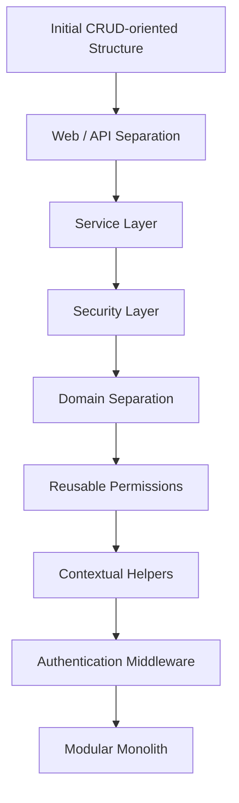

---

# 101. IAM Evolution

El sistema IAM también evolucionó junto con el alcance global del proyecto.

---

# 102. Initial IAM Model

La base conceptual seguía siendo:

```text
Usuario

↓

Identidad

↓

Rol
```

---

# 103. IAM Responsibility Separation

El modelo permitía diferenciar:

```text
logical actor

credential / identity

authorization role.
```

---

# 104. Authentication Independence

Esto permitía que la autenticación no quedara conceptualmente limitada a:

```text
one credential type.
```

---

# 105. Future Authentication Compatibility

La separación preparaba el sistema conceptualmente para posibles mecanismos adicionales como:

```text
OAuth

SSO

SAML

external identity providers
```

sin exigir que el modelo de usuario estuviera diseñado alrededor de un único proveedor.

Estos mecanismos deben entenderse aquí como:

```text
architectural compatibility

not

implemented authentication providers.
```

---

# 106. JWT Authentication Evolution

La autenticación JWT evolucionó más allá de un único access token.

La implementación actual confirma:

```text
JWT access token

+

JWT refresh token
```

---

# 107. Access Token

El access token proporciona el contexto autenticado utilizado por las requests protegidas.

Estado:

```text
CURRENT
```

---

# 108. Refresh Token

El refresh token permite renovar el access token sin exigir una nueva autenticación completa mientras el refresh token siga siendo válido.

Estado:

```text
CURRENT
```

---

# 109. Browser Token Transport

Los flujos web utilizan:

```text
HTTPOnly cookies
```

para transportar los tokens de autenticación.

Estado:

```text
CURRENT
```

---

# 110. Explicit Refresh Flow

Existe un flujo explícito de renovación que conceptualmente realiza:

```text
read refresh token

↓

validate refresh token

↓

create new access token

↓

update access-token cookie
```

Estado:

```text
CURRENT
```

---

# 111. Automatic Access Refresh

La autenticación evolucionó también para permitir renovación automática del access token desde middleware cuando:

```text
access token is no longer valid

+

valid refresh token is available.
```

Estado:

```text
CURRENT
```

---

# 112. Current Authentication Flow

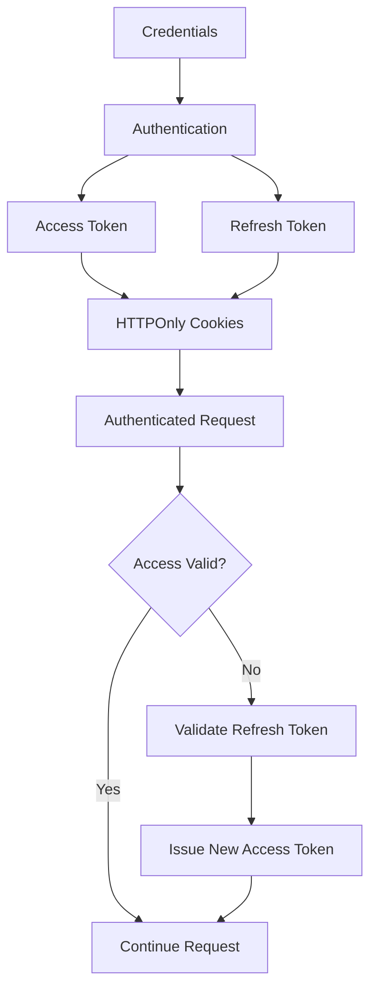

---

# 113. Logout Evolution

El logout elimina las cookies correspondientes a:

```text
access token

refresh token
```

como parte del cierre de la sesión browser.

---

# 114. Refresh Implementation vs Hardening

Debe diferenciarse estrictamente:

```text
refresh-token support
    CURRENT

from

refresh-token lifecycle hardening
    PARTIAL / IN PROGRESS
```

---

# 115. Refresh-token Hardening

No deben presentarse como históricamente completados sin evidencia específica:

```text
refresh-token rotation

server-side revocation

reuse detection

device/session management
```

---

# 116. Cookie Policy Hardening

La implementación actual contiene una diferencia relevante entre la configuración de cookies del flujo principal y la renovación automática desde middleware.

Por tanto:

```text
HTTPOnly cookie authentication
    CURRENT

centralized consistent cookie policy
    IN PROGRESS / HARDENING
```

---

# 117. Global Roles

La primera evolución de autorización se apoyaba principalmente en:

```text
global roles.
```

---

# 118. RBAC

El modelo global evolucionó hacia una estructura basada en:

```text
roles

+

permissions
```

Estado:

```text
CURRENT
```

---

# 119. Contextual Needs

El crecimiento funcional introdujo necesidades donde el permiso podía depender de:

```text
resource

project

relationship

context.
```

---

# 120. Hybrid Authorization Direction

La arquitectura comenzó a evolucionar hacia un enfoque:

```text
RBAC

+

contextual authorization.
```

---

# 121. Why Global RBAC Alone Became Insufficient

A medida que aparecieron dominios operativos, ya no bastaba responder:

```text
What role does this user have globally?
```

---

# 122. New Authorization Question

También era necesario considerar:

```text
What may this user do

inside this specific context?
```

---

# 123. Authorization Maturity Boundary

Esta evolución debe interpretarse con precisión:

```text
Global RBAC
    CURRENT

Contextual Authorization
    PARTIAL / EVOLVING

Explicit ProjectMembership model
    TARGET / IN CONSOLIDATION
```

---

# 124. Authorization Progression

La evolución conceptual es:

```text
Authentication

↓

Global Role / Permission

↓

Resource-aware checks

↓

Contextual Authorization

↓

Explicit Project Membership
    TARGET
```

---

# 125. ProjectMembership Historical Guardrail

El hecho de que la arquitectura necesite participación contextual en Projects no demuestra que exista ya un modelo completamente consolidado de:

```text
ProjectMembership.
```

Por tanto no debe describirse retrospectivamente como una capability madura ya completada.

---

# 126. IAM Evolution Significance

IAM dejó de ser:

```text
a Eurobot authentication module
```

para convertirse en:

```text
a shared identity and access foundation
for Aula Robótica Platform.
```

---

# 127. Current IAM Classification

La evolución confirmada puede resumirse así:

```text
User / Identity foundations
    CURRENT

JWT Access Tokens
    CURRENT

JWT Refresh Tokens
    CURRENT

HTTPOnly Cookies
    CURRENT

Explicit Refresh
    CURRENT

Automatic Access Refresh
    CURRENT

Global RBAC
    CURRENT

Contextual Authorization
    PARTIAL / EVOLVING

ProjectMembership
    TARGET / IN CONSOLIDATION

SAML
    FUTURE
```

---

# 128. First Major Evolution Summary

La primera gran etapa del proyecto puede resumirse como:

```text
Eurobot analysis

↓

IAM proposal

↓

REST authentication API

↓

SSR administration

↓

JWT authentication

↓

Access + Refresh Token workflow

↓

Global RBAC

↓

Layered architecture

↓

Scope expansion

↓

Reusable Aula Robótica platform

↓

Modular Monolith

↓

Contextual authorization evolution
```

---

# 129. Project Evolution Axis

Durante esta fase evolucionaron simultáneamente tres dimensiones principales.

---

# 130. Product Axis

```text
Eurobot-specific

↓

Aula-wide platform
```

---

# 131. Architecture Axis

```text
CRUD-oriented

↓

layered

↓

modular monolith
```

---

# 132. Security Axis

```text
JWT authentication

↓

access + refresh workflow

↓

RBAC

↓

context-aware authorization evolution
```

---

# 133. Initial Technology Continuity

La expansión de alcance no implicó abandonar las principales tecnologías iniciales.

---

# 134. Maintained Foundations

Continuaron como foundations:

```text
FastAPI

SQLAlchemy

MariaDB

JWT

Jinja2

AdminLTE

relational persistence
```

---

# 135. Technology Continuity Matrix

| Capability | Evolution Status |
| :--- | :--- |
| FastAPI | CURRENT |
| SQLAlchemy | CURRENT |
| MariaDB | CURRENT |
| JWT Access Token | CURRENT |
| JWT Refresh Token | CURRENT |
| HTTPOnly Cookies | CURRENT |
| Jinja2 SSR | CURRENT |
| Bootstrap / AdminLTE | CURRENT |
| Modular JavaScript | CURRENT |
| PostgreSQL | FUTURE / CANDIDATE |
| SAML | FUTURE |
| Microservices | CONDITIONAL |

---

# 136. Importance of This Continuity

La evolución se realizó principalmente mediante:

```text
architectural extension

and

refactoring
```

en lugar de reconstruir la aplicación sobre un stack completamente diferente.

---

# 137. Evolution Principle

El proyecto siguió de facto una estrategia:

```text
preserve useful foundations

↓

refactor boundaries

↓

add reusable capabilities

↓

expand functional scope.
```

---

# 138. Early Project Lesson

Una de las primeras conclusiones derivadas de esta evolución fue que una infraestructura inicialmente diseñada para un único caso podía aportar mayor valor si se desacoplaba del dominio concreto.

---

# 139. Architectural Reuse Lesson

```text
Authentication and authorization

were more valuable

as platform capabilities

than as Eurobot-specific functionality.
```

---

# 140. Scope Evolution Principle

La ampliación del alcance no consistió en añadir funcionalidades arbitrariamente.

---

# 141. Structural Evolution

La arquitectura tuvo que adaptarse para soportar:

```text
multiple domains

shared IAM

shared security

shared administration

reusable services.
```

---

# 142. Current Architectural Foundation

La foundation resultante incluye:

```text
FastAPI Backend

REST API

SSR Administration

SQLAlchemy ORM

MariaDB Persistence

IAM

JWT Access Tokens

JWT Refresh Tokens

HTTPOnly Cookies

RBAC

Service Layer

Security Layer

Repository-oriented Persistence

Modular Monolith
```

---

# 143. Foundation Maturity

Esta base permitió que el proyecto evolucionara posteriormente hacia dominios operativos y colaborativos sin sustituir sus foundations principales.

---

# 144. Transition to Functional Expansion

La siguiente etapa introdujo progresivamente capacidades relacionadas con:

```text
audit

projects

teams

tasks

activities

attachments

time tracking

WebSockets

notifications

realtime awareness
```

---

# 145. Kanban Boundary

Tasks abrió además una evolución natural hacia:

```text
Kanban
```

pero debe diferenciarse:

```text
Task status workflow
    CURRENT

Kanban UI
    PLANNED

Realtime Kanban
    PLANNED
```

---

# 146. Realtime Boundary

WebSockets sí forman parte de la evolución realizada.

Sin embargo, debe distinguirse:

```text
WebSocket foundation
    CURRENT

selected realtime features
    CURRENT

reconnect / reconciliation hardening
    IN PROGRESS / TARGET

distributed realtime
    FUTURE / CONDITIONAL
```

---

# 147. Infrastructure Boundary

La evolución arquitectónica realizada tampoco implica la adopción de infraestructura distribuida.

El baseline actual permanece:

```text
Docker

Docker Compose

Nginx

Ubuntu

Hetzner VPS
```

---

# 148. Scaling Boundary

Capacidades como:

```text
Redis

Kubernetes

microservices

distributed object storage
```

deben permanecer:

```text
FUTURE / CONDITIONAL
```

hasta que exista una necesidad y una implementación reales.

---

# 149. First-phase Historical Invariants

La primera etapa de evolución debe preservar las siguientes verdades:

```text
MariaDB was adopted
and remains current.

PostgreSQL was not adopted.

JWT access tokens were implemented.

JWT refresh tokens were implemented.

HTTPOnly cookie authentication was implemented.

Global RBAC was implemented.

Contextual authorization started evolving
but is not fully consolidated.

SAML was not implemented.

The architecture evolved into a Modular Monolith,
not microservices.
```

---

# 150. Avoiding Retrospective Architecture Inflation

La documentación histórica no debe transformar retrospectivamente:

```text
design maturity
```

en:

```text
implementation maturity.
```

---

# 151. Example — Correct Historical Evolution

```text
Tasks implemented

↓

collaborative requirements discovered

↓

Kanban identified as useful next capability
```

---

# 152. Example — Incorrect Historical Evolution

```text
Tasks implemented

↓

Kanban implemented

↓

Realtime Kanban implemented
```

si estas dos últimas etapas todavía permanecen planificadas.

---

# 153. Example — Correct Database Evolution

```text
MariaDB selected

↓

schema and domain model evolved

↓

MariaDB remains current

↓

PostgreSQL may be evaluated in the future
```

---

# 154. Example — Incorrect Database Evolution

```text
MariaDB

↓

PostgreSQL migration

↓

PostgreSQL standardization
```

porque esa transición no ocurrió.

---

# 155. Example — Correct IAM Evolution

```text
User / Identity model

↓

JWT authentication

↓

Access + Refresh Tokens

↓

HTTPOnly browser integration

↓

Global RBAC

↓

Contextual Authorization evolution
```

---

# 156. Example — Incorrect IAM Evolution

```text
JWT

↓

RBAC

↓

SAML enterprise IAM
```

porque SAML continúa siendo futuro.

---

# 157. Historical vs Target Architecture

A partir de esta etapa, cualquier descripción de evolución debe separar:

```text
IMPLEMENTED EVOLUTION
```

de:

```text
TARGET EVOLUTION.
```

---

# 158. Implemented Evolution

Incluye, entre otras foundations:

```text
FastAPI

SQLAlchemy

MariaDB

REST API

Jinja2 SSR

AdminLTE

JWT access + refresh

HTTPOnly cookies

RBAC

Modular Monolith
```

---

# 159. Partial Evolution

Incluye áreas como:

```text
Contextual Authorization

security hardening

realtime reliability

testing expansion
```

---

# 160. Target / Planned Evolution

Incluye:

```text
ProjectMembership consolidation

formal CSRF protection

refresh-token lifecycle hardening

cookie-policy consolidation

Kanban

realtime Kanban
```

---

# 161. Future / Conditional Evolution

Incluye:

```text
PostgreSQL migration

SAML

Redis-backed distributed realtime

Kubernetes

microservices

object-storage migration

PWA

AI / RAG

multi-tenancy
```

---

# 162. Evolution Model

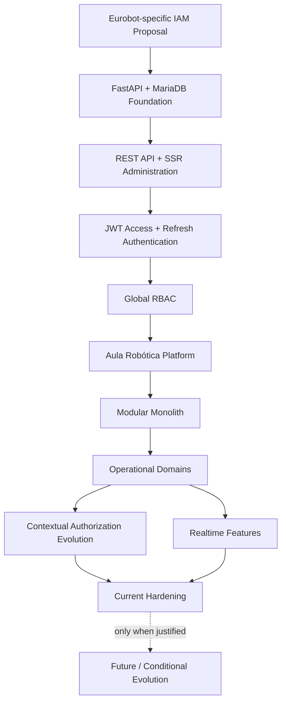

---

# 163. Historical Interpretation

El diagrama anterior no representa necesariamente:

```text
one release per node
```

ni:

```text
strictly isolated development phases.
```

Representa los principales cambios conceptuales y técnicos del proyecto.

---

# 164. Current Platform Identity

Como resultado de esta primera gran evolución, Aula Robótica Platform debe entenderse actualmente como:

```text
a FastAPI-based Modular Monolith

with

relational persistence on MariaDB

server-rendered administration

REST APIs

JWT access and refresh authentication

HTTPOnly browser token transport

RBAC

evolving contextual authorization

and reusable platform foundations.
```

---

# 165. What the Platform Is Not

En esta fase histórica no debe describirse como:

```text
PostgreSQL-centered platform

SAML-based IAM platform

microservices platform

Kubernetes platform

Redis-backed distributed system

completed realtime Kanban platform.
```

---

# 166. Evolution Quality Principle

La evolución del proyecto debe evaluarse por:

```text
useful capability growth

architectural coherence

security maturity

maintainability

operational maturity
```

y no por la cantidad de tecnologías incorporadas.

---

# 167. Complexity Principle

Una tecnología futura debe incorporarse únicamente cuando resuelva una necesidad real mejor que la arquitectura existente.

---

# 168. Architectural Continuity Principle

La estrategia predominante continúa siendo:

```text
evolve the Modular Monolith

before

introducing distributed-system complexity.
```

---

# 169. First Major Evolution Result

La primera gran evolución produjo una foundation significativamente más amplia que la propuesta original:

```text
Eurobot-specific IAM

↓

shared Aula Robótica platform foundation
```

sin abandonar el stack principal que había demostrado ser útil.

---

# 170. First-phase Platform Foundation

El resultado consolidado puede resumirse como:

```text
Backend
    FastAPI

Architecture
    Modular Monolith

Persistence
    SQLAlchemy + MariaDB

Interfaces
    REST API + Jinja2 SSR

Authentication
    JWT Access + Refresh Tokens

Browser Security
    HTTPOnly Cookies

Authorization
    Global RBAC
    + evolving contextual authorization

Administration
    AdminLTE / Bootstrap

Extensibility
    reusable services and domain boundaries
```

---

# 171. Transition to the Next Evolution Phase

Esta foundation permitió que el proyecto evolucionara hacia nuevos dominios funcionales sin reconstruir su core.

---

# 172. Next Functional Expansion

La siguiente etapa comprende la evolución alrededor de:

```text
IAM delivery

administrative SSR

Audit

Projects

Teams

Tasks

Activities

Attachments

Time Tracking

Realtime

Notifications

Activity Feed

Dashboard
```

junto con la identificación de nuevas necesidades de:

```text
contextual authorization

interactive work management

realtime synchronization

security hardening.
```

---

# 173. Kanban Position in the Evolution

Kanban debe aparecer en esa evolución como:

```text
requirement discovered from Task workflow

and

planned product evolution
```

no como una capability histórica ya entregada.

---

# 174. Realtime Position in the Evolution

Realtime debe aparecer de forma diferente porque:

```text
FastAPI WebSockets
```

sí forman parte de la implementación actual.

La evolución correcta será:

```text
collaborative requirements

↓

WebSocket foundation implemented

↓

selected realtime features implemented

↓

reliability/security gaps identified

↓

reconnect/reconciliation/security hardening
currently evolving
```

---

# 175. Database Position in the Evolution

La persistencia seguirá representándose como:

```text
MariaDB

↓

schema evolution

↓

more domains and relationships

↓

query/performance evolution

↓

MariaDB remains current
```

---

# 176. Future Database Position

Solo como posible evolución futura puede aparecer:

```text
MariaDB

-. optional future migration .->

PostgreSQL
```

---

# 177. IAM Position in the Evolution

La evolución IAM debe continuar desde:

```text
JWT Access + Refresh

↓

HTTPOnly browser integration

↓

Global RBAC

↓

Contextual Authorization evolution
```

sin insertar SAML como milestone histórico.

---

# 178. Project Evolution Rule

A partir de esta sección, cada nuevo dominio deberá responder tres preguntas:

```text
What was implemented?

What architectural pressure did it introduce?

What later evolution did it motivate?
```

---

# 179. Why This Matters

Esta separación permite documentar correctamente casos como:

```text
Tasks were implemented.

Tasks motivated Kanban.

Kanban remains planned.
```

o:

```text
WebSockets were implemented.

WebSockets exposed reliability requirements.

Reconnect/reconciliation remain evolving.
```

---

# 180. Historical Precision

La evolución profesional del proyecto no necesita presentar todas las ideas como completadas.

Al contrario:

```text
discovering the next architectural problem

is itself part of project evolution.
```

---

# 181. Part 1 Summary

La evolución inicial de Aula Robótica Platform puede resumirse así:

```text
Initial context:
FCT at Aula de Robótica, EPS-UAH

Initial domain:
Eurobot Spain

Initial objective:
REST API for users and authentication

Initial technical foundations:
FastAPI
MariaDB
SQLAlchemy
JWT
Jinja2
AdminLTE

Initial conceptual model:
Usuario → Identidad → Rol

First major change:
Eurobot-specific IAM
        ↓
Aula Robótica transversal platform

Architectural evolution:
CRUD-oriented structure
        ↓
Layered architecture
        ↓
Modular Monolith

Authentication evolution:
JWT
        ↓
Access + Refresh Tokens
        ↓
HTTPOnly browser integration

Authorization evolution:
Global RBAC
        ↓
Contextual Authorization
        PARTIAL / EVOLVING

Database evolution:
MariaDB
        ↓
schema/domain growth
        ↓
MariaDB remains CURRENT

Future database candidate:
PostgreSQL

Federated identity:
SAML remains FUTURE

Scaling architecture:
distributed infrastructure remains CONDITIONAL
```

---

# 182. Continuation

La **Parte 2/3** continúa con:

```text
Functional Evolution

IAM Delivery

Browser Authentication

Audit System

Projects

Teams

Tasks

Activities

Attachments

Time Tracking

Kanban as Planned Evolution

WebSocket Introduction

Notifications

Dashboard

Activity Feed

Realtime Evolution

Contextual Authorization Pressure

Security Hardening

Major Functional Turning Points

Platform Complexity Growth
```

---

# 57_PROJECT_EVOLUTION.md

# Aula Robótica Platform — Project Evolution

## Parte 2/3 — Evolución funcional, IAM, administración, auditoría, proyectos, equipos, tareas, actividades, adjuntos, time tracking, Kanban planificado y realtime

---

# 183. Functional Evolution

Una vez consolidada la transformación desde un sistema IAM específico hacia una plataforma transversal, el proyecto comenzó una segunda etapa caracterizada por:

```text
progressive functional expansion.
```

---

# 184. Evolution Strategy

La plataforma no evolucionó mediante la incorporación simultánea de todos los módulos.

El crecimiento siguió una estrategia incremental:

```text
foundation

↓

administration

↓

security

↓

auditability

↓

collaboration

↓

work management

↓

realtime interaction.
```

---

# 185. Functional Evolution Principle

Cada nueva capability debía apoyarse en foundations existentes siempre que fuera posible:

```text
IAM

authorization

services

persistence

SSR

API

audit.
```

---

# 186. Why Incremental Evolution

Este enfoque permitió:

```text
validate architecture

discover new requirements

refactor progressively

avoid premature complexity

preserve working functionality.
```

---

# 187. Functional Evolution Status Rule

La evolución funcional debe distinguir entre:

```text
implemented domain

↓

pressure or requirement discovered

↓

subsequent capability proposed
```

---

# 188. Avoiding Functional Inflation

Por ejemplo:

```text
Task workflow implemented

↓

Kanban identified as useful
```

no significa:

```text
Kanban implemented.
```

---

# 189. First Functional Foundation — IAM

El primer dominio funcional relevante continuó siendo:

```text
Identity and Access Management.
```

---

# 190. IAM Responsibilities

El sistema IAM evolucionó para cubrir:

```text
users

identities

roles

authentication

authorization

administrative management.
```

---

# 191. User Domain

La gestión de usuarios proporcionó una primera entidad transversal sobre la que construir el resto de la plataforma.

---

# 192. User Responsibility

`Usuario` representa:

```text
the logical platform actor.
```

---

# 193. User Lifecycle

La administración contempla operaciones relacionadas con:

```text
create

read

update

activation state

administrative management.
```

---

# 194. Identity Domain

La identidad se mantuvo separada conceptualmente del usuario.

---

# 195. Identity Responsibility

`Identidad` representa:

```text
the authentication identity associated
with a logical user.
```

---

# 196. Separation Benefit

La separación permite evitar:

```text
User == Credentials
```

como supuesto estructural.

---

# 197. Identity Extensibility

La decisión también permite que el modelo conceptual no dependa exclusivamente de:

```text
one authentication mechanism.
```

---

# 198. External Identity Boundary

Esta extensibilidad puede facilitar en el futuro:

```text
OAuth

SSO

SAML

external identity providers
```

pero estas posibilidades no deben confundirse con funcionalidades actualmente implementadas.

---

# 199. SAML Status

El estado correcto continúa siendo:

```text
SAML
    FUTURE
```

---

# 200. Role Domain

Los roles proporcionaron la primera estructura de autorización.

---

# 201. Authorization Model

La autorización se apoyó principalmente en:

```text
RBAC
```

o:

```text
Role-Based Access Control.
```

---

# 202. RBAC Responsibility

RBAC permite responder:

```text
Which operations are available
to a user according to their role?
```

---

# 203. Global Role Scope

Los roles constituyen principalmente:

```text
global platform authorization.
```

---

# 204. RBAC Current Status

El estado de esta capability es:

```text
Global RBAC
    CURRENT
```

---

# 205. Administrative Interface Evolution

El proyecto no se limitó a proporcionar endpoints REST.

---

# 206. SSR Administration

Se desarrolló una interfaz administrativa basada en:

```text
Jinja2

+

AdminLTE / Bootstrap.
```

---

# 207. Administration Purpose

Esta interfaz permitió gestionar visualmente recursos de la plataforma.

---

# 208. Importance of SSR

SSR permitió mantener una arquitectura donde:

```text
server remains authoritative
```

para navegación, generación de vistas y enforcement de reglas de servidor.

---

# 209. API + SSR Duality

La plataforma pasó a mantener dos formas complementarias de interacción:

```text
REST API

+

server-rendered web interface.
```

---

# 210. Shared Application Logic

Ambos canales debían reutilizar:

```text
services

security rules

persistence

domain behavior.
```

---

# 211. Architectural Rule

La existencia de dos interfaces no debía producir:

```text
two independent business implementations.
```

---

# 212. Frontend Evolution

Sobre la base SSR se incorporó progresivamente:

```text
modular JavaScript
```

para mejorar determinados workflows sin transformar la aplicación en una SPA.

---

# 213. Current Frontend Model

```text
Jinja2 SSR

+

Bootstrap / AdminLTE

+

Modular JavaScript
```

Estado:

```text
CURRENT
```

---

# 214. Progressive Enhancement

La estrategia frontend puede resumirse como:

```text
server-rendered baseline

+

JavaScript enhancement where useful.
```

---

# 215. Authentication Evolution

JWT continuó siendo el mecanismo principal de autenticación.

---

# 216. Authentication Baseline

La implementación actual incluye:

```text
JWT access token

JWT refresh token

HTTPOnly cookies

explicit refresh

automatic access refresh.
```

---

# 217. Access and Refresh Relationship

Conceptualmente:

```text
Authentication

↓

Access Token
    short-lived authenticated access

+

Refresh Token
    access renewal capability
```

---

# 218. Browser Authentication

La incorporación de SSR introdujo necesidades específicas del contexto browser.

---

# 219. Browser Security Context

La plataforma debía considerar conjuntamente:

```text
JWT

HTTPOnly cookies

browser requests

server-rendered routes.
```

---

# 220. Browser Authentication Evolution

La seguridad evolucionó desde:

```text
API token validation
```

hacia:

```text
browser-aware authentication
and authorization.
```

---

# 221. Explicit Refresh

Existe un endpoint de refresh capaz de:

```text
receive refresh cookie

↓

validate refresh token

↓

generate new access token

↓

update access cookie.
```

---

# 222. Automatic Refresh

El middleware también puede renovar automáticamente el access token cuando:

```text
access validation fails

+

valid refresh token exists.
```

---

# 223. Logout

El flujo de logout elimina:

```text
access-token cookie

+

refresh-token cookie.
```

---

# 224. Authentication Maturity

Por tanto:

```text
Access Token
    CURRENT

Refresh Token
    CURRENT

HTTPOnly Cookies
    CURRENT

Explicit Refresh
    CURRENT

Automatic Access Refresh
    CURRENT
```

---

# 225. Authentication Hardening Boundary

No deben confundirse estas capabilities con:

```text
refresh-token rotation

server-side revocation

reuse detection

session/device management.
```

---

# 226. Refresh Hardening Status

```text
Refresh-token workflow
    CURRENT

Advanced refresh-token hardening
    VERIFY / IN PROGRESS

Session/device management
    FUTURE
```

---

# 227. Cookie Policy Evolution

La implementación introdujo una necesidad adicional:

```text
centralized cookie policy.
```

---

# 228. Cookie Configuration Issue

Los diferentes caminos de emisión o renovación de cookies deben utilizar una política coherente para:

```text
HttpOnly

Secure

SameSite

Path

expiration.
```

---

# 229. Cookie Policy Status

```text
HTTPOnly token cookies
    CURRENT

Centralized environment-aware cookie policy
    HARDENING / IN PROGRESS
```

---

# 230. Security Evolution Lesson

La existencia de una capability de seguridad no significa que todos sus aspectos de hardening estén finalizados.

---

# 231. Middleware Evolution

Se incorporó middleware de autenticación para proporcionar:

```text
cross-cutting authentication context.
```

---

# 232. Context Propagation

El sistema necesita conocer de forma reutilizable:

```text
current actor

authentication state

authorization context.
```

---

# 233. Reusable Security Dependencies

Las dependencies de FastAPI permiten encapsular:

```text
authentication requirements

authorization requirements

context resolution.
```

---

# 234. Functional Growth Consequence

A medida que aparecieron nuevos dominios, la autorización dejó de poder depender exclusivamente de:

```text
global role.
```

---

# 235. Audit System Introduction

Una de las siguientes capabilities transversales fue:

```text
Audit.
```

---

# 236. Audit Motivation

Una plataforma con operaciones administrativas y colaborativas necesita responder:

```text
Who did what?

When?

On which resource?
```

---

# 237. Audit Purpose

El sistema de auditoría permite preservar:

```text
traceability

accountability

operational history.
```

---

# 238. Audit Current Status

La auditoría forma parte de la plataforma actual.

```text
Audit
    CURRENT
```

---

# 239. Audit as Cross-cutting Concern

Audit no debe quedar acoplado únicamente a:

```text
one module.
```

---

# 240. Audit Evolution

La auditoría evolucionó como una capability reutilizable por distintos dominios.

---

# 241. Audit Information

Conceptualmente, un evento de auditoría puede incluir información como:

```text
actor

action

resource type

resource identifier

timestamp

context

relevant metadata.
```

---

# 242. Audit Architectural Value

La auditoría introdujo una forma explícita de:

```text
cross-domain traceability.
```

---

# 243. Audit and Security

Audit complementa seguridad, pero no la sustituye.

---

# 244. Security vs Audit

```text
Authorization

→ decides whether an operation is allowed.


Audit

→ records relevant operations and outcomes.
```

---

# 245. Project Domain Introduction

La evolución hacia una plataforma transversal hizo natural introducir:

```text
Projects.
```

---

# 246. Project Current Status

El core de Projects forma parte de la implementación actual.

```text
Projects
    CURRENT
```

---

# 247. Project as Collaboration Boundary

`Project` comenzó a convertirse en una de las principales boundaries funcionales.

---

# 248. Project Responsibility

Un proyecto actúa como contexto para diferentes recursos y workflows colaborativos.

---

# 249. Architectural Importance of Project

La introducción de Projects modificó profundamente las necesidades de autorización.

---

# 250. Before Projects

La pregunta principal podía ser:

```text
What global role does the user have?
```

---

# 251. After Projects

También debía considerarse:

```text
What relationship does the user have
with this specific project?
```

---

# 252. Contextual Authorization Pressure

Esta necesidad impulsó el paso conceptual hacia:

```text
RBAC

+

context-aware authorization.
```

---

# 253. Authorization Context

El acceso puede depender de:

```text
actor

global role

project

resource ownership

resource ancestry

project relationship.
```

---

# 254. Project as Security Boundary

Project comenzó a actuar no solo como entidad funcional, sino también como:

```text
authorization context.
```

---

# 255. Project Evolution Significance

Esto marcó uno de los cambios arquitectónicos más importantes de la plataforma.

---

# 256. Global to Contextual Security

La evolución real debe representarse como:

```text
Global RBAC
    CURRENT

↓

Resource-aware checks
    CURRENT / PARTIAL depending on workflow

↓

Contextual Authorization
    PARTIAL / EVOLVING

↓

Explicit ProjectMembership
    TARGET / IN CONSOLIDATION
```

---

# 257. Contextual Authorization Boundary

No debe afirmarse todavía:

```text
complete project-scoped authorization
across every resource.
```

---

# 258. ProjectMembership Evolution

La necesidad de representar explícitamente la relación entre:

```text
User

and

Project
```

conduce hacia un modelo más formal de:

```text
ProjectMembership.
```

---

# 259. ProjectMembership Status

El estado correcto es:

```text
TARGET / IN CONSOLIDATION
```

y no:

```text
fully mature CURRENT capability.
```

---

# 260. Membership Architectural Goal

El modelo objetivo debe permitir representar explícitamente:

```text
who belongs to a project

under which project context

with which project-scoped capabilities.
```

---

# 261. Team Domain

La colaboración dentro del ecosistema introdujo también el concepto de:

```text
Teams.
```

---

# 262. Team Purpose

Teams permite representar agrupaciones de usuarios dentro de contextos colaborativos.

---

# 263. Team Relationship

Los equipos pueden relacionarse con:

```text
users

projects

organizational collaboration.
```

---

# 264. Team Architectural Impact

La aparición de Teams reforzó la necesidad de separar:

```text
global identity

from

contextual participation.
```

---

# 265. Authorization Complexity Growth

Con recursos contextualizados, la autorización deja de ser una simple comprobación:

```text
role == admin
```

---

# 266. Contextual Authorization Questions

Ahora aparecen preguntas como:

```text
May the actor access this Project?

May the actor access this nested resource?

Does the actor have the required capability?

Does the resource belong to an accessible Project?
```

---

# 267. Nested Resource Authorization

Los recursos dependientes de Project introducen:

```text
nested authorization.
```

---

# 268. Nested Authorization Example

Para acceder a una Task no basta conceptualmente con comprobar:

```text
Task exists.
```

---

# 269. Required Resource Context

También puede ser necesario comprobar:

```text
Task

↓

belongs to Project

↓

actor may access Project.
```

---

# 270. Architectural Consequence

La autorización necesita resolver:

```text
resource ancestry

+

authorization context.
```

---

# 271. Authorization Maturity

La necesidad está claramente identificada, pero su cobertura debe considerarse:

```text
PARTIAL / EVOLVING
```

hasta que todos los workflows relevantes utilicen políticas consistentes.

---

# 272. Task Domain Introduction

La siguiente evolución funcional importante fue:

```text
Tasks.
```

---

# 273. Task Current Status

El core de Tasks está implementado.

```text
Tasks
    CURRENT
```

---

# 274. Task Purpose

Las tareas permiten estructurar:

```text
work

responsibility

progress

project execution.
```

---

# 275. Task Relationship

Conceptualmente:

```text
Project

↓

Tasks
```

---

# 276. Task Functional Capabilities

El dominio de tareas soporta el trabajo sobre:

```text
task information

status

project relationship

work progression.
```

---

# 277. Task Status Model

La existencia de estados permite representar progresión de trabajo.

Entre los estados actuales relevantes se encuentran:

```text
TODO

DOING

DONE
```

---

# 278. Task Architectural Impact

Tasks introdujo una entidad:

```text
frequently mutated

collaborative

project-scoped.
```

---

# 279. Task Evolution Pressure

Esto convirtió Tasks en uno de los principales puntos de presión para futuras capacidades como:

```text
Kanban

richer realtime updates

notifications

activity history.
```

---

# 280. Task Status Is Not Kanban

Debe mantenerse una distinción fundamental:

```text
Task status model

≠

Kanban UI.
```

---

# 281. Current Task vs Planned Kanban

```text
Task management
    CURRENT

Task statuses
    CURRENT

Kanban board
    PLANNED

Drag & Drop Kanban
    PLANNED

Live Kanban
    PLANNED
```

---

# 282. Activity Domain

La plataforma incorporó:

```text
Activities.
```

---

# 283. Activity Current Status

```text
Activities
    CURRENT
```

---

# 284. Activity Purpose

Activities permite representar información relacionada con trabajo o acciones del dominio.

---

# 285. Activity Relationships

Las Activities pueden estar relacionadas con:

```text
project

task

actor

time

description.
```

---

# 286. Activity vs Audit

Activity y Audit no deben confundirse.

---

# 287. Activity

Representa principalmente:

```text
product/domain-visible work information.
```

---

# 288. Audit

Representa:

```text
system traceability
of relevant operations.
```

---

# 289. Example Difference

```text
Activity:

"Robot arm calibration completed."


Audit:

"User 17 updated Activity 42."
```

---

# 290. Architectural Importance

Mantener ambos conceptos separados evita convertir:

```text
audit log
```

en:

```text
business activity feed.
```

---

# 291. Activity Feed

La evolución de información colaborativa permitió además disponer de:

```text
Activity Feed.
```

---

# 292. Activity Feed Status

```text
Activity Feed
    CURRENT
```

---

# 293. Activity Feed Responsibility

Activity Feed proporciona una representación orientada al usuario de actividad relevante.

---

# 294. Activity Feed vs Audit

Debe mantenerse:

```text
Activity Feed
    user/product awareness

Audit
    traceability/accountability
```

---

# 295. Attachment Domain

La evolución del trabajo colaborativo hizo necesaria la incorporación de:

```text
Attachments.
```

---

# 296. Attachment Current Status

El core de Attachments forma parte de la implementación actual.

```text
Attachments
    CURRENT
```

---

# 297. Attachment Purpose

Permite asociar archivos a recursos de la plataforma.

---

# 298. Attachment Context

Los attachments pueden relacionarse con recursos dentro de los dominios colaborativos.

---

# 299. Attachment Architectural Challenge

La introducción de archivos añadió concerns distintos de la persistencia relacional.

---

# 300. Attachment Concerns

```text
metadata

binary storage

authorization

download

upload

lifecycle

deletion

backup.
```

---

# 301. Attachment Security

El acceso a un archivo no debe depender únicamente de conocer:

```text
file identifier

or

storage path.
```

---

# 302. Attachment Authorization

El acceso debe derivarse del:

```text
resource context
```

al que pertenece el archivo.

---

# 303. Current Attachment Storage

La plataforma utiliza actualmente almacenamiento local/persistente para los archivos.

```text
Local Attachment Storage
    CURRENT
```

---

# 304. Object Storage Boundary

Una posible evolución futura es:

```text
object storage

external storage backend
```

pero no forma parte de la arquitectura actual.

---

# 305. Object Storage Status

```text
Object Storage
    FUTURE / CONDITIONAL
```

---

# 306. Storage Evolution Principle

No debe introducirse infraestructura distribuida hasta que:

```text
deployment requirements

scale

durability requirements

or multi-instance operation
```

lo justifiquen.

---

# 307. Time-related Work Tracking

La evolución de Tasks y Activities también introdujo necesidades relacionadas con:

```text
work tracking

time-related information

activity history.
```

---

# 308. Time Tracking Historical Rule

Cualquier capability específica de Time Tracking debe describirse únicamente con el alcance realmente implementado.

No debe utilizarse la mera existencia de:

```text
Tasks

Activities

timestamps
```

como prueba de un subsistema completo de Time Tracking.

---

# 309. Time Tracking Architectural Pressure

Cuando existe tracking temporal, aparecen invariantes como:

```text
valid start/end relationships

non-negative duration

valid referenced resource

valid actor.
```

---

# 310. Data Integrity Lesson

Los invariantes importantes no deberían depender exclusivamente de:

```text
UI assumptions.
```

---

# 311. Database Domain Growth

A medida que crecieron dominios y relaciones, MariaDB pasó de almacenar principalmente información IAM a representar:

```text
collaborative domain state.
```

---

# 312. Persistence Complexity Growth

Aparecieron:

```text
more foreign keys

nested relationships

authorization-sensitive relationships

larger collections.
```

---

# 313. Query Complexity Growth

Las consultas dejaron de ser únicamente:

```text
simple CRUD lookup.
```

---

# 314. New Query Requirements

Comenzaron a aparecer necesidades como:

```text
project-scoped retrieval

filtered collections

joined relationships

ordered activity

pagination

aggregations.
```

---

# 315. Database Evolution Principle

La persistencia debía evolucionar manteniendo:

```text
correctness first

performance through measurement.
```

---

# 316. Database Continuity

Este crecimiento del modelo ocurrió sobre:

```text
MariaDB
```

y no representa una migración a otro motor.

---

# 317. Database Historical State

```text
MariaDB
    CURRENT

PostgreSQL
    FUTURE / CANDIDATE
```

---

# 318. Kanban Requirement Emergence

La evolución de Tasks hizo natural considerar una representación visual del workflow mediante:

```text
Kanban.
```

---

# 319. Kanban Purpose

Kanban permitiría representar visualmente el estado de las tareas.

---

# 320. Conceptual Kanban Model

```text
Task

↓

Status

↓

Visual Column
```

---

# 321. Current Task Status Flow

El modelo actual puede trabajar con estados como:

```text
TODO

↓

DOING

↓

DONE
```

---

# 322. Kanban Historical Correction

La existencia de estos estados no significa que:

```text
Kanban board
```

esté implementado.

---

# 323. Kanban Status

```text
Kanban
    PLANNED
```

---

# 324. Planned Kanban Baseline

La evolución prevista comienza por:

```text
SSR project board
```

manteniendo coherencia con la arquitectura frontend actual.

---

# 325. Planned Kanban Mutation

Después deberá existir una operación autorizada para:

```text
change Task status
```

desde el board.

---

# 326. Planned Progressive Enhancement

Una vez consolidado el flujo funcional:

```text
Drag & Drop
```

puede añadirse como mejora JavaScript.

---

# 327. Planned Live Kanban

Posteriormente puede integrarse:

```text
realtime synchronization
```

sobre el board.

---

# 328. Correct Kanban Evolution

```text
Task Domain
    CURRENT

↓

Task Status Workflow
    CURRENT

↓

SSR Kanban
    PLANNED

↓

Authorized Status Mutation
    PLANNED

↓

Drag & Drop
    PLANNED

↓

Live Kanban
    PLANNED
```

---

# 329. Kanban Progressive Enhancement

La dirección arquitectónica mantiene:

```text
SSR baseline

+

JavaScript enhancement.
```

---

# 330. Server Authority

Incluso cuando se implemente interacción dinámica:

```text
server remains authoritative
for validation and authorization.
```

---

# 331. Kanban Security Requirement

Mover una Task entre columnas será:

```text
a state-changing operation.
```

---

# 332. Required Kanban Controls

Deberá aplicar:

```text
authentication

authorization

validation

browser security controls.
```

---

# 333. Kanban Security Dependency

Por ello Kanban depende también de la madurez de:

```text
project-scoped contextual authorization.
```

---

# 334. Kanban as Architectural Pressure

Aunque todavía sea planificado, Kanban evidencia una evolución del producto desde:

```text
administrative CRUD
```

hacia:

```text
interactive collaborative workflows.
```

---

# 335. Realtime Requirement Emergence

La colaboración entre múltiples usuarios introdujo otra necesidad:

```text
timely state awareness.
```

---

# 336. Traditional Request Model

Inicialmente:

```text
Browser

↓

HTTP request

↓

Server

↓

HTML / JSON response.
```

---

# 337. Collaborative Requirement

Con múltiples usuarios:

```text
User A changes shared state

↓

User B may need to become aware of the change.
```

---

# 338. Polling Alternative

Una posibilidad habría sido:

```text
periodic polling.
```

---

# 339. Realtime Direction

La plataforma evolucionó realmente hacia:

```text
WebSockets.
```

---

# 340. WebSocket Current Status

```text
FastAPI WebSockets
    CURRENT
```

---

# 341. WebSocket Introduction

WebSockets permiten mantener un canal persistente:

```text
Client

⇄

Server.
```

---

# 342. Realtime Initial Goal

El objetivo era propagar determinados eventos relevantes sin requerir:

```text
full page refresh

or

continuous polling.
```

---

# 343. Current Realtime Foundation

La implementación actual utiliza:

```text
FastAPI WebSockets

+

in-memory Connection Manager.
```

---

# 344. Connection Manager Status

```text
In-memory Connection Manager
    CURRENT
```

---

# 345. Single-instance Model

Este diseño es adecuado para una arquitectura donde:

```text
one application instance
```

puede mantener en memoria las conexiones que gestiona.

---

# 346. Distributed Realtime Boundary

La existencia de WebSockets no significa que exista:

```text
distributed connection coordination.
```

---

# 347. Redis Boundary

Redis puede convertirse en una opción futura si aparece:

```text
multiple application instances

cross-process event delivery

distributed connection ownership.
```

---

# 348. Redis Status

```text
Redis
    CONDITIONAL
```

---

# 349. Realtime Use Cases

La plataforma dispone de capabilities realtime y estas pueden aplicarse a casos como:

```text
notifications

activity-related awareness

selected state updates
```

según el workflow implementado.

---

# 350. Kanban Realtime Guardrail

No debe utilizarse la existencia de WebSockets para inferir:

```text
Live Kanban
    CURRENT
```

porque:

```text
WebSocket capability

≠

Kanban capability.
```

---

# 351. Realtime Complexity Increase

Realtime introdujo nuevas preocupaciones:

```text
connection lifecycle

authentication

subscription authorization

event contracts

disconnect

reconnect

duplicate delivery

missed events

client convergence.
```

---

# 352. Important Realtime Lesson

WebSockets no significan automáticamente:

```text
reliable synchronized state.
```

---

# 353. Connection Reality

Las conexiones pueden:

```text
disconnect

reconnect

fail

miss events.
```

---

# 354. Event Reality

Los eventos pueden:

```text
arrive late

be duplicated

or

be missed during disconnect windows.
```

---

# 355. Realtime Maturity Boundary

Debe distinguirse:

```text
WebSocket transport
    CURRENT

from

reliable realtime synchronization
    PARTIAL / EVOLVING
```

---

# 356. Realtime Reliability Requirements

La evolución identificó necesidades relacionadas con:

```text
event identity

event versioning

authentication

subscription authorization

reconnection

reconciliation

idempotency.
```

---

# 357. Event Contract Evolution

Los mensajes realtime necesitan contratos suficientemente explícitos.

---

# 358. Target Event Envelope

Conceptualmente:

```text
event_id

event_type

version

scope

resource

occurred_at

payload.
```

---

# 359. Event Contract Status

La normalización completa de este contrato debe considerarse:

```text
TARGET / IN PROGRESS
```

mientras no esté aplicada consistentemente a todos los workflows relevantes.

---

# 360. Why Event IDs Matter

Permiten soportar:

```text
deduplication

diagnostics

traceability.
```

---

# 361. Why Versioning Matters

Permite evolucionar:

```text
producer

and

consumer
```

sin depender de contratos implícitos.

---

# 362. Why Scope Matters

Permite identificar:

```text
which project/resource context
the event belongs to.
```

---

# 363. WebSocket Authentication

La conexión realtime necesita una identidad autenticada validada por el servidor.

---

# 364. WebSocket Authentication Status

El hardening completo de esta frontera debe considerarse:

```text
IN PROGRESS / TARGET
```

y no una capability completamente cerrada.

---

# 365. Realtime Authorization

Una conexión autenticada no implica automáticamente:

```text
authorization for every subscription.
```

---

# 366. Required Subscription Model

```text
authenticate connection

↓

authorize subscription

↓

filter event scope.
```

---

# 367. Subscription Authorization Status

```text
Project-scoped WebSocket subscription authorization
    TARGET / IN PROGRESS
```

---

# 368. Authentication vs Subscription Authorization

```text
Authentication

→ Who is connected?


Subscription Authorization

→ Which realtime scopes may this actor observe?
```

---

# 369. Realtime Security Significance

Esta separación es especialmente importante cuando los eventos contienen información:

```text
project-scoped

resource-scoped

or

user-specific.
```

---

# 370. Disconnect Handling

Realtime también debe considerar la desconexión como:

```text
normal operational behavior
```

y no únicamente como error excepcional.

---

# 371. Reconnect Requirement

El cliente puede necesitar:

```text
controlled reconnection.
```

---

# 372. Reconnect Status

```text
Reliable reconnect strategy
    TARGET / IN PROGRESS
```

---

# 373. Why Reconnect Alone Is Insufficient

Después de reconectar:

```text
events may have been missed.
```

---

# 374. State Reconciliation

Por ello aparece la necesidad de:

```text
authoritative state reconciliation.
```

---

# 375. Reconciliation Principle

```text
WebSocket

→ provides timely awareness.


HTTP / authoritative server state

→ restores correctness.
```

---

# 376. Reconciliation Status

```text
State Reconciliation
    TARGET / IN PROGRESS
```

---

# 377. Realtime Convergence Model

```text
Realtime Event

↓

Update Client State

↓

Disconnect May Occur

↓

Reconnect

↓

Fetch Authoritative State

↓

Client Converges Again
```

---

# 378. Realtime Correctness Principle

La corrección no debe depender de:

```text
every WebSocket event being delivered exactly once.
```

---

# 379. Realtime Role

Realtime debe considerarse principalmente:

```text
awareness and synchronization aid
```

sobre un estado persistido autoritativo.

---

# 380. Persistence Authority

La autoridad continúa siendo:

```text
server-side validated

+

persisted domain state.
```

---

# 381. Notifications Introduction

La evolución realtime se relacionó especialmente con:

```text
Notifications.
```

---

# 382. Notification Current Status

```text
Notifications
    CURRENT
```

---

# 383. Notification Purpose

Notifications permite comunicar al usuario eventos relevantes dentro de la aplicación.

---

# 384. Notification Persistence

La plataforma dispone de notificaciones persistentes que pueden mantener estado como:

```text
read

unread.
```

---

# 385. Notification Delivery

La experiencia puede combinar:

```text
persistent notification state

+

realtime awareness.
```

---

# 386. Persistence vs Realtime

Esto permite mantener:

```text
database
    authoritative notification state

WebSocket
    timely delivery/awareness
```

---

# 387. Notification Reliability Principle

Una notificación importante no debería existir únicamente como:

```text
ephemeral WebSocket message.
```

---

# 388. Notification Future Extensions

Capacidades como:

```text
email delivery

push notifications

digest generation

advanced preferences

background delivery infrastructure
```

permanecen:

```text
FUTURE / TARGET
```

según la capability.

---

# 389. Dashboard Evolution

La expansión funcional permitió disponer también de:

```text
Dashboard.
```

---

# 390. Dashboard Status

```text
Dashboard
    CURRENT
```

---

# 391. Dashboard Purpose

Dashboard proporciona una visión agregada del estado relevante para el usuario.

---

# 392. Dashboard Architectural Pressure

La agregación de información introduce presión sobre:

```text
query efficiency

authorization-aware retrieval

aggregation

SSR rendering cost.
```

---

# 393. Dashboard Performance Evolution

Esto genera una línea de evolución relacionada con:

```text
query optimization

measurement

avoiding repeated database access.
```

---

# 394. Performance Status

La optimización debe considerarse:

```text
continuous engineering work
```

y no una transformación arquitectónica finalizada.

---

# 395. Activity Feed Evolution

Activity Feed representa otra capability de awareness dentro de la plataforma.

---

# 396. Activity Feed Current Status

```text
Activity Feed
    CURRENT
```

---

# 397. Activity Feed Purpose

Permite presentar información relevante de actividad en una forma orientada al usuario.

---

# 398. Activity Feed vs Notifications

Aunque relacionados:

```text
Activity Feed

≠

Notifications.
```

---

# 399. Activity Feed

Responde principalmente:

```text
What has been happening?
```

---

# 400. Notifications

Responde principalmente:

```text
What relevant event should this user notice?
```

---

# 401. Audit

Responde principalmente:

```text
What operation occurred,
by whom,
and on which resource?
```

---

# 402. Three Different Concerns

```text
Activity Feed
    product awareness

Notifications
    user attention

Audit
    traceability
```

---

# 403. Functional Platform Growth

La plataforma pasó progresivamente de:

```text
IAM-focused application
```

a:

```text
collaborative modular platform.
```

---

# 404. Current Core Functional Domains

Entre los dominios actualmente consolidados se encuentran:

```text
Users

Identity / Authentication

Roles / RBAC

Projects

Tasks

Activities

Attachments

Notifications

Dashboard

Activity Feed

Audit.
```

---

# 405. Cross-cutting Capabilities

A ellos se suman capabilities transversales como:

```text
JWT Authentication

HTTPOnly Cookies

Authorization

WebSockets

SSR

REST API

Testing

Deployment.
```

---

# 406. Functional Growth and Authorization

Cada nuevo dominio aumentó la importancia de responder correctamente:

```text
who

may do what

to which resource

inside which context.
```

---

# 407. Functional Growth and Auditability

También aumentó la necesidad de:

```text
traceability

historical visibility

user awareness.
```

---

# 408. Functional Growth and Realtime

Los workflows colaborativos introdujeron la necesidad de:

```text
timely awareness
```

sin convertir WebSockets en la fuente autoritativa del estado.

---

# 409. Functional Growth and Testing

El aumento de dominios incrementó la necesidad de:

```text
unit tests

service tests

API tests

authorization tests

UI tests

realtime tests.
```

---

# 410. Testing Current Status

La plataforma dispone de:

```text
automated testing
```

pero la cobertura continúa evolucionando.

---

# 411. Authorization Testing Pressure

Contextual authorization introduce especialmente la necesidad de:

```text
cross-project authorization tests.
```

---

# 412. Cross-project Risk

Un fallo de autorización contextual puede permitir:

```text
User from Project A

↓

access Resource from Project B
```

aunque ambos recursos sean individualmente válidos.

---

# 413. Cross-project Test Status

La ampliación sistemática de estas pruebas forma parte de:

```text
current hardening / planned work.
```

---

# 414. Realtime Testing Pressure

WebSockets introducen casos adicionales:

```text
multiple clients

connect/disconnect

authorization

subscription scope

reconnect

event propagation

state convergence.
```

---

# 415. Realtime Test Status

La ampliación de esta cobertura debe considerarse:

```text
IN PROGRESS / PLANNED
```

y no completamente consolidada.

---

# 416. UI Testing Pressure

El crecimiento de workflows browser también incrementó la necesidad de:

```text
critical user journey testing.
```

---

# 417. UI Testing Status

```text
UI testing
    CURRENT foundation

coverage expansion
    IN PROGRESS / PLANNED
```

---

# 418. Security Growth

La plataforma evolucionó desde una seguridad centrada principalmente en:

```text
authentication
```

hacia un modelo que debe considerar:

```text
authentication

authorization

browser security

context isolation

realtime security

auditability.
```

---

# 419. CSRF Requirement

El uso de autenticación basada en cookies para workflows browser introduce la necesidad de evaluar y aplicar protección formal frente a:

```text
Cross-Site Request Forgery.
```

---

# 420. CSRF Status

```text
Formal CSRF Protection
    IN PROGRESS / PLANNED
```

---

# 421. Security Baseline vs Security Completion

La plataforma posee una base de seguridad real.

Sin embargo:

```text
security baseline

≠

security completion.
```

---

# 422. Security Hardening Areas

Entre las áreas actuales de hardening se encuentran:

```text
CSRF

refresh-token lifecycle

cookie-policy consistency

contextual authorization

WebSocket authentication

subscription authorization.
```

---

# 423. Functional Turning Point — IAM to Platform

El primer gran turning point fue:

```text
Eurobot-specific IAM

↓

Aula Robótica shared platform.
```

---

# 424. Functional Turning Point — Global to Contextual Security

El segundo fue descubrir que:

```text
global role alone
```

no era suficiente para todos los dominios colaborativos.

---

# 425. Functional Turning Point — CRUD to Collaboration

La incorporación de:

```text
Projects

Tasks

Activities

Attachments
```

transformó la aplicación desde administración de entidades hacia:

```text
collaborative work management.
```

---

# 426. Functional Turning Point — Request/Response to Realtime

La incorporación de WebSockets añadió:

```text
server-initiated awareness
```

a la arquitectura tradicional HTTP.

---

# 427. Functional Turning Point — Realtime to Reliable Realtime

La experiencia con realtime mostró que:

```text
WebSocket connectivity
```

no es equivalente a:

```text
reliable state synchronization.
```

---

# 428. Functional Turning Point — Tasks to Kanban Requirement

Tasks y su workflow hicieron visible la oportunidad de:

```text
Kanban.
```

Pero esta evolución se encuentra todavía en:

```text
PLANNED
```

---

# 429. Functional Turning Point — Security Hardening

El crecimiento del browser, los recursos contextualizados y WebSockets hizo necesario ampliar el modelo de seguridad.

---

# 430. Platform Complexity Growth

La complejidad de la plataforma aumentó en varias dimensiones simultáneamente.

---

# 431. Domain Complexity

```text
Users

↓

Projects

↓

Tasks / Activities

↓

Attachments / Notifications / Feed
```

---

# 432. Security Complexity

```text
Authentication

↓

RBAC

↓

Contextual Authorization

↓

Browser Security

↓

Realtime Security
```

---

# 433. Interaction Complexity

```text
REST

↓

SSR

↓

Modular JavaScript

↓

WebSockets
```

---

# 434. Persistence Complexity

```text
IAM Data

↓

Collaborative Domain Data

↓

Nested Relationships

↓

Authorization-sensitive Queries

↓

Aggregated Views
```

---

# 435. Operational Complexity

```text
Application

↓

Containers

↓

Reverse Proxy

↓

Persistent Data

↓

Backups / Monitoring / CI
```

---

# 436. Complexity Management Strategy

La respuesta arquitectónica no fue dividir inmediatamente la plataforma en servicios distribuidos.

---

# 437. Modular Monolith Strategy

Se mantuvo:

```text
Modular Monolith
```

como arquitectura principal.

---

# 438. Why the Modular Monolith Remains Appropriate

Permite mantener:

```text
clear boundaries

shared transactions

simpler deployment

lower operational complexity

incremental refactoring.
```

---

# 439. No Premature Microservices

La evolución funcional no justifica por sí sola:

```text
microservices.
```

---

# 440. Microservices Status

```text
Microservices
    CONDITIONAL / NOT CURRENT
```

---

# 441. No Premature Distributed Realtime

La existencia de WebSockets tampoco justifica automáticamente:

```text
Redis

message broker

distributed event bus.
```

---

# 442. Distributed Realtime Status

```text
Distributed Realtime
    CONDITIONAL
```

---

# 443. Trigger for Distributed Realtime

La evolución sería razonable cuando aparezcan necesidades como:

```text
multiple application instances

cross-instance message propagation

horizontal scaling

distributed connection ownership.
```

---

# 444. Current Realtime Architecture

Hasta entonces:

```text
FastAPI

+

WebSockets

+

in-memory Connection Manager
```

continúa siendo la arquitectura actual.

---

# 445. Deployment Evolution

La aplicación evolucionó también hacia un entorno desplegable y reproducible.

---

# 446. Current Deployment Baseline

```text
Docker

Docker Compose

Nginx

Ubuntu

Hetzner VPS
```

---

# 447. Deployment Status

Estas tecnologías forman parte del estado actual:

```text
CURRENT
```

---

# 448. Kubernetes Boundary

La plataforma no ha evolucionado actualmente hacia:

```text
Kubernetes.
```

---

# 449. Kubernetes Status

```text
Kubernetes
    CONDITIONAL
```

---

# 450. CI Evolution

La calidad y automatización evolucionaron mediante:

```text
GitHub Actions.
```

---

# 451. CI Status

```text
GitHub Actions
    CURRENT

Automated Testing
    CURRENT
```

---

# 452. Continuous Delivery Boundary

La existencia de CI no debe utilizarse para afirmar automáticamente:

```text
fully automated production delivery.
```

---

# 453. Operational Evolution Principle

La infraestructura debe crecer cuando:

```text
operational requirements justify additional complexity.
```

---

# 454. Current Functional Maturity Matrix

| Capability | Status |
| :--- | :--- |
| Users / Identity | CURRENT |
| JWT Access Tokens | CURRENT |
| JWT Refresh Tokens | CURRENT |
| HTTPOnly Cookies | CURRENT |
| Global RBAC | CURRENT |
| Projects | CURRENT |
| Tasks | CURRENT |
| Activities | CURRENT |
| Attachments | CURRENT |
| Notifications | CURRENT |
| Dashboard | CURRENT |
| Activity Feed | CURRENT |
| Audit | CURRENT |
| WebSockets | CURRENT |
| Contextual Authorization | PARTIAL / EVOLVING |
| ProjectMembership | TARGET / IN CONSOLIDATION |
| Kanban | PLANNED |
| Live Kanban | PLANNED |

---

# 455. Current Security Maturity Matrix

| Capability | Status |
| :--- | :--- |
| JWT Authentication | CURRENT |
| Access Token | CURRENT |
| Refresh Token | CURRENT |
| Explicit Refresh | CURRENT |
| Automatic Access Refresh | CURRENT |
| Global RBAC | CURRENT |
| Contextual Authorization | PARTIAL / EVOLVING |
| Formal CSRF Protection | IN PROGRESS / PLANNED |
| Refresh-token Rotation | VERIFY / HARDENING |
| Server-side Revocation | VERIFY / HARDENING |
| Reuse Detection | VERIFY / FUTURE HARDENING |
| Cookie Policy Consolidation | HARDENING |
| WebSocket Authentication Hardening | IN PROGRESS / TARGET |
| Subscription Authorization | IN PROGRESS / TARGET |
| SAML | FUTURE |

---

# 456. Current Realtime Maturity Matrix

| Capability | Status |
| :--- | :--- |
| FastAPI WebSockets | CURRENT |
| In-memory Connection Manager | CURRENT |
| Selected Realtime Features | CURRENT |
| Event Contract Normalization | TARGET / IN PROGRESS |
| Reliable Reconnect | TARGET / IN PROGRESS |
| State Reconciliation | TARGET / IN PROGRESS |
| Subscription Authorization | TARGET / IN PROGRESS |
| Distributed Realtime | CONDITIONAL |
| Redis | CONDITIONAL |
| Live Kanban | PLANNED |

---

# 457. Current Infrastructure Maturity Matrix

| Capability | Status |
| :--- | :--- |
| MariaDB | CURRENT |
| Docker | CURRENT |
| Docker Compose | CURRENT |
| Nginx | CURRENT |
| Ubuntu | CURRENT |
| Hetzner VPS | CURRENT |
| GitHub Actions | CURRENT |
| PostgreSQL | FUTURE / CANDIDATE |
| Object Storage | FUTURE / CONDITIONAL |
| Redis | CONDITIONAL |
| Kubernetes | CONDITIONAL |
| Microservices | CONDITIONAL |

---

# 458. Functional Evolution Diagram

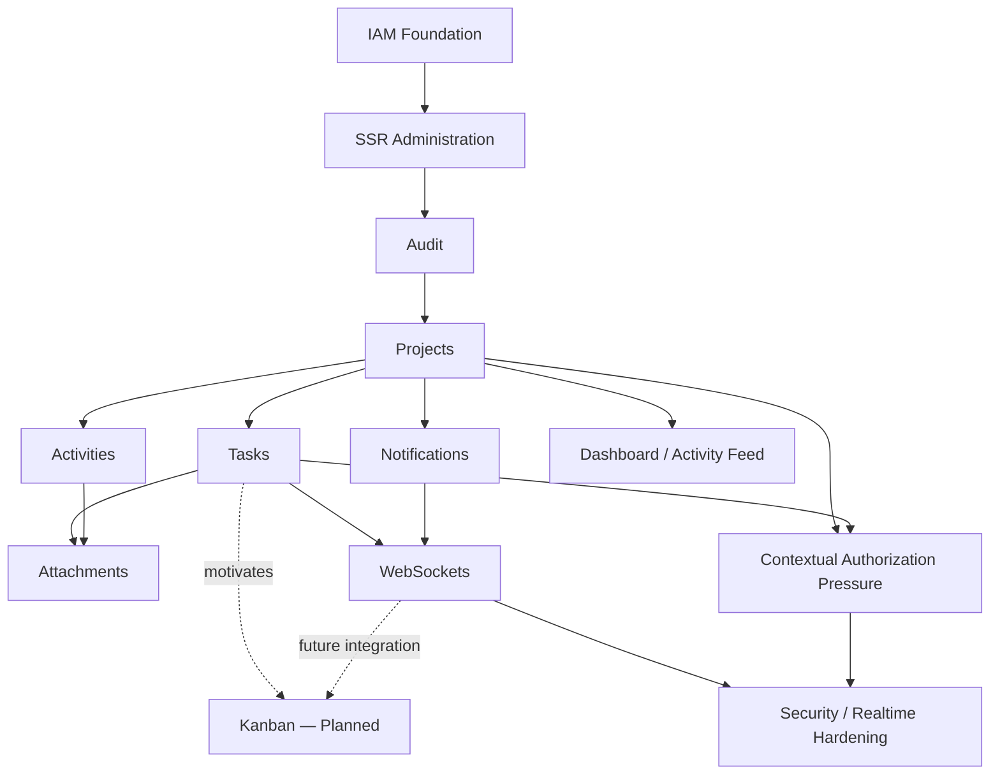

---

# 459. Functional Evolution Interpretation

El diagrama distingue dos tipos de relación:

```text
solid arrow
    implemented/evolution relationship

dashed arrow
    motivation or planned evolution
```

---

# 460. Why This Distinction Matters

Sin esta separación, la narrativa puede convertir:

```text
architectural intention
```

en:

```text
historical implementation.
```

---

# 461. Functional Evolution Pattern

El patrón dominante de la plataforma ha sido:

```text
implement useful capability

↓

discover new architectural pressure

↓

refactor shared foundation

↓

extend platform

↓

identify next capability.
```

---

# 462. Example — Projects

```text
Projects implemented

↓

project context appears

↓

authorization becomes context-sensitive

↓

ProjectMembership consolidation becomes necessary.
```

---

# 463. Example — Tasks

```text
Tasks implemented

↓

workflow states become important

↓

Kanban becomes valuable

↓

Kanban planned.
```

---

# 464. Example — WebSockets

```text
WebSockets implemented

↓

realtime awareness becomes possible

↓

disconnect/reconnect limitations become visible

↓

reliability hardening becomes necessary.
```

---

# 465. Example — Refresh Tokens

```text
Refresh tokens implemented

↓

automatic renewal added

↓

multiple cookie-setting paths exist

↓

cookie-policy consolidation becomes necessary.
```

---

# 466. Example — Attachments

```text
Attachments implemented

↓

binary lifecycle and authorization appear

↓

local storage supports current deployment

↓

object storage remains a future option.
```

---

# 467. Evolution Through Real Requirements

Estas secuencias muestran que la evolución no depende de:

```text
technology adoption for its own sake.
```

---

# 468. Architectural Pressure Model

```text
Functional Requirement

↓

Implementation

↓

Operational Experience

↓

New Constraint Discovered

↓

Architectural Improvement
```

---

# 469. Platform Evolution Quality

Este patrón permite que la arquitectura evolucione a partir de:

```text
observed requirements
```

en lugar de:

```text
speculative infrastructure.
```

---

# 470. Current Functional Baseline

Al finalizar esta etapa, la plataforma dispone de una base funcional formada por:

```text
IAM

SSR Administration

REST API

Audit

Projects

Tasks

Activities

Attachments

Notifications

Dashboard

Activity Feed

WebSockets
```

junto con otras capacidades auxiliares del dominio.

---

# 471. Current Security Baseline

```text
JWT Access Token

JWT Refresh Token

HTTPOnly Cookies

Explicit Refresh

Automatic Access Refresh

Global RBAC

Contextual Authorization Foundations

Audit
```

---

# 472. Current Frontend Baseline

```text
Jinja2 SSR

Bootstrap / AdminLTE

Modular JavaScript
```

---

# 473. Current Persistence Baseline

```text
SQLAlchemy

+

MariaDB
```

---

# 474. Current Realtime Baseline

```text
FastAPI WebSockets

+

in-memory Connection Manager

+

selected realtime features.
```

---

# 475. Current Deployment Baseline

```text
Docker

+

Docker Compose

+

Nginx

+

Ubuntu

+

Hetzner VPS
```

---

# 476. Current Quality Baseline

```text
Automated Testing

+

GitHub Actions
```

con cobertura todavía en evolución.

---

# 477. Active Evolution Areas

Las principales áreas todavía en consolidación incluyen:

```text
ProjectMembership

Contextual Authorization

CSRF Protection

Refresh-token Hardening

Cookie-policy Consistency

WebSocket Authentication

Subscription Authorization

Realtime Event Contracts

Reconnect

Reconciliation

UI Testing

Realtime Testing

SSR Performance.
```

---

# 478. Planned Product Evolution

Entre las siguientes capabilities de producto se encuentra:

```text
Kanban

+

Live Kanban.
```

---

# 479. Future / Conditional Architecture

Permanecen fuera de la arquitectura actual:

```text
PostgreSQL migration

SAML

Redis-backed distributed realtime

Kubernetes

Microservices

Object Storage migration

PWA

AI / RAG

Multi-tenancy.
```

---

# 480. Second-phase Historical Invariants

Esta etapa debe conservar las siguientes verdades:

```text
Projects are implemented.

Tasks are implemented.

Activities are implemented.

Attachments are implemented.

Notifications are implemented.

Dashboard is implemented.

Activity Feed is implemented.

Audit is implemented.

WebSockets are implemented.

Kanban is not yet an implemented UI.

Live Kanban is not current.

Contextual authorization is evolving.

ProjectMembership is not yet a fully consolidated current model.

MariaDB remains the current relational database.

PostgreSQL was not adopted.

SAML was not implemented.

Redis is not part of the current realtime architecture.

Kubernetes is not the current deployment architecture.
```

---

# 481. Second-phase Evolution Summary

La evolución funcional puede resumirse como:

```text
IAM

↓

SSR Administration

↓

Auditability

↓

Projects

↓

Collaborative Domains

↓

Tasks / Activities / Attachments

↓

Notifications / Dashboard / Activity Feed

↓

WebSockets

↓

Realtime and Contextual Security Pressure

↓

Current Hardening
```

mientras:

```text
Tasks

-. motivate .->

Kanban
    PLANNED
```

---

# 482. Main Architectural Result

El resultado no fue una sustitución del core tecnológico, sino una expansión controlada de:

```text
FastAPI

+

SQLAlchemy / MariaDB

+

Jinja2 SSR

+

JWT / RBAC

+

Modular Monolith
```

hacia una plataforma colaborativa con capabilities realtime.

---

# 483. Main Security Result

La seguridad evolucionó desde:

```text
authentication
```

hacia:

```text
authentication

+

global authorization

+

resource-aware authorization

+

browser security

+

realtime security.
```

---

# 484. Main Product Result

El producto evolucionó desde:

```text
identity administration
```

hacia:

```text
collaborative project and work management.
```

---

# 485. Main Realtime Result

Realtime evolucionó desde una necesidad de awareness hacia una capability implementada mediante WebSockets.

La siguiente evolución no consiste simplemente en:

```text
more WebSockets
```

sino en:

```text
more reliable

more secure

more testable

realtime behavior.
```

---

# 486. Main Architecture Lesson

La expansión funcional confirmó la utilidad del:

```text
Modular Monolith
```

como estrategia para crecer sin introducir prematuramente complejidad distribuida.

---

# 487. Main Authorization Lesson

La introducción de recursos project-scoped mostró que:

```text
global RBAC

is necessary

but not sufficient
```

para todos los workflows.

---

# 488. Main Frontend Lesson

La combinación:

```text
SSR

+

progressive JavaScript enhancement
```

permite aumentar interactividad sin exigir una reescritura completa como SPA.

---

# 489. Main Persistence Lesson

El crecimiento del dominio puede producir:

```text
schema complexity

query complexity

performance pressure
```

sin implicar necesariamente:

```text
database engine replacement.
```

---

# 490. Main Infrastructure Lesson

La complejidad operativa debe crecer únicamente cuando exista una necesidad que la justifique.

---

# 491. Main Documentation Lesson

Una arquitectura futura detalladamente diseñada sigue siendo:

```text
future architecture
```

hasta que se implemente.

---

# 492. Historical Integrity Check

La narrativa de esta segunda etapa debe superar siempre esta comprobación:

```text
Is this capability actually implemented?

or

did the implemented system merely create the need for it?
```

---

# 493. Correct Evolution Example

```text
WebSockets
    implemented

↓

reconnect problem
    discovered

↓

reconciliation
    target
```

---

# 494. Incorrect Evolution Example

```text
WebSockets
    implemented

↓

reconnect
    implemented

↓

reconciliation
    implemented
```

si esas últimas capabilities siguen en consolidación.

---

# 495. Correct Kanban Example

```text
Tasks
    implemented

↓

Task statuses
    implemented

↓

Kanban
    planned
```

---

# 496. Incorrect Kanban Example

```text
Tasks

↓

Kanban

↓

Realtime Kanban
```

como secuencia histórica completada.

---

# 497. Correct Database Example

```text
MariaDB

↓

more domain tables

↓

more relationships

↓

more complex queries

↓

optimization
```

---

# 498. Incorrect Database Example

```text
MariaDB

↓

PostgreSQL

↓

PostgreSQL standardization
```

porque no representa la evolución real.

---

# 499. Correct IAM Example

```text
JWT access

↓

JWT refresh

↓

HTTPOnly cookies

↓

automatic access renewal

↓

security hardening.
```

---

# 500. Incorrect IAM Example

```text
JWT

↓

SAML

↓

federated enterprise IAM
```

porque SAML continúa siendo futuro.

---

# 501. Current vs Next Evolution

El estado al final de esta parte puede expresarse como:

```text
CURRENT

collaborative modular platform
with IAM, project/work domains,
SSR, REST and WebSockets


NEXT

consolidate authorization,
security and realtime reliability


PLANNED PRODUCT

Kanban


FUTURE / CONDITIONAL

distributed and alternative infrastructure
only when justified.
```

---

# 502. Transition to Part 3

La siguiente etapa de la evolución debe analizar:

```text
architecture maturity

security maturity

testing evolution

DevOps

deployment

observability

technical debt

operational lessons

current platform baseline

future boundaries
```

sin convertir decisiones objetivo en historia implementada.

---

# 503. Part 2 Summary

La segunda fase consolidó el paso desde una foundation IAM hacia una plataforma colaborativa.

La evolución confirmada incluye:

```text
IAM

SSR Administration

Audit

Projects

Tasks

Activities

Attachments

Notifications

Dashboard

Activity Feed

WebSockets
```

La evolución parcial o en consolidación incluye:

```text
Contextual Authorization

ProjectMembership

Security Hardening

Realtime Reliability

Expanded Testing
```

La evolución planificada incluye:

```text
Kanban

Live Kanban
```

Y permanecen como futuras o condicionales:

```text
PostgreSQL

SAML

Redis

Kubernetes

Microservices

Object Storage

PWA

AI / RAG

Multi-tenancy.
```

---

# 504. Continuation

La **Parte 3/3** continúa con:

```text
Architecture Maturity

Security Maturity

Testing Evolution

CI/CD Evolution

Deployment Evolution

Observability

Operational Maturity

Technical Debt

Major Turning Points

Evolution Timeline

Current Architecture Baseline

Current vs Target vs Future

Future Evolution Boundaries

Project Evolution Principles

Final Evolution Map

Conclusions
```

---

# 57_PROJECT_EVOLUTION.md

# Aula Robótica Platform — Project Evolution

## Parte 3/3 — Madurez arquitectónica, seguridad, testing, DevOps, despliegue, observabilidad, deuda técnica, estado actual y límites de evolución futura

---

# 505. Architecture Maturity

La tercera gran dimensión de evolución del proyecto corresponde a:

```text
architectural maturity.
```

---

# 506. Architecture Maturity Meaning

La madurez arquitectónica no significa:

```text
adding more technologies.
```

Significa mejorar progresivamente:

```text
boundaries

responsibilities

consistency

security

testability

operability

maintainability.
```

---

# 507. Initial Architectural State

Las primeras fases estaban más próximas a:

```text
CRUD-oriented application

+

authentication foundation.
```

---

# 508. Current Architectural State

La arquitectura actual puede clasificarse como:

```text
Modular Monolith
```

con responsabilidades separadas entre:

```text
Web

API

Services

Security

Persistence

Realtime

Domain Modules.
```

---

# 509. Architectural Maturity Path

```text
CRUD-oriented structure

↓

Layered architecture

↓

Reusable services

↓

Domain separation

↓

Cross-cutting security

↓

Context-aware authorization

↓

Realtime capabilities

↓

Operational hardening
```

---

# 510. Layering Evolution

La separación progresiva de responsabilidades permitió reducir lógica mezclada dentro de:

```text
routes

templates

database access.
```

---

# 511. Router Responsibility

Los routers deben permanecer principalmente responsables de:

```text
request handling

input/output adaptation

dependency resolution

HTTP concerns.
```

---

# 512. Service Responsibility

Los services concentran:

```text
application behavior

business orchestration

domain operations.
```

---

# 513. Persistence Responsibility

La capa de persistencia encapsula:

```text
database access

queries

entity retrieval

persistence operations.
```

---

# 514. Security Responsibility

La seguridad concentra:

```text
authentication

authorization

token handling

security policies.
```

---

# 515. Realtime Responsibility

Realtime concentra:

```text
WebSocket connections

event delivery

connection lifecycle

realtime communication.
```

---

# 516. Architectural Result

Esta separación facilita:

```text
testing

maintenance

security review

future evolution.
```

---

# 517. Repository Pattern Evolution

El acceso a persistencia evolucionó hacia una separación más explícita mediante:

```text
Repository Pattern.
```

---

# 518. Repository Purpose

El repository evita que:

```text
database query details
```

se propaguen indiscriminadamente por:

```text
routers

services

UI logic.
```

---

# 519. Repository Architectural Value

Esto permite distinguir:

```text
application behavior

from

persistence mechanics.
```

---

# 520. Repository Guardrail

Repository Pattern no debe convertirse en:

```text
unnecessary abstraction
for every trivial operation.
```

---

# 521. Service Layer Evolution

Service Layer adquirió mayor importancia a medida que los workflows dejaron de ser CRUD simples.

---

# 522. Service Layer Benefit

Permite reutilizar comportamiento desde:

```text
API routes

SSR routes

background-capable workflows

tests.
```

---

# 523. Domain Growth Effect

La expansión funcional confirmó que:

```text
business behavior
```

no debía permanecer acoplado a:

```text
HTTP delivery mechanism.
```

---

# 524. Modular Monolith Maturity

La plataforma evolucionó internamente hacia módulos más claros sin abandonar:

```text
single deployable application.
```

---

# 525. Why This Remains Valuable

El Modular Monolith proporciona actualmente:

```text
low operational complexity

shared transactions

simple deployment

clear internal boundaries

incremental evolution.
```

---

# 526. Microservices Decision Boundary

La evolución arquitectónica no ha alcanzado un punto que obligue a adoptar:

```text
microservices.
```

---

# 527. Microservices Status

```text
Microservices
    CONDITIONAL / NOT CURRENT
```

---

# 528. Microservices Trigger

Solo deberían reconsiderarse si aparecen problemas reales como:

```text
independent scaling requirements

independent deployment ownership

strong domain autonomy

operational bottlenecks

team boundaries requiring independent lifecycle.
```

---

# 529. Security Maturity

La seguridad evolucionó desde una preocupación centrada en autenticación hacia un modelo transversal.

---

# 530. Security Evolution Path

```text
Authentication

↓

JWT

↓

Access + Refresh Tokens

↓

HTTPOnly Cookies

↓

Global RBAC

↓

Context-aware Authorization

↓

Browser Security Hardening

↓

Realtime Security Hardening
```

---

# 531. Current Authentication Baseline

Actualmente están implementados:

```text
JWT Access Token

JWT Refresh Token

HTTPOnly Cookies

Explicit Refresh Endpoint

Automatic Access Refresh

Logout Cookie Cleanup.
```

---

# 532. Authentication Status

```text
Authentication
    FUNCTIONAL / ADVANCED
```

---

# 533. Global Authorization Status

```text
Global RBAC
    FUNCTIONAL / MATURE
```

---

# 534. Context Authorization Status

```text
Contextual Authorization
    PARTIAL / IN PROGRESS
```

---

# 535. Session Hardening Status

```text
Session Hardening
    IN PROGRESS
```

---

# 536. Federated Identity Status

```text
SAML / Federated Identity
    FUTURE
```

---

# 537. Security Maturity Model

```text
Authentication
    CURRENT

Global RBAC
    CURRENT

Contextual Authorization
    PARTIAL

CSRF Hardening
    IN PROGRESS / PLANNED

Refresh-token Security Hardening
    IN PROGRESS / VERIFY

Cookie Policy Consolidation
    IN PROGRESS

WebSocket Security Hardening
    IN PROGRESS

Federated Identity
    FUTURE
```

---

# 538. Refresh-token Evolution

La implementación real incluye:

```text
refresh token generation

refresh token cookie

refresh validation

explicit refresh

automatic access renewal.
```

---

# 539. Refresh-token Security Boundary

La existencia de refresh tokens no implica automáticamente:

```text
rotation

server-side revocation

reuse detection

device/session inventory.
```

---

# 540. Refresh-token Hardening Direction

La siguiente evolución debe evaluar y consolidar:

```text
token rotation

revocation strategy

reuse detection

session lifecycle.
```

---

# 541. Cookie Security Evolution

La plataforma utiliza cookies:

```text
HTTPOnly
```

para los tokens del flujo browser.

---

# 542. Cookie Configuration Maturity

La configuración debe centralizarse para evitar diferencias entre:

```text
login token issuance

explicit refresh

middleware automatic refresh.
```

---

# 543. Cookie Security Attributes

La política centralizada debe controlar:

```text
HttpOnly

Secure

SameSite

Path

Max-Age / Expires.
```

---

# 544. Environment-aware Cookie Policy

La configuración debe ser coherente con:

```text
development

testing

production.
```

---

# 545. CSRF Evolution

El uso de cookies en operaciones browser exige tratar explícitamente:

```text
CSRF.
```

---

# 546. CSRF Current Position

La protección formal CSRF debe considerarse:

```text
IN PROGRESS / PLANNED
```

hasta verificar cobertura consistente en los workflows mutadores relevantes.

---

# 547. Contextual Authorization Evolution

Projects introdujo la necesidad de pasar de:

```text
global permission
```

a:

```text
global permission

+

resource context.
```

---

# 548. Contextual Authorization Target

El modelo debe evolucionar hacia políticas capaces de evaluar:

```text
actor

project

membership

resource

resource ancestry

requested operation.
```

---

# 549. ProjectMembership Role

La consolidación de:

```text
ProjectMembership
```

permitirá hacer explícita una relación que resulta central para autorización contextual.

---

# 550. ProjectMembership Status

```text
ProjectMembership
    TARGET / IN CONSOLIDATION
```

---

# 551. Cross-project Security

Una de las pruebas más importantes de madurez será demostrar sistemáticamente:

```text
Project A actor

cannot access

Project B protected resources
```

salvo autorización explícita.

---

# 552. WebSocket Security Evolution

Realtime amplía la frontera de seguridad más allá de HTTP.

---

# 553. WebSocket Security Requirements

Debe garantizarse:

```text
authenticated connection

authorized subscription

scope filtering

safe event delivery.
```

---

# 554. Realtime Security Maturity

```text
WebSocket Transport
    CURRENT

Authentication Hardening
    IN PROGRESS

Subscription Authorization
    IN PROGRESS / TARGET

Scope Isolation
    TARGET / HARDENING
```

---

# 555. Security Maturity Principle

La plataforma no debe calificarse como:

```text
security complete.
```

---

# 556. Better Security Description

Es más preciso describirla como:

```text
a platform with a substantial security foundation
and identified hardening work.
```

---

# 557. Testing Evolution

Testing evolucionó desde pruebas de funcionalidad concreta hacia una preocupación transversal.

---

# 558. Testing Purpose

La suite debe proteger:

```text
behavior

security

domain invariants

regressions

critical workflows.
```

---

# 559. Testing Layers

La estrategia contempla progresivamente:

```text
unit tests

service tests

repository tests

API tests

authorization tests

UI tests

realtime tests.
```

---

# 560. Automated Testing Status

```text
Automated Testing
    CURRENT
```

---

# 561. Coverage Status

La cobertura no debe considerarse:

```text
complete.
```

---

# 562. Testing Evolution Model

```text
Basic Functional Tests

↓

Service / API Coverage

↓

Security Tests

↓

Context Authorization Tests

↓

UI Tests

↓

Realtime Tests
```

---

# 563. Authorization Testing Importance

El crecimiento de contextual authorization hace especialmente importantes los tests negativos.

---

# 564. Positive Test

```text
authorized actor
can access resource.
```

---

# 565. Negative Test

```text
unauthorized actor
cannot access resource.
```

---

# 566. Cross-project Test

```text
actor with access to Project A

cannot access

resource belonging to Project B.
```

---

# 567. Security Test Value

Los tests negativos protegen boundaries que pueden no ser visibles mediante pruebas funcionales felices.

---

# 568. Realtime Testing Evolution

WebSockets introducen escenarios que no aparecen en HTTP convencional.

---

# 569. Realtime Test Scenarios

```text
connect

authenticate

subscribe

receive event

disconnect

reconnect

multiple clients

unauthorized scope

state reconciliation.
```

---

# 570. Realtime Testing Status

```text
Realtime Testing Foundation
    CURRENT / PARTIAL

Coverage Expansion
    IN PROGRESS / PLANNED
```

---

# 571. UI Testing Evolution

El crecimiento de SSR y JavaScript modular introduce workflows browser que necesitan validación.

---

# 572. UI Testing Focus

La prioridad debe situarse en:

```text
critical user journeys

authorization-sensitive actions

high-value mutations

regression-prone workflows.
```

---

# 573. UI Testing Status

```text
UI Testing Foundation
    CURRENT

Coverage Expansion
    IN PROGRESS / PLANNED
```

---

# 574. Testing Maturity Principle

No es necesario convertir cada comportamiento en:

```text
end-to-end test.
```

---

# 575. Testing Pyramid Direction

La estrategia debe equilibrar:

```text
many focused tests

+

fewer integration tests

+

selected end-to-end workflows.
```

---

# 576. CI Evolution

La automatización del proyecto evolucionó mediante:

```text
GitHub Actions.
```

---

# 577. CI Current Status

```text
GitHub Actions
    CURRENT
```

---

# 578. CI Responsibilities

El pipeline puede ejecutar controles como:

```text
tests

linting

static analysis

quality checks.
```

---

# 579. Quality Gate Evolution

La automatización permite convertir ciertas reglas de calidad en:

```text
repeatable repository checks.
```

---

# 580. CI Architectural Value

Esto reduce dependencia de:

```text
manual developer memory.
```

---

# 581. Continuous Delivery Boundary

Debe diferenciarse:

```text
CI automation
```

de:

```text
fully automated production CD.
```

---

# 582. Current CI/CD Interpretation

```text
CI
    CURRENT

GitHub Actions
    CURRENT

Production deployment automation
    EVOLVING / VERIFY

Fully automated CD
    not assumed.
```

---

# 583. Static Analysis Evolution

La calidad del código puede apoyarse en herramientas de análisis estático integradas en el workflow.

---

# 584. Static Analysis Purpose

Permite detectar:

```text
code smells

maintainability issues

potential defects

quality regressions.
```

---

# 585. Static Analysis Principle

Una herramienta automática complementa:

```text
engineering judgment
```

pero no lo sustituye.

---

# 586. Dependency Evolution

La gestión de dependencias también forma parte de la madurez operativa.

---

# 587. Dependency Principle

Las dependencias deben mantenerse:

```text
explicit

reproducible

reviewable.
```

---

# 588. Deployment Evolution

La aplicación evolucionó desde ejecución de desarrollo hacia despliegue containerizado.

---

# 589. Docker

Docker proporciona:

```text
application packaging

runtime consistency

deployment reproducibility.
```

Estado:

```text
CURRENT
```

---

# 590. Docker Compose

Docker Compose permite coordinar:

```text
application services

database

supporting containers.
```

Estado:

```text
CURRENT
```

---

# 591. Nginx

Nginx actúa como parte de la arquitectura de despliegue.

Estado:

```text
CURRENT
```

---

# 592. Server Environment

El entorno operativo actual incluye:

```text
Ubuntu

Hetzner VPS.
```

---

# 593. Deployment Baseline

```text
Internet

↓

Nginx

↓

Containerized FastAPI Application

↓

MariaDB

+

Persistent Storage
```

---

# 594. Deployment Diagram

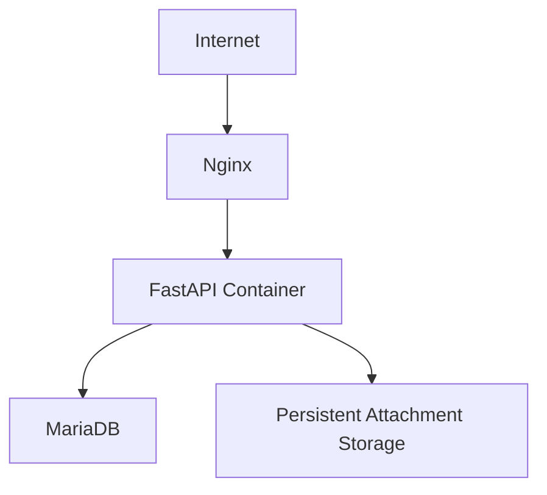

---

# 595. Deployment Maturity

El despliegue containerizado representa un avance importante respecto a:

```text
development-only execution.
```

---

# 596. Persistence Operational Requirement

El uso de contenedores no debe convertir los datos en:

```text
ephemeral container state.
```

---

# 597. Persistent Data

Deben persistir adecuadamente:

```text
database data

attachments

configuration where appropriate

operational artifacts where required.
```

---

# 598. Backup Evolution

La madurez operativa requiere no solo persistencia sino:

```text
backup

restore.
```

---

# 599. Backup Principle

```text
A backup that has never been restored
is not fully validated.
```

---

# 600. Restore Validation

La evolución operativa debe incluir:

```text
documented restore procedures

+

periodic restore validation.
```

---

# 601. Kubernetes Boundary

El despliegue actual no utiliza Kubernetes.

---

# 602. Kubernetes Status

```text
Kubernetes
    CONDITIONAL / NOT CURRENT
```

---

# 603. Kubernetes Trigger

Solo debería reconsiderarse si aparecen requisitos como:

```text
multi-node orchestration

large-scale horizontal deployment

complex service topology

operational requirements that Compose cannot satisfy.
```

---

# 604. Observability Evolution

A medida que la aplicación madura, también debe evolucionar la capacidad de entender su comportamiento en ejecución.

---

# 605. Observability Dimensions

La observabilidad puede incluir:

```text
logs

metrics

traces

health information

correlation identifiers.
```

---

# 606. Logging

Logging proporciona evidencia operativa sobre:

```text
application behavior

errors

security-relevant events

runtime conditions.
```

---

# 607. Structured Logging Direction

La evolución hacia logging estructurado facilita:

```text
search

filtering

correlation

automation.
```

---

# 608. Request Correlation

Los correlation IDs permiten relacionar:

```text
request

logs

errors

downstream operations.
```

---

# 609. Observability Maturity

La observabilidad debe considerarse:

```text
an evolving operational capability
```

y no necesariamente una plataforma distribuida completa de tracing y métricas.

---

# 610. Avoid Observability Inflation

La existencia de logs no implica automáticamente:

```text
full distributed tracing

centralized metrics platform

enterprise observability stack.
```

---

# 611. Operational Maturity

La evolución técnica del proyecto debe incluir también su capacidad de:

```text
run reliably

recover

diagnose

deploy safely.
```

---

# 612. Operational Maturity Dimensions

```text
deployment

configuration

secrets

backups

restore

logging

monitoring

health checks

incident diagnosis.
```

---

# 613. Environment Configuration

La configuración debe permanecer:

```text
externalized where appropriate
```

en lugar de estar codificada directamente en la aplicación.

---

# 614. Secrets Principle

Secrets no deben almacenarse como:

```text
hard-coded source values.
```

---

# 615. Environment Separation

La evolución operativa debe mantener diferencias controladas entre:

```text
development

testing

production.
```

---

# 616. Configuration Consistency

Las diferencias entre entornos deben ser:

```text
intentional

documented

minimal where possible.
```

---

# 617. Database Evolution

El crecimiento operativo y funcional se ha producido sobre:

```text
MariaDB.
```

---

# 618. MariaDB Current State

```text
MariaDB
    CURRENT
```

---

# 619. PostgreSQL Historical Correction

No se realizó una evolución histórica:

```text
MariaDB

↓

PostgreSQL.
```

---

# 620. PostgreSQL Correct Status

```text
PostgreSQL
    FUTURE / CANDIDATE
```

---

# 621. PostgreSQL Evaluation Trigger

Una migración solo debería evaluarse ante:

```text
specific technical requirements

measurable operational benefit

feature requirements

scaling requirements

or strategic constraints.
```

---

# 622. Database Migration Principle

No debe realizarse una migración únicamente porque:

```text
another database is perceived as more standard.
```

---

# 623. Migration Cost

Una migración real implicaría revisar:

```text
schema

types

constraints

queries

migrations

tests

backups

restore

deployment

operational procedures.
```

---

# 624. Migration Validation

Por tanto una migración futura debería tratarse como:

```text
explicit engineering project.
```

---

# 625. Database Evolution Reality

La evolución real ha sido:

```text
MariaDB

↓

more tables

↓

more relationships

↓

more domain complexity

↓

more query complexity

↓

optimization and integrity work.
```

---

# 626. Performance Evolution

La expansión funcional introduce necesidades de rendimiento.

---

# 627. Performance Principle

La optimización debe basarse en:

```text
measurement

profiling

observed bottlenecks.
```

---

# 628. Avoid Premature Optimization

No debe añadirse infraestructura compleja únicamente por:

```text
anticipated scale.
```

---

# 629. Query Performance

SSR y Dashboard pueden generar presión mediante:

```text
repeated queries

N+1 patterns

large collections

expensive joins

aggregations.
```

---

# 630. Query Optimization Direction

La evolución puede incluir:

```text
eager loading

query consolidation

pagination

indexes

request-context reuse.
```

---

# 631. Pagination

La paginación debe incorporarse donde:

```text
collection size
```

pueda crecer significativamente.

---

# 632. Caching Boundary

Caching no debe añadirse automáticamente a cada lectura.

---

# 633. Cache Trigger

Debe introducirse cuando exista:

```text
measured repeated cost

+

acceptable consistency semantics.
```

---

# 634. Redis Is Not Current Cache Infrastructure

La plataforma no debe describirse actualmente como:

```text
Redis-backed.
```

---

# 635. Redis Status

```text
Redis
    CONDITIONAL
```

---

# 636. Horizontal Scaling Boundary

La arquitectura actual está optimizada principalmente para:

```text
single-instance deployment.
```

---

# 637. Horizontal Scaling Trigger

La evolución hacia múltiples instancias requeriría revisar:

```text
WebSocket coordination

shared state

session assumptions

file storage

deployment

load balancing.
```

---

# 638. Distributed Realtime Trigger

Con múltiples instancias podría ser necesario:

```text
broker / pub-sub infrastructure.
```

---

# 639. Object Storage Trigger

Con múltiples instancias también podría ser necesario sustituir almacenamiento local por:

```text
shared object storage.
```

---

# 640. Scaling Evolution Principle

```text
scale when required

not

because distributed architecture appears more advanced.
```

---

# 641. Technical Debt Evolution

La evolución del proyecto genera inevitablemente:

```text
technical debt.
```

---

# 642. Technical Debt Meaning

Technical debt incluye:

```text
known implementation compromises

missing hardening

incomplete abstractions

test gaps

consistency gaps.
```

---

# 643. Technical Debt Is Not Failure

La existencia de deuda técnica no significa que la arquitectura sea incorrecta.

---

# 644. Healthy Technical Debt Management

Una plataforma madura debe:

```text
identify

document

prioritize

reduce
```

su deuda técnica.

---

# 645. Current High-value Debt Areas

Entre las áreas relevantes se encuentran:

```text
contextual authorization consistency

ProjectMembership consolidation

CSRF protection

refresh-token hardening

cookie policy consistency

WebSocket security

reconnect

reconciliation

testing gaps

query optimization.
```

---

# 646. Technical Debt Prioritization

La prioridad debe depender de:

```text
security impact

correctness impact

operational risk

development friction

user impact.
```

---

# 647. Security Debt Priority

La deuda relacionada con:

```text
authorization

authentication

browser security

realtime security
```

debe recibir prioridad elevada.

---

# 648. Architecture Debt Priority

La deuda arquitectónica debe priorizarse cuando:

```text
it repeatedly increases implementation cost
or creates correctness risk.
```

---

# 649. Current Hardening Cycle

La plataforma se encuentra en una etapa donde gran parte del valor técnico procede de:

```text
consolidating existing capabilities
```

antes de ampliar indiscriminadamente el stack.

---

# 650. Hardening Areas

```text
Authorization

Security

Realtime Reliability

Testing

Performance

Operational Consistency
```

---

# 651. Hardening vs Feature Growth

Una plataforma madura debe equilibrar:

```text
new capabilities

+

existing capability hardening.
```

---

# 652. Major Turning Points

La evolución completa contiene varios turning points relevantes.

---

# 653. Turning Point 1 — Eurobot Analysis

```text
Initial environment analysis
```

permitió identificar la necesidad de IAM.

---

# 654. Turning Point 2 — IAM Proposal

El proyecto comenzó como:

```text
authentication and authorization infrastructure
for Eurobot Spain.
```

---

# 655. Turning Point 3 — Scope Expansion

El alcance cambió hacia:

```text
Aula Robótica transversal platform.
```

---

# 656. Turning Point 4 — Layered Architecture

La estructura evolucionó desde CRUD hacia:

```text
separated application layers.
```

---

# 657. Turning Point 5 — Modular Monolith

Los dominios comenzaron a organizarse dentro de:

```text
clear internal modules.
```

---

# 658. Turning Point 6 — Browser Administration

Jinja2 y AdminLTE consolidaron:

```text
SSR administration
```

junto a REST.

---

# 659. Turning Point 7 — Refresh-token Workflow

La autenticación evolucionó a:

```text
Access + Refresh Tokens

+

HTTPOnly Cookies

+

automatic renewal.
```

---

# 660. Turning Point 8 — Projects

Projects introdujo una boundary funcional y de seguridad central.

---

# 661. Turning Point 9 — Contextual Authorization Need

La plataforma descubrió que:

```text
Global RBAC alone
```

no cubría todas las reglas de recursos project-scoped.

---

# 662. Turning Point 10 — Collaborative Domains

Tasks, Activities y Attachments transformaron la aplicación en una plataforma más colaborativa.

---

# 663. Turning Point 11 — Awareness Layer

Notifications, Dashboard y Activity Feed aumentaron la visibilidad del estado de la plataforma.

---

# 664. Turning Point 12 — WebSockets

Realtime dejó de ser únicamente una idea futura y se incorporó mediante:

```text
FastAPI WebSockets.
```

---

# 665. Turning Point 13 — Realtime Reliability

La implementación realtime mostró la necesidad de:

```text
reconnect

reconciliation

event contracts

subscription authorization.
```

---

# 666. Turning Point 14 — Kanban Requirement

El workflow de Tasks motivó:

```text
Kanban
```

como siguiente capability de producto.

Estado:

```text
PLANNED
```

---

# 667. Turning Point 15 — Security Hardening

La combinación de:

```text
cookies

contextual resources

WebSockets
```

amplió las necesidades de seguridad.

---

# 668. Turning Point 16 — Operational Maturity

Docker, Compose, Nginx, CI y VPS consolidaron la plataforma como:

```text
deployable software
```

y no únicamente como proyecto de desarrollo local.

---

# 669. Turning Point 17 — Documentation Maturity

La documentación evolucionó hacia un corpus capaz de describir:

```text
architecture

security

modules

operations

testing

history

future evolution.
```

---

# 670. Documentation Risk

La profundidad documental introdujo también un nuevo riesgo:

```text
documented target architecture
being mistaken for implemented architecture.
```

---

# 671. Documentation Maturity Lesson

Una documentación profesional debe distinguir:

```text
CURRENT

PARTIAL

TARGET

PLANNED

FUTURE

CONDITIONAL.
```

---

# 672. Evolution Timeline

La evolución conceptual puede representarse mediante una secuencia de etapas.

---

# 673. Stage 1 — Analysis

```text
Eurobot Spain ecosystem analysis.
```

---

# 674. Stage 2 — IAM Foundation

```text
Users

Identity

Roles

JWT

MariaDB.
```

---

# 675. Stage 3 — Administration

```text
REST API

+

Jinja2 / AdminLTE SSR.
```

---

# 676. Stage 4 — Architecture Refactoring

```text
Layer separation

Services

Repositories

Security

Modularization.
```

---

# 677. Stage 5 — Platform Expansion

```text
Eurobot-specific system

↓

Aula Robótica Platform.
```

---

# 678. Stage 6 — Collaborative Domains

```text
Projects

Tasks

Activities

Attachments.
```

---

# 679. Stage 7 — Awareness

```text
Notifications

Activity Feed

Dashboard

Audit.
```

---

# 680. Stage 8 — Realtime

```text
FastAPI WebSockets

+

in-memory Connection Manager

+

selected realtime workflows.
```

---

# 681. Stage 9 — Hardening

```text
Context Authorization

CSRF

Refresh Security

Cookie Consistency

WebSocket Security

Testing

Realtime Reliability.
```

---

# 682. Stage 10 — Planned Product Evolution

```text
Kanban

Live Kanban.
```

---

# 683. Stage 11 — Conditional Future Evolution

Potential capabilities only when justified:

```text
PostgreSQL

SAML

Redis

Object Storage

Kubernetes

Microservices

PWA

AI / RAG

Multi-tenancy.
```

---

# 684. Evolution Timeline Diagram

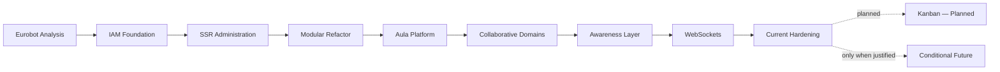

---

# 685. Timeline Interpretation

El timeline representa:

```text
conceptual evolution
```

y no necesariamente:

```text
one formal release per stage.
```

---

# 686. Current Architecture Baseline

La arquitectura actual confirmada puede resumirse como:

```text
Modular Monolith

FastAPI

SQLAlchemy

MariaDB

REST API

Jinja2 SSR

Bootstrap / AdminLTE

Modular JavaScript

JWT Access + Refresh Tokens

HTTPOnly Cookies

Global RBAC

Partial Contextual Authorization

Audit

WebSockets

Docker

Docker Compose

Nginx

Ubuntu

Hetzner VPS

GitHub Actions

Automated Testing.
```

---

# 687. Current Architecture Diagram

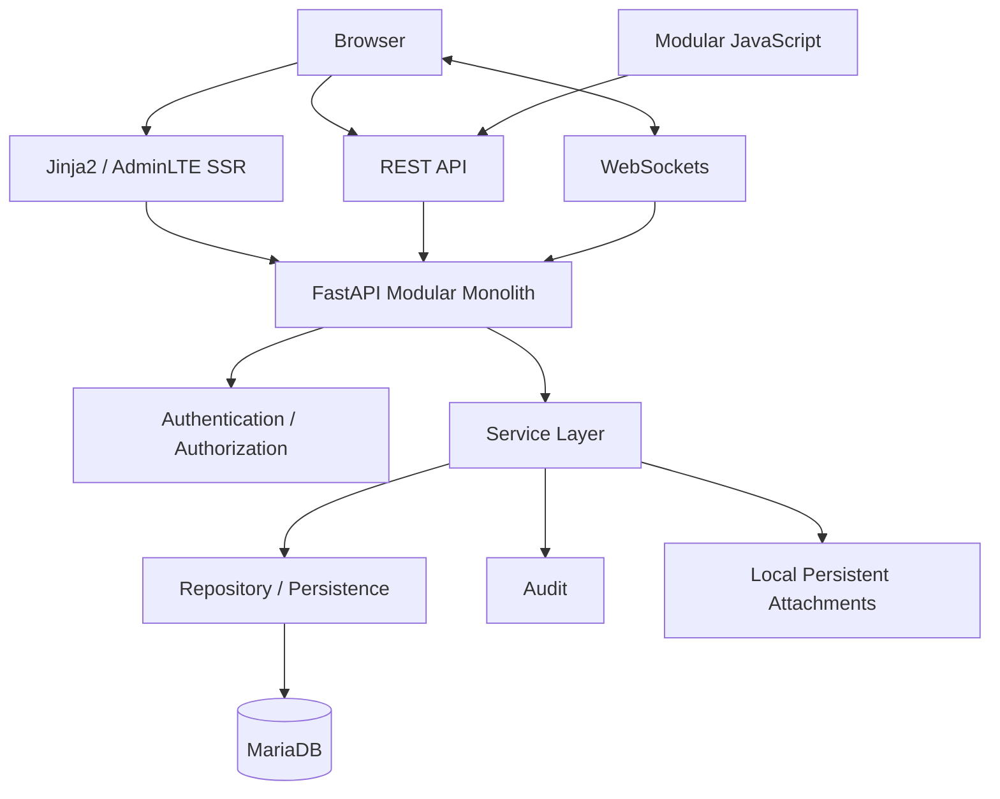

---

# 688. Current Architecture Is Not Target Architecture

El baseline anterior debe distinguirse de capabilities que todavía se encuentran en evolución.

---

# 689. Partial / In-progress Architecture

```text
Contextual Authorization

ProjectMembership consolidation

CSRF Protection

Refresh-token Hardening

Cookie-policy Consistency

WebSocket Authentication Hardening

Subscription Authorization

Realtime Event Contract

Reconnect

Reconciliation

Expanded UI / Realtime Testing

SSR Query Optimization.
```

---

# 690. Planned Architecture

```text
Kanban

Authorized Kanban Status Mutation

Drag & Drop Kanban

Live Kanban.
```

---

# 691. Future Architecture

```text
SAML

PWA

AI / RAG.
```

---

# 692. Conditional Architecture

```text
PostgreSQL migration

Redis

Object Storage

Kubernetes

Microservices

Multi-tenancy

Horizontal Scaling.
```

---

# 693. Why Conditional Matters

`CONDITIONAL` significa:

```text
not automatically on the roadmap.
```

---

# 694. Conditional Trigger Principle

Una capability condicional solo debe avanzar cuando exista:

```text
specific problem

+

measurable benefit

+

acceptable complexity.
```

---

# 695. PostgreSQL Future Boundary

PostgreSQL no debe convertirse en:

```text
default future destination
```

sin evaluación.

---

# 696. PostgreSQL Decision Rule

```text
Stay on MariaDB

unless

a concrete requirement justifies migration.
```

---

# 697. Redis Future Boundary

Redis no debe incorporarse únicamente para:

```text
appear scalable.
```

---

# 698. Redis Decision Rule

```text
Use in-memory realtime coordination

until

multiple processes/instances require shared coordination.
```

---

# 699. Kubernetes Future Boundary

Kubernetes no debe incorporarse mientras:

```text
Docker Compose + VPS
```

resuelva adecuadamente el problema operativo.

---

# 700. Microservices Future Boundary

Microservices no deben introducirse mientras:

```text
Modular Monolith
```

permita mantener boundaries y deployment adecuados.

---

# 701. Object Storage Future Boundary

El almacenamiento local puede mantenerse mientras:

```text
single-instance deployment

storage capacity

backup model

durability requirements
```

lo permitan.

---

# 702. PWA Future Boundary

PWA puede evaluarse cuando exista una necesidad real de:

```text
installability

offline behavior

mobile-oriented experience.
```

---

# 703. AI / RAG Future Boundary

AI/RAG debe permanecer:

```text
FUTURE / EXPERIMENTAL
```

hasta existir un caso de uso concreto.

---

# 704. AI Adoption Principle

No debe incorporarse IA únicamente porque:

```text
AI capability is technologically available.
```

---

# 705. AI Requirement

Una futura capability de IA debería demostrar:

```text
user value

data suitability

security

privacy

evaluation criteria

operational feasibility.
```

---

# 706. Multi-tenancy Boundary

Multi-tenancy no debe inferirse automáticamente de la existencia de:

```text
Projects

Teams

multiple users.
```

---

# 707. Multi-tenancy Status

```text
Multi-tenancy
    FUTURE / CONDITIONAL
```

---

# 708. Multi-tenancy Trigger

Solo tendría sentido ante necesidad de aislar:

```text
independent organizations

data ownership

administrative boundaries

configuration boundaries.
```

---

# 709. Current vs Future Matrix

| Area | Current | Evolving / Planned | Future / Conditional |
| :--- | :--- | :--- | :--- |
| Database | MariaDB | Query/schema optimization | PostgreSQL candidate |
| Authentication | JWT Access + Refresh | Refresh hardening | Federated identity |
| Authorization | Global RBAC | Context Authorization / ProjectMembership | Advanced policy evolution |
| Browser Security | HTTPOnly Cookies | CSRF / cookie consistency | Additional hardening as needed |
| Frontend | Jinja2 SSR + Modular JS | Kanban | PWA |
| Realtime | FastAPI WebSockets | Reconnect / reconciliation / subscription auth | Redis/distributed realtime |
| Storage | Local persistent files | Lifecycle hardening | Object storage |
| Deployment | Docker Compose + VPS | Operational automation | Kubernetes |
| Architecture | Modular Monolith | Internal modularity | Microservices if justified |
| Intelligence | Traditional application logic | — | AI / RAG |
| Tenancy | Shared platform | — | Multi-tenancy if required |

---

# 710. Product Evolution Principle

El futuro del producto debe estar guiado por:

```text
user needs

operational needs

security needs

measured technical constraints.
```

---

# 711. Architecture Evolution Principle

La arquitectura debe evolucionar mediante:

```text
evidence-driven decisions.
```

---

# 712. Technology Adoption Principle

Una nueva tecnología debe responder:

```text
Which current problem does this solve?

Why is the current architecture insufficient?

What new complexity does it introduce?

How will success be measured?
```

---

# 713. Simplicity Principle

La solución preferida debe ser:

```text
the simplest architecture
that satisfies current requirements
without blocking credible near-term evolution.
```

---

# 714. Reversibility Principle

Cuando sea posible, las decisiones deben mantener:

```text
reasonable reversibility.
```

---

# 715. Abstraction Principle

Las abstracciones deben introducirse cuando:

```text
they protect a meaningful boundary
or remove repeated complexity.
```

---

# 716. Avoid Speculative Abstraction

No deben crearse abstracciones únicamente para:

```text
possible hypothetical future requirements.
```

---

# 717. Security-first Evolution

La evolución de nuevas features no debe debilitar:

```text
authorization

data isolation

authentication

auditability.
```

---

# 718. Server Authority Principle

El servidor continúa siendo la autoridad para:

```text
authorization

validation

business rules

persistent state.
```

---

# 719. Client Role

El cliente puede mejorar:

```text
interaction

feedback

realtime awareness
```

pero no debe convertirse en autoridad de seguridad.

---

# 720. Realtime Authority Principle

WebSockets no deben convertirse en:

```text
the authoritative data store.
```

---

# 721. Persistence Authority Principle

La verdad de dominio permanece en:

```text
validated persistent server state.
```

---

# 722. Audit Principle

Los cambios relevantes deben mantener suficiente trazabilidad para:

```text
understand

diagnose

review
```

el comportamiento del sistema.

---

# 723. Testing Principle

Las nuevas capabilities deben incorporar testing proporcional a:

```text
risk

complexity

security impact.
```

---

# 724. Deployment Principle

Una feature no está completamente madura únicamente porque:

```text
it works locally.
```

---

# 725. Operational Completion

También debe considerarse:

```text
configuration

deployment

logging

failure behavior

backup implications

monitoring.
```

---

# 726. Documentation Principle

La documentación debe evolucionar junto con:

```text
code

architecture

operations.
```

---

# 727. Documentation Truth Principle

Pero:

```text
documentation must describe reality

not manufacture reality.
```

---

# 728. Architecture Decision Traceability

Las decisiones relevantes deben conservar:

```text
context

decision

reason

consequences

status.
```

---

# 729. Historical Traceability

La historia del proyecto debe conservar:

```text
what changed

why it changed

what problem it solved.
```

---

# 730. Future Traceability

Las propuestas futuras deben conservar:

```text
trigger

expected benefit

cost

risk

reversibility.
```

---

# 731. Evolution and Technical Debt

No toda deuda debe resolverse inmediatamente.

---

# 732. Debt Decision Rule

La deuda debe priorizarse cuando:

```text
risk

or

repeated cost
```

supera el coste de resolverla.

---

# 733. Security Debt Exception

La deuda con impacto de seguridad requiere una evaluación más estricta y normalmente mayor prioridad.

---

# 734. Current Priority Direction

La evolución inmediata debe centrarse principalmente en consolidar:

```text
contextual authorization

browser security

refresh-token security

realtime security

realtime reliability

testing.
```

---

# 735. Why Hardening Comes First

Estas áreas afectan:

```text
correctness

security

future feature safety.
```

---

# 736. Kanban Dependency

Kanban se beneficiará directamente de:

```text
stable contextual authorization

safe state mutation

reliable realtime foundations.
```

---

# 737. Kanban Correct Evolution Path

```text
Project Authorization

↓

SSR Board

↓

Authorized Status Mutation

↓

JavaScript Drag & Drop

↓

Realtime Event Integration

↓

Reconnect / Reconciliation

↓

Live Kanban
```

---

# 738. Kanban Status Reminder

El diagrama anterior representa:

```text
planned evolution
```

y no historia ya completada.

---

# 739. Future Scaling Path

Una posible evolución de escalado podría ser:

```text
Single Instance

↓

Measured Capacity Pressure

↓

Horizontal Scaling Requirement

↓

Shared Realtime Coordination

↓

Shared File Storage

↓

More Advanced Orchestration
```

---

# 740. Scaling Status Reminder

Ese camino es:

```text
CONDITIONAL
```

y no una secuencia comprometida.

---

# 741. Future Database Path

Una posible evaluación futura podría ser:

```text
MariaDB

↓

Requirement Analysis

↓

Migration Cost Analysis

↓

Proof of Compatibility

↓

Decision

↓

Optional PostgreSQL Migration
```

---

# 742. Database Status Reminder

Actualmente:

```text
MariaDB remains the production/current relational database.
```

---

# 743. Future Identity Path

Una posible evolución de identidad podría ser:

```text
Current JWT IAM

↓

External Identity Requirement

↓

Protocol Evaluation

↓

Optional SAML / OIDC Integration
```

---

# 744. Identity Status Reminder

Actualmente:

```text
SAML is not implemented.
```

---

# 745. Future AI Path

Una posible evolución responsable sería:

```text
Concrete Use Case

↓

Data Evaluation

↓

Privacy / Security Review

↓

Prototype

↓

Quality Evaluation

↓

Operational Decision.
```

---

# 746. AI Status Reminder

Actualmente:

```text
AI / RAG
    FUTURE / EXPERIMENTAL
```

---

# 747. Evolution Success Criteria

La evolución futura debe mejorar al menos una dimensión relevante:

```text
user value

security

reliability

maintainability

performance

operability.
```

---

# 748. Architecture Success Criteria

Una evolución arquitectónica debe evitar introducir complejidad cuyo coste sea mayor que el problema resuelto.

---

# 749. Platform Maturity Model

La plataforma puede interpretarse mediante cinco dimensiones.

---

# 750. Functional Maturity

```text
HIGH / GROWING
```

debido a la existencia de múltiples dominios funcionales implementados.

---

# 751. Architectural Maturity

```text
STRONG
```

por la evolución hacia:

```text
Modular Monolith

layering

services

repositories

cross-cutting foundations.
```

---

# 752. Security Maturity

```text
FUNCTIONAL WITH ACTIVE HARDENING
```

debido a:

```text
JWT

refresh tokens

HTTPOnly cookies

RBAC

partial contextual authorization

identified browser/realtime hardening.
```

---

# 753. Realtime Maturity

```text
FUNCTIONAL / EVOLVING
```

porque:

```text
WebSockets are current

but reliability and authorization hardening continue.
```

---

# 754. Operational Maturity

```text
FUNCTIONAL / EVOLVING
```

por la existencia de:

```text
Docker

Compose

Nginx

VPS deployment

CI
```

junto con necesidades continuas de:

```text
observability

backup validation

deployment hardening.
```

---

# 755. Testing Maturity

```text
FUNCTIONAL / EXPANDING
```

porque existe automatización, pero permanecen áreas de cobertura prioritarias.

---

# 756. Documentation Maturity

```text
HIGH
```

siempre que se mantenga la separación entre:

```text
implemented

and

target architecture.
```

---

# 757. Current Platform Snapshot

```text
Aula Robótica Platform

Architecture
    Modular Monolith

Backend
    FastAPI

Persistence
    SQLAlchemy + MariaDB

Web
    Jinja2 SSR
    Bootstrap / AdminLTE
    Modular JavaScript

API
    REST

Authentication
    JWT Access Token
    JWT Refresh Token
    HTTPOnly Cookies
    Explicit Refresh
    Automatic Refresh

Authorization
    Global RBAC
    Contextual Authorization PARTIAL

Realtime
    FastAPI WebSockets
    In-memory Connection Manager

Core Domains
    IAM
    Projects
    Tasks
    Activities
    Attachments
    Notifications
    Dashboard
    Activity Feed
    Audit

Deployment
    Docker
    Docker Compose
    Nginx
    Ubuntu
    Hetzner VPS

Automation
    GitHub Actions
    Automated Testing
```

---

# 758. Active Consolidation Snapshot

```text
ProjectMembership

Contextual Authorization

Cross-project Authorization Tests

CSRF

Refresh-token Security Hardening

Cookie Policy Consistency

WebSocket Authentication

Subscription Authorization

Realtime Event Contract

Reconnect

State Reconciliation

UI Test Expansion

Realtime Test Expansion

SSR Query Optimization.
```

---

# 759. Planned Snapshot

```text
Kanban

Kanban Status Mutation

Drag & Drop

Live Kanban.
```

---

# 760. Future Snapshot

```text
SAML

PWA

AI / RAG.
```

---

# 761. Conditional Snapshot

```text
PostgreSQL

Redis

Object Storage

Kubernetes

Microservices

Multi-tenancy

Horizontal Scaling.
```

---

# 762. What Should Not Be Rewritten as History

Future documentation must not retrospectively claim:

```text
PostgreSQL migration completed

SAML integration completed

Kanban completed

Live Kanban completed

Redis adopted

Kubernetes adopted

Microservices adopted

Object storage adopted

Multi-tenancy completed.
```

---

# 763. What Is Valid Historical Evolution

It is valid to state that the project evolved through:

```text
IAM

SSR

Modular Monolith

Projects

Tasks

Activities

Attachments

Audit

Notifications

Dashboard

Activity Feed

WebSockets

Dockerized Deployment

CI.
```

---

# 764. What Is Valid Partial Evolution

It is valid to state that the platform is evolving toward stronger:

```text
contextual authorization

browser security

session security

realtime reliability

realtime authorization

test coverage.
```

---

# 765. What Is Valid Planned Evolution

It is valid to state:

```text
Kanban is a planned evolution
of the current Task workflow.
```

---

# 766. What Is Valid Conditional Evolution

It is valid to state:

```text
PostgreSQL may be evaluated
if future requirements justify migration.
```

Lo mismo se aplica a:

```text
Redis

Kubernetes

Microservices

Object Storage

Multi-tenancy.
```

---

# 767. Complete Evolution Map

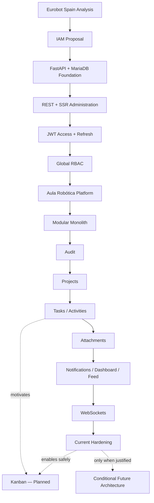

---

# 768. Security Evolution Map

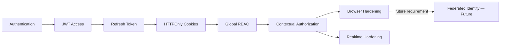

---

# 769. Realtime Evolution Map

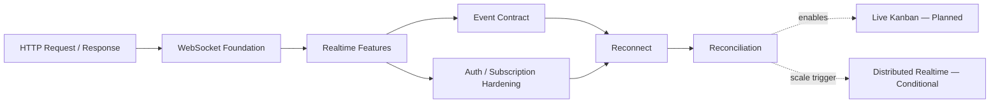

---

# 770. Persistence Evolution Map

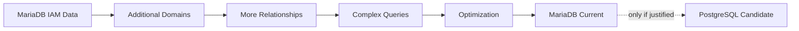

---

# 771. Product Evolution Map

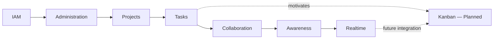

---

# 772. Operational Evolution Map

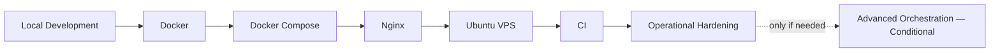

---

# 773. Evolution Philosophy

La filosofía que mejor representa la evolución del proyecto es:

```text
Build

↓

Validate

↓

Learn

↓

Refactor

↓

Harden

↓

Extend.
```

---

# 774. Avoid Technology-driven Evolution

Debe evitarse:

```text
Technology

↓

Search for a problem.
```

---

# 775. Prefer Problem-driven Evolution

Debe preferirse:

```text
Problem

↓

Requirements

↓

Options

↓

Decision

↓

Implementation

↓

Validation.
```

---

# 776. Preserve Working Foundations

Una foundation que continúa resolviendo correctamente el problema no necesita ser sustituida únicamente porque exista una alternativa más nueva.

---

# 777. MariaDB Example

```text
MariaDB works as current persistence

↓

no migration required

until a real trigger exists.
```

---

# 778. Modular Monolith Example

```text
Modular Monolith supports current domains

↓

no microservices required

until independent operational boundaries exist.
```

---

# 779. Compose Example

```text
Docker Compose supports current deployment

↓

no Kubernetes required

until orchestration requirements justify it.
```

---

# 780. In-memory Realtime Example

```text
Single application instance

↓

in-memory Connection Manager is sufficient

↓

no Redis required.
```

---

# 781. Local Storage Example

```text
Single-instance deployment

↓

persistent local attachment storage may remain sufficient

↓

no object storage required.
```

---

# 782. Architecture Fitness Principle

Cada componente debe evaluarse según:

```text
fitness for current requirements
```

y no por:

```text
perceived technological prestige.
```

---

# 783. Evolution and Learning

Una parte importante del proyecto ha sido descubrir requisitos mediante la propia implementación.

---

# 784. Examples of Emergent Learning

```text
Projects
    revealed contextual authorization needs.

Tasks
    revealed Kanban opportunity.

WebSockets
    revealed reconnect/reconciliation needs.

Refresh Tokens
    revealed cookie-policy consistency needs.

Attachments
    revealed storage lifecycle concerns.

Dashboard
    revealed query-performance pressure.
```

---

# 785. Emergent Architecture

Esto representa una forma de:

```text
evolutionary architecture.
```

---

# 786. Evolutionary Architecture Meaning

La arquitectura:

```text
adapts to validated requirements

while preserving intentional boundaries.
```

---

# 787. Evolutionary Architecture Guardrail

Evolutiva no significa:

```text
unplanned

or

structureless.
```

---

# 788. Controlled Evolution

La evolución debe mantenerse mediante:

```text
architecture decisions

tests

documentation

code review

technical debt tracking

operational feedback.
```

---

# 789. Documentation Role

La documentación permite conservar:

```text
why the platform looks the way it does.
```

---

# 790. History Role

La historia del proyecto evita que futuras decisiones se tomen sin conocer:

```text
previous constraints

previous experiments

previous trade-offs.
```

---

# 791. Architecture Decision Role

Los ADRs y documentos de decisiones permiten distinguir:

```text
intentional architecture

from

accidental architecture.
```

---

# 792. Changelog Role

El changelog debe responder:

```text
What changed?
```

---

# 793. Project Evolution Role

Este documento debe responder:

```text
How and why did the project become
what it is today?
```

---

# 794. Roadmap Role

El roadmap debe responder:

```text
What may be implemented next?
```

---

# 795. Future Evolution Role

`62_FUTURE_EVOLUTION.md` debe responder:

```text
How could the platform evolve
under future requirements?
```

sin reescribir esas posibilidades como estado actual.

---

# 796. Separation of Documentation Concerns

```text
CHANGELOG
    completed changes

PROJECT_EVOLUTION
    historical transformation

CURRENT_TASKS
    actionable work

ROADMAP
    product direction

FUTURE_EVOLUTION
    possible future architecture.
```

---

# 797. Temporal Coherence

Todos estos documentos deben compartir la misma verdad temporal.

---

# 798. Temporal Coherence Example — Database

```text
Current:
MariaDB

Possible future:
PostgreSQL
```

debe mantenerse igual en:

```text
Current Tasks

Changelog

Project Evolution

Timeline

Major Decisions

Lessons Learned

Future Evolution.
```

---

# 799. Temporal Coherence Example — Kanban

```text
Current:
Tasks + statuses

Planned:
Kanban

Planned later:
Live Kanban.
```

---

# 800. Temporal Coherence Example — IAM

```text
Current:
JWT Access + Refresh
HTTPOnly Cookies
Global RBAC

Partial:
Context Authorization

Future:
SAML.
```

---

# 801. Temporal Coherence Example — Realtime

```text
Current:
WebSockets

Partial:
reliability/security hardening

Conditional:
distributed realtime.
```

---

# 802. Temporal Coherence Example — Infrastructure

```text
Current:
Docker Compose + VPS

Conditional:
Kubernetes.
```

---

# 803. Historical Accuracy Principle

La evolución real es suficientemente amplia y técnicamente relevante sin necesidad de atribuirle capabilities no implementadas.

---

# 804. Current Strengths

Entre las fortalezas resultantes de la evolución se encuentran:

```text
clear backend framework

relational persistence

modular architecture

layer separation

real IAM

refresh-token workflow

RBAC

SSR administration

collaborative domains

auditability

realtime capability

containerized deployment

automated testing

CI

extensive documentation.
```

---

# 805. Current Improvement Areas

Las áreas principales de mejora son:

```text
contextual authorization completeness

security hardening

realtime reliability

realtime security

test coverage

performance optimization

operational maturity.
```

---

# 806. Current Product Opportunity

La principal evolución funcional inmediata identificada es:

```text
Kanban.
```

---

# 807. Current Architecture Opportunity

La principal evolución arquitectónica inmediata es consolidar:

```text
context-aware security
```

sobre los dominios existentes.

---

# 808. Current Security Opportunity

La principal evolución de seguridad incluye:

```text
CSRF

refresh lifecycle

cookie consistency

WebSocket security.
```

---

# 809. Current Realtime Opportunity

La principal evolución realtime incluye:

```text
event contracts

reconnect

reconciliation

subscription authorization.
```

---

# 810. Current Testing Opportunity

La principal evolución de testing incluye:

```text
cross-project authorization

UI workflows

realtime behavior.
```

---

# 811. Current Performance Opportunity

La principal evolución de rendimiento incluye:

```text
SSR query optimization

pagination

measured query improvements.
```

---

# 812. Current Operational Opportunity

La principal evolución operativa incluye:

```text
stronger observability

backup validation

deployment consistency

security configuration.
```

---

# 813. Future Evolution Should Remain Trigger-based

Las capabilities futuras deben permanecer vinculadas a triggers explícitos.

---

# 814. PostgreSQL Trigger

```text
Current MariaDB limitations
must become concrete and measurable.
```

---

# 815. Redis Trigger

```text
Multiple instances
must require shared realtime coordination.
```

---

# 816. Kubernetes Trigger

```text
Deployment topology
must exceed what current orchestration can reasonably manage.
```

---

# 817. Microservices Trigger

```text
Independent domain deployment/scaling
must provide more value than monolith simplicity.
```

---

# 818. Object Storage Trigger

```text
File durability/scaling/shared-access requirements
must exceed local persistent storage capabilities.
```

---

# 819. SAML Trigger

```text
A real institutional or enterprise identity-provider requirement
must exist.
```

---

# 820. PWA Trigger

```text
Installability/offline/mobile workflows
must provide clear user value.
```

---

# 821. AI Trigger

```text
A validated AI use case
must outperform simpler deterministic alternatives.
```

---

# 822. Multi-tenancy Trigger

```text
Independent organizational isolation
must become a real product requirement.
```

---

# 823. Evolution Risk — Premature Distribution

Uno de los principales riesgos futuros sería introducir:

```text
distributed-system complexity
```

antes de necesitarla.

---

# 824. Evolution Risk — Security Lag

Otro riesgo sería añadir nuevas features más rápido que:

```text
authorization

security

testing
```

puedan madurar.

---

# 825. Evolution Risk — Documentation Drift

Otro riesgo importante es que:

```text
future architecture
```

vuelva a aparecer en documentación como:

```text
current architecture.
```

---

# 826. Evolution Risk — Feature Inflation

La existencia de un diseño detallado puede crear la impresión de que una capability ya está terminada.

---

# 827. Evolution Risk — Architecture Inflation

La adopción documental de términos como:

```text
distributed

enterprise

cloud-native

microservices
```

no debe sustituir evidencia técnica.

---

# 828. Evolution Risk — Hidden Authorization Gaps

El crecimiento de recursos anidados puede crear:

```text
cross-project access vulnerabilities
```

si las policies no son consistentes.

---

# 829. Evolution Risk — Realtime Inconsistency

Los clientes pueden divergir del estado real si:

```text
events are missed

and

no reconciliation exists.
```

---

# 830. Evolution Risk — Session Inconsistency

La existencia de múltiples caminos de renovación puede generar políticas distintas de cookies si no se centralizan.

---

# 831. Evolution Risk — Operational Assumptions

Un sistema desplegado no debe asumir que:

```text
backup exists

restore works

logs are sufficient

monitoring is complete
```

sin validación.

---

# 832. Evolution Risk Mitigation

Estos riesgos se reducen mediante:

```text
explicit status

tests

architecture decisions

security review

operational validation

documentation audits.
```

---

# 833. Project Evolution Governance

La evolución futura debe apoyarse en un ciclo de gobernanza.

---

# 834. Governance Cycle

```text
Requirement

↓

Analysis

↓

Architecture Decision

↓

Implementation

↓

Tests

↓

Documentation

↓

Deployment

↓

Observation

↓

Learning.
```

---

# 835. Governance Feedback Loop

El último paso debe alimentar nuevamente:

```text
Requirement / Improvement.
```

---

# 836. Governance Diagram

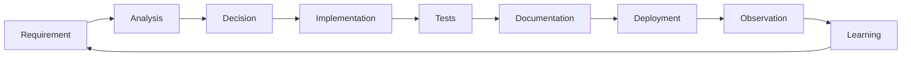

---

# 837. Architecture Governance

Las decisiones arquitectónicas importantes deben evitar ser:

```text
implicit.
```

---

# 838. Security Governance

Las nuevas capabilities deben revisar:

```text
authentication

authorization

input validation

browser security

audit

data exposure.
```

---

# 839. Realtime Governance

Las nuevas capabilities realtime deben revisar:

```text
event contract

authorization scope

disconnect behavior

reconciliation

testability.
```

---

# 840. Database Governance

Los cambios de persistencia deben revisar:

```text
schema integrity

migration safety

indexes

query impact

backup compatibility.
```

---

# 841. Operational Governance

Los cambios de despliegue deben revisar:

```text
configuration

secrets

rollback

health

logs

backup

restore.
```

---

# 842. Evolution Decision Template

Una decisión futura debería poder responder:

```text
Problem

Current Limitation

Proposed Change

Alternatives

Security Impact

Operational Impact

Migration Cost

Testing Strategy

Rollback Strategy

Success Criteria.
```

---

# 843. Architecture Evolution Gate

Antes de introducir una nueva infraestructura:

```text
Does the current architecture fail a real requirement?
```

---

# 844. If No

```text
Do not add complexity yet.
```

---

# 845. If Yes

Evaluar:

```text
smallest effective architectural change.
```

---

# 846. Platform Evolution Identity

La identidad técnica de Aula Robótica Platform no está definida por:

```text
maximum technology count.
```

---

# 847. Platform Technical Identity

Está definida por:

```text
pragmatic architecture

clear boundaries

security-aware design

incremental evolution

operational realism.
```

---

# 848. Project Evolution Narrative

La narrativa completa puede resumirse como:

```text
A specific IAM need

became

a reusable platform foundation.

That foundation

enabled

collaborative domains.

Those domains

created

contextual authorization requirements.

Collaboration

created

realtime requirements.

Realtime

created

reliability and security requirements.

Operational deployment

created

observability and recovery requirements.

Each implementation step

revealed

the next real engineering problem.
```

---

# 849. Final Historical Baseline

El proyecto ha evolucionado realmente hasta una plataforma que dispone de:

```text
FastAPI

SQLAlchemy

MariaDB

REST

SSR

JWT Access + Refresh

HTTPOnly Cookies

Global RBAC

Projects

Tasks

Activities

Attachments

Notifications

Dashboard

Activity Feed

Audit

WebSockets

Docker

Docker Compose

Nginx

Ubuntu / Hetzner

GitHub Actions

Automated Testing.
```

---

# 850. Final Partial Baseline

Permanece en consolidación:

```text
ProjectMembership

Contextual Authorization

CSRF

Refresh-token Hardening

Cookie Policy

WebSocket Security

Subscription Authorization

Realtime Contracts

Reconnect

Reconciliation

Expanded Testing

Performance Optimization.
```

---

# 851. Final Planned Baseline

Permanece planificado:

```text
Kanban

Drag & Drop

Live Kanban.
```

---

# 852. Final Future Baseline

Permanece futuro:

```text
SAML

PWA

AI / RAG.
```

---

# 853. Final Conditional Baseline

Permanece condicionado a necesidades reales:

```text
PostgreSQL

Redis

Object Storage

Kubernetes

Microservices

Multi-tenancy

Horizontal Scaling.
```

---

# 854. Final Database Statement

La base de datos relacional actual de Aula Robótica Platform es:

```text
MariaDB.
```

No existe una migración histórica completada a PostgreSQL.

---

# 855. Final Authentication Statement

La autenticación actual incluye:

```text
JWT Access Tokens

JWT Refresh Tokens

HTTPOnly Cookies

Explicit Refresh

Automatic Access Refresh.
```

---

# 856. Final Refresh Security Statement

Debe distinguirse:

```text
Refresh-token workflow
    CURRENT

Refresh-token security hardening
    EVOLVING / VERIFY
```

---

# 857. Final Authorization Statement

```text
Global RBAC
    CURRENT

Contextual Authorization
    PARTIAL / EVOLVING

ProjectMembership
    TARGET / IN CONSOLIDATION
```

---

# 858. Final Realtime Statement

```text
WebSockets
    CURRENT

Reliable Reconnect
    EVOLVING

Reconciliation
    EVOLVING

Distributed Realtime
    CONDITIONAL
```

---

# 859. Final Kanban Statement

```text
Task Workflow
    CURRENT

Kanban
    PLANNED

Live Kanban
    PLANNED
```

---

# 860. Final Infrastructure Statement

```text
Docker
Docker Compose
Nginx
Ubuntu
Hetzner VPS

    CURRENT


Kubernetes
Redis
Microservices

    CONDITIONAL / NOT CURRENT
```

---

# 861. Final Identity Federation Statement

```text
SAML
    FUTURE / NOT CURRENT
```

---

# 862. Final Architecture Statement

Aula Robótica Platform es actualmente:

```text
a Modular Monolith
```

y no:

```text
a microservices platform.
```

---

# 863. Final Evolution Principle

La evolución debe continuar mediante:

```text
validated need

↓

minimal effective change

↓

secure implementation

↓

testing

↓

operational validation

↓

documentation.
```

---

# 864. Final Architecture Principle

```text
Do not replace a working architecture
until a real requirement proves
that the replacement is necessary.
```

---

# 865. Final Security Principle

```text
Every new capability
must preserve or strengthen
authorization boundaries.
```

---

# 866. Final Realtime Principle

```text
Realtime improves awareness.

Persistent server state
remains authoritative.
```

---

# 867. Final Testing Principle

```text
The higher the security or correctness risk,
the stronger the required automated evidence.
```

---

# 868. Final Operational Principle

```text
Software is not operationally mature
until it can be deployed,
observed,
recovered
and maintained.
```

---

# 869. Final Documentation Principle

```text
Detailed documentation
does not prove implementation.
```

---

# 870. Final Historical Principle

```text
History records what happened.

Roadmaps describe what may happen.

Architecture must never confuse the two.
```

---

# 871. Final Evolution Model

```text
Eurobot Spain Analysis

↓

IAM Foundation

↓

REST + SSR

↓

JWT Access + Refresh

↓

Global RBAC

↓

Aula Robótica Platform

↓

Modular Monolith

↓

Audit

↓

Projects

↓

Tasks / Activities / Attachments

↓

Notifications / Dashboard / Activity Feed

↓

WebSockets

↓

Contextual Security + Realtime Hardening

↓

Current Consolidation

↓

Kanban
    PLANNED

↓

Future Architecture
    ONLY WHEN JUSTIFIED
```

---

# 872. Final Project Position

Aula Robótica Platform ha dejado de ser un ejercicio limitado de autenticación para convertirse en una:

```text
modular

collaborative

security-aware

realtime-capable

deployable

documented

software platform.
```

---

# 873. Evolution Is Not Finished

La plataforma continúa evolucionando.

Sin embargo, la siguiente etapa debe priorizar:

```text
consolidation

before

unnecessary architectural expansion.
```

---

# 874. Immediate Evolution Direction

```text
1. Consolidate ProjectMembership.

2. Complete contextual authorization.

3. Strengthen cross-project tests.

4. Formalize CSRF protection.

5. Harden refresh-token lifecycle.

6. Centralize cookie policy.

7. Harden WebSocket authentication.

8. Authorize subscriptions.

9. Normalize realtime contracts.

10. Implement reconnect and reconciliation.

11. Build Kanban on top of those foundations.

12. Expand UI and realtime testing.

13. Optimize measured SSR/database bottlenecks.
```

---

# 875. Medium-term Direction

Después de consolidar estas foundations, la plataforma podrá evolucionar con mayor seguridad hacia:

```text
richer collaborative workflows

improved realtime UX

additional functional domains

stronger operational maturity.
```

---

# 876. Long-term Direction

Las decisiones de mayor impacto deberán permanecer condicionadas a requisitos reales:

```text
database migration

distributed realtime

horizontal scaling

advanced orchestration

microservices

federated identity

AI capabilities

multi-tenancy.
```

---

# 877. Evolution Quality Criterion

El éxito futuro no debe medirse por:

```text
number of technologies adopted.
```

---

# 878. Better Quality Criterion

Debe medirse por:

```text
how effectively the platform
solves real problems

while remaining

secure

maintainable

testable

operable

and understandable.
```

---

# 879. Final Project Evolution Summary

```text
ORIGIN
    Eurobot Spain IAM proposal

FOUNDATION
    FastAPI
    SQLAlchemy
    MariaDB
    JWT
    Jinja2
    AdminLTE

SCOPE CHANGE
    Eurobot-specific system
        ↓
    Aula Robótica Platform

ARCHITECTURE
    CRUD-oriented
        ↓
    Layered
        ↓
    Modular Monolith

AUTHENTICATION
    JWT
        ↓
    Access + Refresh
        ↓
    HTTPOnly Cookies
        ↓
    Automatic Refresh

AUTHORIZATION
    Global RBAC
        ↓
    Context-aware checks
        ↓
    Contextual Authorization
        PARTIAL

FUNCTIONAL GROWTH
    Audit
    Projects
    Tasks
    Activities
    Attachments
    Notifications
    Dashboard
    Activity Feed

REALTIME
    FastAPI WebSockets
        ↓
    Current realtime features
        ↓
    Reliability/security hardening

OPERATIONS
    Docker
    Docker Compose
    Nginx
    Ubuntu
    Hetzner VPS
    GitHub Actions

CURRENT CONSOLIDATION
    ProjectMembership
    Contextual Authorization
    CSRF
    Refresh Hardening
    Cookie Policy
    WebSocket Security
    Reconnect
    Reconciliation
    Testing
    Performance

PLANNED PRODUCT EVOLUTION
    Kanban
    Live Kanban

FUTURE / CONDITIONAL
    PostgreSQL
    SAML
    Redis
    Object Storage
    Kubernetes
    Microservices
    PWA
    AI / RAG
    Multi-tenancy
```

---

# 880. Conclusion

La evolución de **Aula Robótica Platform** muestra una transición progresiva desde una necesidad concreta de identidad y acceso hacia una plataforma modular capaz de soportar dominios colaborativos, administración web, auditoría y comunicación realtime.

La característica principal de esta evolución no ha sido la sustitución continua de tecnologías, sino la ampliación controlada de una foundation estable.

La arquitectura actual continúa basada en:

```text
FastAPI

SQLAlchemy

MariaDB

Jinja2 SSR

JWT

HTTPOnly Cookies

RBAC

WebSockets

Docker

Modular Monolith.
```

La siguiente etapa debe consolidar:

```text
contextual authorization

security hardening

realtime reliability

testing

operational maturity
```

antes de introducir complejidad distribuida innecesaria.

La evolución futura deberá mantener un principio central:

```text
Aula Robótica Platform
should evolve because requirements demand it,

not because additional technology
can be added.
```

---

# 881. End of Document

```text
57_PROJECT_EVOLUTION.md

Status:
    AUDITED / TEMPORALLY ALIGNED

Current Database:
    MariaDB

Current Architecture:
    Modular Monolith

Current Authentication:
    JWT Access + Refresh
    HTTPOnly Cookies

Current Authorization:
    Global RBAC
    + Partial Contextual Authorization

Current Realtime:
    FastAPI WebSockets
    + In-memory Connection Manager

Planned Product Evolution:
    Kanban

Future / Conditional Architecture:
    PostgreSQL
    SAML
    Redis
    Object Storage
    Kubernetes
    Microservices
    PWA
    AI / RAG
    Multi-tenancy

Core Principle:
    Preserve historical truth
    and evolve only from validated requirements.
```
